# 1. Domain-Driven Design

> DDD (Domain-Driven Design) shapes software around the words and the borders of the business. Interviewers ask about it to see whether you can cut a big system into parts that stay true to the problem.

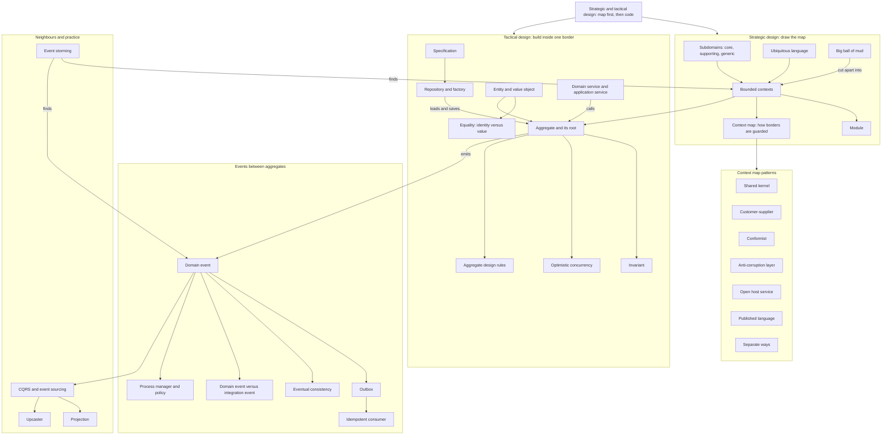

## The map in words

Start at the top. Split the business problem into **subdomains** and listen to the words people use.
Where a word changes meaning, you have found the edge of a bounded context.
The context map says how two contexts talk across that edge.
Inside one context you build with entities, value objects and aggregates.
Aggregates change one at a time and tell the rest of the world through domain events.

## Strategic and tactical design

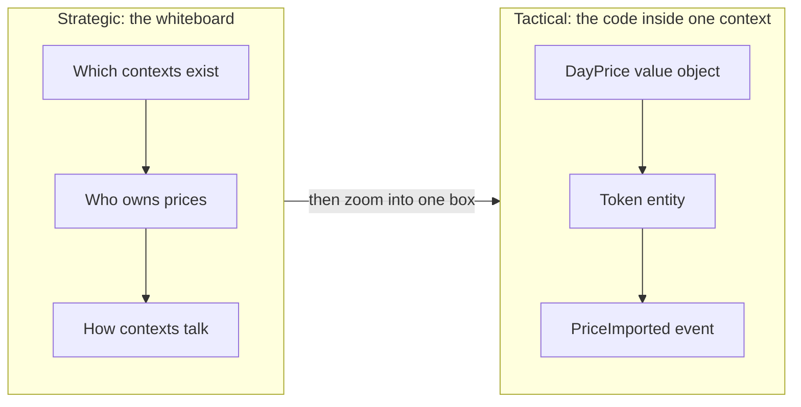

**Story.** Chain Insights must show transfers in US dollars (USD).
First the team stands at a whiteboard: which context owns prices, and how do the indexer and the graph get them?
They decide on one pricing context, fed by vendors through a translator.
Only then do they open the pricing code and write `DayPrice`, `Token` and `PriceImported`.

**How it works.**

1. Strategic design draws the map: subdomains, bounded contexts, and the relationship on each border (left box).
2. It answers "where does this code live, and who owns it".
3. Tactical design builds inside one context: entities, value objects, aggregates, events, repositories (right box).
4. It answers "how is this code shaped".
5. Strategic comes first. A perfect class in the wrong context is still in the wrong place.

### In code

```text
# strategic: before any class
contextMap.owner = {}                      # idea -> one context
claim(idea, ctx):
  if idea has another owner: refuse         # one owner per idea
  owner[idea] = ctx
edges: vendor -> pricing (translator), pricing -> graph, indexer -> graph
# tactical: inside the pricing box only
DayPrice {token, day, usd}                 # value object
Token {id, name, decimals}                 # entity: keeps its id
PriceImported {price}                      # domain event
usd(amount, dayPrice) = amount * dayPrice.usd   # the one rule
# tactical first: indexer, graph, billing each write a Price
#   three rules, three answers for one transfer
```

```go
// Strategic: the context map. Each idea has exactly one owner.
type ContextMap struct {
	Owner map[string]string   // idea -> owning context
	Edges map[string][]string // context -> contexts it supplies
}

// Claim is how a context starts keeping an idea. A second owner is a defect.
func (m *ContextMap) Claim(idea, ctx string) error {
	if o, ok := m.Owner[idea]; ok && o != ctx {
		return fmt.Errorf("%s already owned by %s", idea, o)
	}
	m.Owner[idea] = ctx
	return nil
}

// Tactical, inside pricing only.

// DayPrice is a value object: equal when its values are equal.
type DayPrice struct {
	Token, Day string
	USD        float64
}

// Token is an entity: same ID even when its name or decimals change.
type Token struct {
	ID       string
	Name     string
	Decimals int
}

// PriceImported is a domain event other contexts may learn about.
type PriceImported struct{ Price DayPrice }

// USD is the one rule for a transfer's value, owned by pricing.
func USD(amount float64, p DayPrice) float64 { return amount * p.USD }
```

Run it: `handbook/code/01-strategic-and-tactical-design/` with `go run .`.

**What goes wrong.** The team starts tactical. They write a fine `Price` class inside the indexer.
The graph and billing need prices too, so each copies it. Three price models drift apart, and three reports disagree.
Fix: draw the map first. One pricing context owns `DayPrice`, and the others read it.

**Where you use it.**

- A new feature that crosses teams: a one-hour map session before the first pull request.
- An interview design question: name the contexts and their borders before any class.
- A rewrite: strategic design decides what to cut out first, tactical design decides how each piece is built.

> Strategic design decides where code lives and who owns it, and tactical design decides how the code inside one border is shaped.

▶ Watch it move: [Strategic and tactical design](visual/01-strategic-and-tactical-design.html)

## Subdomains: core, supporting, generic

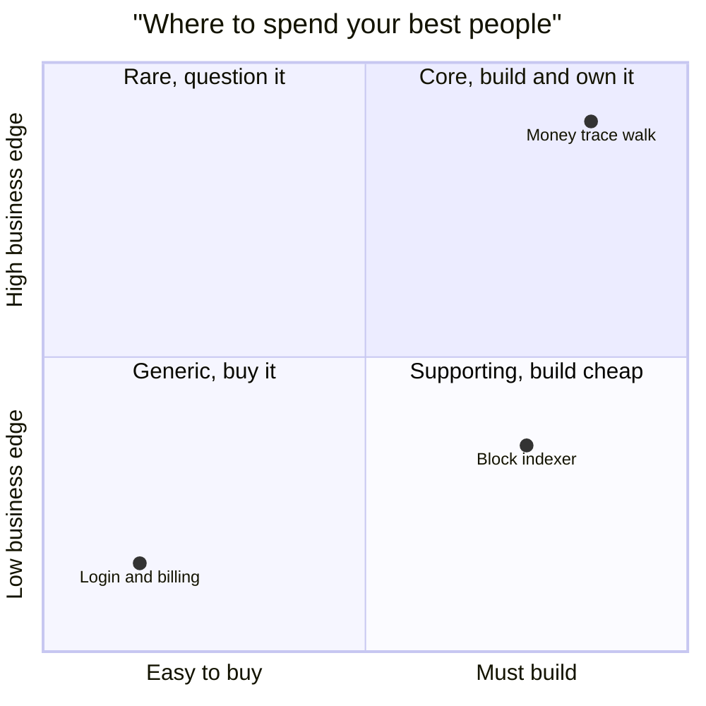

**Story.** Chain Insights traces blockchain money: who sent what to whom, and where it stopped.
The graph walk that follows money through exchanges is what customers pay for.
The indexer that decodes blocks into tables is needed, but nobody buys it for that.
Login, billing and email are solved by everyone else.

**How it works.**

1. List the problems the business solves. The whole list is the domain.
2. Ask "would we ever outsource this?" A no marks the core (top right).
3. Mark the parts you need but that give no edge as supporting (bottom right).
4. Mark the parts every company has as generic (bottom left). Buy them.
5. Put the strongest engineers on the core.

### In code

```text
domain = every problem the business solves
kind(part):
  if we would never outsource it: core       # what customers pay for
  if every company has it: generic          # solved long ago
  else: supporting                          # needed, no edge
plan = {core: build and own,
        supporting: build simply,
        generic: buy or run open source}
seniors():                                 # where the best people go
  if ranked by edge: every core part
  # the failure: ranked by noise
  else: the part with the most incidents
```

```go
// Part is one problem the business must solve.
type Part struct {
	Name           string
	WouldOutsource bool // "would we ever outsource this?"
	EveryCompany   bool // does every company have it?
	Incidents      int  // how loud it is: noise, not edge
}

// Kind answers the two questions in order.
func Kind(p Part) string {
	switch {
	case !p.WouldOutsource:
		return "core"
	case p.EveryCompany:
		return "generic"
	default:
		return "supporting"
	}
}

// Plan turns each kind into a budget line.
var Plan = map[string]string{"core": "build and own", "supporting": "build simply", "generic": "buy or run open source"}

// Seniors says where the senior engineers work.
// byEdge: on every core part. The failure: on the loudest part, by incidents.
func Seniors(parts []Part, byEdge bool) []string {
	var out []string
	if byEdge {
		for _, p := range parts {
			if Kind(p) == "core" {
				out = append(out, p.Name)
			}
		}
		return out
	}
	loudest := parts[0]
	for _, p := range parts {
		if p.Incidents > loudest.Incidents {
			loudest = p
		}
	}
	return []string{loudest.Name}
}
```

Run it: `handbook/code/01-subdomains/` with `go run .`.

**What goes wrong.** The loudest part gets the best people. Login breaks often, so the senior engineer rebuilds login.
The core walk then stays a prototype. Fix: rank by edge, not by noise.

**Where you use it.**

- Chain Insights: own the graph walk and the risk rules. Buy payments and email.
- A shop: own pricing and recommendations. Buy the payment provider.
- Planning a team: one quadrant per budget line makes the hiring talk short.

> Build the core, build the supporting parts cheap, and buy the generic parts.

▶ Watch it move: [Subdomains](visual/01-subdomains.html)

## Ubiquitous language

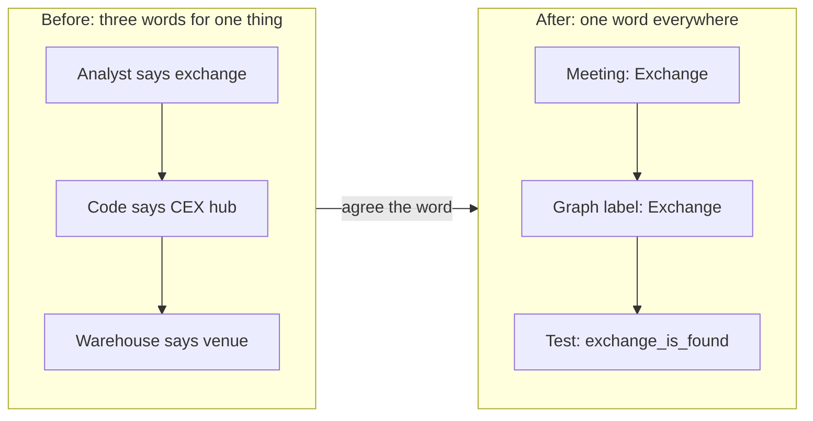

**Story.** The business calls an address that breaks the money trail a "mixer".
The graph label is `Mixer`, the skill says "mixer", the test says "mixer".
Nobody says "obfuscation node". A new engineer reads the code and understands the meeting.

**How it works.**

1. Write down the words the experts use (left side of the picture).
2. Agree one word per idea with them.
3. Use that exact word in class names, table names, labels and tests (right side).
4. When code needs a new word, ask the business first.

### In code

```text
analyst: 'stop the trace at an exchange'  # the expert's word
developer: isCexHub(a) = a on the hot-wallet list
warehouse: isVenue(a) = a has 1,000+ depositors
# four names, four rules, mapped only in heads
walk(path, stop):
  for a in path:
    if stop(a): end the trail here
    flag a as linked
agreed: isExchange(a) = a holds money for many customers
glossary = {Exchange, Bridge, ...}         # one word, one rule
review(code):                              # the habit
  if code uses a banned synonym: refuse
new idea: ask the analysts for the word, add it first
```

```go
// Four names, four rules: each team's code is right by its own word.
func isCexHub(a Addr) bool   { return a.HotWallet }          // developer
func isVenue(a Addr) bool    { return a.Depositors >= 1000 } // warehouse table
func isExchange(a Addr) bool { return a.Depositors >= 1000 } // the agreed word

// Walk follows money and stops where stop says the trail breaks.
func Walk(path []Addr, stop func(Addr) bool) []string {
	var flagged []string
	for _, a := range path {
		if stop(a) {
			return flagged // money held for many customers: stop here
		}
		flagged = append(flagged, a.Name)
	}
	return flagged
}

// Glossary is the agreed word list. Review refuses any other name.
var Glossary = map[string]string{
	"Exchange": "holds money for many customers; the trace stops there",
	"Bridge":   "moves money between chains",
}
var banned = []string{"CexHub", "venue", "hub_detected"}

// Review is the habit that keeps one word per idea.
func Review(code string) error {
	for _, b := range banned {
		if strings.Contains(code, b) {
			return fmt.Errorf("refused: %s is not in the glossary, say Exchange", b)
		}
	}
	return nil
}
```

Run it: `handbook/code/01-ubiquitous-language/` with `go run .`.

**What goes wrong.** A translation lives in people's heads. Three names mean three bugs, because each team adds its own rule.
Fix: a glossary in the repository, and reviews that refuse a second name.

**Where you use it.**

- Graph labels such as `Mixer` and `Exchange` are the same words an analyst writes in a report.
- A test name is the cheapest place to enforce the word.
- Event names (`WalletToppedUp`) are part of the language too.

> One word per idea, the same in the meeting, the code, the table and the test.

▶ Watch it move: [Ubiquitous language](visual/01-ubiquitous-language.html)

## Bounded context

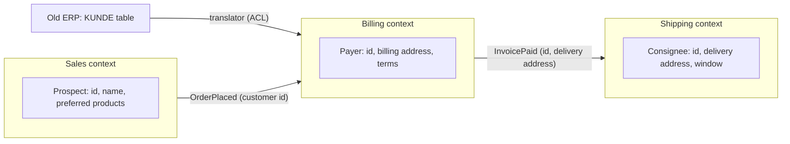

**Story.** A shop's sales, billing and shipping teams all say "customer".
They shared one Customer model, and it grew to 46 fields.
Billing renamed `address` to `billing_address`, and sales and shipping broke that night.
Now sales has a Prospect, billing a Payer and shipping a Consignee: one person, three small models.
They share only the customer id and events.

**How it works.**

1. Listen for one word with two meanings. That is a border.
2. Check who owns each side. Two teams fighting over one model is a second signal.
3. Check the speed of change. One side weekly, the other yearly, is a third signal.
4. If two of the three signals agree, draw the line (the boxes in the picture).
5. Inside each box, the model and the words are consistent.
6. Between boxes, pass ids and events, never objects. A legacy model enters through a translator.

### In code

```text
customer = one shared model, one table       # three teams
each team adds fields -> 46 fields
rename(team, column):
  broken = every other team reading column
border: one word with two meanings -> draw a line
sales: Prospect {id, name, preferred}
billing: Payer {id, billing address, terms}
shipping: Consignee {id, delivery address, window}
OrderPlaced {customer id}                  # crosses the border
billing(event): payers[event.customerId]   # in its own words
KUNDE row {KD_NR, ZAHLZIEL}                # the old ERP's language
translate(row): Payer{id: KD_NR, terms: ZAHLZIEL}   # legacy stops here
```

```go
// Shared is the god model: one Customer table, read by three teams.
type Shared struct {
	Columns map[string][]string // column -> teams that read it
}

// Rename in a shared model breaks every other reader of that column.
func (s Shared) Rename(team, col string) []string {
	var broken []string
	for _, t := range s.Columns[col] {
		if t != team {
			broken = append(broken, t)
		}
	}
	return broken
}

// Three small models: same person, one meaning each.
type Prospect struct {
	ID, Name  string
	Preferred []string
}
type Payer struct {
	ID, BillingAddress, Terms string
}
type Consignee struct {
	ID, DeliveryAddress, Window string
}

// OrderPlaced crosses the border: an id, never an object.
type OrderPlaced struct{ CustomerID string }

// Billing handles the event in its own words.
func Billing(e OrderPlaced, payers map[string]Payer) Payer { return payers[e.CustomerID] }

// KundeRow is the old ERP's table, in its own language.
type KundeRow struct {
	KDNr     string
	Zahlziel int
}

// Translate is the anti-corruption layer: legacy names stop here.
func Translate(k KundeRow) Payer {
	return Payer{ID: k.KDNr, Terms: fmt.Sprintf("%d days", k.Zahlziel)}
}
```

Run it: `handbook/code/01-bounded-contexts/` with `go run .`.

**What goes wrong.** One giant shared Customer for the whole shop. Every team bends it, and one rename breaks the others.
Fix: let each context keep its own model (Prospect, Payer, Consignee) and translate at the edge.

**Where you use it.**

- A blockchain indexer: "address" is 20 bytes from a receipt in the indexer, and a node with labels, a score and a history in the risk context. Each keeps its own type.
- A token launchpad: "buy on a curve" and "swap in a pool" split the launchpad context from the exchange context.
- A modular monolith: each Go package (`pricing`, `dex`, `transfers`) is a context with its own tables.
- Microservices: a context is a candidate service, never an automatic one.

> A bounded context is the border inside which one word has one meaning.

▶ Watch it move: [Bounded contexts](visual/01-bounded-contexts.html)

## Module

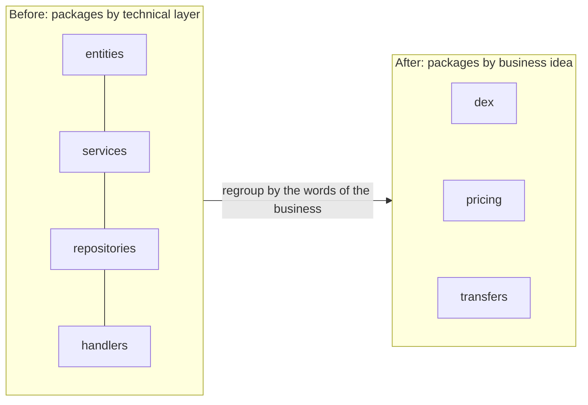

**Story.** The indexer's Go code started with packages called `entities`, `services`, `repositories` and `handlers`.
A change to how swap fees are read touched all four.
The team regrouped the code into `dex`, `pricing` and `transfers`. The same kind of change now touches one package.

**How it works.**

1. A module is a package, a namespace or a folder inside one bounded context.
2. Name it with a word from the ubiquitous language: `dex`, not `services`.
3. Put together what changes together: the swap rule, its tables and its tests sit in `dex`.
4. Keep the inside private. Each module offers a small public surface to the others.
5. A context can hold several modules. A module never spans two contexts.

### In code

```text
file = {package, idea, name, public}
by layer: entities, services, repositories, handlers
  every idea has a file in every layer      # swap in all four
touched(idea):                             # packages one change edits
  return packages of the files serving idea
by idea: dex, pricing, transfers           # words from the language
  dex = Swaps (public), decoder, tables (private)
call(from, pkg, name):
  allowed if name is public or from == pkg
  else refuse: private                      # a small public surface
# a module lives inside one bounded context
# a context holds many modules, a module never spans two
```

```go
type File struct {
	Pkg, Idea, Name string
	Public          bool
}

// Touched lists the packages a change to one business idea must edit.
func Touched(files []File, idea string) []string {
	set := map[string]bool{}
	for _, f := range files {
		if f.Idea == idea {
			set[f.Pkg] = true
		}
	}
	var out []string
	for p := range set {
		out = append(out, p)
	}
	sort.Strings(out)
	return out
}

// Call checks one cross-module call: only the public surface may be used.
func Call(files []File, from, pkg, name string) error {
	for _, f := range files {
		if f.Pkg == pkg && f.Name == name && (f.Public || from == pkg) {
			return nil
		}
	}
	return fmt.Errorf("%s may not call %s.%s: private", from, pkg, name)
}

func byLayer() []File {
	var fs []File
	for _, idea := range []string{"swap", "price", "transfer"} {
		for _, layer := range []string{"entities", "services", "repositories", "handlers"} {
			fs = append(fs, File{Pkg: layer, Idea: idea, Name: idea + "_" + layer, Public: true})
		}
	}
	return fs
}

func byIdea() []File {
	return []File{
		{Pkg: "dex", Idea: "swap", Name: "Swaps", Public: true},
		{Pkg: "dex", Idea: "swap", Name: "decoder"},
		{Pkg: "dex", Idea: "swap", Name: "tables"},
		{Pkg: "pricing", Idea: "price", Name: "DayPrice", Public: true},
		{Pkg: "transfers", Idea: "transfer", Name: "Transfers", Public: true},
	}
}
```

Run it: `handbook/code/01-module/` with `go run .`.

**What goes wrong.** Packages by technical layer. Every business change cuts across every package, and every package imports every other.
Nobody can say where the swap rule lives. Fix: one package per business idea, with its own tables and tests.

**Where you use it.**

- A modular monolith: Go packages `pricing`, `dex` and `transfers`, each a candidate service later.
- A code review: a new package called `utils` or `helpers` is a smell. Ask which business idea it serves.
- A new engineer: the folder list reads like the business, so they find the swap rule in seconds.

> A module groups code by a business idea and is named in the business language, never by technical layer.

▶ Watch it move: [Module](visual/01-module.html)

## Big ball of mud

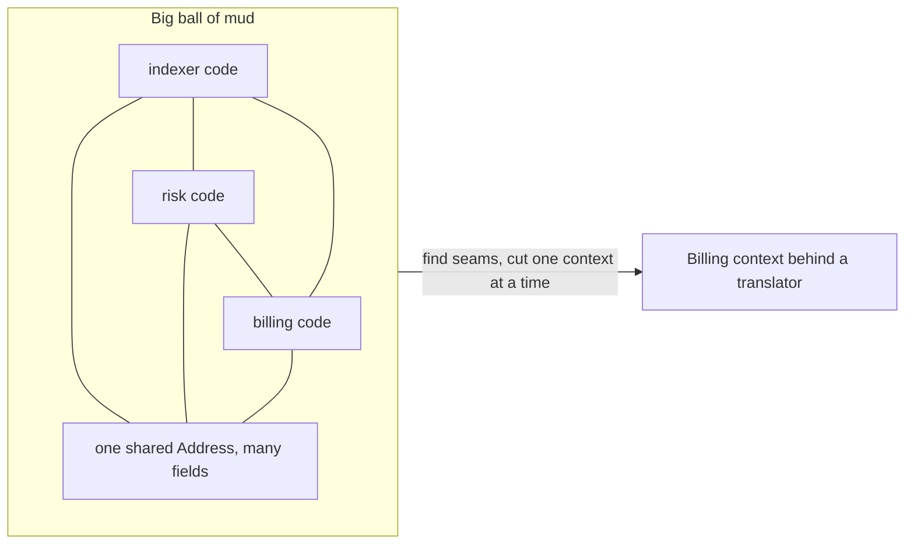

**Story.** One `models` package holds an `Address` used by the indexer, the risk rules and billing.
Each team adds the fields it needs. Soon `Address` has dozens of fields and three meanings.
Billing renames `balance` for its own invoices, and the indexer and the risk rules break the same night.

**How it works.**

1. A big ball of mud is a system with no visible borders: any code calls any code and shares any table.
2. It is how most systems grow when nobody draws the map.
3. To get out, listen for one word with two meanings. That is a seam.
4. Cut one context out at a time, behind a translator (an anti-corruption layer).
5. Leave the rest of the mud alone until its turn. Never rewrite it all at once.

### In code

```text
address = shared type in one models package
add(team, field, meaning):                 # each team grows it
  address.field.users[team] = meaning
  # 6 fields -> 40 fields, three meanings
rename(team, field):
  broken = every other team using field     # nobody was looking
seam(field):                               # do not rewrite it all
  return field has more than one meaning
cut(team):                                 # one context out
  team gets its own type (Wallet)
  team reads the old code through a translator (ACL)
  remove team from every shared field
ship, then pick the next seam
```

```go
// Field is one field of the shared Address and what each user means by it.
type Field struct {
	Name  string
	Users map[string]string // team -> meaning
}

// Mud is the shared models package: every team reads every field.
type Mud struct{ Fields map[string]*Field }

// Add is how each team grows the shared type for itself.
func (m *Mud) Add(team, name, meaning string) {
	f, ok := m.Fields[name]
	if !ok {
		f = &Field{Name: name, Users: map[string]string{}}
		m.Fields[name] = f
	}
	f.Users[team] = meaning
}

// Rename by one team breaks every other team that used the field.
func (m *Mud) Rename(team, name string) []string {
	var broken []string
	for t := range m.Fields[name].Users {
		if t != team {
			broken = append(broken, t)
		}
	}
	return broken
}

// Seam finds one word with two meanings: a place to cut.
func (m *Mud) Seam(name string) bool {
	seen := map[string]bool{}
	for _, meaning := range m.Fields[name].Users {
		seen[meaning] = true
	}
	return len(seen) > 1
}

// Cut moves one team out: its own type, fed by a translator (an ACL).
func (m *Mud) Cut(team string) {
	for _, f := range m.Fields {
		delete(f.Users, team)
	}
}
```

Run it: `handbook/code/01-big-ball-of-mud/` with `go run .`.

**What goes wrong.** The big rewrite. The team stops features to rebuild everything, the old system keeps changing, and the new one never catches up.
Fix: cut one context out at a time, and ship after each cut.

**Where you use it.**

- A legacy monolith: draw the contexts on paper first, then cut the one that changes most.
- The strangler fig pattern: new code beside the old, traffic moved one route at a time.
- Reviews: a new shared "common" table is the first grain of mud. Ask who owns it.

> A big ball of mud is a system with no borders, and you get out one context at a time, never with a big rewrite.

▶ Watch it move: [Big ball of mud](visual/01-big-ball-of-mud.html)

## Context map

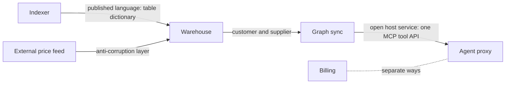

**Story.** The indexer writes rows. The warehouse holds them. The graph sync reads them and builds a graph.
The agent proxy serves the graph to Claude Code and other hosts.
A vendor price feed enters through a translator. Billing never talks to the graph at all.

**How it works.**

1. Draw each context as a box.
2. Draw an arrow from upstream (the one who supplies) to downstream (the one who reads).
3. Write the relationship on the arrow. The label is the point of the map.
4. For a foreign, messy model, put an anti-corruption layer (ACL) on the arrow: a translator into your own types.
5. For many readers, offer one open host service and a published language.
6. When two contexts gain nothing from each other, write "separate ways" and build no link.

### In code

```text
boxes = contexts, each with its own model and words
arrow(upstream, downstream, relationship)  # the name is the point
indexer <-> graph sync: shared kernel
warehouse -> graph sync: customer-supplier
node -> indexer: conformist
vendor -> warehouse: anti-corruption layer
graph sync -> hosts: open host service; indexer -> analysts: published language
billing, graph: separate ways, no link
renameEffect(arrow):                       # who must warn whom
  customer-supplier: add, move reader, drop
  unnamed: breaks at night, nobody warned
unnamed(map): list arrows with no relationship  # the real defect
```

```go
// Arrow is one border on the map. Rel "" means nobody named it.
type Arrow struct {
	Up, Down, Rel string
}

// Map is the whole picture: contexts and named arrows.
var Map = []Arrow{
	{"indexer", "graph sync", "shared kernel"},
	{"warehouse", "graph sync", "customer-supplier"},
	{"Ethereum node", "indexer", "conformist"},
	{"price vendor", "warehouse", "anti-corruption layer"},
	{"graph sync", "agent hosts", "open host service"},
	{"indexer", "analysts", "published language"},
	{"billing", "graph", "separate ways"},
}

// Unnamed finds the arrows nobody labelled: the map's real defects.
func Unnamed(m []Arrow) []Arrow {
	var bad []Arrow
	for _, a := range m {
		if a.Rel == "" {
			bad = append(bad, a)
		}
	}
	return bad
}

// RenameEffect says what an upstream column rename does, by the arrow's name.
func RenameEffect(a Arrow) string {
	switch a.Rel {
	case "customer-supplier":
		return "planned: add value, move the reader, drop amount"
	case "anti-corruption layer":
		return "one adapter changes"
	case "shared kernel":
		return "both teams must approve"
	case "separate ways":
		return "nothing happens: no link"
	case "conformist":
		return "every reader changes, with no warning"
	case "":
		return "breaks at night: nobody knew who had to warn whom"
	}
	return "readers keep the documented door"
}
```

Run it: `handbook/code/01-context-map/` with `go run .`.

**What goes wrong.** Boxes with bare arrows. Nobody knows who must warn whom before a change.
A column rename then breaks the graph sync in production. Fix: name every arrow, and plan changes on customer-supplier arrows together.

**Where you use it.**

- Price vendors: one adapter per vendor turns vendor rows into `DayPrice(token, day, usd)`. A vendor rename touches one adapter.
- The Ethereum JSON-RPC (remote procedure call) is stable and standard, so the indexer conforms to it and saves the ACL.
- One MCP (Model Context Protocol) tool server serves every host, so no host gets a private integration.

> A context map names who depends on whom, and how each border is guarded.

▶ Watch it move: [Context map](visual/01-context-map.html)

## Shared kernel

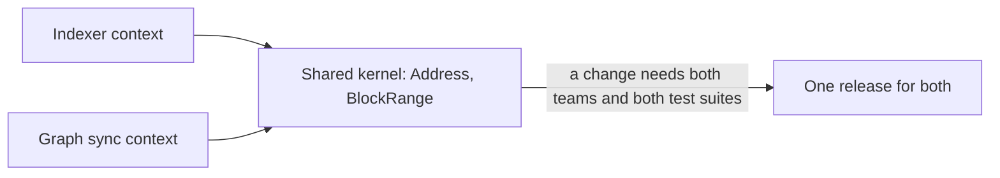

**Story.** The indexer and the graph sync both need the same `Address` and `BlockRange`.
Instead of two copies, they share one tiny Go module.
A change to it is reviewed by both teams, and both test suites run before it merges.

**How it works.**

1. Find the few types two contexts must agree on exactly.
2. Put only those in one small shared module (the box in the middle).
3. Both teams own it. A change needs a yes from each.
4. Both test suites run on every change to the kernel.
5. Keep it tiny. Every type in it couples two teams.

### In code

```text
owners = {Receipt: indexer, Link: graph-sync, ...}   # one owner each
share(type):                         # put a type in the kernel
  kernel.add(type)
  owners[type] = [indexer, graph-sync]   # now both teams own it
unshare(type, team):                 # move it back home
  kernel.remove(type); owners[type] = [team]
merge(change to type):
  for team in owners[type]:          # every owner of the type
    if team has not approved: wait
    if team's tests are red: block
  release to every owner             # all owners rebuild
# rule: share only what both sides must agree on exactly
# rule: every type in the kernel couples two teams
```

```go
// Owner says which teams own a type. The kernel's types have two owners.
type Owner map[string][]string

var owners = Owner{
	"Receipt": {"indexer"}, "Decoder": {"indexer"},
	"Link": {"graph-sync"}, "Label": {"graph-sync"}, "Walk": {"graph-sync"},
}

var kernel = map[string]bool{}

// Share puts a type into the kernel: from now on both teams own it.
func Share(t string) {
	kernel[t] = true
	owners[t] = []string{"indexer", "graph-sync"}
}

// Unshare moves a type back into the one context that uses it.
func Unshare(t, team string) {
	delete(kernel, t)
	owners[t] = []string{team}
}

// Merge decides whether a change to type t can merge.
func Merge(t string, approved map[string]bool, testsPass map[string]bool) (bool, string) {
	need := owners[t] // every owner of the type must say yes
	for _, team := range need {
		if !approved[team] {
			return false, "waiting for " + team + " approval"
		}
		if !testsPass[team] {
			return false, team + " tests are red"
		}
	}
	return true, fmt.Sprintf("released for %v", need) // all owners rebuild
}
```

Run it: `handbook/code/01-shared-kernel/` with `go run .`.

**What goes wrong.** The kernel grows. Someone adds `RiskScore` to the shared `Address`.
Now a risk rule change forces the indexer to rebuild and redeploy. The kernel has become a small ball of mud.
Fix: move `RiskScore` back to the context that owns it. The kernel keeps only what both truly share.

**Where you use it.**

- Chain types (`Address`, `BlockRange`, `Money`) shared by the services of one platform team.
- A generated client from one schema, used by two services of the same team.
- Avoid it between teams that rarely talk: the shared review becomes a queue.

> A shared kernel is a tiny model two contexts own together, worth it only while it stays tiny.

▶ Watch it move: [Shared kernel](visual/01-shared-kernel.html)

## Customer-supplier

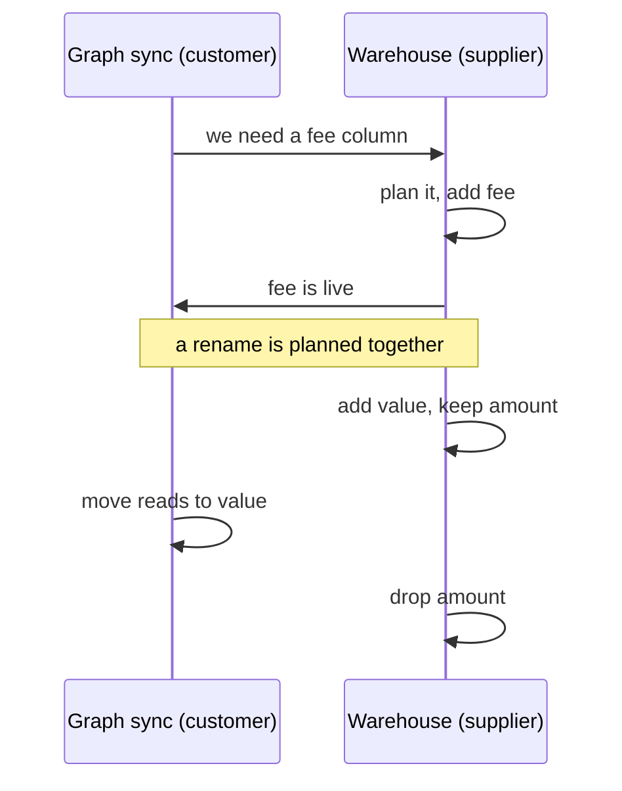

**Story.** The warehouse is upstream: it supplies the rows. The graph sync is downstream: it reads them.
The graph sync team asks for a `fee` column, and the warehouse team puts it in its plan.
Later the warehouse wants to rename `amount` to `value`. It adds the new column first and waits for the graph sync to move.

**How it works.**

1. Name who is upstream (supplier) and who is downstream (customer).
2. The customer says what it needs. The supplier plans it like any other feature.
3. A change that could break the customer is planned together: add the new, move the reader, drop the old.
4. The customer's contract test runs in the supplier's build, so a breaking change fails before it merges.

### In code

```text
core_transfers = {amount, from, to}        # supplier: the warehouse
customer asks for fee -> supplier plans it  # like any feature
contract = columns the customer reads, with types
contractTest(table):                       # runs in the supplier build
  for col, type in contract:
    if table[col] != type: report col missing
build(change):
  if contract test is wired in:
    if contractTest(change) reports any: block the merge
  merge
rename amount -> value, in three steps:
  1. add value, keep amount (both filled)
  2. customer moves its reads to value
  3. drop amount
```

```go
// Table is core_transfers: column name -> type.
type Table map[string]string

// contract is written by the customer: the columns it reads, with their types.
var contract = Table{"value": "LARGEINT", "from": "VARCHAR", "to": "VARCHAR", "fee": "LARGEINT"}

// ContractTest runs inside the supplier's build on every change.
func ContractTest(t Table, reads Table) []string {
	var missing []string
	for col, typ := range reads {
		if t[col] != typ {
			missing = append(missing, col)
		}
	}
	return missing
}

// Build is the warehouse pipeline. Without the contract test, only its own tests run.
func Build(t Table, reads Table, withContract bool) string {
	if withContract {
		if m := ContractTest(t, reads); len(m) > 0 {
			return "build red, merge blocked: customer reads " + strings.Join(m, ",")
		}
	}
	return "build green, merged"
}
```

Run it: `handbook/code/01-customer-supplier/` with `go run .`.

**What goes wrong.** The supplier renames a column without the contract test. Its own tests pass. The graph sync breaks in production at night.
Fix: the customer's contract test lives in the supplier's pipeline, and a rename is always add, move, then drop.

**Where you use it.**

- The warehouse and the graph sync: a schema change is a planned step, never a surprise.
- Two teams in one company where the downstream team has a real voice in the upstream plan.
- An internal API with a few known consumers: consumer-driven contract tests (Pact is one tool).

> Customer-supplier means the upstream plans its changes with its downstream reader, and a contract test enforces it.

▶ Watch it move: [Customer-supplier](visual/01-customer-supplier.html)

## Conformist

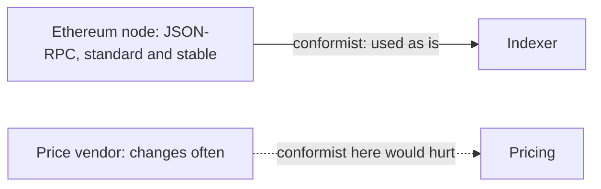

**Story.** The indexer reads blocks from an Ethereum node over JSON-RPC (remote procedure call).
It uses the node's fields as they are: `blockNumber`, `transactionHash`, `logs`.
No translator. The standard rarely changes, so a translator would be pure cost.

**How it works.**

1. Downstream takes the upstream model as is. It adds no translation.
2. Choose it when the upstream is stable and standard, and you cannot change it anyway.
3. It saves the cost of an adapter and of a second model.
4. The price: every upstream change reaches every place that uses the upstream names.

### In code

```text
node = Ethereum JSON-RPC                   # stable, public standard
indexer reads block["blockNumber"], ["gasUsed"]  # names used as is
conformRead(row, name): return row[name]   # no adapter, no second model
node upgrade: same names -> nothing changes
pricing places = import, daily close, report, alert, graph value
runPricing(row, word):
  for place in places:                      # five places
    if conformRead(row, word) missing: break place
vendor renames px to price -> five places break
adapter(row):                              # for the unstable upstream
  usd = row.price if present else row.px    # vendor words stop here
  return {usd}                              # places read usd
```

```go
// Row is a decoded JSON object, keyed by the upstream's own names.
type Row map[string]float64

// places that read the upstream directly, in the upstream's words
var pricingPlaces = []string{"import", "daily close", "report", "alert", "graph value"}

// conformRead is a conformist read: it uses the upstream name directly.
func conformRead(r Row, name string) (float64, bool) {
	v, ok := r[name]
	return v, ok
}

// Adapter translates the vendor's row into our own word, usd.
// When the vendor renames px to price, only this function changes.
func Adapter(r Row) Row {
	if v, ok := r["price"]; ok {
		return Row{"usd": v}
	}
	return Row{"usd": r["px"]}
}

// RunPricing reads one row in every place. word is the name each place uses.
func RunPricing(r Row, word string) int {
	broken := 0
	for _, place := range pricingPlaces {
		if _, ok := conformRead(r, word); !ok {
			fmt.Println("  ", place+":", word, "missing")
			broken++
		}
	}
	return broken
}
```

Run it: `handbook/code/01-conformist/` with `go run .`.

**What goes wrong.** Conforming to an upstream that changes often. Pricing reads a vendor's `px` field in five places.
The vendor renames `px` to `price`. All five break at once, and a day of prices is missing.
Fix: conform only to stable standards. Put a translator (an anti-corruption layer) in front of anything that changes.

**Where you use it.**

- An indexer conforms to Ethereum JSON-RPC.
- An app conforms to the payment provider's checkout model, because it has no power to change it.
- A team conforms to a cloud provider's resource model in its infrastructure code.

> A conformist takes the upstream model as is, which is cheap when the upstream is stable and painful when it is not.

▶ Watch it move: [Conformist](visual/01-conformist.html)

## Anti-corruption layer

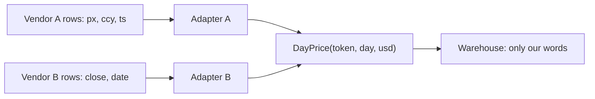

**Story.** Two price vendors send rows in two foreign shapes. Vendor A says `px`, `ccy` and `ts`. Vendor B says `close` and `date`.
One adapter per vendor turns each row into our own `DayPrice(token, day, usd)`.
When vendor A switches its time from seconds to milliseconds, one adapter changes and nothing else.

**How it works.**

1. Treat the foreign model as foreign. Never let its names into your code.
2. Write one adapter per foreign source at the border (the adapter boxes).
3. The adapter translates names, units and time into your own types.
4. The domain only ever sees your type, `DayPrice`.
5. A change upstream touches one adapter.

### In code

```text
type DayPrice {token, day, usd}             # our words
adapterA(row):                             # vendor A: px, ccy, ts
  sec = row.ts
  if vendor A sends milliseconds: sec = sec / 1000
  day = utcDate(sec)
  return DayPrice(token, day, usd = row.px)
adapterB(row):                             # vendor B: close, date
  return DayPrice(token, day = row.date, usd = row.close)
pricing(dayPrice):                         # the domain
  uses only token, day, usd
# failure, no layer: pricing reads row.ts as seconds
#   ts in ms read as seconds -> a day in the year 58,718
```

```go
// DayPrice is our own model. The domain sees only this.
type DayPrice struct {
	Token string
	Day   string // YYYY-MM-DD, UTC
	USD   float64
}

// VendorARow is vendor A's shape, in vendor A's words.
type VendorARow struct {
	Px  float64
	Ccy string
	Ts  int64 // seconds; after the change, milliseconds
}

// VendorBRow is vendor B's shape.
type VendorBRow struct {
	Close float64
	Date  string
}

// AdapterA translates vendor A. tsInMs follows the vendor's format change.
func AdapterA(token string, r VendorARow, tsInMs bool) DayPrice {
	sec := r.Ts
	if tsInMs {
		sec = r.Ts / 1000 // the only line the format change touched
	}
	day := time.Unix(sec, 0).UTC().Format("2006-01-02")
	return DayPrice{Token: token, Day: day, USD: r.Px}
}

// AdapterB translates vendor B: different names, same DayPrice out.
func AdapterB(token string, r VendorBRow) DayPrice {
	return DayPrice{Token: token, Day: r.Date, USD: r.Close}
}

// NoLayer is the failure: pricing reads the vendor's ts directly, as seconds.
func NoLayer(r VendorARow) string {
	return fmt.Sprintf("year %d", time.Unix(r.Ts, 0).UTC().Year())
}
```

Run it: `handbook/code/01-anti-corruption-layer/` with `go run .`.

**What goes wrong.** No layer. Vendor field names spread through the pricing code.
The vendor sends time in milliseconds, the code reads seconds, and prices land on a date tens of thousands of years ahead.
Fix: one adapter at the border, with a test per vendor shape.

**Where you use it.**

- Price vendors and any third-party API with its own model.
- A legacy system you are cutting a context out of: the new context talks to the old one through a translator.
- An LLM (large language model) tool result turned into a typed object before the agent's code uses it.

> An anti-corruption layer translates a foreign model into yours at the border, so a foreign change touches one adapter.

▶ Watch it move: [Anti-corruption layer](visual/01-anti-corruption-layer.html)

## Open host service

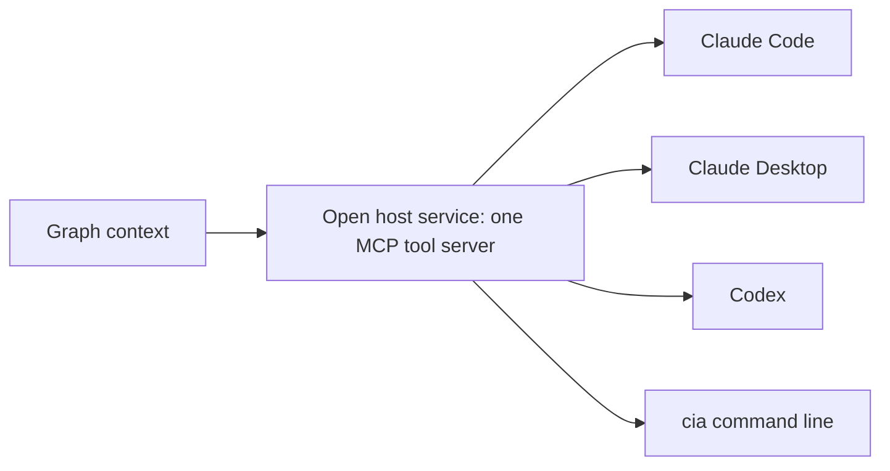

**Story.** The graph serves four kinds of agent host: Claude Code, Claude Desktop, Codex and the `cia` command line.
Each could get its own private endpoint. Instead the graph offers one door: an MCP (Model Context Protocol) tool server.
A fifth host joins by speaking the same protocol, with no change to the graph.

**How it works.**

1. The upstream offers one protocol to every consumer (the middle box).
2. It is documented and versioned, so consumers can rely on it.
3. A new consumer joins without upstream work.
4. The inside of the upstream can change freely while the door stays the same.

### In code

```text
server = {version: 1, tools, storage}      # one documented door
connect(host):                             # any host that speaks MCP
  return 'connected, version, tools'        # no upstream work
call(host, tool):
  if host has a private endpoint: use it    # the fork
  if tool not in tools: refuse
  run tool against storage                  # storage hidden inside
doors() = 1 + private endpoints           # places to change per inside change
addTool(tool):                             # grow the shared protocol
  tools.add(tool); version = version + 1    # for every host at once
# rule: no private door for one consumer
# rule: the inside may change, the protocol may not
```

```go
// Server is the graph's one door. Tools are listed per protocol version.
type Server struct {
	Version int
	Tools   map[string]bool
	Private map[string]string // host -> private endpoint (the failure)
	Storage string
}

// Connect lets any host in that speaks the protocol. No upstream work.
func (s *Server) Connect(host string) string {
	return fmt.Sprintf("%s connected, protocol v%d, %d tools", host, s.Version, len(s.Tools))
}

// Call runs a tool. The host never sees the storage engine.
func (s *Server) Call(host, tool string) string {
	if ep, ok := s.Private[host]; ok {
		return host + " uses private " + ep
	}
	if !s.Tools[tool] {
		return host + ": no tool " + tool
	}
	return host + ": " + tool + " ok"
}

// Doors counts what the graph team must change for every inside change.
func (s *Server) Doors() int { return 1 + len(s.Private) }

// AddTool grows the shared protocol: a new version, for every host.
func (s *Server) AddTool(tool string) {
	s.Tools[tool] = true
	s.Version++
}
```

Run it: `handbook/code/01-open-host-service/` with `go run .`.

**What goes wrong.** One special endpoint for one big consumer. The protocol forks.
Every change in the graph now has to be made twice, and the special one is always the one that breaks.
Fix: add the need to the shared protocol, for everyone.

**Where you use it.**

- One MCP tool server for every agent host.
- A public REST (representational state transfer) or gRPC API that every partner uses the same way.
- Kafka topics with documented schemas as the door of a context.

> An open host service is one documented protocol every consumer uses, so the upstream never builds a private integration.

▶ Watch it move: [Open host service](visual/01-open-host-service.html)

## Published language

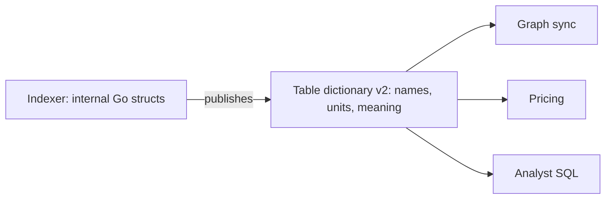

**Story.** The indexer writes tables that many readers use. Its Go structs are its own business.
What it publishes is a table dictionary: every table, every column, its unit and its meaning.
`core_transfers.amount` is a raw integer in the token's smallest unit, and the dictionary says so.

**How it works.**

1. Pick a shared format for exchange: a documented schema, not your internal model.
2. Write down names, units and meaning for every field.
3. Version it. Add fields in a new version, and keep old readers working.
4. Readers learn the language, not the upstream code.
5. It is often paired with an open host service: the service is the door, the published language is what is said through it.

### In code

```text
dictionary v1:                             # the published language
  amount: unit ETH, raw integer, decimals 18
indexer structs: change freely             # not part of the contract
read(dictionary, column, raw):             # every reader does this
  c = dictionary[column]
  if c.unit is missing: guess whole units   # half a language
  return raw / 10^c.decimals, c.unit
addColumn(dictionary, column):             # grow the language
  copy every old column unchanged
  add the new column; version = version + 1
# readers of v1 keep working on v2
# often paired with an open host service: the door and what is said
```

```go
// Column is one entry of the published language.
type Column struct {
	Name     string
	Unit     string // "" means the unit was never written down
	Decimals int    // divide the raw integer by 10^Decimals
}

// Dictionary is the contract, separate from the indexer's own structs.
type Dictionary struct {
	Version int
	Columns map[string]Column
}

// Read is what any reader does: look the column up, apply its unit.
func Read(d Dictionary, col, raw string) string {
	c := d.Columns[col]
	v, _ := new(big.Float).SetString(raw)
	if c.Unit == "" { // half a language: the reader guesses whole units
		return v.Text('f', 0) + " ETH (guessed)"
	}
	div := new(big.Float).SetInt(new(big.Int).Exp(big.NewInt(10), big.NewInt(int64(c.Decimals)), nil))
	return new(big.Float).Quo(v, div).Text('f', 1) + " " + c.Unit
}

// AddColumn grows the language in a new version. Old columns stay as they are.
func AddColumn(d Dictionary, c Column) Dictionary {
	cols := map[string]Column{}
	for k, v := range d.Columns {
		cols[k] = v
	}
	cols[c.Name] = c
	return Dictionary{Version: d.Version + 1, Columns: cols}
}
```

Run it: `handbook/code/01-published-language/` with `go run .`.

**What goes wrong.** No published units. An analyst reads `amount` as whole ETH, but it is in wei, the smallest unit.
The report shows a wallet holding a billion billion times its real balance.
Fix: the unit lives in the dictionary, and the reader divides by the token's decimals.

**Where you use it.**

- A table dictionary for warehouse tables.
- JSON Schema, Protocol Buffers or Avro schemas for messages between teams.
- The MCP tool descriptions and input schemas: the one text every host reads.

> A published language is the documented, versioned format two contexts use to exchange data, separate from either one's internal model.

▶ Watch it move: [Published language](visual/01-published-language.html)

## Separate ways

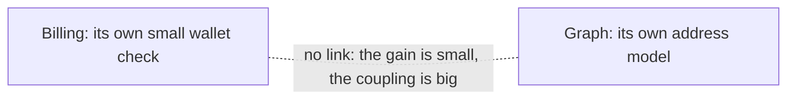

**Story.** Billing needs to check that a wallet address is well formed before a top-up.
The graph already has a rich address model. Linking them would save about twenty lines of code.
The team chooses separate ways: billing keeps its own small check, and the two never call each other.

**How it works.**

1. For each possible link, weigh the gain against the coupling.
2. Coupling means shared releases, shared outages and a meeting for every change.
3. When the gain is small, build no link at all.
4. Accept a little duplicated code as the price.

### In code

```text
for each possible link between two contexts:
  gain = code the link would save           # about twenty lines
  cost = shared releases + shared outages
  if gain < cost: build no link             # separate ways
validWallet(addr):                         # billing's own copy
  return addr is 0x plus 40 hex characters
topUp(addr):
  ok = validWallet(addr)
  if linked to the graph:                   # the coupling
    ok = graph.isWallet(addr)
    if the graph is down: fail the top-up
  if not ok: refuse
  accept
```

```go
// The link decision, made once for billing -> graph:
// gain: about twenty lines (validWallet below).
// cost: shared releases and shared outages.
const linkToGraph = false // gain < cost: separate ways

// Graph is the other context. During a rebuild from block 1 it answers nothing.
type Graph struct{ Rebuilding bool }

// IsWallet is the graph's answer, if billing chose to link.
func (g Graph) IsWallet(addr string) (bool, error) {
	if g.Rebuilding {
		return false, fmt.Errorf("graph rebuilding")
	}
	return validWallet(addr), nil
}

// validWallet is billing's own small check: 0x plus 40 hex characters.
func validWallet(addr string) bool {
	if len(addr) != 42 || !strings.HasPrefix(addr, "0x") {
		return false
	}
	for _, c := range addr[2:] {
		if !strings.ContainsRune("0123456789abcdefABCDEF", c) {
			return false
		}
	}
	return true
}

// TopUp is billing. linked decides whether it asks the graph or itself.
func TopUp(g Graph, addr string, linked bool) string {
	ok := validWallet(addr)
	if linked { // the coupling: billing now fails when the graph fails
		var err error
		if ok, err = g.IsWallet(addr); err != nil {
			return "top-up fails: " + err.Error()
		}
	}
	if !ok {
		return "top-up refused: bad address"
	}
	return "top-up accepted"
}
```

Run it: `handbook/code/01-separate-ways/` with `go run .`.

**What goes wrong.** The link is built anyway. Billing calls the graph to check a wallet.
The graph is rebuilt for a few hours, and in that time no customer can top up.
Fix: separate ways. Billing keeps its own check and stays up while the graph is rebuilt.

**Where you use it.**

- Billing and the graph: no link.
- Two teams that each need a small calendar or address parser: copy it, do not share it.
- Any integration whose only reason is "the other team already has it".

> Separate ways means two contexts choose not to integrate, because the coupling costs more than the duplicated code.

▶ Watch it move: [Separate ways](visual/01-separate-ways.html)

## Entity and value object

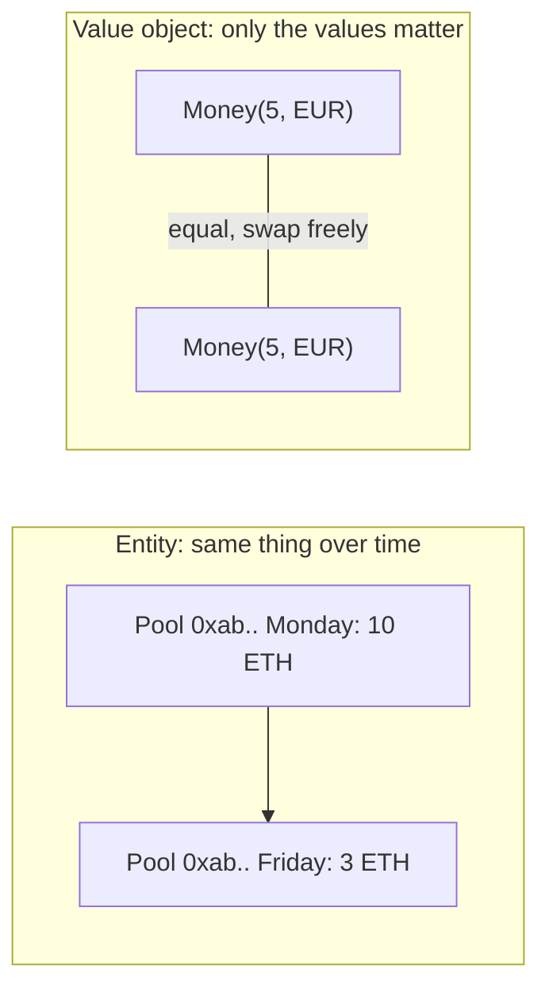

**Story.** A liquidity pool changes its balance every block. It is still the same pool.
Two block ranges from 100 to 200 are the same range. Swap one for the other and nothing changes.
So the pool is an entity and the range is a value object.

**How it works.**

1. Ask: do I need to follow this thing while it changes? Yes means entity (left side).
2. Ask: would an equal copy do? Yes means value object (right side).
3. Give an entity an id, a store and a lifecycle.
4. Make a value object immutable. To change it, make a new one.
5. Validate a value object in its constructor, so it is born valid. `Money` can never be negative.

### In code

```text
Customer {id, name, city}                  # entity
same(a, b) = a.id == b.id                  # never by fields
customer.city = "Krakow"                   # changes in place, same id
Money {cents, currency}                    # value object, no id
equal(x, y) = all values equal             # any copy will do
newMoney(cents, currency):                 # the only door
  if cents < 0: refuse                      # born valid
  return Money
minus(m, d) = newMoney(m.cents - d, m.currency)  # a new value
order {id, total: Money}                   # holds its own value
# failure: order.total -> one shared, changeable amount
#   changing it for 1001 changes 1002 too
```

```go
// Customer is an entity: compared by ID, its fields change in place.
type Customer struct {
	ID, Name, City string
}

func (c Customer) Same(o Customer) bool { return c.ID == o.ID }

// Money is a value object. Its fields are private, and NewMoney checks them.
type Money struct {
	cents    int
	currency string
}

// NewMoney is the only door: a Money that exists is always valid.
func NewMoney(cents int, cur string) (Money, error) {
	if cents < 0 {
		return Money{}, errors.New("money cannot be negative")
	}
	return Money{cents, cur}, nil
}

// Minus makes a new Money. The old one stays what it was.
func (m Money) Minus(cents int) (Money, error) { return NewMoney(m.cents-cents, m.currency) }

func (m Money) String() string { return fmt.Sprintf("%d %s", m.cents/100, m.currency) }

// Order holds a Money by value: nobody can change it through another order.
type Order struct {
	ID    int
	Total Money
}

// MutableMoney is the failure: two orders can point at one changeable amount.
type MutableMoney struct{ Cents int }
type BadOrder struct {
	ID    int
	Total *MutableMoney
}
```

Run it: `handbook/code/01-entity-vs-value-object/` with `go run .`.

**What goes wrong.** A mutable value object. Two places share one `Money`, one changes it, the other is surprised.
Fix: immutable values. Default to value object, and promote to entity only when you must track it.

**Where you use it.**

- `Money(amount, token)`, `BlockRange(from, to)` and `DayPrice` in the indexer are values.
- An address, a pool and a wallet are entities.
- A value object that needs an entity holds the entity's id, never the entity.

> An entity has identity that survives change, and a value object is just its values.

▶ Watch it move: [Entity and value object](visual/01-entity-vs-value-object.html)

## Equality: identity versus value

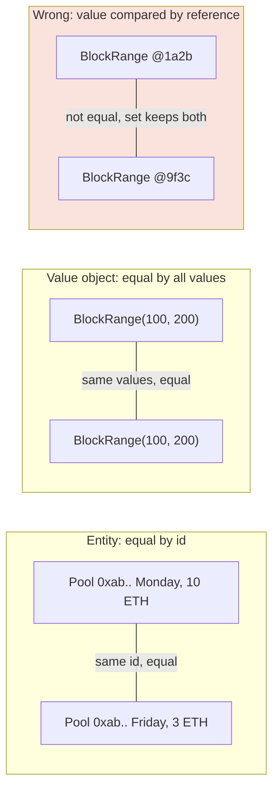

**Story.** The indexer keeps a set of block ranges it has already read.
`BlockRange(100, 200)` was a plain Java class, so it compared by memory address.
A second `BlockRange(100, 200)` looked new, went into the set, and blocks 100 to 200 were indexed twice.

**How it works.**

1. Decide the kind first: entity or value object.
2. An entity is equal when the id is equal (the pool on Monday and Friday).
3. A value object is equal when every field is equal (the two block ranges).
4. The hash code is built from the same fields as equality, so sets and maps work.
5. A value object is immutable, so its hash never changes while it sits in a set.

### In code

```text
what are these two? entity or value object
Pool {id, day, balance}                    # entity
same(a, b) = a.id == b.id                  # the id only
Money {amount, currency}                   # value object
equal(a, b) = every field equal            # all values
BlockRange {from, to}                      # value object as a key
hash(r) built from from and to             # the same fields as equal
indexed.add(r):
  if r in indexed: skip                     # one entry
  else add it
# failure 1: compare by reference: every range looks new
refSet.add(pointer): two entries, indexed twice
# failure 2: entity compared by all fields: one pool, two graph nodes
```

```go
// Pool is an entity: its balance changes, its id says who it is.
type Pool struct {
	ID      string
	Day     string
	Balance int
}

// Same is entity equality: the id only.
func (p Pool) Same(o Pool) bool { return p.ID == o.ID }

// SameByFields is failure 2: an entity compared by every field.
func (p Pool) SameByFields(o Pool) bool { return p == o }

// Money is a value object. Go structs compare by every field.
type Money struct {
	Amount   int
	Currency string
}

// BlockRange is a value object used as a map key: equal values, one entry.
type BlockRange struct{ From, To int }

// Indexed is a set of ranges already indexed.
type Indexed map[BlockRange]bool

// Add reports whether the range was new.
func (s Indexed) Add(r BlockRange) bool {
	if s[r] {
		return false // same hash, same fields: one entry
	}
	s[r] = true // first time
	return true
}

// RefSet is failure 1: compare by memory address, as a plain Java class does.
type RefSet map[*BlockRange]bool

// Add never finds an equal range, because every pointer is different.
func (s RefSet) Add(r *BlockRange) bool {
	if s[r] {
		return false
	}
	s[r] = true // a new pointer, every time
	return true
}
```

Run it: `handbook/code/01-equality/` with `go run .`.

**What goes wrong.** A value compared by reference, as in the story: sets and maps fill with duplicates.
The mirror failure: an entity compared by its fields. On Friday the pool's balance differs, so the graph sync sees a new pool, and one pool becomes two nodes.
Fix: value objects use field equality and hash. Entities use the id only.

**Where you use it.**

- Java and C# records, Kotlin data classes, Go structs and Rust `#[derive(PartialEq, Eq, Hash)]` give field equality for free.
- ORM entities (Hibernate, Entity Framework) compare by id.
- Never use a mutable object as a map key.

> An entity is equal by identity, a value object by all its values, and the hash always follows equality.

▶ Watch it move: [Equality: identity versus value](visual/01-equality.html)

## Aggregate and aggregate root

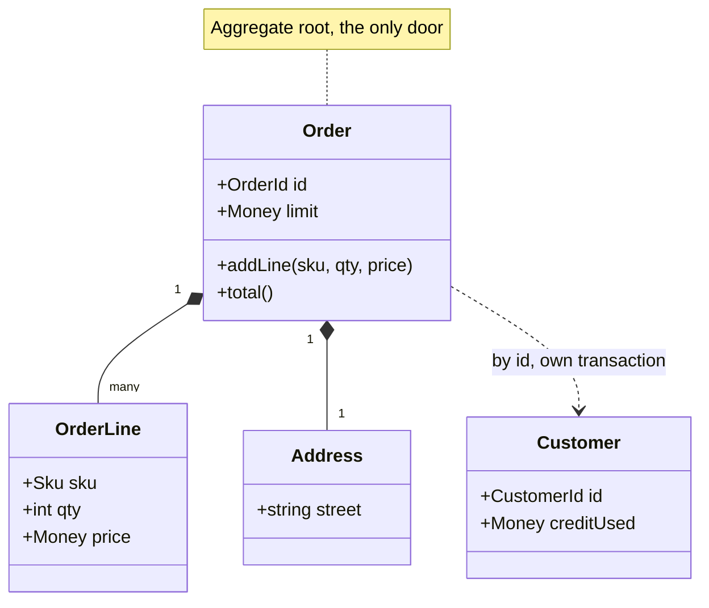

**Story.** Order 1001 holds two lines and an address. Its total is 180 and the credit limit is 400.
The rule is "the total never passes the limit".
`AddLine` with 3 items at 90 would make 450, so the Order refuses. With 2 items it makes 360, and the Order accepts.
Nobody edits a line directly, so the rule always holds. The Customer's credit used is updated a moment later, from an event.

**How it works.**

1. Group the objects that must stay consistent together. That group is the aggregate: the Order, its lines and its address.
2. Pick one entity as the root (`Order` in the picture). The outside world holds only its id.
3. Every change goes through a method on the root: `addLine`.
4. The root checks the invariants (the rules that must be true after every change) before it accepts: 180 plus 2 times 90 is 360, under 400.
5. Load and save the whole aggregate as one unit, in one transaction, then publish `OrderLineAdded`.
6. Other aggregates, such as the Customer, react to the event in their own transaction.

### In code

```text
Order (root) {id, limit, lines}            # lines are private
addLine(sku, qty, price):                  # the only door
  next = total() + qty * price              # work out the new state
  if next > limit: reject                   # invariant, before any change
  lines.add(line)
  events.add(OrderLineAdded)
store.save(order):                         # one transaction
  write the whole order
  publish its events after the commit
customer handler (later, own transaction):
  customer.used += amount
# failure: save Order and Customer in one transaction
#   every order of a busy customer waits for one row
```

```go
// Order is the aggregate root.
type Order struct {
	ID     int
	limit  int
	lines  []line
	events []string
}

// AddLine is the only door. It checks the invariant before any change.
func (o *Order) AddLine(sku, qty, price int) error {
	next := o.total() + qty*price
	if next > o.limit {
		return errors.New("rejected: over limit") // nothing happened
	}
	o.lines = append(o.lines, line{sku, qty, price})
	o.events = append(o.events, fmt.Sprintf("OrderLineAdded order %d plus %d", o.ID, qty*price))
	return nil
}

// Store saves one whole aggregate in one transaction.
type Store struct {
	Saved     map[int]Order
	Published []string
}

func (s *Store) Save(o *Order) {
	s.Saved[o.ID] = *o                             // the whole Order, or the old one stays
	s.Published = append(s.Published, o.events...) // after the commit
	o.events = nil
}

// Customer is another aggregate. A handler updates it in its own transaction.
type Customer struct{ Used int }

func (c *Customer) OnLineAdded(amount int) { c.Used += amount }

// RowLock is the failure: Order and Customer saved in one transaction,
// so every order of this customer needs this one row.
type RowLock struct{ Holder int }

func (l *RowLock) SaveBoth(orderID int) bool {
	if l.Holder != 0 {
		return false // waits for the holder to commit
	}
	l.Holder = orderID
	return true
}
```

Run it: `handbook/code/01-aggregate-root/` with `go run .`.

**What goes wrong.** Saving Order and Customer in one transaction. Every order of a busy customer then waits for the same Customer row, and deadlocks appear under load.
Fix: the Order commits alone and publishes an event. The Customer updates its credit used a moment later.

**Where you use it.**

- A shop: `Order` is the root and order lines are inside it. The customer is another aggregate, held by id.
- Billing: `Wallet` is the root of its balance, subscription and payments. A batch job that bypasses `wallet.charge()` is the bug to look for.
- The Akka.NET IoT backend: one actor per device is a natural aggregate root, with one mailbox as the only door.

> The aggregate root is the only door, and it guards the rules for everything behind it.

▶ Watch it move: [Aggregate root](visual/01-aggregate-root.html)

## Invariant

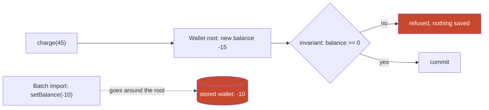

**Story.** A wallet holds 20 USD. One rule must be true after every single change: the balance is never below zero.
A charge of 45 USD would leave -15, so the wallet refuses it and saves nothing.
In another codebase the same rule sat only in the checkout controller. A batch import called `setBalance(-10)` and nothing stopped it.

**How it works.**

1. Write the rule down in one sentence: "the balance is never below zero".
2. The command reaches the root (`charge(45)` in the picture).
3. The root works out the new state first: -15.
4. It checks the invariant before it saves (the diamond).
5. No: refuse, and nothing changed. Yes: commit the whole aggregate.
6. Draw the aggregate border around exactly the data this rule needs.

### In code

```text
rule: the balance is never below zero
wallet {balance}                           # private
apply(next):                               # every method ends here
  if next < 0: refuse                       # the check, before saving
  balance = next                            # save
topUp(n)  = apply(balance + n)
charge(n) = apply(balance - n)
# failure 1: the rule lives in one caller
controller(charge): if balance - charge < 0: refuse
setBalance(n): balance = n                 # public: a batch import skips it
# failure 2: a rule across two aggregates
sumRule(own, seenOther, topUp, limit)      # each sees a stale read
```

```go
// Wallet is the aggregate. balance is private: no door skips the rule.
type Wallet struct{ balance int }

var errNegative = errors.New("refused: balance would be below zero")

// apply is the one path every method takes: compute, check, then save.
func (w *Wallet) apply(next int) error {
	if next < 0 { // the invariant
		return errNegative // nothing changed
	}
	w.balance = next
	return nil
}

// TopUp and Charge both end in the same check.
func (w *Wallet) TopUp(n int) error  { return w.apply(w.balance + n) }
func (w *Wallet) Charge(n int) error { return w.apply(w.balance - n) }

// LooseWallet is the failure: the rule lives in one caller, the setter is public.
type LooseWallet struct{ Balance int }

func (w *LooseWallet) SetBalance(n int) { w.Balance = n }

// Controller is the only place that checks. A batch import never comes here.
func Controller(w *LooseWallet, charge int) error {
	if w.Balance-charge < 0 {
		return errNegative
	}
	w.SetBalance(w.Balance - charge)
	return nil
}

// SumRule is a rule across two aggregates: each sees only its own stale read.
func SumRule(own, seenOther, topUp, limit int) bool { return own+topUp+seenOther < limit }
```

Run it: `handbook/code/01-invariant/` with `go run .`.

**What goes wrong.** The rule lives in one caller, not in the root (the dashed arrow). Every other door skips it.
A second trap: a rule across two aggregates, such as "all wallets of one customer stay under 1,000 USD". Two top-ups at once each read an old total, and both pass.
Fix: put the check in the root and make setters private. For a rule across aggregates, merge them, or accept a policy that checks later and corrects.

**Where you use it.**

- Billing: "balance never below zero" is the reason `Wallet` is an aggregate.
- A Go indexer: a block aggregate refuses a receipt whose block number does not match.
- A database `CHECK` constraint is a useful second net, never the only one.

> An invariant is a rule that must be true after every change, and the aggregate root checks it before it saves.

▶ Watch it move: [Invariant](visual/01-invariant.html)

## Optimistic concurrency: the aggregate version

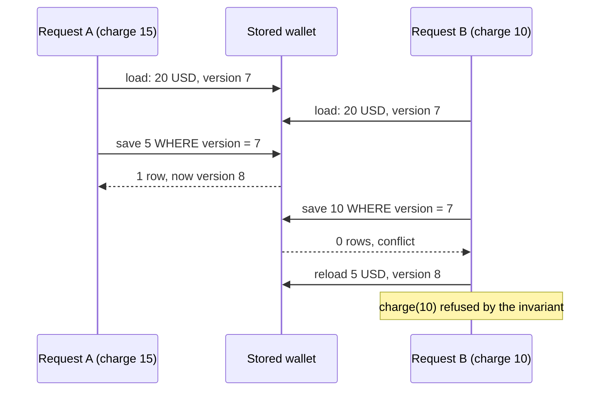

**Story.** Two requests charge the same wallet at the same moment. The wallet holds 20 USD.
Request A wants 15, request B wants 10. Both load the wallet, both check the rule on their own copy, both pass.
The version number decides who wins. B learns it lost, reloads, and the invariant refuses its charge.

**How it works.**

1. Every aggregate carries a version number (7 in the picture).
2. A request loads the aggregate and remembers the version. No lock is held.
3. It saves with "where the version is still 7".
4. The first save matches one row and the version becomes 8.
5. The second save matches zero rows. That is a conflict.
6. The loser reloads and runs the command again on the fresh state.

### In code

```text
row = {balance, version}                   # version 7
load(row): copy = balance, version         # no lock held
charge(copy, n):                           # on its own copy
  if n > copy.balance: refuse               # the invariant
  copy.balance -= n
save(row, copy):
  UPDATE ... WHERE version = copy.version
  if zero rows matched: conflict
  version = version + 1
chargeWithRetry(n):
  on conflict: fresh = load(row)            # never re-send the old result
  charge(fresh, n), then save
# failure: save with no WHERE on the version: last write wins
```

```go
// Row is the stored wallet.
type Row struct{ Balance, Version int }

// Copy is what one request holds in memory.
type Copy struct{ Balance, Version int }

var errConflict = errors.New("conflict: zero rows matched")

// Load remembers the version. No lock.
func Load(r *Row) Copy { return Copy{r.Balance, r.Version} }

// Charge runs the invariant on the request's own copy.
func (c *Copy) Charge(n int) error {
	if n > c.Balance {
		return errors.New("refused: not enough")
	}
	c.Balance -= n
	return nil
}

// Save is: UPDATE wallet SET balance=?, version=version+1 WHERE version=?
func Save(r *Row, c Copy) error {
	if r.Version != c.Version {
		return errConflict // nothing overwritten
	}
	r.Balance = c.Balance
	r.Version++
	return nil
}

// SaveBlind is the failure: no version check, the last write wins.
func SaveBlind(r *Row, c Copy) { r.Balance = c.Balance }

// ChargeWithRetry reloads and runs the command again on the fresh state.
func ChargeWithRetry(r *Row, c Copy, n int) error {
	if err := Save(r, c); !errors.Is(err, errConflict) {
		return err
	}
	fresh := Load(r) // never re-send the old result
	if err := fresh.Charge(n); err != nil {
		return err
	}
	return Save(r, fresh)
}
```

Run it: `handbook/code/01-optimistic-concurrency/` with `go run .`.

**What goes wrong.** No version check. B saves 10 over A's 5 and the last write wins.
The customer was charged 25 USD but the wallet says 10. This is a lost update, and both requests passed the invariant on stale copies.
Fix: a version on every aggregate, checked on every save. Retry by reloading, never by re-sending the old result.

**Where you use it.**

- Postgres or MySQL: a `version` column and `UPDATE ... WHERE id = ? AND version = ?`.
- Kubernetes: every object has a `resourceVersion`. A stale update gets 409 Conflict.
- Choose a pessimistic lock (`SELECT ... FOR UPDATE`) only for hot rows where conflicts are frequent.

> Each aggregate carries a version, a save only succeeds if nobody saved since I loaded, and the loser reloads and tries again.

▶ Watch it move: [Optimistic concurrency](visual/01-optimistic-concurrency.html)

## Aggregate design rules

```mermaid
flowchart LR
  subgraph Big["First draft: giant aggregate"]
    W1["Wallet"] --- C1["Customer profile"]
    W1 --- S1["Subscription"]
    W1 --- P1["10,000 payments"]
  end
  subgraph Small["After the four rules"]
    W2["Wallet: balance, version"] -.->|"customerId"| C2["Customer"]
    W2 -.->|"subscriptionId"| S2["Subscription"]
    W2 -->|"append one row"| L2["Payments ledger"]
    W2 -->|"WalletToppedUp, later"| S2
  end
  style Big fill:#fbe3dd
```

**Story.** The first draft of the wallet held the customer profile, the subscription and every payment.
In production each charge loaded 10,000 payments. A customer changing their name made a running charge fail on a version conflict.
Four rules shrank the aggregate to the wallet and its balance.

**How it works.**

1. Draw the border around the invariant. "Balance never below zero" needs the balance, nothing else.
2. Hold other aggregates by id: `customerId`, `subscriptionId` (dashed arrows).
3. Keep unbounded collections outside. Payments go into an append-only ledger.
4. Change one aggregate per transaction. Others react to events, a moment later.

### In code

```text
first draft: wallet + profile + plan + every payment
loadCost(big) = 3 + payments               # 10,003 items per charge
rule 1: border = what the invariant reads  # only the balance
wallet {version, balance, customerId, subscriptionId}
rule 2: hold other aggregates by id        # loads and locks nothing
customer {version, name}                   # its own version
rule 3: ledger.add(row)                    # unbounded, append only
rule 4: charge(wallet, ledger, n):         # one aggregate, one transaction
  balance -= n
  ledger.add(n)
  publish WalletCharged                     # others react a moment later
save(stored, loaded):                      # the version check
  if stored != loaded: conflict             # a name edit and a charge fight
```

```go
// BigWallet is the first draft: everything the wallet touches, one version.
type BigWallet struct {
	Version     int
	Balance     int
	ProfileName string
	Plan        string
	Payments    []int
}

// LoadCost counts the items a charge must load.
func (w BigWallet) LoadCost() int { return 3 + len(w.Payments) }

// Wallet is the small aggregate: rule 1, only what the invariant reads.
// Rule 2: other aggregates are held by id.
type Wallet struct {
	Version        int
	Balance        int
	CustomerID     string
	SubscriptionID string
}

// LoadCost: the balance and two ids. No payments.
func (w Wallet) LoadCost() int { return 3 }

// Customer is its own aggregate with its own version.
type Customer struct {
	Version int
	Name    string
}

// Ledger is rule 3: an unbounded collection lives outside. Append only.
type Ledger struct{ Rows []int }

func (l *Ledger) Add(n int) { l.Rows = append(l.Rows, n) }

// Charge is rule 4: one transaction changes one aggregate; others hear an event.
func Charge(w *Wallet, l *Ledger, n int) []string {
	w.Balance -= n
	l.Add(n)
	return []string{"WalletCharged"}
}

// save stores an edit only if nobody saved since this edit loaded.
func save(stored *int, loaded int) bool {
	if *stored != loaded {
		return false // a version conflict
	}
	*stored++
	return true
}
```

Run it: `handbook/code/01-aggregate-design-rules/` with `go run .`.

**What goes wrong.** The giant aggregate (left box). It is slow to load, and unrelated edits fight over one version and one lock.
The opposite mistake also exists: splitting so far that a true invariant spans two aggregates and can no longer be checked.
Fix: size the aggregate by the invariant, not by "what is related".

**Where you use it.**

- Billing: a wallet with its balance, and a payments ledger beside it.
- An order with its lines inside, and the customer held by id.
- A Go indexer: a block holds its transactions, but address history lives in the warehouse, never inside the block.

> An aggregate holds only the data its invariant needs, refers to other aggregates by id, and changes alone in its transaction.

▶ Watch it move: [Aggregate design rules](visual/01-aggregate-design-rules.html)

## Domain events and one transaction per aggregate

```mermaid
sequenceDiagram
  participant U as Customer
  participant W as Wallet aggregate
  participant O as Outbox
  participant S as Subscription aggregate
  U->>W: topUp(20 USD)
  W->>W: check rule, add balance
  W->>O: store WalletToppedUp in the same transaction
  Note over W,O: transaction 1 ends here
  O-->>S: publish WalletToppedUp
  S->>S: renew plan
  Note over S: transaction 2, a moment later
```

**Story.** A customer tops up their wallet with 20 USD. The subscription should renew.
The wallet does not reach into the subscription. It records `WalletToppedUp`.
A moment later the subscription hears the event and renews.

**How it works.**

1. The command arrives at the wallet root.
2. The root checks its rules and changes its own state.
3. In the same transaction it writes the event to an outbox table.
4. The transaction ends. Only one aggregate changed.
5. A relay publishes the event.
6. The subscription reacts in its own transaction. The two are consistent eventually, not at once.

### In code

```text
wallet {balance}, subscription {plan, paid} # two aggregates
topUp(amount):                             # transaction 1
  if amount <= 0: refuse
  wallet.balance += amount
  outbox.add(WalletToppedUp)                # same transaction
  commit                                    # one aggregate changed
relay:                                     # a moment later
  for each outbox row: deliver it, then clear
onEvent(WalletToppedUp):                   # transaction 2
  subscription.paid = true
# failure 1: renew inside the top-up transaction
  if subscription row is locked: top-up times out
# failure 2: commit, then send: a crash loses the event
```

```go
// DB is one database with an outbox table.
type DB struct {
	Wallet Wallet
	Outbox []string
}

// TopUp is transaction 1: state and event are saved together, or not at all.
func TopUp(db *DB, amount int) error {
	if amount <= 0 {
		return errors.New("refused: amount must be positive")
	}
	db.Wallet.Balance += amount
	db.Outbox = append(db.Outbox, "WalletToppedUp")
	return nil // commit
}

// Relay publishes unsent rows. The subscription hears a moment later.
func Relay(db *DB, s *Subscription) {
	for _, ev := range db.Outbox {
		OnEvent(ev, s)
	}
	db.Outbox = nil
}

// OnEvent is transaction 2, in the subscription's own border.
func OnEvent(ev string, s *Subscription) {
	if ev == "WalletToppedUp" {
		s.Paid = true
	}
}

// TopUpAndRenew is failure 1: two aggregates in one transaction.
func TopUpAndRenew(db *DB, s *Subscription, amount int) error {
	if s.Blocked {
		return errors.New("top-up times out: waiting for the Subscription lock")
	}
	db.Wallet.Balance += amount
	s.Paid = true
	return nil
}

// TopUpThenSend is failure 2: the event is sent outside the transaction.
func TopUpThenSend(db *DB, s *Subscription, amount int, crash bool) {
	db.Wallet.Balance += amount // committed
	if crash {
		return // the event is never sent
	}
	OnEvent("WalletToppedUp", s)
}
```

Run it: `handbook/code/01-domain-events/` with `go run .`.

**What goes wrong.** "Just this once" one transaction updates both aggregates. Under load the locks collide and the two grow into one blob.
A second failure: the event is published outside the transaction and gets lost. Fix: the outbox, and idempotent consumers.

**Where you use it.**

- Name events in the past tense: `BlockIndexed`, `SwapDecoded`, `WalletToppedUp`. An event is history, not a request.
- The warehouse has a swap at block N. The graph shows it a minute later. Show the lag as freshness: "graph is 1,200 blocks behind".
- If the user truly needs both at once, they are one aggregate. Redraw it.

> One transaction changes one aggregate, and the others catch up through events.

▶ Watch it move: [Domain events](visual/01-domain-events.html)

## Outbox

```mermaid
flowchart LR
  W["Wallet service"] -->|"one transaction"| T
  subgraph T["Postgres"]
    WR["wallets: balance 20"]
    OB["outbox: WalletToppedUp, sent no"]
  end
  RL["Relay"] -->|"read unsent rows"| OB
  RL -->|"publish"| K["Kafka: wallet-events"]
  RL -->|"mark sent"| OB
  K --> S["Subscription consumer"]
```

**Story.** A customer tops up 20 USD. The balance must change in Postgres, and `WalletToppedUp` must reach Kafka.
A database and a broker cannot share one transaction.
So the wallet service writes the event as a row in an outbox table, in the same transaction as the balance. A relay sends it later.

**How it works.**

1. Open one database transaction.
2. Update the wallet row and insert the event into the outbox table (the box on the left).
3. Commit. Both rows exist, or neither does.
4. A relay reads unsent rows and publishes them to Kafka.
5. After Kafka confirms, the relay marks the row sent.
6. If the relay crashes before marking, it sends the row again. Delivery is at least once.

### In code

```text
topUp(amount):                             # one transaction
  wallet.balance += amount
  outbox.insert(WalletToppedUp)
  commit                                    # both rows, or neither
relay loop:
  for row in outbox where not sent:
    kafka.publish(row.event)
    # a crash here: the row stays unsent, it is sent again
    row.sent = true                         # after Kafka confirms
# delivery is at least once: consumers must be idempotent
# failure 1: commit, then publish: a crash loses the event
# failure 2: publish, then commit: a ghost event
```

```go
// TopUp is one transaction: both rows exist, or neither does.
func TopUp(db *DB, amount int) {
	db.Balance += amount // the wallet row
	db.Outbox = append(db.Outbox, &Row{Event: "WalletToppedUp"})
	// COMMIT: both rows exist, or neither does
}

// Relay publishes every unsent row. crashBeforeMark stops it after the publish.
func Relay(db *DB, k *Kafka, crashBeforeMark bool) {
	for _, r := range db.Outbox {
		if r.Sent {
			continue
		}
		k.Messages = append(k.Messages, r.Event)
		if crashBeforeMark {
			return // row still unsent: the restart sends it again
		}
		r.Sent = true
	}
}

// CommitThenPublish is the failure: a crash between the two loses the event.
func CommitThenPublish(db *DB, k *Kafka, amount int, crash bool) {
	db.Balance += amount // committed
	if crash {
		return // nothing written down, nothing can resend it
	}
	k.Messages = append(k.Messages, "WalletToppedUp")
}

// PublishThenCommit fails the other way: a ghost event.
func PublishThenCommit(db *DB, k *Kafka, amount int, commitFails bool) error {
	k.Messages = append(k.Messages, "WalletToppedUp")
	if commitFails {
		return errors.New("commit timed out: rolled back")
	}
	db.Balance += amount
	return nil
}
```

Run it: `handbook/code/01-outbox/` with `go run .`.

**What goes wrong.** A dual write: commit, then publish. A crash in between loses the event for good.
The other order is just as bad: publish, then the commit fails, and a ghost event announces a change that never happened.
Fix: the outbox. And because the relay may resend, every consumer must be idempotent.

**Where you use it.**

- Debezium reading the Postgres write-ahead log and publishing outbox rows to Kafka.
- A Go indexer writing a block and its `BlockIndexed` row in one load, with a relay feeding the graph sync.
- Delete sent rows on a schedule. The outbox is a queue, not an archive.

> The event goes into an outbox table in the same transaction as the change, and a relay publishes it afterwards.

▶ Watch it move: [Outbox](visual/01-outbox.html)

## Idempotent consumer

```mermaid
flowchart LR
  K["Kafka delivers e-81"] --> C{"e-81 in processed_events?"}
  C -->|"no"| A["insert e-81 and extend plan, one transaction"]
  C -->|"yes"| S["skip, acknowledge"]
  A --> D["paid until December"]
  S --> D
```

**Story.** `WalletToppedUp` with id `e-81` renews a subscription by one month.
The consumer saves its work, then crashes before telling Kafka it has read the message. Kafka sends `e-81` again.
The consumer finds `e-81` already recorded, skips it, and the plan stays paid until December.

**How it works.**

1. Every event carries a unique id from birth.
2. The consumer has a table of processed ids with a unique key.
3. In one transaction it inserts the id and applies the effect (left branch).
4. A second delivery hits the unique key. The consumer skips and acknowledges (right branch).
5. Better still, shape the effect so twice equals once: "mark the month paid by `e-81`", not "add a month".

### In code

```text
event carries a unique id from birth       # e-81
processed_events: unique key on the id
handle(event):                             # one transaction
  if id already in processed_events:
    skip, acknowledge                       # second delivery
  insert id
  extend the plan by one month              # add: not idempotent
  commit                                    # id and effect together
kafka.commitOffset(42)                     # after the transaction
# a crash before line 9: Kafka resends offset 42
handleSet(event):                          # better: set, not add
  mark the month paid by e-81
# failure: no processed table: e-81 twice adds two months
```

```go
var months = []string{"November", "December", "January"}

// Plan is the subscription: an index into months, plus the months already paid.
type Plan struct {
	Until     int
	PaidBy    map[string]bool // the set form: month paid by this top-up
	Processed map[string]bool // processed_events, with a unique key on the id
}

// Handle inserts the id and applies the effect in one transaction.
func Handle(p *Plan, id string) string {
	if p.Processed[id] { // the insert hits the unique key
		return "duplicate: skipped"
	}
	p.Processed[id] = true
	p.Until++ // add one month
	return "applied"
}

// HandleNoDedup is the failure: every delivery adds a month.
func HandleNoDedup(p *Plan, id string) string {
	p.Until++
	return "applied again"
}

// HandleSet makes the effect idempotent itself: set, not add.
func HandleSet(p *Plan, id string) {
	if !p.PaidBy[id] {
		p.PaidBy[id] = true
		p.Until = len(p.PaidBy)
	}
}

// Kafka resends from the last committed offset.
type Kafka struct{ Committed int }

func (k *Kafka) Commit(offset int) { k.Committed = offset }
```

Run it: `handbook/code/01-idempotent-consumer/` with `go run .`.

**What goes wrong.** No de-duplication. `e-81` arrives twice and the plan is extended twice.
The customer paid 20 USD once and got two months. Nothing crashed and no alert fired.
Fix: store the event id in the same transaction as the effect, or make the effect a set or an upsert.

**Where you use it.**

- Kafka consumers after a rebalance or a deploy, which redeliver as normal behaviour.
- Webhooks: Stripe sends an event id because it retries on timeout.
- StarRocks primary-key tables: loading the same block twice upserts the same rows.

> Delivery is at least once, so the consumer makes twice have the same effect as once.

▶ Watch it move: [Idempotent consumer](visual/01-idempotent-consumer.html)

## Eventual consistency

```mermaid
sequenceDiagram
  participant W as Wallet
  participant P as Account page
  participant S as Subscription
  W->>W: t0, top-up commits, 20 USD
  P->>W: read: 20 USD
  P->>S: read: unpaid
  Note over P: the window, the two disagree
  W-->>S: WalletToppedUp
  S->>S: t1, renews
  P->>S: read: renewed
  Note over P: agree again
```

**Story.** A customer tops up 20 USD. The wallet commits at once. The subscription hears a moment later.
In between, the account page shows 20 USD and "unpaid" side by side.
A second later it shows 20 USD and "renewed". Nothing was wrong, only late.

**How it works.**

1. The wallet commits alone at t0.
2. The window opens: the two aggregates disagree.
3. The event travels through the outbox and the broker.
4. The subscription renews in its own transaction at t1. The window closes.
5. The page shows "renewal in progress" during the window, because the command reply told it a top-up happened.

### In code

```text
wallet and subscription: two aggregates
topUp(n):                                  # t0: the window opens
  balance += n; events in flight += 1
deliver:                                   # t1: the window closes
  if consumer is stopped: events pile up
  subscription renews, in its own transaction
lag() = events in flight                   # measure, alert
page(justToppedUp):
  renewed: show 'renewed'
  justToppedUp: show 'renewal in progress'  # from the command's reply
  else: show 'unpaid'
reminder on a read:                        # the failure
  if not renewed: email 'plan cancelled'    # cannot be undone
reminder on the lag: if lag > 0: wait       # the fix
```

```go
// TopUp is t0: the wallet commits alone and the window opens.
func (w *World) TopUp(n int) {
	w.Balance += n
	w.InFlight = append(w.InFlight, "WalletToppedUp")
}

// Deliver is t1: the subscription handles the event in its own transaction.
func (w *World) Deliver() {
	if w.Stopped {
		return // events pile up in the broker
	}
	for range w.InFlight {
		w.Renewed = true
	}
	w.InFlight = nil
}

// Lag is what you measure and alert on.
func (w *World) Lag() int { return len(w.InFlight) }

// Page shows the account. justToppedUp comes from the command's reply.
func (w *World) Page(justToppedUp bool) string {
	switch {
	case w.Renewed:
		return fmt.Sprintf("%d USD, renewed", w.Balance)
	case justToppedUp:
		return fmt.Sprintf("%d USD, renewal in progress", w.Balance)
	}
	return fmt.Sprintf("%d USD, unpaid", w.Balance)
}

// ReminderOnRead is the failure: an irreversible act on a stale read.
func (w *World) ReminderOnRead() string {
	if !w.Renewed {
		return "email sent: plan cancelled"
	}
	return "no email"
}

// ReminderOnLag is the fix: never act while events are still travelling.
func (w *World) ReminderOnLag() string {
	if w.Lag() > 0 {
		return "wait: the window is open"
	}
	return w.ReminderOnRead()
}
```

Run it: `handbook/code/01-eventual-consistency/` with `go run .`.

**What goes wrong.** A decision on a stale read. A reminder job runs inside the window, sees "unpaid", and emails "your plan is cancelled".
The data heals a second later. The email cannot be unsent.
A second failure: the consumer stops and the window never closes. Fix: never act irreversibly on a read that may be stale, and measure the lag with an alert.

**Where you use it.**

- An indexer and a graph: show freshness, "graph is 1,200 blocks behind".
- Read replicas in Postgres: a read right after a write can miss it, so read your own writes from the primary.
- A search index behind a database, which catches up in seconds.

> Inside an aggregate I want strong consistency, between aggregates I accept a short, measured window.

▶ Watch it move: [Eventual consistency](visual/01-eventual-consistency.html)

## Domain event versus integration event

```mermaid
flowchart LR
  subgraph B["Billing context"]
    W["Wallet"] --> DE["WalletToppedUp: walletId, amount, balanceAfter"]
    DE --> S["Subscription"]
    DE --> TR["Translator"]
  end
  TR -->|"outbox and Kafka"| IE["PaymentReceived v1: customerId, amountUsd, receivedAt"]
  IE --> EM["Email context"]
  IE --> AN["Analytics context"]
```

**Story.** A top-up is news inside Billing, for the subscription, and outside it, for Email and Analytics.
Inside, `WalletToppedUp` carries every internal detail. Billing changes it whenever it likes.
Outside, a translator publishes `PaymentReceived` version 1: three stable fields that other teams can rely on.

**How it works.**

1. The wallet raises a domain event in the context's own words.
2. Handlers in the same context read it (the subscription).
3. A translator maps it to an integration event, a small public contract.
4. The integration event goes through the outbox to Kafka.
5. Other contexts read only the contract.
6. A rename inside Billing changes the domain event and its handlers in one commit. Version 1 stays as it was.

### In code

```text
billing context: wallet, subscription
walletToppedUp {walletId, amount, balanceAfter, ...}  # domain event, private
renew(event): extend the plan               # a handler inside the context
PaymentReceived v1 {version, customerId, usd, receivedAt}  # the contract
translate(event):                          # one small mapping
  return PaymentReceived v1 from the event's fields
  # through the outbox, on to Kafka
email(contract): send a receipt            # reads only the contract
analytics(contract): count revenue
rename amount to money:
  handler and translator change in one commit; v1 stays the same
# failure: emailRaw(event) reads event["amount"] directly
#   finds nothing: a receipt for 0 USD
```

```go
// WalletToppedUp is the domain event. Billing may change it in any commit.
// Kept as a map so a rename can really happen in this program.
type WalletToppedUp map[string]any

// PaymentReceivedV1 is the integration event: few fields, stable names.
type PaymentReceivedV1 struct {
	Version    int
	CustomerID string
	USD        int
	ReceivedAt string
}

// amountField is what Billing calls the amount today. A rename changes it here.
var amountField = "amount"

// Renew is the handler inside the context, changed in the same commit.
func Renew(e WalletToppedUp) string {
	return fmt.Sprintf("subscription renewed for %v USD", e[amountField])
}

// Translate maps the private event to the public contract.
func Translate(e WalletToppedUp) PaymentReceivedV1 {
	return PaymentReceivedV1{1, e["customerId"].(string), e[amountField].(int), e["at"].(string)}
}

// Email and Analytics read only the contract.
func Email(p PaymentReceivedV1) string     { return fmt.Sprintf("receipt: %d USD", p.USD) }
func Analytics(p PaymentReceivedV1) string { return fmt.Sprintf("revenue: %d", p.USD) }

// EmailRaw is the failure: another team reads the private event by its field name.
func EmailRaw(e WalletToppedUp) string {
	usd, _ := e["amount"].(int) // missing after the rename: zero
	return fmt.Sprintf("receipt: %d USD", usd)
}
```

Run it: `handbook/code/01-domain-vs-integration-event/` with `go run .`.

**What goes wrong.** The domain event is published raw. Billing renames `amount` to `money`.
Email reads `amount`, finds nothing, and sends receipts for 0 USD. A private refactor became another team's outage.
Fix: a separate, versioned integration event. Add fields freely. A rename or removal is a new version, published beside the old one.

**Where you use it.**

- Kafka with Avro or Protobuf schemas and a compatibility check in a schema registry.
- Public webhooks: Stripe and GitHub version their event payloads.
- This is the published language from the context map, applied to events.

> A domain event is private to its context, and an integration event is a published, versioned contract made by a translator.

▶ Watch it move: [Domain event versus integration event](visual/01-domain-vs-integration-event.html)

## Process manager and policy

```mermaid
stateDiagram-v2
  [*] --> Started: RenewalDue
  Started --> WaitingForFunds: ChargeFailed, set 7-day timer
  Started --> Charged: WalletCharged
  WaitingForFunds --> Charged: WalletToppedUp, charge again
  WaitingForFunds --> Cancelled: timer fires on day 7
  Charged --> Done: ExtendPlan
  Done --> [*]
  Cancelled --> [*]
```

**Story.** A subscription is due for renewal. The wallet holds only 5 USD, so the charge fails.
Renewal `r-12` waits and sets a 7-day timer. On day 2 the customer tops up 20 USD.
`r-12` charges again, it works, and the plan is extended. No single aggregate could have run this alone.

**How it works.**

1. A policy is the simple case: whenever an event happens, send one command. No memory. "Whenever `WalletToppedUp`, send a receipt."
2. When a process waits, branches or times out, a process manager owns it (the state diagram).
3. `RenewalDue` starts an instance, `r-12`, with its own stored state.
4. It sends `ChargeWallet`. On `ChargeFailed` it moves to waiting and sets a timer.
5. It finds itself again by the customer id in each event (correlation).
6. Every path has an ending: `ExtendPlan` when charged, `CancelPlan` when the timer fires.

### In code

```text
policy(event):                             # no memory
  whenever WalletToppedUp: SendReceipt
renewal {id, customer, state, timerDay}    # stored between events
instances[customer]                        # correlation
on(RenewalDue): state = started; ChargeWallet(20)
on(ChargeFailed): state = waiting for funds; timer = day + 7
on(WalletToppedUp) when waiting: ChargeWallet(20)
on(WalletCharged):
  clear timer; state = done; ExtendPlan     # an ending
on(TimerFired) when day >= timer:
  state = cancelled; CancelPlan             # the other ending
# failure: separate handlers, no state, nobody connects them
```

```go
func Policy(event string) string {
	if event == "WalletToppedUp" {
		return "SendReceipt" // one command out
	}
	return ""
}

type Renewal struct { // one instance, stored between events

	ID, Customer string
	State        string
	TimerDay     int
}

var Instances = map[string]*Renewal{} // correlation: found by customer id

// On handles one event on one day and returns the command to send next.
func (r *Renewal) On(event string, day int) string {
	switch {
	case event == "RenewalDue":
		r.State = "started"
		return "ChargeWallet(20)"
	case event == "ChargeFailed":
		r.State = "waiting for funds"
		r.TimerDay = day + 7
		return ""
	case event == "WalletToppedUp" && r.State == "waiting for funds":
		r.State = "charging"
		return "ChargeWallet(20)"
	case event == "WalletCharged":
		r.TimerDay = 0
		r.State = "done"
		return "ExtendPlan"
	case event == "TimerFired" && r.TimerDay != 0 && day >= r.TimerDay:
		r.State = "cancelled"
		return "CancelPlan"
	}
	return ""
}

// Handlers is the failure: no state, nobody connects the two.
func Handlers(event string, day int) string {
	if event == "ChargeFailed" {
		return fmt.Sprintf("schedule cancel on day %d", day+7)
	}
	return "SendReceipt" // the top-up handler: knows nothing of the cancel
}
```

Run it: `handbook/code/01-process-manager/` with `go run .`.

**What goes wrong.** No owner. The steps hide in separate handlers. The `ChargeFailed` handler schedules a cancel. The top-up handler only sends a receipt.
On day 7 a customer holding 25 USD loses their plan. Each handler is right alone. The process is wrong.
Fix: one process manager with stored state, correlation by id, and an ending for every path, including silence.

**Where you use it.**

- Event storming: a policy is the lilac note between an event and the next command.
- The saga in chapter 3 is a process manager across services. Temporal and AWS Step Functions run them as durable workflows.
- A Kubernetes controller works the same way: watch events, compare state, send the next command.

> A policy turns one event into one command, and a process manager owns a process that waits, branches or times out across aggregates.

▶ Watch it move: [Process manager and policy](visual/01-process-manager.html)

## Repository and factory

```mermaid
flowchart LR
  APP["Application service"] -->|"Wallet.open(owner)"| F["Factory"]
  F -->|"valid wallet, zero balance, trial plan"| APP
  APP -->|"get(id), save(wallet)"| R["WalletRepository port"]
  R --> SR[("StarRocks")]
  R --> MEM[("In-memory, for tests")]
```

**Story.** A new customer signs up. `Wallet.open(owner)` builds a wallet with a zero balance and a trial plan in one step.
Later, the application asks `WalletRepository.get(id)`, changes the wallet and calls `save`.
It never writes SQL. Behind the repository is StarRocks, or an in-memory store in a test.

**How it works.**

1. The factory builds a whole aggregate in a valid state (top arrow).
2. The repository looks like a collection: `get` and `save`.
3. There is one repository per aggregate, not per table.
4. Save writes the whole aggregate in one transaction.
5. Swap the store behind the port without touching the domain (the two cylinders).

### In code

```text
open(id, owner, plan):                     # the factory
  if owner is empty: refuse                 # before building anything
  return wallet {id, owner, balance 0, plan, no payments}
walletRepository:                          # the port, one per root
  get(id)                                   # the whole wallet
  save(wallet)                              # the whole wallet, one transaction
memoryStore: same port, in a test          # no database
charge(n):                                 # the only door
  if n > balance: refuse
# failure 1: a repository per table
paymentRepo.save(n): balance -= n          # around the root
# failure 2: saved in pieces
savePieces: write balance; crash; payments never written
```

```go
// Open is the factory. It checks every field before it builds anything.
func Open(id, owner, plan string) (*Wallet, error) {
	if owner == "" {
		return nil, errors.New("refused: owner missing")
	}
	return &Wallet{ID: id, Owner: owner, Plan: plan}, nil
}

// TopUp and Charge are the only doors to the balance.
func (w *Wallet) TopUp(n int) { w.Balance += n }
func (w *Wallet) Charge(n int) error {
	if n > w.Balance {
		return errors.New("refused: balance would be below 0")
	}
	w.Balance -= n
	w.Payments = append(w.Payments, n)
	return nil
}

// WalletRepository is the port: it looks like a collection.
type WalletRepository interface {
	Get(id string) *Wallet
	Save(w *Wallet)
}

// MemoryStore is one implementation behind the port, used in tests.
type MemoryStore struct{ rows map[string]Wallet }

func (s *MemoryStore) Get(id string) *Wallet { w := s.rows[id]; return &w }
func (s *MemoryStore) Save(w *Wallet)        { s.rows[w.ID] = *w } // whole aggregate, one write

// Tables is the failure: one repository per table, saved in pieces.
type Tables struct {
	WalletBalance map[string]int
	PaymentRows   map[string][]int
}

// SavePieces crashes between the two writes when crash is true.
func (t *Tables) SavePieces(w *Wallet, crash bool) {
	t.WalletBalance[w.ID] = w.Balance
	if crash {
		return
	}
	t.PaymentRows[w.ID] = w.Payments
}

// PaymentRepoSave goes around the root: nobody checks the rule.
func (t *Tables) PaymentRepoSave(id string, n int) {
	t.WalletBalance[id] -= n
}
```

Run it: `handbook/code/01-repository-and-factory/` with `go run .`.

**What goes wrong.** A repository per table. The wallet is saved in pieces and the balance rule breaks halfway.
A public constructor that allows a half-built object is the same failure at birth. Fix: one repository per aggregate, and a factory as the only way in.

**Where you use it.**

- Tests run against the in-memory store, so they run in milliseconds.
- A rule turned into an object (a specification), such as `IsExchange.and(SeenInLast30Days)`, can be handed to a repository. Push it into the query when the data is big.
- This is a port in hexagonal architecture. See chapter 2.

> A repository loads and saves one whole aggregate, and a factory makes sure it is valid from birth.

▶ Watch it move: [Repository and factory](visual/01-repository-and-factory.html)

## Specification

```mermaid
flowchart LR
  E["IsExchange"] --> AND(("and"))
  S["SeenInLast30Days"] --> AND
  AND --> AE["ActiveExchange"]
  AE -->|"isSatisfiedBy(address)"| M["one address, in memory"]
  AE -->|"find(spec)"| Q["StarRocks query: label = exchange AND last_seen in 30 days"]
```

**Story.** Risk screening needs the active exchanges: addresses labelled exchange and seen in the last 30 days.
Two small rules, `IsExchange` and `SeenInLast30Days`, combine into one named rule, `ActiveExchange`.
The same object checks one address in memory, and the repository turns it into the query for millions.

**How it works.**

1. Each small rule is an object with one question: does this thing satisfy me?
2. Combine them with `and`, `or`, `not` (the circle in the picture).
3. Give the result a business name: `ActiveExchange`.
4. Check one address in memory with `isSatisfiedBy`. A unit test needs no database.
5. Hand the same specification to the repository. It becomes the `WHERE` clause.
6. Need the opposite? `ActiveExchange.not()`. No new rule, no copy.

### In code

```text
spec {isSatisfiedBy(thing), sql}           # one question, two uses
and(a, b): both satisfied; a.sql AND b.sql
not(a): not satisfied; NOT (a.sql)
isExchange = label is exchange
seenInLast(days) = days seen <= days
activeExchange = isExchange and seenInLast(30)  # the business name
in memory: activeExchange.isSatisfiedBy(address)
repository(spec): SELECT ... WHERE spec.sql
# failure 1: the rule copied in Go and in SQL: 30 days and 31 days
# failure 2:
findAllThenFilter: load every row, keep a few
```

```go
// Spec answers one question, and can write itself as SQL.
type Spec struct {
	IsSatisfiedBy func(Address) bool
	SQL           string
}

// And and Not build new rules with no new if statement.
func (s Spec) And(o Spec) Spec {
	return Spec{func(a Address) bool { return s.IsSatisfiedBy(a) && o.IsSatisfiedBy(a) }, s.SQL + " AND " + o.SQL}
}
func (s Spec) Not() Spec {
	return Spec{func(a Address) bool { return !s.IsSatisfiedBy(a) }, "NOT (" + s.SQL + ")"}
}

// The small rules, in the business language.
var IsExchange = Spec{func(a Address) bool { return a.Label == "exchange" }, "label = 'exchange'"}

func SeenInLast(days int) Spec {
	return Spec{func(a Address) bool { return a.DaysSeen <= days }, fmt.Sprintf("days_seen <= %d", days)}
}

// ActiveExchange is the one place that says what active means.
var ActiveExchange = IsExchange.And(SeenInLast(30))

// Repository turns the rule into a query: only matches come back.
func Repository(s Spec) string { return "SELECT address FROM addresses WHERE " + s.SQL }

// FindAllThenFilter is failure 2: right answer, every row loaded.
func FindAllThenFilter(all []Address, s Spec) (kept, loaded int) {
	for _, a := range all {
		loaded++
		if s.IsSatisfiedBy(a) {
			kept++
		}
	}
	return
}
```

Run it: `handbook/code/01-specification/` with `go run .`.

**What goes wrong.** The rule is copied. The alert code says "last seen within 30 days" in Go. The weekly report says "first seen within 31 days" in SQL.
The two lists disagree and nobody can say which is right.
A second trap: `findAll`, then filter in memory. Every address on the chain is loaded to keep a few. Fix: one specification, and push it into the query when the data is big.

**Where you use it.**

- Screening and alerting over a StarRocks warehouse.
- Entity Framework and LINQ, or Spring Data JPA `Specification`, which turn one rule into SQL.
- Kubernetes label selectors are a small specification language.

> A specification is a business rule as an object that checks one thing in memory, combines with and, or and not, and becomes the query.

▶ Watch it move: [Specification](visual/01-specification.html)

## Domain service, application service, and the anemic model

```mermaid
flowchart TB
  subgraph Good["Rich model"]
    AS1["ScreenAddress: load, call, save, publish"] --> DS1["RiskScorer: combines labels and flows"]
    AS1 --> W1["Wallet.charge: checks balance itself"]
  end
  subgraph Bad["Anemic model"]
    W2["Wallet: fields and setBalance only"]
    S1["Service A checks balance"] --> W2
    S2["Service B checks balance"] --> W2
    S3["Service C forgot the check"] --> W2
  end
```

**Story.** Risk scoring reads labels, flows and prices. No single entity owns that rule.
So it becomes a `RiskScorer` domain service. The `ScreenAddress` application service only wires it: load the address, call the scorer, store the result, send the event.
Elsewhere, a `Wallet` with only `setBalance` had five services checking for negative balances. One forgot.

**How it works.**

1. A rule about one aggregate goes inside that aggregate (`Wallet.charge`).
2. A rule across several aggregates goes into a domain service (`RiskScorer`).
3. The application service holds no rules. It loads, calls, saves and publishes.
4. Test: can you unit test the rule with no database? Then it is in the domain.
5. Make setters private. Behaviour lives next to the data.

### In code

```text
address {hex, labels, flows, score}        # the aggregate it changes
repo.get(hex)
repo.saveWithEvent(address, event):        # one transaction
  write the address
  outbox.add(event)
screenAddress(hex):                        # one use case, a recipe
  a = repo.get(hex)                         # 1. load
  a.score = riskScorer(a.labels, a.flows, prices)  # 2. call the domain
  repo.saveWithEvent(a, AddressScreened)    # 3. save, 4. publish
  return a.score
# no if about risk in here
```

```go
// Address is the aggregate this use case changes.
type Address struct {
	Hex   string
	L     Labels
	F     Flows
	Score Score
}

// Repo stores Addresses. Outbox rows commit in the same transaction.
type Repo struct {
	Rows   map[string]Address
	Outbox []string
}

func (r *Repo) Get(hex string) Address { return r.Rows[hex] }

// SaveWithEvent is one transaction: the address and the event together.
func (r *Repo) SaveWithEvent(a Address, ev string) {
	r.Rows[a.Hex] = a
	r.Outbox = append(r.Outbox, ev)
}

// ScreenAddress is a recipe. There is no if about risk in here.
func ScreenAddress(r *Repo, hex string, p Prices) Score {
	a := r.Get(hex)                       // 1. load
	a.Score = RiskScorer(a.L, a.F, p)     // 2. call the domain
	r.SaveWithEvent(a, "AddressScreened") // 3. save, 4. publish
	return a.Score
}
```

Run it: `handbook/code/01-domain-vs-application-service/` with `go run .`.

**What goes wrong.** The anemic model (right side of the picture): classes with data and no behaviour, and the rules copied into services.
It looks like DDD because the names match. Fix: move `charge()` into the wallet. In the story it fixed the bug and deleted four checks.

**Where you use it.**

- In Go and Rust: unexported fields and methods that enforce the rule.
- At a border, a plain data struct is right. Inside the domain it is a smell.
- Object-relational mappers (ORMs) push you to anemic models. Push back.

> Rules live in the aggregate or a domain service, and the application service only orchestrates.

▶ Watch it move: [Where the rule lives](visual/01-domain-vs-application-service.html)

## Event storming

```mermaid
flowchart LR
  E1["TokenCreated"] --> E2["CurveBuy"] --> E3["CurveSell"] --> E4["Graduated"] --> E5["PoolOpened"] --> E6["PoolSwap"]
  subgraph L["Launchpad context"]
    E1
    E2
    E3
  end
  subgraph X["Exchange context"]
    E5
    E6
  end
```

**Story.** Experts and engineers stand at a long wall. They stick orange notes for every event of a token launchpad, in time order.
Before graduation, everyone says "buy on the curve". After it, they say "swap in the pool".
The vocabulary splits at `Graduated`. That is where the context border goes.

**How it works.**

1. Bring domain experts, not only engineers.
2. Pass 1: everyone writes past-tense events, in any order.
3. Pass 2: put them on a timeline. Mark hot spots where people disagree.
4. Pass 3: add the commands, the actors and the aggregates that cause each event.
5. Clusters become bounded contexts (the two boxes). The words on the notes become the language.
6. Leave with a context map, a glossary and a list of unknowns.

### In code

```text
bring domain experts and engineers to a long wall
pass 1: for each person:
  write past-tense events on orange notes   # TokenCreated, Graduated
pass 2: order the notes left to right
for each disagreement:
  add a pink hotspot note, do not debate it
pass 3: for each event:
  add its command (blue) and its actor (yellow)
group notes that change the same thing     # the aggregates
where the words change, draw a border      # at Graduated
leave with: context map, glossary, hotspot list
# failure: no expert in the room
#   notes say INSERT tokens, POST /buy: no hotspots, wrong border
```

Pseudo code only: Event storming is a workshop: people at a wall. There is no program to run, so the panel shows the procedure the group follows.

**What goes wrong.** Engineers alone in the room. It becomes a design meeting with stickers, and the language is still the engineers'.
Fix: no session without at least one domain expert.

**Where you use it.**

- A new product: half a day per context, a day for the whole system.
- A remote team: a shared online board works, but reading the room is harder.
- An unclear legacy system: storm what it does today before you replace it.

> Event storming puts the events on a wall, and the borders fall out of the clusters.

▶ Watch it move: [Event storming](visual/01-event-storming.html)

## CQRS and event sourcing: the neighbours

```mermaid
flowchart LR
  CH[("Chain: the event store")] -->|"replay from block 1"| IX["Indexer"]
  IX --> WH[("Warehouse tables: write side")]
  WH -->|"projection"| GR[("Graph: read side")]
  Q1["All swaps of a pool on a day"] --> WH
  Q2["Where did this money go"] --> GR
```

**Story.** A blockchain is the purest event store. It never forgets a block.
The indexer replays blocks into warehouse tables. The graph sync turns the tables into a graph for "where did the money go".
When the decoder changes, the team rebuilds from block 1 instead of repairing rows.

**How it works.**

1. CQRS (Command Query Responsibility Segregation): commands change the write model, queries read a model built for reading.
2. Event sourcing: store the events, not the current state.
3. Any read model is a fold over the events.
4. A bad projection is fixed by rebuilding it from the events.
5. Snapshots shorten the replay.

### In code

```text
events of wallet W = append only list     # never changed or deleted
fold(start, events):                       # the state is a fold
  balance = start
  for e in events, in order:
    e = upcast(e)                           # old shapes, at read time
    amount = e.eth
    if e is Sent: amount = -amount
    balance += amount
  return balance
upcast(e): if e.version == 1: e.version = 2  # v1 meant ETH
rebuild: throw the state away, fold(0, all events)
snapshot = fold(0, events 1..4)            # a cache of the fold
fold(snapshot, events 5..6)                # shorter replay
# the bug lives in the fold, never in the events
```

```go
type Event struct {
	Version int
	Kind    string // "Received" or "Sent"
	ETH     int
}

// Upcast turns an old v1 event into v2 when it is read. The store is never edited.
func Upcast(e Event) Event {
	if e.Version == 1 {
		e.Version = 2 // v1 had no token; it only ever meant ETH
	}
	return e
}

// Fold replays events from a starting state. bug4 is the projector bug.
func Fold(start int, events []Event, bug4 bool) int {
	bal := start
	for k, e := range events {
		e = Upcast(e)
		amt := e.ETH
		if bug4 && k == 3 {
			amt = 20 // read event 4 as 20 ETH sent
		}
		if e.Kind == "Sent" {
			amt = -amt
		}
		bal += amt
	}
	return bal
}
```

Run it: `handbook/code/01-cqrs-and-event-sourcing/` with `go run .`.

**What goes wrong.** Using them everywhere. For a simple create, read, update, delete (CRUD) screen, CQRS doubles the code and adds a lag for nothing.
Event sourcing also needs a plan for old event shapes. Fix: arrive at them when the read model is the bottleneck, never start with them.

**Where you use it.**

- The chain, the warehouse and the graph are event sourcing and CQRS in the shape of the data, with no framework.
- Audit and money tracing: the history is the product.
- An old event shape is upgraded at read time (an upcaster) or by a replay into a new stream.

> CQRS and event sourcing are DDD's neighbours, worth it when reads differ from writes or history is the product.

▶ Watch it move: [CQRS and event sourcing](visual/01-cqrs-and-event-sourcing.html)

## Projection

```mermaid
flowchart LR
  E["Transfer rows, blocks 100 to 105"] --> P["Projector: graph sync"]
  P -->|"upsert by transfer id"| G["Read model: FLOWS_TO links"]
  P -->|"saved with the write"| C["Checkpoint: block 105"]
```

**Story.** The graph sync reads transfer rows in block order and folds them into money links between addresses.
After each batch it saves how far it got: a checkpoint.
When the rule for a link changes, the team deletes the links, sets the checkpoint to zero, and replays from block 1.

**How it works.**

1. A projection is a read model built by folding events, or rows, in order.
2. The projector reads the next batch after its checkpoint.
3. It updates the read model with an upsert keyed by a stable id, such as the transfer id.
4. It saves the checkpoint after the write, in a different database, so a crash can fall between them.
5. A wrong projection is rebuilt from the start, never repaired by hand.

### In code

```text
loop forever:
  cp = checkpoints.load("graph_sync")        # the bookmark, in the warehouse
  rows = warehouse.transfers(after=cp, limit=3)  # next batch, block order
  if rows is empty: wait, then loop again
  for r in rows:                              # write 1: the graph
    if graph.seen(r.id): skip r               # the idempotent check
    graph.markSeen(r.id)                      # in the same graph write
    graph.link(r.from, r.to).total += r.amount
  checkpoints.save("graph_sync", last(rows).block)  # write 2: another database
  # a crash between line 8 and line 9 means the batch is read again
rebuild(newRule):
  graph.deleteLinks(); graph.clearSeen()
  checkpoints.save("graph_sync", 0)          # replay from block 1
```

```go
// Step runs one batch. crash stops it between the two writes.
// idempotent switches the seen check on or off.
func Step(w *Warehouse, g *Graph, idempotent, crash bool) bool {
	cp := w.Checkpoint     // load the bookmark
	rows := w.After(cp, 3) // the next batch, in block order
	if len(rows) == 0 {
		return false
	}
	for _, r := range rows { // write 1: the graph
		if idempotent && g.Seen[r.ID] {
			continue // folded before: skip
		}
		g.Seen[r.ID] = true
		g.Links[r.From+" -> "+r.To] += r.Amount
	}
	if crash {
		return false // the process dies before write 2
	}
	w.Checkpoint = rows[len(rows)-1].Block // write 2: another database
	return true
}

// Rebuild starts the projection again from block 1 under a new rule.
func Rebuild(w *Warehouse, g *Graph) {
	g.Links, g.Seen = map[string]int{}, map[string]bool{}
	w.Checkpoint = 0 // replay from the first row
}
```

Run it: `handbook/code/01-projection/` with `go run .`.

**What goes wrong.** The projector crashes after writing a batch but before saving the checkpoint.
It restarts, reads the same batch again, and adds every amount a second time. Totals are doubled.
Fix: make the write idempotent (an upsert by transfer id), so a replay changes nothing.

**Where you use it.**

- The graph sync: warehouse rows projected into a graph.
- A search index or a dashboard table fed from Kafka.
- Any read model in CQRS (Command Query Responsibility Segregation).

> A projection folds events in order into a read model, keeps a checkpoint, and must be safe to replay.

▶ Watch it move: [Projection](visual/01-projection.html)

## Upcaster

```mermaid
flowchart LR
  S["Event store: v1 and v2 events mixed"] --> U["Upcaster chain: v1 to v2 to v3"]
  U --> P["Projector sees only v3"]
```

**Story.** The first `TransferRecorded` events had no token field, because only ETH was tracked then.
Version 2 added the token. Version 3 added the chain.
The projector only knows version 3. An upcaster upgrades each old event when it is read: a v1 event gains token ETH, then chain robinhood.

**How it works.**

1. Events are never rewritten. Old shapes stay in the store.
2. Each version step has one small upcaster: v1 to v2, v2 to v3.
3. On read, an old event runs through the chain until it is the newest shape.
4. The projector and the rest of the code see only the newest shape.
5. When the chain gets long, replay once into a new stream in the newest shape, and retire the old upcasters.

### In code

```text
read(event):
  v = event.version; f = event.fields        # as stored, never edited
  while upcasting is on and v < 3:
    f = upcasters[v](f)                       # one small step: v to v+1
    v = v + 1
  project(v, f)
upcasters[1](f): return f + {token: "ETH"}   # v1 only tracked ETH
upcasters[2](f): return f + {chain: "robinhood"}
project(v, f):
  if v != 3 or f.token is missing: stop with an error  # knows only v3
  fold f into the read model
# never store.update(event): editing history is not allowed
# a long chain: replay once into a new v3 stream, retire the upcasters
```

```go
// upcasters[v] turns shape v into shape v+1. Pure: no lookups, no clock.
var upcasters = map[int]func(map[string]string) map[string]string{
	1: func(f map[string]string) map[string]string { // v1 only tracked ETH
		return with(f, "token", "ETH")
	},
	2: func(f map[string]string) map[string]string { // v2 events were all on robinhood
		return with(f, "chain", "robinhood")
	},
}

const newest = 3 // a new version raises this and adds one upcaster

// Read runs an event through the chain until it has the newest shape.
// It never writes the event back: the store is append only.
func Read(e Stored, upcast bool) (V3, error) {
	v, f := e.Version, e.Fields
	for upcast && v < newest {
		f = upcasters[v](f) // one small step: v to v+1
		v++
	}
	return Project(v, f)
}

// Project accepts only the newest shape.
func Project(v int, f map[string]string) (V3, error) {
	if v != newest || f["token"] == "" || f["chain"] == "" {
		return V3{}, errors.New("error: token missing, projection stops")
	}
	return V3{f["from"], f["to"], f["amount"], f["token"], f["chain"]}, nil
}
```

Run it: `handbook/code/01-upcaster/` with `go run .`.

**What goes wrong.** No upcaster. The projector meets a v1 event with no token, and the projection stops with an error at the first old event.
The other mistake is editing old events in place, which destroys the history the store exists for.
Fix: an upcaster per version step, on the read path.

**Where you use it.**

- Event-sourced systems such as Axon Framework, which has upcasters built in.
- Kafka topics whose schema evolves, with readers that upgrade old records.
- A blockchain indexer whose decoder changes: the chain is never rewritten, the reading is.

> An upcaster turns an old event shape into the new one when it is read, so history is never rewritten.

▶ Watch it move: [Upcaster](visual/01-upcaster.html)

## Small words

| Term | One plain line | Belongs to |
|---|---|---|
| Domain | The business problem the software serves, not the code or the database schema. Experts know it before any program exists. For Chain Insights the domain is tracing money on a blockchain: addresses, transfers, swaps, exchanges, risk. The tables and services are only one way to model it. | Subdomains |
| Strategic design | Which contexts exist and how they relate | Strategic and tactical design |
| Tactical design | The building blocks inside one context | Strategic and tactical design |
| Shared kernel | A tiny piece of model two contexts share and change together | Shared kernel |
| Customer-supplier | Upstream plans changes with its downstream reader | Customer-supplier |
| Conformist | Downstream takes the upstream model as is | Conformist |
| Anti-corruption layer (ACL) | A translator from a foreign model into yours, at the border | Anti-corruption layer |
| Open host service (OHS) | One protocol offered to every consumer | Open host service |
| Published language | A shared, versioned schema for exchange between contexts | Published language |
| Separate ways | Two contexts choose not to integrate | Separate ways |
| Invariant | A rule that must be true after every change | Invariant |
| Specification | A rule as an object you can combine with and, or, not | Specification |
| Module | A package named in the business language, not `entities` or `services` | Module |
| Outbox | A table written in the same transaction as the change, published later | Outbox |
| Idempotent | Running it twice has the same effect as once | Idempotent consumer |
| Eventual consistency | Other parts agree a little later, not at once | Eventual consistency |
| Policy | Whenever one event happens, send one command, with no memory | Process manager and policy |
| Lost update | Two saves of one aggregate, the second silently overwrites the first | Optimistic concurrency |
| Upcaster | Code that turns an old event shape into the new one when read | Upcaster |
| Projection | A read model built by folding events | Projection |
| Big ball of mud | A system with no visible borders | Big ball of mud |

## Practise

**Q1. What is DDD, and when would you not use it?**
Draw the big map at the top. DDD is the strategic half (borders and language) plus the tactical half (aggregates and events). I always draw the borders. I skip the tactical patterns for a thin service that only moves rows between APIs, because there the aggregates are ceremony.

**Q2. How do you find bounded context borders?**
Point at the bounded context picture: "customer" means three things to sales, billing and shipping. I look for three signals: one word with two meanings, two teams fighting over one model, and two speeds of change. Two of three, and I draw the line. The launchpad storm split at `Graduated`.

**Q3. Entity or value object: how do you decide?**
Draw the pool on Monday and Friday, and the two equal `Money` notes. If I must follow it while it changes, it is an entity. If an equal copy would do, it is a value object, immutable and validated at birth. I default to value object.

**Q4. Why one transaction per aggregate?**
Draw the wallet top-up sequence and point at "transaction 1 ends here". The aggregate is the consistency border. If one transaction needs two, they are one aggregate, or they talk through events with an outbox so the event is never lost.

**Q5. What is an anti-corruption layer, and when is it worth it?**
Point at the price feed arrow in the context map. An ACL translates a foreign model into mine. Worth it when the foreign model is messy or moving, like price vendors. For a stable standard like Ethereum JSON-RPC, I conform and save the layer.

**Q6. Are CQRS and event sourcing part of DDD?**
Draw chain, warehouse, graph. They are neighbours, not members. CQRS splits read and write models. Event sourcing stores events and rebuilds state by replay. I arrive at them when reads differ from writes, never as a default.

**Q7. What is the anemic domain model?**
Draw the right half of the service picture: three services, one forgot the check. Data with no behaviour, rules copied around. Fix: move the rule into the entity and make the setter private. The services shrink to orchestration.

**Q8. How do you run event storming?**
Draw the launchpad timeline. Experts and engineers, events first, then a timeline with hot spots, then commands and aggregates. Clusters become contexts, the notes become the glossary. Half a day per context.

**Q9. Where does a rule go?**
Point at the rich model box. One aggregate: in the aggregate. Across aggregates: a domain service like `RiskScorer`. The application service only loads, calls, saves and publishes. If I can test it with no database, it is domain.

**Q10. How does DDD relate to microservices?**
Draw the bounded context boxes and say each one is a candidate service. A modular monolith can hold several contexts as packages, each with its own tables. I split a context out only when it needs its own scale, release pace or team.

**Q11. Strategic or tactical design: which comes first?**
Draw the strategic and tactical picture: the whiteboard on top, the pricing code below. Strategic decides where code lives and who owns it. Tactical shapes the code inside one box. I start at the map, because three good `Price` classes in three contexts give three different answers.

**Q12. How do you decide what to build and what to buy?**
Draw the subdomain map: business edge up, "must we build it" across. The money trace walk is core: build it with the best people. The indexer is supporting: build it cheap. Login and billing are generic: buy them. The mistake is giving the loudest part the best people.

**Q13. Why does a shared word list matter?**
Draw the ubiquitous language picture: exchange, `CexHub`, `venue`, `hub_detected`. Four names carried four rules, and the trace walked through a new exchange. One word, `Exchange`, in the meeting, the code, the table and the test, leaves nothing to translate.

**Q14. Name the context map patterns and when you use each.**
Draw the context map and light one arrow at a time. Shared kernel for a tiny model two close teams own. Customer-supplier when the downstream has a voice, backed by a contract test. Conformist for a stable standard such as JSON-RPC. An anti-corruption layer for anything foreign. Open host service with a published language for many readers. Separate ways when the link costs more than it saves.

**Q15. How do you stop an upstream change from breaking you?**
Draw the customer-supplier picture with the contract test in the warehouse build. A rename goes add, move, drop. Then draw the conformist picture: one vendor rename broke five places, so an unstable upstream gets a translator instead.

**Q16. How do you get out of a big ball of mud?**
Draw the tangle around one shared `Address`, then the billing box cut out behind a translator. Find a word with two meanings, cut that context out, ship, repeat. Inside each context, group code into modules named after business ideas, not layers.

**Q17. How do you keep an aggregate's rule true under concurrent requests?**
Draw the two wallet charges racing on a balance of 20 USD. The root checks the invariant before every save, and the version number lets only one save win. The loser reloads and the rule refuses it. Keep the aggregate small, so conflicts stay rare.

**Q18. How does an event leave a service without being lost or applied twice?**
Draw the outbox picture: the balance and the event row in one transaction, a relay after. Then the idempotent consumer: `e-81` arrives twice and is applied once. Delivery is at least once, so every reader makes twice the same as once.

**Q19. A process waits seven days across two aggregates. Where does it live?**
Draw the renewal timeline: the charge fails, a timer starts, the top-up arrives, the charge is retried. A policy turns one event into one command. A process manager owns the waiting, branching and time-outs. Inside each aggregate the change is strong, between them it is eventual.

**Q20. What do you publish to other teams: domain events or something else?**
Draw `WalletToppedUp` inside Billing and `PaymentReceived` version 1 outside it. Domain events stay private and change freely. A translator publishes a small, versioned integration event other teams can rely on.

**Q21. How do you rebuild a read model, and handle old event shapes?**
Draw the projection: rows in block order, a checkpoint, an upsert by transfer id. A crash between write and checkpoint must not double the totals. Then draw the upcaster chain: a v1 event is upgraded to v3 on read, and history is never edited.

**Q22. How do you write one business rule that runs in memory and as a query?**
Draw the specification picture: `IsExchange` and `SeenInLast30Days` combine into `ActiveExchange`. The same object checks one address in memory, and the repository turns it into the query for millions.

## Read next

- [2. Architecture Styles](02-architecture-styles.md): hexagonal, modular monolith, microservices, and where contexts become services.
- [3. Distributed Systems](03-distributed-systems.md): sagas and consistency between aggregates that live in different services.
