# 2. Architecture Styles

> An architecture style is the repeating shape of a system: how it is cut into parts and how the parts talk. Interviewers ask about styles to see whether you pick by trade-off or by fashion.

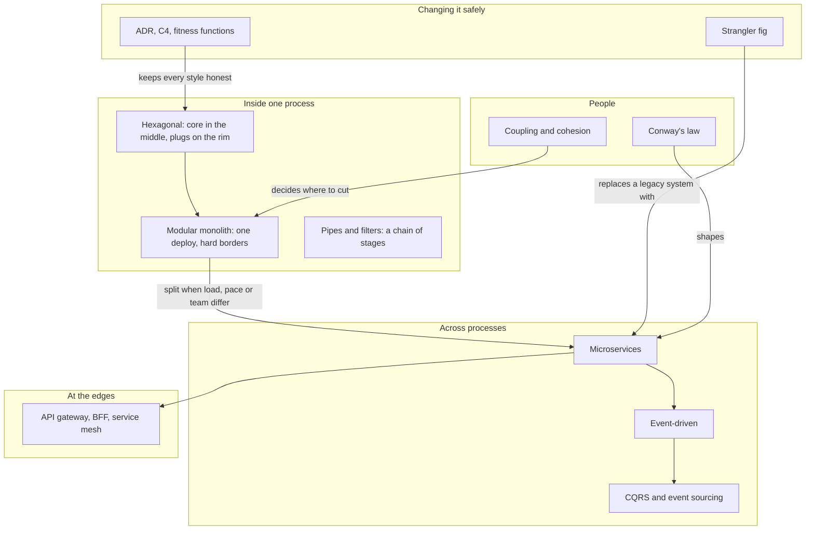

## The map in words

Inside one process, put the business core in the middle and plug the world in around it.
Group the code into modules with hard borders. That is a modular monolith.
Split a module into its own service only when its load, release pace or team differs.
Services then talk through events and meet clients through a gateway.
Conway's law and coupling decide where the cuts go. The strangler fig and the decision records keep change safe.

| Style | Buys you | Costs you | Pick it when |
|---|---|---|---|
| Layered | Simple, familiar | Domain tied to the database | Small CRUD (create, read, update, delete) app |
| Hexagonal, clean, onion | Testable core, swappable infrastructure | Indirection | Rich rules, long life |
| Modular monolith | One deploy, enforced borders, cheap split later | Discipline in the build | Default for a new product |
| Microservices | Independent scale, deploy, teams | Network, consistency, operations | Different load, pace or owner per part |
| Event-driven | Decoupled producers and consumers | Hidden flow, idempotency work | Many readers of one fact |
| Pipes and filters | Simple stages, back-pressure | Linear only | Data transformation chains |
| CQRS and event sourcing | Fit read models, rebuildable state | Lag, versioning | Reads differ from writes, history matters |
| Service-based | Few coarse services, one database server | Shared server tempts shared tables | First step out of a monolith |
| Microkernel | Small core, features as plug-ins | Contract versioning | Many variants of one job |
| Serverless | Scale to zero, pay per call | Time limits, cold starts | Short, bursty, event-triggered work |
| Space-based | Bursts served from memory | Collisions, data must fit in memory | Short, huge bursts on small data |
| Cell-based | Small blast radius | Many copies to run | Many tenants, high availability |

## Layered versus hexagonal

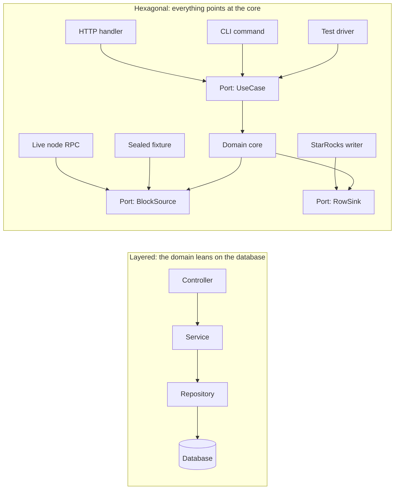

**Story.** The Go EVM indexer decodes blocks. Its core asks a `BlockSource` port for blocks and a `RowSink` port to write rows.
In production, one adapter reads a live chain node. In tests, another replays a sealed fixture file.
The core cannot tell the difference, and it never changed for a test.

**How it works.**

1. Put the business rules in the middle (`Domain core`).
2. The core defines ports: interfaces in its own words (`BlockSource`, `RowSink`).
3. Adapters outside implement the ports: a node reader, a fixture reader, a StarRocks writer.
4. Driving adapters (HTTP, CLI, test) call in through a use-case port.
5. Every source code dependency points inward. The core imports nothing from the rim.
6. Swap an adapter and run the same core.

### In code

The code uses the shop from the lesson, because a price rule fits on one screen. `PlaceOrder` and `OrderStore` play the part of `BlockSource` and `RowSink`: the core declares them, and adapters plug in from outside.

```text
port PlaceOrder: place(qty) gives an order    # the core owns it
port OrderStore: save(order)                  # the core owns it
core.place(qty):
    subtotal = qty * phone price (200 EUR)
    total = subtotal
    if subtotal > 500: total = subtotal * 90 / 100
    store.save(order with total)              # a port, not Postgres
    return the order
REST adapter: read qty from POST /orders, call core.place(qty)
CLI adapter: read qty from the command, call core.place(qty)
Postgres adapter: save = INSERT INTO orders
memory adapter: save = put the order in a map
test: core with memory adapter, want place(3).total == 540
rule: adapters import the core, the core imports no adapter
```

```go
type PlaceOrder interface {
	Place(qty int) Order
}

type OrderStore interface {
	Save(o Order)
}

type Core struct{ store OrderStore }

func (c Core) Place(qty int) Order {
	subtotal := qty * phonePrice // 3 x 200 = 600 EUR
	total := subtotal
	if subtotal > 500 { // the rule: over 500 EUR, 10 percent off
		total = subtotal * 90 / 100
	}
	o := Order{Qty: qty, Total: total}
	c.store.Save(o)
	return o
}

func restAdapter(p PlaceOrder, bodyQty int) Order { return p.Place(bodyQty) }

func cliAdapter(p PlaceOrder, flagQty int) Order { return p.Place(flagQty) }

func (postgresAdapter) Save(o Order) {
	fmt.Printf("  postgres: INSERT INTO orders (qty, total) VALUES (%d, %d)\n", o.Qty, o.Total)
}

func (m memoryAdapter) Save(o Order) { m.orders[len(m.orders)+1] = o }

// in main: the same core, under a test
mem := memoryAdapter{orders: map[int]Order{}}
swapped := Core{store: mem}
got := swapped.Place(3)
```

Run it: `handbook/code/02-hexagonal/`

```bash
cd handbook/code/02-hexagonal && go run .
```

**What goes wrong.** A port shaped like its adapter: a `SQLRepository` port that leaks SQL. The core now depends on the database after all.
A second failure: business rules written in the HTTP controller. Fix: a port speaks the domain's language, and the controller only translates.

**Where you use it.**

- The indexer's T2 (integration) tests: the real binary, a fixture adapter, a throwaway StarRocks.
- Clean architecture (Robert Martin's rings) and onion architecture (Jeffrey Palermo's) are the same rule drawn as rings. Say so in the interview.
- A 300-line tool does not need it. Layered is fine there.

> Ports belong to the core, adapters plug in from outside, and every dependency points inward.

▶ Watch it move: [Hexagonal architecture](visual/02-hexagonal.html)

## Layered architecture and the sinkhole layer

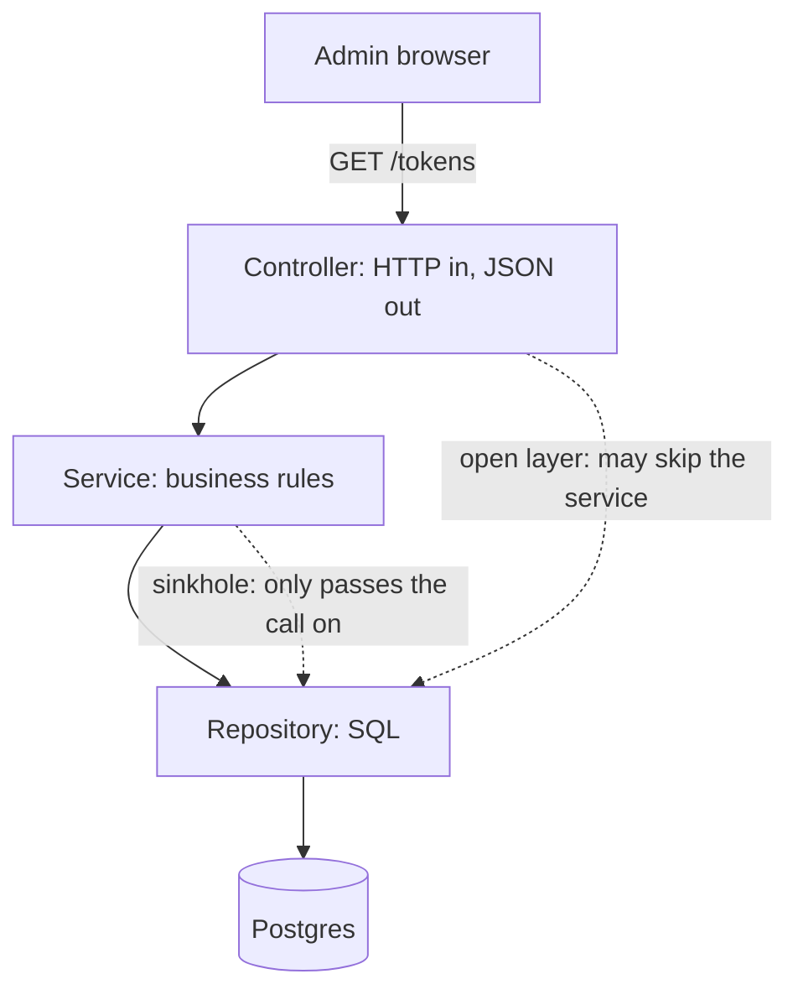

**Story.** An admin tool for the price oracle lists tokens and edits their names.
A request goes controller, service, repository, Postgres. Each layer calls the one below.
Most service methods only pass the call on. Then a real rule arrived, "never show a price from fewer than three sources", and it landed in the controller and in an SQL filter.

**How it works.**

1. The controller takes HTTP and returns JSON.
2. It calls the service layer, where business rules belong.
3. The service calls the repository, which holds the SQL.
4. The repository talks to the database.
5. Closed layers: each layer calls only the one right below.
6. An open layer may be skipped. Say which layers are open.

### In code

```text
GET /tokens -> controller.getTokens()
controller: if the service is open: rows = repository.listTokens()
  else: rows = service.listTokens()            # closed: only the layer below
service.listTokens(): return repository.listTokens()   # passes the call on
service.renameToken(sym, name): name is 1 to 32 characters, then repository
repository.listTokens(): return db.select(sources >= 0)
repository.exportPrices(): return db.select(sources >= exportMin)  # rule copy 2
db.select(min): the rows where sources >= min    # the SQL
controller: shown = rows where sources >= minSources  # rule copy 1
controller: return json(shown)                  # rows travel back up
sinkholes = service methods that only forward the call
# the fix: one home for the rule, in a domain object both paths call
```

```go
func (c *Controller) GetTokens() (string, int) {
	trace = append(trace, "controller")
	var rows []Token
	if c.open {
		rows = c.repo.ListTokens() // skip the service on purpose
	} else {
		rows = c.svc.ListTokens() // closed: only the layer below
	}
	var shown []Token
	for _, t := range rows {
		if t.Sources >= c.minSources { // rule copy 1
			shown = append(shown, t)
		}
	}
	b, _ := json.Marshal(shown)
	return string(b), len(shown)
}

func (s *Service) ListTokens() []Token { s.pass("ListTokens"); return s.repo.ListTokens() }
func (s *Service) pass(method string) {
	s.forwarded[method] = true // a sinkhole: no rule, no change
}
func (s *Service) RenameToken(sym, name string) error {
	if name == "" || len(name) > 32 { // a real rule
		return errors.New("name must be 1 to 32 characters")
	}
	s.repo.RenameToken(sym, name)
	return nil
}

func (r *Repository) ListTokens() []Token {
	trace = append(trace, "repository")
	return r.db.Select(0)
}
func (r *Repository) ExportPrices() []Token {
	return r.db.Select(r.exportMin) // rule copy 2, in SQL
}

// Select is the SQL: SELECT * FROM tokens WHERE sources >= min.
func (db *Database) Select(min int) []Token {
	for _, t := range db.rows {
		if t.Sources >= min {
			out = append(out, t)
		}
	}
	return out
}

// main: count the service methods that only forward
	fmt.Printf("  service methods: 5, only pass the call on: %d\n", len(svc.forwarded))
```

Run it: `handbook/code/02-layered/`

```bash
cd handbook/code/02-layered && go run .
```

**What goes wrong.** The sinkhole: most requests pass through a layer that adds nothing, so every screen costs three empty files.
Worse, rules leak into the controller and the SQL, and one copy is missed when the rule changes. Fix: one home for each rule. When rules grow, move to hexagonal.

**Where you use it.**

- A small CRUD (create, read, update, delete) admin tool. Spring and ASP.NET tutorials use this shape.
- Mark Richards' rule of thumb: if most requests sink straight through, open the layer or change the style.
- The step up is the next section's rings, or hexagonal ports.

> Layered stacks controller, service, repository and database, and fits CRUD until most calls sink through and rules leak into two places.

▶ Watch it move: [Layered architecture](visual/02-layered.html)

## Clean and onion architecture

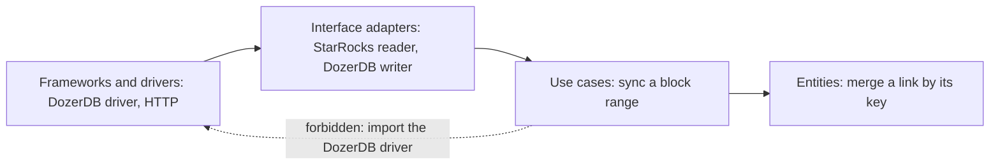

**Story.** The graph sync keeps one rule in the middle: a link between two addresses is merged by its key, never added twice.
The use case "sync a block range" wraps it and defines the interfaces it needs.
A StarRocks reader and a DozerDB writer implement those interfaces from outside. One day a developer imported the DozerDB driver into the use case, and the lint refused it.

**How it works.**

1. Entities hold the rules that would be true without a computer.
2. Use cases run one job and own the interfaces they need (`RowReader`, `LinkWriter`).
3. Interface adapters implement those interfaces and translate.
4. Frameworks and drivers sit on the rim. They are details.
5. The dependency rule: source code dependencies point inward only.
6. Onion (Jeffrey Palermo) names the rings domain model, domain services, application services and infrastructure. Clean (Robert Martin) names them as above. Same rule.

### In code

```text
# entities: true with no computer at all
link.key = from + "->" + to
mergeLink(graph, link): if link.key is in graph: return not added
  else: graph[link.key] = link, return added      # never added twice
# use cases own the interfaces they need
interface RowReader: rows(from, to)    interface LinkWriter: merge(links)
syncRange(reader, writer, from, to):
  links = one link per row of reader.rows(from, to)
  return writer.merge(links)
# adapters implement the interfaces
memReader implements RowReader            # the StarRocks reader in production
memWriter implements LinkWriter: mergeLink for each link  # the DozerDB writer
ring = {entities 0, usecases 1, adapters 2, drivers 3}
lint(imports): refuse each import where ring(to) > ring(from)  # points out
# rings for CRUD
field copies = fields x rings, rules protected = 0
```

```go
func (l Link) Key() string { return l.From + "->" + l.To }

func MergeLink(g map[string]Link, l Link) (added bool) {
	if _, seen := g[l.Key()]; seen {
		return false // merged, never added twice
	}
	g[l.Key()] = l
	return true
}

type RowReader interface{ Rows(from, to int) []Row }
type LinkWriter interface {
	Merge(links []Link) (added int)
}

func SyncRange(r RowReader, w LinkWriter, from, to int) (rows, added int) {
	var links []Link
	for _, row := range r.Rows(from, to) {
		links = append(links, Link{row.From, row.To})
	}
	return len(links), w.Merge(links)
}

type memReader struct{ rows []Row }            // stands in for the StarRocks reader
type memWriter struct{ graph map[string]Link } // stands in for the DozerDB writer

func (m memWriter) Merge(links []Link) int {
	added := 0
	for _, l := range links {
		if MergeLink(m.graph, l) {
			added++
		}
	}
	return added
}

var ring = map[string]int{"entities": 0, "usecases": 1, "adapters": 2, "drivers": 3}

func Lint(imports []Import) []string {
	var bad []string
	for _, im := range imports {
		if ring[im.To] > ring[im.From] { // points outward
			bad = append(bad, im.From+" imports "+im.To)
		}
	}
	return bad
}

fields, rings := 5, 4 // a CRUD app that edits one table of 5 fields
	fmt.Printf("rings for CRUD: %d fields x %d rings = %d field copies, %d mappers, rules protected: 0\n",
		fields, rings, fields*rings, rings-1)
```

Run it: `handbook/code/02-clean-onion/`

```bash
cd handbook/code/02-clean-onion && go run .
```

**What goes wrong.** One outward import, and the core cannot be tested without the database.
The other failure is ceremony: four projects and a mapper per ring for an app that edits one table. Fix: an import lint for the rule, and rings only where rules are rich.

**Where you use it.**

- The graph sync's merge rule is tested with an in-memory `LinkWriter`. The DozerDB writer gets its own test against a real server.
- .NET and Java "clean architecture" templates: Domain, Application, Infrastructure, Web projects, with references pointing in.
- Hexagonal, clean and onion are one idea. Name the rule, not the brand.

> Clean and onion are hexagonal drawn as rings: the rules in the middle, details outside, and every source dependency points inward.

▶ Watch it move: [Clean and onion architecture](visual/02-clean-onion.html)

## Vertical slice architecture

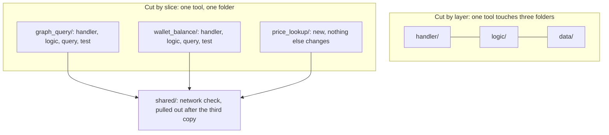

**Story.** A local MCP (Model Context Protocol) proxy exposes tools: `graph_query`, `wallet_balance`, `subscription_topup`.
Cut by layer, adding `price_lookup` means a handler, a logic file and a query in three folders.
Cut by slice, it is one new folder. The cost came later: the network-name check was copied into three slices, and a new network was added to one copy only.

**How it works.**

1. Group code by feature, not by technical kind.
2. Each slice holds its handler, logic, data access and test.
3. A new feature is a new slice. Other slices do not change.
4. Each slice is as simple or as rich as it needs.
5. Slices never call each other.
6. Shared rules move to a small shared package, only once the same code appears a third time.

### In code

```text
layerChange(tool): for each layer in handler, logic, data:
  edit layer/tool.go and layer/registry.go       # one tool, three folders
sliceChange(tool): edit tool/handler.go, logic.go, query.go, tool_test.go
foldersTouched(files) = the distinct folders of the files
conflicts(a, b) = the files both changes edit
# each slice keeps its own copy of the network check
graph_query.check = allow(robinhood, base)        # updated
wallet_balance.check = allow(robinhood)           # missed
subscription_topup.check = allow(robinhood)       # missed
refusing = the tools whose check says no to base
# the fix: share after the third copy
shared = allow(robinhood, base)                   # shared/network.go
for each slice: slice.check = shared
```

```go
func layerChange(tool string) []string {
	var files []string
	for _, layer := range []string{"handler", "logic", "data"} {
		files = append(files, layer+"/"+tool+".go", layer+"/registry.go")
	}
	return files
}

func sliceChange(tool string) []string {
	return []string{
		tool + "/handler.go", tool + "/logic.go",
		tool + "/query.go", tool + "/tool_test.go",
	}
}

func foldersTouched(files []string) []string {
	seen := map[string]bool{}
	for _, f := range files {
		seen[path.Dir(f)] = true
	}
	// return the folders in seen, sorted
}

func conflicts(a, b []string) []string {
	// inA holds every file of change a
	for _, f := range b {
		if inA[f] {
			out = append(out, f)
		}
	}
	return out
}

slices := map[string]checkNetwork{
	"graph_query":        copyOf("robinhood", "base"),
	"wallet_balance":     copyOf("robinhood"),
	"subscription_topup": copyOf("robinhood"),
}
for _, n := range names {
	if !slices[n]("base") { // refuses a valid network
		out = append(out, n)
	}
}

shared := copyOf("robinhood", "base") // shared/network.go, one copy
for _, n := range names {
	slices[n] = shared // every slice calls the shared check
}
```

Run it: `handbook/code/02-vertical-slice/`

```bash
cd handbook/code/02-vertical-slice && go run .
```

**What goes wrong.** Copied rules drift: two tools refuse a valid network because one copy was updated.
Fix: pull a rule out into shared code once it repeats, and keep domain rules in a core the slices call.

**Where you use it.**

- Tool servers and APIs with many independent endpoints.
- .NET with MediatR (Jimmy Bogard): one handler per request.
- On top of a domain core: slices for requests, the core for rules many slices share.

> Vertical slices group code by feature, top to bottom, so a new feature touches one folder instead of every layer.

▶ Watch it move: [Vertical slice architecture](visual/02-vertical-slice.html)

## Microkernel architecture

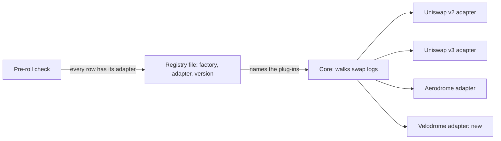

**Story.** The indexer's exchange decoder has a small core that walks swap logs.
Each exchange is a plug-in adapter, named in a registry file with its factory address and version.
A new exchange is one adapter and one registry row, and the core is not edited. Once a registry named an adapter version the binary did not carry, and the core restarted in a loop.

**How it works.**

1. A small core does the common job: read receipts, find swap logs.
2. Plug-ins do the variable job: decode one exchange's logs into rows.
3. A contract joins them: one interface plus a registry (a manifest).
4. The core reads the registry at start-up and routes each log to its plug-in.
5. Adding a feature means adding a plug-in, never editing the core.

### In code

```text
interface Adapter: decode(log) -> swap        # the plug-in contract
registry row = factory, adapter, version
start(registry, binary):
  for each row: adapter = binary[row.adapter @ row.version]
    if it is missing: fail "unknown adapter"   # the core cannot start
    route[row.factory] = adapter
walk(logs): for each log: route[log.factory].decode(log)  # no exchange code
# a new exchange: one plug-in, one row
binary += velodrome@1, registry += (factory-ve, velodrome, 1)
# the fix: before every roll
preRoll(registry, binary): missing = rows whose adapter@version is not in binary
verdict = go if missing is empty, else no-go
```

```go
type Adapter interface {
	Decode(log Log) Swap
}

type RegistryRow struct {
	Factory, Adapter string
	Version          int
}

func Start(reg []RegistryRow, bin Binary) (*Core, error) {
	c := &Core{route: map[string]Adapter{}}
	for _, r := range reg {
		a, ok := bin[id(r.Adapter, r.Version)]
		if !ok {
			return nil, fmt.Errorf("unknown adapter %s", id(r.Adapter, r.Version))
		}
		c.route[r.Factory] = a
	}
	return c, nil
}

func (c *Core) Walk(logs []Log) []Swap {
	for _, l := range logs {
		if a, ok := c.route[l.Factory]; ok {
			out = append(out, a.Decode(l))
		}
	}
	return out
}

bin["velodrome@1"] = exchange{"Velodrome"}
reg = append(reg, RegistryRow{"factory-ve", "velodrome", 1})

func PreRoll(reg []RegistryRow, bin Binary) (string, []string) {
	var missing []string
	for _, r := range reg {
		if _, ok := bin[id(r.Adapter, r.Version)]; !ok {
			missing = append(missing, id(r.Adapter, r.Version))
		}
	}
	if len(missing) > 0 {
		return "no-go", missing
	}
	return "go", nil
}
```

Run it: `handbook/code/02-microkernel/`

```bash
cd handbook/code/02-microkernel && go run .
```

**What goes wrong.** Contract drift: the registry names a plug-in or a version the binary does not have, and the core cannot start.
Fix: version the contract, and check the registry against the binary before every roll.

**Where you use it.**

- The DEX decoder: ship the registry with the binary, run the pre-roll check, roll only on "go".
- VS Code extensions, Eclipse plug-ins, browser extensions, Claude Code skills.
- Rules engines and insurance claim systems, where each product is a plug-in.

> A microkernel keeps a small core and adds features as plug-ins through one contract, so the contract is what you version and check.

▶ Watch it move: [Microkernel architecture](visual/02-microkernel.html)

## Modular monolith

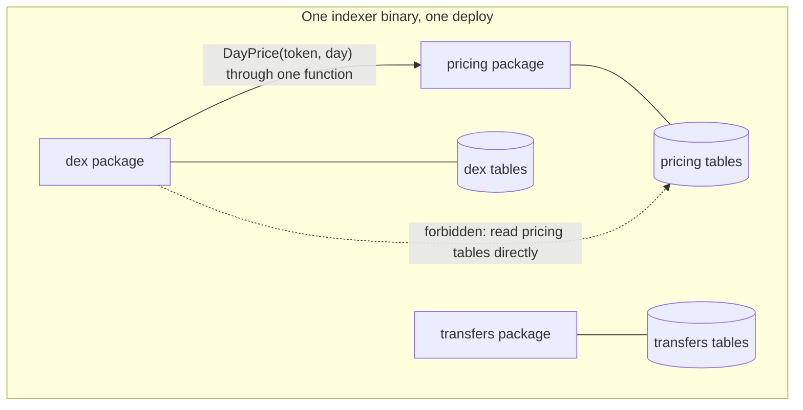

**Story.** The indexer holds `pricing`, `dex` and `transfers` as packages in one binary.
Each package owns its own tables. `dex` asks `pricing` for a day price through one function.
It never reads the pricing tables. A year on, none of them needed to become a service.

**How it works.**

1. One deployable unit holds the whole system.
2. Each module is a bounded context with its own package and its own tables.
3. Modules talk through interfaces or in-process events (the solid arrow).
4. No module reads another module's tables (the dotted arrow is forbidden).
5. The build enforces it: internal packages, an import lint, one schema per module.
6. A later split is a move of a package, not a rewrite.

### In code

```text
build():
  if the import check is off: return PASS            # nothing checked
  for each package p, for each import q of p:
    if q sits under X/internal/ and p is not X: forbidden
  PASS if no forbidden import, else FAIL
# a call through an exported function imports only the package
dex imports pricing, calls DayPrice(token, day)       # allowed
forbiddenReads = every read of table t by p where owner(t) is not p
change(t): every reader of t except its owner breaks
cascade(t): each broken reader changes its own tables to fix itself
  so their readers break next
splitCost(m) = packages outside m that read m's tables
# 0 packages: a split is a move. 1 or more: a rewrite first
# the fix for borders by convention
turn the import check on in the build
```

```go
func (b *Binary) forbiddenImports() (bad []string) {
	for _, m := range b.mods {
		for _, imp := range m.imports {
			i := strings.Index(imp, "/internal/")
			if i >= 0 && imp[:i] != m.name { // the importer is outside the tree
				bad = append(bad, m.name+" -> "+imp)
			}
		}
	}
	return
}

func (b *Binary) build() (ok bool, bad []string) {
	if b.enforce { // off: nothing is checked
		bad = b.forbiddenImports()
	}
	return len(bad) == 0, bad
}

func (b *Binary) forbiddenReads() (bad []string) {
	for _, m := range b.mods {
		for _, t := range m.reads {
			if o := b.owner(t); o != m.name {
				bad = append(bad, m.name+" reads "+t)
			}
		}
	}
	return
}

func (b *Binary) cascade(t string) (order []string) {
	for queue := []string{t}; len(queue) > 0; queue = queue[1:] {
		for _, m := range b.change(queue[0]) { // every reader but the owner
			order = append(order, m.name+" (read "+queue[0]+")")
			queue = append(queue, m.tables...) // its fix changes its own tables
		}
	}
	return
}

func (b *Binary) splitCost(name string) (rewrite []string) {
	for _, m := range b.mods { // who reads name's tables from outside?
		for _, t := range m.reads {
			if m.name != name && b.owner(t) == name {
				rewrite = append(rewrite, m.name)
			}
		}
	}
	return
}
```

Run it: `handbook/code/02-modular-monolith/`

```bash
cd handbook/code/02-modular-monolith && go run .
```

**What goes wrong.** Borders kept by convention only. One shortcut import and the module is gone. Soon it is a big ball of mud with one deploy.
Fix: let the build fail on a forbidden import.

**Where you use it.**

- The default for a new product with one or two teams.
- Go: `internal/` packages. .NET: separate projects with no cross references.
- A "monolith" is a deployment choice, not a failure. The failure is having no borders inside.

> A modular monolith is one deploy with borders the build enforces, so a later split is a move, not a rewrite.

▶ Watch it move: [Modular monolith](visual/02-modular-monolith.html)

## Service-based architecture

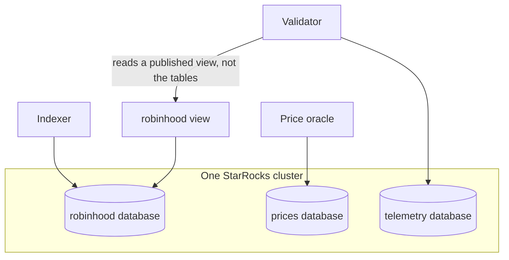

**Story.** The indexer, the price oracle and the validator deploy on their own.
They share one StarRocks cluster, and each owns its own database inside it.
Then the validator started reading the indexer's tables directly, and a column rename broke it. A published view fixed it.

**How it works.**

1. Cut the system into a few coarse services: usually four to twelve.
2. Each deploys on its own.
3. They share one database server, with one database or schema each.
4. Services do not call each other on a request path.
5. A reader from another service gets a view, not the tables.

### In code

```text
owner = {robinhood: Indexer, prices: Oracle, telemetry: Validator}
one StarRocks cluster holds all three databases
calls between services on a request = none
readsAcross(s):
  a table s reads whose owner is not s, and that is not a view
renameColumn(table, old, new):
  the owner updates its own queries
  broken = readers whose query names a column that is gone
# the fix
publish view transfers_v over robinhood.transfers, same column names
grant Validator select on the view only
renameColumn: the owner remaps the view in the same change
readsAcross(Validator) is empty, broken is empty
split a database off only when its load or its team differs a lot
```

```go
func (c *Cluster) readsAcross(s string) []string {
	var out []string
	for name := range c.reads[s] {
		o := c.objects[name]
		if c.owner[o.db] != s && !o.view { // a read across owners
			out = append(out, name)
		}
	}
	sort.Strings(out)
	return out
}

func (c *Cluster) renameColumn(table, old, now string) []string {
	db := c.objects[table].db
	rename(c.objects[table].columns, old, now)
	rename(c.reads[c.owner[db]][table], old, now) // the owner updates its own queries
	for _, o := range c.objects { // and keeps its views working
		if o.view && o.over == table && o.rename[old] == old {
			o.rename[old] = now
		}
	}
	var broken []string
	for s, objs := range c.reads {
		for name, cols := range objs {
			if !c.resolves(name, cols) { // a column the query names is gone
				broken = append(broken, s+" reading "+name)
			}
		}
	}
	sort.Strings(broken)
	return broken
}

// one cluster, one owner per database, no calls
owner: map[string]string{"robinhood": "Indexer", "prices": "Oracle", "telemetry": "Validator"},
calls: map[string][]string{},

// the fix: a published view, and a grant on the view only
c.objects["robinhood.transfers_v"] = &Object{
	db: "robinhood", view: true, over: "robinhood.transfers",
	rename: map[string]string{"block": "block", "amount": "amount"},
}
c.reads["Validator"] = map[string][]string{
	"telemetry.checks":      {"check", "ok"},
	"robinhood.transfers_v": {"block", "amount"},
}
```

Run it: `handbook/code/02-service-based/`

```bash
cd handbook/code/02-service-based && go run .
```

**What goes wrong.** Direct reads across owners. The shared server slides into a shared schema, and the result is a distributed monolith.
Fix: one owner per table, and a view as the contract.

**Where you use it.**

- Several services on one StarRocks or Postgres server, each with its own database.
- Mark Richards names it the pragmatic first step out of a monolith.
- Split a database off only when one service's load or team differs.

> Service-based architecture is a few coarse services sharing one database server, each owning its own schema, with no call chains between them.

▶ Watch it move: [Service-based architecture](visual/02-service-based.html)

## Microservices and the distributed monolith

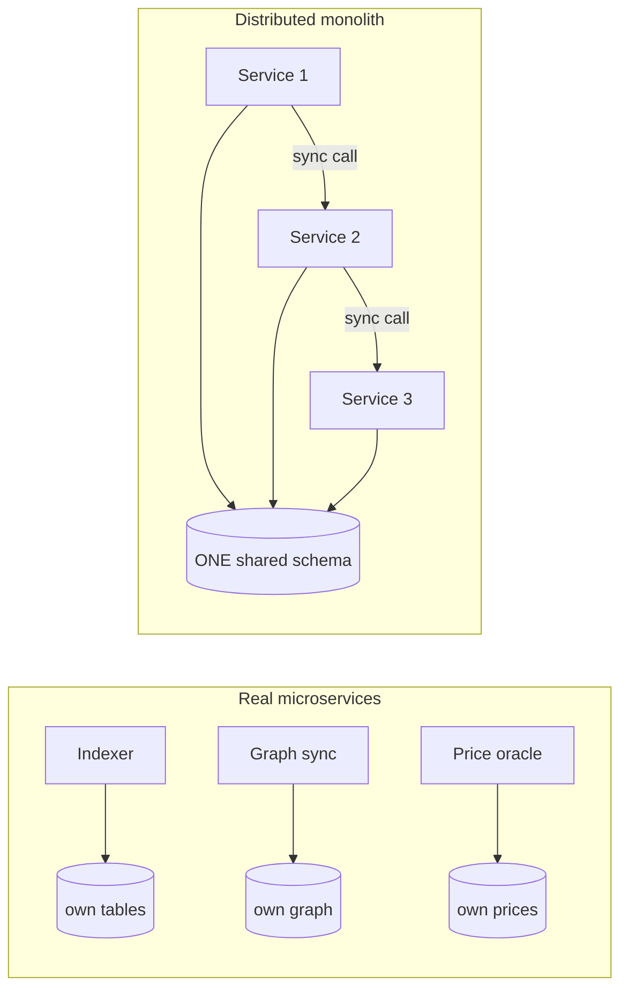

**Story.** The indexer, graph sync, price oracle, agent proxy and validator deploy on their own, each with its own release.
The graph sync was a separate service from day one: it ran at a different pace and on a different box.
Elsewhere, five services shared one schema. A column rename needed five releases in one window.

**How it works.**

1. Each service owns its data. Nobody else reads its tables (left side).
2. Each deploys and scales alone.
3. They talk over the network, by API or by events.
4. Split a module out only when its load, pace or team differs.
5. Test it: can you deploy one service alone on a Tuesday?

### In code

```text
# each service: the tables it uses, the service it calls, its own work
releasesNeeded(s):
  ship = { s }
  for each table t that s uses: ship += every user of t
  return the size of ship                   # 1 means s ships alone
scale(s): add one copy of s only
request(start):
  for each hop on the call chain: total += its own work
    a hop that calls the next holds its request open
  ok = total <= timeout                     # 2000 ms
chain availability = 0.999 ^ hops           # every hop must be up
slowestHop(trace) = the span with the most ms
# the fix
fix: each table gets one owner, the others use its API or events
```

```go
func (sys *System) releasesNeeded(s string) int {
	ship := map[string]bool{s: true}
	for _, users := range sys.tables {
		if contains(users, s) { // every user of a table s uses ships with s
			for _, u := range users {
				ship[u] = true
			}
		}
	}
	return len(ship)
}

func (sys *System) scale(s string) { sys.replicas[s]++ }

func (sys *System) request(start string, timeoutMs int) (int, []string, bool) {
	total, waiting := 0, []string{}
	for cur := start; cur != ""; cur = sys.calls[cur] {
		total += sys.work[cur]
		if sys.calls[cur] != "" {
			waiting = append(waiting, cur) // holds its request open
		}
	}
	return total, waiting, total <= timeoutMs
}

func slowestHop(trace []Span) Span {
	worst := trace[0]
	for _, s := range trace[1:] {
		if s.ms > worst.ms {
			worst = s
		}
	}
	return worst
}

func (sys *System) fix(owner map[string]string) {
	for t := range sys.tables {
		sys.tables[t] = []string{owner[t]}
	}
}

// in main: every hop must be up
fmt.Printf("  chain availability: 0.999^5 = %.4f\n", math.Pow(0.999, 5))
```

Run it: `handbook/code/02-microservices/`

```bash
cd handbook/code/02-microservices && go run .
```

**What goes wrong.** The distributed monolith (right side): a shared schema, synchronous call chains, release trains.
You pay for microservices and get none of the benefit. Fix: move each table under one owner, put others behind an API or events, or honestly merge back into a modular monolith.

**Where you use it.**

- After a split, observability breaks first. Without tracing, nobody finds the failing hop.
- A shared read replica is still coupling to the schema. Prefer a published view or events.
- SOA (service-oriented architecture) is the older cousin: coarse services on a shared bus with one company model. That bus became the new monolith.

> Microservices trade code complexity for operations complexity, and a shared database makes them a distributed monolith.

▶ Watch it move: [Microservices and the distributed monolith](visual/02-microservices.html)

## The distributed monolith

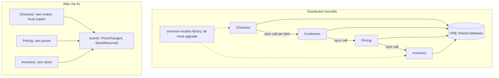

**Story.** A shop split its checkout into Checkout, Customers, Pricing and Inventory. Each has its own repository and pipeline.
But they share one database and one models library, and one checkout page calls Customers, then Pricing, then Inventory, once per cart item.
A column rename in Pricing broke Checkout. Version 13 of the models library forced all four to ship in one window.

**How it works (how to spot it).**

1. Shared database: two services read or write the same tables.
2. Shared domain library: a type change forces every service to upgrade together.
3. Chatty synchronous chains: one request waits on hop after hop.
4. Availability multiplies down: four services at 99.9 percent each give about 99.6 percent for a page that needs all four.
5. Lockstep releases: every change is a release train planned in a meeting.
6. The test: can one service deploy alone on a Tuesday with no meeting? If not, it is a distributed monolith.

### In code

```text
coupledTo(s):
  others = {}
  for each table t that s uses: others += users(t) - s     # shared database
  for each library l s imports: others += importers(l) - s # shared models
  for each call c s makes on a request: others += c.callee # must be up too
  return others
canShipAlone(s) = coupledTo(s) is empty                    # the Tuesday test
pageUp = up ^ (services the page waits on)                 # 0.999 ^ 4
# the fix
for each table t: users(t) = { owner(t) }                  # one owner
for each request call a -> b: b publishes events, a keeps a local copy
for each shared library: a versioned contract + a contract test
check canShipAlone(s) again for every service
```

```go
func (sys *System) coupledTo(s string) []string {
	others := map[string]bool{}
	for _, users := range sys.tables { // shared database
		addOthers(others, users, s)
	}
	for _, users := range sys.libs { // shared models library
		addOthers(others, users, s)
	}
	for _, callee := range sys.calls[s] { // must be up together
		others[callee] = true
	}
	var out []string
	for o := range others {
		out = append(out, o)
	}
	sort.Strings(out)
	return out
}

func (sys *System) canShipAlone(s string) bool {
	return len(sys.coupledTo(s)) == 0 // the Tuesday test
}

func (sys *System) pageAvailability(start string) (float64, int) {
	a, hops, cur := sys.up, 1, start
	for len(sys.calls[cur]) > 0 { // follow the chain
		cur = sys.calls[cur][0]
		a *= sys.up
		hops++
	}
	return a, hops
}

func (sys *System) fix() {
	for t := range sys.tables { // step 1
		sys.tables[t] = []string{owner[t]}
	}
	sys.calls = map[string][]string{} // step 2: events, local copies
	sys.libs = map[string][]string{}  // step 3: versioned contracts
}
```

Run it: `handbook/code/02-distributed-monolith/`

```bash
cd handbook/code/02-distributed-monolith && go run .
```

**What goes wrong.** You pay for microservices (network calls, operations, tracing, on-call) and get none of the independence.
Fix, in order: give every table one owner, replace synchronous chains with events and local copies, replace the shared library with versioned contracts and contract tests. Or merge back into a modular monolith with enforced borders.

**Where you use it.**

- In a design review, ask of every table: who owns it, and who else reads it?
- A split that moves code but leaves the database "for later" lands here.
- Contract tests (Pact, for example) fail a build before a change breaks a consumer.

> A distributed monolith is services that must deploy together because of a shared database, a shared models library or synchronous chains, so fix the data ownership or merge back.

▶ Watch it move: [The distributed monolith](visual/02-distributed-monolith.html)

## SOA and the enterprise service bus

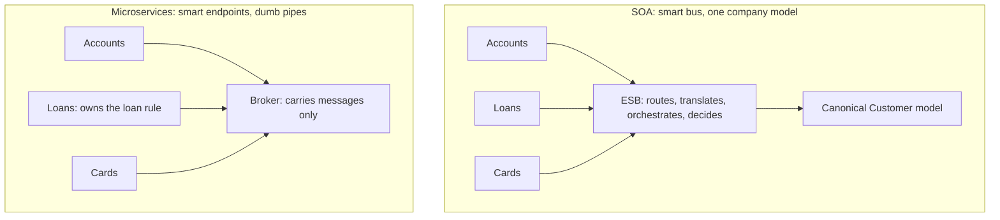

**Story.** A bank in the 2000s linked accounts, loans and cards through an ESB (enterprise service bus).
The bus translated every message into one company-wide Customer model.
Loan approval logic crept into the bus. When cards needed a new field, every team retested and waited for the integration team.

**How it works.**

1. SOA (service-oriented architecture): coarse services, built for reuse.
2. Services talk only through the bus.
3. The bus routes, translates into a canonical model, and orchestrates flows.
4. One integration team owns the bus.
5. Microservices keep the idea of services and drop the smart bus: smart endpoints, dumb pipes.

### In code

```text
bus.routes[message type] = the system the bus sends it to
bus.canonical = one company Customer model, mapped by every system
bus.rules[approveLoan] = account check, card check   # logic in the pipe
changeField(team, field):
  canonical.add(field)
  retest = every mapped system except team
  bus mappings to change = every mapped system
waitsOnPipeTeam(change) = the pipe holds the route, model or rule it touches
# smart endpoints, dumb pipes
broker = a pipe with no routes, no rules and no model
each service keeps its own model
consume(event): read only the needed fields, an extra field breaks nothing
approveLoan in Loans: ask Accounts, ask Cards, decide here
isBus(pipe) = the pipe holds a rule or a model
```

```go
// isBus is the gateway test: can the pipe team change a business outcome?
func (p *Pipe) isBus() bool { return len(p.rules) > 0 || len(p.canonical) > 0 }

func (p *Pipe) changeField(team, field string) (retest []string, mappings int) {
	p.canonical[field] = true
	for _, s := range p.mappedBy {
		if s != team {
			retest = append(retest, s)
		}
	}
	return retest, len(p.mappedBy) // every mapping in the bus changes too
}

func (p *Pipe) waitsOnPipeTeam(c Change) bool {
	switch c.touches {
	case "model":
		return len(p.canonical) > 0
	case "rule":
		return len(p.rules) > 0
	case "route":
		return len(p.routes) > 0
	}
	return false
}

// consume reads only the fields it needs. A new optional field breaks nothing.
func (s *Service) consume(event map[string]string) (ignored int, broken bool) {
	for _, f := range s.needs {
		if _, ok := event[f]; !ok {
			broken = true
		}
	}
	return len(event) - len(s.needs), broken
}

// approveLoan lives in Loans: ask the two APIs, decide here.
func approveLoan(accountOK, cardOK bool) bool { return accountOK && cardOK }

bus := &Pipe{
	routes:    map[string]string{"AccountOpened": "Loans", "CardIssued": "Accounts"},
	canonical: map[string]bool{"id": true, "name": true, "address": true},
	mappedBy:  systems,
	rules:     map[string][]string{},
}
bus.rules["approveLoan"] = []string{"account check", "card check"}
broker := &Pipe{name: "Message broker"}
acc := &Service{"Accounts", map[string]bool{"id": true, "iban": true}, []string{"id"}}
lns := &Service{"Loans", map[string]bool{"id": true, "income": true}, []string{"id", "limit"}}
```

Run it: `handbook/code/02-soa/`

```bash
cd handbook/code/02-soa && go run .
```

**What goes wrong.** The bus becomes smart. Business rules live in the pipe, and its team becomes the queue for the whole company.
A shared canonical model couples every service to every change. Fix: rules in the owning service, a model per bounded context, a pipe that only carries messages.

**Where you use it.**

- Banks, insurers and telecoms still run ESBs such as MuleSoft or IBM Integration Bus. Map where the rules live before you change anything.
- A Kafka broker or a RabbitMQ exchange is a dumb pipe. Keep it that way.
- An API gateway with business rules is the same failure, one level up.

> SOA put the logic in a shared bus with one company model; microservices keep the pipes dumb and each service owns its model.

▶ Watch it move: [SOA and the enterprise service bus](visual/02-soa.html)

## Cell-based architecture

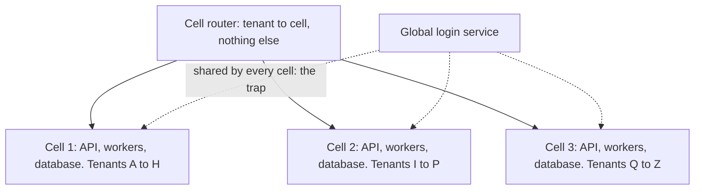

**Story.** An API serves thousands of tenants. It is split into three cells.
Each cell is a full copy of the stack with its own database, serving a third of the tenants. A thin router maps tenant to cell.
A bad release went to cell 1 first and hit only its tenants. Later, a shared login service went down and took every cell with it.

**How it works.**

1. Build the whole stack as one unit: the cell.
2. Run several cells. Each serves a slice of the tenants.
3. A thin router sends each tenant to its cell.
4. Release cell by cell. A failure hits one cell.
5. A noisy tenant hurts only its own cell, or gets a cell of its own.

### In code

```text
cells = [cell 1: A to H, cell 2: I to P, cell 3: Q to Z]
each cell = API + workers + its own database
route(tenant):
  the cell whose letter range holds the tenant's first letter
release(v2, cell 1)       # one cell first, the others stay on v1
serve(tenant): cell = route(tenant)
  if the cell's version is bad: the request fails
blastRadius = count of tenants whose serve fails
rollback(cell 1): version = v1
# the trap
serve: if login is global and the global login is down: fail
globalLogin = down
# the fix
each cell runs its own login
```

```go
// route is the thin router: tenant to cell, nothing else.
func (s *System) route(tenant string) *Cell {
	for _, c := range s.cells {
		if tenant[0] >= c.from && tenant[0] <= c.to {
			return c
		}
	}
	return nil
}

// serve answers one request inside the tenant's cell.
func (s *System) serve(tenant string) bool {
	c := s.route(tenant)
	if c.login == "global" && !s.globalLogin { // shared by every cell
		return false
	}
	return !s.bad[c.version]
}

// blastRadius counts the tenants whose requests fail.
func (s *System) blastRadius() int {
	hit := 0
	for _, t := range s.tenants {
		if !s.serve(t) {
			hit++
		}
	}
	return hit
}

cells: []*Cell{
	{"cell 1", 'A', 'H', "v1", "global"},
	{"cell 2", 'I', 'P', "v1", "global"},
	{"cell 3", 'Q', 'Z', "v1", "global"},
},
s.cells[0].version = "v2" // release to one cell first
s.cells[0].version = "v1" // roll back one cell
s.globalLogin = false // the trap: one login service for every cell
for _, c := range s.cells { // the fix: login inside each cell
	c.login = "own"
}
```

Run it: `handbook/code/02-cell-based/`

```bash
cd handbook/code/02-cell-based && go run .
```

**What goes wrong.** Anything shared across cells: a global login, a global database, a fat router. It fails, and every cell fails with it.
Fix: put dependencies inside each cell, keep the router tiny and static.

**Where you use it.**

- AWS builds many services from cells. Slack and DoorDash have written about moving to cells.
- Two full lanes behind a pointer are the two-cell cousin: used to switch versions, not to split tenants. The same rule holds: share nothing that can take both down.
- Size a cell so it can be tested at full load.

> Cells are full copies of the stack, each serving a slice of tenants behind a thin router, so one failure hits one cell.

▶ Watch it move: [Cell-based architecture](visual/02-cell-based.html)

## Event-driven architecture

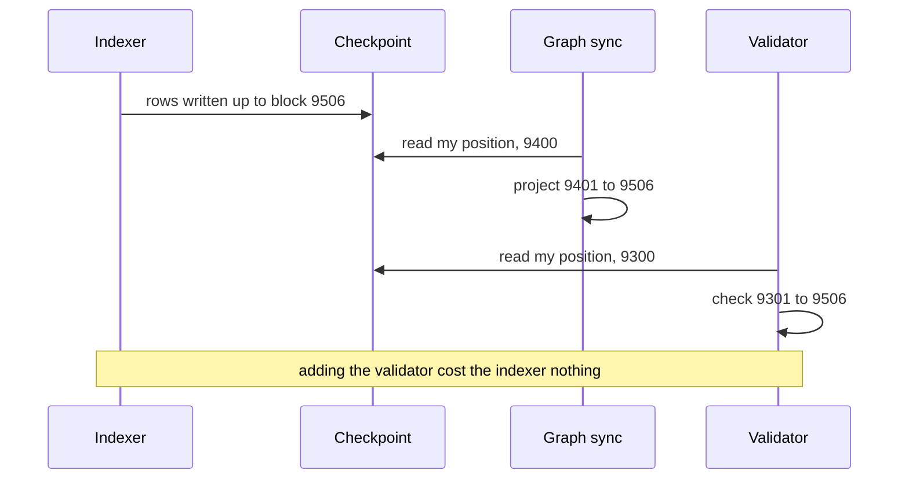

**Story.** The indexer writes rows and moves a checkpoint forward.
The graph sync reads from its own position and projects. Later a validator joined as a second reader.
The indexer did not change at all.

**How it works.**

1. A producer publishes a fact: rows plus a checkpoint, or an event on a broker.
2. The producer does not know its consumers.
3. Each consumer keeps its own position.
4. Delivery is at least once, so each consumer must be idempotent.
5. Ordering holds per key, not globally.
6. A replay is moving a consumer's position back.

### In code

```text
write(to):                                    # the indexer
  for each block b after the checkpoint, up to to: rows[b] = decode(b)
  checkpoint = to                             # no call to any reader
read(reader, stop):                           # each reader, alone
  for each block b after reader.position, up to stop and the checkpoint:
    store[b] = rows[b]                        # keyed by block: a repeat is harmless
  save reader.position = stop                 # a crash skips this line
decode(b): a wrong value if the decoder bug touches b
# wrong fix: rewrite rows in place while everyone runs
for b in 9500..9506: rows[b] = the right value  # readers past 9506 never come back
# right fix: the reset
stop the indexer, the graph sync and the validator
delete rows after 9499, checkpoint = 9499
every reader: drop what it built after 9499, position = 9499
start all: write(9600), then each reader read(9600)
```

```go
func (ix *Indexer) decode(block int) int {
	if block >= ix.bugFrom && block <= ix.bugTo {
		return -1 // the bug: a wrong row
	}
	return correct(block)
}

func (ix *Indexer) write(log *Log, to int) {
	for b := log.checkpoint + 1; b <= to; b++ {
		log.rows[b] = ix.decode(b)
	}
	log.checkpoint = to // then the checkpoint: all up to here is written
}

func (r *Reader) read(log *Log, stop int, crash bool) {
	for b := r.position + 1; b <= stop && b <= log.checkpoint; b++ {
		r.store[b] = log.rows[b] // same block, same value: a repeat is harmless
		r.reads++
	}
	if !crash { // a crash skips the save
		r.position = min(stop, log.checkpoint) // save my own position
	}
}

func reset(log *Log, to int, readers ...*Reader) (deleted int) {
	for b := range log.rows {
		if b > to {
			delete(log.rows, b)
			deleted++
		}
	}
	log.checkpoint = to
	for _, r := range readers {
		for b := range r.store {
			if b > to {
				delete(r.store, b)
			}
		}
		r.position = to
	}
	return
}
```

Run it: `handbook/code/02-event-driven/`

```bash
cd handbook/code/02-event-driven && go run .
```

**What goes wrong.** A decoder bug writes bad rows. Every reader has already consumed them.
Fixing one reader while the others keep going leaves the graph wrong for good. Fix: a reset stops every writer and every reader, and rewinds them together.

**Where you use it.**

- The outbox pattern keeps a database write and an event publish atomic.
- Choreography for a few steps. An orchestrator (a saga) when the flow needs a visible owner.
- Draw the flow. The code will not show it.

> Producers publish facts and never wait, so consumers must be idempotent and a reset rewinds everyone.

▶ Watch it move: [Event-driven architecture](visual/02-event-driven.html)

## At-least-once delivery and idempotency

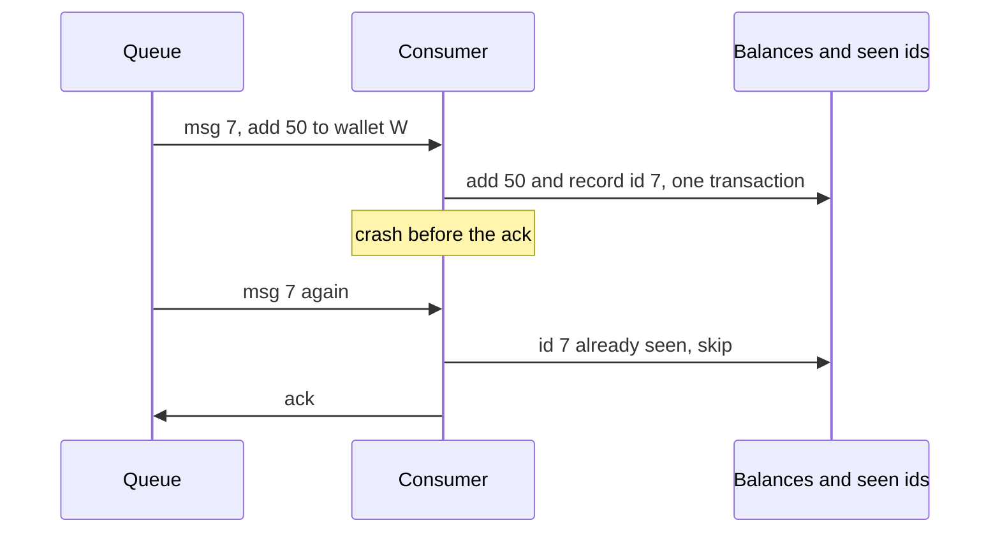

**Story.** Message 7 says: add 50 to wallet W, which holds 100.
A careless consumer adds 50, crashes before it acknowledges, gets message 7 again and adds 50 again. W shows 200.
A careful consumer records id 7 in the same transaction as the change. On the repeat it finds id 7 and skips.

**How it works.**

1. The queue keeps a message until the consumer sends an ack (acknowledgement).
2. The consumer does the work, then sends the ack.
3. A crash between the work and the ack means the message comes again.
4. That is at-least-once delivery: repeats are normal.
5. So the effect must be idempotent: doing it twice equals doing it once.
6. Ways to get there: record the message id with the change, merge by a natural key, set a value instead of adding to it.

### In code

```text
deliver(): return the first message with no ack yet      # kept until the ack
consumeNaive(msg):
  balance[msg.wallet] += msg.amount                      # adds every time
  if the process crashes here: stop                      # the ack is never sent
  ack(msg)
# no ack, so deliver() returns the same message again    # at-least-once
consumeOnce(msg):
  tx = begin()
  if msg.id is in tx.seen: ack(msg), return              # a repeat: skip the work
  tx.balance[msg.wallet] += msg.amount
  tx.seen += msg.id
  commit(tx)                                             # both or neither
  if the process crashes here: stop                      # the id is already saved
  ack(msg)
# other ways to be idempotent
setBalance(w, v): balance[w] = v                         # set, not add
merge a row by its key, never insert it twice
```

```go
func (q *Queue) deliver() (Msg, bool) {
	for _, m := range q.msgs {
		if !q.acked[m.ID] { // no ack yet: deliver it (again)
			return m, true
		}
	}
	return Msg{}, false
}

func consumeNaive(q *Queue, s *Store, m Msg, crash bool) error {
	s.balance[m.Wallet] += m.Amount // adds every time
	if crash {
		return errCrash // the ack is never sent
	}
	q.ack(m)
	return nil
}

func consumeOnce(q *Queue, s *Store, m Msg, crash bool) (applied bool, err error) {
	tx := s.begin()
	if tx.seen[m.ID] { // a repeat: skip the work, just ack
		q.ack(m)
		return false, nil
	}
	tx.balance[m.Wallet] += m.Amount
	tx.seen[m.ID] = true
	s.commit(tx) // the effect and the id commit together
	if crash {
		return true, errCrash
	}
	q.ack(m)
	return true, nil
}

func setBalance(s *Store, wallet string, v int) { s.balance[wallet] = v }
```

Run it: `handbook/code/02-at-least-once/`

```bash
cd handbook/code/02-at-least-once && go run .
```

**What goes wrong.** A consumer that adds instead of setting, and has no record of what it applied. Every repeat corrupts money or counts.
Fix: at-least-once delivery plus an idempotent effect. That gives exactly-once results.

**Where you use it.**

- Kafka commits offsets after the work. Amazon SQS redelivers after a visibility timeout. Both repeat.
- A graph sync merges each link by its key, so re-reading a block range is safe.
- At-most-once (ack first) only for data you can lose, such as metrics.

> At-least-once delivery means repeats will come, so every consumer makes its effect idempotent by merging, setting or recording the message id.

▶ Watch it move: [At-least-once delivery and idempotency](visual/02-at-least-once.html)

## Choreography versus orchestration

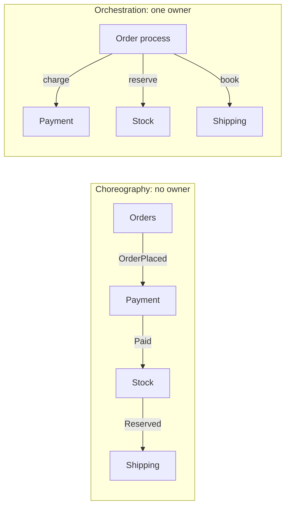

**Story.** A customer orders a phone. Payment, stock and shipping each do a part.
With choreography, each service reacts to the event before it. One day Stock never published Reserved, and the order sat paid and unshipped. Nobody noticed.
With orchestration, an order process tells each step what to do. When Stock said "out of stock", it ran the refund.

**How it works.**

1. Choreography: a service publishes an event and moves on.
2. Others react and publish their own events. No one owns the whole flow.
3. Orchestration: one process holds the order's state and the list of steps.
4. It calls each step, waits for the reply, and runs undo steps on failure.
5. That is a saga with an orchestrator.

### In code

```text
publish(event, order):
  for each handler h subscribed to event: h(order)   # nobody owns the flow
on OrderPlaced: Payment charges, then publish Paid
on Paid: Stock reserves, then publish Reserved
on Reserved: Shipping books, then publish Shipped
on Shipped: Orders marks the order done
placeOrder(o): publish(OrderPlaced, o)               # and move on
# the bug: Stock fails silently and never publishes Reserved
# the fix: a timeout watcher per order
watch(now): every order not done after 30 minutes is stuck
```

```go
func (b *Bus) publish(event string, order int) {
	b.log = append(b.log, fmt.Sprintf("%s(%d)", event, order))
	for _, h := range b.subs[event] { // nobody owns the flow
		h(order)
	}
}

func wire(b *Bus, stockBug bool) {
	b.subscribe("OrderPlaced", func(o int) { status[o] = "paid"; b.publish("Paid", o) })
	b.subscribe("Paid", func(o int) {
		status[o] = "reserved"
		if stockBug {
			status[o] = "paid" // the bug: the reservation fails silently
			return             // and Reserved is never published
		}
		b.publish("Reserved", o)
	})
	b.subscribe("Reserved", func(o int) { b.publish("Shipped", o) })
	b.subscribe("Shipped", func(o int) { status[o] = "done" })
}

func watch(now, limit int) []int {
	var stuck []int
	for o, s := range status {
		if s != "done" && now-placedAt[o] > limit {
			stuck = append(stuck, o)
		}
	}
	return stuck
}

b.publish("OrderPlaced", 4410) // Orders publishes and moves on
```

Run it: `handbook/code/02-choreography-orchestration/`

```bash
cd handbook/code/02-choreography-orchestration && go run .
```

**What goes wrong.** Choreography: the flow lives only in the sum of the services, so a stuck order is invisible.
Orchestration: domain rules drift into the orchestrator until it is a god service. Fix: a timeout watcher for choreography, and an orchestrator that holds the sequence, never the rules.

**Where you use it.**

- Choreography for a few steps between loosely linked teams.
- Orchestration with Temporal, AWS Step Functions or Camunda for many steps and compensation.
- A lane reset that stops every writer in order is orchestration: one runbook owns the sequence.

> Choreography lets services react to events with no owner; orchestration gives one process the sequence, so pick by how many steps and how visible the flow must be.

▶ Watch it move: [Choreography versus orchestration](visual/02-choreography-orchestration.html)

## Serverless functions

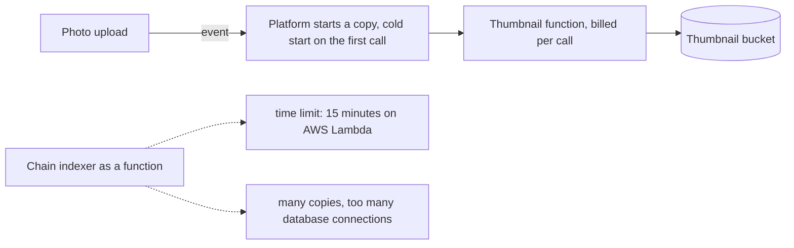

**Story.** Users upload photos. A function makes a thumbnail for each one.
At night nothing runs and nothing is billed. A school uploads its class photos and the platform starts many copies at once.
Then someone moved a chain indexer into functions. Calls hit the time limit, and the copies ran the database out of connections.

**How it works.**

1. An event triggers the function: an upload, a webhook, a timer.
2. The platform starts a copy. The first call on a new copy waits for a cold start.
3. The function runs, writes its result and returns.
4. Many events at once: many copies.
5. No events: zero copies, and no compute bill.

### In code

```text
invoke(event):
  c = an idle warm copy, if any
  if none: c = a fresh copy, and add the cold start     # 800 ms in this model
  run the handler on c
  bill += busy time x price                             # per call, not per hour
handler(upload): resize the photo, write to the bucket  # 600 ms in this model
for each waiting event: invoke(event)                   # one copy each when none is idle
reap(now): stop every copy idle for 10 minutes          # scale to zero
# long, steady work
runLong(need): if need > 15 minutes: kill the call      # the time limit
connect(): if connections + 5 > 100: refuse             # each copy opens its own
function cost = busy seconds x 1.0
container cost = all seconds x 0.4                      # running or not
# the fix: one container keeps its state, connections and position
```

```go
func (p *Platform) invoke(workMs int) (cold bool, ms int) {
	var c *Copy
	for _, x := range p.copies {
		if !x.busy { // an idle warm copy
			c = x
			break
		}
	}
	if c == nil { // none idle: start a fresh copy
		c = &Copy{}
		p.copies = append(p.copies, c)
		cold, ms = true, coldMs
	}
	c.busy = true
	ms += workMs
	p.busyMs += ms // billed per call, for the busy time
	p.calls++
	return cold, ms
}

func (p *Platform) reap(now int) {
	var keep []*Copy
	for _, c := range p.copies {
		if c.busy || now-c.idleFrom < idleStopMin {
			keep = append(keep, c)
		}
	}
	p.copies = keep
}

func runLong(needMin int) (ranMin int, killed bool) {
	if needMin > limitMin {
		return limitMin, true // the call is cut off
	}
	return needMin, false
}

func (p *Platform) connect() bool {
	if p.dbConns+connsCopy > dbMax {
		return false // refused
	}
	p.dbConns += connsCopy
	return true
}
fn, box := 86400*priceFn, 86400*priceBox
for i := 0; i < 30; i++ { // a school uploads 30 photos at once
	if c, _ := p.invoke(thumbMs); c {
		colds++
	}
}
```

Run it: `handbook/code/02-serverless/`

```bash
cd handbook/code/02-serverless && go run .
```

**What goes wrong.** Long, steady, stateful work. Calls are cut at the time limit (15 minutes on AWS Lambda), cold starts add delay, many copies open too many database connections, and per-call pricing costs more than a container at steady load.
Fix: keep long work in a long-running service.

**Where you use it.**

- Webhooks, thumbnails, scheduled reports, glue between managed services.
- AWS Lambda, Google Cloud Functions, Azure Functions, Cloudflare Workers.
- An indexer, a graph sync and a database stay long-running services.

> Serverless fits short, bursty, stateless work that scales to zero, and punishes long, steady work with time limits, cold starts and connection storms.

▶ Watch it move: [Serverless functions](visual/02-serverless.html)

## Space-based architecture

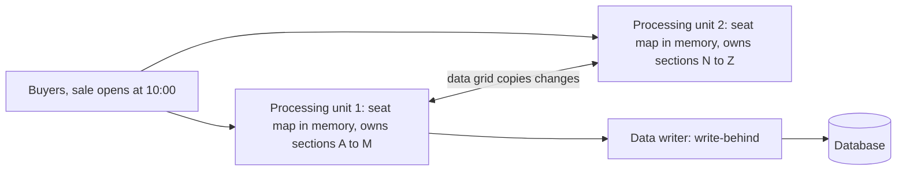

**Story.** A concert sale opens at 10:00. Thousands of buyers hit a seat map of a few thousand seats.
Each processing unit keeps the seat map in memory, and the units copy changes to each other. A data writer stores them in the database later.
In the copy gap, two units once sold seat F14 to two buyers. Giving each section one owner unit fixed it.

**How it works.**

1. Load the hot data into memory in every processing unit.
2. Serve every read and write from memory.
3. A data grid copies each change to the other units.
4. A data writer drains changes to the database in batches (write-behind).
5. Add units to absorb a bigger burst. The database stays off the hot path.

### In code

```text
load(): every unit copies all 2600 seats into memory   # once, before the sale
sell(unit, seat, buyer):
  if unit.seats[seat] is taken: return false           # reads this unit's own memory
  unit.seats[seat] = buyer                             # memory only, no database call
  add the change to the other unit's inbox             # the grid copies it
  add the change to the writer's queue
deliver(): each unit applies its inbox                 # a moment later
  if the seat is already sold to someone else: collision
flush(): one batch insert per 500 changes              # write-behind
# the fix: one writing owner per section
owner(seat): sections A to M = unit 1, N to Z = unit 2
request(unit, seat, buyer):
  if owned: unit = owner(seat)                         # forward to the owner
  sell(unit, seat, buyer)
```

```go
u1 := &Unit{name: "unit 1", seats: loadSeats()}
u2 := &Unit{name: "unit 2", seats: loadSeats()}

func (g *Grid) owner(seat string) *Unit {
	if seat[0] <= 'M' {
		return g.units[0]
	}
	return g.units[1]
}

func (g *Grid) request(u *Unit, seat, buyer string) bool {
	if g.owned {
		u = g.owner(seat) // forward to the one writing owner
	}
	return g.sell(u, seat, buyer)
}

func (g *Grid) sell(u *Unit, seat, buyer string) bool {
	if u.seats[seat] != "" { // reads this unit's own memory
		return false // taken
	}
	u.seats[seat] = buyer                                    // memory only, no database call
	u.peer.inbox = append(u.peer.inbox, Change{seat, buyer}) // the grid copies it
	g.queue = append(g.queue, Change{seat, buyer})           // for the data writer
	return true
}

func (g *Grid) deliver() {
	for _, u := range g.units {
		for _, c := range u.inbox {
			if b := u.seats[c.seat]; b != "" && b != c.buyer {
				g.collided[c.seat] = true // already sold to someone else
				continue
			}
			u.seats[c.seat] = c.buyer
		}
		u.inbox = nil
	}
}

func (g *Grid) flush() {
	for len(g.queue) > 0 {
		n := min(batch, len(g.queue))
		g.queue = g.queue[n:]
		g.dbWrites++
	}
}
```

Run it: `handbook/code/02-space-based/`

```bash
cd handbook/code/02-space-based && go run .
```

**What goes wrong.** Collisions: two units write the same item before the copy arrives.
Also data too big for memory. Fix: partition the data so each piece has one writing owner, and use the style only for small, hot data.

**Where you use it.**

- Ticket sales, flash sales, online auctions.
- Hazelcast, Apache Ignite, and GigaSpaces, where the name comes from (a tuple space).
- Not for a chain indexer: terabytes of history do not fit in memory.

> Space-based architecture serves a short burst from a replicated in-memory grid and writes the database later, so it suits small hot data with one owner per piece.

▶ Watch it move: [Space-based architecture](visual/02-space-based.html)

## CQRS and event sourcing

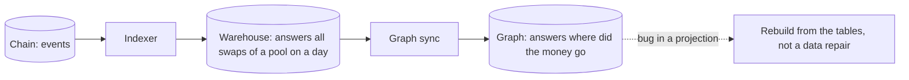

**Story.** One event source, the chain, feeds two read models.
The warehouse answers "all swaps of this pool on this day". The graph answers "where did this address's money go".
After every change in the graph's shape, the team rebuilt it from the tables.

**How it works.**

1. CQRS (Command Query Responsibility Segregation) separates the write model from the read model.
2. Event sourcing stores events. State is a fold over them.
3. Each read model is a projection shaped for its question.
4. A bug in a projection is fixed by rebuilding it.
5. Show the lag between write and read as freshness: "graph is N blocks behind".

### In code

```text
fold(events, to):                             # the indexer
  for each event after the checkpoint, up to to:
    a swap: append to swaps[pool, day]        # shaped for question one
    a transfer: append to transfers
  checkpoint = to
question one = swaps[P, 2026-10-06]           # one key, a narrow read
project(warehouse, to):                       # the graph sync
  for each transfer row after my position, up to to:
    links[from][to] += amount
    if bug and the transfer is inside a swap: add it again
  position = to
walk(a, hops): follow links one hop at a time # question two, no join
lag = warehouse checkpoint - graph position   # shown as freshness
# hand patch: subtract the extra from today's links, the rule stays wrong
rebuild: fix the rule, drop the graph, project from the first warehouse row
replay from block 1 = decode every chain event again  # grows every block
```

```go
func (w *Warehouse) fold(ev []Event, to int) {
	for _, e := range ev {
		if e.block <= w.checkpoint || e.block > to {
			continue
		}
		if e.kind == "swap" {
			k := e.pool + "|" + day(e.block) // one key per pool and day
			w.swaps[k] = append(w.swaps[k], e)
		} else {
			w.transfers = append(w.transfers, e)
		}
	}
	w.checkpoint = to // folded up to here
}

func (g *Graph) project(w *Warehouse, to int) {
	for _, t := range w.transfers {
		if t.block <= g.position || t.block > to {
			continue
		}
		g.links[t.from][t.to] += t.amount
		if g.bug && t.viaSwap {
			g.links[t.from][t.to] += t.amount // the bug: counted twice
		}
	}
	g.position = to
}

func rebuild(w *Warehouse) *Graph {
	g := newGraph(false)       // the old graph is dropped, the rule is fixed
	g.project(w, w.checkpoint) // from the first warehouse row
	return g
}

func (g *Graph) walk(a string, hops int) (out [][]string) {
	seen, frontier := map[string]bool{a: true}, []string{a}
	for h := 0; h < hops; h++ {
		var next []string
		for _, f := range frontier {
			for to := range g.links[f] { // one lookup per hop, no join
				if !seen[to] {
					seen[to], next = true, append(next, to)
				}
			}
		}
		out, frontier = append(out, next), next
	}
	return
}
```

Run it: `handbook/code/02-cqrs-event-sourcing/`

```bash
cd handbook/code/02-cqrs-event-sourcing && go run .
```

**What goes wrong.** Using it for an ordinary form-based app. It doubles the surface and adds a lag for nothing.
Event sourcing without snapshots makes replay time grow forever. Fix: use it only when reads differ from writes, or history is the product.

**Where you use it.**

- Money tracing and audit: history is the product.
- A graph or a search index built from a warehouse is CQRS without the name.
- Details in chapter 1, "CQRS and event sourcing: the neighbours".

> CQRS gives each question its own read model, and event sourcing lets you rebuild any of them by replay.

▶ Watch it move: [CQRS and event sourcing](visual/02-cqrs-event-sourcing.html)

## Pipes and filters

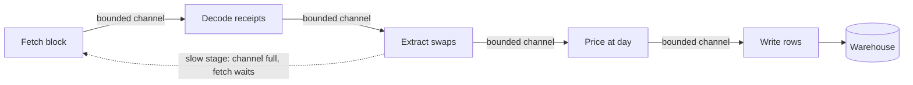

**Story.** Inside the indexer, each block goes through five stages.
Each stage is a goroutine with a channel in and a channel out. It knows nothing of the others.
When pricing slows down, the channels fill and fetching waits. Memory stays flat.

**How it works.**

1. Cut the work into small stages that each read, transform and write.
2. Connect them with bounded channels.
3. A full channel blocks the stage before it. That is back-pressure, for free.
4. Scale a slow stage by running more copies of it.

### In code

```text
stage(in, out, job):
  for each item in in: send job(item) to out   # waits while out is full
pipeline(40 blocks from 9401):
  ch1, ch2, ch3, ch4 = channel(capacity 3)     # the bound
  fetch -> ch1 -> decode -> ch2 -> extract -> ch3 -> price -> ch4 -> write
price(swap):
  look up the day price                        # slow, or stuck
# what a full channel does
a send on a full channel waits                 # back-pressure
items waiting <= 4 channels x 3 = 12           # memory is flat
# scale the slow stage
start a second price copy that reads ch3
# the unbounded channel
queue3 = a list with no limit: append, never wait
if queue3 holds more than memory (20): the OS kills the process
# the fix
ch3 = channel(capacity 3) again
```

```go
func stage(in <-chan Item, out chan<- Item, job func(Item) Item) {
	for it := range in {
		out <- job(it)
	}
	close(out)
}

func newPipeline(bounded3 bool) *Pipeline {
	for k := 1; k <= 4; k++ {
		p.ch[k] = make(chan Item, capacity) // make(chan Item, 3)
	}
	go func() { // stage 1: fetch block
		for b := firstBlock; b < firstBlock+blocks; b++ {
			p.fetched.Add(1)
			p.ch[1] <- Item{Block: b} // waits when channel 1 is full
		}
		close(p.ch[1])
	}()
	go stage(p.ch[1], p.ch[2], decode) // stage 2
	if bounded3 {
		go stage(p.ch[2], p.ch[3], extract) // stage 3
	} else {
		p.ch[3] = make(chan Item) // the queue hands swaps to pricing one at a time
		raw := make(chan Item)    // extract hands each swap straight to the queue
		go stage(p.ch[2], raw, extract)
		go unbounded(raw, p.ch[3], p.killed)
	}

func (p *Pipeline) price(in <-chan Item, out chan<- Item, wg *sync.WaitGroup) {
	defer wg.Done()
	for it := range in {
		<-p.release // the price lookup is stuck
		out <- it
	}
}

func unbounded(in <-chan Item, out chan<- Item, killed chan<- int) {
	for in != nil || len(queue) > 0 {
		select {
		case it, ok := <-in:
			if !ok {
				in = nil
				continue
			}
			queue = append(queue, it) // never waits
			if len(queue) > memBudget {
				killed <- len(queue) // out of memory
				return

	wg.Add(1)
	go p.price(p.ch[3], p.ch[4], &wg) // copy 2 reads the same channel
```

Run it: `handbook/code/02-pipes-and-filters/`

```bash
cd handbook/code/02-pipes-and-filters && go run .
```

**What goes wrong.** An unbounded channel. A slow stage lets the queue grow until the process dies.
Fix: bound every channel.

**Where you use it.**

- Inside one service: a pipeline. Between services: events. A pipeline is a chain, events are a bus.
- Unix shell pipes are the original.
- Stream processors (Kafka Streams, Flink) are pipes and filters across machines.

> Pipes and filters is a chain of small stages on bounded channels, so a slow stage slows the fetch instead of filling memory.

▶ Watch it move: [Pipes and filters](visual/02-pipes-and-filters.html)

## Back-pressure

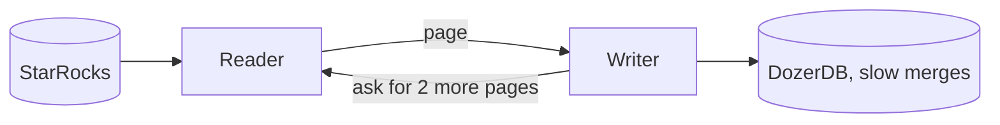

**Story.** The graph sync reads pages of rows from StarRocks and writes them into DozerDB.
DozerDB is slower during big merges. When the reader pushed with no limit, pages piled up in memory, calls timed out and retried, and the process died.
When the writer asked for two pages at a time, the reader simply waited, and memory stayed flat.

**How it works.**

1. A slow receiver needs a way to slow the sender.
2. Pull: the receiver asks for n items when it is ready.
3. Block: the sender waits on a full bounded buffer.
4. Drop: discard the oldest items, only for data you can lose.
5. Buffer durably: spill to a queue on disk, such as Kafka.
6. Never buffer in memory without a limit.

### In code

```text
every tick:
  if push, or the writer asked for pages:         # pull reads only on request
    read one page from StarRocks into the buffer
  else: the reader waits                          # no request, no read
  if the writer is free: take the oldest page
    a write costs 4 ticks during big merges, else 1
  when a write ends:
    if the page waited over 20 ticks: timeout, put it back, retries += 1
    else: written += 1
  if pull and the buffer is empty: ask for 2 more pages   # the back-pressure
  if the buffer holds over 60 pages: out of memory, restart
# other ways to push back
block: a send on a full bounded channel waits
drop: when full, throw away the oldest (metrics only)
spill: write to a durable queue such as Kafka
```

```go
func (s *Sync) tick(t int) {
	if !s.pull || s.demand > 0 { // push reads always, pull only on request
		s.buf = append(s.buf, page{s.read, t})
		s.read++
		if s.pull {
			s.demand--
		}
	} else {
		s.idle++ // no request, no read
	}
	if s.busy == 0 && len(s.buf) > 0 { // the writer takes the oldest page
		s.cur, s.buf = s.buf[0], s.buf[1:]
		s.busy = cost(t, s.pull) // 4 ticks during big merges, else 1
	}
	if s.busy > 0 {
		s.busy--
		if s.busy == 0 {
			s.finish(t)
		}
	}
	if s.pull && len(s.buf) == 0 && s.demand == 0 {
		s.demand = pullSize // ask for 2 more pages
	}
}

func (s *Sync) finish(t int) {
	if t-s.cur.readAt > timeout {
		s.retries++
		s.buf = append(s.buf, s.cur) // put it back: wasted work
		return
	}
	s.written++
}

// nothing else stops the growth in the push run
if len(s.buf) > memLimit {
	break // out of memory: restart, read the pages again
}

// block: a plain send, ch <- v, waits while the channel is full
func offer(ch chan int, v int) (dropped bool) {
	select {
	case ch <- v: // there is room
		return false
	default:
		<-ch // full: drop the oldest
		ch <- v
		return true
	}
}
```

Run it: `handbook/code/02-back-pressure/`

```bash
cd handbook/code/02-back-pressure && go run .
```

**What goes wrong.** Push with no limit. Memory grows, old work times out, retries add more work, and the process crashes and starts again.
Fix: pull or bound, so the slowest part sets the pace.

**Where you use it.**

- A Kafka consumer pulls at its own pace.
- Reactive Streams (Project Reactor, RxJava, Akka Streams) send a "give me n" demand signal.
- A Go channel with a capacity blocks the sender when full. See pipes and filters above.

> Back-pressure lets a slow receiver slow the sender, by pulling, blocking on a bound, dropping, or buffering durably, so memory stays flat.

▶ Watch it move: [Back-pressure](visual/02-back-pressure.html)

## Strangler fig

```mermaid
sequenceDiagram
  participant C as Client
  participant F as Facade
  participant O as Old system
  participant N as New system
  C->>F: request transfers
  F->>N: route transfers, already moved
  C->>F: request swaps
  F->>O: route swaps to old
  Note over F,N: compare outputs, flip one route at a time
  C->>F: request swaps, later
  F->>N: route swaps, now moved
  Note over O: nothing routes here, switch it off
```

**Story.** A legacy indexer was replaced table by table.
The new indexer took `transfers` first, behind a flag. The team compared rows over a day range and flipped the route.
Then `swaps`. When nothing routed to the old one, it was switched off.

**How it works.**

1. Put a facade in front of the legacy system. All traffic goes through it.
2. Build one capability in the new system.
3. Run both over the same history and diff the outputs.
4. Flip that one route at the facade. Flip back to roll back.
5. Each moved capability takes its data with it.
6. Repeat. Set a date for the last route.

### In code

The code uses the shop from the lesson. Its four routes play the part of the `transfers` and `swaps` tables: compare over the same requests, then flip one rule. Comparing rows over a day range is the same check.

```text
facade.handle(path, request):
    if routes[path] is new: the new service answers
    if routes[path] is shadow: the old service answers, the new one runs as a dry run, compare
    otherwise: the old service answers
compare(path, requests):
    routes[path] = shadow
    for each request: count same or different
flip(path, different):
    if different is not 0: stay, do not flip
    routes[path] = new
    tables[path] = new                        # the data moves with the route
rollback(path):
    routes[path] = shadow
    tables[path] = old
count routes on new; 4 of 4 means nothing reaches the monolith, switch it off
```

```go
func (f *Facade) Handle(path, req string) (served string, ok, match bool) {
	switch f.routes[path] {
	case onNew:
		return "new", f.newOK[path](req), true
	case shadow:
		return "old", true, f.newOK[path](req)
	default:
		return "old", true, true
	}
}

func (f *Facade) Compare(path string, reqs []string) (same, diff int) {
	f.routes[path] = shadow
	for _, r := range reqs {
		if _, _, match := f.Handle(path, r); match {
			same++
		} else {
			diff++
		}
	}
	return same, diff
}

func (f *Facade) Flip(path string, diff int) bool {
	if diff != 0 {
		return false
	}
	f.routes[path] = onNew
	f.tables[path] = "new"
	return true
}

func (f *Facade) Rollback(path string) {
	f.routes[path] = shadow
	f.tables[path] = "old"
}

func (f *Facade) OnNew() int {
	n := 0
	for _, s := range f.routes {
		if s == onNew {
			n++
		}
	}
	return n
}
```

Run it: `handbook/code/02-strangler-fig/`

```bash
cd handbook/code/02-strangler-fig && go run .
```

**What goes wrong.** The last 10 percent is boring, so both systems run forever and you pay twice.
The other failure is the big-bang rewrite: the new system chases a moving target and never ships. Fix: one route at a time, and a date for the last cut.

**Where you use it.**

- Replacing a monolith endpoint by endpoint behind an API gateway.
- Parity is proven by volume: diff a long history, not by waiting for calendar days.
- A feature flag per route is the cheapest facade inside one codebase.

> Put a facade in front, move one route at a time, and switch the old system off when nothing routes to it.

▶ Watch it move: [Strangler fig](visual/02-strangler-fig.html)

## Conway's law and coupling

```mermaid
flowchart LR
  subgraph Org["Teams"]
    T1["Ingest team"]
    T2["Graph team"]
  end
  subgraph Sys["System"]
    S1["Indexer"]
    S2["Graph sync"]
    S1 -->|"published schema, low coupling"| S2
  end
  T1 -->|"owns"| S1
  T2 -->|"owns"| S2
  T1 <-->|"talks to"| T2
```

**Story.** One team owned the indexer and the graph sync. They shared a repository and types.
When the sync got its own owner, the shared types became a published schema within a month.
The organisation moved, and the code followed.

**How it works.**

1. Conway's law: a system copies the communication structure of the organisation that builds it.
2. Inverse Conway: shape the teams first, to get the architecture you want.
3. Cohesion: the things inside one part belong together. Want it high.
4. Coupling: how much one part must know about another to change. Want it low.
5. Things that change together live together.

### In code

```text
breaks(s):
  for each coupling c that starts at s:
    if c is not a versioned contract: c.to breaks
teamsPulledIn(s) = owner(s) + the owners of breaks(s)
a change needs a meeting when teamsPulledIn(s) has 2 or more teams
crossTeam = couplings between two teams that are not contracts
hidden = the crossTeam couplings not drawn on the diagram
perTeam(t) = services owned by t               # deploys and pages
# the org moves
owner(graph sync) = Graph team
# the code follows
shared types become a published schema       # a contract
# the fix for twelve services
merge services until each team owns 2
the shared table gets one owner, the other team reads its API
draw every run order on the diagram
```

```go
func (o *Org) breaks(s string) []string {
	var out []string
	for _, c := range o.couplings {
		if c.From == s && c.Kind != "contract" { // a contract absorbs it
			out = append(out, c.To)
		}
	}
	return out
}

func (o *Org) teamsPulledIn(s string) []string {
	teams := map[string]bool{o.owner[s]: true}
	for _, b := range o.breaks(s) {
		teams[o.owner[b]] = true
	}
	return sortedKeys(teams) // 2 or more: a meeting
}

func (o *Org) crossTeam() (all, hidden int) {
	for _, c := range o.couplings {
		if o.owner[c.From] != o.owner[c.To] && c.Kind != "contract" {
			all++
			if !c.Drawn { // not on the diagram
				hidden++
			}
		}
	}
	return all, hidden
}

func (o *Org) perTeam() map[string]int {
	for _, t := range o.owner {
		n[t]++ // services each team is paged for
	}
}

o.owner["graph sync"] = "Graph" // the org moves first
o.couplings[0].Kind = "contract" // shared types: a published schema

for from, into := range merge { // 12 services become 6
	delete(o.owner, from)
}
o.couplings[0] = Coupling{"wallets", "pools", "contract", true}
o.couplings[1].Drawn = true // run order on the diagram
```

Run it: `handbook/code/02-conways-law/`

```bash
cd handbook/code/02-conways-law && go run .
```

**What goes wrong.** A target of twelve services drawn for three teams. Each team holds four, and on-call hurts.
The hidden failure is coupling you cannot see in imports: a shared table, or "A must run before B". Fix: match services to the teams who can own them, and draw temporal and data coupling.

**Where you use it.**

- A platform team owns the shared rails: gateway, pipelines. Not domain services.
- `dex` asks `pricing` through one function, not its table: low coupling.
- Micro-frontends split the UI by team. They need a shared shell and a design system.

> The system copies the org, so shape the teams around the borders you want.

▶ Watch it move: [Conway's law and coupling](visual/02-conways-law.html)

## Inverse Conway and team topologies

```mermaid
flowchart TB
  S1["Ingest team: stream-aligned"]
  S2["Graph team: stream-aligned"]
  S3["Agent tools team: stream-aligned"]
  EN["Enabling team: testing practice"] -->|"facilitating"| S1
  CX["Complicated subsystem: graph query engine"] -->|"X-as-a-service"| S3
  PF["Platform team: lanes, deploys, dashboards"] -->|"X-as-a-service"| S1
  PF --> S2
  PF --> S3
```

**Story.** Before building the agent tool server and the lane pipelines, the teams were drawn first.
Three stream-aligned teams own ingest, graph and agent tools. A platform team offers lanes, deploys and dashboards as self-service.
The risk came later: the platform drifted into a ticket queue, and every stream team waited on it.

**How it works.**

1. Inverse Conway: decide the system you want, then shape the teams to match.
2. Stream-aligned teams own one flow of value, end to end, including on-call.
3. A platform team offers internal tools as a self-service product.
4. An enabling team coaches a team for a while, then moves on.
5. A complicated-subsystem team owns a part that needs rare, deep skill.
6. Three interaction modes: collaboration, X-as-a-service, facilitating.

### In code

```text
teams = 3 stream-aligned, platform, enabling, complicated subsystem
links = platform -> each stream team: X-as-a-service
        enabling -> ingest: facilitating, for 4 weeks
        query engine -> agent tools: X-as-a-service
deploy(selfService):
  every day, each stream team starts 4 deploys:
    if selfService: the team deploys now     # wait 0 days
    else: open a ticket in the platform queue
  the platform closes 8 tickets a day, oldest first
    wait = close day - open day
# the check
count deploys done, deploys still waiting, the average and worst wait
# the fix
selfService = true, tickets only for the rare case
```

```go
var teams = []Team{
	{"Ingest", "stream-aligned"}, {"Graph", "stream-aligned"}, {"Agent tools", "stream-aligned"},
	{"Platform", "platform"}, {"Enabling", "enabling"},
	{"Graph query engine", "complicated subsystem"},
}

var links = []Link{
	{"Platform", "Ingest", "X-as-a-service", 0},
	{"Platform", "Graph", "X-as-a-service", 0},
	{"Platform", "Agent tools", "X-as-a-service", 0},
	{"Enabling", "Ingest", "facilitating", 4},
	{"Graph query engine", "Agent tools", "X-as-a-service", 0},
}

func deploy(selfService bool) (waits map[string]int, open []ticket, worst int) {
	waits = map[string]int{}
	var queue []ticket
	for d := 1; d <= days; d++ {
		for _, t := range teams {
			if t.kind != "stream-aligned" {
				continue
			}
			for i := 0; i < deploysPerDay; i++ {
				if selfService {
					continue // the team deploys now: wait 0 days
				}
				queue = append(queue, ticket{t.name, d}) // open a ticket
			}
		}
		for n := 0; n < ticketsPerDay && len(queue) > 0; n++ {
			tk := queue[0]
			queue = queue[1:]
			w := d - tk.day // days the deploy waited
			waits[tk.team] += w
			if w > worst {
				worst = w
			}
		}
	}
	return waits, queue, worst
}

// in main: the same 120 deploys, both ways
for _, self := range []bool{true, false} {
	waits, open, worst := deploy(self)
	done := asked - len(open)
	// print done, still waiting, average and worst wait
}
```

Run it: `handbook/code/02-team-topologies/`

```bash
cd handbook/code/02-team-topologies && go run .
```

**What goes wrong.** The platform becomes a gate: every deploy needs a ticket.
Or the org chart changes but code ownership does not, and two teams fight over one codebase. Fix: self-service first, and move repository and on-call ownership with the team.

**Where you use it.**

- "Team Topologies" by Matthew Skelton and Manuel Pais gives the four types and three modes.
- Before a service split, ask which team will own and run each service.
- A platform team owns the rails, never a domain service.

> Inverse Conway means drawing the teams first: stream-aligned teams own the value, and a self-service platform carries them.

▶ Watch it move: [Inverse Conway and team topologies](visual/02-team-topologies.html)

## Coupling and cohesion

```mermaid
flowchart LR
  DX["dex module"] -->|"code: one function call"| PR["pricing module"]
  DX -. "data: a shared table" .-> PR
  DX -. "temporal: runs after the day close" .-> PR
  DX -. "deploy: must ship together" .-> PR
  DX -. "semantic: amounts scaled by decimals" .-> PR
```

**Story.** The dex module asks pricing for a day price through one function. That is low code coupling.
But both assume amounts are raw integers scaled by the token's decimals. If pricing ever sends human amounts, dex is wrong by many orders of magnitude, and nothing fails to compile.
Meanwhile a `utils` package held dates, retries, HTML and fee maths, and changed for every reason.

**How it works.**

1. Coupling: how much one part must know about another to change.
2. Code coupling shows in imports. Data coupling hides in shared tables.
3. Temporal coupling: A must run before B, or both must be up together.
4. Deploy coupling: they must ship together.
5. Semantic coupling: they share the meaning of a value.
6. Cohesion: the things inside one part belong together and change for one reason. Want it high.

### In code

```text
couplings of dex to pricing = code, data, temporal, deploy, semantic
the import graph sees only code                 # 1 of 5 kinds
rename a column: dex breaks if data coupling is there, the build still passes
nightly: if pricing closes after dex runs and dex does not wait: no price
change DayPrice: both ship together if deploy coupling is there
swap value = whole tokens swapped / whole tokens quoted x USD   # Amount is raw
reasons(package) = count of different reasons to change
# the fix
for each coupling:
  data, deploy: remove it       # read through DayPrice, a versioned contract
  temporal, semantic: write it into the contract and test it
split utils by reason, one package each
```

```go
var dexToPricing = []Coupling{
	{"code", "calls DayPrice(token, day)", true, true},
	{"data", "reads table pricing.day_prices", false, false},
	{"temporal", "nightly job runs after the day close", false, false},
	{"deploy", "a DayPrice change must ship with dex", false, false},
	{"semantic", "Quote.Amount is raw, scaled by decimals", false, false},
}

// has(cs, kind) says whether a kind of coupling is still there.
func renameBreaksDex(cs []Coupling) bool { return has(cs, "data") }
func shipTogether(cs []Coupling) bool { return has(cs, "deploy") }

func nightly(swaps int, closeAt, dexAt string, waits bool) (unpriced int) {
	if closeAt > dexAt && !waits {
		return swaps
	}
	return 0
}

func swapValue(raw float64, decimals int, q Quote) float64 {
	scale := math.Pow10(decimals)
	return (raw / scale) / (q.Amount / scale) * q.USD
}

func reasons(funcs map[string]string) int {
	seen := map[string]bool{}
	for _, why := range funcs {
		seen[why] = true
	}
	return len(seen)
}

func fix(cs []Coupling) []Coupling {
	var out []Coupling
	for _, c := range cs {
		switch c.kind {
		case "data", "deploy":
			continue // the shared table and the lockstep release are gone
		case "temporal", "semantic":
			c.written = true // written down and tested
		}
		out = append(out, c)
	}
	return out
}
```

Run it: `handbook/code/02-coupling-cohesion/`

```bash
cd handbook/code/02-coupling-cohesion && go run .
```

**What goes wrong.** Measuring only imports. The hidden kinds (data, temporal, semantic) do the damage, and a service split along them makes a distributed monolith.
Fix: things that change together live together, and the rest meet through a narrow contract that states units and order.

**Where you use it.**

- In review, ask four questions: which tables, what runs first, what ships with it, what does each field mean.
- Connascence is the formal name for these kinds of coupling and their strength.
- Before cutting a service, cut where coupling is lowest.

> Coupling is how much one part must know to change another, cohesion is whether a part has one reason to change, and the hidden kinds (data, temporal, semantic) do the damage.

▶ Watch it move: [Coupling and cohesion](visual/02-coupling-cohesion.html)

## Micro-frontends

```mermaid
flowchart LR
  SH["Shell: routes, login, layout"] -->|"/risk"| RK["Risk pages: graph team"]
  SH -->|"/billing"| BL["Billing pages: payments team"]
  SH -->|"/account"| AC["Account pages: identity team"]
  DS["Shared design system, one copy of React"] --> RK
  DS --> BL
  DS --> AC
```

**Story.** A dashboard has risk pages, billing pages and account pages, owned by three teams.
A shell app loads each team's part by route, and each team deploys its part on its own.
At first each part shipped its own copy of React and its own buttons. The page loaded three frameworks and looked like a patchwork.

**How it works.**

1. A thin shell owns routes, login and layout.
2. Each team owns one part, split by route.
3. Each part builds and deploys on its own.
4. A shared design system gives the buttons and colours.
5. The framework is loaded once and shared.

### In code

```text
shell.routes = /risk -> graph team, /billing -> payments team, /account -> identity team
load(route) = find the part, load its bundle
deploy(route, version):
  change that part's version only           # nothing else is rebuilt
session(routes):
  add every library the shell shares, once each
  for each route: add the part's own code
    for each library in the part's bundle: add it   # a private copy
  count the copies of React and the kinds of button
# the fix
share(): move React and the buttons from every part into the shell
every part draws the design system's buttons
# when not to
worth splitting only if over 1 team and they block each other
```

```go
sh := &Shell{routes: map[string]*Part{
	"/risk":    {"graph team", "v1", 60, []string{"react", "buttons"}, "graph team"},
	"/billing": {"payments team", "v1", 45, []string{"react", "buttons"}, "payments team"},
	"/account": {"identity team", "v1", 30, []string{"react", "buttons"}, "identity team"},
}}

var libKB = map[string]int{"react": 140, "buttons": 40} // example sizes

func (s *Shell) load(route string) *Part { return s.routes[route] }

func (s *Shell) deploy(route, version string) (rebuilt []string) {
	s.routes[route].version = version
	return []string{s.routes[route].team}
}

func (s *Shell) session(routes []string) (kb, reactCopies int, looks map[string]bool) {
	looks = map[string]bool{}
	for _, l := range s.shared {
		kb += libKB[l] // loaded once by the shell
		if l == "react" {
			reactCopies++
		}
	}
	for _, r := range routes {
		p := s.load(r)
		kb += p.codeKB
		for _, l := range p.bundles {
			kb += libKB[l] // a private copy inside the part
			if l == "react" {
				reactCopies++
			}
		}
		looks[p.buttons] = true
	}
	return kb, reactCopies, looks
}

func (s *Shell) share() {
	s.shared = []string{"react", "buttons"}
	for _, p := range s.routes {
		p.bundles = nil
		p.buttons = "design system"
	}
}

func worthSplitting(teams int, blocking bool) bool {
	return teams > 1 && blocking
}
```

Run it: `handbook/code/02-micro-frontends/`

```bash
cd handbook/code/02-micro-frontends && go run .
```

**What goes wrong.** Three of everything: three frameworks, three button styles, slow pages.
Or parts that talk through shared global state, so they cannot deploy alone after all. Fix: a shared design system, single shared copies, and communication through the URL and a few events.

**Where you use it.**

- IKEA, Spotify and Zalando have written about it. Tools: Webpack Module Federation, single-spa, or plain links between apps.
- Split by route, not by widget on one page.
- One team, one app: skip it. It solves a team problem, not a technical one.

> Micro-frontends split the user interface by team behind a thin shell, and only work with a shared design system and single shared copies of the framework.

▶ Watch it move: [Micro-frontends](visual/02-micro-frontends.html)

## Gateway, BFF and service mesh

```mermaid
flowchart LR
  WEB["Web app"] --> BFFW["Web BFF"]
  MOB["Mobile app"] --> BFFM["Mobile BFF"]
  AG["AI agent host"] --> GW["API gateway: auth, limits, metering"]
  BFFW --> GW
  BFFM --> GW
  GW -->|"north-south"| R["Risk service"]
  GW --> WS["Wallet service"]
  R <-->|"east-west, via sidecars"| WS
```

**Story.** The local agent proxy meters every call and holds the free-tier limits in front of the graph server. That is a gateway.
A web dashboard and a mobile app each get a backend shaped for their screens. Those are BFFs (backends for frontends).
There is no service mesh: five services and one platform engineer do not justify one.

**How it works.**

1. The API gateway is one door for outside traffic: routing, auth, rate limits, metering.
2. A BFF calls the real services and reshapes the result for one client.
3. Gateway and BFF handle north-south traffic, from clients in.
4. A service mesh puts a sidecar next to each service for east-west traffic: mutual TLS (transport layer security), retries, timeouts, tracing.
5. The mesh costs a proxy hop and a control plane per cluster.

### In code

```text
handle(key, call):
  if key is unknown: refuse
  if counted(key) >= limit (3): refuse        # free tier used up
  counted(key) += 1                           # metering
  route the call to the service
webBFF(addr):
  risk = handle(web, risk.score(addr))
  wallet = handle(web, wallet.balance(addr))
  return the dashboard shape: 4 fields        # joins, never decides
mobileBFF(addr):
  return a small shape: the risk score, 1 field
# the failure: a smart gateway
the gateway, the web BFF and the risk service all hold the rule
# the fix
the rule lives only in the risk service
```

```go
func (g *Gateway) Handle(key string, call func() string) (string, error) {
	if !g.keys[key] {
		return "", errors.New("unknown key")
	}
	if g.counted[key] >= g.limit { // 3 calls in the free tier
		g.refused++
		return "", errors.New("refused: free tier used up")
	}
	g.counted[key]++ // metering
	return call(), nil // route
}

func webBFF(g *Gateway, addr string) []string {
	r, _ := g.Handle("web", func() string { return risk.Score(addr) })
	w, _ := g.Handle("web", func() string { return Wallet{}.Balance(addr) })
	return []string{r, w, "chart of the last 30 days", "full history table"}
}

func mobileBFF(g *Gateway, addr string) []string {
	r, _ := g.Handle("mobile", func() string { return risk.Score(addr) })
	return []string{r} // a smaller shape
}

rule := "block risky wallets"
smart := map[string][]string{"gateway": {rule}, "web BFF": {rule}, "risk service": {rule}}
placesHoldingRule(rule, smart) // 3 places
dumb := map[string][]string{"risk service": {rule}}
placesHoldingRule(rule, dumb) // 1 place
```

Run it: `handbook/code/02-gateway-bff-mesh/`

```bash
cd handbook/code/02-gateway-bff-mesh && go run .
```

**What goes wrong.** The gateway gets smart and holds domain rules. That is the old SOA bus again.
A BFF that decides instead of reshaping is the same failure. Fix: the gateway stays dumb, the BFF aggregates but never decides.

**Where you use it.**

- A mesh pays off at dozens of services with a platform team.
- Below that, Kubernetes network policies and a shared client library with retries do the job.
- One client type: the gateway can be the BFF. Two client shapes want two BFFs.

> The gateway is the front door, a BFF fits one client, and a mesh handles service-to-service plumbing.

▶ Watch it move: [Gateway, BFF and service mesh](visual/02-gateway-bff-mesh.html)

## Sidecar, ambassador and adapter

```mermaid
flowchart LR
  subgraph POD["One pod: shared network and files"]
    APP["Main container: price oracle job"]
    LOG["Sidecar: ships logs"]
    AMB["Ambassador: retries outbound calls"]
    ADP["Adapter: Prometheus format"]
  end
  APP --> LOG --> LK["Loki"]
  APP --> AMB --> API["Price API"]
  APP --> ADP
  PR["Prometheus"] -->|"scrapes"| ADP
```

**Story.** A Kubernetes pod runs the price oracle job, which fetches prices, writes rows and exits.
Beside it run a sidecar that ships logs, an ambassador that retries outbound calls, and an adapter that turns the job's status into Prometheus metrics.
The job finished, but the helpers kept running. The pod never ended, so the Kubernetes Job never completed.

**How it works.**

1. A pod's containers share one network and can share files.
2. Sidecar: adds a job beside the app, such as shipping logs.
3. Ambassador: a local proxy for calls going out. The app calls localhost.
4. Adapter: reshapes what leaves the pod into a standard form.
5. The main container stays about its own job.

### In code

```text
pod = main + helpers, one network (localhost), one shared folder
main: prices = call localhost:9000
main: write rows, log lines to the shared folder, a status file
main: exit 0
sidecar: read the lines in the shared folder, send them to Loki
ambassador: try the price API, on an error try again, at most 3 tries
adapter on a scrape: read the status file, print Prometheus lines
jobComplete = every container has exited and main exited 0
# the fix: native sidecars (Kubernetes 1.29 and later)
when main exits: stop every helper marked native
```

```go
func ambassador(p *Pod, api *priceAPI) []float64 {
	for try := 1; try <= 3; try++ {
		code, body := api.get()
		p.shared["log"] = append(p.shared["log"], fmt.Sprintf("ambassador: try %d -> %d", try, code))
		if code == 200 {
			return body
		}
	}
	return nil
}

func mainJob(p *Pod, api *priceAPI) {
	prices := ambassador(p, api) // a call to localhost:9000
	p.shared["log"] = append(p.shared["log"], fmt.Sprintf("fetched %d prices", len(prices)))
	p.shared["log"] = append(p.shared["log"], fmt.Sprintf("wrote %d rows", len(prices)))
	p.shared["status"] = []string{fmt.Sprintf("rows=%d", len(prices)), "errors=0"}
	p.running["main"] = false
	p.exit = 0
}

func sidecar(p *Pod, loki *[]string) {
	*loki = append(*loki, p.shared["log"]...)
}

func adapter(p *Pod) string {
	var out []string
	for _, kv := range p.shared["status"] {
		k, v, _ := strings.Cut(kv, "=")
		out = append(out, "price_oracle_"+k+" "+v)
	}
	return strings.Join(out, "\n")
}

func (p *Pod) mainExited() {
	for h := range p.running {
		if p.native[h] { // native sidecars are stopped after the main one
			p.running[h] = false
		}
	}
}

func (p *Pod) jobComplete() (bool, []string) {
	var alive []string
	for _, c := range []string{"main", "sidecar", "ambassador", "adapter"} {
		if p.running[c] {
			alive = append(alive, c)
		}
	}
	return len(alive) == 0 && p.exit == 0, alive
}
```

Run it: `handbook/code/02-sidecar/`

```bash
cd handbook/code/02-sidecar && go run .
```

**What goes wrong.** Lifetimes. A helper starts later than the app, or outlives it and keeps a Job from finishing.
Fix: native sidecar containers (Kubernetes 1.29 and later start them first and stop them after the main one), or a shutdown signal.

**Where you use it.**

- Log shippers (Fluent Bit, Promtail) and metric exporters.
- Envoy in a service mesh is an ambassador sidecar.
- A local MCP proxy beside an agent host plays the ambassador's part: the host calls localhost, the proxy handles the network, auth and metering.

> Sidecar, ambassador and adapter are helper containers beside the main one: one adds a job, one handles calls out, one reshapes output, and all must share its lifetime.

▶ Watch it move: [Sidecar, ambassador and adapter](visual/02-sidecar.html)

## Writing it down: ADR, C4 and fitness functions

```mermaid
flowchart LR
  ADR["ADR 12: graph is a projection of SQL"] -->|"explains"| C4["C4 container diagram"]
  C4 -->|"checked by"| FF["Fitness function in the build"]
  FF -->|"fails on drift"| PR["Pull request blocked"]
  FF -->|"passes"| OK["Merge"]
```

**Story.** A decision record says "the graph is a projection of SQL, never the source of truth".
Its consequence: any graph can be rebuilt from the warehouse.
In the agent harness, a lint fails any Mermaid label with a semicolon, because the renderer breaks on it. Small rule, no broken diagrams since.

**How it works.**

1. ADR (architecture decision record): context, options, decision, consequences. Numbered, stored with the code.
2. Never edit an accepted ADR. A new one supersedes it.
3. C4: four zoom levels. Context, Containers (deployables), Components, Code.
4. Pick one level per diagram and stay there.
5. Fitness functions: build checks that a property still holds. Dependency direction, size caps, test time budgets.
6. Evolutionary architecture: everything may change, but the fitness functions guard what matters.

### In code

```text
mermaidSemicolons(file):
  for each line inside a mermaid block:
    for each label [..] (..) {..} |..| on the line:
      if the label holds a semicolon: fail     # the renderer breaks on it
domainImportsInfra(file):
  if the file is in the domain package:
    for each import: if it is an infra package: fail
adrHasRejected(file):
  if the file is an ADR with no Rejected section: fail
build(pull request):
  for each file, for each check in the build: collect failures
  0 failures: merge. 1 or more: block
# a new decision
write ADR 31 that supersedes ADR 12, never edit ADR 12
# the wiki
checks in the build = none                     # the rule is only read
```

```go
func mermaidSemicolons(name, md string) []string {
	for i, line := range strings.Split(md, "\n") {
		switch {
		case strings.HasPrefix(line, "```mermaid"):
			in = true
		case in:
			for _, l := range label.FindAllString(line, -1) {
				if strings.Contains(l, ";") {
					bad = append(bad, fmt.Sprintf("%s:%d: label %s has a ;", name, i+1, l))
				}
			}
		}
	}
	return bad
}

func domainImportsInfra(name, src string) []string {
	if !strings.HasPrefix(name, "domain/") {
		return nil
	}
	f, err := parser.ParseFile(token.NewFileSet(), name, src, parser.ImportsOnly)
	if err != nil {
		return []string{name + ": " + err.Error()}
	}
	for _, imp := range f.Imports {
		path, _ := strconv.Unquote(imp.Path.Value)
		if strings.Contains(path, "/infra") {
			bad = append(bad, fmt.Sprintf("%s: domain imports %s", name, path))
		}
	}
	return bad
}

func adrHasRejected(name, md string) []string {
	if strings.HasPrefix(name, "docs/adr/") && !strings.Contains(md, "## Rejected") {
		return []string{name + ": no rejected options"}
	}
	return nil
}

func build(files map[string]string, checks []func(string, string) []string) []string {
	for _, name := range sortedNames(files) {
		for _, check := range checks {
			bad = append(bad, check(name, files[name])...)
		}
	}
	return bad // empty: merged, else: blocked
}

all := []func(string, string) []string{mermaidSemicolons, domainImportsInfra, adrHasRejected}
none := []func(string, string) []string{} // the wiki: the build runs nothing
```

Run it: `handbook/code/02-adr-c4-fitness/`

```bash
cd handbook/code/02-adr-c4-fitness && go run .
```

**What goes wrong.** An ADR with no rejected options. A year later nobody knows what was considered, and the debate starts again.
Rules in a wiki nobody reads are the other failure. Fix: write the rejected options, and put every rule in the build.

**Where you use it.**

- A lint that fails when `domain` imports `infrastructure`.
- A gate that fails a unit-test tier over three minutes, or any file over 1,500 lines.
- Every schema change ships as a numbered migration gated by a runner.

> ADRs hold the why, C4 holds the picture, and fitness functions keep both true in the build.

▶ Watch it move: [ADR, C4 and fitness functions](visual/02-adr-c4-fitness.html)

## Evolutionary architecture

```mermaid
flowchart LR
  CH["Characteristics that matter: fast tests, small files, inward dependencies"] --> FF["Fitness functions with limits"]
  FF --> CI["Build runs them on every push"]
  CI -->|"inside the limits"| FREE["Change freely"]
  CI -->|"over a limit"| RED["Build fails, fix the change"]
  RED -. "trap: raise the limit to pass" .-> FF
```

**Story.** The agent harness changes every day. Three properties must stay true: unit tests under three minutes, no file over 1,500 lines, and the domain never imports infrastructure.
Each is a check in the build. A hundred pull requests land in a month inside the limits.
One adds a slow suite to the unit tier and the build fails. The suite moves to the integration tier. Months later someone raises a limit to ship, and the guard is gone.

**How it works.**

1. Name the few characteristics that matter most. Not every quality.
2. Turn each into a fitness function: a number with a limit.
3. The build runs them on every push (atomic). Some run against production (holistic): a latency budget, a cost ceiling.
4. Inside the limits, change needs no architect.
5. Decide at the last responsible moment, and prefer reversible decisions.

### In code

```text
fitness = [unit tier at most 180 s, biggest file at most 1,500 lines, 0 domain imports]
unit tier seconds = the sum of the suites in the unit tier
biggest file lines = the lines of the biggest file
domain imports = imports from domain packages into infrastructure
build(change):
  for each f in fitness: if f.measure > f.limit: fail and name f
  pass
# the fix for a failing check
move the slow suite to the integration tier, budget 600 s
# the trap
f.limit = 3000           # edited by hand to get a release out
# the guard
raiseLimit(f, to, reason): refuse when there is no reviewed reason
```

```go
type Fitness struct {
	name    string
	limit   int
	measure func(*Repo) int
}

func sum(m map[string]int) int {
	t := 0
	for _, v := range m {
		t += v
	}
	return t
}

// build runs every fitness function and fails on the first one over its limit.
func build(r *Repo, fs []*Fitness) (bool, string) {
	for _, f := range fs {
		if v := f.measure(r); v > f.limit {
			return false, fmt.Sprintf("%s: %d over the limit %d", f.name, v, f.limit)
		}
	}
	return true, "all checks pass"
}

// raiseLimit is the guard on the guards: a limit moves only with a reviewed reason.
func raiseLimit(f *Fitness, to int, reviewedReason string) bool {
	if reviewedReason == "" {
		return false
	}
	f.limit = to
	return true
}

unit := &Fitness{"unit tier seconds", 180, func(r *Repo) int { return sum(r.unitSuites) }}
size := &Fitness{"biggest file lines", 1500, func(r *Repo) int { return r.biggestFile }}
dom := &Fitness{"domain imports of infrastructure", 0, func(r *Repo) int { return r.domainImport }}

delete(r.unitSuites, "replay") // the fix moves the work, not the limit
r.integSuites["replay"] = 72

size.limit = 3000 // edited by hand to get a release out
```

Run it: `handbook/code/02-evolutionary-architecture/`

```bash
cd handbook/code/02-evolutionary-architecture && go run .
```

**What goes wrong.** A limit loosened whenever it bites. It protects nothing.
Fix: changing a limit is a reviewed decision with a written reason, like an ADR.

**Where you use it.**

- A gate script with size caps, test-time budgets and import lints.
- "Building Evolutionary Architectures" by Neal Ford, Rebecca Parsons and Patrick Kua.
- Alerts on a latency budget are fitness functions for the live system.

> Evolutionary architecture lets everything change while fitness functions in the build keep the few properties that matter inside their limits.

▶ Watch it move: [Evolutionary architecture](visual/02-evolutionary-architecture.html)

## Small words

| Term | In plain words | Belongs to |
|---|---|---|
| Layered architecture | Controller, service, repository, database, each calling the one below. See its own section. | Layered architecture and the sinkhole layer |
| Sinkhole layer | A layer that only passes calls through. See the layered section. | Layered architecture and the sinkhole layer |
| Port | An interface the core defines in its own words, such as `BlockSource`. The core calls it without knowing who answers. A live node and a test fixture can both stand behind it. A port named after a technology, such as `SQLRepository`, is a port in the wrong words. | Layered versus hexagonal |
| Adapter | The code that plugs the outside world into a port. The node reader turns chain RPC (remote procedure call) replies into the blocks `BlockSource` promises. Swap the adapter and the core runs the same. Adapters may import drivers, the core never does. | Layered versus hexagonal |
| Clean architecture | Robert Martin's rings, same dependency rule. See its own section. | Clean and onion architecture |
| Onion architecture | Jeffrey Palermo's rings, same dependency rule. See its own section. | Clean and onion architecture |
| Vertical slice | All the code for one feature in one folder, top to bottom. See its own section. | Vertical slice architecture |
| Microkernel | A small core plus plug-ins through one contract. See its own section. | Microkernel architecture |
| Monolith | One deployable unit for the whole system. The indexer binary with pricing, dex and transfers inside is one. It is a deployment choice, not a failure. The failure is a monolith with no borders inside. | Modular monolith |
| Big ball of mud | A system with no visible borders: every part reads every other part's data. It grows from small shortcuts, one import at a time. Nobody can change one part without testing all of them. A monolith becomes one when its borders are kept by convention only. | Modular monolith |
| Service-based architecture | A few coarse services on one database server, a schema each. See its own section. | Service-based architecture |
| Distributed monolith | Services that deploy separately but must ship together, because of a shared database, a shared library or call chains. See its own section. | The distributed monolith |
| Release train | Many services forced to ship together in one window. Five services on one schema need one train for a column rename. One late team holds back the others. It is the symptom that gives a distributed monolith away. | Microservices and the distributed monolith |
| SOA (service-oriented architecture) | Coarse services on a shared bus with one company model. See its own section. | SOA and the enterprise service bus |
| ESB (enterprise service bus) | The shared bus of SOA that routes, translates and often orchestrates. A bank links accounts, loans and cards through one. It becomes a bottleneck when business rules move into it. Its modern lesson: keep pipes dumb. | SOA and the enterprise service bus |
| Canonical model | One company-wide shape for a business thing, such as Customer, that every system must use. It looks tidy on a diagram. In practice every change to it touches every system. Bounded contexts replace it with one model per context. | SOA and the enterprise service bus |
| Cell | A full copy of the stack serving a slice of the tenants. See its own section. | Cell-based architecture |
| Blast radius | How much breaks when one thing fails. A bad release to one of three cells hits about a third of the tenants. Cells, staged releases and lanes exist to make it small. Anything shared by everyone makes it everyone. | Cell-based architecture |
| Serverless | Functions on demand, paid per call. See its own section. | Serverless functions |
| Cold start | The wait on the first call to a fresh copy of a function, while the platform loads it. A thumbnail function feels it on the first upload of the day. It is usually small, but it adds up for chatty, latency-sensitive calls. Keeping copies warm costs money, which is the trade. | Serverless functions |
| Space-based architecture | Data in a replicated in-memory grid, written to the database later. See its own section. | Space-based architecture |
| Write-behind | Writing to memory first and to the database later, in batches. A ticket sale keeps the seat map in memory and a data writer stores the sales afterwards. The database stays out of the burst. A crash before the write can lose the newest changes, so the grid keeps copies. | Space-based architecture |
| At-least-once delivery | A message may arrive more than once. See its own section. | At-least-once delivery and idempotency |
| Idempotent | Doing it twice has the same effect as doing it once. See the at-least-once section. | At-least-once delivery and idempotency |
| Choreography | Services react to each other's events with no owner. See its own section. | Choreography versus orchestration |
| Orchestration | One owner tells each step what to do. See its own section. | Choreography versus orchestration |
| Back-pressure | A slow stage slows the stage before it. See its own section. | Back-pressure |
| Facade | The routing layer in front of the old and the new system during a strangler fig. Clients talk only to the facade, so they never see which system answers. Moving a route is one rule change at the facade, and so is rolling it back. An API gateway or a feature flag per route is the usual facade. | Strangler fig |
| Inverse Conway | Shape the teams to get the system you want. See its own section. | Inverse Conway and team topologies |
| Stream-aligned team | A team that owns one flow of value end to end: build it, run it, be on call for it. The graph team owns the graph sync from code to pager. Most teams should be this type. The other team types exist to make these faster. | Inverse Conway and team topologies |
| Coupling and cohesion | How much one part must know to change another, and whether a part has one reason to change. See its own section. | Coupling and cohesion |
| Temporal coupling | A must run before B, or both must be up at the same time. See the coupling section. | Coupling and cohesion |
| Connascence | A formal name for coupling: two parts are connascent if changing one forces a change in the other. Sharing a function name is weak. Sharing the meaning of a number, such as "amounts are scaled by decimals", is stronger. Strong kinds should only exist inside one module. | Coupling and cohesion |
| Micro-frontends | The user interface split into parts owned by different teams. See its own section. | Micro-frontends |
| North-south traffic | Traffic from clients into the system, through the front door. An AI agent host calling the graph server through the gateway is north-south. Auth, limits and metering live on this path. A gateway or a BFF (backend for frontend) handles it. | Gateway, BFF and service mesh |
| East-west traffic | Traffic between services inside the system. The risk service calling the wallet service is east-west. Retries, timeouts, mutual TLS (transport layer security) and tracing matter here. A shared client library, or a service mesh at scale, handles it. | Gateway, BFF and service mesh |
| Sidecar | A helper container next to the main one in a pod. See its own section. | Sidecar, ambassador and adapter |
| Ambassador | A local proxy that handles calls going out of a service. The app calls localhost, and the ambassador adds retries, timeouts and credentials. Envoy in a mesh is one. A local MCP proxy beside an agent host plays the same part. | Sidecar, ambassador and adapter |
| Evolutionary architecture | Guided change, guarded by fitness functions. See its own section. | Evolutionary architecture |
| Last responsible moment | Make a decision as late as you can without harming the work. Choosing the graph database after the queries are known beats choosing it on day one. Late decisions use more facts. Too late, and the delay itself becomes the decision. | Evolutionary architecture |

## Practise

**Q1. Hexagonal, clean, onion: what is the difference?**
Draw the hexagonal half of the first picture. They are one rule drawn three ways: dependencies point inward, and the world plugs in through ports the core owns. I use the hexagonal words because ports and adapters are concrete in code. The indexer swaps a live node for a fixture and the core never changes.

**Q2. Monolith or microservices for a new product?**
Draw the indexer binary with three packages. A modular monolith, with borders the build enforces. I split a module out when its scale, release pace or team differs. The graph sync was split on day one for exactly that reason. Pricing never was.

**Q3. What is a distributed monolith and how do you spot it?**
Draw the right half of the microservices picture: one shared schema. Services that cannot deploy alone. Test: can I release one on a Tuesday with no meeting? Fix: data ownership, events, contract tests, or merge back.

**Q4. Explain event-driven architecture and its failure modes.**
Draw the checkpoint sequence. Producers publish, consumers keep their own position. Failures: duplicates, so consumers are idempotent. Ordering, which holds per key only. And resets: every reader of a bad fact must rewind together.

**Q5. When do CQRS and event sourcing pay off?**
Draw chain, warehouse, graph. When reads and writes need different shapes, or the history is the product. A projection bug is fixed by a rebuild. For a form-based app, neither pays.

**Q6. How would you replace a legacy system?**
Draw the strangler fig sequence. A facade in front, one route at a time, diff over history before each flip, rollback by flipping back. Set a date for the last route. Never the big-bang rewrite.

**Q7. How do you keep architecture documents true?**
Draw ADR, C4, fitness function, blocked pull request. C4 at one zoom level per picture, an ADR per decision with the rejected options, and build checks that fail on drift. A rule not in the build is a wish.

**Q8. What does Conway's law change in your design?**
Draw the two teams and two services. The system copies the org, so I shape the teams around the borders I want. I match the number of services to the teams who can own them.

**Q9. Gateway, BFF, service mesh: which problem does each solve?**
Draw the edge picture and point at north-south and east-west. Gateway: one dumb front door. BFF: one backend per client shape. Mesh: plumbing between services, worth it at dozens of services.

**Q10. Pipes and filters versus event-driven: the same thing?**
Draw the indexer pipeline with bounded channels. A pipeline is a linear chain in one process with back-pressure for free. Events are a bus across processes, with no back-pressure, so consumers keep their own position. Pipeline inside a service, events between services.

**Q11. When is a layered architecture enough, and what is a sinkhole?**
Draw the four stacked layers. Layered fits a small CRUD tool with few rules. A sinkhole is a layer that only passes calls through. When most calls sink through, or rules leak into the controller and the SQL, I move the rules into a core with ports.

**Q12. Clean, onion, vertical slices: how do they relate?**
Draw the rings, then the slice grid. Clean and onion are hexagonal drawn as rings: dependencies point inward. Vertical slices cut the other way, by feature, so a new tool in the proxy is one folder. I use slices for requests and a core for shared rules.

**Q13. What is a microkernel architecture? Give an example.**
Draw the core, the plug-ins and the registry. A small core plus plug-ins through one contract. The DEX decoder is one: each exchange is an adapter named in a registry. The risk is contract drift, so a pre-roll check compares the registry with the binary.

**Q14. Service-based architecture versus microservices?**
Draw three services on one StarRocks cluster. A few coarse services, one database server, a schema each, no call chains. It is the pragmatic first step out of a monolith. Readers from another service get a view, never the tables.

**Q15. SOA versus microservices?**
Draw the bank's bus, then the dumb pipe. SOA put routing, translation and often rules into a shared bus with one canonical model, and the bus team became the queue. Microservices keep smart endpoints and dumb pipes, with a model per bounded context.

**Q16. Why would you use a cell-based architecture?**
Draw the router and three cells. Each cell is a full copy of the stack for a slice of tenants. A bad release or a noisy tenant hits one cell. The trap is anything shared across cells, such as a global login.

**Q17. Can you get exactly-once delivery?**
Draw the crash between the work and the ack. Delivery is at least once, so repeats come. I make the effect idempotent: record the message id in the same transaction, merge by key, or set instead of add. That gives exactly-once results.

**Q18. Choreography or orchestration?**
Draw both halves of the order picture. Choreography for a few steps between loose teams, with a timeout watcher. Orchestration when there are many steps, compensation, and the flow needs a visible owner. The orchestrator holds the sequence, never the domain rules.

**Q19. When do you choose serverless, and when not?**
Draw the upload burst and the indexer hitting the limit. Serverless for short, bursty, event-triggered work that can scale to zero. Not for long, steady, stateful work: time limits, cold starts, connection storms and a higher bill at steady load.

**Q20. What is space-based architecture for?**
Draw the ticket sale. Short, huge bursts on small hot data, served from a replicated in-memory grid, written to the database later. The failure is a collision in the copy gap, fixed by one writing owner per piece of data.

**Q21. What is back-pressure and how do you implement it?**
Draw the reader, the buffer and the writer. A slow receiver slows the sender. Pull, block on a bounded buffer, drop data you can lose, or spill to a durable queue. Never an unbounded buffer in memory.

**Q22. What is inverse Conway, and which team types do you know?**
Draw the team map. Design the teams to get the system you want. Stream-aligned teams own value end to end, a platform team offers self-service rails, enabling teams coach, complicated-subsystem teams hold rare skills. The trap is a platform that becomes a ticket queue.

**Q23. What kinds of coupling do you look for?**
Draw the five lines between dex and pricing. Code, data, temporal, deploy and semantic. Imports show only the first. The hidden kinds do the damage, so I ask which tables, what runs first, what ships together, and what each field means.

**Q24. Would you use micro-frontends?**
Draw the shell and the three parts. Only when several teams block each other in one frontend. Split by route, share one design system and one copy of the framework. For one team, a single frontend is simpler.

**Q25. Sidecar, ambassador, adapter: what is each?**
Draw the pod. A sidecar adds a job beside the app, an ambassador handles calls going out, an adapter reshapes output. All share the pod's lifetime, so a helper that outlives the main container keeps a Job from finishing.

**Q26. What is evolutionary architecture?**
Draw the three gauges with their limits. Everything may change, and fitness functions in the build keep the few properties that matter inside limits. Changing a limit is a reviewed decision with a written reason, never a way to get a release out.

## Read next

- [1. Domain-Driven Design](01-domain-driven-design.md): bounded contexts, the seams every style above cuts along.
- [4. Messaging Patterns](04-messaging-patterns.md): the outbox, idempotent consumers and delivery guarantees in depth.
- [15. Cloud and Infrastructure](15-cloud-and-infrastructure.md): Kubernetes, service mesh and serverless in depth.
