# 3. Distributed Systems

> How many machines agree on one truth when the network drops messages and clocks lie. Interviewers ask it to see if you know the price of every guarantee.

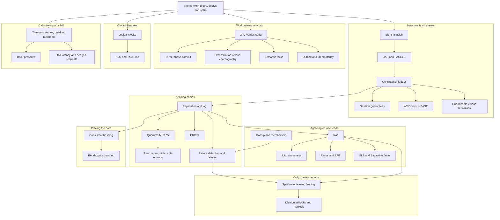

## The map in words

Everything starts at the top box: the network is not reliable. When it splits, CAP forces a choice between a correct answer and any answer. The ladder below says how correct each answer is.

Data lives on several machines, so it is copied (replication). Copies agree through a quorum or through a consensus leader, and fencing stops an old leader from doing harm.

Work that spans services cannot lock them all, so a saga runs local steps, and an outbox plus idempotency make each step happen exactly once in effect. Clocks cannot order events, so logical clocks do. Every call can hang, so timeouts and breakers keep one sick service from taking down the rest.

## The eight fallacies of distributed computing

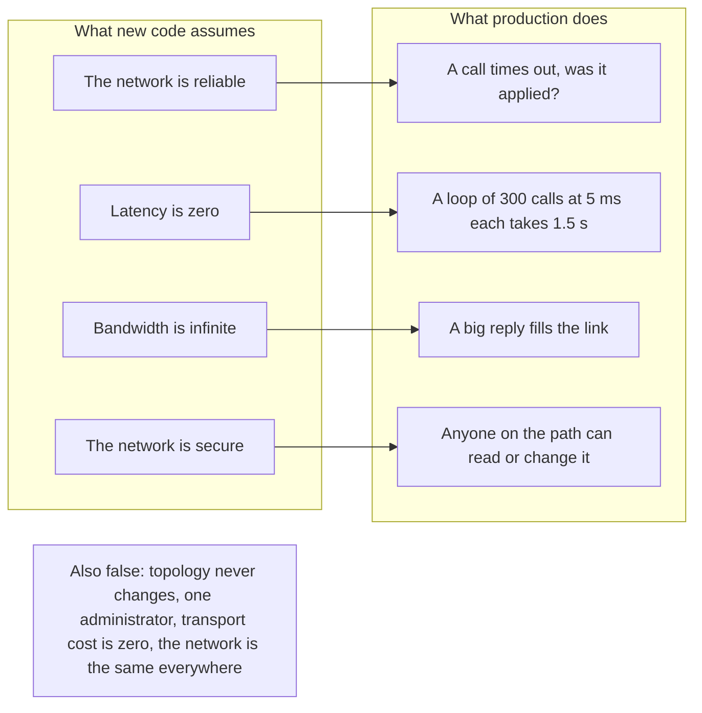

**Story.** A developer writes a wallet page that calls a price service once per token. On a laptop it is instant. In production the wallet holds 300 tokens and each call crosses the network, so the page takes one and a half seconds. One morning the price service restarts, a call times out, and the code does not know if the price update it sent was applied.

**How it works.**

1. Peter Deutsch and colleagues at Sun listed eight beliefs that every new distributed system makes, and that are all false.
2. The network is reliable: messages are lost, delayed and duplicated (first row of the picture).
3. Latency is zero: each hop costs time, so a chatty loop is slow (second row).
4. Bandwidth is infinite: big replies queue behind each other (third row).
5. The network is secure: traffic must be encrypted and authenticated (fourth row).
6. The bottom box: topology changes, there are many administrators, moving data costs money, and the network is a mix of different parts.

### In code

```text
roundTrip = 5 ms                           # latency is not zero
call(handler):
  elapsed += roundTrip; reply = handler()  # the server runs it
  if the reply is lost: return timeout     # "I do not know"
pricesChatty(tokens):
  for each token: call(price)              # 300 x 5 ms = 1.5 s
pricesBatched(tokens):
  call(all prices at once)                 # 1 x 5 ms, a bigger reply
service charge(key, order, amount):
  if key != "" and key in done:
    return done[key]                       # same key: no second charge
  charges.append(order)                    # the money moves
  if key != "": done[key] = result
client chargeWithRetry(key, order):
  r = call(charge(key, order, 20))
  if r is timeout: call(charge(key, order, 20))   # the retry
fix: key = the order id, the same on every try
```

```go
// Call sends one request. The handler always runs; the reply may be lost.
func (n *Network) Call(handler func() string) (string, error) {
	n.elapsedMs += roundTripMs
	reply := handler()
	if n.dropReply {
		n.dropReply = false
		return "", errTimeout // applied on the server, unknown to the client
	}
	return reply, nil
}

// PricesChatty makes one call per token: 300 tokens, 300 round trips.
func PricesChatty(n *Network, tokens int) {
	for t := 0; t < tokens; t++ {
		n.Call(func() string { return "price" })
	}
}

// PricesBatched asks for every price in one call.
func PricesBatched(n *Network, tokens int) {
	n.Call(func() string { return fmt.Sprintf("%d prices", tokens) })
}

func (p *PaymentService) Charge(key, order string, amount int) string {
	if key != "" {
		if r, ok := p.done[key]; ok {
			return r // the same key again: return the stored result
		}
	}
	p.charges = append(p.charges, order)
	r := fmt.Sprintf("charged %d for %s", amount, order)
	if key != "" {
		p.done[key] = r
	}
	return r
}

// ChargeWithRetry retries once after a timeout. key "" is a blind retry.
func ChargeWithRetry(n *Network, p *PaymentService, key, order string) {
	_, err := n.Call(func() string { return p.Charge(key, order, 20) })
	if errors.Is(err, errTimeout) {
		n.Call(func() string { return p.Charge(key, order, 20) }) // retry
	}
}
```

Run it: `handbook/code/03-eight-fallacies/` with `go run .`

**What goes wrong.** The most expensive one is the first. A timeout does not mean "not done". It means "I do not know". Code that retries a non-idempotent payment after a timeout can charge twice. Fix it with an idempotency key, so a retry is safe.

**Where you use it.**

- A Go indexer that calls a chain node's RPC (Remote Procedure Call) endpoint: batch the calls instead of one per block, and set a timeout on each.
- A microservice split review: count the calls a page makes across the network before you split the service.
- Every API between data centres: encrypt it, even inside the private network.

> "Every remote call can be lost, slow, duplicated or read by someone else. I design for that before I write the happy path."

▶ Watch it move: [The eight fallacies](visual/03-eight-fallacies.html)

## CAP and PACELC

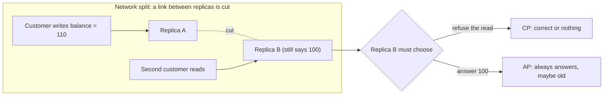

**Story.** A customer deposits 10 into a wallet on replica A. The cable between A and B is cut a second later. Another request reads the balance from replica B. B has not seen the deposit. It can say "sorry, try later" or it can say "100".

**How it works.**

1. A Partition (the dashed cut) separates replicas A and B.
2. B gets a read and does not know the newest value.
3. Refusing keeps Consistency (C): every answer is the latest write. That is CP.
4. Answering keeps Availability (A): every request gets a non-error reply. That is AP.
5. PACELC adds the normal day: Else, with no partition, you still trade Latency (L) against Consistency (C). Waiting for B to confirm makes every write slower.

### In code

Partition: CP refuses:

```text
on write(op) at A: apply op, send a copy to B
  link cut: the copy is lost, B holds 100
on read at a replica:
  reach = replicas it can talk to, itself included
  if reach * 2 <= total: refuse "try later"
  else: answer its balance
two replicas, cut: each side reaches 1 of 2   # 2 <= 2 on both sides
fix: total = 3, A and C reach 2 of 3          # 4 > 3: A answers
  B alone reaches 1 of 3: still refuses
```

```go
// Op is one change to the balance, kept so replicas can merge later.
type Op struct {
	id     string
	amount int
}

// Replica holds one copy of the wallet balance and the ops it applied.
type Replica struct {
	name    string
	balance int
	ops     []Op
}

// Apply adds an op to the balance and remembers it.
func (r *Replica) Apply(op Op) {
	r.balance += op.amount
	r.ops = append(r.ops, op)
}

// ErrNoMajority is the CP answer when a replica cannot reach a majority.
var ErrNoMajority = errors.New("no majority: try later")


// ReadCP answers only when the replica reaches a majority of all replicas.
func ReadCP(r *Replica, reach, total int) (int, error) {
	if reach*2 <= total {
		return 0, ErrNoMajority
	}
	return r.balance, nil
}
```

Partition: AP answers:

```text
on read at B: answer its balance              # no peer check
on write at B: apply op, keep it in the ops log
link heals: A has 110, B has 70
last writer wins: keep one balance            # drops 10 or 30
fix: merge ops: send each replica the ops it lacks
  both apply them: 100 + 10 - 30 = 80
```

```go
// Apply adds an op to the balance and remembers it.
func (r *Replica) Apply(op Op) {
	r.balance += op.amount
	r.ops = append(r.ops, op)
}

// Has reports whether the replica already applied the op.
func (r *Replica) Has(id string) bool {
	for _, op := range r.ops {
		if op.id == id {
			return true
		}
	}
	return false
}

// ReadAP always answers with the local balance, whatever its age.
func ReadAP(r *Replica) int {
	return r.balance
}

// LWW keeps the balance of the later writer and drops the other one.
func LWW(a, b *Replica, bLater bool) int {
	if bLater {
		return b.balance
	}
	return a.balance
}

// MergeOps gives each replica the ops it lacks, so both end equal.
func MergeOps(a, b *Replica) {
	var toA, toB []Op
	for _, op := range b.ops {
		if !a.Has(op.id) {
			toA = append(toA, op)
		}
	}
	for _, op := range a.ops {
		if !b.Has(op.id) {
			toB = append(toB, op)
		}
	}
	for _, op := range toA {
		a.Apply(op)
	}
	for _, op := range toB {
		b.Apply(op)
	}
}
```

Normal day: PACELC:

```text
EC write(op): apply on A
  send the copy to B, wait for B's ok
  then reply ok to the customer       # one round trip slower
read at B: answer its balance
EL write(op): apply on A, reply ok at once
  queue the copy for B                # sent later
read at B before the copy lands       # 110, stale
fix: strong read: deliver pending copies, then answer   # 120
```

```go
// WriteEC applies on A, copies to B and waits for B before replying.
func WriteEC(a, b *Replica, op Op) string {
	a.Apply(op)
	b.Apply(op) // the copy and B's ok come before the reply
	return "ok"
}

// Link carries copies from A to B. Pending holds copies not yet delivered.
type Link struct {
	pending []Op
}

// Deliver applies every pending copy on B.
func (l *Link) Deliver(b *Replica) {
	for _, op := range l.pending {
		b.Apply(op)
	}
	l.pending = nil
}

// WriteEL applies on A, replies at once and queues the copy for later.
func WriteEL(a *Replica, l *Link, op Op) string {
	a.Apply(op)
	l.pending = append(l.pending, op)
	return "ok"
}

// ReadAP always answers with the local balance, whatever its age.
func ReadAP(r *Replica) int {
	return r.balance
}

// ReadStrong delivers every pending copy before it answers.
func ReadStrong(b *Replica, l *Link) int {
	l.Deliver(b)
	return b.balance
}
```

Run it: `handbook/code/03-cap-pacelc/` with `go run .`

**What goes wrong.** People say "we chose CA". Partitions are not optional, so CA is not on the menu. A two-node cluster is the classic trap: with no third node, no side has a majority, so it cannot be safely CP.

**Where you use it.**

- A graph database cluster with one leader stops writes when it loses its peers. That is CP. A half-written money flow is worse than a few minutes of refusals.
- A DNS (Domain Name System) cache keeps answering old records. That is AP, and nobody minds.
- DynamoDB is PA/EL: available in a split, low latency on a normal day. A single-leader Postgres is PC/EC.

> "CAP is a choice I make only during a partition: refuse or answer stale. PACELC reminds me that on a normal day I still pay latency for consistency."

▶ Watch it move: [CAP and PACELC](visual/03-cap-pacelc.html)

## The consistency ladder

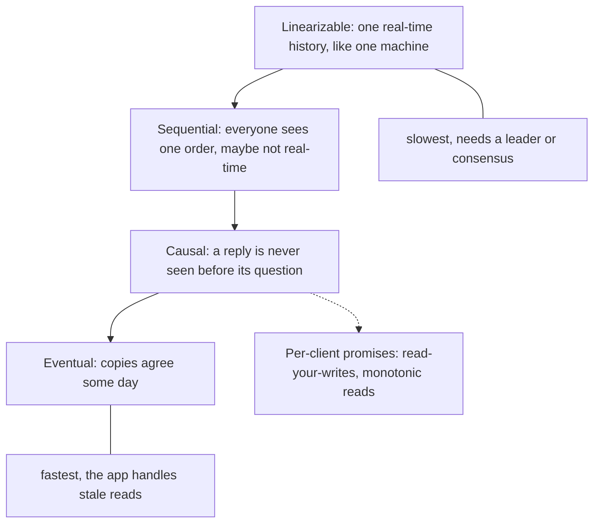

**Story.** A customer tops up a wallet and refreshes the page. The page reads from a replica that is one second behind. The balance shows the old number and the customer opens a support ticket. The fix is not "make everything linearizable". The fix is "this one page must read your own writes".

**How it works.**

1. Linearizable (top box): every operation seems to happen at one instant. Any read after a write sees it.
2. Sequential: all nodes agree on one order of writes, but that order may differ from wall time.
3. Causal: if write B was caused by write A, everyone sees A first. Unrelated writes may show up in any order.
4. Eventual (bottom box): stop writing and the copies converge. No promise about when.
5. The dotted box: per-client promises. Read-your-writes means you always see your own change. Monotonic reads means you never see time go backwards.

### In code

```text
on write(key, value), at the leader:
  pos = pos + 1; log[pos] = (key, value)   # the leader orders writes
  return ok, pos                           # the client may keep pos
replica, all the time:
  apply the log entries that have arrived  # replica.pos <= leader.pos
on read(key, minPos):
  r = loadBalancer.pick()                  # usually the replica
  if minPos == 0: return r.get(key)        # eventual: no check
  if r.pos >= minPos: return r.get(key)    # new enough for this client
  return leader.get(key)                   # too old: ask the leader
on signup(name):
  if replica.get(name) is empty:           # a stale check
    write(name)                            # two people can both pass
  fix: leader.putIfAbsent(name)            # one linearizable winner
```

```go
// Write goes to the leader. It returns the log position of the write.
func (c *Cluster) Write(key string, value int) int {
	c.log = append(c.log, entry{key, value})
	c.leader.pos = len(c.log)
	c.leader.data[key] = value
	return c.leader.pos // the client may keep this position
}

// Replicate applies the log entries that have reached the replica, up to pos.
func (c *Cluster) Replicate(upTo int) {
	for c.replica.pos < upTo {
		e := c.log[c.replica.pos]
		c.replica.data[e.key] = e.value
		c.replica.pos++
	}
}

// Read picks the replica, as the load balancer does. minPos 0 means
// "any copy will do" (eventual). minPos > 0 is read-your-writes.
func (c *Cluster) Read(key string, minPos int) (int, string) {
	r := c.replica
	if minPos == 0 {
		v, _ := r.get(key)
		return v, r.name // eventual: no check at all
	}
	if r.pos >= minPos {
		v, _ := r.get(key)
		return v, r.name // the replica is new enough
	}
	v, _ := c.leader.get(key)
	return v, c.leader.name // too old: go to the leader
}

// SignupStale checks a replica, then writes. Two people can both pass.
func (c *Cluster) SignupStale(name string) bool {
	if _, taken := c.replica.get("user:" + name); taken {
		return false
	}
	c.Write("user:"+name, 1)
	return true
}

// SignupLinearizable asks the leader to put the name only if absent.
func (c *Cluster) SignupLinearizable(name string) bool {
	if _, taken := c.leader.get("user:" + name); taken {
		return false
	}
	c.Write("user:"+name, 1)
	return true
}
```

Run it: `handbook/code/03-consistency-ladder/` with `go run .`

**What goes wrong.** A strong write path with an eventual read path, and nobody told the user. The deposit "vanishes" for a second. Fix it with read-your-writes: route that client's next read to the leader, or wait until the replica has reached the write's log position.

**Where you use it.**

- Wallet balance after a deposit: read-your-writes.
- A "recent swaps" list on a block explorer: eventual is fine.
- A uniqueness check (one username, one lease holder): linearizable, through a consensus store such as etcd.

> "Consistency is a ladder. I pick the lowest rung the business can live with, per endpoint, not per system."

▶ Watch it move: [The consistency ladder](visual/03-consistency-ladder.html)

## Session guarantees: read-your-writes and monotonic reads

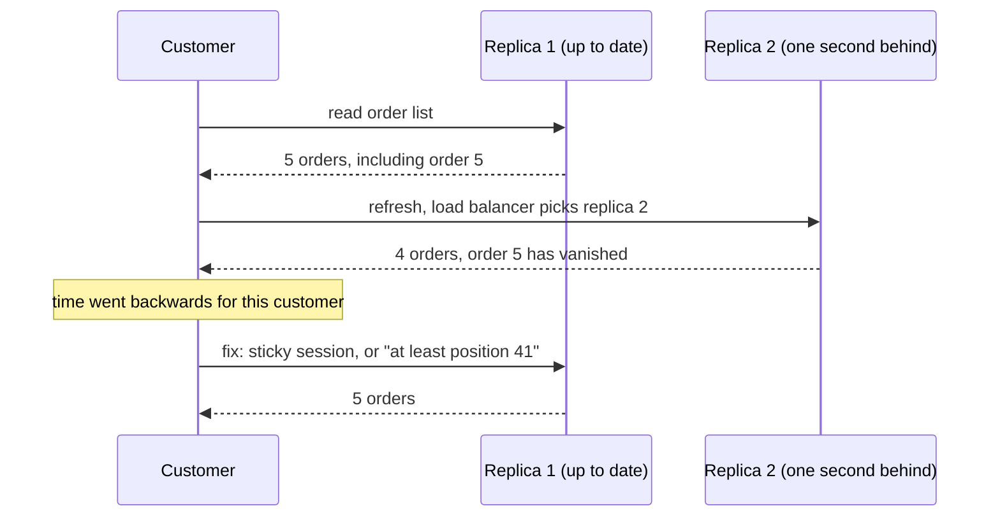

**Story.** A customer sees five orders on the order page. They refresh. The load balancer sends the second read to a replica that is one second behind, and the list shows four orders. Order 5 appeared and then vanished. The data is not lost. The customer simply saw time go backwards.

**How it works.**

1. Session guarantees are promises made to one client, not to the whole system.
2. Read-your-writes: after you write, your reads include that write.
3. Monotonic reads: once you have seen a version, you never see an older one (the vanished order breaks this).
4. Monotonic writes: your writes are applied in the order you made them.
5. Writes-follow-reads: a write you make after reading something is ordered after that thing.
6. The fix in the picture: keep the client on one replica (a sticky session), or send the highest log position it has seen with every read, and let a replica that is older wait or refuse.

### In code

```text
lb.pick():
  if a replica is pinned to this client:
    return it                              # sticky session
  return the next replica in turn          # knows nothing about the client
on read(client):
  r = lb.pick()
  if r is dead: r = another replica        # the pinned one crashed
  if r.pos < client.seen:                  # the session check
    wait until r.pos >= client.seen        # never answer from the past
  rows = orders up to r.pos                # pos 40: 4 orders, 41: 5
  if client keeps it: client.seen = max(client.seen, r.pos)
  return rows
```

```go
func (lb *Balancer) Pick() *Replica {
	if lb.sticky != nil {
		return lb.sticky // the replica pinned to this client
	}
	r := lb.replicas[lb.next%len(lb.replicas)]
	lb.next++ // round robin: knows nothing about the client
	return r
}

// Read runs one page load. catchUp lets a lagging replica apply the log.
func Read(lb *Balancer, c *Client, catchUp func(*Replica)) (int, string) {
	r := lb.Pick()
	if r.dead {
		r = lb.replicas[1] // the sticky replica died: fall back
	}
	if r.pos < c.seen {
		catchUp(r) // wait until the replica has reached what we saw
	}
	rows := ordersAt(r.pos)
	if c.keep && r.pos > c.seen {
		c.seen = r.pos // remember the newest position seen
	}
	return rows, r.name
}
```

Run it: `handbook/code/03-session-guarantees/` with `go run .`

**What goes wrong.** Sticky sessions break when that replica dies, and the client lands on a stale one. The robust fix is the log position token: the client carries "I have seen position 41", so any replica can check itself.

**Where you use it.**

- MongoDB causal consistency sessions carry an operation time for exactly this.
- A page that reads from Postgres replicas: store the leader's log position (LSN, Log Sequence Number) in the user's session after a write.
- A block explorer: remember the highest block the user has seen, and never serve a page from a node below it.

> "Session guarantees are cheap promises to one user: see your own writes, and never see time go backwards. A log position carried by the client gives both."

▶ Watch it move: [Session guarantees](visual/03-session-guarantees.html)

## ACID versus BASE

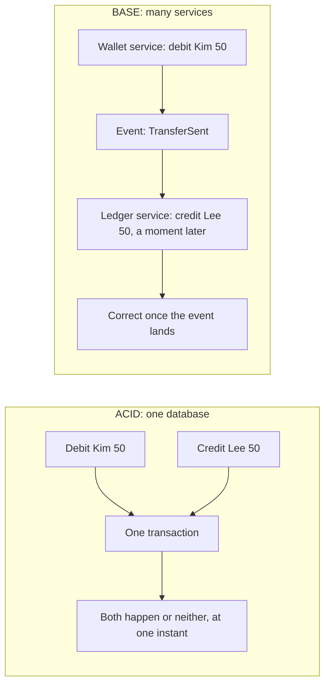

**Story.** Kim sends Lee 50. Inside one Postgres database, the debit and the credit are one transaction: nobody can ever see the money gone from Kim and not yet with Lee. Split into a wallet service and a ledger service, the debit commits first and the credit follows an event a moment later. For that moment, the total looks 50 short.

**How it works.**

1. ACID is the single-database promise (left box).
2. Atomic: all of the transaction or none of it.
3. Consistent: the database's rules hold before and after, such as "no balance below zero".
4. Isolated: running transactions do not see each other's half-done work.
5. Durable: once committed, it survives a crash.
6. BASE is the trade many services make (right box): Basically Available, Soft state (copies may differ for a while), Eventually consistent.

### In code

ACID: one database:

```text
transfer(kim -> lee, 50), one database:
  tx = db.begin()
  tx.set(kim, kim - 50)            # written, not visible to others
  tx.set(lee, lee + 50)
  report: read committed kim + lee # sees 100 + 50 = 150
  if the power fails here:
    discard tx.writes              # rollback: 100 and 50 stay
  tx.commit():
    for each write: make it visible  # both at one instant
read(key): return committed[key]   # never a half-done write
```

```go
func (db *DB) Read(key string) int { return db.committed[key] }

func (tx *Tx) Set(key string, v int) { tx.writes[key] = v } // not visible yet


// Commit makes every write visible at one instant.
func (tx *Tx) Commit() {
	for k, v := range tx.writes {
		tx.db.committed[k] = v
	}
}

// Crash before commit: the writes are thrown away (rollback).
func (tx *Tx) Crash() { tx.writes = nil }

// TransferACID moves 50 inside one transaction. crash stops it before commit.
// report runs in the middle, while the transaction is open.
func TransferACID(db *DB, crash bool, report func()) {
	tx := db.Begin()
	tx.Set("kim", db.Read("kim")-50) // written, not visible
	tx.Set("lee", db.Read("lee")+50)
	report() // a reader in the middle sees the old committed values
	if crash {
		tx.Crash() // rollback: 100 and 50 stay
		return
	}
	tx.Commit() // both visible at one instant
}
```

BASE: two services:

```text
wallet, one local transaction:
  kim = kim - 50
  outbox.add(TransferSent 50)      # same commit as the debit
relay and ledger, a moment later:
  for each outbox event: lee = lee + amount
  clear the outbox                 # confirmed
report:
  return wallet.kim + ledger.lee   # in the gap: 50 + 50 = 100
fix, report with pending:
  pending = sum of outbox events   # money in flight: 50
  return kim + lee + pending       # 50 + 50 + 50 = 150
```

```go
// Debit is one local transaction: the balance and the outbox row together.
func (w *Wallet) Debit(amount int) {
	w.kim -= amount
	w.outbox = append(w.outbox, amount) // same commit as the debit
}

// Deliver is the relay plus the ledger: the event lands, Lee is credited.
func Deliver(w *Wallet, l *Ledger) {
	for _, amount := range w.outbox {
		l.lee += amount
	}
	w.outbox = nil // confirmed
}

// ReportNaive adds the two balances. In the gap it is short.
func ReportNaive(w *Wallet, l *Ledger) int { return w.kim + l.lee }

// ReportPending also counts transfers still in flight.
func ReportPending(w *Wallet, l *Ledger) (total, pending int) {
	for _, a := range w.outbox {
		pending += a
	}
	return w.kim + l.lee + pending, pending
}
```

Run it: `handbook/code/03-acid-vs-base/` with `go run .`

**What goes wrong.** Treating BASE as "no rules". The in-between state is real and visible: a report that sums wallets and ledger during that moment is wrong. Design for it: mark the transfer "pending", show it as pending, and let a saga finish or undo it.

**Where you use it.**

- A bank ledger inside one database: ACID, always.
- An order flow across payment, stock and shipping: BASE with a saga and an outbox.
- An analytics warehouse such as StarRocks that loads in batches: each load is atomic, but the reports are eventually consistent with the source.

> "ACID gives me one instant of truth inside one database. BASE gives me availability across services, and I pay with a visible in-between state that I must design."

▶ Watch it move: [ACID versus BASE](visual/03-acid-vs-base.html)

## Linearizability versus serializability

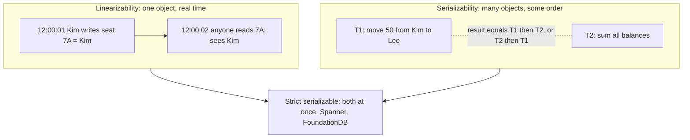

**Story.** Two promises sound alike and interviewers love to mix them. An airline seat system needs that once Kim books seat 7A, every later read sees Kim: that is linearizability. A bank needs that a transfer and a balance report never mix halfway: that is serializability. Spanner gives both, and calls it external consistency.

**How it works.**

1. Linearizability is about one object and real time (top box). Every operation seems to happen at one instant between its start and its end.
2. Serializability is about transactions over many objects (middle box). The result equals some one-at-a-time order.
3. Serializability does not promise real time. A read-only transaction may be placed "before" a write that already finished.
4. Strict serializability (bottom box) is both: a one-at-a-time order that also respects real time.

### In code

Linearizable: seat 7A:

```text
rule: a read that starts after a write ended must see it
book(seat, who):
  leader.seats[seat] = who         # takes effect at one instant
replicate, later:
  copy the leader's seats to the replica   # the replica lags
read(seat) from a replica:
  return replica.seats[seat]       # may be behind: breaks the rule
fix, linearizable read:
  return leader.seats[seat]        # has every finished write
```

```go
// Book writes on the leader. The replica gets it later, in Replicate.
func (s *SeatStore) Book(seat, who string) {
	s.leader[seat] = who
}

func (s *SeatStore) Replicate() {
	for k, v := range s.leader {
		s.replica[k] = v
	}
}

// ReadReplica may be behind: not linearizable.
func (s *SeatStore) ReadReplica(seat string) string { return orFree(s.replica[seat]) }

// ReadLeader sees every finished write: linearizable.
func (s *SeatStore) ReadLeader(seat string) string { return orFree(s.leader[seat]) }
```

Serializable: transfer and report:

```text
T1 transfer(isolated):
  if isolated: lock()              # hold it to the commit
  kim = kim - 50
  (T2 may run here if not isolated)
  lee = lee + 50
  unlock()
T2 report(isolated):
  if isolated: lock()              # wait until T1 has finished
  return kim + lee
T2 on a replica snapshot:
  return snapshot.kim + snapshot.lee   # a valid order, old data
strict: a T2 that starts after T1 ended reads after T1
```

```go
// Transfer is T1. With isolation it holds the lock for the whole transaction.
// between runs after the debit and before the credit: where T2 can sneak in.
func (b *Bank) Transfer(isolated bool, between func()) {
	if isolated {
		b.mu.Lock()
		defer b.mu.Unlock()
	}
	b.kim -= 50
	between()
	b.lee += 50
}

// Report is T2. With isolation it waits for the lock, so it never sees half of T1.
func (b *Bank) Report(isolated bool) int {
	if isolated {
		b.mu.Lock()
		defer b.mu.Unlock()
	}
	return b.kim + b.lee
}
```

Run it: `handbook/code/03-linearizable-vs-serializable/` with `go run .`

**What goes wrong.** Saying "our database is serializable, so reads are fresh". A serializable database can still serve a read from a stale snapshot. Postgres SERIALIZABLE on a read replica is the classic case: the order is correct, the data is old.

**Where you use it.**

- etcd and ZooKeeper writes: linearizable, so a lock or a leader name is never stale.
- Postgres SERIALIZABLE on the leader: serializable transactions, for money moves.
- Spanner and CockroachDB: strict serializable, with clocks used to respect real time.

> "Linearizable is one object in real time. Serializable is many objects in some order. Strict serializable is both, and it costs a clock or a leader."

▶ Watch it move: [Linearizability versus serializability](visual/03-linearizable-vs-serializable.html)

## Quorum reads and writes (N, R, W)

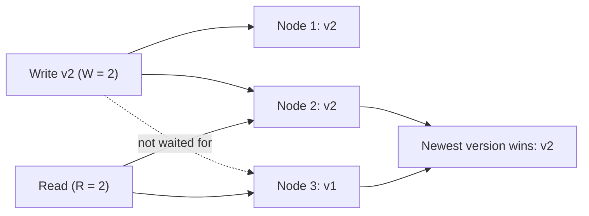

**Story.** Three replicas hold a token's price (N = 3). A writer updates it and waits for two acknowledgements (W = 2). A reader asks two replicas (R = 2). One of them is stale, but the other is not, because two plus two is more than three. The reader takes the higher version.

**How it works.**

1. N is the number of copies. Here three nodes.
2. A write is done when W nodes have acknowledged it. Node 3 was not waited for.
3. A read asks R nodes and compares their versions.
4. If R + W > N, the read set and the write set share at least one node. Node 2 is that overlap.
5. The reader returns the newest version and may repair the stale node in the background (read repair).

### In code

```text
on write(v), done after W acks:
  send v to all N replicas
  wait until W replicas have acked        # the others are not waited for
  return done
on read(), asking R replicas:
  ask R replicas for their version
  newest = the highest version answered
  send newest to any asked replica that is older   # read repair
  return newest
the overlap check: R + W > N              # read set meets write set
a replica gets a read during a partition:
  CP: if reachable <= N / 2: return error # no majority, so no proof
  AP: return what it has                  # maybe old
in the background: deliver every copy still in flight   # anti-entropy
```

```go
// Overlap reports whether every read set meets every write set.
func Overlap(r, w, n int) bool { return r+w > n }

// Write sends v to all replicas. ackOrder is who answers first. It is done
// after W acks. The others keep the copy in flight.
func (c *Cluster) Write(v, w int, ackOrder []int) (bool, []int) {
	acks := []int{}
	for _, id := range ackOrder {
		rep := c.reps[id-1]
		if !rep.up {
			continue
		}
		if len(acks) == w {
			c.inFlight[id] = v // not waited for
			continue
		}
		rep.version = v
		acks = append(acks, id)
	}
	return len(acks) == w, acks
}

// Read asks the given R replicas, returns the newest version, and repairs any
// replica that answered older.
func (c *Cluster) Read(ask []int) (int, []int) {
	newest := 0
	for _, id := range ask {
		if v := c.reps[id-1].version; v > newest {
			newest = v
		}
	}
	repaired := []int{}
	for _, id := range ask {
		if c.reps[id-1].version < newest {
			c.reps[id-1].version = newest
			repaired = append(repaired, id)
		}
	}
	return newest, repaired
}

// ReadCut is a read on replica id when it reaches only reachable replicas.
func (c *Cluster) ReadCut(id, reachable int, consistent bool) (int, error) {
	if consistent && reachable <= len(c.reps)/2 {
		return 0, fmt.Errorf("no quorum: reaches %d of %d", reachable, len(c.reps))
	}
	return c.reps[id-1].version, nil
}

// AntiEntropy delivers every copy still in flight.
func (c *Cluster) AntiEntropy() {
	for id, v := range c.inFlight {
		c.reps[id-1].version = v
		delete(c.inFlight, id)
	}
}
```

Run it: `handbook/code/03-cap-and-quorum/` with `go run .`

**What goes wrong.** R + W > N gives overlap, not linearizability. Two concurrent writers can still be seen in different orders. Sloppy quorums, which write to any reachable node during an outage, break the overlap completely. For true linearizability you need a leader or a consensus round.

**Where you use it.**

- Cassandra with N = 3, W = 2, R = 2: survives one node loss for both reads and writes.
- W = 3, R = 1 when reads must be fast and writes are rare. Any one dead node now stops writes.
- W = 1, R = 1 for speed when a stale read is harmless, such as view counters.

> "With R plus W greater than N, every read touches at least one node that saw the newest write. That is overlap, not linearizability."

▶ Watch it move: [CAP and quorums](visual/03-cap-and-quorum.html)

## Repairing replicas: read repair, hinted handoff and anti-entropy

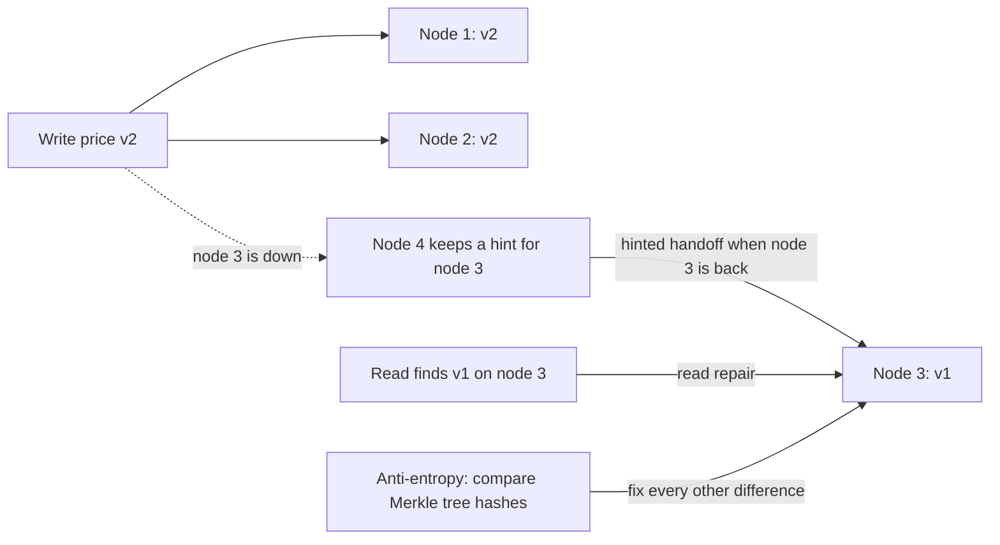

**Story.** Node 3 of a Cassandra cluster is down for ten minutes while a token price changes. Node 4 keeps the write as a hint. Node 3 comes back and gets the hint. A reader also notices node 3 still holds an old price and fixes it. At night a repair job compares all the rows the hints and reads never touched.

**How it works.**

1. Hinted handoff: a stand-in node (node 4) stores a write meant for a dead node, with a note saying who it is for.
2. When node 3 returns, node 4 hands the write over and deletes the hint.
3. Read repair: a quorum read sees versions v2 and v1, returns v2, and writes v2 back to the stale node.
4. Anti-entropy: a background job compares replicas. It builds a Merkle tree, a tree of hashes, so two nodes compare one root hash and walk down only into the branches that differ.
5. Sloppy quorum: during an outage the write counts node 4's hint toward W. It stays available, but a read of nodes 1 and 3 may not overlap the write.

### In code

Hints and read repair:

```text
write(key, v):
  for each replica r of key:          # N = 3: nodes 1, 2, 3
    if r is up: r.store(key, v)
    else: hints[r].add(key, v)        # node 4 keeps it for r
on r back:
  for each hint for r:
    if not expired: r.store(hint)     # hinted handoff
  delete hints[r]                     # expired ones are just lost
read(key) from nodes a and b:
  newest = max(a.version, b.version)
  for each node with an older version:
    node.store(key, newest)           # read repair
  return newest
```

```go
// Write stores the version on every replica that is up, and a hint for the rest.
func (c *Cluster) Write(key string, version int) {
	for _, r := range c.replicas {
		if r.up {
			r.data[key] = version
		} else {
			c.hints[r.name] = append(c.hints[r.name], hint{key, version, false})
		}
	}
}

// Return brings a node back and hands over every hint that has not expired.
func (c *Cluster) Return(r *Node) {
	r.up = true
	for _, h := range c.hints[r.name] {
		if !h.expired {
			r.data[h.key] = h.version // hinted handoff
		}
	}
	delete(c.hints, r.name) // expired hints are simply lost
}

// Read asks two nodes, returns the newest version and repairs the older one.
func Read(key string, a, b *Node) int {
	newest := a.data[key]
	if b.data[key] > newest {
		newest = b.data[key]
	}
	for _, n := range []*Node{a, b} {
		if n.data[key] < newest {
			n.data[key] = newest // read repair
		}
	}
	return newest
}
```

Anti-entropy with Merkle trees:

```text
build(node):
  leaf[k] = hash(rows of range k)     # 4 ranges
  mid = hash(leaf1 + leaf2), hash(leaf3 + leaf4)
  root = hash(mid1 + mid2)            # one hash for all the data
repair(src, dst):
  if src.root == dst.root: done       # 1 comparison: equal data
  for each mid m:
    if src.mid[m] == dst.mid[m]: skip # both ranges below are equal
    for each leaf l under m:
      if src.leaf[l] != dst.leaf[l]:
        copy range l from src to dst  # only what differs
rebuild dst: the roots match again
```

```go
func Build(n *Node) Tree {
	var t Tree
	for i, r := range ranges(n) {
		t.leaf[i] = h(r) // leaf = hash of the rows of the range
	}
	t.mid[0], t.mid[1] = h(t.leaf[0]+t.leaf[1]), h(t.leaf[2]+t.leaf[3])
	t.root = h(t.mid[0] + t.mid[1]) // parent = hash of its children
	return t
}

// Repair walks down only where the hashes differ, and copies those ranges.
func Repair(src, dst *Node) (compared int, copied []int) {
	a, b := Build(src), Build(dst)
	compared++
	if a.root == b.root {
		return compared, nil // one comparison: equal data
	}
	for m := 0; m < 2; m++ {
		compared++
		if a.mid[m] == b.mid[m] {
			continue // equal below: skip both ranges
		}
		for l := 2 * m; l < 2*m+2; l++ {
			compared++
			if a.leaf[l] != b.leaf[l] {
				copied = append(copied, l+1)
				copyRange(src, dst, l)
			}
		}
	}
	return compared, copied
}
```

Run it: `handbook/code/03-replica-repair/` with `go run .`

**What goes wrong.** A row that is written once and rarely read is never read-repaired, and a hint expires after a few hours. A node that was down longer silently keeps old data. Fix it by running anti-entropy repair more often than the hint lifetime and the delete grace period.

**Where you use it.**

- Cassandra: hints by default, `nodetool repair` with Merkle trees, run on a schedule.
- DynamoDB's original design (the Dynamo paper): sloppy quorum and hinted handoff for an always-writable cart.
- Any two copies of a large table: compare hashes per range first, then copy only the ranges that differ.

> "Hints fix short outages, read repair fixes what readers touch, and anti-entropy with Merkle trees fixes everything else in the background."

▶ Watch it move: [Repairing replicas](visual/03-replica-repair.html)

## Replication: leader, leaderless, and lag

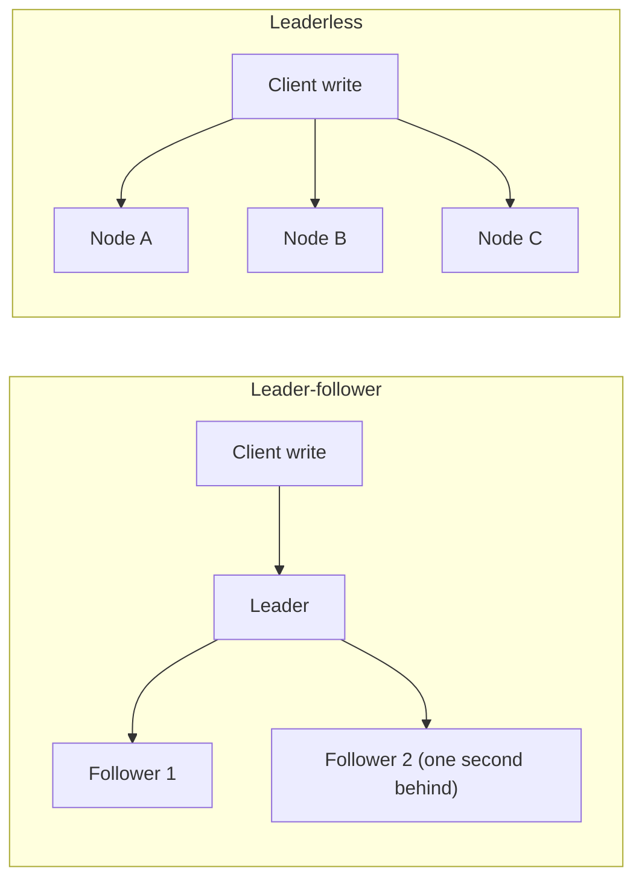

**Story.** Postgres takes every write on one leader and streams its log to two read replicas. A report runs on follower 2, which is one second behind. Next door, Cassandra lets any node take a write, and the nodes sort out conflicts later.

**How it works.**

1. Leader-follower (left): one node accepts writes and defines the order. Followers copy its log.
2. Replication lag is the gap between a write on the leader and its arrival on a follower.
3. Lag is measured as a log position. The right question is "has follower 2 seen position X yet".
4. Leaderless (right): any node accepts a write. Conflicts are settled by version vectors or by last-writer-wins.

### In code

Leader-follower (Postgres):

```text
on write(order), at the leader:
  pos = pos + 1; log[pos] = order
  return ok                              # confirmed on one machine
ship loop, for each follower f:
  send entries f.pos+1 .. leader.pos     # some are still in flight
  f.pos = highest position received
lag(f) = leader.pos - f.pos              # lag is a log position
report on follower f:
  answer from f, as of f.pos             # older by lag(f) positions
on leader dead:
  newLeader = first follower to answer   # careless: ignores pos
  fix: newLeader = follower with max pos # nothing confirmed is lost
```

```go
// Leader appends a write at the next log position.
func Append(leader *Node) int {
	leader.pos++
	return leader.pos
}

// Ship copies the leader's log to a follower, up to the position that has
// reached it. A slow follower gets a smaller upTo.
func Ship(leader, f *Node, upTo int) {
	if upTo > leader.pos {
		upTo = leader.pos
	}
	if f.pos < upTo {
		f.pos = upTo
	}
}

// Lag is the leader's position minus the follower's.
func Lag(leader, f *Node) int { return leader.pos - f.pos }

// PromoteCareless picks whichever follower answered first (here follower 2),
// whatever its log position.
func PromoteCareless(followers []*Node) *Node { return followers[len(followers)-1] }

// PromoteSafe picks the follower with the highest log position.
func PromoteSafe(followers []*Node) *Node {
	best := followers[0]
	for _, f := range followers {
		if f.pos > best.pos {
			best = f
		}
	}
	return best
}
```

Leaderless (Cassandra):

```text
on write(key, value) by client c:
  v = {value, stamp: c.clock(), vv: c's vector + 1}
  send v to every node
each node merges incoming v with stored s:
  last-writer-wins: keep the larger stamp  # the other is dropped
  fix: if s.vv has seen all of v.vv: keep s
       if v.vv has seen all of s.vv: keep v
       else: keep both as siblings         # concurrent writes
reader gets two siblings:
  app picks a value, vv = union of both vectors
  write it back: it has seen both, so it replaces both
```

```go
// Version is one write to a leaderless key.
type Version struct {
	value string
	stamp string         // wall-clock stamp from the writer's clock
	vv    map[string]int // version vector: writer -> count
}

// LWW keeps the version with the larger clock stamp, and drops the other.
func LWW(a, b Version) Version {
	if b.stamp > a.stamp {
		return b
	}
	return a
}

// Descends reports whether vector a has seen everything vector b has.
func Descends(a, b map[string]int) bool {
	for k, n := range b {
		if a[k] < n {
			return false
		}
	}
	return true
}

// Merge keeps one version if it descends from the other, else both siblings.
func Merge(a, b Version) []Version {
	if Descends(a.vv, b.vv) {
		return []Version{a}
	}
	if Descends(b.vv, a.vv) {
		return []Version{b}
	}
	return []Version{a, b} // concurrent: keep both for the app
}
```

Run it: `handbook/code/03-replication-lag/` with `go run .`

**What goes wrong.** Leaderless plus last-writer-wins silently drops writes when clocks disagree. The write with the "later" clock wins, even if it really happened first. Leader-follower has the opposite risk: a failover that promotes a follower which had not yet received the last writes.

**Where you use it.**

- Postgres streaming replication and MySQL: leader-follower.
- Cassandra and Riak: leaderless, tuned by quorum.
- A graph database cluster: leader-follower, with Raft to pick the leader.

> "One leader gives me one order and one failover problem. No leader gives me availability and a conflict problem. I choose which problem I want."

▶ Watch it move: [Replication and lag](visual/03-replication-lag.html)

## Failure detection and failover

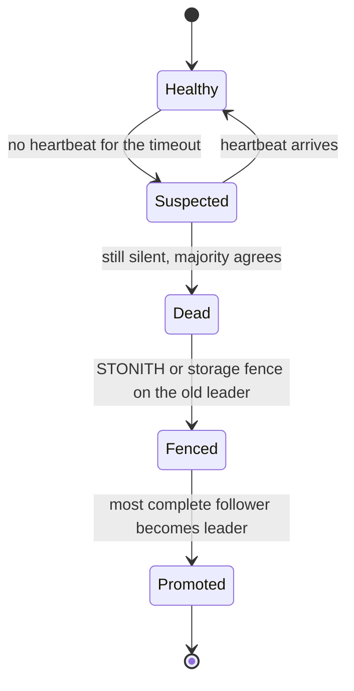

**Story.** A Postgres leader stops answering. Its followers cannot tell if it crashed, if it is just slow, or if the network between them broke. They wait for a heartbeat that does not come, suspect it, agree it is dead, cut its power, and promote the follower with the most complete log. Twenty seconds later the application writes again.

**How it works.**

1. The leader sends a heartbeat every second or so (Healthy).
2. No heartbeat within the timeout moves it to Suspected. A late heartbeat clears the suspicion.
3. A phi accrual detector, used by Cassandra and Akka, does not use one fixed timeout. It outputs a suspicion level from the history of heartbeat gaps.
4. Dead needs agreement: a majority of nodes, or a consensus store, so one node with a bad cable cannot start a failover alone.
5. Fenced: the old leader is stopped for sure. STONITH (Shoot The Other Node In The Head) cuts its power, or the storage refuses its writes.
6. Promoted: the follower with the highest log position becomes leader, and clients are pointed at it.

### In code

```text
leader, every second:
  send a heartbeat to each follower
follower, on a heartbeat:
  lastSeen = now; state = Healthy        # silence back to 0
follower, every tick:
  if now - lastSeen > timeout:
    state = Suspected                    # crashed, slow or cut off?
decide:
  votes = followers in state Suspected
  if votes < 2: return                   # 2 of 3 nodes is a majority
  if fenceEnabled: fence(oldLeader)      # STONITH before promotion
  best = follower with the highest log position
  best.leader = true                     # the app writes to best
on a write at node n:
  accept only if n.leader and not n.fenced
```

```go
// Heartbeat: the leader resets every follower's silence timer.
func (c *Cluster) Heartbeat(now int) {
	for _, f := range c.followers {
		f.lastSeen = now // silence goes back to 0
		f.state = "Healthy"
	}
}

// Tick runs on each follower: too much silence means Suspected.
func (c *Cluster) Tick(now int) {
	for _, f := range c.followers {
		if now-f.lastSeen > c.timeout {
			f.state = "Suspected"
		}
	}
}

// Decide counts the suspicions. A majority of the 3 nodes declares the
// leader dead, then the cluster fences it and promotes the best follower.
func (c *Cluster) Decide() *Node {
	votes := 0
	for _, f := range c.followers {
		if f.state == "Suspected" {
			votes++
		}
	}
	if votes < 2 { // 2 of 3 nodes is a majority
		return nil
	}
	if c.fence {
		c.old.fenced = true // STONITH: cut the old leader's power
	}
	best := c.followers[0]
	for _, f := range c.followers[1:] {
		if f.pos > best.pos {
			best = f // the highest log position loses no confirmed write
		}
	}
	best.leader = true
	return best
}

// Write: a node accepts a write only if it is a leader and not fenced.
func (n *Node) Write() bool {
	return n.leader && !n.fenced
}
```

Run it: `handbook/code/03-failure-detection/` with `go run .`

**What goes wrong.** A failure detector cannot be both fast and never wrong. A short timeout fails over during a long garbage-collection pause and creates two leaders. A long timeout means minutes without writes. Fix it with a fence, so a wrong guess is safe, and then tune the timeout for speed.

**Where you use it.**

- Patroni for Postgres: leader key in etcd with a time to live, fencing through a watchdog.
- Kubernetes: node heartbeats through leases, pods evicted after a grace period.
- A graph database cluster: Raft heartbeats, and a new leader within seconds.

> "A missing heartbeat means 'I do not know', so I make the failover safe with a fence first, and fast with the timeout second."

▶ Watch it move: [Failure detection and failover](visual/03-failure-detection.html)

## CRDTs: data that merges itself

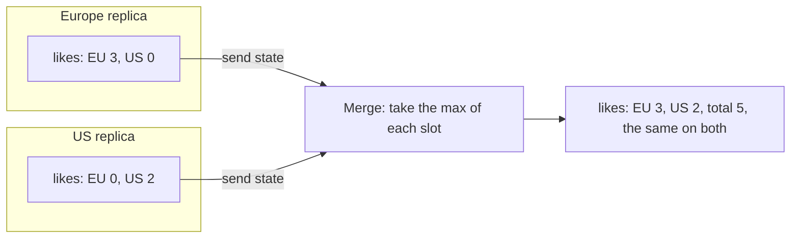

**Story.** A post gets likes in Europe and in the United States while the link between the two data centres is down. Each side keeps counting. When the link returns, the two counters merge to the same total, 5, on both sides, with no lock, no leader and no lost like.

**How it works.**

1. A CRDT (Conflict-free Replicated Data Type) is a data type with a merge function that always agrees.
2. The merge must be commutative (any order), associative (any grouping) and idempotent (merging twice changes nothing).
3. A G-Counter keeps one slot per replica. Each replica only adds to its own slot (the boxes in the picture).
4. Merge takes the maximum of each slot. The total is the sum of the slots.
5. Other CRDTs: a PN-Counter (two G-Counters, for plus and minus), an OR-Set (a set where add and remove merge cleanly), and sequence types for shared text.

### In code

```text
counter = one slot per replica, all 0
inc(me):
  counter[me] = counter[me] + 1          # only my own slot
value():
  return the sum of all slots
merge(other):
  for each replica r:
    counter[r] = max(counter[r], other[r])  # any order, any repeat
on link up:
  send my whole state; merge what arrives
stock as a counter:
  sell(me): if 1 - sold.value() > 0:     # checks only my own view
    sold.inc(me)
fix, one leader for stock:
  sell(): if stock > 0: stock = stock - 1
          else: refuse                   # the second sale fails
```

```go
// Inc adds one to this replica's own slot.
func (c GCounter) Inc(me string) {
	c[me]++
}

// Value is the sum of all slots.
func (c GCounter) Value() int {
	total := 0
	for _, v := range c {
		total += v
	}
	return total
}

// Merge takes the larger value of each slot. It is commutative,
// associative and idempotent, so any order and any repeat agree.
func (c GCounter) Merge(other GCounter) {
	for r, v := range other {
		if v > c[r] {
			c[r] = v
		}
	}
}

// SellLocal sells if this replica's own view of stock is above zero.
// The check only sees what this replica knows.
func SellLocal(sold GCounter, me string, stock int) bool {
	if stock-sold.Value() <= 0 {
		return false
	}
	sold.Inc(me)
	return true
}

// Sell decrements stock only if there is some left.
func (l *StockLeader) Sell() bool {
	if l.stock <= 0 {
		return false
	}
	l.stock--
	return true
}
```

Run it: `handbook/code/03-crdt/` with `go run .`

**What goes wrong.** A CRDT always converges, but not always to what the business wants. A stock counter that two regions each decrease from 1 converges to minus 1: two items sold, one in stock. CRDTs cannot keep a rule like "never below zero". Use them for likes and carts, and a leader for money and stock.

**Where you use it.**

- Riak and Redis Enterprise active-active: CRDT counters and sets across regions.
- Collaborative editors built on Automerge or Yjs: sequence CRDTs for shared text.
- Shopping carts: an OR-Set, so an item added offline is never lost.

> "A CRDT merges in any order and always agrees, so it needs no coordination, but it cannot keep a rule like 'stock never below zero'."

▶ Watch it move: [CRDTs](visual/03-crdt.html)

## Consensus with Raft

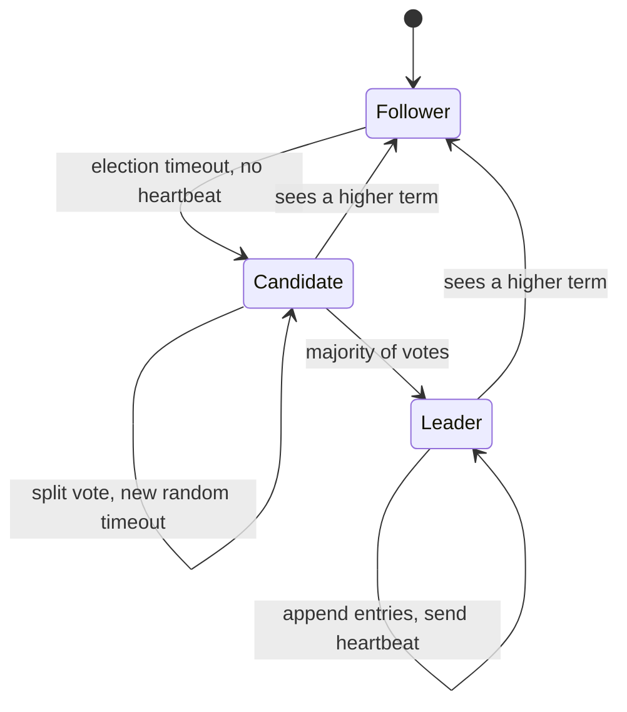

**Story.** Kubernetes stores its whole state in etcd, a three-node Raft cluster. The leader node loses power. Two seconds later one of the followers hears no heartbeat, raises the term from 7 to 8, and asks for votes. The other follower agrees. Writes continue on the new leader.

**How it works.**

1. Every node starts as a Follower and waits for heartbeats.
2. No heartbeat before a random timeout: the node becomes a Candidate and raises the term.
3. A Candidate with a majority of votes becomes Leader.
4. The Leader appends each write to its log and copies it to the others.
5. An entry is committed once a majority has stored it.
6. Anyone who sees a higher term steps down to Follower. The term is a fencing number.

### In code

```text
follower, on a heartbeat with term t:
  if t >= term: term = t; role = follower; timer = 0
every tick, not leader, timer >= my random timeout:
  term = term + 1; role = candidate; vote for myself
  ask every reachable node for its vote
on a vote request with term t and log length L:
  if t > term: term = t; role = follower; votedFor = none
  if votedFor is none and L >= my log length: grant, else refuse
candidate: if votes > N / 2: role = leader   # N counts dead nodes too
candidate, timer fires again with no majority:
  draw a new random timeout; go to line 4
leader, about every 100 ms: send a heartbeat to all
any node, on a higher term: step down (lines 2 and 7)
```

```go
// Heartbeat: a follower accepts a term at least as high as its own. A leader
// that sees a higher term steps down.
func (c *Cluster) Heartbeat(leader, to string) {
	l, n := c.nodes[leader], c.nodes[to]
	if !c.reach(leader, to) || l.term < n.term {
		return
	}
	n.term, n.role = l.term, "follower"
}

// StartElection runs when a node's random timer fires.
func (c *Cluster) StartElection(id string) {
	n := c.nodes[id]
	n.term++
	n.role, n.votedFor, n.votes = "candidate", id, 1
}

// RequestVote: a node gives one vote per term, to a log at least as long.
func (c *Cluster) RequestVote(cand, voter string) bool {
	k, v := c.nodes[cand], c.nodes[voter]
	if !c.reach(cand, voter) || k.term < v.term {
		return false
	}
	if k.term > v.term { // a higher term: step down and forget the old vote
		v.term, v.role, v.votedFor = k.term, "follower", ""
	}
	if v.votedFor != "" || k.logLen < v.logLen {
		return false // one vote per term, and never for a shorter log
	}
	v.votedFor = cand
	k.votes++
	return true
}

// Tally: more than half of ALL nodes, dead or not, makes a leader.
func (c *Cluster) Tally(cand string) bool {
	k := c.nodes[cand]
	if k.votes > len(c.nodes)/2 {
		k.role = "leader"
		return true
	}
	return false
}
```

Run it: `handbook/code/03-raft-election/` with `go run .`

**What goes wrong.** An even node count. Four nodes need three for a majority, so they survive one failure, the same as three nodes. Five survive two. The other trap is the split vote, which random timeouts fix: one node usually wakes first.

**Where you use it.**

- etcd under Kubernetes and Consul run Raft.
- Spanner and Chubby run Paxos, the original proof that Raft makes teachable. ZooKeeper runs ZAB, a close cousin.
- A graph database cluster uses Raft to elect the one writer. When two of three nodes die, writes stop on purpose.

> "Raft elects one leader by majority vote, the leader orders every write, and a write counts once a majority stored it. With 2f + 1 nodes I survive f failures."

▶ Watch it move: [Raft leader election](visual/03-raft-election.html)

## Changing cluster membership: joint consensus

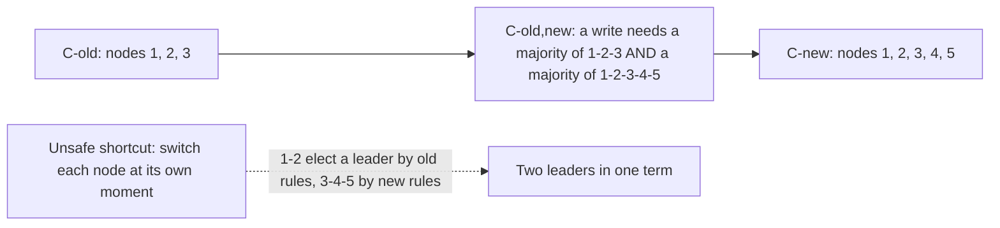

**Story.** An etcd cluster of three nodes must grow to five. If each node switched to the new list at its own moment, nodes 1 and 2 could still count to three while nodes 3, 4 and 5 count to five. Both groups could find a majority and elect two leaders. Raft avoids this with a middle step where both lists must agree.

**How it works.**

1. The leader writes a special log entry: the joint configuration C-old,new.
2. While it is in force, every election and every commit needs a majority of the old list and a majority of the new list (middle box).
3. Once C-old,new is committed, the leader writes C-new.
4. Once C-new is committed, the old list no longer matters and removed nodes can shut down.
5. Most real systems use a simpler form: change one node at a time. Any two majorities of N and N + 1 nodes always overlap, so one-at-a-time is safe too.

### In code

```text
config = one member list, or joint(old, new)
isMajority(votes, list):
  return count(votes in list) > len(list) / 2
canWin(votes, config):
  if config has one list L:
    return isMajority(votes, L)          # the list this node holds
  return isMajority(votes, old)          # joint: both majorities
     and isMajority(votes, new)
unsafe: a node's list is edited by hand  # nodes disagree on L
safe change, run by the leader:
  append C-old,new to the log            # every node, same order
  when it commits under canWin: append C-new
  when C-new commits: only new counts
simpler: add one node at a time
  every majority of N meets every majority of N+1
```

```go
// Config is a member list. When New is set, the joint rule applies.
type Config struct {
	Old []int
	New []int // empty when not in a joint configuration
}

// IsMajority: more than half of members are among the votes.
func IsMajority(votes map[int]bool, members []int) bool {
	n := 0
	for _, m := range members {
		if votes[m] {
			n++
		}
	}
	return n > len(members)/2
}

// CanWin decides if a candidate with these votes wins under config c.
func CanWin(votes map[int]bool, c Config) bool {
	if len(c.New) == 0 {
		return IsMajority(votes, c.Old) // one list: one majority
	}
	// joint configuration: a majority of the old AND of the new list
	return IsMajority(votes, c.Old) && IsMajority(votes, c.New)
}

// Overlap reports whether every majority of a and every majority of b
// share at least one node. It tries every subset, for small clusters.
func Overlap(a, b []int) bool {
	all := map[int]bool{}
	for _, x := range append(append([]int{}, a...), b...) {
		all[x] = true
	}
	nodes := []int{}
	for x := range all {
		nodes = append(nodes, x)
	}
	for m1 := 0; m1 < 1<<len(nodes); m1++ {
		for m2 := 0; m2 < 1<<len(nodes); m2++ {
			s1, s2 := set(nodes, m1), set(nodes, m2)
			if IsMajority(s1, a) && IsMajority(s2, b) && !shares(s1, s2) {
				return false
			}
		}
	}
	return true
}
```

Run it: `handbook/code/03-joint-consensus/` with `go run .`

**What goes wrong.** The dashed path in the picture: two groups that each believe they hold a majority under different member lists. It also happens by hand, when an operator edits the member list on each node separately. Always change membership through the cluster's own command.

**Where you use it.**

- `etcdctl member add` and `member remove`: one node at a time, through the log.
- Consul and the HashiCorp Raft library: the same one-at-a-time rule.
- Growing a three-node graph database cluster to five: add a node, wait until it has caught up, then add the next.

> "A membership change goes through the log, one node at a time or through a joint step, so the old and new majorities always overlap."

▶ Watch it move: [Joint consensus](visual/03-joint-consensus.html)

## Paxos and ZAB

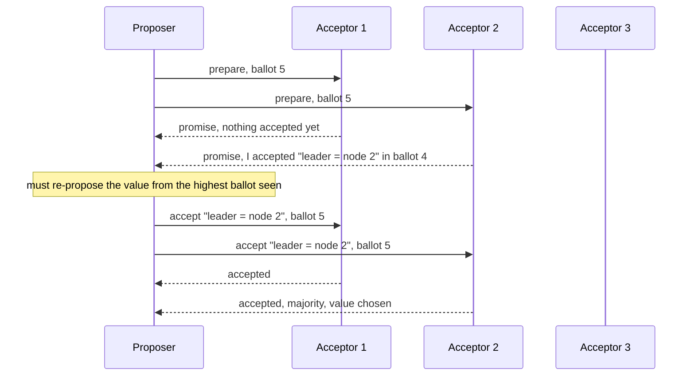

**Story.** Three servers must agree who holds a lock. A proposer picks ballot number 5 and asks for promises. One acceptor already accepted "node 2" in an earlier ballot. So the proposer must propose "node 2" again, not its own wish. That one rule is why two different values can never both be chosen.

**How it works.**

1. Phase one, prepare: the proposer sends a ballot number. An acceptor promises to ignore smaller ballots and reports any value it already accepted.
2. If any acceptor reported a value, the proposer must use the one from the highest ballot.
3. Phase two, accept: the proposer asks the acceptors to accept that value under its ballot.
4. A value accepted by a majority is chosen, forever.
5. Multi-Paxos keeps one stable leader so phase one runs once, not per value. Raft is Multi-Paxos rewritten to be easy to teach.
6. ZAB (ZooKeeper Atomic Broadcast) is the same family: a leader, epochs instead of ballots, and a recovery phase that syncs followers before new writes.

### In code

```text
acceptor, on prepare(b):
  if b > promised: promised = b
    reply promise + (accepted ballot, accepted value)
  else: reply reject
acceptor, on accept(b, v):
  if b >= promised: accepted = (b, v); reply ok
  else: reply reject                     # promised a higher ballot
proposer(want):
  b = a ballot higher than any seen
  send prepare(b); need promises from a majority
  if a promise reported a value:
    v = the value with the highest ballot   # carry it forward
  else: v = want
  send accept(b, v)
  if a majority accepts: v is chosen forever
  else: back off a random time, retry with a higher b
Multi-Paxos, ZAB: a stable leader runs prepare once,
  then sends only accept for each new value
```

```go
// Prepare: promise to ignore smaller ballots, and report what was accepted.
func (a *Acceptor) Prepare(b int) Promise {
	if !a.up || b <= a.promised {
		return Promise{ok: false}
	}
	a.promised = b
	return Promise{ok: true, accBallot: a.accBallot, accValue: a.accValue}
}

// Accept: take (b, v) unless a higher ballot was promised since.
func (a *Acceptor) Accept(b int, v string) bool {
	if !a.up || b < a.promised {
		return false // promised a higher ballot
	}
	a.promised, a.accBallot, a.accValue = b, b, v
	return true
}

// Phase1 sends prepare to the acceptors it reaches and picks the value to
// propose. It returns false without a majority of all n acceptors.
func Phase1(acc []*Acceptor, n, b int, want string) (string, bool) {
	promises, best, v := 0, 0, want
	for _, a := range acc {
		p := a.Prepare(b)
		if !p.ok {
			continue
		}
		promises++
		if p.accValue != "" && p.accBallot > best {
			best, v = p.accBallot, p.accValue // carry the value forward
		}
	}
	return v, promises > n/2
}

// Phase2 sends accept. The value is chosen if a majority of n accepts.
func Phase2(acc []*Acceptor, n, b int, v string) bool {
	oks := 0
	for _, a := range acc {
		if a.Accept(b, v) {
			oks++
		}
	}
	return oks > n/2
}
```

Run it: `handbook/code/03-paxos-zab/` with `go run .`

**What goes wrong.** Two proposers that keep beating each other's ballot: 5, then 6, then 7, and nothing is ever chosen. This is called duelling proposers. The fix is the same as Raft's: elect one leader, with random back-off.

**Where you use it.**

- Google Chubby and Spanner run Paxos.
- ZooKeeper runs ZAB, under Kafka's older controller and many Hadoop systems.
- In an interview, explain Raft, then say "Paxos is the same idea with a harder explanation, and ZAB is ZooKeeper's version".

> "Paxos chooses one value in two rounds, prepare and accept, and a proposer must carry forward any value already accepted. Raft and ZAB are the same idea with a stable leader."

▶ Watch it move: [Paxos and ZAB](visual/03-paxos-zab.html)

## What consensus cannot do: FLP and Byzantine faults

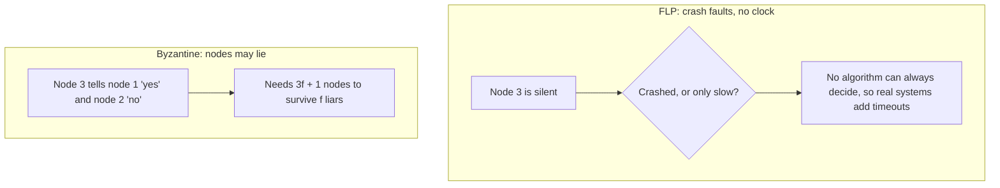

**Story.** Two famous limits sit under every consensus system. FLP (Fischer, Lynch and Paterson, 1985) proves that with no clock and even one crash, no algorithm can promise to always reach a decision. And Raft trusts every node to tell the truth. A blockchain cannot, because some nodes are run by attackers.

**How it works.**

1. FLP's trap (top box): a silent node may be dead or just slow, and without time you can never know which.
2. So Raft and Paxos never decide wrongly, but they may stall. They use timeouts to make progress in practice.
3. A crash fault is a node that stops. 2f + 1 nodes survive f crashes.
4. A Byzantine fault is a node that lies or sends different messages to different peers (bottom box).
5. Byzantine fault tolerance (BFT) needs 3f + 1 nodes to survive f liars, and signed messages.

### In code

FLP: crashed or slow?:

```text
decide(me), crash faults only:
  send my vote to all; collect replies
wait for all, no clock:
  loop:
    if every node replied: decide
    a silent node: crashed or slow?       # nothing can tell
  runs forever if one node crashed        # FLP: may never decide
wait with a timeout:
  loop:
    if every node replied: decide
    if now >= timeout and replies > n / 2:
      decide with the majority            # give up on the silent node
  if node 3 was only slow, it learns the decision later
```

```go
// WaitAll waits for every reply before deciding. It returns the tick it
// decided, or never if it ran out of ticks still waiting.
func WaitAll(arrival []int, maxTicks int) int {
	for t := 0; t < maxTicks; t++ {
		got := 0
		for _, a := range arrival {
			if a != never && a <= t {
				got++
			}
		}
		if got == len(arrival) {
			return t
		}
	}
	return never // crashed or slow: without a clock it cannot tell
}

// WaitTimeout waits until the timeout, then decides with a majority.
func WaitTimeout(arrival []int, timeout int) int {
	for t := 0; ; t++ {
		got := 0
		for _, a := range arrival {
			if a != never && a <= t {
				got++
			}
		}
		if got == len(arrival) || (t >= timeout && got > len(arrival)/2) {
			return t // give up on the silent node, decide as a majority
		}
	}
}
```

Byzantine: a node lies:

```text
crash-only rule (Raft), n = 3:
  count my own vote and every vote I receive
  decide when 2 of 3 match                # trusts every vote
a Byzantine node:
  sends 'commit' to node 1 and 'abort' to node 2
BFT rule, n = 3f + 1 (4 for f = 1):
  every vote is signed and relayed to all
  for each node: the set of values it signed
    two different signed values: a liar, ignore it
  count the votes of the honest nodes
  decide only if a value has more than 2/3 of n
                                          # 3 of 4: the liar cannot tip it
```

```go
// DecideMajority is the crash-only rule: 2 of 3 matching votes decide.
// It trusts every vote, so a liar can tip each honest node a different way.
func DecideMajority(me int, own string, inbox []Vote) string {
	count := map[string]int{own: 1}
	for _, v := range inbox {
		if v.to == me {
			count[v.value]++
			if count[v.value] >= 2 {
				return v.value
			}
		}
	}
	return "undecided"
}

// DecideBFT: votes are signed and relayed, so every node sees every vote.
// A node that signed two different values is a liar and is ignored.
// Decide only with matching votes from more than two thirds of n nodes.
func DecideBFT(all []Vote, n int) string {
	said := map[int]map[string]bool{}
	for _, v := range all {
		if said[v.from] == nil {
			said[v.from] = map[string]bool{}
		}
		said[v.from][v.value] = true
	}
	count := map[string]int{}
	for _, vals := range said {
		if len(vals) > 1 {
			continue // two different signed votes: a liar
		}
		for val := range vals {
			count[val]++
		}
	}
	for val, c := range count {
		if 3*c > 2*n {
			return val
		}
	}
	return "undecided"
}
```

Run it: `handbook/code/03-flp-byzantine/` with `go run .`

**What goes wrong.** Using Raft between parties that do not trust each other. One bad node that votes twice or forges entries breaks it completely. Between organisations, use a BFT protocol or a public chain, and inside one company use Raft.

**Where you use it.**

- etcd, Consul, a graph database cluster: crash faults only, Raft, inside one trust domain.
- Ethereum proof of stake and Tendermint-based chains: BFT, with two thirds of the stake needed to finalise.
- An interview answer on "is consensus always possible": name FLP, then say timeouts make it work in practice.

> "FLP says consensus can stall but need not lie, so we add timeouts. Raft handles crashes with 2f + 1 nodes, and liars need BFT with 3f + 1."

▶ Watch it move: [FLP and Byzantine faults](visual/03-flp-byzantine.html)

## Gossip and cluster membership

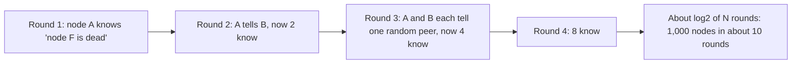

**Story.** A Cassandra cluster has 1,000 nodes. Node F dies. Nobody broadcasts to everyone. Each second, each node tells one random peer what it knows. Like a rumour in a school, the news doubles each round and reaches every node in about ten rounds.

**How it works.**

1. Every second, each node picks a random peer and swaps its view of the cluster: who is alive, with a heartbeat counter per node.
2. Each side keeps the newer entry for every node (the counter decides).
3. The number of informed nodes roughly doubles each round (the picture), so news spreads in about log2 N rounds.
4. A node whose counter stops rising for a while is marked suspected, then dead.
5. SWIM, used by Consul and Serf, adds indirect checks: if A cannot reach F, it asks two other nodes to try before calling F dead.

### In code

```text
every second, on each node:
  p = pick one random live peer
  swap views with p
  for each node x: keep the entry with the higher counter
  if x's counter stalled for the timeout: mark x dead
on a client request:
  target = first node my view says is alive
  if the call times out: retry on the next node   # my view may be stale
SWIM, when my ping to g fails:
  ask 2 helpers to ping g for me
  if any helper reaches g: g stays alive          # the link was bad
  else: mark g suspected, then dead
never: pick a leader or grant a lock from my view # views differ
```

```go
// Merge swaps views with a peer. For each node, both keep the newer entry:
// the higher heartbeat wins, and at the same heartbeat "dead" wins.
func Merge(a, b *Node) {
	for name := range union(a.View, b.View) {
		x, y := a.View[name], b.View[name]
		newer := x
		if y.Heartbeat > x.Heartbeat || (y.Heartbeat == x.Heartbeat && y.Dead) {
			newer = y
		}
		a.View[name], b.View[name] = newer, newer
	}
}

// CheckStalled marks a node dead when its heartbeat has not risen for
// timeout seconds.
func (n *Node) CheckStalled(name string, stalledFor, timeout int) {
	if stalledFor >= timeout {
		e := n.View[name]
		e.Dead = true
		n.View[name] = e
	}
}

// Route sends a request to the first node this view thinks is alive.
// A view can be stale, so a timed-out call is retried on the next node.
// Never use a view to elect a leader or grant a lock: views differ.
func Route(from *Node, order []string, reachable func(string) bool) (string, []string) {
	var failed []string
	for _, target := range order {
		if from.View[target].Dead {
			continue // my view says dead: skip
		}
		if reachable(target) {
			return target, failed
		}
		failed = append(failed, target) // timed out: my view was stale
	}
	return "", failed
}

// SwimProbe: a direct ping failed, so ask k helpers to ping the target.
// The target is only suspected when no helper reaches it either.
func SwimProbe(target string, helpers []string, canReach func(from, to string) bool) string {
	for _, h := range helpers {
		if canReach(h, target) {
			return "alive" // the link from me was bad, not the node
		}
	}
	return "suspected"
}
```

Run it: `handbook/code/03-gossip/` with `go run .`

**What goes wrong.** Gossip is eventually consistent. For a few seconds different nodes disagree about who is alive, and a node may route to a dead peer. Never use gossip to elect a leader or to grant a lock. Use it for membership and health, and use Raft for decisions.

**Where you use it.**

- Cassandra and Redis Cluster: gossip for membership and node state.
- Consul: SWIM gossip for health, Raft for the key-value store. Two protocols for two jobs.
- A fleet of indexer pods sharing which block ranges are hot: gossip is enough, nothing breaks if it is a second late.

> "Gossip spreads news to N nodes in about log N rounds with no centre, so I use it for membership and health, never for a decision that must be agreed."

▶ Watch it move: [Gossip](visual/03-gossip.html)

## Split brain, leases and fencing tokens

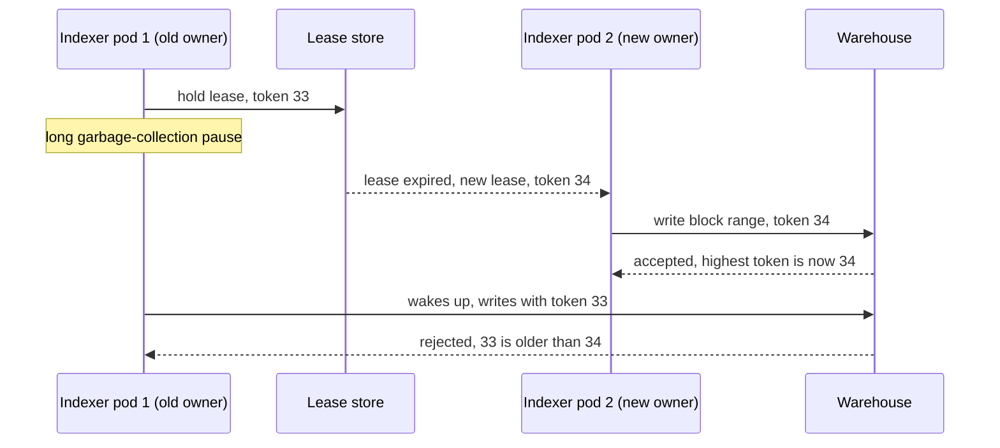

**Story.** Two indexer pods compete for one block range. Pod 1 holds a lease, then freezes in a long garbage-collection pause. The lease expires and pod 2 takes over with a higher token. Pod 1 wakes up still believing it is the owner. The warehouse refuses its write because the token is old.

**How it works.**

1. A lease is a lock with an expiry. The holder must renew it in time.
2. Each new lease comes with a fencing token that only grows: 33, then 34.
3. The storage remembers the highest token it has seen.
4. Every write carries its token. Storage rejects any token lower than the highest.
5. The old owner can be wrong about itself. The storage cannot be fooled.

### In code

```text
lease store, on acquire(pod, now):
  if a live lease exists: refuse
  token = token + 1                       # 33, then 34: only grows
  holder = pod; expires = now + 10 s
holder pod, while it works:
  renew before expires                    # a pause skips this line
  write(batch, token)
warehouse, on write(batch, token):
  fix: if token < highest: refuse         # the fencing check
  highest = max(highest, token)
  store the rows
holder pod, lease only:
  if leaseStore.holder == me: write       # true now, stale when it lands
```

```go
// Acquire grants the lease if it is free or expired. The token only grows.
func (s *LeaseStore) Acquire(pod string, now time.Time, ttl time.Duration) (int, bool) {
	if s.holder != "" && now.Before(s.expires) {
		return 0, false // someone else holds a live lease
	}
	s.token++ // 33, then 34: a newer lease always has a bigger number
	s.holder, s.expires = pod, now.Add(ttl)
	return s.token, true
}

// Warehouse stores the rows of one block range.
type Warehouse struct {
	fencing bool   // check the token on every write?
	highest int    // the highest token seen so far
	rowsBy  string // which pod wrote the rows now stored
	damaged bool   // a stale owner wrote over a newer owner's rows
}

// Write stores a batch. With fencing on, a token below the highest is refused.
func (w *Warehouse) Write(pod string, token int) bool {
	if w.fencing && token < w.highest {
		return false // stale owner: 33 is older than 34
	}
	if token < w.highest {
		w.damaged = true // split brain: the old owner overwrote the new one
	}
	if token > w.highest {
		w.highest = token
	}
	w.rowsBy = pod
	return true
}
```

Run it: `handbook/code/03-split-brain-fencing/` with `go run .`

**What goes wrong.** Split brain: two nodes both act as leader after a partition or a pause. Trusting the old leader to notice it lost is the mistake. A lock without a fencing token is a hope, not a lock. Redlock on Redis was shown unsafe for exactly this reason.

**Where you use it.**

- Kubernetes leader election is a lease object renewed every few seconds.
- Raft terms, ZooKeeper zxids and etcd revisions are all fencing tokens.
- An indexer that writes a lease epoch with every batch, and a warehouse check that refuses a smaller epoch.

> "A lease decides who should act. A fencing token, checked by the storage, makes sure only that one can."

▶ Watch it move: [Leases and fencing tokens](visual/03-split-brain-fencing.html)

## Distributed locks and Redlock

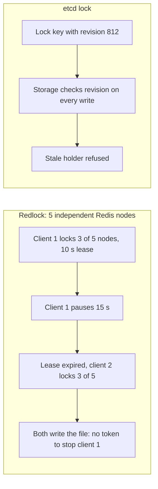

**Story.** Two report workers must never write the same file at once. Team A uses Redlock: lock a majority of five Redis nodes for 10 seconds. Worker 1 gets the lock and then pauses for 15 seconds. The lease expires, worker 2 locks, and both write. Team B uses an etcd lock, whose revision number is a fencing token, and the storage refuses worker 1.

**How it works.**

1. A lock for efficiency avoids doing the same work twice. If it fails now and then, you lose a little time. A single Redis `SET key value NX PX 10000` is fine for this.
2. A lock for correctness must never let two holders act. A failure corrupts data.
3. Redlock tries to make the efficiency lock correct by taking a majority of five independent Redis nodes.
4. Martin Kleppmann's critique: Redlock depends on timing. A pause or a clock jump after the lock is granted lets two clients act (top box), and Redlock gives no fencing token to stop it.
5. A correct lock comes from a consensus store (etcd, ZooKeeper) and gives a number that only grows. The storage checks it (bottom box).

### In code

```text
Redlock acquire(worker, ttl):
  on each node: SET key NX, expiry now + ttl  # only if the key is free
  if 3 or more of 5 said yes: worker holds the lock
plain store write(data):
  accept                                      # no check, no token
etcd lock(worker), with a lease:
  if the key is free:
    revision = revision + 1; key = worker
    return revision                           # the fencing token
  lease not renewed in time: delete the key, revision + 1
fenced store write(data, rev):
  if rev < highest: refuse                    # a stale holder stops here
  highest = rev; accept
efficiency job: one Redis key, a duplicate is harmless
```

```go
// SetNX is SET key value NX PX ttl: it succeeds only if the key is free.
func (n *RedisNode) SetNX(owner string, now, ttl int) bool {
	local := now + n.clockAhead
	if n.owner != "" && local < n.expiresAt {
		return false // the key still exists on this node's clock
	}
	n.owner, n.expiresAt = owner, local+ttl
	return true
}

// Redlock asks each node. A majority, 3 of 5, means the lock is held.
func Redlock(nodes []*RedisNode, reach []int, owner string, now, ttl int) bool {
	count := 0
	for _, i := range reach {
		if nodes[i].SetNX(owner, now, ttl) {
			count++
		}
	}
	return count >= 3
}

// Write has no check at all.
func (s *PlainStore) Write(data string) bool {
	s.file = data
	return true
}

// Lock grants the free key and returns the revision: the fencing token.
func (e *Etcd) Lock(worker string) (int, bool) {
	if e.holder != "" {
		return 0, false
	}
	e.revision++
	e.holder = worker
	return e.revision, true
}

// LeaseExpired deletes the key of a holder that stopped renewing.
func (e *Etcd) LeaseExpired() {
	e.revision++ // the delete is a change too
	e.holder = ""
}

// Write refuses a revision older than the highest seen.
func (s *FencedStore) Write(data string, rev int) bool {
	if rev < s.highest {
		return false // a stale holder stops here
	}
	s.highest = rev
	s.file = data
	return true
}
```

Run it: `handbook/code/03-distributed-locks/` with `go run .`

**What goes wrong.** Picking a lock without asking "what happens if two hold it". If the answer is "data is corrupted", a lease alone is never enough. You need the token check at the storage.

**Where you use it.**

- A Redis lock to stop two cron runs from sending the same daily email: efficiency, Redis is fine.
- Leader election for an indexer that writes to a warehouse: correctness, use a Kubernetes lease or etcd, and write the epoch with every batch.
- ZooKeeper's sequential ephemeral nodes: the classic recipe for a fair, correct lock.

> "First I ask if the lock is for efficiency or correctness. For efficiency Redis is fine. For correctness I need a consensus store and a fencing token checked by the storage."

▶ Watch it move: [Distributed locks and Redlock](visual/03-distributed-locks.html)

## Two-phase commit versus saga

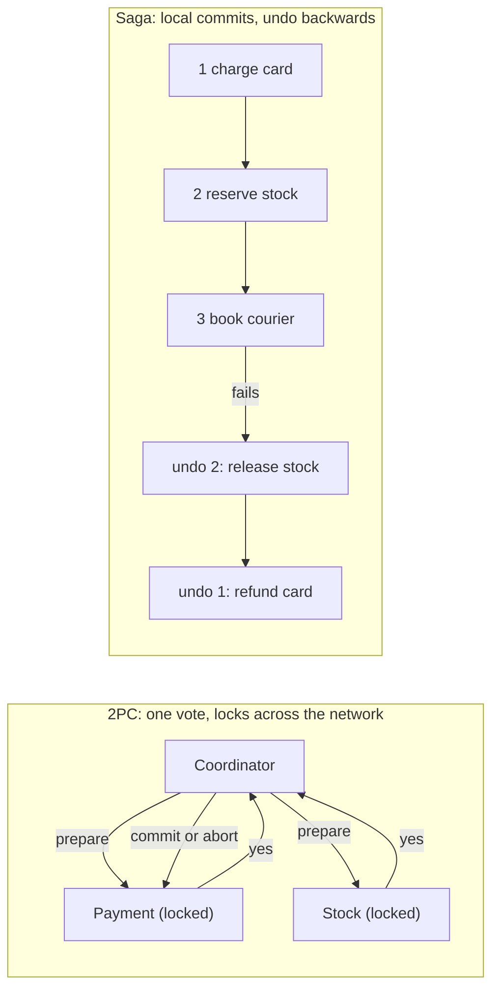

**Story.** A customer orders a phone. Payment, stock and shipping are three services with three databases. Shipping refuses the address. With two-phase commit (2PC) nothing was ever visible, but every service held locks while waiting. With a saga the card was really charged, then really refunded.

**How it works.**

1. 2PC, phase one: the coordinator asks each participant to prepare. Each one locks its rows and votes.
2. 2PC, phase two: all yes means commit. Any no means abort.
3. Saga: each step is a normal local transaction, committed at once.
4. A saga step that fails starts the compensations, in reverse order.
5. An orchestrator (one service that drives the steps) or choreography (each service reacts to the last event) runs the saga.

### In code

Two-phase commit:

```text
coordinator, on an order:
  for each participant p: vote[p] = p.prepare(order)
  if every vote is yes: decision = commit
  else: decision = abort                  # one no is enough
  log.write(decision)                     # durable before anyone hears it
  for each participant p: p.finish(decision)
p.prepare(order):
  if p cannot do it: return no
  write the change to p's log; lock the rows
  return yes
p.finish(decision):
  commit or roll back; release the locks
p voted yes and heard no decision:
  keep the locks; it may not decide alone  # the blocking problem
coordinator restart: read log; no decision means abort; resend it
```

```go
// Prepare writes the change to the service's log and locks the rows.
func (p *Participant) Prepare() bool {
	if !p.canDo {
		p.state = "refused"
		return false
	}
	p.state, p.locked = "locked", true // the rows wait for the decision
	return true
}

// Finish applies the coordinator's decision and frees the locks.
func (p *Participant) Finish(decision string) {
	if p.state == "refused" || p.state == "idle" {
		return
	}
	p.locked = false
	if decision == "commit" {
		p.state = "committed"
	} else {
		p.state = "rolled back"
	}
}

// Run is 2PC. crashAfter > 0 stops the coordinator after that many votes.
func (c *Coordinator) Run(crashAfter int) string {
	decision := "commit"
	for k, p := range c.parts {
		if crashAfter > 0 && k == crashAfter {
			return "crashed" // no decision was written: everyone waits
		}
		if !p.Prepare() {
			decision = "abort" // one no is enough
		}
	}
	c.log = decision // durable before anyone hears the result
	for _, p := range c.parts {
		p.Finish(decision)
	}
	return decision
}

// Recover runs when the coordinator restarts. No logged decision means abort.
func (c *Coordinator) Recover() string {
	decision := c.log
	if decision == "" {
		decision = "abort"
		c.log = decision
	}
	for _, p := range c.parts {
		p.Finish(decision)
	}
	return decision
}
```

Saga:

```text
orchestrator, on an order:
  for each step s in charge, reserve, book:
    log.write(s, started)
    result = s.do(order)                  # commits at once, keyed by order id
    if result is no: go to compensate
    log.write(s, done)
  return done
compensate:
  for each done step s, newest first:
    s.undo(order)                         # a new committed transaction
  return cancelled
orchestrator restart:
  read the log; skip every step marked done
  s.do(order) for the rest                # safe: the key stops a second effect
```

```go
// do runs one step. The service keys the work by order id, so a repeat is safe.
func (s *Saga) do(st Step) bool {
	s.calls[st.name]++
	if st.ok {
		fmt.Printf("  %s commits at once\n", st.name)
	}
	return st.ok
}

// Run walks the steps. On a refusal it compensates the done steps backwards.
func (s *Saga) Run() string {
	var done []Step
	for _, st := range s.steps {
		s.log[st.name] = "started"
		if !s.do(st) {
			fmt.Printf("  %s refused\n", st.name)
			for k := len(done) - 1; k >= 0; k-- {
				fmt.Printf("  compensate: %s\n", done[k].undo)
			}
			return "cancelled"
		}
		s.log[st.name] = "done"
		done = append(done, st)
	}
	return "done"
}

// Resume runs after an orchestrator crash: it repeats what is not done.
func (s *Saga) Resume() string {
	for _, st := range s.steps {
		if s.log[st.name] == "done" {
			continue // already committed, never run twice
		}
		s.log[st.name] = "started"
		s.do(st)
		s.log[st.name] = "done"
	}
	return "done"
}
```

Run it: `handbook/code/03-2pc-vs-saga/` with `go run .`

**What goes wrong.** In 2PC, the coordinator crashes after the votes. Every participant sits locked and cannot decide alone. That is the blocking problem. In a saga, a compensation is not a rollback: an email or a bank transfer cannot be unsent. Put the irreversible step last.

**Where you use it.**

- 2PC: inside one database cluster, or XA (eXtended Architecture) between a database and a broker in a classic Java application server.
- Saga: a subscription top-up across services: charge the wallet, grant units, send a receipt. A failed grant refunds the wallet.
- Three-phase commit (3PC) almost nowhere. It needs bounded network delay, which a real network does not give.

> "2PC buys atomicity with blocking. A saga buys availability with compensations. Across service boundaries I choose the saga and design the undo steps first."

▶ Watch it move: [Two-phase commit versus saga](visual/03-2pc-vs-saga.html)

## Three-phase commit

```mermaid
sequenceDiagram
  participant C as Coordinator
  participant P as Payment
  participant S as Stock
  C->>P: can you commit?
  C->>S: can you commit?
  P-->>C: yes
  S-->>C: yes
  C->>P: pre-commit
  C->>S: pre-commit
  Note over P,S: everyone now knows all voted yes
  C->>P: do commit
  C->>S: do commit
  Note over C,S: if the coordinator dies after pre-commit, the others time out and commit
```

**Story.** Two-phase commit blocks when the coordinator dies after the votes. Three-phase commit adds a middle step, pre-commit, so that every participant learns "everyone voted yes" before anyone commits. If the coordinator then dies, the participants can finish on their own by timeout. The catch: it only works if the network never delays a message longer than the timeout.

**How it works.**

1. Phase one, can-commit: the coordinator asks, each participant votes.
2. Phase two, pre-commit: all said yes, so the coordinator tells everyone "prepare to commit". Each one acknowledges.
3. Phase three, do-commit: the coordinator says commit.
4. A participant in pre-commit that hears nothing commits after a timeout, because it knows everyone voted yes.
5. A participant that never got pre-commit aborts after a timeout.

### In code

```text
coordinator:
  send "can you commit?" to all
  if any vote is no or missing: send abort, stop
  send pre-commit to all, wait for acks
  send do-commit to all
participant, on can-commit: lock rows, vote yes, state = voted
participant, on pre-commit: state = pre-committed, ack
participant, on do-commit: commit
participant, on timeout:
  if state == pre-committed: commit        # every vote was yes
  if state == voted: abort                 # it never heard the result
the flaw: lines 10 and 11 assume "nothing heard" means "nothing sent"
fix: coordinator is 3 replicas, decision stored by a majority
fix: participants ask the group, no timeout decides
```

```go
// OnCanCommit locks the rows and votes yes.
func (p *Participant) OnCanCommit() bool {
	p.State = "voted"
	return true
}

// OnPreCommit records that everyone voted yes.
func (p *Participant) OnPreCommit() { p.State = "pre-committed" }

// OnDoCommit makes the change final.
func (p *Participant) OnDoCommit() { p.State = "committed" }

// OnTimeout decides alone, from what this participant knows.
func (p *Participant) OnTimeout() {
	switch p.State {
	case "pre-committed":
		p.State = "committed" // everyone voted yes
	case "voted":
		p.State = "aborted" // it never heard the result
	}
}

// Run3PC is the coordinator. After a crash, every participant times out.
func Run3PC(parts []*Participant, sc Scenario) {
	for _, p := range parts {
		if !p.OnCanCommit() {
			return
		}
	}
	if !sc.CrashBeforePreCommit {
		for _, p := range parts {
			if sc.PreCommitReaches[p.Name] {
				p.OnPreCommit()
			}
		}
		if !sc.CrashBeforeDoCommit {
			for _, p := range parts {
				p.OnDoCommit()
			}
			return
		}
	}
	for _, p := range parts {
		p.OnTimeout() // the coordinator is gone
	}
}

// Decide writes the outcome only if a majority of the group stores it.
func (g *Group) Decide(outcome string) bool {
	if 2*g.alive <= 3 {
		return false
	}
	g.decision = outcome
	return true
}
```

Run it: `handbook/code/03-three-phase-commit/` with `go run .`

**What goes wrong.** A network partition. Payment got pre-commit and times out into commit. Stock never got pre-commit and times out into abort. One order is now half committed. 3PC trades blocking for a wrong answer under exactly the failures real networks have.

**Where you use it.**

- Almost nowhere in production. It is an interview question about why 2PC blocks.
- Real systems remove the blocking by making the coordinator itself fault tolerant: Spanner runs 2PC where each participant is a Paxos group.
- Across services, use a saga instead.

> "3PC removes 2PC's blocking only if message delay is bounded. A real partition makes it commit on one side and abort on the other, so real systems replicate the coordinator instead."

▶ Watch it move: [Three-phase commit](visual/03-three-phase-commit.html)

## Saga orchestration versus choreography

```mermaid
flowchart TB
  subgraph orch["Orchestration: one conductor"]
    O["Order saga orchestrator"] --> OP["Payment: charge"]
    O --> OS["Stock: reserve"]
    O --> OH["Shipping: book"]
  end
  subgraph chor["Choreography: everyone listens"]
    E1["OrderPlaced"] --> CP["Payment charges, emits PaymentTaken"]
    CP --> CS["Stock reserves, emits StockReserved"]
    CS --> CH["Shipping books, emits Shipped"]
  end
```

**Story.** The same phone order runs two ways. In orchestration, an order saga service calls payment, then stock, then shipping, and keeps the state in its own table. In choreography, there is no conductor: payment listens for OrderPlaced, stock listens for PaymentTaken, shipping listens for StockReserved.

**How it works.**

1. Orchestration (top): one service holds the plan and the current step. It sends commands and waits for replies.
2. On failure, the orchestrator sends the compensations in reverse order.
3. Choreography (bottom): each service reacts to the previous event and publishes its own.
4. On failure, a service publishes a failure event and the earlier services listen for it and undo their own step.
5. Each step still uses an outbox so its event is never lost.

### In code

Orchestration: one conductor:

```text
on order placed: row = (id, step 1, running)   # in its own table
for each step in the plan, in order:
  row.step = i; save the row
  reply = call step.command
  if reply is no:
    row.state = failed at step i
    for each done step, backwards: call its undo
    row.state = cancelled; stop
row.state = done
on "where is order 501?": read the row
```

```go
// Step is one line of the orchestrator's plan.
type Step struct {
	Name string
	Do   func() bool
	Undo func()
}

// Row is the orchestrator's own record of one order.
type Row struct {
	Step  int
	State string
}

// Run walks the plan, and walks it backwards on a refusal.
func (o *Orchestrator) Run(id int) {
	row := &Row{Step: 1, State: "running"}
	o.Table[id] = row
	for i, st := range o.Plan {
		row.Step = i + 1
		if !st.Do() {
			row.State = fmt.Sprintf("failed at step %d", row.Step)
			for j := i - 1; j >= 0; j-- {
				o.Plan[j].Undo()
			}
			row.State = fmt.Sprintf("cancelled at step %d", row.Step)
			return
		}
	}
	row.State = "done"
}
```

Choreography: everyone listens:

```text
order, on checkout: save order; publish OrderPlaced    # through its outbox
payment, on OrderPlaced: charge; publish PaymentTaken
stock, on PaymentTaken: reserve; publish StockReserved
shipping, on StockReserved:
  if the address is ok: book; publish Shipped
  else: publish ShippingFailed
stock, on ShippingFailed: release
payment, on ShippingFailed: refund
order, on ShippingFailed: mark cancelled
missing: nothing records the whole flow
fix: tracker, on every event: row[order id] = last event
```

```go
// Publish calls the listeners. Nothing here knows the order of the steps.
func (b *Bus) Publish(id int, event string) {
	for _, f := range b.all {
		f(id, event)
	}
	for _, f := range b.subs[event] {
		f(id)
	}
}

// Wire is the whole flow, spread over each service's own listeners.
func Wire(b *Bus, s *Shop, addressOK bool) {
	b.On("OrderPlaced", func(id int) { s.Payment = "charged"; b.Publish(id, "PaymentTaken") })
	b.On("PaymentTaken", func(id int) { s.Stock = "reserved"; b.Publish(id, "StockReserved") })
	b.On("StockReserved", func(id int) {
		if addressOK {
			s.Shipping = "booked"
			b.Publish(id, "Shipped")
			return
		}
		s.Shipping = "refused"
		b.Publish(id, "ShippingFailed")
	})
	b.On("ShippingFailed", func(id int) { s.Stock = "released" })
	b.On("ShippingFailed", func(id int) { s.Payment = "refunded" })
	b.On("ShippingFailed", func(id int) { s.Order = "cancelled" })
}

// Track is the fix: a read model that records the last event per order.
func Track(b *Bus, rows map[int]string) {
	b.all = append(b.all, func(id int, event string) { rows[id] = event })
}
```

Run it: `handbook/code/03-saga-orchestration-choreography/` with `go run .`

**What goes wrong.** Choreography with many steps becomes a flow nobody can see. To answer "where is order 501 stuck?" you must read four services' logs. A cycle of events can even loop. Use choreography for two or three steps, and an orchestrator once the flow has branches or more steps.

**Where you use it.**

- Orchestration: Temporal, AWS Step Functions, Camunda. The plan is code or a diagram you can read.
- Choreography: services on Kafka reacting to each other's events, good for loose teams and short flows.
- A subscription top-up with charge, grant and receipt: an orchestrator, because the refund path must be obvious.

> "Orchestration puts the plan in one place I can read and debug. Choreography removes the centre but hides the flow, so I choreograph short flows and orchestrate long ones."

▶ Watch it move: [Orchestration versus choreography](visual/03-saga-orchestration-choreography.html)

## Saga isolation: semantic locks and countermeasures

```mermaid
sequenceDiagram
  participant S1 as Saga 1: order 501
  participant ST as Stock row: phone, 1 left
  participant S2 as Saga 2: order 502
  S1->>ST: reserve, set status = PENDING by 501
  S2->>ST: read stock
  ST-->>S2: 1 left, but PENDING by 501
  Note over S2: wait, or fail fast, never sell the same unit
  S1->>ST: saga fails, compensate: release, clear PENDING
  S2->>ST: retry: reserve, status = PENDING by 502
```

**Story.** A saga commits each step at once, so other requests can see its half-done work. Saga 1 reserves the last phone for order 501 and later fails. If saga 2 had read "0 left" and told its customer "sold out", that answer was based on a change that was undone. A semantic lock marks the row as "a saga is working on me", so saga 2 knows the number is not final.

**How it works.**

1. A saga has no isolation, the I in ACID. Other transactions see its intermediate states.
2. Semantic lock: a step sets a flag on the row, such as `status = PENDING` with the saga id.
3. Another saga that meets the flag waits, retries later, or fails fast. It never treats the pending value as final.
4. The compensating step or the final step clears the flag.
5. Other countermeasures: commutative updates (add and subtract in any order), re-reading a value before the final step, and putting the step that can fail before the steps that cannot be undone.

### In code

No isolation: a wrong sold out:

```text
row = {left: 1}
saga 1, stock step: left = left - 1; commit     # visible at once
saga 2, stock step: read left
if left is 0: tell the customer sold out; cancel order 502
saga 1, compensation: left = left + 1; commit
missing: nothing says the 0 is not final
fix: if status is PENDING: wait, never answer sold out
```

```go
// Row is one stock row. Owner and Since say who set the flag and when.
type Row struct {
	Left   int
	Status string
	Owner  int
	Since  int
}

// PlainReserve commits at once. Everyone sees the new number.
func (r *Row) PlainReserve() { r.Left-- }

// PlainRead returns the number, with nothing to say it is not final.
func (r *Row) PlainRead() int { return r.Left }

// PlainRelease is the compensation: the number goes back up.
func (r *Row) PlainRelease() { r.Left++ }

// Reserve refuses to treat a pending value as final.
func (r *Row) Reserve(saga, now int) string {
	if r.Status == "PENDING" {
		return fmt.Sprintf("wait, pending by %d", r.Owner)
	}
	if r.Left == 0 {
		return "sold out"
	}
	r.Left--
	r.Status, r.Owner, r.Since = "PENDING", saga, now
	return "reserved"
}
```

Semantic lock:

```text
reserve(row, saga, now):
  if status is PENDING: return wait       # never read it as final
  if left is 0: return sold out
  left -= 1; status = PENDING; owner = saga; since = now
compensation(saga): if owner is saga: left += 1; clear status and owner
final step(saga): status = SOLD; owner = saga
crash: nobody runs line 5 or line 6, so the flag stays
sweeper job, on a timer:
  if status is PENDING and now - since >= limit:
    run the owner's compensation (line 5)
```

```go
// Row is one stock row. Owner and Since say who set the flag and when.
type Row struct {
	Left   int
	Status string
	Owner  int
	Since  int
}

// Reserve refuses to treat a pending value as final.
func (r *Row) Reserve(saga, now int) string {
	if r.Status == "PENDING" {
		return fmt.Sprintf("wait, pending by %d", r.Owner)
	}
	if r.Left == 0 {
		return "sold out"
	}
	r.Left--
	r.Status, r.Owner, r.Since = "PENDING", saga, now
	return "reserved"
}

// Release is the compensation, and only the owner's flag is cleared.
func (r *Row) Release(saga int) {
	if r.Status != "PENDING" || r.Owner != saga {
		return
	}
	r.Left++
	r.Status, r.Owner = "", 0
}

// Confirm is the final step. A crashed saga runs neither Release nor Confirm.
func (r *Row) Confirm(saga int) {
	r.Status, r.Owner = "SOLD", saga
}

// Sweep undoes a saga whose flag is older than the limit.
func (r *Row) Sweep(now, limit int) bool {
	if r.Status == "PENDING" && now-r.Since >= limit {
		r.Release(r.Owner)
		return true
	}
	return false
}
```

Run it: `handbook/code/03-saga-semantic-lock/` with `go run .`

**What goes wrong.** A semantic lock whose saga crashed and never cleared it. The row stays PENDING forever and the phone can never be sold. Give each flag an owner and a timestamp, and run a job that finishes or compensates sagas older than a limit.

**Where you use it.**

- An order in state `APPROVAL_PENDING` in a microservices order flow: the classic semantic lock.
- A wallet top-up marked `pending` until units are granted, so a second top-up cannot spend the same deposit.
- Hotel and flight holds that expire after 15 minutes: a semantic lock with a timeout built in.

> "A saga has no isolation, so I add it in the data: a pending flag other sagas respect, cleared by the final step or by the compensation, with an expiry for crashed sagas."

▶ Watch it move: [Semantic locks](visual/03-saga-semantic-lock.html)

## Outbox, idempotency and effectively-once

```mermaid
sequenceDiagram
  participant API as Order service
  participant DB as Order database
  participant R as Relay
  participant K as Broker
  participant PAY as Payment consumer
  API->>DB: one transaction: insert order + insert outbox row
  R->>DB: read unpublished outbox rows
  R->>K: publish OrderPlaced, key = order 501
  K-->>PAY: deliver OrderPlaced
  K-->>PAY: deliver OrderPlaced again (retry)
  PAY->>PAY: key 501 already in processed table, skip
```

**Story.** A customer places order 501. The order service writes the order row and an outbox row in one database transaction. A relay publishes the event. The broker delivers it twice after a network hiccup. The payment consumer charges once, because key 501 is already in its processed table.

**How it works.**

1. Business row and outbox row commit together, or neither does.
2. A relay (a poller or CDC, Change Data Capture) reads the outbox and publishes.
3. The relay may publish twice after a crash. That is fine.
4. The consumer stores each processed message id (the inbox, or idempotency key table) in the same transaction as its effect.
5. A duplicate finds its id already stored and does nothing.
6. At-least-once delivery plus an idempotent receiver is "exactly-once" in effect.

### In code

```text
order service, on an order:
  begin; insert order; insert outbox(id, pending); commit
relay, all the time:
  for each outbox row that is pending:
    broker.publish(row)                   # a crash here means publish again
    mark the row sent
payment, on message m:
  begin
  if m.key is in processed: commit; ack; return   # a duplicate: skip
  charge the card; insert m.key into processed
  commit                                  # the charge and the key together
  ack                                     # a crash before this: redelivery
the dual write, the broken way:
  commit order; then broker.publish(event)  # a crash between loses the event
```

```go
// PlaceOrder inserts the order and its outbox row in one transaction.
func (s *Store) PlaceOrder(id int) {
	s.orders = append(s.orders, id)
	s.outbox = append(s.outbox, &Row{id, "pending"})
}

// RelayOnce publishes pending rows. crash stops it after a publish, before
// the row is marked sent.
func RelayOnce(s *Store, topic *[]int, crash bool) {
	for _, row := range s.outbox {
		if row.status != "pending" {
			continue
		}
		*topic = append(*topic, row.id) // may be a second copy
		if crash {
			return // the row stays pending
		}
		row.status = "sent"
	}
}

// Handle runs one delivery in one transaction, and returns true when the
// message may be acknowledged.
func (p *Payment) Handle(id int, crashBeforeAck bool) bool {
	if p.keys != nil && p.keys[id] {
		return true // duplicate: skip, and acknowledge
	}
	p.charges++
	if p.keys != nil {
		p.keys[id] = true // commits together with the charge
	}
	return !crashBeforeAck
}

// DualWrite is the broken way: commit, then publish from code.
func DualWrite(s *Store, topic *[]int, id int, crashBetween bool) {
	s.orders = append(s.orders, id)
	if crashBetween {
		return // the event exists nowhere
	}
	*topic = append(*topic, id)
}
```

Run it: `handbook/code/03-outbox-and-idempotency/` with `go run .`

**What goes wrong.** The dual write: commit to the database, then publish from code. The process dies between the two and the event is lost. Or it publishes first and the commit fails, and the event lies. On the receiving side, "increment balance by 10" is not idempotent. "Set balance to 110 as of version 7" is.

**Where you use it.**

- Stripe's `Idempotency-Key` header on every payment call.
- An EVM (Ethereum Virtual Machine) indexer writes rows keyed by `(block, tx_index, log_index)`. Replaying a block after a crash overwrites the same rows.
- The same indexer writes a block's rows and a "block done" marker in one load. The graph sync reads the markers, which act as the outbox.

> "Exactly-once does not exist on the wire. I get it at the receiver: an outbox so nothing is lost, and an idempotency key so nothing happens twice."

▶ Watch it move: [Outbox and idempotency](visual/03-outbox-and-idempotency.html)

## Logical clocks

```mermaid
sequenceDiagram
  participant A as Node A
  participant B as Node B
  participant C as Node C
  Note over A: event, clock 1
  A->>B: message, stamp 1
  Note over B: receive, max(0, 1) + 1 = 2
  Note over C: own event, clock 1
  B->>C: message, stamp 2
  Note over C: receive, max(1, 2) + 1 = 3
```

**Story.** Two servers log "user banned" and "user posted" 3 ms apart. Their wall clocks disagree by 10 ms, so the log shows the post after the ban. A logical clock fixes the order by cause. On a blockchain the block height is the logical clock: two indexers on two machines agree on order without ever comparing wall time.

**How it works.**

1. Each node keeps a counter. It adds one on every local event.
2. Every message carries the sender's counter.
3. On receive, the node sets its counter to max(own, received) + 1.
4. So if A caused B, A's stamp is smaller. That is a Lamport clock.
5. A vector clock keeps one counter per node. It can also say "these two events were concurrent".
6. A hybrid logical clock (HLC) carries wall time plus a counter, so humans can read it.

### In code

Wall clocks: the log lies:

```text
on event e at server s:
  e.stamp = s.wallClock()                # server 1 runs 10 ms fast
  append e to the merged log
show the log:
  sort lines by stamp                    # wrong when drift > gap
fix: order by cause instead
  on send: counter = counter + 1         # the post gets 1
  on receive: counter = max(own, msg) + 1   # the ban gets 2
  sort lines by counter
```

```go
// LogLine is one event in the merged log.
type LogLine struct {
	stamp time.Time // the server's wall clock, which may drift
	text  string
}

// SortByWall orders the merged log by wall-clock stamp, as most log tools do.
func SortByWall(lines []LogLine) {
	sort.Slice(lines, func(i, j int) bool { return lines[i].stamp.Before(lines[j].stamp) })
}

// Lamport is one node's counter.
type Lamport struct{ c int }

// Event is a local event or a send: add one.
func (l *Lamport) Event() int { l.c++; return l.c }

// Receive takes the larger of the own and the message counter, then adds one.
func (l *Lamport) Receive(msg int) int {
	if msg > l.c {
		l.c = msg
	}
	l.c++
	return l.c
}
```

Lamport clock:

```text
every node keeps counter = 0
on a local event or a send:
  counter = counter + 1
  a message carries counter
on receive(msg):
  counter = max(counter, msg) + 1
if a caused b: stamp(a) < stamp(b)       # always true
stamp(a) < stamp(b) does not prove a caused b
```

```go
// Lamport is one node's counter.
type Lamport struct{ c int }

// Event is a local event or a send: add one.
func (l *Lamport) Event() int { l.c++; return l.c }

// Receive takes the larger of the own and the message counter, then adds one.
func (l *Lamport) Receive(msg int) int {
	if msg > l.c {
		l.c = msg
	}
	l.c++
	return l.c
}
```

Vector clock:

```text
every node keeps v = [0, 0, 0]         # one slot per node
on a local event at node i:
  v[i] = v[i] + 1                        # only its own slot
on receive(msg) at node i:
  v[k] = max(v[k], msg[k]) for every k
  v[i] = v[i] + 1
compare(a, b):
  if every a[k] <= b[k] and a != b: a before b
  if every a[k] >= b[k] and a != b: a after b
  else: concurrent                       # a conflict to merge
```

```go
// Vector is one counter per node: [A, B, C].
type Vector [3]int


// Tick adds one to the node's own slot.
func (v *Vector) Tick(me int) Vector { v[me]++; return *v }

// Merge takes the larger value in every slot, then ticks the own slot.
func (v *Vector) Merge(me int, msg Vector) Vector {
	for k := range v {
		if msg[k] > v[k] {
			v[k] = msg[k]
		}
	}
	return v.Tick(me)
}

// Compare says "before", "after" or "concurrent".
func Compare(a, b Vector) string {
	le, ge := true, true
	for k := range a {
		if a[k] > b[k] {
			le = false
		}
		if a[k] < b[k] {
			ge = false
		}
	}
	switch {
	case le && !ge:
		return "before"
	case ge && !le:
		return "after"
	}
	return "concurrent"
}
```

Run it: `handbook/code/03-logical-clocks/` with `go run .`

**What goes wrong.** Last-writer-wins by wall clock. A node whose clock runs 200 ms behind loses every race, and its writes vanish without an error. NTP (Network Time Protocol) narrows the drift but never removes it.

**Where you use it.**

- Dynamo-style stores keep a vector clock per key to detect conflicting writes.
- CockroachDB orders transactions with HLC and bounds the skew it tolerates.
- Spanner's TrueTime uses atomic clocks to bound the uncertainty and simply waits it out.

> "Wall clocks disagree by more than the gap between two events, so I order by cause: a Lamport clock for order, a vector clock to see concurrency."

▶ Watch it move: [Logical clocks](visual/03-logical-clocks.html)

## Hybrid logical clocks and TrueTime

```mermaid
flowchart LR
  subgraph hlc["Hybrid logical clock"]
    H1["Node A: wall 10:00:00.005, counter 0"] -- "message" --> H2["Node B wall says 10:00:00.003, behind"]
    H2 --> H3["B takes 10:00:00.005, counter 1: after A, and readable"]
  end
  subgraph tt["Spanner TrueTime"]
    T1["now = 10:00:00.010, error plus or minus 4 ms"] --> T2["Commit stamp = latest possible time"]
    T2 --> T3["Wait out the 4 ms, then reply"]
  end
```

**Story.** Lamport clocks give order but a number like 4,812 means nothing to a human reading a log. A hybrid logical clock (HLC) keeps the wall time and adds a small counter, so a stamp looks like a time and still respects cause. Google went the other way with TrueTime: atomic clocks and GPS give every server the time plus a known error, and Spanner waits out that error before it commits.

**How it works.**

1. An HLC stamp is a pair: the largest wall time seen so far, and a counter.
2. On a local event or a send, take the larger of your wall time and the stored time. If the time did not move, add one to the counter.
3. On receive, take the larger of your wall time, your stored time and the message's time, and set the counter so the stamp is bigger than both.
4. So a node whose clock runs behind (node B) still stamps after the message it received, and the stamp stays close to real time.
5. TrueTime returns an interval, the earliest and latest the time could be. Spanner stamps a commit with the latest value and waits until the earliest value has passed. Then no later transaction anywhere can get a smaller stamp.

### In code

Hybrid logical clock:

```text
on a local event or a send, wall = now():
  if wall > hlc.t: hlc = (wall, 0)         # time moved: the counter resets
  else: hlc.c = hlc.c + 1                  # time stood still: count
  return hlc                               # the message carries this stamp
on receive(msg), wall = now():
  if msg.t > wall + maxOffset: refuse      # guard against a broken clock
  t = max(wall, hlc.t, msg.t)
  if t == hlc.t and t == msg.t: c = max(hlc.c, msg.c) + 1
  else if t == hlc.t: c = hlc.c + 1
  else if t == msg.t: c = msg.c + 1
  else: c = 0                              # my wall clock is ahead of both
  hlc = (t, c)
```

```go
// Stamp is a hybrid logical clock value: wall time plus a counter.
type Stamp struct {
	T, C int
}

// HLC is the clock one node keeps.
type HLC struct {
	last      Stamp
	maxOffset int // 0 means the guard is off
}

// Local runs on a local event or a send, with this node's wall clock.
func (h *HLC) Local(wall int) Stamp {
	if wall > h.last.T {
		h.last = Stamp{wall, 0} // time moved: the counter resets
	} else {
		h.last.C++ // time stood still: count instead
	}
	return h.last
}

// Receive merges a stamp from a message. It refuses a stamp too far ahead.
func (h *HLC) Receive(wall int, msg Stamp) (Stamp, bool) {
	if h.maxOffset > 0 && msg.T > wall+h.maxOffset {
		return h.last, false // the sender's clock is broken: do not follow it
	}
	t := max(wall, h.last.T, msg.T)
	c := 0 // the wall clock is ahead of both
	switch {
	case t == h.last.T && t == msg.T:
		c = max(h.last.C, msg.C) + 1
	case t == h.last.T:
		c = h.last.C + 1
	case t == msg.T:
		c = msg.C + 1
	}
	h.last = Stamp{t, c}
	return h.last, true
}
```

Spanner TrueTime:

```text
TT.now(): return (clock - eps, clock + eps)  # the real time is inside
on commit(T):
  (earliest, latest) = TT.now()
  T.stamp = latest                         # never in the past
  if commit wait is on:
    while TT.now().earliest <= T.stamp:    # is the stamp surely past?
      sleep 1 ms                           # about 2 x eps
  reply "done" to the client
a client that saw "done" starts T2 on any server:
  T2.stamp = TT.now().latest               # lines 3 and 4 again
a server that loses its time masters:
  eps grows, so lines 6 and 7 wait longer
```

```go
// Server is a Spanner server: its clock may be off by at most eps.
type Server struct {
	offset, eps int // clock = real + offset, and |offset| <= eps
}

// Now is TrueTime: the real time is surely inside [earliest, latest].
func (s Server) Now(real int) (earliest, latest int) {
	clock := real + s.offset
	return clock - s.eps, clock + s.eps
}

// Commit stamps a transaction. It returns the stamp and the reply time.
func (s Server) Commit(real int, commitWait bool) (stamp, reply int) {
	_, stamp = s.Now(real) // the latest possible time: never in the past
	reply = real
	if commitWait {
		for {
			earliest, _ := s.Now(reply)
			if earliest > stamp {
				break // the stamp is now surely in the past, everywhere
			}
			reply++ // sleep 1 ms
		}
	}
	return stamp, reply
}
```

Run it: `handbook/code/03-hlc-truetime/` with `go run .`

**What goes wrong.** An HLC is only as good as the clock skew bound you set. CockroachDB refuses to run a node whose clock drifts past its maximum offset, because a larger skew could reorder transactions. If NTP (Network Time Protocol) breaks on one node, it must stop, not keep writing.

**Where you use it.**

- CockroachDB and YugabyteDB: HLC for transaction stamps, with a maximum clock offset setting.
- MongoDB: a hybrid cluster time for causal sessions.
- Spanner: TrueTime and commit wait, which gives strict serializable transactions across the world.

> "An HLC is wall time plus a counter, so stamps respect cause and humans can read them. TrueTime gives the time with an error bar, and Spanner waits out the error to order commits globally."

▶ Watch it move: [HLC and TrueTime](visual/03-hlc-truetime.html)

## Timeouts, retries, circuit breaker and bulkhead

```mermaid
stateDiagram-v2
  [*] --> Closed
  Closed --> Open: too many failures in a row
  Open --> HalfOpen: cool-down timer ends
  HalfOpen --> Closed: one trial call succeeds
  HalfOpen --> Open: trial call fails
  Closed --> Closed: call with timeout, retry with backoff and jitter
  Open --> Open: fail fast, no call made
```

**Story.** An API serves wallet data from a warehouse and money flows from a graph database. One graph query starts taking 40 seconds. Without limits, every thread waits on the graph and the warehouse endpoints starve too. With a timeout, its own connection pool and a breaker, the graph calls fail fast and the rest of the API stays healthy.

**How it works.**

1. Every call has a deadline (the timeout).
2. Retry only idempotent calls. Wait 100 ms, then 200, then 400, each plus random jitter.
3. Closed state: calls flow. Too many failures move the breaker to Open.
4. Open state: calls fail at once and the sick service gets rest.
5. After a cool-down, Half-open lets one trial call through. Success closes the breaker.
6. A bulkhead gives each dependency its own pool, so one slow dependency cannot drain every thread.

### In code

No limits: the API starves:

```text
on every request r:
  t = sharedPool.acquire()        # 8 threads for every endpoint
  if t is none: refuse r          # the wallet page dies here
  result = callGraph(r)           # no deadline: waits 40 s
  sharedPool.release(t)
fix: a deadline and a pool per dependency   # the next tab
```

```go
// Pool is a fixed number of threads. A call holds one until it returns.
type Pool struct {
	name       string
	size, busy int
}

// Acquire takes a free thread, or reports that none is free.
func (p *Pool) Acquire() bool {
	if p.busy == p.size {
		return false // every thread is held by a waiting call
	}
	p.busy++
	return true
}

// Release gives the thread back.
func (p *Pool) Release() { p.busy-- }
```

Timeout, bulkhead, breaker:

```text
on a graph call at time now:
  if state is Open and now - openedAt >= coolDown: state = HalfOpen
  if state is Open: return "graph unavailable"   # fail fast
  t = graphPool.acquire() or refuse              # bulkhead: 4 threads
  result = call the graph with a 2 s deadline    # timeout
  graphPool.release(t)
  if result is ok: state = Closed; fails = 0
  else: fails = fails + 1
    if state is HalfOpen or fails >= 5: state = Open; openedAt = now
```

```go
// Allow decides if a call may leave the API at time now.
func (b *Breaker) Allow(now time.Duration) bool {
	if b.state == "Open" && now-b.openedAt >= b.coolDown {
		b.state = "HalfOpen" // the cool-down ended: let one trial through
	}
	return b.state != "Open"
}

// Record counts the result of a call that was allowed.
func (b *Breaker) Record(ok bool, now time.Duration) {
	if ok {
		b.state, b.fails = "Closed", 0 // a success closes and resets
		return
	}
	b.fails++
	if b.state == "HalfOpen" || b.fails >= b.threshold {
		b.state, b.openedAt = "Open", now // stop calling the sick service
	}
}

// CallGraph runs one graph call with a deadline. The thread is held for
// the shorter of the query time and the timeout.
func CallGraph(p *Pool, b *Breaker, query, timeout, now time.Duration) string {
	if !b.Allow(now) {
		return "fail fast: graph unavailable" // no call is made
	}
	if !p.Acquire() {
		return "refused: no free thread"
	}
	defer p.Release()
	if query > timeout {
		b.Record(false, now)
		return "timed out after " + timeout.String()
	}
	b.Record(true, now)
	return "ok"
}
```

The retry storm:

```text
each layer, on a call it receives:
  for try = 1 to 3:
    if the call below succeeds: return ok
    wait backoff(try)
calls reaching the graph = 3 ^ layers     # 5 layers: 243
backoff(try) = 100 ms * 2 ^ (try - 1)     # 100, 200, 400 ms
fix: add random jitter, up to 50 %        # spreads the retries
fix: retry at one layer only              # 3 calls at most
fix: retry budget, at most 10 % extra calls
```

```go
// CallsReachingGraph: every one of n layers tries each call it gets this many times.
func CallsReachingGraph(layers, tries int) int {
	calls := 1
	for i := 0; i < layers; i++ {
		calls *= tries
	}
	return calls
}

// Budget allows a retry only while retries stay at most 10 % of all calls.
type Budget struct{ calls, retries int }

// MayRetry spends one retry if the budget allows it.
func (b *Budget) MayRetry() bool {
	if float64(b.retries+1) > 0.10*float64(b.calls) {
		return false // over budget: return the failure at once
	}
	b.retries++
	return true
}

// Backoff waits 100, 200, 400 ms for attempts 1, 2, 3, plus up to 50 % random jitter.
func Backoff(attempt int, jitter bool, r *rand.Rand) time.Duration {
	d := 100 * time.Millisecond << (attempt - 1)
	if jitter {
		d += time.Duration(r.Int63n(int64(d / 2)))
	}
	return d
}
```

Run it: `handbook/code/03-timeouts-retries-breaker/` with `go run .`

**What goes wrong.** The retry storm. Five layers each retry three times, so one user request becomes 3 to the power 5, which is 243 calls. Without jitter, a thousand clients retry at the same instant and knock the recovering server down again. Fix: retry at one layer only, with a retry budget such as "at most 10 % extra calls".

**Where you use it.**

- Resilience4j in Java (Netflix Hystrix before it). `gobreaker` in Go.
- An indexer calling a chain node's RPC (Remote Procedure Call) endpoint: a timeout and retry with backoff turned an hours-long stall after a node restart into a ten-line fix.
- Separate pools for warehouse and graph in one API, so a slow graph query fails alone.

> "Every call fails sooner or later. I give it a deadline, retry it with jitter at one layer, and stop calling a sick service with a breaker."

▶ Watch it move: [Timeouts, retries and circuit breaker](visual/03-timeouts-retries-breaker.html)

## Back-pressure

```mermaid
flowchart LR
  P["Indexer: 2,000 rows per second"] --> Q["Bounded queue: 10,000 rows"]
  Q --> C["Warehouse loader: 1,000 rows per second"]
  Q -- "queue full: block, slow down, or shed" --> P
  NOBP["Without back-pressure: unbounded queue"] -. "memory grows until the pod is killed" .-> OOM["Out of memory"]
```

**Story.** An indexer reads blocks at 2,000 rows a second. The warehouse loader behind it can write only 1,000 a second. With an unbounded queue between them, the queue grows by 1,000 rows every second until the pod runs out of memory and all of it is lost. With a bounded queue, the indexer is told to wait when the queue is full, and runs at the loader's speed.

**How it works.**

1. Put a bounded buffer between a fast producer and a slow consumer (the middle box).
2. When the buffer is full, the consumer's slowness travels back to the producer (the arrow back).
3. The producer then blocks (waits), slows its rate, or sheds work it can drop.
4. In pull-based systems, the consumer asks for only as many items as it can take. Kafka consumers and Reactive Streams `request(n)` work this way.
5. Across HTTP, the signal is a refusal: 429 Too Many Requests or 503 with a Retry-After header.

### In code

```text
each second:
  taken = min(1000, queue + offered)       # the loader's pace
  if a limit is set:
    free = limit - queue + taken           # slots open this second
    if offered > free:                     # the queue is full
      rule shed: count and drop the extra rows
      rule block: offered = free           # the indexer waits
  queue = queue + offered - taken
  memory = 10 % + queue x 0.0018 %         # share of the pod limit
  if memory >= 100 %: pod killed, queue lost
real Go: queue := make(chan row, size)
  queue <- r                               # blocks while the channel is full
pull: got = log.Pull(1000)                 # the reader asks for what it can take
  lag = appended - consumed                # the backlog stays on disk
```

```go
// Second runs one second. The loader's slowness reaches the indexer here.
func (p *Pipeline) Second() {
	offered := indexerRate
	taken := min(loaderRate, p.queue+offered)
	if p.limit > 0 {
		free := p.limit - p.queue + taken
		if offered > free { // the queue is full: apply the rule
			if p.rule == Shed {
				p.shed += offered - free // dropped and counted
			}
			offered = free // Block: the indexer waits for a free slot
		}
	}
	p.queue += offered - taken
	p.rate = offered
	if p.Memory() >= 1 {
		p.killed = true // over the pod limit: every queued row is lost
	}
}

// Memory is the share of the pod limit in use.
func (p *Pipeline) Memory() float64 { return baseMem + float64(p.queue)*rowMem }

// ChannelDemo is the same rule in real Go: a buffered channel. A send blocks
// when the buffer is full, so the buffer can never grow past its size.
func ChannelDemo(rows, size int) (delivered, maxLen int) {
	queue := make(chan int, size)
	go func() {
		for r := 0; r < rows; r++ {
			queue <- r // blocks while the channel is full
			maxLen = max(maxLen, len(queue))
		}
		close(queue)
	}()
	for range queue {
		delivered++ // the consumer frees one slot per row
	}
	return delivered, maxLen
}

// Pull gives the reader only what it asked for. The rest stays in the log.
func (l *Log) Pull(n int) int {
	got := min(n, l.appended-l.consumed)
	l.consumed += got
	return got
}
```

Run it: `handbook/code/03-back-pressure/` with `go run .`

**What goes wrong.** An unbounded queue hides the problem until it is fatal, as in the bottom of the picture. Every queue in a system must have a limit and a rule for what happens at that limit. Adding a bigger queue only delays the crash.

**Where you use it.**

- A Go channel with a buffer size: a send blocks when it is full, which is back-pressure for free.
- TCP flow control: the receiver advertises a window, and the sender never sends more than fits.
- Kafka: the consumer pulls at its own pace, and lag grows in the log on disk instead of in memory.

> "Back-pressure lets the slowest part set the pace. Every queue gets a limit and a rule at the limit: block, slow down, or shed."

▶ Watch it move: [Back-pressure](visual/03-back-pressure.html)

## Tail latency and hedged requests

```mermaid
flowchart LR
  REQ["Wallet page: asks 100 shards"] --> S1["99 shards answer in 10 ms"]
  REQ --> S2["1 shard is in a pause: 1 s"]
  S1 --> WAIT["Page waits for the slowest: 1 s"]
  S2 --> WAIT
  HEDGE["Hedge: after 20 ms, ask a second replica of the slow shard"] --> FAST["First answer wins: page in about 30 ms"]
```

**Story.** A wallet page asks 100 storage shards for its rows and must wait for all of them. Each shard is fast 99 times out of 100 and slow once. With 100 shards, almost every page meets at least one slow shard, so the page is slow most of the time. A hedged request asks a second copy of any shard that has not answered after a short wait, and takes whichever answer comes first.

**How it works.**

1. Tail latency is the slow end of the response times: the 99th percentile (p99) is the time 99 % of calls beat.
2. A request that fans out waits for its slowest part (the middle box).
3. With 100 parts that are each slow 1 % of the time, the chance that none is slow is 0.99 to the power 100, about 37 %. So about 63 % of pages are slow.
4. Hedged request: wait about the p95 time, then send the same request to another replica, and cancel the loser.
5. This adds only a few percent more load, because only the slowest few percent of calls are hedged.

### In code

```text
on a page request:
  send a read to each of the 100 shards, at once
  wait until every shard has answered      # page time = the slowest
  chance none is slow = 0.99 ^ 100 = 0.37  # so 63 % of pages meet one
on a hedged read of one shard:
  send the read to the shard
  wait up to 20 ms                         # about p95 of one call
  if it answered: return it                # 95 of 100 calls stop here
  if the call is not idempotent: wait for it   # never send a payment twice
  if hedges + 1 > 5 % of calls: wait for it    # the budget caps the extra load
  send the same read to a replica
  return the first answer, cancel the other
```

```go
// ReadAll is the page: it waits for every shard, so the slowest decides.
func ReadAll(reads []Read) time.Duration {
	start := time.Now()
	var wg sync.WaitGroup
	for _, r := range reads {
		wg.Add(1)
		go func(r Read) { defer wg.Done(); r(context.Background()) }(r)
	}
	wg.Wait()
	return time.Since(start)
}

// Allow refuses a write, and refuses a hedge beyond the budget.
func (g *Guard) Allow(idempotent bool) bool {
	if !idempotent {
		return false // never send a payment twice
	}
	if float64(g.hedges+1) > budget*float64(g.calls) {
		return false // the budget is spent: wait for the primary
	}
	g.hedges++
	return true
}

// Hedged reads the primary, and after a short wait also a replica. The first
// answer wins and the other call is cancelled.
func Hedged(primary, replica Read, idempotent bool, g *Guard) (string, int) {
	ctx, cancel := context.WithCancel(context.Background())
	defer cancel() // cancels the loser
	answers := make(chan string, 2)
	g.calls++
	go func() { answers <- primary(ctx) }()
	select {
	case a := <-answers:
		return a, 1 // fast path: no hedge
	case <-time.After(hedgeAfter):
	}
	if !g.Allow(idempotent) {
		return <-answers, 1
	}
	go func() { answers <- replica(ctx) }()
	return <-answers, 2
}
```

Run it: `handbook/code/03-tail-latency-hedging/` with `go run .`

**What goes wrong.** Hedging a request that is not idempotent, such as a payment, makes it happen twice. And hedging every call at once doubles the load and makes the tail worse. Hedge only reads, only after a delay, and cap the extra load.

**Where you use it.**

- Google's "The Tail at Scale" paper: the source of hedged and tied requests in Bigtable-style systems.
- Cassandra's speculative retry: a read that is slower than the p99 is sent to another replica.
- An API that reads a balance from two warehouse replicas: hedge the read after 50 ms, never the write.

> "A fan-out request waits for its slowest part, so p99 becomes the median. I hedge idempotent reads after a short delay and cap the extra load."

▶ Watch it move: [Tail latency and hedged requests](visual/03-tail-latency-hedging.html)

## Consistent hashing

```mermaid
flowchart LR
  K1["key: wallet 0x18"] --> RING(("hash ring"))
  K2["key: wallet 0x9f"] --> RING
  RING --> NA["node A owns arc 0 to 120"]
  RING --> NB["node B owns arc 120 to 240"]
  RING --> NC["node C owns arc 240 to 360"]
  NEW["add node D at 300"] -. "takes keys 240 to 300 from C only" .-> NC
```

**Story.** A cache cluster of three nodes holds wallet data. Traffic grows and a fourth node joins. With `hash(key) mod N`, almost every key would move, and the cache would empty in one second. With a ring, only the keys between node C's start and the new node's position move.

**How it works.**

1. Hash every node onto a ring, a circle of numbers.
2. Hash every key onto the same ring.
3. A key belongs to the next node clockwise.
4. A new node takes keys only from its clockwise neighbour, about 1/N of all keys.
5. Virtual nodes put each machine on the ring many times, which evens out the arcs.

### In code

hash(key) mod N:

```text
node(key) = nodes[hash(key) mod N]
  0x18: 15 mod 3 = 0, so node A
on a node joining: N = N + 1
  recompute node(key) for every key
  if node(key) changed: the key moves     # a cache miss
moved = 10 of 12                          # almost every key
fix: put nodes and keys on a ring         # the next tab
```

```go
// Key is a wallet with its hash on the 0-359 ring.
type Key struct {
	name string
	hash int
}

// ModN picks node hash mod N: remainder 0 is A, 1 is B, 2 is C, 3 is D.
func ModN(hash, n int) string { return string(rune('A' + hash%n)) }

// MovesModN lists the keys whose node changes when N goes from `from` to `to`.
func MovesModN(ks []Key, from, to int) []string {
	var m []string
	for _, k := range ks {
		if ModN(k.hash, from) != ModN(k.hash, to) {
			m = append(m, k.name) // a different node: the next lookup misses
		}
	}
	return m
}
```

Hash ring:

```text
place each node point at hash(node) on the 0-359 ring
owner(key):
  walk clockwise from hash(key)
  return the first node point at or after it
  past the last point: wrap to the first
on node D joining at 300:
  a key moves only if its owner changed   # keys in 240..300
virtual nodes: each machine at many points   # evens the arcs
hot key: one key, one owner                  # spreads keys, not load
fix: split it into key#1, key#2, key#3       # three owners
```

```go
// Point is one place of a node on the ring. A node may have several.
type Point struct {
	node string
	pos  int
}

// Owner walks clockwise from the key to the first node point at or after it.
func Owner(hash int, ring []Point) string {
	sort.Slice(ring, func(i, j int) bool { return ring[i].pos < ring[j].pos })
	for _, p := range ring {
		if p.pos >= hash {
			return p.node
		}
	}
	return ring[0].node // past the last point: wrap around to the first
}

// Moved lists the keys whose owner differs between two rings.
func Moved(ks []Key, before, after []Point) []string {
	var m []string
	for _, k := range ks {
		if Owner(k.hash, before) != Owner(k.hash, after) {
			m = append(m, k.name)
		}
	}
	return m
}

// VirtualRing places each machine at several points, here every 30 degrees.
func VirtualRing(machines []string, perMachine int) []Point {
	var r []Point
	step := 360 / (len(machines) * perMachine)
	for i := 1; i <= len(machines)*perMachine; i++ {
		r = append(r, Point{machines[(i-1)%len(machines)], i * step})
	}
	return r
}
```

Run it: `handbook/code/03-consistent-hashing/` with `go run .`

**What goes wrong.** A hot key. Hashing spreads keys, not popularity. One very busy wallet still lands on one node. Fix it by splitting the key with a suffix, or by giving the hot key its own node.

**Where you use it.**

- Cassandra and DynamoDB place rows on a ring.
- CDNs (Content Delivery Networks) and cache clients pick a cache server this way.
- Kafka uses the simpler `hash(key) mod partitions`, which is why adding partitions moves keys. See [chapter 4](04-messaging-patterns.md).

> "Consistent hashing moves only one Nth of the keys when a node joins, but it spreads keys, not load, so a hot key stays hot."

▶ Watch it move: [Consistent hashing](visual/03-consistent-hashing.html)

## Rendezvous hashing

```mermaid
flowchart LR
  K["Key: wallet 0x18"] --> SA["score(0x18, cache A) = 87"]
  K --> SB["score(0x18, cache B) = 95, highest"]
  K --> SC["score(0x18, cache C) = 28"]
  SB --> WIN["0x18 lives on cache B"]
  GONE["Cache B removed"] -. "next highest, A = 87, takes it" .-> SA
```

**Story.** A small cluster of five cache servers needs to split wallet keys between them. Instead of a ring, each client scores every server for a key, with a hash of the key and the server name together, and picks the highest score. When server B leaves, only the keys that B had won move, and each one goes to its own second-best server.

**How it works.**

1. For a key, compute `hash(key + server)` for every server.
2. The server with the highest score owns the key (cache B in the picture).
3. A server leaves: its keys go to their next-highest score. Other keys do not move.
4. A server joins: it takes only the keys where it now scores highest, about 1/N of them.
5. No ring, no virtual nodes, and the load is even by default. Weighted versions give a big server more keys.

### In code

```text
score(key, server) = hash(key + server + seed) mod 100
owner(key, servers):
  best = none, bestScore = -1
  for each server s:                       # one hash per server
    sc = score(key, s)
    if sc > bestScore: best = s, bestScore = sc
  return best                              # the same on every client
a server leaves: servers = servers - B     # only B's keys change owner
a server joins: servers = servers + F      # F wins only where it scores highest
moved = keys whose owner changed
a hot key: owner(key) stays one server     # hashing spreads keys, not popularity
fix: store it as key#1, key#2, key#3       # each has its own winner
```

```go
// Score hashes the key and the server together into a number from 0 to 99.
// A strong hash matters: with a weak one, similar server names score alike.
func Score(key, server string) int {
	h := sha256.Sum256([]byte(key + "/" + server + "/" + seed))
	return (int(h[0])<<8 | int(h[1])) % 100
}

// Owner scores every server for the key and returns the highest.
func Owner(key string, servers []string) string {
	best, bestScore := "", -1
	for _, s := range servers { // one hash per server, per lookup
		if sc := Score(key, s); sc > bestScore {
			best, bestScore = s, sc
		}
	}
	return best
}

// Remove returns the server list without one server.
func Remove(servers []string, gone string) []string {
	var left []string
	for _, s := range servers {
		if s != gone {
			left = append(left, s)
		}
	}
	return left
}

// Split stores a hot key under n keys, so n servers share its traffic.
func Split(key string, n int, servers []string) []string {
	var owners []string
	for i := 1; i <= n; i++ {
		owners = append(owners, Owner(fmt.Sprintf("%s#%d", key, i), servers))
	}
	return owners
}

// Moved lists the keys whose owner changed.
func Moved(keys []string, before, after map[string]string) []string {
	var moved []string
	for _, k := range keys {
		if before[k] != after[k] {
			moved = append(moved, fmt.Sprintf("%s %s->%s", k, before[k], after[k]))
		}
	}
	return moved
}
```

Run it: `handbook/code/03-rendezvous-hashing/` with `go run .`

**What goes wrong.** Every lookup scores every server, so it costs N hashes. With 5 or 50 servers that is nothing. With 10,000 it is slow, and a ring with a sorted lookup wins. It still spreads keys, not popularity: a hot key is still hot.

**Where you use it.**

- Memcached and Redis client libraries that pick a server for a key.
- Content delivery networks choosing which edge server keeps a file.
- A job queue split across a few workers: a worker that joins takes only its own share of the jobs.

> "Rendezvous hashing scores every server for a key and picks the highest. It moves only 1/N of keys like a ring, with no ring and no virtual nodes, as long as N is small."

▶ Watch it move: [Rendezvous hashing](visual/03-rendezvous-hashing.html)

## Small words

| Term | In plain words | Belongs to |
|---|---|---|
| Eight fallacies | Eight beliefs that every new distributed system makes and that are all false. The network is reliable, latency is zero and bandwidth is infinite are the first three. Example: a page that makes 300 remote calls is fast on a laptop and slow in production. | The eight fallacies of distributed computing |
| ACID | Atomic, Consistent, Isolated, Durable: the promise one database makes for one transaction. All of it happens or none of it, nobody sees half of it, and it survives a crash. Example: a debit and a credit in one Postgres transaction. | ACID versus BASE |
| BASE | Basically Available, Soft state, Eventually consistent: the trade many services make instead of ACID. The parts may disagree for a moment and agree later. Example: a wallet debit now, and the ledger credit a moment later through an event. | ACID versus BASE |
| PACELC | An extension of CAP. If there is a Partition, choose Availability or Consistency. Else, on a normal day, choose Latency or Consistency. Example: DynamoDB is PA/EL, a single-leader Postgres is PC/EC. | CAP and PACELC |
| Read-your-writes | A promise to one client that its reads always include its own writes. Other clients may still see old data. Example: after a deposit, the customer's own refresh shows the new balance. | Session guarantees |
| Monotonic reads | A promise to one client that it never sees older data after it has seen newer data. Without it, a refresh can make an order vanish. Example: keep the highest log position the client has seen, and refuse to serve it from a replica below that. | Session guarantees |
| Read repair | A quorum read that finds an old copy on one replica writes the newest version back to it. It fixes only the rows that are read. Example: a price read sees v2 and v1, returns v2, and repairs node 3. | Repairing replicas |
| Sloppy quorum | During an outage, a write is counted on any reachable node, even one that does not normally hold the key. Writes stay available, but a later read may miss the write. Example: Dynamo's always-writable shopping cart. | Repairing replicas |
| Hinted handoff | A stand-in node keeps a write meant for a dead node, with a note saying who it belongs to. When the dead node returns, the stand-in hands it over. Example: Cassandra keeps hints for a few hours by default. | Repairing replicas |
| Anti-entropy | A background job that compares replicas and fixes every difference. It compares Merkle tree hashes, so only differing ranges are copied. Example: a scheduled `nodetool repair` in Cassandra. | Repairing replicas |
| Merkle tree | A tree of hashes where each parent is the hash of its children. Two copies compare one root hash and walk down only where hashes differ. Example: anti-entropy repair, Git and blockchains all use one. | Repairing replicas |
| Failover | Moving the leader role to another node when the current leader dies. It must stop the old leader and pick the most complete follower. Example: Patroni promotes a Postgres replica in seconds. | Failure detection and failover |
| Phi accrual detector | A failure detector that outputs a suspicion level instead of yes or no. It learns the normal gap between heartbeats and grows more suspicious as a gap gets unusual. Example: Cassandra and Akka use it. | Failure detection and failover |
| STONITH | Shoot The Other Node In The Head: cut the power or network of the old leader before promoting a new one. It makes sure the old leader cannot keep writing. Example: a Pacemaker cluster with a power switch it can control. | Failure detection and failover |
| CRDT | Conflict-free Replicated Data Type: a data type whose copies merge in any order and always agree. It needs no lock and no leader. Example: like counters in two regions that merge to the same total. | CRDTs |
| Term | Raft's election number. It only grows, and a node that sees a higher term steps down. Example: a leader of term 7 that wakes up and sees term 8 becomes a follower at once. | Consensus with Raft |
| Joint consensus | Raft's safe way to change the list of cluster members. For a while both the old and the new majority must agree. Example: growing etcd from three to five nodes. | Changing cluster membership |
| Paxos | The original proof that a group can agree on one value despite crashes. It runs in two rounds, prepare and accept, with ballot numbers. Example: Google Chubby and Spanner. | Paxos and ZAB |
| ZAB | ZooKeeper Atomic Broadcast, ZooKeeper's consensus protocol. It has a leader and numbered epochs, like Raft. Example: the ZooKeeper ensemble Kafka used before KRaft. | Paxos and ZAB |
| FLP | Fischer, Lynch and Paterson's proof that with no clock and even one crash, no algorithm can always reach a decision. Real systems add timeouts to get past it. Example: Raft may stall during a partition, but never decides wrongly. | What consensus cannot do |
| Byzantine fault | A node that lies or sends different messages to different peers, rather than simply stopping. Surviving f liars needs 3f + 1 nodes. Example: a public blockchain must assume some validators are attackers. | What consensus cannot do |
| Gossip | Each node tells a random peer what it knows, every second. News spreads to N nodes in about log2 N rounds. Example: Cassandra uses gossip to learn which nodes are up. | Gossip and cluster membership |
| SWIM | A gossip-style membership protocol that checks a silent node through other nodes before calling it dead. It cuts false alarms from one bad link. Example: Consul and Serf. | Gossip and cluster membership |
| Lease | A lock that expires on its own unless the holder renews it. It frees the lock when a holder dies. Example: a Kubernetes leader-election lease renewed every few seconds. | Split brain, leases and fencing tokens |
| Fencing token | A number that grows with every new lease, sent with each write. The storage refuses any number lower than the highest it has seen. Example: lease 34 makes the storage refuse a stale write with 33. | Split brain, leases and fencing tokens |
| Redlock | A Redis recipe that takes a lock on a majority of five independent Redis nodes. It depends on timing and gives no fencing token, so it is unsafe for correctness. Example: fine to stop two cron runs, wrong for guarding a ledger. | Distributed locks and Redlock |
| 3PC | Three-phase commit: 2PC with an extra pre-commit step so participants can finish without the coordinator. It assumes messages are never late, which real networks break. Example: a partition makes one side commit and the other abort. | Three-phase commit |
| XA | eXtended Architecture: the standard interface for 2PC between a database and a message broker. A transaction manager in the application server is the coordinator. Example: a Java application server committing a database row and a JMS message together. | Two-phase commit versus saga |
| Orchestration | One service drives the saga: it sends each step as a command and keeps the current state. The flow is in one place and easy to read. Example: a Temporal workflow for an order. | Saga orchestration versus choreography |
| Choreography | No central driver: each service reacts to the previous event and publishes its own. It is loose, but the flow is hard to see. Example: payment listens for OrderPlaced and emits PaymentTaken. | Saga orchestration versus choreography |
| Compensation | The step that undoes a committed saga step with a new action. It is not a rollback: both actions stay in history. Example: a refund that undoes a charge. | Two-phase commit versus saga |
| Semantic lock | A flag on a row saying a saga is working on it, such as `status = PENDING`. Other sagas wait or fail fast instead of trusting the value. Example: the last phone in stock marked pending by order 501. | Saga isolation |
| Inbox | The receiver's table of message ids it has already processed. It is written in the same transaction as the effect, so a duplicate is skipped. Example: the payment consumer skips order 501's second delivery. | Outbox, idempotency and effectively-once |
| Dual write | Writing to a database and to a broker from code, one after the other. If the process dies between the two, one of them is missing. Example: the order is saved but OrderPlaced is never published. The outbox fixes it. | Outbox, idempotency and effectively-once |
| Idempotency key | A unique id sent with a request so that a retry has no second effect. The server stores the key with the result. Example: Stripe's `Idempotency-Key` header. | Outbox, idempotency and effectively-once |
| Lamport clock | A counter per node, raised on every event and carried on every message, taking the larger value on receive. If A caused B, A's number is smaller. Example: stamps 1, 2, 3 along a chain of messages. | Logical clocks |
| Vector clock | One counter per node, carried as a list. It can tell that two events were concurrent, which a Lamport clock cannot. Example: [1,0,0] and [0,0,1] are concurrent. | Logical clocks |
| HLC | Hybrid logical clock: the wall time plus a small counter. It respects cause like a Lamport clock and reads like a time. Example: CockroachDB stamps its transactions with it. | Hybrid logical clocks and TrueTime |
| TrueTime | Google's clock API that returns the time with a known error, such as plus or minus 4 ms. Spanner waits out the error before it commits. Example: Spanner's commit wait. | Hybrid logical clocks and TrueTime |
| Jitter | A random extra wait added to a retry delay. It stops a thousand clients from retrying at the same instant. Example: wait 200 ms plus a random 0 to 100 ms. | Timeouts, retries, circuit breaker and bulkhead |
| Retry budget | A cap on how many retries a client may add, such as 10 % of its calls. It stops retries from multiplying into a storm. Example: once retries reach 10 % of traffic, failures are returned at once. | Timeouts, retries, circuit breaker and bulkhead |
| Bulkhead | A separate pool of threads or connections for each dependency. One slow dependency can then fill only its own pool. Example: four threads for the graph, four for the warehouse. | Timeouts, retries, circuit breaker and bulkhead |
| Back-pressure | The slow receiver makes the fast sender slow down, instead of letting a queue grow without limit. The signal can be a full buffer, a pull request or an HTTP 429. Example: a full Go channel blocks the sender. | Back-pressure |
| Load shedding | Dropping some requests on purpose when overloaded, so the rest are served well. It is the last answer of back-pressure. Example: return 503 to low-priority traffic during a spike. | Back-pressure |
| Tail latency | The slow end of response times, measured as p99 or p999. A request that fans out to many parts meets the tail almost every time. Example: 100 shards, each slow 1 % of the time, make about 63 % of pages slow. | Tail latency and hedged requests |
| Hedged request | A second copy of a slow read, sent to another replica after a short wait. The first answer wins and the other is cancelled. Example: Cassandra's speculative retry. | Tail latency and hedged requests |
| Virtual node | One machine placed on the hash ring many times. It evens out how many keys each machine owns. Example: four machines at three points each own three keys each. | Consistent hashing |
| Rendezvous hashing | Each key scores every server with a hash and goes to the highest score. Only the keys of a leaving server move. Example: a client picking one of five cache servers. | Rendezvous hashing |

## Practise

**1. Explain CAP. Which side for a payment ledger and for a social feed?**
Draw the split picture and point at replica B. A ledger refuses: a double spend is worse than an error. A feed answers with an old timeline. Add PACELC: on a normal day the ledger still pays latency for each confirmed write.

**2. How would you run a transaction across two services?**
First try to redraw the boundary so one service owns the change. If not, draw the saga half of the 2PC picture: local commits and undo steps backwards. Add an outbox so each step's event is never lost. Explain why 2PC blocks when the coordinator dies.

**3. What does exactly-once mean to you?**
Draw the outbox sequence and point at the second delivery. The message can arrive twice. The effect happens once, because the consumer stores the key in the same transaction as the effect. Kafka transactions give it inside Kafka only.

**4. Explain Raft to a junior.**
Draw the state diagram. Followers wait for heartbeats, a silent leader triggers an election with a higher term, a majority makes a leader. The leader orders writes, and a write commits once a majority has it. Then say why an even count adds nothing.

**5. How do you build a safe distributed lock?**
Draw the fencing sequence and point at the rejected write from pod 1. A lease decides the owner. The storage checks a growing token. For correctness, use etcd or ZooKeeper revisions as the token. A plain lease is fine only for efficiency.

**6. Why logical clocks if the servers run NTP?**
Draw the three-node Lamport picture. Drift can be bigger than the gap between events. Lamport gives order by cause. A vector clock shows concurrency. A block height is a natural logical clock for a blockchain indexer.

**7. A dependency is slow. What happens and what do you do?**
Draw the breaker states. Threads fill, then every endpoint slows. Timeout per call, a bulkhead pool per dependency, a breaker that fails fast, retries with jitter at one layer only. Name the 243-call retry storm.

**8. Does R + W > N make the system linearizable?**
Draw the quorum picture and point at node 2, the overlap. It guarantees the read sees the newest write, not one global order. Sloppy quorums break even the overlap. A leader or consensus is needed for linearizability.

**9. What is split brain and how do you prevent it?**
Two leaders after a split. Require a majority to act, so the minority side stops. Fence the storage so a stale leader is refused. A two-node cluster cannot be safe without a witness.

**10. When is consistent hashing the wrong tool?**
Draw the ring and the new node D. It solves movement, not popularity. A hot key needs a suffix split or its own node. For a handful of nodes, rendezvous hashing is simpler.

**11. A call to another service timed out. Did it happen?**
Draw the fallacies picture and point at "the network is reliable". A timeout means "I do not know", not "not done". Retry only with an idempotency key, so the second try has no second effect.

**12. A customer saves a profile, refreshes, and sees the old one. Why, and what is the fix?**
Draw the session guarantees sequence and point at the read that went to the lagging replica. Give that customer read-your-writes: carry the last log position in the session, and let an older replica wait or refuse. Add monotonic reads so a refresh never goes back in time.

**13. ACID or BASE for a money transfer between two services?**
Draw the two boxes. Inside one database, ACID gives one instant of truth. Across services it is BASE: mark the transfer pending, show it as pending, and let a saga finish or undo it.

**14. What is the difference between linearizable and serializable?**
Draw the two boxes. Linearizable is one object in real time. Serializable is many objects in some order, which may not be real time. Strict serializable is both, as in Spanner.

**15. A Cassandra node was down for a day. What happens to the writes it missed?**
Draw the repair flowchart. Hints cover a short outage and then expire. Read repair fixes only rows that are read. Run anti-entropy repair with Merkle trees more often than the hint lifetime, or old data stays.

**16. How does a database decide the leader is dead, and what can go wrong?**
Draw the failure detection state diagram and point at Suspected. A missing heartbeat means "I do not know". A short timeout during a long pause makes two leaders, so fence first with STONITH or a storage token, then tune the timeout for speed.

**17. Two regions count likes while their link is down. How do they agree?**
Draw the G-Counter picture: one slot per region, merge by taking the max of each slot. Then name the limit: a CRDT cannot keep "stock never below zero", so stock and money need a leader.

**18. Raft, Paxos, ZAB: what is the difference, and is consensus always possible?**
Draw the Paxos sequence and point at the value carried forward from ballot 4. Raft and ZAB are the same idea with a stable leader. FLP says consensus can stall, so timeouts make it work. Between parties that may lie, you need BFT with 3f + 1 nodes.

**19. How do you grow a three-node etcd cluster to five safely?**
Draw the joint consensus flowchart and point at the dashed "two leaders" path. Change membership through the log, one node at a time, so the old and new majorities always overlap.

**20. How do 1,000 nodes learn that one node died, with no central server?**
Draw the gossip doubling rounds: about log2 N rounds, so about 10. Use it for membership and health only, never for a lock or a leader, because for a few seconds nodes disagree.

**21. Why does nobody use three-phase commit?**
Draw the 3PC sequence and add a cut between payment and stock after pre-commit. One side times out into commit, the other into abort. Real systems replicate the coordinator instead, as Spanner runs 2PC over Paxos groups.

**22. Orchestration or choreography for a saga? And how does one saga avoid trusting another's half-done work?**
Draw both halves of the saga flowchart. Choreograph short flows, orchestrate long ones so the plan is visible. Then draw the semantic lock sequence: a PENDING flag that other sagas respect, with an expiry for crashed sagas.

**23. Your database orders transactions by time. How, if clocks drift?**
Draw the HLC box: wall time plus a counter, so a stamp respects cause and stays readable. Then the TrueTime box: Spanner knows the clock error and waits it out before it commits.

**24. A fast indexer feeds a slow warehouse loader. What do you build?**
Draw the back-pressure flowchart and point at the arrow back from the full queue. Bound every queue, and decide what happens at the limit: block, slow down, or shed. An unbounded queue only delays the crash.

**25. The p50 is fine, but users complain the page is slow. Why?**
Draw the 100-shard fan-out: 0.99 to the power 100 is about 37 %, so most pages meet a slow shard. Hedge idempotent reads after about the p95 wait, and cap the extra load.

## Read next

- [4. Messaging Patterns](04-messaging-patterns.md): delivery guarantees, partitions, outbox and CDC in practice.
- [2. Architecture Styles](02-architecture-styles.md): when to split a system at all.
- [12. Scalability and Reliability](12-scalability-and-reliability.md): circuit breakers, SLOs, and the topics below.
- [Sharding and rebalancing](12-scalability-and-reliability.md#sharding-and-rebalancing-split-the-data-by-a-key): splitting data by a key, chapter 12.
- [Distributed tracing: the three pillars](12-scalability-and-reliability.md#the-three-pillars-metrics-logs-traces): metrics, logs and traces with one trace id, chapter 12.
- [Service discovery](12-scalability-and-reliability.md#service-discovery-find-the-copies-that-are-alive-right-now): how callers find the copies that are alive right now, chapter 12.
- [Service mesh and sidecars](15-cloud-and-infrastructure.md#service-mesh-and-sidecars): discovery, retries and mutual TLS (Transport Layer Security) in the platform, chapter 15.
- [16. Data Engineering](16-data-engineering.md): stream processing, windows and watermarks.
