# 4. Messaging Patterns

> How services talk without waiting for each other, and what a broker can and cannot promise. Interviewers ask it because every outage story in a distributed system runs through a queue.

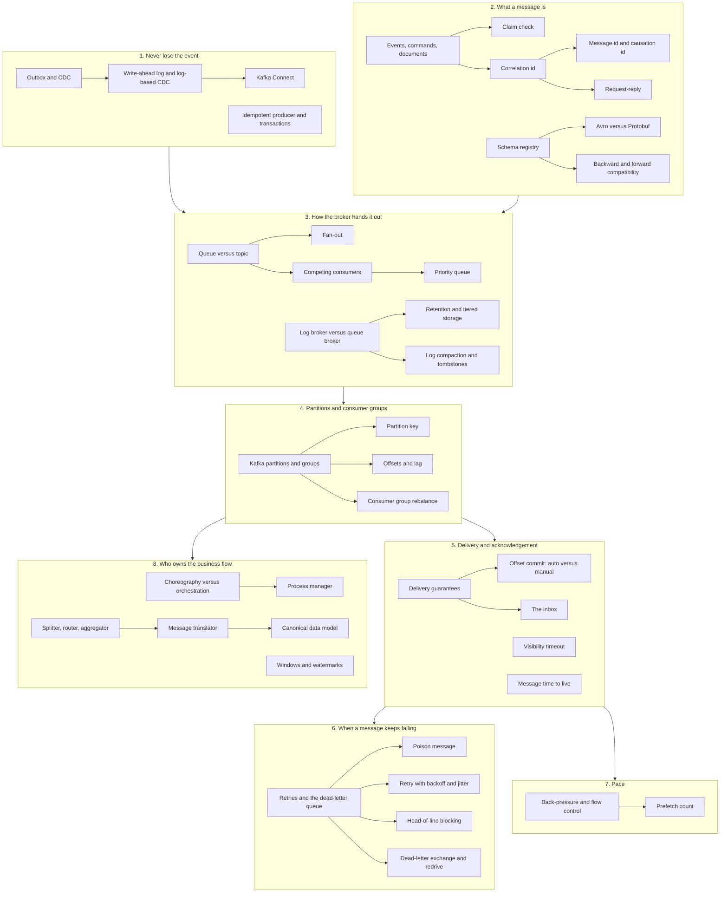

## The map in words

The map shows every section of this chapter, grouped into eight boxes. Read the boxes in number order: the arrows between them follow one message from the producer to the business flow.

A producer must never lose an event, so it writes through an outbox or CDC. The broker hands messages out in one of two shapes: a queue where one worker takes each message, or a topic where every reader sees every message.

A topic is split into partitions. A key picks the partition, which keeps order per key. A consumer group shares the partitions and remembers its place with offsets.

When the consumer acknowledges decides the delivery guarantee. Messages that keep failing are retried with growing gaps, then parked in a dead-letter queue. Around all of it: the shape of the message, its schema, the pace of the consumer, and who owns the business flow.

## Queue versus topic

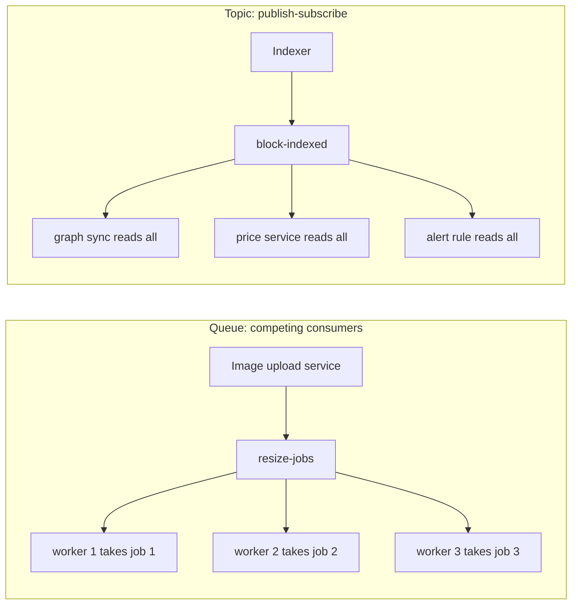

**Story.** A customer uploads three photos. Each "resize this image" job must be done once, by any free worker. That is a queue. An indexer finishes block 101200000. The graph sync, the price service and an alert rule all want to know. That is a topic.

**How it works.**

1. Queue (left): one sender, one receiver per message. This is point-to-point.
2. Several workers on one queue are competing consumers. Each message goes to one of them.
3. Throughput grows with the number of workers.
4. Topic (right): the publisher does not know its readers. This is publish-subscribe (pub-sub).
5. Every subscriber gets its own copy of every message.


### In code

```text
queue resize-jobs:
  put(job): append job at the tail
  take(): if empty: wait
          job = head; remove head      # nobody else can get it now
          return job
each worker loop:
  job = queue.take()
  resize(job)
  ack(job)                             # done once
```

```go
// A slice stands in for the broker's queue storage.
type Queue struct{ msgs []string }

func (q *Queue) Put(m string) { q.msgs = append(q.msgs, m) }

func (q *Queue) Take() (string, bool) {
	if len(q.msgs) == 0 {
		return "", false // a real worker would block here
	}
	m := q.msgs[0]
	q.msgs = q.msgs[1:] // gone for every other worker
	return m, true
}

// each worker
for {
	m, ok := q.Take()
	if !ok {
		break
	}
	done[m]++ // resize, then ack
}
```

```text
topic block-indexed:
  subscribe(name): add a subscription
  publish(msg):
    for each subscription s:
      s.append(copy of msg)            # every subscriber gets it
each subscriber, in its own loop:
  msg = next message of its subscription
  handle(msg)                          # graph, prices, alerts
  if msg lacks a field it needs: fail  # it was never asked
```

```go
// Each subscription keeps its own copy of the stream.
type Topic struct {
	subs map[string][]map[string]int
	keys []string
}

func (t *Topic) Subscribe(name string) {
	t.subs[name] = nil
	t.keys = append(t.keys, name)
}

func (t *Topic) Publish(m map[string]int) {
	for _, s := range t.keys {
		t.subs[s] = append(t.subs[s], m) // one copy per subscriber
	}
}

// the alert rule reads its own copy
msg := t.subs["alert rule"][1]
if _, ok := msg["gas_used"]; !ok {
	fmt.Println("block 101200001 has no gas_used: the alert rule fails")
}
```

```text
trap 1: publish(job) to a topic with 3 workers subscribed
  each worker gets its own copy and resizes it    # 3 times the work
trap 2: two workers take from one queue
  worker 1: deposit 100 (slow)
  worker 2: withdraw 80 (fast)
    if balance < 80: refuse                       # balance is still 0
fix: worker = hash(account) mod workers
  every message of account 7 goes to one worker, in order
```

```go
// trap 1: a job published to a topic
jobTopic.Publish(map[string]int{"photo": 1})
resized := 0
for _, s := range jobTopic.keys {
	resized += len(jobTopic.subs[s]) // each subscriber resizes it
}

// trap 2: the withdrawal runs before the deposit
balance := 0
if balance >= 80 {
	balance -= 80
} else {
	fmt.Println("trap 2: withdraw 80 runs first, balance 0, refused")
}

// fix: one key, one worker
func workerFor(key string, workers int) int {
	h := fnv.New32a()
	h.Write([]byte(key))
	return int(h.Sum32()) % workers
}
```

Run it: `handbook/code/04-queue-vs-topic/` with `go run .` It prints each job taken once, the 30 photos split 8, 8, 7, 7, three copies of block 101200000, and the two traps with the fixed balance of 20.

**What goes wrong.** A topic used for work distribution: every subscriber resizes the same image. The other trap: competing consumers lose order. Two messages for one account run in parallel on two workers, and the withdrawal lands before the deposit.

**Where you use it.**

- RabbitMQ or SQS for task queues such as resize, email, re-decode block N.
- Kafka or SNS for events that many teams read.
- Pub-sub hides who depends on you. Removing a field breaks a reader nobody knew existed, which is why a schema registry matters.

> "A queue is eaten once. A topic is read by everyone. I pick by asking whether the message is a job or a fact."

▶ Watch it move: [Queue versus topic](visual/04-queue-vs-topic.html)

## Fan-out

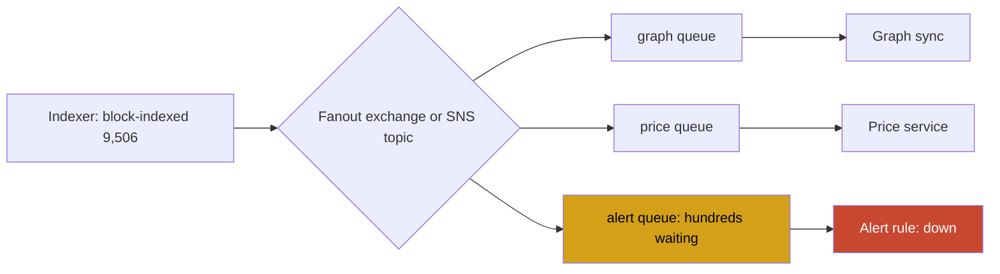

**Story.** The indexer finishes block 9,506. The graph sync, the price service and an alert rule all need to know. The indexer publishes one message. The broker copies it into three queues, one per reader. The alert rule is down for an hour, and only its own queue grows.

**How it works.**

1. The publisher sends one message to a fanout exchange (RabbitMQ) or a topic (Amazon SNS).
2. The exchange copies it into every queue bound to it.
3. Each consumer reads only its own queue, at its own pace.
4. A slow or broken consumer backs up only its own queue.
5. A new consumer is one more queue bound to the exchange. The publisher never changes.


### In code

```text
on publish(msg) to the fanout exchange:
  for each queue q bound to the exchange:
    q.append(copy of msg)          # one copy per subscriber

each consumer c runs its own loop:
  if c is down: do nothing         # its messages wait in its queue
  msg = c.queue.take()             # only c's own queue
  handle(msg)
  ack(msg)                         # removed from c's queue only

new subscriber: bind(newQueue)     # the publisher is unchanged
```

```go
// A buffered channel stands in for each broker queue.
// Publish plays the RabbitMQ fanout exchange.
func (x *Exchange) Publish(m Msg) {
	for _, n := range x.names {
		x.queues[n] <- m // a copy per subscriber
	}
}

// A consumer that is down never calls Drain, so its messages wait.
func (x *Exchange) Drain(name string) int {
	q, n := x.queues[name], 0
	for len(q) > 0 {
		<-q // handle, then ack: gone from this queue only
		n++
	}
	return n
}
```

Run it: `handbook/code/04-fan-out/` with `go run .` It prints 360 messages waiting for the alert rule and 0 lost, then 360 of 360 lost with the push and no queue.

**What goes wrong.** Fan-out by pushing straight to each reader's HTTP endpoint, with no queue in between. When one reader is down longer than the push retries last, its messages are dropped. The fix: fan out to a queue per subscriber, then consume from the queue. Each queue also gets its own dead-letter queue and its own depth alert.

**Where you use it.**

- RabbitMQ: a `fanout` exchange with one queue per consumer service.
- AWS: SNS topic with one SQS queue subscribed per consumer. This is the standard "SNS to SQS fan-out".
- Kafka: each consumer group reads the whole topic, so every group is its own fan-out. The topic's retention plays the role of the queue.

> "Fan-out copies one message to many subscribers. I give each subscriber its own queue, so one slow or broken reader only backs up itself."

▶ Watch it move: [Fan-out](visual/04-fan-out.html)

## Competing consumers

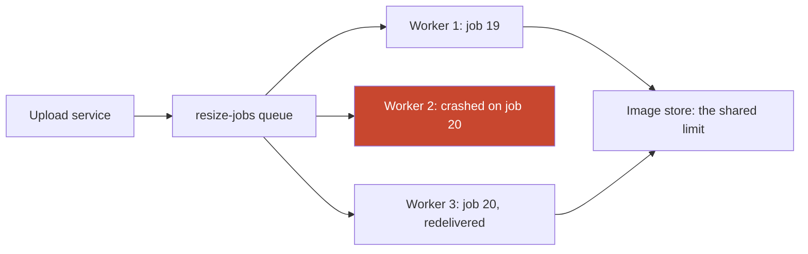

**Story.** Thirty photos land on the queue `resize-jobs`. One worker would take thirty times one photo's time. Two more workers join the same queue and each takes the next job, so the queue drains three times as fast. Worker 2 dies in the middle of job 20, and the broker gives job 20 to worker 3. At ten workers the image store they all write to is full, and more workers stop helping.

**How it works.**

1. Several workers read from one queue. Each message goes to exactly one of them.
2. Nobody assigns work. Each free worker asks for the next message.
3. A worker acknowledges only after the work is done.
4. A worker that dies before its acknowledgement loses nothing: the broker redelivers that message to another worker.
5. Scale the number of workers on queue depth.


### In code

```text
broker, on a free worker w:
  if no job is ready: wait
  job = head of ready; remove it
  unacked[job] = w                  # handed out, not yet done
worker w loop:
  job = deliver(w)
  write the resized image to the store   # the shared limit
  ack(job): delete unacked[job]     # done once
broker, when worker w's connection drops:
  for each job held by w:
    put it back at the head         # another worker gets it
```

```go
// The broker remembers who holds each job until the ack.
type Broker struct {
	ready   []int       // jobs waiting
	unacked map[int]int // job -> worker holding it
}

func (b *Broker) Deliver(worker int) (int, bool) {
	if len(b.ready) == 0 {
		return 0, false
	}
	job := b.ready[0]
	b.ready = b.ready[1:]
	b.unacked[job] = worker
	return job, true
}

func (b *Broker) Ack(job int) { delete(b.unacked, job) }

// WorkerDied: every job it held goes back to the head.
func (b *Broker) WorkerDied(worker int) []int {
	var back []int
	for job, w := range b.unacked {
		if w == worker {
			delete(b.unacked, job)
			b.ready = append([]int{job}, b.ready...)
			back = append(back, job)
		}
	}
	return back
}

// per tick: at most storeLimit workers can write
for w := 1; w <= workers && w <= storeLimit; w++ {
	if job, ok := b.Deliver(w); ok {
		b.Ack(job)
	}
}
```

```text
plain competing consumers:
  any free worker takes the next message    # no order between workers
  withdraw: if balance < 80: refuse
message groups (group = account id):
  each tick, for each message m in order:
    if m.group already has a message in flight:
      skip m for now                        # wait behind its group
    else:
      mark m.group busy; deliver m
  order holds inside a group, groups run in parallel
  one busy group runs one message at a time
```

```go
type Pay struct {
	Group  string
	Amount int
}

// plain: the withdrawal ran first
if bal < 80 {
	fmt.Println("step 7: withdraw 80 runs first, balance 0, refused")
}

// groups: one in-flight message per group
for len(queue) > 0 {
	busy := map[string]bool{}
	var rest []Pay
	for _, p := range queue {
		if busy[p.Group] { // its group already has one in flight
			rest = append(rest, p)
			continue
		}
		busy[p.Group] = true
		balances[p.Group] += p.Amount
	}
	queue = rest
}

// one busy key: 50 of 100 payments in one group
ticks := 50 // that group runs one at a time
```

Run it: `handbook/code/04-competing-consumers/` with `go run .` It prints 30 ticks with one worker and 10 with three, job 20 put back and taken by worker 3, 8 ticks for both 4 and 10 workers against the store limit, and balance 20 with message groups.

**What goes wrong.** Two things. Order is lost: a deposit and a withdrawal for one account run on two workers, and the withdrawal finishes first. Group messages by account to fix it. And the shared resource behind the workers, often a database, becomes the limit, so adding workers only adds waiting.

**Where you use it.**

- RabbitMQ and SQS task queues. In Kafka the unit of competition is a partition, not a message.
- KEDA (Kubernetes Event-driven Autoscaling) adds pods when the queue grows.
- SQS FIFO message groups, RabbitMQ single active consumer or a Kafka key when order matters per entity.

> "Competing consumers share one queue, and each message goes to exactly one of them. I scale on queue depth, acknowledge after the work, and group by key when order matters."

▶ Watch it move: [Competing consumers](visual/04-competing-consumers.html)

## Priority queue

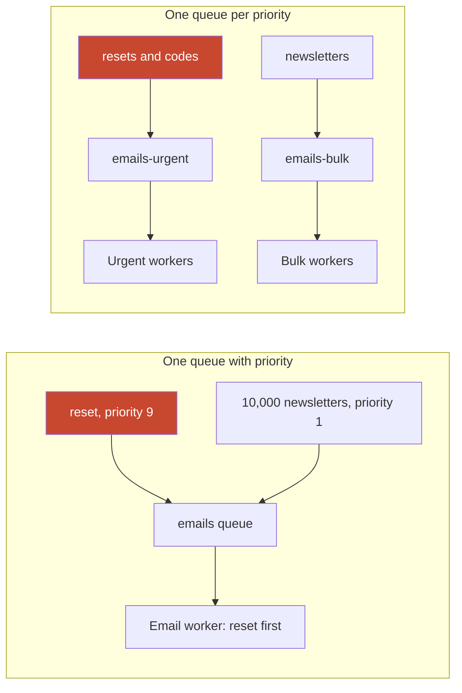

**Story.** The email worker has 10,000 newsletter emails waiting. A customer asks for a password reset and waits at the login page. In a plain first-in, first-out queue the reset goes out an hour later. With priority, it goes out next.

**How it works.**

1. The queue is declared with a priority range, for example `x-max-priority 10` in RabbitMQ.
2. Each message carries a priority: the reset 9, newsletters 1.
3. The broker hands out the highest priority first (left picture).
4. Inside one priority, order stays first in, first out.
5. Messages already prefetched to a worker are not reordered, so keep prefetch low.


### In code

```text
queue declared with x-max-priority 10
publish(email, priority):
  if the queue has no priority: priority = 0     # plain first in, first out
  insert email in order of (priority high first, then arrival)
worker loop, 3 emails a second:
  take prefetch emails into its own buffer       # already out of the queue
  email = head of the queue
  send(email); ack(email)
```

```go
// container/heap stands in for a RabbitMQ priority queue.
type Email struct {
	Kind     string
	Priority int
	seq      int
}

func (q PQ) Less(i, j int) bool {
	if q[i].Priority != q[j].Priority {
		return q[i].Priority > q[j].Priority // higher first
	}
	return q[i].seq < q[j].seq // same priority: first in, first out
}

add := func(kind string, p int) {
	if !prio {
		p = 0 // a plain queue ignores priority
	}
	seq++
	heap.Push(q, Email{kind, p, seq})
}

// prefetched emails already left the queue: never reordered
for i := 0; i < prefetch; i++ {
	heap.Pop(q)
}
e := heap.Pop(q).(Email) // send, then ack
```

```text
one priority queue, steady urgent traffic:
  each second: 3 urgent emails arrive
  each second: the worker sends 3, highest priority first
  newsletters are reached only when no urgent email waits   # never
fix: one queue per priority
  emails-urgent -> urgent worker, sized for the peak
  emails-bulk   -> bulk worker, sized for its deadline
  alert on each queue's depth and oldest age
```

```go
// one queue: urgent always wins the Less check
for sec := 0; sec < 3600; sec++ {
	for k := 0; k < perSecond; k++ {
		heap.Push(q, Email{"code", 9, seq})
	}
	for k := 0; k < perSecond; k++ {
		if heap.Pop(q).(Email).Kind == "news" {
			newsSent++ // stays 0
		}
	}
}

// fix: two queues, each with its own worker
for sec := 0; sec < 3600; sec++ {
	urgent += perSecond
	n := min(urgent, perSecond) // urgent worker
	urgent -= n
	m := min(bulk, perSecond) // bulk worker, never blocked
	bulk -= m
	bulkSent += m
}
depth := map[string]int{"urgent": urgent, "bulk": bulk} // alert on each queue
```

Run it: `handbook/code/04-priority-queue/` with `go run .` It prints the reset as email 10,001 after 56 minutes in a plain queue, email 1 with priority, email 51 with prefetch 50, 0 newsletters in an hour of steady urgent traffic, and 10,000 with two queues.

**What goes wrong.** Starvation. When urgent emails arrive all the time, the worker never reaches the newsletters, which wait for days. The fix is the right picture: one queue per priority, each with its own workers. Priority becomes reserved capacity instead of a place in line.

**Where you use it.**

- RabbitMQ: per-message priority on a queue declared with `x-max-priority`. Use a few levels, not hundreds.
- Kafka and Amazon SQS have no message priority. Use one topic or queue per priority with its own consumers.
- Background jobs (Sidekiq, Celery): named queues with weights, so low priority still gets a share.

> "A priority queue lets an urgent message jump the line. On Kafka or SQS, or when urgent traffic is steady, I use a separate queue per priority with its own workers so nothing starves."

▶ Watch it move: [Priority queue](visual/04-priority-queue.html)

## Kafka partitions, keys and consumer groups

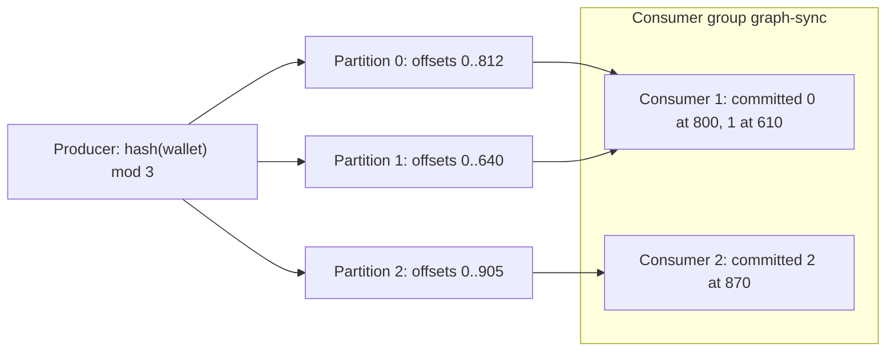

**Story.** Every transfer event is keyed by wallet address. All events of wallet 0x18 land in partition 1, so its deposit and its withdrawal stay in order. Two graph-sync pods form one consumer group. A third pod starts, the group rebalances, and each pod now owns one partition.

**How it works.**

1. A topic is split into partitions. Each partition is an ordered, append-only log.
2. The producer hashes the key and picks a partition. Same key, same partition.
3. Order holds inside one partition only.
4. A consumer group shares the partitions. One partition belongs to one member at a time.
5. Each member commits an offset: "I have processed up to here".
6. Lag is the head offset minus the committed offset.
7. A member joins or dies, and the group rebalances the partitions.


### In code

```text
producer send(wallet, msg):
  p = murmur2(key) mod 3             # same key, same partition
  append msg to partition p          # ordered, append-only
group rebalance(members):
  share = 3 partitions / members
  each member keeps its old partitions, up to its share
  the rest go to members below their share
consumer loop, for each partition it owns:
  read from the committed offset
  process(msg)
  commit(offset + 1)                 # a crash before this = read again
lag(p) = end offset - committed offset
```

```go
// Kafka's default partitioner: murmur2 of the key, mod the count.
func partitionFor(key string, n int) int {
	return int(murmur2([]byte(key))&0x7fffffff) % n
}

func (t *Topic) Send(wallet, msg string) int {
	p := partitionFor(key[wallet], 3)
	t.logs[p] = append(t.logs[p], msg) // append-only
	return p
}

// sticky assignor: keep old partitions up to the fair share
for i, m := range members {
	for _, p := range old[m] {
		if len(out[m]) < share(i) {
			out[m] = append(out[m], p)
			taken[p] = true
		}
	}
}
for p := 0; p < parts; p++ { // the rest: members below share
	if taken[p] {
		continue
	}
	for i, m := range members {
		if len(out[m]) < share(i) {
			out[m] = append(out[m], p)
			break
		}
	}
}

// consume and commit
msg := t.logs[p][committed[p]] // read from the committed offset
process(msg)
committed[p]++ // a crash before this line: msg is read again
lag := func(p int) int { return len(t.logs[p]) - committed[p] }
```

```text
producer send(wallet, msg):
  p = murmur2(key) mod 3
  9 of every 10 transfers have key H     # all land in one partition
each consumer handles 10 a tick
  backlog(p) grows when arrivals(p) > 10
a member with no partition left gets nothing  # 3 partitions, 3 readers max
fix, for the hot key only:
  p = (murmur2(H) + sequence) mod 3      # spread H over all partitions
  the reader re-orders H by sequence if order matters
```

```go
const perTick, capacity = 30, 10

for i := 0; i < perTick; i++ {
	var p int
	if i%10 != 9 { // 9 of every 10 come from wallet H
		p = partitionFor(key["H"], 3)
		if split { // custom partitioner for the hot key only
			p = (p + seq) % 3
			seq++
		}
	} else {
		other := []string{"A", "B", "C"}[i%3]
		p = partitionFor(key[other], 3)
	}
	backlog[p]++
}
for p := range backlog {
	backlog[p] = max(0, backlog[p]-capacity) // each reader: 10 a tick
}

// 4 members, 3 partitions: the sticky assignor
// fills each share and c4 is left with none
own = assign([]string{"c1", "c2", "c3", "c4"}, nil, 3)
```

Run it: `handbook/code/04-kafka-partitions/` with `go run .` It prints the partition of each wallet from Kafka's murmur2 hash, the assignments after each rebalance, C3 read twice after the crash, a backlog of 180 on P1 from the hot key, and 0 after the split.

**What goes wrong.** A hot key. One very busy wallet sends everything to one partition, and one consumer drowns while the others idle. Also: more consumers than partitions, and the extras sit idle. Adding partitions re-hashes keys, so order across the change is lost for a while.

**Where you use it.**

- Key by the entity that needs order: an account, a wallet, an order id.
- Pick the partition count early. It caps the parallelism of the group.
- A graph sync keyed by address keeps credits and debits of one address in order, with parallelism across addresses.

> "Kafka keeps order per partition, a key picks the partition, so I key by whatever needs the order and size partitions for the parallelism I want."

▶ Watch it move: [Kafka partitions and consumer groups](visual/04-kafka-partitions.html)

## Partition key

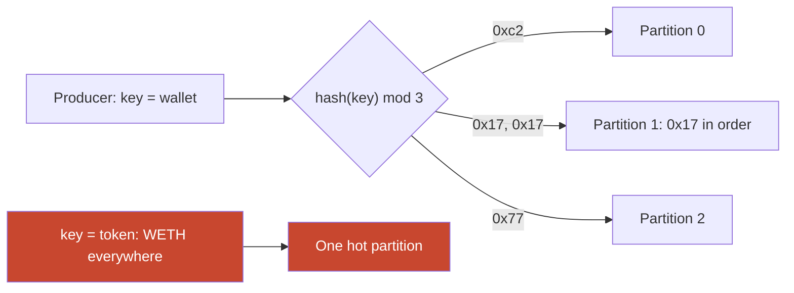

**Story.** Every transfer is published to a Kafka topic with three partitions. The producer keys each transfer by the sender's wallet. Wallet 0x17's deposit and withdrawal land in the same partition, so they are processed in order. Thousands of other wallets spread over the other partitions.

**How it works.**

1. The producer sets a key on each message: here the wallet address.
2. The default partitioner hashes the key (murmur2 in Kafka) and takes it modulo the partition count.
3. The same key always lands in the same partition while the count stays the same.
4. Inside one partition, order is kept. Across partitions, there is no order.
5. A message with no key is spread for balance, so it has no order with anything.


### In code

```text
producer send(msg):
  if msg has a key:
    p = murmur2(key) mod partitions     # same key -> same partition
  else:
    p = spread for balance              # no order with anything
  append msg to partition p
one consumer per partition:
  read partition p in offset order      # order holds inside p only
```

```go
// Kafka's default partitioner, used for every keyed message.
func partitionFor(key string, n int) int {
	return int(murmur2([]byte(key))&0x7fffffff) % n
}

func send(key, msg string) {
	var p int
	if key != "" {
		p = partitionFor(key, 3) // 0x17 -> P1, every time
	} else {
		p = nextSticky() // no key: spread, no order
	}
	logs[p] = append(logs[p], msg)
}

// the owner of P1 reads it in order
for _, m := range logs[1] {
	handle(m)
}
```

```text
choose the key = the entity whose events must stay in order
  key = tx hash:  every transfer its own key
                  one wallet's transfers spread over partitions
  key = token:    order per token
                  partition load = traffic share of its busiest token
  key = wallet:   order per wallet, thousands of keys spread the load
measure the busiest key's share of traffic
  if one key dominates: add a sub-key where its own order allows
```

```go
// key = tx hash: deposit and withdrawal of 0x17 split
pd := partitionFor(tx1, 3) // P0
pw := partitionFor(tx2, 3) // P2: read by another consumer

// key = token: 100 transfers, 60 of them WETH
for i := 0; i < 100; i++ {
	byToken[partitionFor(tok(i), 3)]++ // P0=20 P1=60 P2=20
}

// key = wallet: 3,000 wallets
for i := 0; i < 3000; i++ {
	byWallet[partitionFor(fmt.Sprintf("0x%04x", i), 3)]++
}

// the busiest key's share decides its partition's load
share := float64(top) / float64(total)
```

```text
old messages stay where they were written
partitions = 3:  p = murmur2(key) mod 3        # 0x17 -> P1
raise partitions to 4:
  p = murmur2(key) mod 4                       # 0x17 -> P2
  new messages follow the new rule, old ones wait in P1
  two consumers read 0x17's events: no order between them
fix: size the count early, or drain first, or a new topic
consumers in a group > partitions: the extra ones idle
```

```go
logs := map[int][]string{}

old := partitionFor("0x17", 3) // 1
logs[old] = append(logs[old], "0x17 old", "0x17 old")

now := partitionFor("0x17", 4) // 2: the modulus changed
logs[now] = append(logs[now], "0x17 new")

// P1 and P2 have different owners: no order between them
first := logs[now][0] // P2's reader is free: "0x17 new" runs first
// fix: drain the old partitions first, then raise the count
drain(logs[old])

idle := members - parts // 5 consumers, 4 partitions: 1
```

Run it: `handbook/code/04-partition-key/` with `go run .` It prints the partition of each key from Kafka's murmur2 hash, the tx-hash split, 20, 60 and 20 per 100 with token keys, 983, 1,032 and 985 for 3,000 wallets, and 0x17 moving from P1 to P2 when the count goes to 4.

**What goes wrong.** Three bad keys. A transaction hash spreads perfectly but loses order per wallet. A token contract keeps order per token, but WETH makes one hot partition while two sit idle. And adding a partition changes `mod 3` to `mod 4`: new messages of 0x17 go to a new partition while its old ones still wait, so for a while they run out of order. The fix: key by the entity that needs order, measure the busiest key's share, and size the partition count early with room to grow.

**Where you use it.**

- Kafka, Kinesis (partition key) and Pulsar (key-shared subscription) all route by a hashed key.
- Amazon SQS FIFO calls it the message group id: order per group, parallel across groups.
- The partition count also caps parallelism. With 4 partitions, a fifth consumer in the group is idle.

> "The key picks the partition, and order holds only inside a partition. I key by the entity that needs order, check for hot keys, and fix the partition count early because changing it moves keys."

▶ Watch it move: [Partition key](visual/04-partition-key.html)

## Offsets and consumer lag

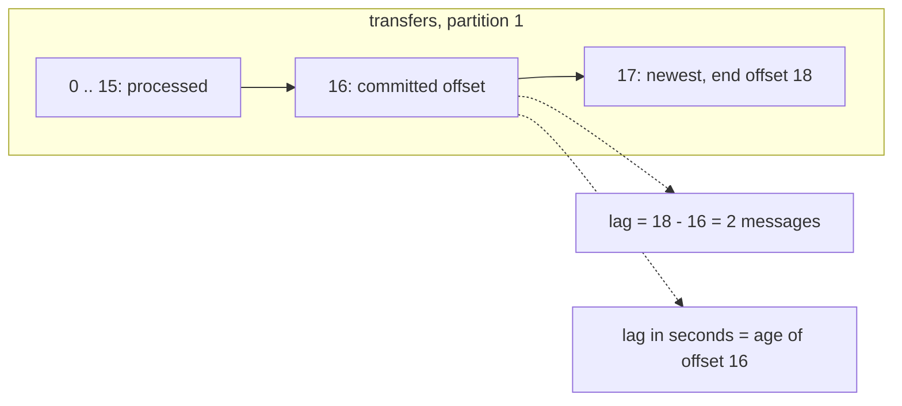

**Story.** The graph-sync group reads partition 1 of the transfers topic. Kafka remembers its place as a number, the committed offset. The gap to the newest message is the lag. One night the consumer hangs on offset 16 while one transfer arrives per hour. Lag in messages stays at 2, under the alert threshold, for three hours. Lag in seconds would have fired.

**How it works.**

1. Every message in a partition has an offset, counting from 0.
2. The group commits an offset per partition: everything before it is done.
3. Lag is the end offset minus the committed offset.
4. Healthy lag rises in a burst and falls again. Lag that only rises means the consumer is too slow or stuck.
5. A group with no committed offset, or one that fell out of retention, starts where `auto.offset.reset` says: `earliest` or `latest`.


### In code

```text
end offset   = next offset the partition will write
committed    = next offset the group will read
lag          = end offset - committed          # in messages
consumer loop:
  msg = read(committed)
  process(msg)
  committed = committed + 1; commit it
lag in time  = now - writeTime(committed)      # age of the oldest unread
alert on lag in time, not only on a message count
```

```go
type Partition struct {
	start int   // log start offset
	times []int // write time of each offset
}

func (p *Partition) End() int          { return len(p.times) }
func (p *Partition) Append(minute int) { p.times = append(p.times, minute) }

// Lag in messages: end offset minus committed offset.
func (p *Partition) Lag(committed int) int { return p.End() - committed }

// Lag in time: how old the oldest unread record is.
func (p *Partition) LagMinutes(committed, now int) int {
	if committed >= p.End() {
		return 0
	}
	return now - p.times[committed]
}

// consumer loop
for committed < p.End() {
	process(committed)
	committed++ // commit
}
```

```text
where does a group start reading?
  if it has a committed offset
     and log start <= committed <= end:
    start at committed                 # a valid bookmark
  else use auto.offset.reset:
    earliest: start at log start       # the oldest record still kept
    latest:   start at end             # only new records
retention deletes old records and moves log start forward
```

```go
func startOffset(p *Partition, committed int, has bool, reset string) int {
	if has && committed >= p.start && committed <= p.End() {
		return committed // a valid bookmark
	}
	if reset == "earliest" {
		return p.start // the oldest record still kept
	}
	return p.End() // latest: only new records
}

// down 9 days, retention 7 days: offsets 0..5 deleted
q.start = 6
latest := startOffset(q, 4, true, "latest")     // 12: 4..11 skipped
earliest := startOffset(q, 4, true, "earliest") // 6
```

Run it: `handbook/code/04-offsets-and-lag/` with `go run .` It prints lag 4, 0, 6 and 2, a stuck consumer at lag 2 but 180 minutes old, and start offsets 12 and 0 for a new group, 12 and 6 after retention deleted offsets 0 to 5.

**What goes wrong.** An offset that falls out of retention. The graph sync is down for 9 days, retention is 7, and `auto.offset.reset=latest` jumps it to the end, silently skipping days of transfers. Use `earliest`, and alert when lag in seconds nears the retention.

**Where you use it.**

- `kafka-consumer-groups --describe` shows committed offset, end offset and lag per partition.
- Burrow or the Kafka exporter for Prometheus turn it into alerts. Alert on lag in seconds and on lag that stops shrinking.
- A deliberate replay: stop the group, then `kafka-consumer-groups --reset-offsets --to-datetime`.

> "An offset is the consumer's bookmark, and lag is the gap to the newest message. I alert on lag in seconds and on lag that stops shrinking, and I never let an offset fall out of retention silently."

▶ Watch it move: [Offsets and consumer lag](visual/04-offsets-and-lag.html)

## Consumer group rebalance

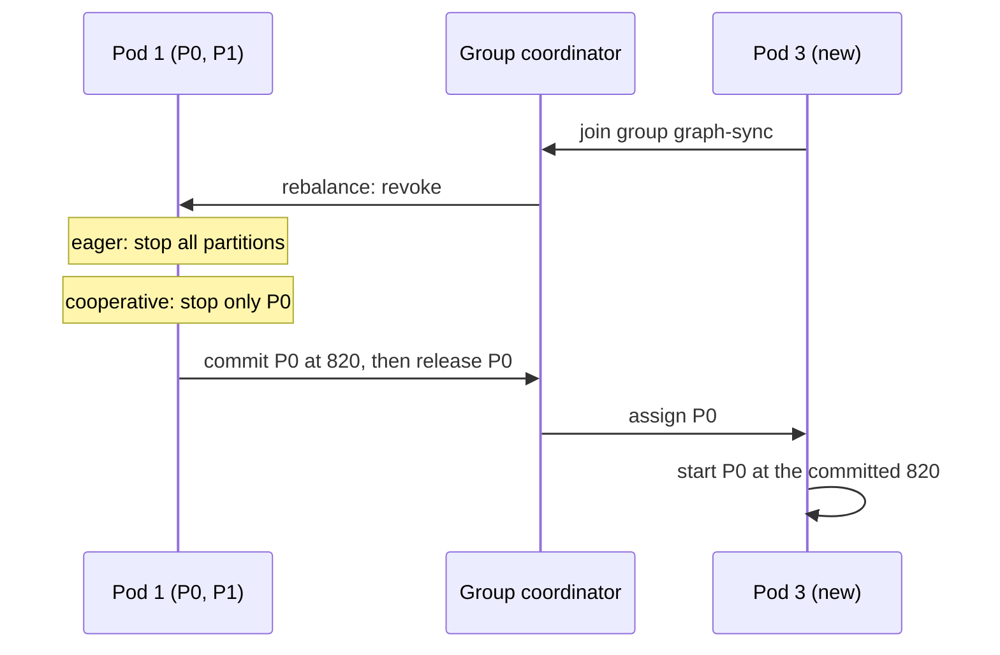

**Story.** Two graph-sync pods read the four partitions of the transfers topic. A deploy starts a third pod. The group must deal the partitions again. Pod 1 had processed partition 0 up to offset 820 but committed only 800. Pod 3 takes partition 0 and starts at 800, so twenty transfers are processed twice.

**How it works.**

1. A member joins, leaves, crashes or stops polling. The group coordinator, a broker, starts a rebalance.
2. Eager rebalance: every member gives up every partition, then the leader deals them all again.
3. Cooperative-sticky rebalance: members keep what they have. Only the partitions that must move are revoked, in a second round.
4. The new owner starts at the last committed offset. Everything after it is replayed.
5. A revoke callback can commit the real position just before hand-over, closing the gap.
6. Static membership (a fixed `group.instance.id`) lets a pod restart inside the session timeout with no rebalance at all.


### In code

```text
on a member joining or leaving:
  generation = generation + 1
  eager:       every member revokes every partition    # all reading stops
  cooperative: revoke only partitions that change owner
  leader computes the new plan; members get it
new owner of partition p:
  start at committed[p]                 # not at the old owner's position
  records between committed and position are read twice
on revoke (callback):
  commit the real position first        # nothing read twice
static member back inside the session timeout: no rebalance
```

```go
// Rebalance installs a new plan. Eager stops everything,
// cooperative stops only the partitions that move.
func (g *Group) Rebalance(plan map[int]string, eager bool) (stopped, moved []int) {
	g.gen++
	for p := 0; p < 4; p++ {
		if plan[p] != g.owner[p] {
			moved = append(moved, p)
		}
		if eager || plan[p] != g.owner[p] {
			stopped = append(stopped, p)
		}
	}
	g.owner = plan
	return
}

// the new owner starts at the committed offset
start := g.committed[0]          // 800
dup := position - start          // 820 - 800 = 20 read twice

// cooperative: commit on revoke, before giving P0 away
g.Commit(g.gen, 0, position)     // 820: nothing read twice
// static membership: same group.instance.id, back in 20 s, under 45 s
restart := 20
if restart < sessionTimeout {
	fmt.Printf("step 5: static member back in %d s < session timeout %d s: no rebalance, generation stays %d\n", restart, sessionTimeout, g.gen)
}
```

```text
member loop:
  records = poll(max.poll.records)
  process(records)                      # must finish in time
  commit(position)
coordinator:
  if no poll for max.poll.interval.ms (300 s):
    remove the member; rebalance        # generation + 1
  a commit with an old generation: refuse
fix: fewer records per poll, or a longer interval
```

```go
const maxPollInterval = 300 // seconds, the default

// a member that polls too slowly is removed
if batchSeconds > maxPollInterval {
	g.Rebalance(allToPod1, true) // generation + 1
}

// Commit is refused when it comes from an older generation.
func (g *Group) Commit(gen, p, off int) bool {
	if gen != g.gen {
		return false // the member was removed
	}
	g.committed[p] = off
	return true
}

// fix: bound the work per poll
cfg.MaxPollRecords = 50 // about 50 s per poll, under 300 s
```

Run it: `handbook/code/04-consumer-group-rebalance/` with `go run .` It prints all four partitions stopped and 20 records read twice in the eager case, pod 2 removed after a 420-second batch and its late commit refused, then only P0 moved and 0 read twice with cooperative rebalancing.

**What goes wrong.** A slow consumer. Work on one poll takes longer than `max.poll.interval.ms` (five minutes by default). The group removes the member and rebalances. Its batch is redone elsewhere, it rejoins, and the cycle repeats: a rebalance storm. Fix it with smaller batches (`max.poll.records`) or a longer interval for truly heavy work.

**Where you use it.**

- Every Kubernetes rolling deploy of a Kafka consumer. Use the cooperative-sticky assignor and static membership.
- A dashboard of rebalance count and duration per group, next to lag.
- An idempotent consumer, because some replay after a rebalance always remains possible.

> "A rebalance pauses the group and replays everything since the last commit. I use cooperative-sticky assignment, static membership and a commit on revoke, so a deploy moves only what it must."

▶ Watch it move: [Consumer group rebalance](visual/04-consumer-group-rebalance.html)

## Delivery guarantees

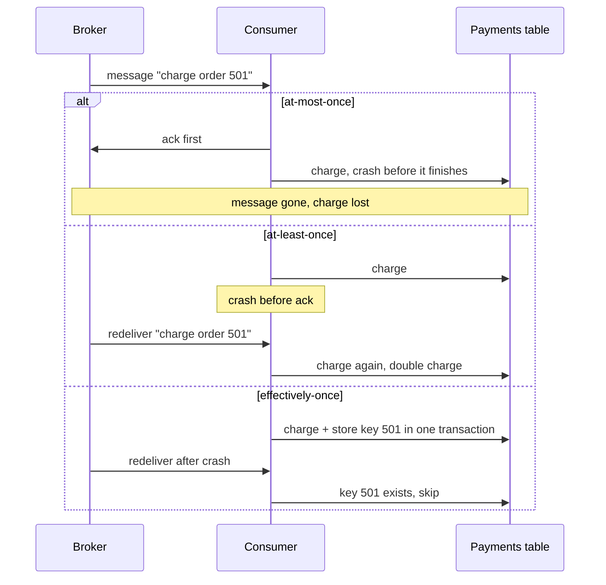

**Story.** A payment consumer receives "charge order 501". It crashes at the worst moment, between doing the work and telling the broker. Where it acknowledged decides what the customer sees: no charge, two charges, or exactly one.

**How it works.**

1. At-most-once: acknowledge first, then work. A crash loses the message. Cheap.
2. At-least-once: work first, then acknowledge. A crash means redelivery. Duplicates happen.
3. Effectively-once: at-least-once plus an idempotent consumer.
4. The consumer stores the message key in the same transaction as the effect.
5. A redelivered message finds its key and does nothing.


### In code

```text
broker: a delivered message stays until it is acked
        after a crash, an unacked message is delivered again
at-most-once handler:
  ack(msg)                              # broker deletes it now
  charge(msg)                           # a crash here loses the charge
at-least-once handler:
  charge(msg)
  ack(msg)                              # a crash before this = redelivery
effectively-once handler:
  if key in processed: ack(msg); return # seen before: skip the work
  in one transaction: charge(msg); insert key
  ack(msg)
```

```go
switch mode {
case "at-most-once":
	b.Ack() // ack first: the broker deletes it
	if crashNow {
		panic(crash{}) // dies before the charge
	}
	d.charges[order]++
case "at-least-once":
	d.charges[order]++ // work first
	if crashNow {
		panic(crash{}) // dies before the ack
	}
	b.Ack()
case "effectively-once":
	if d.processed[order] { // key found: skip the work
		b.Ack()
		return
	}
	d.tx(order) // charge and key commit together
	if crashNow {
		panic(crash{})
	}
	b.Ack()
}

// the broker: delivered again until acked
func (b *Broker) Deliver() (int, bool) {
	if len(b.queue) == 0 {
		return 0, false
	}
	return b.queue[0], true
}
func (b *Broker) Ack() { b.queue = b.queue[1:] } // deleted for good
```

Run it: `handbook/code/04-delivery-guarantees/` with `go run .` It crashes the handler at the same point in each mode and prints order 501 charged 0, 2 and 1 times.

**What goes wrong.** Acknowledging before the work is done, often by accident: Kafka's auto-commit of offsets on a timer. That silently turns at-least-once into at-most-once. The other mistake is trusting a broker's "exactly-once" flag to cover your database. It never does.

**Where you use it.**

- Metrics samples, presence pings: at-most-once. The next message supersedes them.
- Payments: at-least-once with an idempotency key.
- Kafka transactions plus the idempotent producer give exactly-once inside Kafka. Consumers read with `isolation.level=read_committed`. Past Kafka, only idempotency helps.

> "The wire gives me at-most-once or at-least-once. I choose at-least-once and make the consumer idempotent, which is the only exactly-once that exists."

▶ Watch it move: [Delivery guarantees](visual/04-delivery-guarantees.html)

## Offset commit: auto versus manual

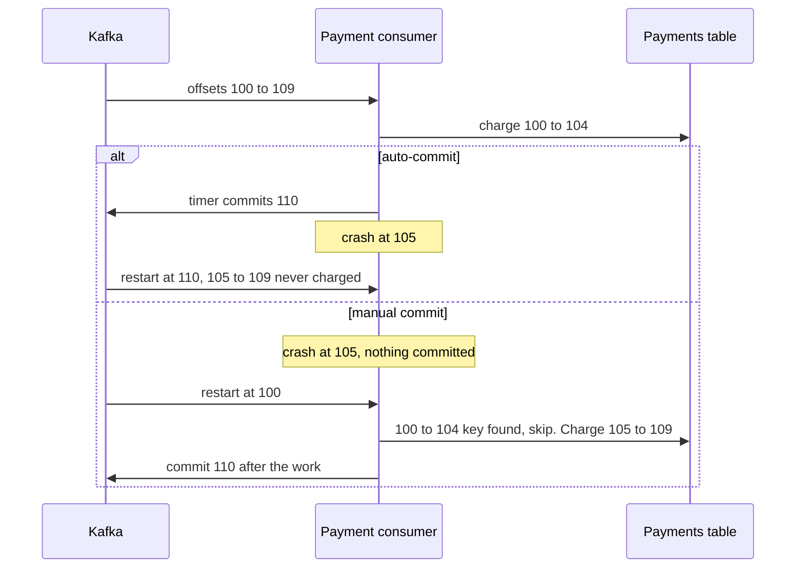

**Story.** A Go payment consumer reads ten charge messages, offsets 100 to 109. Auto-commit is on, the default. After five orders a five-second timer commits offset 110. The pod is killed at order 105. On restart Kafka says "start at 110", and orders 105 to 109 are never charged.

**How it works.**

1. The committed offset is the consumer group's bookmark: "everything before this is done".
2. Auto-commit moves the bookmark on a timer, every 5 seconds by default.
3. In librdkafka-based clients such as confluent-kafka-go, the timer commits every message already handed to your code. In Java, the same happens when another thread does the work and the loop polls again.
4. Manual commit (`enable.auto.commit=false`) moves the bookmark only after the work succeeds.
5. A crash before a manual commit replays the batch. An idempotency key makes the replay harmless.


### In code

```text
batch = poll(from committed)           # offsets 100..109
position = last offset + 1             # 110
for each order o in batch:
  if auto-commit and the 5 s timer fired:
    commit(position)                   # 110, whatever is finished
  if order o's key exists: skip        # already charged
  in one transaction: charge(o); insert key o
if manual:
  commit(position)                     # only after all the work
on restart: start at committed
a crash here: the pod is killed mid-batch
```

```go
func (c *Consumer) runBatch(crashAt, timerAfter int) (done int, crashed bool) {
	batch := poll(c.committed)
	position := batch[len(batch)-1] + 1 // 110
	for i, o := range batch {
		if c.auto && i == timerAfter {
			c.committed = position // timer: commits the poll position
		}
		if o == crashAt {
			return done, true // the pod is killed here
		}
		if c.charges[o] { // the idempotency key exists: skip
			continue
		}
		c.charges[o] = true // charge and key in one transaction
		done++
	}
	if !c.auto {
		c.committed = position // manual: commit after the work
	}
	return done, false
}
```

Run it: `handbook/code/04-offset-commit/` with `go run .` It prints 5 orders never charged with auto-commit, then 5 skipped by key, 5 charged and 10 charges in all with manual commit.

**What goes wrong.** Auto-commit silently turns at-least-once into at-most-once. Nothing logs an error, and the loss shows up weeks later in a reconciliation. The opposite mistake is committing after every single message, which is slow. Commit per batch.

**Where you use it.**

- Payments, ledgers, graph writes: manual commit after the work, plus an idempotent write.
- Metrics and presence pings: auto-commit is fine, losing one sample does not matter.
- Kafka transactions commit the offset together with the output, when the output is Kafka too.

> "Auto-commit can acknowledge work that never happened. I commit manually after the work and make the consumer idempotent."

▶ Watch it move: [Offset commit: auto versus manual](visual/04-offset-commit.html)

## Idempotent producer and Kafka transactions

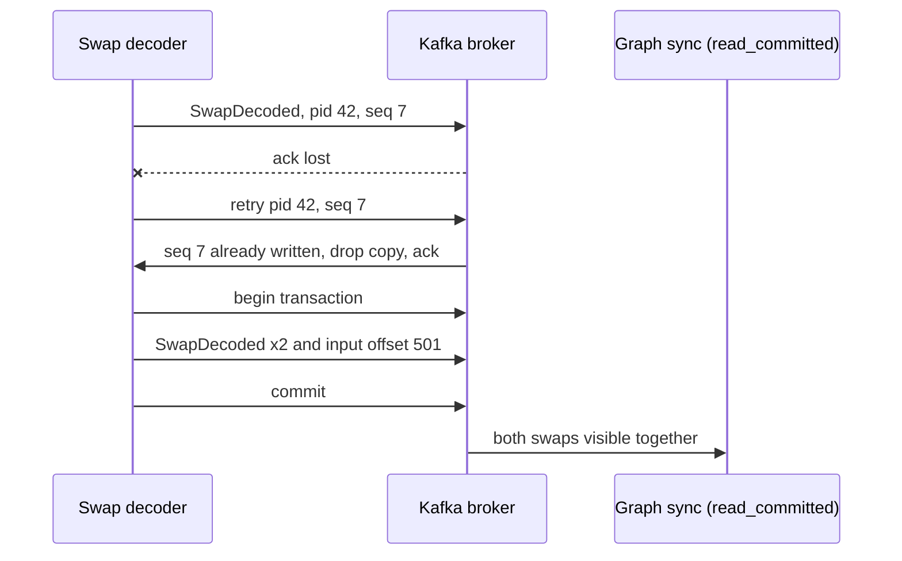

**Story.** A swap decoder reads block events from one Kafka topic and writes decoded swaps to another. A network blip loses an acknowledgement, so the decoder resends. The broker sees the same producer id and sequence number and drops the copy. Later the decoder crashes after writing output but before marking its input done. The transaction is aborted, and nothing is doubled.

**How it works.**

1. The idempotent producer gets a producer id. Every message carries a sequence number per partition.
2. The broker drops a message whose sequence it has already written, and refuses one that arrives out of order.
3. A transaction groups writes to several partitions plus the consumed input offsets.
4. On commit, all of them become visible at once. On abort, none of them do.
5. Readers set `isolation.level=read_committed`, so they skip aborted and still-open writes.


### In code

```text
producer: every record carries (producer id, sequence per partition)
  on a lost ack: resend the same (pid, seq)
broker append(pid, seq, record):
  if seq <= lastSeq[pid]: drop it, ack       # a duplicate
  if seq != lastSeq[pid] + 1: refuse         # a gap: keeps order
  lastSeq[pid] = seq; write record
```

```go
// Append is the broker's idempotence check per partition.
func (p *Partition) Append(pid, seq int, r Rec) string {
	last, seen := p.lastSeq[pid]
	switch {
	case seen && seq <= last:
		return "duplicate, dropped, acked"
	case seen && seq != last+1:
		return "out of order, refused"
	}
	p.lastSeq[pid] = seq
	p.log = append(p.log, r)
	return "written"
}

// producer side: enable.idempotence=true
// a retry resends the same pid and seq
fmt.Println("send pid 42 seq 7:", p.Append(42, 7, Rec{Val: "swap seq 7"}))
fmt.Println("ack lost, retry pid 42 seq 7:", p.Append(42, 7, Rec{Val: "swap seq 7"}))
```

```text
read input record at offset 500
beginTransaction()
send output records                    # written, marked pending
sendOffsetsToTransaction(input 501)    # the input offset joins the txn
commitTransaction()                    # markers: all visible at once
on a crash before commit:
  the txn is aborted; read_committed readers skip it
  the new decoder re-reads from the last committed input offset
```

```go
// Read: what a consumer sees with its isolation level.
func (p *Partition) Read(committedOnly bool) []string {
	var out []string
	for _, r := range p.log {
		if committedOnly && r.TxnID != 0 && p.status[r.TxnID] != "committed" {
			continue // pending or aborted: hidden
		}
		out = append(out, r.Val)
	}
	return out
}

out.status[1] = "pending" // beginTransaction
out.Append(7, 1, Rec{"swap A", 1})
out.Append(7, 2, Rec{"swap B", 1})
offsets[1] = "input offset 501" // sendOffsetsToTransaction
out.status[1] = "committed"     // commitTransaction

out.status[2] = "aborted" // crash before commit
```

```text
inside one Kafka transaction:
  insert swap into Postgres            # not part of the Kafka txn
  send swap to Kafka
crash before commit: Kafka aborts its part, Postgres keeps its row
redo: insert into Postgres again       # a second row
reader with read_uncommitted: sees aborted records too
fix past Kafka: insert with a unique key (tx_hash, log_index)
  ON CONFLICT DO NOTHING               # a second insert is a no-op
```

```go
// read_uncommitted: aborted records are shown as real
fmt.Println("read_uncommitted sees:", out.Read(false)) // swap A, swap B, swap C

// Postgres without a key: the redo adds a second row
plain = append(plain, "0xabc:3") // first attempt
plain = append(plain, "0xabc:3") // redo after the crash

// with a unique key the redo does nothing:
// INSERT INTO swaps ... ON CONFLICT (tx_hash, log_index) DO NOTHING
for _, k := range []string{"0xabc:3", "0xabc:3"} {
	keyed[k] = true
}
```

Run it: `handbook/code/04-idempotent-producer/` with `go run .` It prints the retried seq 7 dropped, seq 8 refused until 7 lands, 0 then 2 swaps visible to read_committed around the commit, the aborted swap seen only by read_uncommitted, and 2 Postgres rows without a key against 1 with it.

**What goes wrong.** Believing it reaches past Kafka. If the decoder also inserts into Postgres, an aborted Kafka transaction leaves the Postgres row behind, and the retry inserts it again. And a reader left on the default `read_uncommitted` counts aborted messages as real.

**Where you use it.**

- Kafka Streams with `processing.guarantee=exactly_once_v2`: read, transform, write, all in Kafka.
- Any producer: the idempotent producer is on by default in recent clients and stops retry duplicates and reordering.
- A database sink: a unique key (transaction hash plus log index) with `ON CONFLICT DO NOTHING`, because the Kafka transaction cannot cover it.

> "The idempotent producer drops retried duplicates, and transactions commit output and offsets together. That is exactly-once inside Kafka only. Past Kafka, I need an idempotent sink."

▶ Watch it move: [Idempotent producer and transactions](visual/04-idempotent-producer.html)

## Retries, poison messages and the dead-letter queue

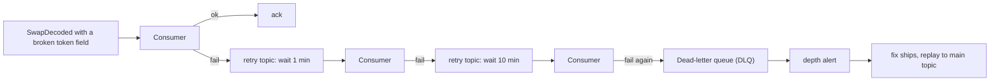

**Story.** A producer release starts sending a token field as text instead of a number. The decoder fails on it every time. Without a limit, the consumer crashes, restarts, reads it again, and every message behind it waits. With retries and a dead-letter queue (DLQ), the bad message is parked after three tries and the stream keeps flowing.

**How it works.**

1. The consumer fails on a message.
2. It moves the message to a retry topic with a delay, so other keys keep flowing.
3. Each retry waits longer: 1 minute, then 10. This is exponential backoff, with jitter.
4. After the last retry the message goes to the DLQ, with the error and the original headers.
5. A metric on DLQ depth fires an alert.
6. A fix ships. A replay tool reads the DLQ back into the main topic with the same keys.


### In code

```text
handle(msg):
  if decode(msg) succeeds: done
  msg.attempts = msg.attempts + 1
  if msg.attempts >= 4:
    send msg to the DLQ with its error and key    # park it, alert
    return
  delay = 2^(attempts - 1) seconds                # 1, 2, 4
  send msg to the retry topic, due at now + delay
  return                                          # the main topic moves on
retry loop: when a message is due, handle(msg)
after the fix: replay the DLQ into the main topic, same key
```

```go
const maxAttempts = 4

handle := func(m Msg) {
	if err := decode(m, false); err != nil {
		m.Attempts++
		if m.Attempts >= maxAttempts {
			dlq = append(dlq, m) // with err and the original key
			return
		}
		delay := float64(int(1) << (m.Attempts - 1)) // 1, 2, 4 s
		m.DueAt = now + delay
		retry = append(retry, m)
		return // the main topic never waits
	}
	decoded = append(decoded, m.ID)
}

for len(retry) > 0 { // the retry topic, in due order
	m := retry[0]
	retry = retry[1:]
	now = m.DueAt
	handle(m)
}

for _, m := range dlq { // replay after the fix
	if decode(m, true) == nil {
		decoded = append(decoded, m.ID+" (replayed)")
	}
}
```

```text
handle(msg), with no retry limit:
  loop:
    if decode(msg) succeeds: break
    retry at once, in place           # no delay, no attempt count
  ack(msg)                            # never reached for a poison message
on a crash: restart, read the same msg again
every message behind msg waits; lag grows
```

```go
// no limit, no retry topic: the partition is blocked
stuck := 0
for t := 0.0; t < 60; t += 0.2 { // one minute of instant retries
	if decode(main[2], false) != nil {
		stuck++ // retried at once, in place
	}
}
// the ack after the loop is never reached
fmt.Printf("one minute: %d failed attempts on m3, m4..m6 decoded: 0\n", stuck)
```

Run it: `handbook/code/04-dead-letter-queue/` with `go run .` It prints m3 failing at 0, 1, 3 and 7 seconds and landing in the DLQ while m4 to m6 decode, m3 decoded after the replay, then 300 failed attempts and 0 decoded in one minute without a limit.

**What goes wrong.** Head-of-line blocking. Retrying in place, forever, means one poison message stops the whole partition. The lag alarm is the first sign. The quieter failure: a DLQ nobody watches, which is just a slower way to lose data.

**Where you use it.**

- Three to five retries for transient faults such as a database restart.
- Retry topics with delay consumers in Kafka. TTL (time to live) plus a dead-letter exchange in RabbitMQ. A redrive policy in SQS.
- The team that owns the consumer owns the DLQ, with its depth on their board.

> "A message that fails every time is poison. I retry it a few times with growing gaps, then park it in a watched dead-letter queue so the stream never stops."

▶ Watch it move: [Dead-letter queue](visual/04-dead-letter-queue.html)

## Poison message

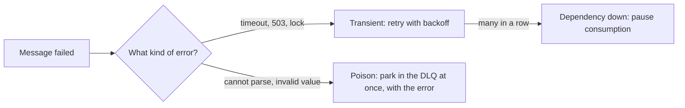

**Story.** The swap decoder fails on two messages. m3 failed because the price database was restarting. m7 has its amount sent as text. m3 succeeds on the third try. m7 fails the same way on every try, because nothing about it will ever change. That is a poison message, and it belongs in the dead-letter queue at once.

**How it works.**

1. A poison message fails because of the message itself: a bad shape, a wrong type, a value out of range.
2. A transient failure is caused by the world: a timeout, a restart, a lock.
3. Parse and validation errors are permanent. Park the message at once with its error and original headers.
4. Timeouts and 5xx answers are transient. Retry with backoff.
5. When many messages fail with the same transient error, the dependency is down for everyone. Pause consumption instead of parking.


### In code

```text
handle(msg):
  err = decode(msg)
  if no err: done
  if err is permanent (parse, validation):
    send msg to the DLQ with err and headers   # retry can never help
    return
  # err is transient (timeout, 503)
  wait 2^(attempt - 1) seconds
  try again
when many messages fail with one transient error in a row:
  open the breaker: pause consumption, probe, resume
```

```go
var (
	ErrTimeout = errors.New("price lookup: timeout")
	ErrParse   = errors.New("amount: expected number, got text")
)

// permanent says whether retrying can ever help.
func permanent(err error) bool { return errors.Is(err, ErrParse) }

t := 0
for attempt := 1; ; attempt++ {
	err := try(t)
	if err == nil {
		return // ok
	}
	if permanent(err) {
		dlq(err) // on the first failure, with its headers
		return
	}
	t += 1 << (attempt - 1) // transient: wait 1, 2, 4 s
}

// breaker: 5 transient failures in a row pause consumption
fails++
if fails >= 5 {
	paused = true // no message is parked, resume on a probe
}
```

Run it: `handbook/code/04-poison-message/` with `go run .` It prints m7 parked on attempt 1, m3 succeeding on attempt 3 at second 3, 31 seconds wasted by the first wrong guess, 40,000 parked by the second, and the breaker opening after 5 timeouts.

**What goes wrong.** Guessing wrong either way. Treat a poison message as transient and each one stalls its partition through every retry. Treat a two-minute database restart as poison and 40,000 healthy messages flood the DLQ.

**Where you use it.**

- Spring Kafka's error handler: list exceptions that skip retries and go straight to the dead-letter topic.
- A schema registry stops most poison at the producer, before it is published.
- A circuit breaker on the dependency pauses the consumer while it is down.

> "A poison message fails every time because the message itself is wrong. I park it at once with its error, and retry only failures caused by the world, like timeouts."

▶ Watch it move: [Poison message](visual/04-poison-message.html)

## Retry with backoff and jitter

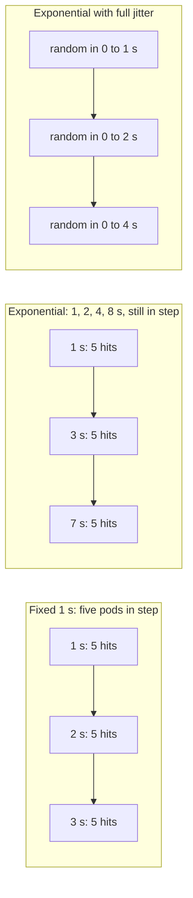

**Story.** Five decoder pods lose the price database at second 0 when it restarts. It is back at second 8. With a fixed 1 second retry, all five hit it in the same instant, every second, and knock it over again as it comes back. With exponential backoff they retry less often, but still all at once. With jitter each pod picks a random wait, the retries arrive as a trickle, and the database stays up.

**How it works.**

1. Backoff: wait longer after each failed try, for example 1, 2, 4, 8 seconds.
2. Jitter: pick a random wait. Full jitter picks between 0 and the backoff value.
3. A cap on the wait stops a pod from sleeping for minutes.
4. A cap on attempts ends the retries. Then park the message or open a circuit breaker.
5. Retry only transient errors, and only operations that are safe to repeat.


### In code

```text
retry(attempt n):
  fixed:       wait = 1 s                     # every pod in step for ever
  exponential: wait = min(16, 2^n) s          # rarer, but still in step
  full jitter: wait = random(0, min(16, 2^n)) s  # spreads the pods out
  t = t + wait
  call the database at time t
  if it answers: done
after a limit of attempts: park the message or open the breaker
```

```go
const capSec = 16.0 // no wait is longer than this

// wait is the delay before retry number n (0-based).
func wait(kind string, n int) float64 {
	if kind == "fixed" {
		return 1
	}
	w := math.Min(capSec, math.Pow(2, float64(n)))
	if kind == "jitter" {
		w = math.Max(0.3, rnd()*w) // full jitter
	}
	return w
}

func retries(kind string) []float64 {
	var out []float64
	t := 0.0
	for n := 0; n < limit; n++ {
		t += wait(kind, n)
		if t > end {
			break
		}
		out = append(out, math.Round(t*10)/10) // one call to the database
	}
	return out // limit reached: park it or open the breaker
}
```

Run it: `handbook/code/04-retry-backoff-jitter/` with `go run .` It prints each pod's retry times from the same random generator as the animation: 120 retries with a peak of 5 for fixed, 20 with a peak of 5 for exponential, 31 with a peak of 3 for jitter.

**What goes wrong.** A retry storm. Clients that retry on the same schedule hit a recovering service together and keep it down. The more clients, the worse it gets. Jitter is the fix, not a longer fixed wait.

**Where you use it.**

- The AWS SDKs use exponential backoff with jitter by default. gRPC has a retry policy with backoff.
- Kafka clients: `retry.backoff.ms` and `retry.backoff.max.ms`. Consumer retry topics with growing delays.
- Any agent or tool call that retries a remote API.

> "Exponential backoff spaces retries out, and jitter stops many clients retrying in step. Without jitter, every client hits the recovering service at the same moment."

▶ Watch it move: [Retry with backoff and jitter](visual/04-retry-backoff-jitter.html)

## Head-of-line blocking

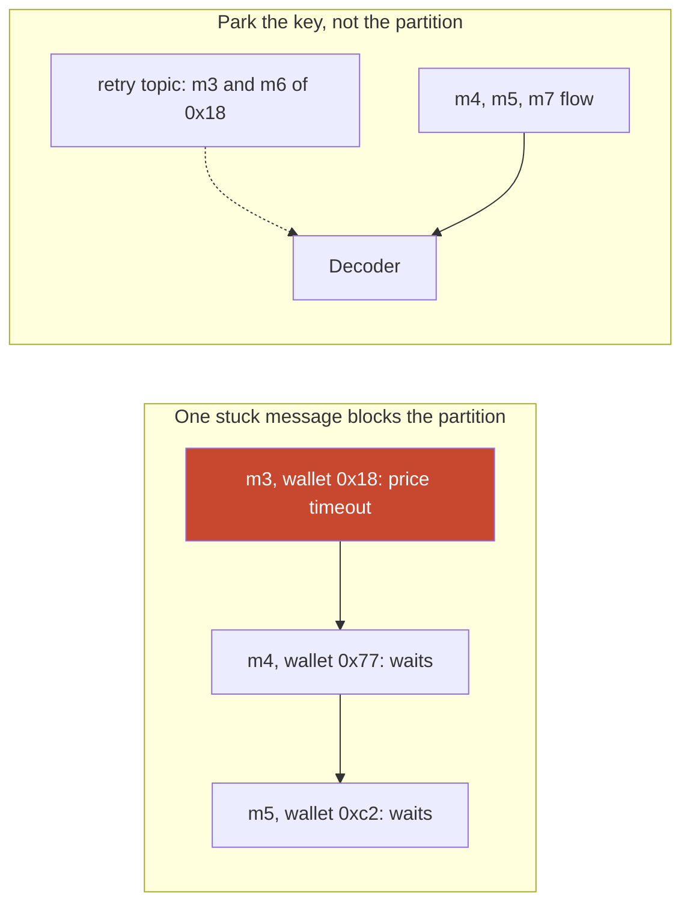

**Story.** A swap decoder reads partition 3, which holds swaps of thousands of wallets. One swap of wallet 0x18 needs a token price, and the price service keeps timing out for that token. The decoder retries in place. Every swap behind it waits, though none of them needs that price.

**How it works.**

1. An ordered line (a partition, a FIFO queue, one connection) serves its head first.
2. When the head cannot finish, everything behind it waits. That is head-of-line blocking.
3. Moving the stuck message to a retry topic frees the line at once.
4. Moving it aside breaks order for its key. So later messages of the same key are parked behind it.
5. Per-key lanes go further: one partition is processed as many parallel lanes, one per key.
6. With lanes, the commit can only reach the lowest unfinished offset, so finished work past it replays after a crash.


### In code

```text
for each message m in partition order:
  if m's price lookup fails:
    wait and retry m, in place          # nothing behind m moves
    commit stays before m
  process(m); commit(m)
lag grows while the head does not move
```

```go
// retry the head until it works
for _, m := range partition {
	if needsPrice(m) && !priceUp {
		return done // stuck at m3, retrying
	}
	done = append(done, m.ID)
}
```

```text
for each message m in partition order:
  if m.wallet is in blocked:            # keeps order per key
    send m to the retry topic; continue
  if m's price lookup fails:
    send m to the retry topic
    add m.wallet to blocked
    continue
  process(m)
  commit past m
retry consumer: process in order, then unblock the key
```

```go
blocked := map[string]bool{}
for _, m := range partition {
	if blockKeys && blocked[m.Wallet] {
		retry = append(retry, m.ID) // behind its own key
		continue
	}
	if needsPrice(m) {
		retry = append(retry, m.ID)
		blocked[m.Wallet] = true
		continue
	}
	done = append(done, m.ID) // and commit past it
}
// retry consumer: m3, then m6, in order, then free the key
delete(blocked, "0x18")
```

```text
for each message m in partition order:
  if m's lane is stuck, or m's lookup fails:
    mark its lane stuck; m waits in its lane
    continue
  process(m) in its own lane; finished[m.offset] = true
commit:
  c = lowest offset not finished        # one offset per partition
  commit(c)                             # a restart replays from c
when the lane recovers: process its waiting messages in order
```

```go
stuck := map[string]bool{}
finished := map[int]bool{}
for _, m := range partition {
	if needsPrice(m) || stuck[m.Wallet] {
		stuck[m.Wallet] = true // its lane waits, others go on
		continue
	}
	done = append(done, m.ID)
	finished[m.Off] = true
}
commit = 1
for finished[commit] { // lowest unfinished offset
	commit++
}
```

Run it: `handbook/code/04-head-of-line-blocking/` with `go run .` It prints only m1 and m2 done with retry in place, m6 ahead of m3 with no key list, m6 parked behind m3 with blocked keys, and a commit stuck at offset 3 with lanes.

**What goes wrong.** The blast radius is the whole partition, not the one key with a problem. Lag climbs for every wallet, and the lag alarm is the first sign. The opposite mistake: move the message aside and forget the key, so wallet 0x18's later swap is processed before the earlier one.

**Where you use it.**

- Kafka retry topics with a blocked-keys list, or Confluent's parallel consumer for per-key lanes.
- SQS FIFO: a stuck message blocks only its message group, so the group id is the key.
- HTTP/1.1 pipelining had the same problem, which is why HTTP/2 multiplexes streams on one connection.

> "One stuck message at the head of an ordered line stops everything behind it. I move it aside, and when order matters I block only its key, never the whole partition."

▶ Watch it move: [Head-of-line blocking](visual/04-head-of-line-blocking.html)

## Dead-letter exchange and redrive

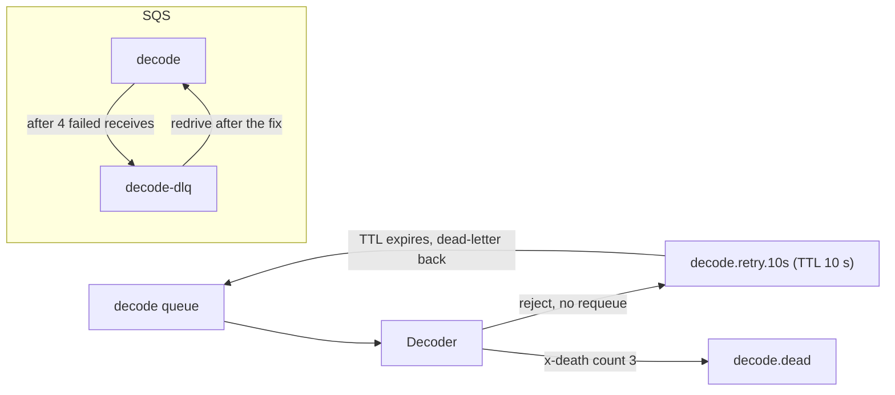

**Story.** A decode job fails on a RabbitMQ queue. RabbitMQ has no delayed retry topic, so the team builds one: the decoder rejects the message, a dead-letter exchange routes it to a queue with a 10 second time to live, and when it expires it is routed back. After three trips the decoder parks it. On SQS the same job is moved to a DLQ by a redrive policy and moved back after the fix.

**How it works.**

1. A RabbitMQ queue names a dead-letter exchange (DLX). A rejected or expired message is re-published there.
2. A retry queue with `x-message-ttl` and no consumer holds the message for the delay, then dead-letters it back.
3. The `x-death` header counts the trips, so the consumer knows when to park the message.
4. An SQS redrive policy names a DLQ and a `maxReceiveCount`. The visibility timeout is the delay between tries.
5. A DLQ redrive moves parked messages back to the source queue.


### In code

```text
queue decode has x-dead-letter-exchange -> decode.retry.10s
on failure: reject(msg, requeue=false)     # the broker dead-letters it
  x-death count = x-death count + 1
  if x-death count >= 3: publish to decode.dead; ack; stop
queue decode.retry.10s: no consumer, x-message-ttl 10 s
  when the HEAD is past its TTL:
    dead-letter it back to decode
a message expires only at the head         # use one queue per delay
```

```go
const maxDeaths = 3

for {
	reject(m, false) // requeue=false: the broker dead-letters it
	m.Death++ // x-death count
	if m.Death >= maxDeaths {
		publish("decode.dead", m)
		return
	}
	now += 10 // nobody reads the retry queue: it waits for its TTL
	// expired: its dead-letter exchange routes it back to decode
}

// RabbitMQ only checks the head of a queue for expiry
for _, m := range q {
	due := m.PutAt + m.TTL
	if due > now {
		now = due // the head blocks everything behind it
	}
	out[m.ID] = now
}
```

```text
queue decode: redrive policy
  maxReceiveCount 4, target decode-dlq
worker: receive(msg)                  # receive count + 1, hidden
  on failure: do not delete           # visible again after the timeout
  on success: delete(msg)
SQS: if receive count reaches 4:
  move msg to decode-dlq              # the main queue flows
redrive decode-dlq to decode:
  only after the fix, with a rate limit
```

```go
const maxReceive = 4

for {
	receives++ // received, failed, not deleted: visible again later
	if receives >= maxReceive {
		return receives // SQS moves it to decode-dlq
	}
}

// redrive before the fix: every message fails 4 more times
wasted := parked * maxReceive // 5,000 x 4 = 20,000

// after the fix: redrive with a rate limit
seconds := parked / rate // 5,000 at 100 a second = 50 s
```

Run it: `handbook/code/04-dead-letter-exchange-redrive/` with `go run .` It prints m3's three trips through the retry queue, a 5-second message leaving at second 60 behind a 60-second one, m3 moved to the DLQ after 4 receives, and 20,000 wasted receives from a redrive before the fix.

**What goes wrong.** Mixed delays in one TTL queue. RabbitMQ expires a message only at the head of the queue, so a 5 second retry waits behind a 60 second one. Use one retry queue per delay. On SQS: a redrive before the fix ships sends every message back into the same bug.

**Where you use it.**

- RabbitMQ: one retry queue per delay (10 s, 1 min, 10 min) and a parking queue, all wired with DLX.
- SQS: a redrive policy on every queue, an alarm on the DLQ's message count, a rate-limited redrive.
- `requeue=true` only for a fault you expect to clear in milliseconds. Otherwise it is a hot loop.

> "RabbitMQ gets delayed retries from a TTL queue and a dead-letter exchange, SQS from the visibility timeout and a redrive policy. In both I cap the tries, park the message, and redrive only after the fix."

▶ Watch it move: [Dead-letter exchange and redrive](visual/04-dead-letter-exchange-redrive.html)

## Visibility timeout

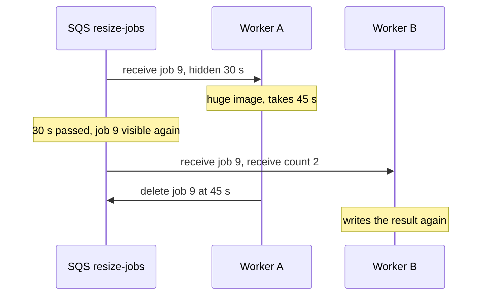

**Story.** An SQS queue holds image resize jobs. Worker A receives job 9. SQS does not delete it. It hides it from other workers for 30 seconds. Job 9 is a huge image and takes 45 seconds. At 30 seconds it becomes visible, worker B takes it too, and the job runs twice.

**How it works.**

1. Receive does not delete. It hides the message for the visibility timeout.
2. The worker processes the message.
3. The worker deletes the message. Delete is the acknowledgement.
4. If the worker crashes, nothing deletes it. After the timeout the message is visible again and another worker takes it.
5. Each receive raises the receive count. A redrive policy moves the message to a dead-letter queue after a set count.


### In code

```text
receive(now):
  job = first job with visibleAt <= now
  job.visibleAt = now + timeout     # hidden, not deleted
  job.receives = job.receives + 1
  if job.receives reaches 4: move it to the DLQ
worker:
  job = receive(now)
  while working: every 20 s extend(job)  # heartbeat, optional
  do the work; name the output by job id  # a repeat overwrites
  delete(job)                       # the acknowledgement
```

```go
// Receive returns the first visible job and hides it.
func (q *Queue) Receive(now int) *Job {
	for _, j := range q.jobs {
		if !j.deleted && j.visibleAt <= now {
			j.visibleAt = now + q.timeout
			j.receives++
			return j
		}
	}
	return nil
}

func (q *Queue) Delete(j *Job) { j.deleted = true }

// the work: the output is named by job id
put(fmt.Sprintf("resized/%d.png", j.ID)) // a repeat overwrites the same file

// Extend is ChangeMessageVisibility: a heartbeat.
func (q *Queue) Extend(j *Job, now int) { j.visibleAt = now + q.timeout }

// the redrive policy
if p.receives >= maxReceive {
	moveToDLQ(p)
}
```

Run it: `handbook/code/04-visibility-timeout/` with `go run .` It prints job 8 hidden at second 39 and received by worker B at second 40, a poison job moved to the DLQ on receive 4, job 9 received twice with a 30-second timeout, and once with a heartbeat.

**What goes wrong.** A timeout shorter than the slowest job, drawn above: SQS cannot tell slow from dead, so the job runs twice. A timeout far too long has the opposite cost: after a crash the job waits the whole timeout before a retry. The fix: set it longer than the slowest normal job, extend it while working with `ChangeMessageVisibility` (a heartbeat), and make the handler idempotent.

**Where you use it.**

- Amazon SQS: the visibility timeout, up to 12 hours, plus a redrive policy.
- Google Cloud Pub/Sub calls it the acknowledgement deadline. Azure Service Bus calls it the lock duration.
- RabbitMQ has no timer. An unacknowledged message returns when the consumer's connection closes.

> "The visibility timeout hides a received message until the worker deletes it. I set it longer than the slowest normal job, extend it for long ones, and keep the handler idempotent."

▶ Watch it move: [Visibility timeout](visual/04-visibility-timeout.html)

## Message time to live (TTL)

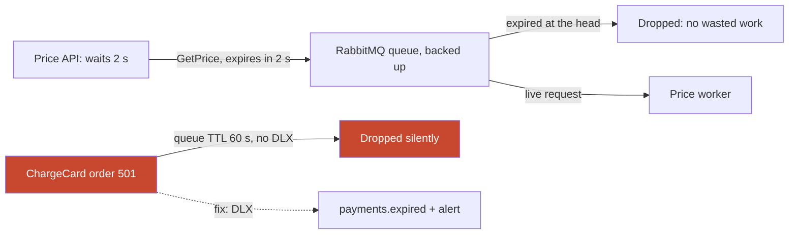

**Story.** The price API asks a price worker for a price and gives up after 2 seconds. During a traffic spike the request waits in a backed-up queue far longer than that. With a time to live of 2 seconds, the broker drops it before a worker wastes time on an answer nobody will read.

**How it works.**

1. The producer sets an expiry on the message (`expiration` in RabbitMQ), or the queue sets one for all messages (`x-message-ttl`).
2. The message waits in the queue as usual.
3. When it is past its time to live, the broker removes it instead of delivering it.
4. If the queue has a dead-letter exchange, the expired message goes there with the reason `expired`.
5. RabbitMQ removes expired messages only when they reach the head of the queue, so they use memory until then.


### In code

```text
producer: publish(msg, expiration = caller's timeout)   # GetPrice: 2,000 ms
broker, when a worker asks for the next message:
  loop:
    m = head of the queue; remove it
    if m has an expiry and now >= m.expiry:
      if the queue has a dead-letter exchange:
        send m there with reason "expired"
      continue                       # the worker never sees m
    return m
```

```go
// Next returns the next live message.
// Expired heads are removed first.
func (q *Queue) Next(now int) (Msg, bool) {
	for len(q.msgs) > 0 {
		m := q.msgs[0]
		q.msgs = q.msgs[1:]
		if m.Expires != 0 && now >= m.Expires {
			q.dropped++
			if q.dlx != nil {
				*q.dlx = append(*q.dlx, m)
			}
			continue // the worker never sees it
		}
		return m, true
	}
	return Msg{}, false
}

// producer: the expiry is the caller's timeout
q.msgs = append(q.msgs, Msg{"GetPrice q-41", sentAt + 2000})
```

Run it: `handbook/code/04-message-ttl/` with `go run .` It prints q-41 dropped while q-99 reaches the worker, then 5 orders dropped silently, 5 kept in payments.expired with a dead-letter exchange, and order 501 delivered with no time to live.

**What goes wrong.** A time to live on business commands. Someone sets a 60-second time to live on the payments queue to keep it small. The payment workers are down for five minutes during a deploy. Every order in those five minutes expires, and with no dead-letter exchange they simply vanish. The fix: commands that move money get no expiry, or a dead-letter exchange plus an alert on its depth.

**Where you use it.**

- RabbitMQ: per-message and per-queue time to live. Combined with a dead-letter exchange it also builds delayed retries.
- Amazon SQS: a retention period up to 14 days. Kafka: retention is the only expiry, and a consumer can skip records older than its own limit by timestamp.
- Good candidates: replies to requests, price quotes, login codes. Anything useless after a deadline.

> "A time to live drops a message nobody wants any more, so workers stop doing useless work. For business commands, expiry goes to a dead-letter queue with an alert, never to nowhere."

▶ Watch it move: [Message time to live](visual/04-message-ttl.html)

## Outbox and Change Data Capture

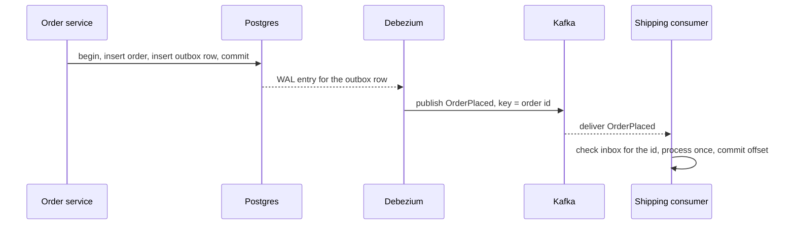

**Story.** The order service must save the order and tell shipping. Saving and then publishing from code can half-fail. Instead it inserts the order and an outbox row in one transaction. Debezium reads the database log and publishes the outbox row to Kafka. No application code does the publishing.

**How it works.**

1. The order row and the outbox row commit together.
2. The database writes the change to its log: the WAL (Write-Ahead Log) in Postgres, the binlog in MySQL.
3. Debezium, a CDC (Change Data Capture) connector, reads that log.
4. It publishes each outbox row, keyed by the order id, so order per order holds.
5. The consumer keeps an inbox of processed ids, written in the same transaction as its effect.


### In code

```text
order service:
  begin transaction
    insert order 502
    insert outbox row (OrderPlaced, key = 502)
  commit                                # both, or neither
relay (Debezium), loop:
  change = next entry in the WAL after my saved position
  if change is an outbox row:
    publish it to Kafka, key = order id
  save my position                      # a crash before this = published again
consumer:
  if the event id is in my inbox: skip  # drops the repeat
```

```go
// Commit applies all changes or none, and logs them in commit order.
func (d *DB) Commit(changes ...Change) {
	for _, c := range changes {
		if c.Table == "orders" {
			d.orders[c.Key] = true
		}
		d.wal = append(d.wal, c)
	}
}

// Poll plays Debezium: read the WAL from the saved position.
func (r *Relay) Poll(d *DB, kafka *[]string, crashBeforeSave bool) {
	for r.pos < len(d.wal) {
		c := d.wal[r.pos]
		if c.Table == "outbox" {
			*kafka = append(*kafka, "OrderPlaced "+c.Key)
		}
		if crashBeforeSave {
			return // published, position not saved
		}
		r.pos++
	}
}
```

Run it: `handbook/code/04-outbox-cdc/` with `go run .` It prints the dual write losing order 501's event, the outbox delivering 502 after the app crashed, and a relay crash publishing 503 twice with the inbox handling it once.

**What goes wrong.** The dual write: commit, then publish. A crash between them loses the event, and state and events disagree for ever. With CDC, a schema change in the source breaks consumers, and the first snapshot of a large table takes hours while the log must be kept.

**Where you use it.**

- Debezium's outbox event router on Kafka Connect.
- At low volume, a poller with `SELECT ... FOR UPDATE SKIP LOCKED` is enough.
- An indexer writes a block's rows and a "block done" marker in one load. The sync reads markers, not a broker. The marker is the outbox, and the warehouse is the log.

> "I never write to a database and a broker from code. I write one transaction with an outbox row and let CDC publish it."

▶ Watch it move: [Outbox and idempotency](visual/03-outbox-and-idempotency.html)

## Write-ahead log and log-based CDC

```mermaid
sequenceDiagram
  participant App as Order service
  participant PG as Postgres
  participant Dz as Debezium
  participant K as Kafka
  App->>PG: insert order and outbox row, commit
  PG->>PG: write WAL record 0/A1 before the table pages
  PG->>Dz: replication slot streams the change
  Dz->>K: OrderPlaced, key order 501
  Dz->>PG: confirmed up to 0/A1, old WAL may be recycled
```

**Story.** The order service commits an order and an outbox row. Postgres writes the change to its write-ahead log (WAL) before it touches the table. Debezium is connected through a replication slot and reads that log like a picky replica. It publishes OrderPlaced to Kafka. One Friday the connector stops, the slot keeps every WAL file since, and by Sunday the database disk is full.

**How it works.**

1. Every database change is written to the WAL first. After a crash the database replays the WAL to rebuild its tables.
2. A logical replication slot decodes the WAL into row changes and streams them, in commit order.
3. Debezium, a CDC (Change Data Capture) connector on Kafka Connect, publishes each change to Kafka.
4. It saves the WAL position it has published and confirms it to the slot.
5. After a restart it resumes from the saved position. A few changes may be sent twice, so CDC is at-least-once.


### In code

```text
database commit:
  append the change to the WAL on disk   # log first
  then update the table pages
Debezium loop:
  e = next WAL entry after my saved position
  publish e to Kafka, key = order id
  save my position                       # crash before this = sent again
  confirm the position to the slot
restart: read the saved position, ask the slot for what follows
```

```go
// Write logs the change first, then updates the table.
func (d *DB) Write(op, order, status string) {
	d.wal = append(d.wal, Entry{len(d.wal) + 1, op, order, status})
	if op == "delete" {
		delete(d.rows, order)
	} else {
		d.rows[order] = status
	}
}

func (z *Debezium) Stream(d *DB, crashBeforeSave bool) []string {
	var out []string
	pos := z.saved // restart: from the saved position
	for pos < len(d.wal) {
		e := d.wal[pos]
		out = append(out, fmt.Sprintf("%s %s %s", e.Op, e.Order, e.Status)) // publish
		pos++
		if crashBeforeSave {
			return out // published, not saved
		}
		z.saved = pos // save and confirm
	}
	return out
}
```

```text
poller, every 5 s:
  rows = SELECT * FROM orders WHERE updated_at > lastPoll
  publish each row                 # only its state right now
  lastPoll = now
between two polls:
  two updates: only the last state is seen
  a delete: the row is gone, so nothing is seen
log reader: every change, in commit order, no query on the table
```

```go
// the poller only ever sees the current row
fmt.Println("next poll sees 501:", d.rows["501"]) // cancelled: placed and paid are gone
_, ok := d.rows["502"]     // false: the delete is invisible

// inside one 5-second gap
d.Write("update", "501", "paid")
d.Write("update", "501", "cancelled")
d.Write("delete", "502", "")

// the log has them all
z = &Debezium{saved: start}
fmt.Println("the log sees all:", z.Stream(d, false)) // update paid, update cancelled, delete 502
```

```text
slot rule: keep every WAL file not yet confirmed
connector stopped: nothing is confirmed
  kept WAL grows with every commit
  disk full: WAL cannot be written, so commits stop
fix: alert on slot lag in bytes
     max_slot_wal_keep_size: past it, drop the slot
     the connector takes a fresh snapshot
```

```go
const diskGB, walPerHour = 100, 2 // this example's numbers
kept, hour := 0, 0
for kept < diskGB {
	hour++
	kept += walPerHour // nothing confirmed, nothing removed
}
// hour == 50: the disk is full, commits stop

const keepGB = 50 // max_slot_wal_keep_size
dropAfter := keepGB / walPerHour // 25 hours: the database survives
```

Run it: `handbook/code/04-wal-and-debezium/` with `go run .` It prints one update published twice after a crash before the save, a poller that sees only cancelled and misses the delete, the log seeing all three, and a 100 GB disk filling in 50 hours behind a stopped connector.

**What goes wrong.** A stopped connector. The slot promises to keep the WAL until it is read, so the WAL grows until the disk is full and the database stops taking writes. Alert on slot lag in bytes, and set `max_slot_wal_keep_size` so Postgres drops the slot instead. The connector then takes a fresh snapshot.

**Where you use it.**

- Debezium for Postgres (WAL), MySQL (binlog) and MongoDB (oplog), with the outbox event router.
- Polling instead of CDC misses updates between polls and every delete, and loads the table. It is fine at low volume.
- Database replicas, point-in-time recovery and CDC all read the same log.

> "The database already writes every change to its write-ahead log before it touches the table. Log-based CDC reads that log, so it sees every insert, update and delete in commit order without querying the table."

▶ Watch it move: [Write-ahead log and log-based CDC](visual/04-wal-and-debezium.html)

## Kafka Connect

```mermaid
flowchart LR
  PG["Postgres orders"] -->|"write-ahead log"| SRC["Debezium source connector"]
  SRC --> K["Kafka orders.events"]
  K --> SNK["S3 sink connector"]
  SNK --> S3["S3 Parquet files"]
  SNK -.->|"bad record"| DLT["orders.dlq"]
  subgraph cl["Connect cluster: 3 workers"]
    SRC
    SNK
  end
  cl -.-> OFF["connect-offsets topic"]
```

**Story.** Orders must flow from Postgres into Kafka, and from Kafka into Parquet files in S3 for the warehouse. Nobody wants to write, run and restart that code. The team posts two short JSON configurations to a Kafka Connect cluster: a Debezium source and an S3 sink. Data moves within minutes.

**How it works.**

1. A Connect cluster is a group of worker processes. You talk to it through a REST API.
2. A source connector brings data into Kafka. Debezium reads the database write-ahead log and publishes each change.
3. A sink connector takes data out of Kafka into a system: S3, a database, a search index.
4. Each connector is split into tasks. Tasks are spread over the workers, and move to another worker when one dies.
5. Positions are stored in Kafka (the `connect-offsets` topic and consumer offsets), so a restart resumes where it stopped.
6. Single message transforms make small changes on the way: drop a column, rename a field.


### In code

```text
POST the connector's JSON configuration to the REST API
start N tasks from tasks.max, spread over the workers
source task loop:
  read changes from the system          # Debezium: the WAL
  transform each one                    # small, stateless
  write it to Kafka
sink task put(record):
  write it to the system                # S3 files
  store the position in Kafka           # a restart resumes here
on a worker dying: rebalance, tasks resume from stored positions
```

```go
// the same JSON a team would POST to the REST API
const sinkConfig = `{"name":"orders-s3","tasks.max":"3","errors.tolerance":"none"}`

func start(cfg string, workers int) *Connector {
	var c map[string]string
	if err := json.Unmarshal([]byte(cfg), &c); err != nil {
		panic(err)
	}
	n, _ := strconv.Atoi(c["tasks.max"])
	k := &Connector{Name: c["name"], Tolerance: c["errors.tolerance"], offsets: map[int]int{}}
	for i := 0; i < n; i++ {
		k.Tasks = append(k.Tasks, &Task{i + 1, i%workers + 1, "RUNNING"})
	}
	return k
}

// a single message transform: small and stateless
func transform(row map[string]string) map[string]string {
	delete(row, "internal_note")
	return row
}

// tasks on a dead worker move, offsets stay in Kafka
func (k *Connector) rebalance(dead int, alive []int) {
	next := 0
	for _, t := range k.Tasks {
		if t.Worker == dead {
			t.Worker = alive[next%len(alive)]
			next++
		}
	}
}
// source task loop: WAL change -> transform -> Kafka
for _, row := range walChanges {
	topic = append(topic, transform(row))
}

// sink task put: write the record, then store the position
k.S3 = append(k.S3, rec)
k.offsets[partition]++
```

```text
sink task put(record):
  if the task is not RUNNING: do nothing      # nothing restarts it
  if the record cannot be converted:
    if errors.tolerance is not all:
      task state = FAILED; stop               # the pods stay healthy
    send it to the dead-letter topic; go on
  else: write it to S3
  store the position
monitor: alert on any task that is not RUNNING
on a worker dying: rebalance, tasks resume from stored positions
```

```go
func (k *Connector) put(t *Task, partition int, rec string) {
	if t.State != "RUNNING" {
		return // a failed task does nothing
	}
	if rec == "BAD" {
		if k.Tolerance != "all" {
			t.State = "FAILED"
			return
		}
		k.DLQ = append(k.DLQ, rec) // park it, go on
	} else {
		k.S3 = append(k.S3, rec)
	}
	k.offsets[partition]++
}

// the alert: pods can be healthy while a task is not
for _, t := range k.Tasks {
	if t.State != "RUNNING" {
		alert(t)
	}
}

k.rebalance(2, []int{1, 3}) // worker 2 died
```

Run it: `handbook/code/04-kafka-connect/` with `go run .` It prints 3 tasks started from JSON, task 1 resuming at offset 3 after worker 2 dies, task 1 FAILED with 0 more written after a bad record, and with errors.tolerance all: RUNNING, 2 in S3, 1 in the dead-letter topic.

**What goes wrong.** A silent stop. A record the S3 sink cannot convert arrives. The task goes to state `FAILED`. The worker pods stay healthy, so nothing restarts, and the warehouse misses orders for days. The fix: set `errors.tolerance` to `all` with a dead-letter topic for the sink, and alert on any task that is not `RUNNING`.

**Where you use it.**

- Change Data Capture: Debezium connectors for Postgres, MySQL and MongoDB.
- Sinks into S3, JDBC databases, Elasticsearch or a warehouse such as StarRocks.
- Managed Connect in Confluent Cloud or Amazon MSK Connect. Use it for movement only: business logic belongs in a real service.

> "Kafka Connect runs source and sink connectors from configuration, stores their positions in Kafka, and spreads their tasks over workers. I use it for movement, not logic, and I alert on failed tasks."

▶ Watch it move: [Kafka Connect](visual/04-kafka-connect.html)

## The inbox

```mermaid
sequenceDiagram
  participant K as Kafka
  participant S as Shipping service
  participant DB as Postgres
  K->>S: OrderPlaced evt-501
  S->>DB: begin, insert inbox evt-501, insert shipment, commit
  Note over S: crash before the offset commit
  K->>S: OrderPlaced evt-501 again
  S->>DB: insert inbox evt-501
  DB->>S: conflict, already processed
  S->>K: skip, commit offset
```

**Story.** The shipping service receives OrderPlaced events, and a broker may deliver one twice. It keeps an inbox table of event ids it has processed. The inbox row and the shipment are written in one transaction. When evt-501 arrives a second time, the inbox insert hits the primary key and the service skips it. One parcel, however many deliveries.

**How it works.**

1. Every message carries an id that the producer sets once and never changes.
2. The consumer's inbox table has that id as its primary key.
3. It inserts the inbox row and the business effect in one transaction.
4. A duplicate hits the key, rolls back, and is skipped.
5. Rows are deleted after the broker's retention plus a margin, because older ids can never be delivered again.


### In code

```text
consumer, on event e:
  begin transaction
    insert e.id into inbox              # unique key
    if the insert hits the key:
      roll back; commit the offset; stop   # a duplicate
    apply the effect: insert shipment
  commit                                # both, or neither
  commit the Kafka offset               # a crash before this = redelivery
```

```go
// inbox row and effect in one transaction
func (d *DB) handle(id string, day int) string {
	if _, seen := d.inbox[id]; seen {
		return "duplicate: rolled back, skipped" // unique key
	}
	d.inbox[id] = day
	d.shipments[id]++
	return "committed"
}

// SQL form of the same thing:
// BEGIN;
// INSERT INTO inbox(event_id) VALUES ($1);  -- a unique key
// INSERT INTO shipments(...) VALUES (...);
// COMMIT;
```

```text
effect first, in two commits:
  commit: insert shipment
  # a crash here: no inbox row
  commit: insert inbox row
inbox first, in two commits:
  commit: insert inbox row
  # a crash here: marked done, no shipment
  commit: insert shipment
the fix: both writes in one transaction
  an external API: send e.id as its idempotency key
```

```go
// effect first
d.shipments["evt-601"]++ // committed
// crash here: the inbox row was never written
if _, seen := d.inbox["evt-601"]; !seen {
	d.shipments["evt-601"]++ // redelivered: shipped again
}

// inbox first
d.inbox["evt-602"] = 1 // committed
// crash here: the shipment was never written
_, seen := d.inbox["evt-602"] // true: skipped, shipped 0 times

// the fix: one transaction
fmt.Println("the fix, one transaction:", d.handle("evt-603", 30))
```

```text
every event adds a row to the inbox
the oldest possible duplicate = the topic's retention, 7 days
cleanup, every night:
  delete inbox rows older than retention + 1 day     # 8 days
if cleanup is shorter than a replay window:
  the inbox forgets; replayed events run again
with strict order per partition:
  store only the last offset, in the same transaction
  offset <= last means a duplicate
```

```go
// cleanup deletes inbox rows older than keepDays.
func (d *DB) cleanup(today, keepDays int) {
	for id, day := range d.inbox {
		if today-day > keepDays {
			delete(d.inbox, id)
		}
	}
}

d.cleanup(30, 8) // retention 7 days + 1 day margin
fmt.Println("replay from day 25 with 8 days kept:", d.handle("evt-day-25", 30))

d.cleanup(30, 1) // the trap
fmt.Println("replay from day 25 after cleanup at 1 day:", d.handle("evt-day-25", 30))

// an inbox of one row: strict order per partition
duplicate := off <= last[partition]
```

Run it: `handbook/code/04-inbox/` with `go run .` It prints evt-501 shipped once after a redelivery, evt-601 shipped twice and evt-602 shipped zero times when the writes are split, and evt-day-25 skipped with an 8-day cleanup but shipped twice with a 1-day cleanup.

**What goes wrong.** Two transactions instead of one. Effect first, inbox second: a crash between them ships twice. Inbox first, effect second: a crash between them marks the order done and never ships it. And deleting inbox rows sooner than any replay you might run.

**Where you use it.**

- Any at-least-once consumer whose effect is a database write. MassTransit, NServiceBus and Axon have it built in.
- An effect outside your database, such as a courier API: send the event id as its idempotency key.
- Strictly in-order processing: store the last offset per partition with the effect, an inbox of one row.

> "The inbox is the outbox's mirror on the consumer side: I store the message id in the same transaction as the effect, so a redelivery finds it and does nothing."

▶ Watch it move: [The inbox](visual/04-inbox.html)

## Events, commands and documents

```mermaid
flowchart LR
  OP["Operator"] -- "command: RebuildLayer" --> SYNC["Graph sync (one known reader)"]
  IX["Indexer"] -- "event: BlockIndexed" --> MANY["Any reader, unknown to the indexer"]
  EXP["Nightly export"] -- "document: rows of a table" --> WH["Warehouse"]
  BIG["Block receipts, megabytes"] --> BLOB["Object storage"]
  BLOB -. "claim check: path to the blob" .-> MSG["Small message"]
```

**Story.** An operator asks the graph sync to rebuild one layer. That is a command: one reader, an order to act. The indexer announces that block 9,506 is indexed. That is an event: a fact in the past, for anyone. A nightly export ships table rows. That is a document. The block's receipts are too large for a message, so they go to object storage and the message carries only the path.

**How it works.**

1. A command is imperative and has one known receiver: `DecodeSwap`.
2. An event is in the past tense and has unknown readers: `SwapDecoded`.
3. A document carries data with no intent: a row, a file.
4. Event notification says "address X changed" and the reader calls back for details.
5. Event-carried state transfer puts the full new state in the event, so the reader needs no call.
6. A claim check stores a big payload elsewhere and sends a pointer.


### In code

```text
command:  an order, imperative, to one known reader       # RebuildLayer
event:    a fact, past tense, any reader                  # BlockIndexed 9,506
document: data, no intent                                 # table rows
reader of a delta named like an order:
  balance = balance + delta        # a redelivery adds it twice
reader of a past-tense fact with the new value:
  balance = event.newBalance       # a redelivery changes nothing
```

```go
type Command struct{ Name, To string }      // an order, to one reader
type Event struct {                         // a fact, past tense
	Name  string
	Block int
}
type Document struct{ Rows []string }       // data, no intent

// a delta named like an order
func addDelta(balance, delta int) int { return balance + delta }

cache = addDelta(cache, 50)
cache = addDelta(cache, 50) // the broker redelivers: 200

// a fact that carries the new value
cache = newBalance
cache = newBalance // the same redelivery: still 150
```

```text
thin event: address X changed
  reader calls the source API for the state    # needs the API up
  if the API is down: the row cannot be built
full event: X, balance 5, nonce 12
  reader writes it straight away               # works alone
half event: balance only
  reader still needs the nonce, so it calls back
```

```go
type State struct{ Balance, Nonce int }

// onNotify must call back to build the row.
func onNotify(addr string) (State, error) { return api(addr) }

// onCarried writes what the event already holds.
func onCarried(s State) State { return s }

func api(addr string) (State, error) {
	if !apiUp {
		return State{}, errors.New("indexer API: connection refused")
	}
	return State{5, 12}, nil
}
```

```text
producer:
  if the blob is too big for the broker:
    put(blob) in object storage at a path
    send a small message holding only the path   # the claim check
each reader:
  blob = get(path)
  if not found: fail                             # deleted too early
cleanup rule:
  keep the blob longer than the message lives
```

```go
store := map[string][]byte{"receipts/9506.bin": blob}
msg := "receipts/9506.bin" // the claim check: a path, not the blob

// reader A
data := store[msg]

// too early: reader B is hours behind
delete(store, msg)
if _, ok := store[msg]; !ok {
	fmt.Println("reader B follows the path: not found")
}

// the rule: the blob outlives the message
keep := blobDays > retentionDays // 8 > 7
```

Run it: `handbook/code/04-events-commands-documents/` with `go run .` It prints the cache at 200 against a ledger at 150 with a delta and both at 150 with the new value, the notification failing while the API is down, carried state written anyway, and a 17-byte claim check for a 5 MB blob.

**What goes wrong.** An event named like a command, `UpdateBalance`, that readers treat as an order. Or state transfer with half the state, so readers call back anyway and you get the worst of both. For the claim check: deleting the blob before every reader fetched it.

**Where you use it.**

- State transfer when readers must keep working while the source is down. A graph that is a projection of a warehouse reads full rows and never calls the indexer.
- Notification for rare, heavy objects.
- Correlation ids in every message header, propagated and never regenerated, so a trace follows the flow.

> "An event is a fact for anyone, a command is an order for one, a document is just data. I name events in the past tense."

▶ Watch it move: [Events, commands and documents](visual/04-events-commands-documents.html)

## Claim check

```mermaid
flowchart LR
  IX["Indexer: receipts of block 9,506, megabytes"] -- "1. upload" --> OS["Object storage: receipts/9506.bin"]
  IX -- "2. publish path and size" --> T["receipts topic"]
  T --> G["Graph sync"]
  T --> P["Price service"]
  G -- "3. fetch" --> OS
  P -- "3. fetch" --> OS
```

**Story.** The indexer must tell three readers about the receipts of block 9,506. The receipts are megabytes, far over a broker's comfortable size. The indexer uploads them to object storage, waits for success, and publishes a small message with the path. Each reader fetches the receipts straight from storage.

**How it works.**

1. Upload the payload to object storage under a stable name, such as the block number.
2. Only after the upload succeeds, publish a message with the path, the size and the small fields readers filter on.
3. A reader that needs the bulk fetches it by path. A reader that needs only the small fields never fetches.
4. A storage lifecycle rule deletes the blob after longer than the topic keeps messages.


### In code

```text
indexer:
  upload(blob) to storage at receipts/9506.bin
  wait for the upload to return success
  publish ticket {path, size, gas}       # small: no blob inside
each reader:
  if the ticket holds all it needs: stop # the alert rule
  blob = get(ticket.path)
```

```go
type Ticket struct {
	Path     string
	Size     int
	Gas      int // a reader that needs only this never fetches the blob
	LinkEnds int // minute a presigned link expires, 0 = no link
}

// upload first, and only then publish
s.Put(path, size)
t := Ticket{Path: path, Size: size, Gas: 21000}

// each reader
n, err := s.Get(t, 0) // the graph sync
fmt.Printf("alert rule read gas %d from the ticket, fetched nothing\n", t.Gas)
```

```text
wrong: start the upload and publish together
  a reader can get the ticket before the blob exists
reader: blob = get(path)
  if not found: the block looks missing
right: await upload; then publish
retry after a timeout: upload again
  name = block number, not a random id   # overwrites the same file
```

```go
// wrong: the ticket is read before the upload finished
_, err = s.Get(t, 0) // the ticket arrived first
fmt.Printf("fast reader, upload not finished: %v\n", err)

// right: publish only after Put returned
s.Put(path, size)
n, err = s.Get(t, 0)

// a retry after a timeout: same name, same file
s.Put(path, size) // a retry after a timeout: same name
```

```text
ticket with a presigned link, valid 15 minutes:
  reader: if now > link end: access denied
  a message can wait 7 days, the link cannot
fix: send the path
  each reader fetches with its own credentials
lifecycle rule:
  delete blobs after 8 days              # topic keeps messages 7 days
```

```go
func (s *Store) Get(t Ticket, now int) (int, error) {
	if t.LinkEnds != 0 && now > t.LinkEnds {
		return 0, ErrExpired // 403 access denied
	}
	size, ok := s.blobs[t.Path]
	if !ok {
		return 0, ErrNotFound
	}
	return size, nil
}

link.LinkEnds = 15 // valid for 15 minutes
_, err = s.Get(link, 60) // 60 > 15: denied
n, err = s.Get(t, 60) // no link: own credentials, works

safe := blobDays > topicDays // 8 > 7
```

Run it: `handbook/code/04-claim-check/` with `go run .` It prints a 5 MB blob left in storage behind a small ticket, a 404 when the ticket beats the upload, 2 uploads and 1 file after a retry, and an expired 15-minute link at minute 60.

**What goes wrong.** Publishing before the upload finishes: a fast reader gets 404 not found. A presigned link as the ticket: it expires in 15 minutes while the message waits days for a slow reader. A blob deleted before every reader fetched it.

**Where you use it.**

- Kafka, whose default message limit is about 1 MB, and SQS, whose limit is 256 KB. The SQS extended client stores bodies in S3 this way.
- Block receipts, images, exports and model files.
- A retry uploads to the same name, so it overwrites instead of duplicating.

> "A claim check stores the big payload in object storage and sends a pointer. I upload before I publish, and keep the blob longer than the message."

▶ Watch it move: [Claim check](visual/04-claim-check.html)

## Correlation id

```mermaid
flowchart LR
  GW["API gateway: creates c-77"] --> TU["Top-up service: logs c-77"]
  TU -- "TopUpPaid m-1, c-77" --> UN["Units service: logs c-77"]
  UN -- "UnitsGranted m-2, c-77, caused by m-1" --> RC["Receipt service: logs c-77"]
  LOG["Support searches c-77"] -.-> GW
  LOG -.-> RC
```

**Story.** A customer tops up their subscription. The gateway creates correlation id c-77 and every service copies it into its logs and into every message it sends. Later the customer asks support where the credit is. Support searches for c-77 and sees all four services, in order. When one service once made up its own id, the trail stopped at that service.

**How it works.**

1. The edge (a gateway or the first service) creates the correlation id if the request has none.
2. Every service reads it from the incoming header and writes it on every log line.
3. Every message it sends carries the same correlation id in a header.
4. Each message also gets its own new message id, used for deduplication.
5. A causation id names the message that caused this one, which turns the trail into a tree.


### In code

```text
at the edge, on a request:
  if it has no correlation id: create one     # c-77, once
in every service, on a message or request:
  cid = incoming header correlation_id        # read, never create
  log every line with cid
  when publishing:
    new message id for the message
    header correlation_id = cid               # copied unchanged
support: search the logs for cid
wrong: a service makes its own id      # the trail breaks here
```

```go
// edge sets the id once, only if the request has none.
func edge(h map[string]string) string {
	if c := h["correlation_id"]; c != "" {
		return c
	}
	nextID++
	return fmt.Sprintf("c-%d", nextID)
}

// carry is the shared middleware: copy the id to the next message.
func carry(in Msg, name string) Msg {
	return Msg{name, map[string]string{
		"correlation_id": in.Headers["correlation_id"],
	}}
}

func log(service, cid, text string) {
	logs = append(logs, fmt.Sprintf("%s [%s] %s", service, cid, text))
}

// support searches one id
n := search("c-77")
// wrong: a hand-written service makes its own id
units.Headers["correlation_id"] = "u-9" // written by hand, a new id
```

Run it: `handbook/code/04-correlation-id/` with `go run .` It prints all four log lines with c-77, then the same flow with a hand-written units service, where a search for c-77 finds 2 of 4 lines.

**What goes wrong.** Regenerating it. A service that makes a new correlation id per message cuts the thread, and every service after it is on a different trail. A library that does not copy headers drops it silently.

**Where you use it.**

- Shared middleware that copies the header in and out, so no service has to remember.
- OpenTelemetry and the W3C `traceparent` header do the same for trace ids across HTTP and Kafka headers.
- A business id, such as the top-up id, as the correlation id when support thinks in those terms.

> "A correlation id is set once at the edge and copied into every message and log line the request causes, never regenerated, so one search shows the whole flow."

▶ Watch it move: [Correlation id](visual/04-correlation-id.html)

## Message id and causation id

```mermaid
flowchart LR
  M0["POST /topup m-0"] --> M1["TopUpPaid m-1, caused by m-0"]
  M1 --> M2["UnitsGranted m-2, caused by m-1"]
  M1 --> M3["LedgerPosted m-3, caused by m-1"]
  M2 --> M4["ReceiptSent m-4, caused by m-2"]
  M3 -.->|"m-5 caused by m-3: a cycle"| M1
  linkStyle 4 stroke:#c8472f
```

**Story.** A customer tops up their wallet. Five messages flow through four services. All carry correlation id c-77. Each also has its own message id, and a causation id naming the message that caused it. When support sees a second TopUpPaid, its causation id says LedgerPosted caused it: an event cycle.

**How it works.**

1. The message id is unique per message. It is set once, when the event is created.
2. The correlation id is copied unchanged onto every message of one request.
3. The causation id is set to the message id of the message being handled.
4. A consumer's inbox stores message ids and drops any it has already seen.
5. Following causation ids turns the flat list for c-77 into a tree of who caused what.


### In code

```text
when handling message p, publish child c:
  c.id          = new id for this event    # set once
  c.correlation = p.correlation            # copied unchanged
  c.causation   = p.id                     # the parent
first check of every handler:
  if m.id is in my inbox: skip             # message id
to explain a request:
  all messages with correlation = c-77     # correlation id
  walk causation up to the root            # causation id
the root request: new id, new correlation, no causation
```

```go
type Msg struct {
	ID, Name, Correlation, Causation string
}

// child makes a new message caused by the one being handled.
func child(parent Msg, id, name string) Msg {
	return Msg{id, name, parent.Correlation, parent.ID}
}

// chain walks causation ids from a message back to the root.
func chain(all map[string]Msg, id string) []string {
	var out []string
	for id != "" {
		m := all[id]
		out = append([]string{m.Name + " " + m.ID}, out...)
		id = m.Causation
	}
	return out
}
// the root: nothing caused it
root := Msg{"m-0", "POST /topup", "c-77", ""}
```

```text
inbox rule, per consumer:
  if m.id is in the inbox: skip the work
  else: add m.id; do the work
producer retry after a timeout:
  wrong: make a new id at send time        # looks like a new event
  right: id = business key + event type    # T-1043.UnitsGranted
         set once, reused on every retry
```

```go
type Inbox map[string]bool

// Seen is the first check of every handler.
func (in Inbox) Seen(id string) bool {
	if in[id] {
		return true
	}
	in[id] = true
	return false
}

// wrong: a retry with a fresh id
if !in.Seen("m-2b") { // a retry that made a fresh id
	receipts++
}

// right: the id comes from the event
key, sent := "T-1043.UnitsGranted", 0
for _, id := range []string{key, key} { // the id comes from the event
	if !in2.Seen(id) {
		sent++
	}
}
```

```text
flat list: every message with correlation c-77, by time
rebuild the tree: each message's parent = its causation id
cycle check, walking from m to the root:
  seen = empty
  while m has a parent:
    if m's event type is in seen: cycle found
    add it to seen; m = parent
tracing: trace id = correlation, parent span id = causation
```

```go
// hasCycle: does an event type repeat on the way to the root?
func hasCycle(all map[string]Msg, id string) (string, bool) {
	seen := map[string]bool{}
	for id != "" {
		m := all[id]
		if seen[m.Name] {
			return m.Name, true
		}
		seen[m.Name] = true
		id = m.Causation
	}
	return "", false
}

// the wallet service reacts to LedgerPosted
again := child(ledger, "m-5", "TopUpPaid")
all[again.ID] = again
fmt.Println("flat list for c-77:", byTime(all, "c-77"))
if name, bad := hasCycle(all, "m-5"); bad {
	fmt.Printf("cycle: %s appears twice on one causation chain\n", name)
}
```

Run it: `handbook/code/04-causation-id/` with `go run .` It prints each message's three ids, the chain POST /topup, TopUpPaid, UnitsGranted, ReceiptSent, 1 receipt after a redelivery, 2 after a retry with a new id, 1 with an id from the event, and TopUpPaid found twice on one causation chain.

**What goes wrong.** A message id made at send time. The units service times out publishing UnitsGranted and retries, and its code gives the retry a fresh id, m-2b. The receipt service's inbox has m-2 but not m-2b, so it sends a second receipt. The fix: derive the message id from the event itself, for example top-up T-1043 plus UnitsGranted, and reuse it on every retry.

**Where you use it.**

- CloudEvents: the `id` attribute is the message id, unique per source.
- NServiceBus and MassTransit set message, correlation and conversation ids for you.
- OpenTelemetry tracing: the trace id plays the correlation id, the parent span id plays the causation id. Carry both in message headers and the tracing tool draws the tree.

> "The message id identifies one message and lets consumers drop duplicates. The correlation id groups a whole request. The causation id points at the parent message, so the flow can be drawn as a tree."

▶ Watch it move: [Message id and causation id](visual/04-causation-id.html)

## Request-reply over messaging

```mermaid
sequenceDiagram
  participant API as Price API
  participant MQ as RabbitMQ
  participant W as Price worker
  API->>MQ: GetPrice WETH, reply_to api-1, correlation q-41
  MQ->>W: GetPrice WETH, correlation q-41
  W->>MQ: price, to api-1, correlation q-41
  MQ->>API: price, correlation q-41
  Note over API: match q-41 to the waiting call, timeout 2 s
```

**Story.** The price API needs a token price from a price worker, but they talk only through RabbitMQ. A message has no built-in reply. The API sends GetPrice with a reply-to queue and correlation id q-41. The worker answers to that queue with the same id. One day the worker is slow, the API times out, and the late answer arrives with no one waiting for it.

**How it works.**

1. The requester sends the request with `reply_to` (where to answer) and `correlation_id` (which question).
2. Any free worker takes it from the queue.
3. The worker publishes the answer to the `reply_to` address and copies the correlation id.
4. The requester matches the answer to the waiting call by correlation id. Answers may arrive in any order.
5. A timeout ends the wait. A late reply with no waiting call is logged and dropped.


### In code

```text
API send(request):
  request.reply_to = my reply queue
  request.correlation_id = new id, q-41
  waiting[q-41] = deadline               # now + 2 s
  publish to price.requests
worker:
  compute the answer
  publish to request.reply_to, same correlation_id
API on reply r:
  if r.correlation_id not in waiting: log, drop
  delete waiting[r.correlation_id]; answer that call
API timer:
  if now >= deadline: delete waiting[id]; answer "unavailable"
a retried command: one idempotency key, one charge
```

```go
// Send records a waiting call with its deadline.
func (a *API) Send(id string, now, timeout int) {
	a.waiting[id] = now + timeout
}

// OnReply matches a reply to its waiting call by correlation id.
func (a *API) OnReply(r Reply) string {
	if _, ok := a.waiting[r.CorrelationID]; !ok {
		a.late++ // nobody waits for this one
		return "no waiting call: logged and dropped"
	}
	delete(a.waiting, r.CorrelationID)
	return fmt.Sprintf("answered %s: %.0f", r.CorrelationID, r.Price)
}

// worker: answer to the queue the request names
reply := Reply{CorrelationID: req.CorrelationID, Price: compute(req.Token)}
publish(req.ReplyTo, reply)

// Tick expires waiting calls whose deadline has passed.
func (a *API) Tick(now int) []string {
	var gone []string
	for id, d := range a.waiting {
		if now >= d {
			delete(a.waiting, id)
			gone = append(gone, id)
		}
	}
	return gone
}

// a retried command: one idempotency key, one charge
if !once[key] {
	once[key] = true
	cards++
}
```

Run it: `handbook/code/04-request-reply/` with `go run .` It prints replies matched out of order by correlation id, q-50 timing out at 2,000 ms and its late reply dropped at 5,000 ms, 2 charges with a new id on retry and 1 with one idempotency key.

**What goes wrong.** A timeout followed by a retry of a command. The slow worker finishes the first request and another worker does the retry, so the card is charged twice. Give commands an idempotency key that survives the retry, and set the message expiry to the timeout so an unwanted request is dropped unread.

**Where you use it.**

- RabbitMQ RPC with `reply_to` or direct reply-to, NATS request-reply, JMS temporary queues.
- When the worker must stay behind a queue for load levelling. Otherwise plain HTTP or gRPC is simpler.
- Always with a timeout, an expiry and an idempotent handler.

> "Request-reply over a broker needs three things: a reply-to address, a correlation id to match the answer, and a timeout with a plan for the late reply."

▶ Watch it move: [Request-reply over messaging](visual/04-request-reply.html)

## Schema evolution and the registry

```mermaid
flowchart LR
  P1["Producer v2 adds field 'chain' with a default"] --> REG{"Schema registry: backward rule"}
  REG -- "compatible, schema id 42" --> T["Topic"]
  P2["Producer v3 changes 'amount' from number to text"] --> REG
  REG -- "rejected at publish" --> X["Build fails, no poison reaches readers"]
  T --> OLD["Old consumer still works"]
```

**Story.** The swap decoder reads events from a topic. One producer release adds a `chain` field with a default. The registry accepts it and old readers keep working. A later release changes `amount` from a number to text. The registry refuses the schema before a single bad message is sent.

**How it works.**

1. Each schema version is stored in a registry with an id.
2. The message carries the schema id, not the schema.
3. The registry enforces a compatibility rule on every new version.
4. Backward: a new reader reads old data. Needed to replay history.
5. Forward: an old reader reads new data. Needed when producers roll out first.
6. Full: both.


### In code

```text
producer, at build or start:
  ask the registry to store schema S
registry register(S):
  reader = S, writer = latest stored schema      # BACKWARD
  for each field f of the reader:
    if f is not in the writer and f has no default: refuse
    if f is in the writer with another type: refuse
  store S; return a new id
message on the wire: [schema id][values]         # never the schema
reader: fetch the writer schema by id, then decode
```

```go
// canRead: every reader field is in the writer
// with the same type, or has a default.
func canRead(reader, writer Schema) error {
	for _, f := range reader {
		w, ok := writer.find(f.Name)
		if !ok && f.Default == "" {
			return fmt.Errorf("field %s: missing, no default", f.Name)
		}
		if ok && w.Type != f.Type {
			return fmt.Errorf("field %s: %s changed to %s", f.Name, w.Type, f.Type)
		}
	}
	return nil
}

func (r *Registry) Register(s Schema) (int, error) {
	if r.latest != 0 {
		if err := canRead(s, r.schemas[r.latest]); err != nil {
			return 0, err
		}
	}
	id := r.next
	r.next++
	r.schemas[id] = s
	r.latest = id
	return id, nil
}
```

```text
producer: send plain JSON, no check        # the broker stores bytes
decoder:
  m = parse(bytes)
  amount = m["amount"]
  if amount is not found: fail             # poison on every retry
with a registry:
  the rename fails at the producer's build
```

```go
decode := func(b []byte) (float64, error) {
	var m map[string]any
	if err := json.Unmarshal(b, &m); err != nil {
		return 0, err
	}
	a, ok := m["amount"].(float64)
	if !ok {
		return 0, errors.New("amount: not found")
	}
	return a, nil
}

a, err := decode([]byte(`{"amount":12.5}`)) // 12.5
_, err = decode([]byte(`{"value":"12.5"}`)) // amount: not found

// the same rename against the registry
_, err = r.Register(renamed) // field value: missing, no default
```

Run it: `handbook/code/04-schema-registry/` with `go run .` It prints v1 as id 41, v2 as id 42, v3 refused because amount changed from double to string, then the renamed JSON failing in the decoder and the same rename refused by the registry.

**What goes wrong.** JSON with no schema "for flexibility". Six months later nobody knows which fields are optional, and a renamed field becomes a poison message. Safe moves: add optional fields with defaults. Never remove, retype or reuse a field number.

**Where you use it.**

- Confluent Schema Registry with Avro, which resolves fields by name with defaults.
- Buf with Protobuf, which resolves by field number and passes unknown fields through.
- A Protobuf contract between a local MCP (Model Context Protocol) proxy and its tool server: field numbers stable, deprecated by name, never reused.

> "A registry with a compatibility rule turns a breaking change into a failed build instead of a poison message."

▶ Watch it move: [Schema registry](visual/04-schema-registry.html)

## Avro versus Protobuf

```mermaid
flowchart LR
  subgraph avro["Avro: match by name"]
    AW["writer: pool, amount, chain"] --> AR["reader v1: pool, amount"]
    AW -. "rename amount to value without alias: error" .-> AX["reader: value"]
  end
  subgraph proto["Protobuf: match by number"]
    PW["writer: 1 pool, 2 amount, 3 chain"] --> PR["reader: 1, 2, and 3 kept as unknown"]
    PW -. "reuse 2 as fee: silent garbage" .-> PX["reader: 2 fee"]
  end
```

**Story.** The swap decoder writes a swap event with pool, amount and chain. Another team reads it with an older schema. In Avro the fields are lined up by name, and a rename without an alias fails. In Protobuf they are lined up by number. Someone deletes field 2 and later reuses 2 for a text field, and old messages decode into garbage with no error.

**How it works.**

1. Avro bytes hold only the values, in order. The reader needs the writer's schema, which the registry supplies by id.
2. Avro lines up writer and reader fields by name. Missing fields get the reader's default. Extra fields are skipped.
3. Protobuf bytes hold a tag number next to each value. A reader can parse them without the writer's schema.
4. Protobuf lines up fields by number. Unknown numbers are kept and passed through on re-serialize.
5. A missing Protobuf field reads as its zero value, unless the field is declared `optional`.


### In code

```text
bytes hold the values in writer order: no names, no numbers
reader gets the writer's schema (from the registry)
for each field f of the reader's schema:
  if f.name is in the writer: use that value
  else if an alias of f is in the writer: use that value
  else if f has a default: use the default
  else: fail
fields of the writer that the reader lacks: skipped
```

```go
func avroRead(writer []AField, values []string, reader []AField) (map[string]string, error) {
	byName := map[string]string{}
	for i, f := range writer { // the writer's schema names the bytes
		byName[f.Name] = values[i]
	}
	out := map[string]string{}
	for _, f := range reader {
		v, ok := byName[f.Name]
		for _, a := range f.Aliases {
			if w, found := byName[a]; found && !ok {
				v, ok = w, true
			}
		}
		if !ok {
			if f.Default == "" {
				return nil, fmt.Errorf("field %s: not in the writer, no default", f.Name)
			}
			v = f.Default
		}
		out[f.Name] = v
	}
	return out, nil
}
```

```text
bytes hold (tag number, value) pairs
for each pair in the bytes:
  find the reader's field with that tag
  if none: keep it as an unknown field     # written back unchanged
  if its kind differs: wrong data          # a reused number
  else: use the value; the name never matters
removing a field: write reserved 2 and reserved amount
  the compiler refuses any later reuse
```

```go
func protoRead(bytes []Tagged, reader []PField) (map[string]string, []Tagged, error) {
	out := map[string]string{}
	var unknown []Tagged
	for _, t := range bytes {
		known := false
		for _, f := range reader {
			if f.Tag == t.Tag {
				if f.Kind != t.Kind {
					return nil, nil, fmt.Errorf("tag %d: %s read as %s (%s)", t.Tag, t.Kind, f.Kind, f.Name)
				}
				out[f.Name] = t.Val
				known = true
			}
		}
		if !known {
			unknown = append(unknown, t) // kept, written back
		}
	}
	return out, unknown, nil
}

reserved := map[int]bool{2: true} // the compiler refuses reuse
```

Run it: `handbook/code/04-avro-vs-protobuf/` with `go run .` It prints an Avro reader matching by name, fee from its default, a rename failing and working with an alias, then a Protobuf reader keeping unknown tag 3, a free rename, and tag 2 failing when reused for a string.

**What goes wrong.** In Avro: renaming a field without an alias. In Protobuf: reusing a field number, the one change that corrupts data silently. Fix it by writing `reserved 2` and `reserved "amount"` whenever a field is removed.

**Where you use it.**

- Avro with Confluent Schema Registry on Kafka, and in data lakes, where a schema per file or per message id is normal.
- Protobuf with gRPC and Buf, whose breaking-change check refuses a reused number.
- A Protobuf contract between a local MCP proxy and its tool server: numbers stable, names free to change.

> "Avro resolves fields by name and needs the writer's schema, Protobuf resolves by number and passes unknown fields through. In Protobuf I never reuse a field number. In Avro I never rename without an alias."

▶ Watch it move: [Avro versus Protobuf](visual/04-avro-vs-protobuf.html)

## Backward and forward compatibility

```mermaid
flowchart LR
  subgraph back["Backward: new reader, old data"]
    B1["1. consumers to v2"] --> B2["2. producer to v2"]
    B3["replay from offset 0 works"]
  end
  subgraph fwd["Forward: old reader, new data"]
    F1["1. producer to v2"] --> F2["2. consumers to v2"]
    F3["replay of old data fails"]
  end
  subgraph full["Full: both"]
    U1["deploy in any order"]
  end
```

**Story.** The swap events topic has one producer and two consumers. The team removes the field fee, which had no default. The registry accepts it under the BACKWARD rule. They deploy the producer first. Consumer B, still on the old schema, reads a message with no fee and fails. Deployed consumers first, nothing would have broken.

**How it works.**

1. Backward compatible: a reader on the new schema can read data written with the old one. Upgrade consumers first.
2. Forward compatible: a reader on the old schema can read data written with the new one. Upgrade producers first.
3. Full compatible: both. Deploy in any order, and replay history.
4. Transitive rules check the new schema against every old version, not only the last one.
5. A change no rule allows, such as a type change, gets a new topic and a migration.


### In code

```text
canRead(reader, writer):
  for each field f of the reader:
    if f is in the writer with another type: fail
    if f is not in the writer and has no default: fail
  otherwise: ok
registry check, by the topic's mode:
  BACKWARD: canRead(new, old)      # consumers upgrade first
  FORWARD:  canRead(old, new)      # producer upgrades first
  FULL:     both                   # any order, any replay
no mode allows it: a new topic, write to both, move readers
```

```go
func canRead(reader, writer Schema) error {
	for _, f := range reader {
		found := false
		for _, w := range writer {
			if w.Name == f.Name {
				found = true
				if w.Type != f.Type {
					return fmt.Errorf("%s: %s read as %s", f.Name, w.Type, f.Type)
				}
			}
		}
		if !found && !f.HasDefault {
			return fmt.Errorf("%s: not in the data, no default", f.Name)
		}
	}
	return nil
}

func check(mode string, old, new Schema) error {
	switch mode {
	case "BACKWARD":
		return canRead(new, old)
	case "FORWARD":
		return canRead(old, new)
	}
	if err := canRead(new, old); err != nil { // FULL: both
		return err
	}
	return canRead(old, new)
}
```

Run it: `handbook/code/04-schema-compatibility/` with `go run .` It prints BACKWARD accepting the removal of fee and failing when the producer upgrades first, FORWARD accepting chain and failing on a replay, FULL accepting chain with a default and refusing amount as text.

**What goes wrong.** The right rule with the wrong rollout order. A backward-only change deployed producer-first breaks the old readers. A forward-only change works until a consumer replays old data. The fix is to know which side goes first, or to use FULL.

**Where you use it.**

- Confluent Schema Registry: BACKWARD is the default, FULL_TRANSITIVE is the safest for shared topics.
- Buf's breaking-change check for Protobuf, run in the build.
- A breaking change: write to both topics, move readers one by one, stop the old topic after the last reader.

> "Backward means new readers read old data, so consumers upgrade first and history can be replayed. Forward means old readers read new data, so producers go first. Full lets me deploy in any order."

▶ Watch it move: [Backward and forward compatibility](visual/04-schema-compatibility.html)

## Log broker versus queue broker

```mermaid
flowchart LR
  subgraph log["Log broker: Kafka"]
    LG["0 1 2 3 4 5 6 7 kept for 30 days"] --> RA["reader A at offset 7"]
    LG --> RB["new reader B starts at offset 0 and replays"]
  end
  subgraph qb["Queue broker: RabbitMQ"]
    QQ["message"] --> AK["consumer acks"]
    AK --> GONE["message deleted, no replay"]
  end
```

**Story.** A team adds a new graph layer and must build it from a year of events. On Kafka, the new consumer starts at offset 0 and replays. On RabbitMQ the messages were deleted on acknowledgement, so the producer would have to send everything again.

**How it works.**

1. A log broker appends messages to a durable, ordered log per partition.
2. Each reader keeps its own offset. Messages stay until the retention period ends.
3. A new reader can start from the beginning.
4. Log compaction keeps only the newest message per key. A null value, the tombstone, is a delete.
5. A queue broker delivers and deletes on acknowledgement. Routing is richer: topic, header and fanout exchanges.


### In code

```text
log broker:
  producer appends a record at the end
  records stay until retention deletes them
  each reader keeps its own offset
reader loop:
  record = read(offset)                # nothing is removed
  offset = offset + 1
new reader: starts at offset 0, replays history
```

```go
// Log: reading does not remove anything.
type Log struct{ recs []string }

func (l *Log) Read(off int) (string, bool) {
	if off >= len(l.recs) {
		return "", false
	}
	return l.recs[off], true
}

// reader B starts at 0, reader A stays at 8
a, b := 8, 0
for {
	if _, ok := l.Read(b); !ok {
		break
	}
	b++
}
```

```text
queue broker:
  producer puts a message on the queue
consumer loop:
  msg = next message
  process(msg)
  ack(msg)                             # the broker deletes it
new consumer: gets only what is still there
  history means the producer must send it again
```

```go
// Queue: an ack removes the message for everyone.
type Queue struct{ msgs []string }

func (q *Queue) Ack() { q.msgs = q.msgs[1:] }

for len(q.msgs) > 0 {
	process(q.msgs[0])
	q.Ack()
}
n := len(q.msgs) // consumer B connects now: 0
```

```text
compaction, in the background:
  for each key: find its newest record
  keep only those                     # older values are dropped
  a tombstone (null value) stays for the delete retention
new reader, from the start:
  table[key] = value
  on a tombstone: delete table[key]
```

```go
func compact(in []Rec) []Rec {
	last := map[string]int{}
	for i, r := range in {
		last[r.Key] = i
	}
	var out []Rec
	for i, r := range in {
		if last[r.Key] == i {
			out = append(out, r)
		}
	}
	return out
}

for _, r := range c {
	if r.Val == "" {
		delete(table, r.Key) // a tombstone
		continue
	}
	table[r.Key] = r.Val
}
```

Run it: `handbook/code/04-log-vs-queue-broker/` with `go run .` It prints reader B replaying 8 events with the log unchanged, a queue empty after 8 acks, and 6 records compacted to 4 with a table of A, C and D.

**What goes wrong.** Choosing Kafka for ten messages a second. Running it costs more than the problem. The reverse: a queue broker for an event stream that later needs replay. For compaction: a compacted topic has no history, and tombstones themselves expire.

**Where you use it.**

- Kafka, Pulsar, Redpanda: event streams, replay, many readers.
- RabbitMQ, SQS, NATS core: task queues, routing, request-reply.
- A compacted `token_metadata` topic keyed by contract address: a new consumer reads it once and holds the current name and decimals of every token.

| Aspect | Kafka | RabbitMQ | NATS JetStream | SQS / SNS | Pulsar |
|---|---|---|---|---|---|
| Model | partitioned log | queue with exchanges | subjects, optional log | managed queue and fan-out | log, segmented storage |
| Replay | yes, by offset | no (Streams: yes) | yes | no | yes |
| Ordering | per partition | per queue | per subject stream | FIFO queues only | per partition |
| Delayed messages | via retry topics | plugin, or TTL plus a dead-letter exchange | yes | yes, up to 15 min | yes |
| Operations | heavy | medium | light | none | heavy, more parts |
| Best at | streams, replay, many readers | task queues, routing | light edge, Go shops | zero-ops on AWS | multi-tenant, geo-replication |

> "A log keeps history and lets every reader keep its own place. A queue forgets on acknowledgement. I pick the log when replay matters."

▶ Watch it move: [Log versus queue broker](visual/04-log-vs-queue-broker.html)

## Retention and tiered storage

```mermaid
flowchart LR
  subgraph broker["Broker disk: fast, expensive"]
    H["today"]
  end
  subgraph remote["Object storage: slower, cheap"]
    C["day 1 .. day 90"]
  end
  P["Producer"] --> H
  H -- "segment closes, moved" --> C
  LIVE["Graph sync: reads today"] --> H
  NEW["New layer: replays 30 days"] --> C
```

**Story.** The `block-events` topic keeps messages for 7 days. A consumer down for 3 days catches up without trouble. A second consumer down for 9 days finds its offset deleted. A new graph layer needs 30 days of history. With tiered storage, the broker keeps 1 day on its disks and 90 days in object storage, and the new layer simply replays more slowly.

**How it works.**

1. Time retention (`retention.ms`) keeps at least N days.
2. Size retention (`retention.bytes`) keeps at most N bytes per partition.
3. With both set, whichever limit is reached first deletes the oldest segment.
4. Kafka deletes whole segment files, so a little more than the limit may stay.
5. Tiered storage moves closed segments to object storage. Consumers read them with the same API.


### In code

```text
retention check, per closed segment:
  if now - segment time >= retention.ms: delete it
  while the partition is over retention.bytes:
    delete the oldest segment
consumer on restart:
  if committed offset >= oldest kept offset: read forward
  else: auto.offset.reset decides
choose retention = longest outage + longest replay
alert when the oldest message is younger than promised
```

```go
func retain(segs []Segment, today, maxDays, maxGB int) []Segment {
	var kept []Segment
	for _, s := range segs {
		if maxDays > 0 && today-s.Day >= maxDays {
			continue // older than retention.ms
		}
		kept = append(kept, s)
	}
	total := 0
	for _, s := range kept {
		total += s.GB
	}
	for maxGB > 0 && total > maxGB {
		total -= kept[0].GB // oldest first
		kept = kept[1:]
	}
	return kept
}

// consumer on restart
if c.off >= oldestDay(kept) {
	readForward(c.name)
} else {
	autoOffsetReset(c.name)
}

alert := oldestDay(kept) > promisedDay
```

```text
tiered storage:
  closed segments are copied to object storage
  broker disk keeps the newest (local retention, 1 day)
  object storage keeps the rest (retention, 90 days)
read(offset):
  if the segment is on broker disk: serve it        # live readers
  else if it is in object storage: fetch and serve  # replays
  else: it is deleted
cap remote fetches, so replays do not starve live traffic
```

```go
const localDays, remoteDays = 1, 90

read := func(age int) string {
	switch {
	case age < localDays:
		return "broker disk"
	case age < remoteDays:
		return "object storage"
	}
	return "deleted"
}

for _, age := range []int{0, 30, 95} { // broker disk, object storage, deleted
	fmt.Printf("a record %d days old is served from: %s\n", age, read(age))
}
// five teams replaying 90 days at once: cap the remote fetches
remoteFetchLimit := 2 // at a time, so live readers keep the network
```

Run it: `handbook/code/04-retention-tiered-storage/` with `go run .` It prints days 2 to 8 kept after day 8 arrives, one consumer reading forward and one falling to auto.offset.reset, a launch shrinking 7 days to 3 under a 75 GB limit, and records of 0, 30 and 95 days served from disk, object storage and nowhere.

**What goes wrong.** Size retention under a traffic spike. Three times the normal traffic for two days, and the byte limit cuts 7 days of history to 3, exactly when an outage is most likely. Measure the oldest message per partition, not the setting.

**Where you use it.**

- Size retention to the longest outage you plan to survive plus the longest replay you might run.
- Kafka tiered storage (KIP-405), Confluent, Redpanda and Pulsar for long history on cheap storage.
- Rate-limit large replays, because remote fetches compete with live readers.

> "Retention decides how far back a consumer can replay. I size it to the longest outage plus the longest replay, and use tiered storage when history matters more than disk."

▶ Watch it move: [Retention and tiered storage](visual/04-retention-tiered-storage.html)

## Log compaction and tombstones

```mermaid
flowchart LR
  subgraph before["Before compaction"]
    L["A v1, B v1, A v2, C v1, B v2, A v3, B null"]
  end
  subgraph after["After compaction"]
    K["C v1, A v3, B null (tombstone)"]
  end
  subgraph later["After the delete retention"]
    Z["C v1, A v3"]
  end
  before --> after --> later
```

**Story.** The topic `token_metadata` is keyed by contract address and holds each token's name and decimals. Nobody needs old values, only the current one per token. Compaction keeps the newest message per key, so a new price service reads the topic once and holds the whole table. Token B is delisted with a null value, a tombstone. A consumer that was offline for three days misses the tombstone and keeps B for ever.

**How it works.**

1. A topic with `cleanup.policy=compact` keeps at least the newest message for each key.
2. A background cleaner rewrites old segments and drops older values. Offsets never change, so the log has gaps.
3. A new consumer reads from the start and gets the current table.
4. A null value is a tombstone: it deletes the key. The cleaner drops the older values and keeps the tombstone.
5. After `delete.retention.ms`, 24 hours by default, the tombstone is removed too.


### In code

```text
cleaner, in the background:
  for each key: last[key] = its newest offset
  for each record r in the old segments:
    if r.offset != last[r.key]: drop r
    if r is a tombstone older than 24 h: drop r
    else: keep r, with its offset         # gaps are normal
consumer fetch(offset):
  return the first record at or after offset
consumer build:
  on a value: table[key] = value
  on a tombstone: delete table[key]
time retention instead: delete by age, even a key's only value
```

```go
func compact(in []Rec, now int) []Rec {
	last := map[string]int{}
	for _, r := range in {
		last[r.Key] = r.Off
	}
	var out []Rec
	for _, r := range in {
		if last[r.Key] != r.Off {
			continue
		}
		if r.Val == "" && now-r.Hour >= deleteRetention {
			continue // the tombstone has expired
		}
		out = append(out, r)
	}
	return out
}

func fetch(in []Rec, off int) (Rec, bool) {
	for _, r := range in {
		if r.Off >= off {
			return r, true
		}
	}
	return Rec{}, false
}

func build(in []Rec, table map[string]string) map[string]string {
	for _, r := range in {
		if r.Val == "" {
			delete(table, r.Key)
			continue
		}
		table[r.Key] = r.Val
	}
	return table
}
// time retention instead of compaction: by age, not by key
if now-r.Hour > 7*24 {
	continue // token C's only value is deleted too
}
```

Run it: `handbook/code/04-log-compaction/` with `go run .` It prints 6 records compacted to 3, offset 1 answered with offset 3, the tombstone kept and then gone after 24 hours, an offline consumer still holding B, and a table restored with and without token C.

**What goes wrong.** Two things. There is no history: the old values of a key are gone. And a consumer away longer than the delete retention never sees the tombstone, so the deleted key lives on in its table. It must rebuild from the start.

**Where you use it.**

- Kafka's own `__consumer_offsets` topic, and Kafka Streams changelog topics that restore a local RocksDB table after a pod moves.
- Lookup topics keyed by entity: token metadata, user settings, a configuration.
- A second, time-retained topic beside it when anyone needs the history.

> "Compaction keeps the newest value per key, so a topic can rebuild a table. Deletes travel as tombstones, which also expire, and there is no history."

▶ Watch it move: [Log compaction and tombstones](visual/04-log-compaction.html)

## Back-pressure and flow control

```mermaid
flowchart LR
  subgraph push["Push, no limit"]
    B1["Broker pushes 5,000"] --> W1["Worker memory fills"]
    W1 --> OOM["out of memory, crash"]
  end
  subgraph pull["Pull or prefetch"]
    B2["Broker"] --> PF["prefetch 10 or pull a page"]
    PF --> W2["Worker takes the next page when done"]
    W2 --> LAG["Lag grows visibly instead"]
  end
```

**Story.** A slow, heavy job queue on RabbitMQ has no prefetch limit. One worker grabs every message into memory while the others idle, then crashes. A graph sync that pulls pages from a warehouse only after the previous page is committed never has that problem. When the graph slows, the read slows.

**How it works.**

1. The consumer, not the broker, must set the pace.
2. Kafka consumers pull, so pace is natural.
3. RabbitMQ needs a prefetch count: at most N unacknowledged messages per worker.
4. Reactive streams do the same inside one process: the subscriber requests N items.
5. In a log broker, lag is how back-pressure shows. Watch it and scale up to the partition count.


### In code

```text
broker, for each ready job:
  w = next worker with room
  if w's unacked count < its prefetch (0 = no limit):
    push the job to w; unacked + 1
worker:
  hold pushed jobs in memory
  process one; ack; unacked - 1
  memory over the limit: crash
broker, on a worker's crash:
  its unacked jobs go back to the queue
producers always faster than any consumers: shed load at the producer
queue grows when arrivals beat finishes; more workers shrink it
```

```go
// the broker gives what the prefetch allows
func push(jobs, prefetch int) (held int) {
	if prefetch == 0 || prefetch > jobs {
		return jobs // no limit: everything
	}
	return prefetch
}

held := push(5000, 0)         // 5,000
if held*jobMB > memoryMB {    // 10,000 MB > 8,000 MB
	// out of memory: 5,000 go back, then to worker 2
	held = push(5000, 0)
}

queue -= push(queue, 1) // prefetch 1: one each
unacked-- // the worker acks: the check passes again
queue += arrive - workers      // the queue absorbs the gap
```

```text
sync loop:
  page = read the next page from the warehouse
  write page to the graph
  wait for the commit
  only then read the next page       # at most one page in memory
commit slower: the loop runs less often
  lag = new pages - pages done        # it grows on the dashboard
  memory does not grow
```

```go
// room for one page: that is the back-pressure
inFlight := make(chan int, 1)

for s := 0; s < minutes*60; s += commitSec {
	inFlight <- done // ask for a page only when there is room
	<-inFlight       // write the page and wait for the commit
	done++
}
lag = minutes*newPages - done
```

Run it: `handbook/code/04-back-pressure/` with `go run .` It prints 10,000 MB held against an 8,000 MB limit with no prefetch, 4,997 left in the queue with prefetch 1, the queue growing at 3 workers and shrinking at 6, and a lag of 40 pages with no extra memory when commits slow down.

**What goes wrong.** Unlimited prefetch, or an unbounded in-memory queue "to be safe". Both hide the overload until the process dies. When producers are faster than any consumer can ever be, shed load at the producer: sample, aggregate or reject with a clear error.

**Where you use it.**

- Prefetch 1 for slow, heavy jobs. Prefetch around 100 for tiny messages.
- An alert on consumer lag, not just on errors.
- Pull-based page reads in a sync daemon.

> "The consumer sets the pace. In Kafka that is pull and visible lag, in RabbitMQ that is a prefetch limit."

▶ Watch it move: [Back-pressure and flow control](visual/04-back-pressure.html)

## Prefetch count

```mermaid
flowchart LR
  subgraph tiny["Tiny messages"]
    T1["prefetch 1: worker waits a round trip per message"]:::bad
    T2["prefetch 100: pipeline stays full"]
  end
  subgraph heavy["Heavy jobs"]
    H1["prefetch 100: worker 1 hoards, worker 3 idles"]:::bad
    H2["prefetch 1: one job each, fair"]
  end
  classDef bad fill:#c8472f,color:#fff
```

**Story.** A RabbitMQ metrics consumer handles each ping in a fraction of a millisecond. With prefetch 1 it spends most of its time waiting for the next message to cross the network. Raised to 100, it never waits. A resize queue does the opposite. With prefetch 100, worker 1 grabs 100 heavy jobs, works on one, and leaves worker 3 with nothing.

**How it works.**

1. Prefetch is the most unacknowledged messages one consumer may hold.
2. When the consumer acknowledges one, the broker sends the next.
3. A low prefetch spreads work fairly and limits what a crash returns to the queue.
4. A high prefetch hides the network round trip behind the work.
5. Either way it is a limit, so memory stays bounded.


### In code

```text
broker, for consumer c with prefetch p:
  while c's unacked count < p and the queue has messages:
    send the next message to c
consumer:
  process one; ack                    # one network round trip
throughput = min(p / (round trip + work), 1 / work)
held in memory <= p
```

```go
// throughput is messages a second for one consumer.
func throughput(prefetch int, rttMs, workMs float64) float64 {
	byNetwork := float64(prefetch) / ((rttMs + workMs) / 1000)
	byWork := 1000 / workMs
	if byNetwork < byWork {
		return byNetwork
	}
	return byWork
}

fmt.Printf("prefetch 1:   %.0f messages a second\n", throughput(1, rtt, work)) // 909: waits on the network
fmt.Printf("prefetch 100: %.0f messages a second, at most 100 held\n", throughput(100, rtt, work)) // 10,000: limited by the work
```

```text
broker, in connection order, for each worker w:
  n = min(prefetch, jobs left in the queue)
  give w n jobs; queue = queue - n
worker crashes:
  its unacked jobs go back to the queue, all at once
choose: heavy, uneven jobs -> prefetch 1
        tiny, even jobs    -> prefetch in the hundreds
prefetch 1: a crash returns only the one job it held
```

```go
func deal(jobs, prefetch, workers int) (held []int, queue int) {
	held = make([]int, workers)
	queue = jobs
	for w := 0; w < workers && queue > 0; w++ {
		n := prefetch
		if n > queue {
			n = queue
		}
		held[w] = n
		queue -= n
	}
	return
}

held, queue := deal(150, 100, 3) // [100 50 0], queue 0
done := 2 // worker 1 crashes on job 3
back := held[0] - done // crash on job 3: 98 go back

held, queue = deal(150, 1, 3) // [1 1 1], queue 147
back = held[0]    // a crash returns 1 job
```

Run it: `handbook/code/04-prefetch-count/` with `go run .` It prints 909 messages a second at prefetch 1 and 10,000 at prefetch 100, then workers holding 100, 50 and 0 with 98 jobs going back on a crash, against 1, 1 and 1 with 1 job going back.

**What goes wrong.** One value for every queue. Prefetch 1 on tiny messages starves the worker. Prefetch 100 on heavy jobs lets one worker hoard while others idle, and a crash returns 100 jobs at once. No prefetch at all lets one worker take the whole queue and run out of memory.

**Where you use it.**

- RabbitMQ `basic.qos`: start at 1 for slow, heavy jobs and around 100 for tiny ones, then measure.
- SQS receives 1 to 10 messages per call. Kafka's `max.poll.records` plays the same role for a pull consumer.
- Raise it while throughput rises and memory stays flat. Stop there.

> "Prefetch limits how many unacknowledged messages a worker holds. I use 1 for heavy jobs so work spreads fairly, and around 100 for tiny messages so the network round trip stays hidden."

▶ Watch it move: [Prefetch count](visual/04-prefetch-count.html)

## Choreography versus orchestration

```mermaid
flowchart LR
  subgraph chor["Choreography: the flow lives nowhere"]
    A1["Wallet: TopUpPaid"] --> B1["Units: UnitsGranted"]
    B1 --> C1["Receipt: ReceiptSent"]
    C1 -.-> D1["Ledger"]
    D1 -.-> A1
  end
  subgraph orch["Orchestration: one process manager"]
    O["Top-up orchestrator (state per top-up)"] --> A2["Wallet"]
    O --> B2["Units"]
    O --> C2["Receipt"]
  end
```

**Story.** A subscription top-up passes through five services by events. Support asks "where is my credit?" and nobody can answer without reading five logs. One orchestrator with a state per top-up and a correlation id answers it in one query.

**How it works.**

1. Choreography: each service reacts to an event and emits its own.
2. No central owner, so teams move independently.
3. The flow exists only as the sum of the services. Cycles can appear (the dotted loop).
4. Orchestration: one service holds the state of each case and sends commands.
5. Hybrid: the orchestrator sends commands and listens for events.


### In code

```text
on event E:
  for each service subscribed to E:
    if the service is down: nothing happens, nobody is told
    the service does its work
    it publishes its own event
nobody holds the state of the flow
to find a stuck case: read every service's log
an event that leads back to an earlier event: a cycle
```

```go
var subscribers = map[string][]string{
	"TopUpPaid":    {"Units"},
	"UnitsGranted": {"Receipt"},
}

func publish(event string, down map[string]bool, ran *[]string, hops *int, maxHops int) {
	for _, service := range subscribers[event] {
		if down[service] {
			return // crashed: the chain stops, silently
		}
		*ran = append(*ran, service)
		if next := publishes[service]; next != "" {
			publish(next, down, ran, hops, maxHops)
		}
	}
}

// the cycle: Wallet hears LedgerPosted, publishes TopUpPaid
subscribers["LedgerPosted"] = []string{"Notify", "Wallet"}
publishes["Wallet"] = "TopUpPaid"
```

```text
start case: record = {id, state: Started}
for each step:
  send the command to the service
  answer comes back as an event: move the state, save the record
  no answer: keep the state, retry later
support: look up the record by id, one query
a repeat is safe: the service keys its work by the id
save the record durably, or a crash loses every case
```

```go
type record struct{ id, state, since string }

r := record{id: "T-1043", state: "Started", since: "10:00"}
if call("Wallet", down) {
	r.state, r.since = "Paid", "10:02"
}
if !call("Units", down) {
	fmt.Printf("support looks up %s: %s, waiting on Units since %s\n", r.id, r.state, r.since)
}
down["Units"] = false // Units restarts
granted[r.id] = true  // idempotent: a repeat grants once
for _, step := range []string{"Receipt", "Ledger", "Notify"} {
	call(step, down)
	r.state = step + " done"
}
```

Run it: `handbook/code/04-choreography-vs-orchestration/` with `go run .` It prints the chain for T-1042, an empty chain for T-1043 with Units down, 3 grants from the cycle cut off at 12 events, then the record for T-1043 waiting on Units since 10:02, one grant from two sends, and the final state.

**What goes wrong.** Choreography for a flow that matters and spans more than three services. A new step needs changes in several services, a stuck case cannot be found, and an event cycle loops. Fix it with an orchestrator for those flows, and a diagram of producers and consumers for the rest.

**Where you use it.**

- Money, compliance, anything support must explain: orchestration. Temporal, Camunda or AWS Step Functions make the orchestrator durable.
- Loose notifications, many teams, high volume: choreography.
- The saga in [chapter 3](03-distributed-systems.md) is run by one of these two.

> "Choreography scales teams and hides the flow. For flows with money I add an orchestrator, so one place can say where every case is."

▶ Watch it move: [Choreography versus orchestration](visual/04-choreography-vs-orchestration.html)

## Process manager

```mermaid
stateDiagram-v2
  [*] --> Started
  Started --> Paid: TopUpPaid
  Paid --> UnitsGranted: UnitsGranted
  Paid --> Refunding: timer fired twice
  UnitsGranted --> ReceiptSent: ReceiptSent
  ReceiptSent --> Done
  Refunding --> Cancelled: PaymentRefunded
  Done --> [*]
  Cancelled --> [*]
```

**Story.** A top-up passes through wallet, units and receipt services. One process manager keeps a record for each top-up, keyed by its id. T-1043 moves from Started to Paid to Done, one event at a time. T-1044 is paid, but the units service never answers. The timer fires twice, and the manager sends a refund and closes the case as cancelled.

**How it works.**

1. Each case gets one record, keyed by its correlation id, with a current state.
2. An event arrives naming its case. The manager loads that record.
3. A table decides: in this state, on this event, move there and send that command.
4. Every waiting state has a timer. On timeout: retry, or compensate.
5. The record is saved before the next command goes out, so a restart resumes where it stopped.


### In code

```text
on start(id):
  save record {id, state: Started}
  send ConfirmPayment
on event(id, name):
  if id is missing: park it; a person looks
  record = load the record for id
  move = table[record.state, name]
  if no move: ignore it                   # a duplicate
  record.state = move.state; save it, with the time
  send move.command
on timer(id):
  first time: send the command again, same key; start the timer again
  second time: state = Refunding; send RefundPayment
```

```go
func (m *manager) start(id string) {
	m.cases[id] = &process{state: "Started", history: []string{"Started"}}
	send("ConfirmPayment")
}

var next = map[[2]string][2]string{
	{"Started", "TopUpPaid"}:         {"Paid", "GrantUnits"},
	{"Paid", "UnitsGranted"}:         {"Units granted", "SendReceipt"},
	{"Units granted", "ReceiptSent"}: {"Done", ""},
	{"Refunding", "PaymentRefunded"}: {"Cancelled, refunded", ""},
}

func (m *manager) on(id, event string) {
	if id == "" { // no correlation id: park it
		return
	}
	p := m.cases[id]
	move, ok := next[[2]string{p.state, event}]
	if !ok {
		return // a duplicate: ignored
	}
	p.state = move[0]
	p.history = append(p.history, p.state)
	send(move[1])
}

func (m *manager) timer(id string, minute int) {
	p := m.cases[id]
	if p.retries == 0 {
		p.retries++
		send("GrantUnits") // same idempotency key
		return
	}
	p.state = "Refunding"
	send("RefundPayment")
}
```

Run it: `handbook/code/04-process-manager/` with `go run .` It prints the state moves for T-1043, the two timers and the refund for T-1044, then two cases side by side with a parked event and an ignored duplicate.

**What goes wrong.** An event without a correlation id has no case to go to, and is dropped or applied to the wrong top-up. A duplicate event moves a case twice unless handlers check the current state first. A waiting state with no timer waits for ever.

**Where you use it.**

- Temporal, Cadence, AWS Step Functions and Camunda keep the state durably for you.
- NServiceBus and MassTransit call it a saga.
- Draw the state diagram first, with a timeout on every wait and a compensation for every step that changed something.

> "A process manager keeps one state machine per case, keyed by correlation id. It sends the next command when an event arrives, and runs a timeout and a compensation for every waiting state."

▶ Watch it move: [Process manager](visual/04-process-manager.html)

## Splitter, router and aggregator

```mermaid
flowchart LR
  B["Block 9,506: swap, transfer, swap"] --> SP["Splitter: 3 parts, 1 of 3 ..."]
  SP --> RT{"Content-based router"}
  RT -- "swap" --> DX["DEX decoder"]
  RT -- "transfer" --> TR["Transfer decoder"]
  RT -- "unknown" --> DF["Unrouted channel"]
  DX --> AG["Aggregator by block number"]
  TR --> AG
  AG -- "3 of 3, or timeout" --> OUT["BlockDecoded 9,506"]
```

**Story.** Block 9,506 arrives as one message with a swap, a transfer and another swap. The splitter makes three messages, each tagged with the block number and "part 1 of 3". A content-based router sends swaps to the DEX decoder and the transfer to the transfer decoder. An aggregator collects the results by block number and publishes one BlockDecoded. When a part is lost, an aggregator with no timeout waits for ever.

**How it works.**

1. Splitter: one message in, one message per item out. Each part carries the correlation id and the expected count.
2. Content-based router: reads each message and sends it to a channel by its content.
3. The router has a default channel for content it does not know.
4. Aggregator: groups messages by correlation id and holds the group in a store.
5. When the group is complete, by count or by timeout, it publishes one message and forgets the group.


### In code

```text
splitter, on block B with n transactions:
  for i in 1..n: publish {correlation: B, part: i, of: n, tx}
router, on a part:
  by type: swap -> dex; transfer -> transfer
  no match -> the unrouted channel, never drop it
decoder, on a part:
  decode it; keep the correlation and the part number
aggregator, on a result:
  group = open group for correlation, or a new one, saved in a store
  if group already has this part: ignore it
  add it; if count == of: publish BlockDecoded; forget the group
aggregator, every minute:
  if a group has waited >= timeout: publish BlockIncomplete, with the missing parts; alert
a decoder that fails parks the part: no result for the aggregator
```

```go
func split(block int, kinds []string) []part {
	parts := make([]part, len(kinds))
	for i, k := range kinds {
		parts[i] = part{block, i + 1, len(kinds), k}
	}
	return parts
}

func (t topics) route(p part) string {
	switch p.kind {
	case "swap":
		t.dex <- p // a buffered channel stands in for a topic
		return "dex"
	case "transfer":
		t.transfer <- p
		return "transfer"
	}
	t.unrouted <- p // never dropped
	return "unrouted"
}

// decoder: keeps block and n, the correlation and the part
func decode(p part) (part, error) {
	if p.kind == "transfer" && broken {
		return p, errParked // parked in the DLQ: no result
	}
	return p, nil
}

func (a *aggregator) add(p part, minute int) {
	g, ok := a.open[p.block] // a durable store in production
	if !ok {
		g = &group{of: p.of, opened: minute, have: map[int]bool{}}
		a.open[p.block] = g
	}
	if g.have[p.n] {
		return
	}
	g.have[p.n] = true
	g.got++
	if g.got == g.of {
		publish("BlockDecoded", p.block)
		delete(a.open, p.block)
	}
}

func (a *aggregator) tick(minute int) {
	for block, g := range a.open {
		if a.timeout > 0 && minute-g.opened >= a.timeout {
			publish("BlockIncomplete", block) // with the missing parts
			delete(a.open, block)
		}
	}
}
```

Run it: `handbook/code/04-splitter-router-aggregator/` with `go run .` It prints the three parts of block 9,506 with their routes, BlockDecoded at 3 of 3, an unknown type on the unrouted channel, then block 9,507 still open at 2 of 3 after 120 minutes with no timeout, and BlockIncomplete at minute 5 with the timeout.

**What goes wrong.** A part never arrives, for example it was parked in a dead-letter queue. An aggregator that completes only on count waits for ever, and the graph sync stops at that block. Fix it with a completion timeout that publishes an "incomplete" message and alerts. Keep open groups in durable storage, not only in memory.

**Where you use it.**

- These are three patterns from the book Enterprise Integration Patterns. Apache Camel and Spring Integration name them directly.
- Kafka Streams: `flatMap` to split, a topic per type or `branch` to route, a windowed `aggregate` to collect.
- Fan-out and fan-in of agent work: split a task, route parts to tools, aggregate the answers.

> "A splitter fans one message out, a content-based router sends each part where it belongs, and an aggregator collects them back by correlation id. The aggregator always needs a completion timeout."

▶ Watch it move: [Splitter, router and aggregator](visual/04-splitter-router-aggregator.html)

## Message translator

```mermaid
flowchart LR
  SRC["Aggregator B: CSV, seconds, price as text"] --> TR["Translator"]
  TR -- "JSON, milliseconds, exact decimal" --> OR["Pricing oracle"]
  TR -- "raw line" --> RAW["raw-prices topic, for replay"]
```

**Story.** Aggregator B sends prices as CSV lines with times in seconds and prices as text. The pricing oracle reads JSON with times in milliseconds and exact decimals. A small translator in between parses, converts and publishes the oracle's format, and keeps the raw line. One version parsed prices as binary floats. Small-token prices were rounded, and every value downstream was slightly wrong.

**How it works.**

1. The translator reads one format and writes another. It holds no business logic.
2. It parses the source format in one place.
3. It converts units and number types: seconds to milliseconds, text to exact decimal.
4. It publishes the target format and keeps the raw input.
5. A normalizer is several translators behind a router: many source formats in, one format out.


### In code

```text
on a line from the source:
  publish the line unchanged on raw-prices
  fields = parse the CSV line
  ms = seconds x 1000
  usd = parse the text as an exact decimal
  publish {token, ts: ms, usd} in the target's format
source adds a column: only this code changes
never: parse money or amounts as a binary float
fix: golden cases from real messages; replay raw-prices
```

```go
func translate(line string) (oraclePrice, error) {
	rawPrices = append(rawPrices, line) // a slice stands in for the topic
	f, err := csv.NewReader(strings.NewReader(line)).Read()
	if err != nil {
		return oraclePrice{}, err
	}
	sec, err := strconv.ParseInt(f[1], 10, 64)
	if err != nil {
		return oraclePrice{}, err
	}
	usd, ok := new(big.Rat).SetString(f[2]) // exact
	if !ok {
		return oraclePrice{}, fmt.Errorf("bad price %q", f[2])
	}
	return oraclePrice{f[0], sec * 1000, strings.TrimRight(usd.FloatString(18), "0")}, nil
}

// the bug
floatAmount, _ := strconv.ParseFloat(amount, 64)
viaFloat, _ := big.NewFloat(floatAmount).Int(nil)
// 123456789012345683968: off by 5,067

// the fix: exact text in, exact text out
exactAmount, _ := new(big.Int).SetString(amount, 10)
fmt.Println("golden case, float:", viaFloat.String() == golden, " exact:", exactAmount.String() == golden)
```

Run it: `handbook/code/04-message-translator/` with `go run .` It prints the oracle's JSON for the CSV line, the same output when the source adds a column, the amount off by 5,067 through a float, the golden case failing for the float and passing for the exact parse, and the raw lines ready to replay.

**What goes wrong.** A lossy translator. A binary float cannot hold most decimals exactly. A price with 18 decimal places is rounded, and nothing raises an error. Parse as an exact decimal, test with golden examples from real messages, and replay from the raw copy after a fix.

**Where you use it.**

- Kafka Connect single message transforms, Apache Camel processors, a small consumer from one topic to another.
- An anti-corruption layer in front of a legacy system is a translator with a domain model behind it.
- One translator per source at the edge, feeding a canonical data model.

> "A message translator converts one format into another at the edge, so producers and consumers never share a format by accident. I keep the raw message so a translator bug can be replayed."

▶ Watch it move: [Message translator](visual/04-message-translator.html)

## Canonical data model

```mermaid
flowchart LR
  subgraph p2p["Point to point: 3 x 3 = 9 translators"]
    A1["Exchange A"] --> X1["Oracle"]
    A1 --> X2["Risk"]
    B1["Aggregator B"] --> X1
    B1 --> X2
  end
  subgraph cdm["Canonical: 3 + 3 = 6 translators"]
    A2["Exchange A"] --> CP["Canonical Price: token, usd, ms, source"]
    B2["Aggregator B"] --> CP
    CP --> Y1["Oracle"]
    CP --> Y2["Risk"]
  end
```

**Story.** Three price sources each send prices in their own format: JSON in milliseconds, CSV in seconds, raw pool ticks. Three services read prices. Point to point, each service writes a translator per source: nine translators. With one canonical Price in the middle, each source translates once at the edge and each service reads one format: six. A year later everyone has added a field, and the canonical Price has forty fields and two meanings of "price".

**How it works.**

1. Define one shared format, owned by one team: token, price in USD, timestamp in milliseconds, source.
2. Each source gets one translator into it, at the edge.
3. Each consumer reads only the canonical format.
4. A source that changes its format changes one translator. A new consumer needs none.
5. N sources and M consumers need N plus M translators, not N times M.


### In code

```text
for each consumer:
  for each source:
    write a translator from that source to this consumer
total = sources x consumers                 # 3 x 3 = 9
source changes: every consumer's translator for it changes
new consumer: one new translator per source
```

```go
sources, consumers := 3, 3
fmt.Printf("%d sources x %d consumers = %d translators\n", sources, consumers, sources*consumers)
fmt.Printf("source B changes: %d translators change\n", consumers)
fmt.Printf("a new consumer: %d translators, %d new\n", sources*(consumers+1), sources)
```

```text
canonical Price = {token, usd, timestamp in ms, source}
for each source: one translator into Price, at the edge
for each consumer: one reader of Price
total = sources + consumers                 # 3 + 3 = 6
source changes: only its translator changes
new consumer: one reader, zero translators
```

```go
type Price struct {
	Token, USD string
	TsMs       int64
	Source     string
}

// one translator per source, at the edge
func fromAggregatorB(s string, msFormat bool) Price {
	f := strings.Split(s, ",")
	t, err := strconv.ParseInt(f[1], 10, 64)
	if err != nil {
		panic(err)
	}
	if !msFormat {
		t *= 1000 // the source sends seconds
	}
	return Price{f[0], f[2], t, "aggregator-b"}
}

// a consumer reads Price only
func alert(p Price) string {
	return "alert: " + p.Token + " from " + p.Source
}
```

```text
every team adds its field to Price
price means two things, by source
a change needs every team's sign-off
fix: keep only the fields every consumer needs, one meaning each
extra data: source-specific events, for those who want it
each consumer: its own model, behind an anti-corruption layer
```

```go
type blurred struct {
	Price string // mid price from one source, last trade from another
	Kind  string
}

mid, last := blurred{"3012.45", "mid"}, blurred{"3012.46", "last trade"}
// same field, two meanings

// the fix: Price is back to 4 fields, one meaning each
type Price struct {
	Token, USD string
	TsMs       int64
	Source     string
}
// each consumer translates Price into its own model
func toRisk(p Price) riskPrice { return riskPrice{p.Token, p.USD} }
```

Run it: `handbook/code/04-canonical-data-model/` with `go run .` It prints 9 translators point to point and 12 with a new consumer, 6 and then 7 pieces of code with the canonical Price, the same canonical output before and after Aggregator B changes format, and one field with two meanings.

**What goes wrong.** The model grows to please everyone. Every team adds its field, meanings blur, and each change needs sign-off from every team. The shared model becomes the bottleneck it was meant to remove. Keep it small, one per bounded context, and let each consumer translate into its own model behind an anti-corruption layer.

**Where you use it.**

- Integration platforms and enterprise service buses, and a company-wide event format on a shared topic.
- Industry standards that act as one: FIX in trading, HL7 FHIR in health care.
- With one source and two consumers, skip it: point to point is simpler.

> "A canonical data model puts one shared format in the middle so N sources and M consumers need N plus M translators, not N times M. I keep it small, or it becomes the bottleneck it was meant to remove."

▶ Watch it move: [Canonical data model](visual/04-canonical-data-model.html)

## Windows and watermarks

```mermaid
flowchart LR
  E["Swaps, each with its own event time"] --> W0["Window 12:00 to 12:01"]
  E --> W1["Window 12:01 to 12:02"]
  WM["Watermark passes 12:01"] --> EMIT["Window 12:00 emits: 5 swaps"]
  LATE["Swap from 12:00:50 arrives after"] --> RULE{"Allowed lateness?"}
  RULE -- "yes" --> UPD["Update 12:00 to 6"]
  RULE -- "no" --> SIDE["Side output, counted"]
```

**Story.** A stream job counts swaps per pool per minute. Swaps arrive a little out of order, because nodes and networks lag. The watermark trails the newest swap by 10 seconds. When it passes 12:01:00 the 12:00 window closes and emits 5 swaps. Then a swap from 12:00:50 arrives from a lagging node. By default it is dropped, and the count stays 5 when it should be 6.

**How it works.**

1. Every event has an event time: when it happened. The job sees it later, at processing time.
2. A window groups events by event time. Tumbling windows are fixed and do not overlap.
3. Hopping windows overlap, so one event counts in several. Session windows close after a quiet gap.
4. The watermark is the job's claim that no event older than time T is still expected.
5. When the watermark passes a window's end, the window emits its result.
6. Allowed lateness keeps a closed window open for updates. Events later than that go to a side output.


### In code

```text
on swap with event time t:
  newest = max(newest, t)
  watermark = newest - 10 seconds
  start = t rounded down to the minute
  end = start + 1 minute
  if watermark >= end + allowed lateness:
    side output: too late, state is gone
    stop
  count[start] += 1
  if window start already closed: send the updated count
  for each open window:
    if watermark >= its end: close it, send its count
```

```go
const windowSize, outOfOrder = 60, 10 // seconds

func (c *counter) onSwap(t int) {
	if t > c.maxSeen {
		c.maxSeen = t
	}
	watermark := c.maxSeen - outOfOrder
	start := t - t%windowSize
	end := start + windowSize
	if watermark >= end+c.lateness {
		c.side = append(c.side, t) // too late
		return
	}
	c.count[start]++
	if c.closed[start] {
		fmt.Printf("  late %s: window %s updated to %d\n", clock(t), clock(start), c.count[start])
	}
	for s := range c.count {
		if !c.closed[s] && watermark >= s+windowSize {
			c.closed[s] = true // send c.count[s]
		}
	}
}
```

```text
hopping(t, size, every):
  every window of this size whose span holds t
  a swap lands in size / every windows
sessions(times, gap):
  sort the times
  for each t:
    if t - last time in the session <= gap: join it
    else: start a new session
tumbling: every = size, so one window each
```

```go
func hopping(t, size, every int) []string {
	out := []string{}
	for s := t - t%every; s > t-size && s >= 0; s -= every {
		out = append(out, clock(s))
	}
	return out
}

func sessions(ts []int, gap int) [][]int {
	sorted := append([]int{}, ts...)
	sort.Ints(sorted)
	out := [][]int{}
	for _, t := range sorted {
		if n := len(out); n > 0 && t-out[n-1][len(out[n-1])-1] <= gap {
			out[n-1] = append(out[n-1], t) // join
		} else {
			out = append(out, []int{t}) // a gap: a new session
		}
	}
	return out
}
```

Run it: `handbook/code/04-windows-watermarks/` with `go run .` It prints window 12:00 closing with 5 at watermark 12:01:25, the late 12:00:50 dropped with no lateness and updating the count to 6 with 60 seconds of lateness, a swap that is too late even then, a swap in 2 and in 5 hopping windows, and two sessions joining into one.

**What goes wrong.** Late events dropped silently, so every count is a little low and nobody sees why. Or windows grouped by arrival time, so results change with how fast the job ran. Group by event time, set lateness from measured delays, and count the side output.

**Where you use it.**

- Kafka Streams (grace period), Apache Flink, Spark Structured Streaming and Apache Beam.
- Swaps per pool per minute: tumbling. Volume in the last 5 minutes, every minute: hopping. One wallet's trading burst: session.
- [Chapter 16](16-data-engineering.md) goes deeper into late data and stream joins.

> "A window groups events by their own timestamp, and a watermark says no older event is expected, so the window can close. Late events after the watermark need a rule: drop, side output, or update."

▶ Watch it move: [Windows and watermarks](visual/04-windows-watermarks.html)

## Small words

| Term | In plain words | Belongs to |
|---|---|---|
| Point-to-point | One sender, one receiver per message. The upload service puts "resize photo 1" on a queue, and exactly one worker takes it. Nobody else ever sees that job. | Queue versus topic |
| Pub-sub | Publish-subscribe: the publisher does not know its readers. The indexer publishes "block 101200000 indexed" once, and the graph sync, the price service and an alert rule each get a copy. A new reader can subscribe without asking the indexer team. | Queue versus topic |
| Competing consumers | Many workers on one queue, each message to one. | [Competing consumers](#competing-consumers) |
| Fan-out | One message copied to every subscriber's queue. | [Fan-out](#fan-out) |
| Partition key | The field hashed to pick a partition. Order holds per key. | [Partition key](#partition-key) |
| Offset | A position in a partition, counting from 0. | [Offsets and consumer lag](#offsets-and-consumer-lag) |
| Rebalance | The group deals partitions again when a member joins, leaves or stops polling. | [Consumer group rebalance](#consumer-group-rebalance) |
| Lag | The end offset minus the committed offset: how far a consumer is behind. | [Offsets and consumer lag](#offsets-and-consumer-lag) |
| Auto-commit | Kafka committing offsets on a timer, which can acknowledge work that never happened. | [Offset commit](#offset-commit-auto-versus-manual) |
| Idempotent producer | Kafka drops duplicate appends by producer id and sequence number. | [Idempotent producer and Kafka transactions](#idempotent-producer-and-kafka-transactions) |
| Read committed | A consumer setting, `isolation.level=read_committed`, that skips data from aborted or open Kafka transactions. | [Idempotent producer and Kafka transactions](#idempotent-producer-and-kafka-transactions) |
| Poison message | A message that fails every time because the message itself is wrong. | [Poison message](#poison-message) |
| Head-of-line blocking | One stuck message stops everything behind it in an ordered line. | [Head-of-line blocking](#head-of-line-blocking) |
| Redrive | Moving messages from a dead-letter queue back to the main queue after a fix. | [Dead-letter exchange and redrive](#dead-letter-exchange-and-redrive) |
| Dead-letter exchange | RabbitMQ's route for rejected or expired messages. | [Dead-letter exchange and redrive](#dead-letter-exchange-and-redrive) |
| Visibility timeout | How long SQS hides a received message before it comes back. | [Visibility timeout](#visibility-timeout) |
| Message TTL | How long a message may wait before the broker drops or dead-letters it. | [Message time to live (TTL)](#message-time-to-live-ttl) |
| Priority queue | A queue that hands out urgent messages first. | [Priority queue](#priority-queue) |
| WAL | Write-Ahead Log: the database's own log of every change, written before the tables. | [Write-ahead log and log-based CDC](#write-ahead-log-and-log-based-cdc) |
| Debezium | The common CDC connector, on Kafka Connect. | [Write-ahead log and log-based CDC](#write-ahead-log-and-log-based-cdc) |
| Kafka Connect | Runs source and sink connectors that move data in and out of Kafka. | [Kafka Connect](#kafka-connect) |
| Inbox | The consumer's table of processed message ids. | [The inbox](#the-inbox) |
| Claim check | Store the big payload, send a pointer. | [Claim check](#claim-check) |
| Correlation id | One id carried through every message a request causes. | [Correlation id](#correlation-id) |
| Message id and causation id | Message id drops duplicates. Causation id names the parent message. | [Message id and causation id](#message-id-and-causation-id) |
| Request-reply | A message with a reply-to address, a correlation id and a timeout. | [Request-reply over messaging](#request-reply-over-messaging) |
| Avro | A schema format that matches fields by name. | [Avro versus Protobuf](#avro-versus-protobuf) |
| Protobuf | A schema format that matches fields by number. | [Avro versus Protobuf](#avro-versus-protobuf) |
| Backward compatible | A new reader reads old data. | [Backward and forward compatibility](#backward-and-forward-compatibility) |
| Forward compatible | An old reader reads new data. | [Backward and forward compatibility](#backward-and-forward-compatibility) |
| Retention | How long or how much a log keeps. | [Retention and tiered storage](#retention-and-tiered-storage) |
| Log compaction | Keep only the newest value per key. | [Log compaction and tombstones](#log-compaction-and-tombstones) |
| Tombstone | A null value that deletes a key in a compacted topic. | [Log compaction and tombstones](#log-compaction-and-tombstones) |
| Prefetch | The most unacknowledged messages a worker may hold. | [Prefetch count](#prefetch-count) |
| Process manager | The orchestrator that keeps one state machine per case. | [Process manager](#process-manager) |
| Splitter | One message into many, one per item. | [Splitter, router and aggregator](#splitter-router-and-aggregator) |
| Aggregator | Many messages into one, by correlation id. | [Splitter, router and aggregator](#splitter-router-and-aggregator) |
| Content-based router | Sends a message to a channel by its content. | [Splitter, router and aggregator](#splitter-router-and-aggregator) |
| Canonical data model | One shared format in the middle, translators at the edges. | [Canonical data model](#canonical-data-model) |
| Exponential backoff and jitter | Waiting longer after each failed try, at a random point. | [Retry with backoff and jitter](#retry-with-backoff-and-jitter) |
| Circuit breaker | A switch that stops calls to a failing dependency for a while, then lets one test call through. When the price database times out five times in a row, the decoder pauses instead of piling on. It protects the dependency and stops a flood of failures. | Poison message |
| Message translator | Converts one message format into another. | [Message translator](#message-translator) |
| Normalizer | Several translators behind a router: many formats in, one out. Exchange A's JSON, Aggregator B's CSV and raw pool ticks all come out as one canonical Price. It is how a canonical data model is fed. | [Message translator](#message-translator) |
| Event time | When an event happened, as opposed to when the job saw it. A swap mined at 12:00:50 that reaches the stream job at 12:01:20 has event time 12:00:50. Windows group by event time so results do not depend on delays. | [Windows and watermarks](#windows-and-watermarks) |
| Tiered storage | Keeping recent log segments on broker disk and older ones in object storage. | [Retention and tiered storage](#retention-and-tiered-storage) |
| Event sourcing | Storing every change as an event and rebuilding state by replaying them, instead of storing only the current row. An account's balance is the sum of its deposit and withdrawal events. It uses a log like Kafka's, but it is a way to store data, not a way to send it. Covered in chapter 2. | Read next: architecture styles |
| Stream processing | Computing over messages as they arrive, instead of in nightly batches. Kafka Streams or Flink count swaps per pool per minute while the swaps flow. Windows and watermarks decide when a minute is complete. Covered in chapter 16. | Read next: data engineering |
| Tumbling window | Fixed, non-overlapping time buckets in a stream. | [Windows and watermarks](#windows-and-watermarks) |
| Watermark | "No event older than T is expected any more." | [Windows and watermarks](#windows-and-watermarks) |

## Practise

Questions follow the eight boxes of the map at the top. Each answer starts from a picture in this chapter.

### 1. Never lose the event

**1. Explain the outbox and why CDC fits it.**
Draw the Debezium sequence. The dual write can half-fail. One transaction writes the row and the outbox row. CDC is the relay with no polling code, and keying by aggregate id keeps order per entity.

**2. Why read the write-ahead log instead of polling the table?**
Draw the write-ahead log picture. Polling misses deletes and quick updates, and loads the table. The log holds every change in commit order. The cost: a replication slot that grows the disk when the reader stops, so alert on slot lag.

**3. What does Kafka Connect give you over your own consumer?**
Draw the Connect picture and point at the dotted dead-letter arrow. Configuration instead of code, positions stored in Kafka, tasks that move when a worker dies. The trap is a FAILED task behind healthy pods, so alert on task status.

**4. How do you get exactly-once with Kafka?**
Draw the delivery sequence and point at the effectively-once branch. Inside Kafka: idempotent producer plus transactions that commit output and offsets together, read with `read_committed`. Outside: an idempotent sink or an inbox table.

### 2. What a message is

**5. Event notification or event-carried state transfer?**
Draw the events picture. Notification is small but couples readers to the source's uptime. State transfer lets readers work alone, at the price of copied data and a version field.

**6. A message would be 50 MB. What do you do?**
Draw the claim check picture. Put the file in object storage, send a small message with its key. Then decide who deletes the file, or storage fills with orphans.

**7. Correlation id, causation id, message id: what is the difference?**
Draw the causation tree. The message id answers "seen it before?", the correlation id "which request?", the causation id "what caused it?". Point at the dotted cycle arrow: only causation ids reveal it. Set the message id from the event, so a retry keeps it.

**8. How does request-reply work over a queue?**
Draw the request-reply sequence. The caller sends with a reply-to queue and a correlation id, then waits with a timeout. Point at the late reply: the caller has given up, so the reply must be dropped by correlation id, and the request should carry a time to live.

**9. How do you evolve a schema without breaking consumers?**
Draw the registry picture and point at the rejected v3. Add optional fields with defaults. Never remove, retype or reuse a field number. A truly breaking change is a new topic, both running until the last reader moves.

**10. Avro or Protobuf?**
Draw the Avro versus Protobuf picture. Avro needs the writer's schema to read, so it pairs with a registry and suits data pipelines. Protobuf carries field numbers and suits service contracts. In both, never reuse a field number or name.

### 3. How the broker hands it out

**11. Kafka or RabbitMQ for this system?**
Draw the log versus queue picture. Kafka when you need replay, order per key and many readers at volume. RabbitMQ for rich routing and a modest work queue. For ten messages a second, SQS is cheaper to run than either.

**12. Three services must react to one event. How do you wire it?**
Draw the fan-out picture and point at the yellow alert queue. One queue per subscriber, so a slow or broken reader only backs up itself. A direct push to each endpoint loses messages when one is down longer than its retries.

**13. Urgent jobs wait behind bulk jobs. Fix it.**
Draw the priority picture. RabbitMQ priority lets the urgent job jump the line. With steady urgent traffic that starves the bulk work, so use the right subgraph: a queue per priority with its own workers. That is also the only way on Kafka or SQS.

**14. You add workers to a queue and throughput stops rising. Why?**
Draw the competing consumers picture and point at the image store. The shared downstream limit is the bottleneck, not the workers. Also remember that competing consumers lose order.

**15. How long do you keep data in Kafka?**
Draw the retention picture. Long enough to replay after the worst outage and to rebuild a reader. Tiered storage moves old segments to object storage, so long retention costs less. Compaction instead keeps the latest value per key.

**16. What is log compaction for?**
Draw the compaction picture. Latest value per key, so a topic rebuilds a table. Deletes travel as tombstones. It gives no history, so keep a second, time-retained topic if you need it.

### 4. Partitions and consumer groups

**17. Messages for one account arrive out of order. Why?**
Draw the partitions picture. They landed in different partitions, or several consumers took them in parallel. Key by the account id. Also limit in-flight requests or use the idempotent producer, so a retry cannot reorder.

**18. One partition is far busier than the others. Why, and what now?**
Draw the partition key picture and point at the red hot partition. The key is too coarse: one token or one wallet carries most traffic. Pick a narrower key that still keeps the order you need, or split the hot key with a sub-key. Size the partition count early, because adding partitions moves keys.

**19. What is consumer lag and what do you do when it grows?**
Draw the offsets picture: lag is the end offset minus the committed offset. Alert on lag over time, not a single value. Scale consumers up to the partition count, then make each consumer cheaper.

**20. Consumers keep rebalancing. What is happening?**
Draw the rebalance sequence. A poll loop slower than `max.poll.interval.ms` makes the group drop the member, and everyone stops. Shorten the work per poll, raise the limit, and use cooperative rebalancing with static membership.

### 5. Delivery and acknowledgement

**21. Auto commit or manual commit?**
Draw the offset commit picture. Auto commit can mark a message done before it is processed, so a crash loses it. Commit manually after processing: at-least-once, which needs an idempotent handler.

**22. How do you make a consumer idempotent?**
Draw the inbox sequence. Store the message id in the same transaction as the side effect. A redelivered message hits the unique key and is skipped.

**23. An SQS job runs twice. Why?**
Draw the visibility timeout sequence. The job took longer than the timeout, became visible again, and a second worker took it. Set the timeout above the slowest normal job, extend it while working, and keep the handler idempotent.

**24. When would you set a time to live on a message?**
Draw the time to live picture. On requests that are useless after a deadline: a price quote, a reply, a login code. Point at the red payments path: never a silent expiry on a command that moves money. Dead-letter it and alert.

### 6. When a message keeps failing

**25. A consumer crashes on every message. What happens?**
Draw the DLQ flow. It is a poison message, and everything behind it waits. Retry a few times with backoff on a retry topic, then park it in the DLQ with the error, alert on depth, replay after the fix.

**26. Why backoff with jitter, not a fixed retry?**
Draw the backoff picture. Fixed retries from many clients hit the recovering service in waves. Growing gaps with random jitter spread them out. Cap the attempts and the gap.

**27. One slow message holds up a whole partition. Fix it.**
Draw the head-of-line picture. Move the failing message to a retry topic so the partition moves on. Check first that skipping ahead does not break the order the key promised.

**28. How do you replay dead-lettered messages in RabbitMQ or SQS?**
Draw the dead-letter exchange picture. RabbitMQ routes rejected or expired messages to a dead-letter exchange. SQS moves them after a receive count and redrives them back. Redrive only after the fix, and in small batches.

### 7. Pace

**29. What is back-pressure in messaging?**
Draw push versus pull. The consumer sets the pace: pull in Kafka, prefetch in RabbitMQ. Lag is the visible form. Scale to the partition count, then make the consumer cheaper or shed at the producer.

**30. What prefetch count would you set?**
Draw the prefetch picture. Too high and one worker hoards messages while others sit idle. Too low and workers wait on the network. Start small for slow jobs, higher for fast ones, and measure.

### 8. Who owns the business flow

**31. When does choreography go wrong?**
Draw the two subgraphs and point at the dotted loop. Flows that matter and span many services become invisible. Add an orchestrator for those, keep choreography for loose notifications.

**32. What does a process manager do?**
Draw the process manager picture. It keeps the state of one long flow, reacts to each event, sends the next command and fires timeouts. Its state must be persisted, or a restart forgets every flow in progress.

**33. Split an order into lines and join the results. What can go wrong?**
Draw the splitter, router and aggregator picture. The aggregator needs a correlation id, a count of expected parts and a timeout. Without the timeout, one lost part holds the order for ever.

**34. Should every service share one canonical data model?**
Draw the translator and canonical model pictures. A canonical model cuts the number of translators, but every change becomes a meeting. Keep it for the shared edge and translate at each boundary.

**35. How do you count events per minute when some arrive late?**
Draw the windows picture. Window by event time, not arrival time. A watermark says how late you still accept data. Events after it go to a side output, not into a closed window silently.

## Read next

- [3. Distributed Systems](03-distributed-systems.md): idempotency, outbox and inbox, saga, consensus.
- [2. Architecture Styles](02-architecture-styles.md): event sourcing and CQRS, when a boundary deserves a broker.
- [16. Data Engineering](16-data-engineering.md): windows, watermarks, late data and stream joins.
