# 5. Caching

> A cache keeps a copy of an answer close to where it is needed, so the next read is cheap. Every fast system has one, and every copy has a staleness story you must decide first.

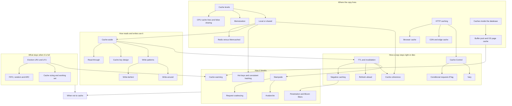

## The map in words

The map has five groups and one final question. A cache is a **copy**, and every copy can be stale. First you choose where the copy lives: in the CPU, in the service, in a shared Redis, at the edge, or inside the database. Then you choose how it is kept: who fills it, who writes it, when it expires, and what is thrown out when it is full. Last, you learn how it breaks: many misses at once, one key that is too hot, and a cold cache after a restart. The final question is always the same: should this be cached at all?

## Cache levels: each step down is slower

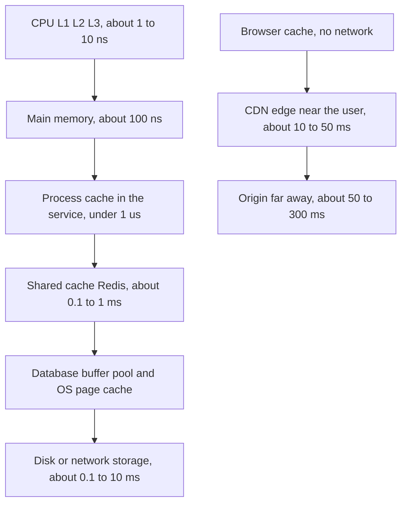

**Story.** An agent asks Chain Insights for the links of one address. The browser has nothing, because it is an API call. The proxy on the user's machine has the schema in its process cache. DozerDB, the graph database, has the hot nodes in its page cache. Only a cold address goes to disk.

**How it works.**
1. A read starts at the top box, the fastest one.
2. A hit answers at once. A miss falls one box down.
3. Each box down is bigger and slower, often about a thousand times slower.
4. The answer is copied back up, so the next read stops higher.

### In code

```text
levels = L1, L2, L3, RAM, process cache, Redis, buffer pool, disk
function read(key):
  for level in levels, fastest first:
    if key in level:                    # hit
      copy key into every faster level  # the next read stops sooner
      return value, time of this level
    # miss: go one level down
```

```go
func Read(ls []*Level, key string) (name string, ns, checked int) {
	for i, l := range ls {
		if l.keys[key] {
			for _, faster := range ls[:i] {
				faster.keys[key] = true // the next read stops sooner
			}
			return l.name, l.ns, i + 1
		}
	}
	return "nowhere", 0, len(ls)
}
```

Run it: `handbook/code/05-cache-levels/` with `go run .` It is a model, and the times are orders of magnitude, not measurements. It prints the answer at each of the 8 levels. A cold read takes about 5,000,000 ns from the disk, and the second read about 1 ns.

**What goes wrong.** You add a cache at the wrong level. A process cache does not help a request that misses at the CDN. A CDN does not help a slow database join. Fix: find the slow box first, then cache one level above it.

**Where you use it.**
- A Go indexer decoding blocks in a tight loop: keep structs small so they fit CPU cache lines. Ignore this for request handlers.
- A web app: hashed static files at the CDN and in the browser, data in Redis.
- The graph database: give the page cache memory. It is a cache you tune with memory, not code.

> Say it: "Every level down is about a thousand times slower, so I cache one level above the slow part, and I quote orders of magnitude, not exact numbers."

▶ Watch it move: [Cache levels](visual/05-cache-levels.html)

## Memoization: a cache inside one function

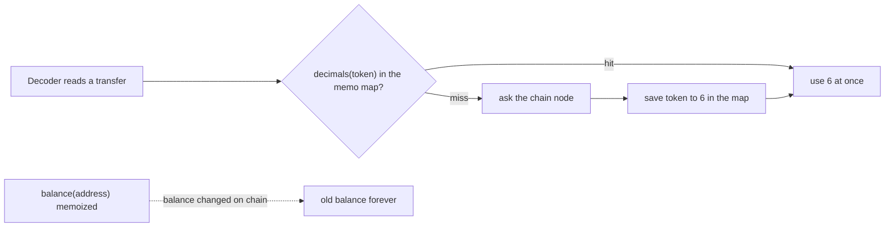

**Story.** The Go indexer decodes millions of token transfers. Each one needs the token's number of decimals, and asking the chain node costs a network call. The decimals of a token never change. So the decoder keeps a map from token address to decimals. The node is asked once per token, not once per transfer.

**How it works.**
1. The function checks a map keyed by its arguments (the diamond).
2. A hit returns the saved result at once.
3. A miss runs the real work, here a call to the node.
4. The result is saved under the arguments, then returned.
5. It is safe only for a **pure** function: same input, same output, no side effects.

### In code

```text
memo = map of arguments -> result, limit 10,000
function memoized(args):
  if args in memo:                    # hit: seen before
    move args to the front            # LRU: most recent first
    return memo[args]
  result = realWork(args)             # miss: ask the node once
  memo[args] = result
  if size(memo) > limit:              # bound the map
    drop the least recently used entry
  return result
```

```go
func (m *Memo[K, V]) Get(key K, load func(K) V) (V, bool) {
	if el, ok := m.items[key]; ok { // hit: seen before
		m.order.MoveToFront(el)
		return el.Value.(entry[K, V]).val, true
	}
	v := load(key) // miss: do the real work once
	m.items[key] = m.order.PushFront(entry[K, V]{key, v})
	if m.order.Len() > m.limit { // bound the map
		old := m.order.Remove(m.order.Back()).(entry[K, V])
		delete(m.items, old.key)
	}
	return v, false
}

// the fix for balance: the block number joins the key
type balanceKey struct {
	addr  string
	block int
}
```

Run it: `handbook/code/05-memoization/` with `go run .` It prints 2 node calls for 1,002 transfers, and the wrong 5 ETH that the fix replaces with 2 ETH.

**What goes wrong.** Memoizing a function that is not pure. `balance(address)` changes with every block, so the map returns an old balance forever. A second trap is a map that only grows, which is a memory leak. Fix: memoize only pure functions, and bound the map with LRU (least recently used) eviction.

**Where you use it.**
- An EVM decoder: token decimals, contract ABIs (the description of a contract's functions) and event signatures. They never change.
- Dynamic programming: Fibonacci, edit distance. The memo turns exponential work into polynomial work.
- A React component: `useMemo` keeps a computed value until its inputs change.

> Say it: "Memoization caches a pure function's result by its arguments, so it is only safe when the same input always gives the same output, and the map needs a size bound."

▶ Watch it move: [Memoization](visual/05-memoization.html)

## CPU cache lines and false sharing

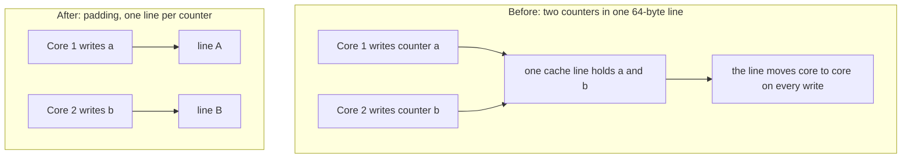

**Story.** The indexer runs eight worker goroutines. Each one counts its decoded blocks in its own slot of one array. The slots are next to each other in memory. The workers never touch each other's slot, yet adding workers makes the program slower.

**How it works.**
1. The CPU moves memory in blocks called **cache lines**, usually 64 bytes.
2. Two counters of 8 bytes each sit in the same line.
3. When core 1 writes its counter, the coherence protocol marks the line invalid in core 2's cache.
4. Core 2 writes its own counter and must fetch the whole line back first.
5. The line moves between cores on every write. The data is not shared, only the line is. That is **false sharing**.

### In code

```text
struct Shared { a int64; b int64 }                 # 16 bytes, one 64-byte line
struct Padded { a int64; pad 56 bytes; b int64 }   # two lines

worker(counter):
  repeat 20,000,000 times:
    counter += 1                     # the core needs the line Modified

on every write to a line, the hardware asks:
  does another core hold this line?  # the coherence protocol (MESI)
    yes: mark its copy Invalid
         move the line to this core
  write in L1, the line is Modified here
```

```go
type Shared struct {
	a int64
	b int64 // byte 8: the same 64-byte line as a
}

type Padded struct {
	a int64
	_ [56]byte
	b int64 // byte 64: the next line
}

// two goroutines, one counter each
for i := 0; i < writes; i++ {
	atomic.AddInt64(c, 1) // the CPU moves the line between cores here
}
```

Run it: `handbook/code/05-false-sharing/` with `go run .` It prints where a and b sit in memory and the time of three runs: shared, padded and local. On the test machine shared took 249 ms, padded 80 ms and local 4 ms. Your times will differ, but the order will not.

**What goes wrong.** Adding threads makes the program slower, and the profiler shows no lock. Fix: pad each counter to its own 64-byte line. Or give each worker a local counter and add them up at the end.

**Where you use it.**
- Per-worker counters and metrics in a Go or Java hot loop. Go's runtime pads its own per-processor structures this way.
- The other side of cache lines: reading an array in order is fast because the CPU loads the next line ahead. Chasing pointers through a linked list is slow, because every node may be a new line.

> Say it: "The CPU caches 64-byte lines, so two threads writing different variables in one line fight over it, and padding each hot variable to its own line fixes the slowdown."

▶ Watch it move: [CPU cache lines and false sharing](visual/05-false-sharing.html)

## Cache-aside: the default pattern

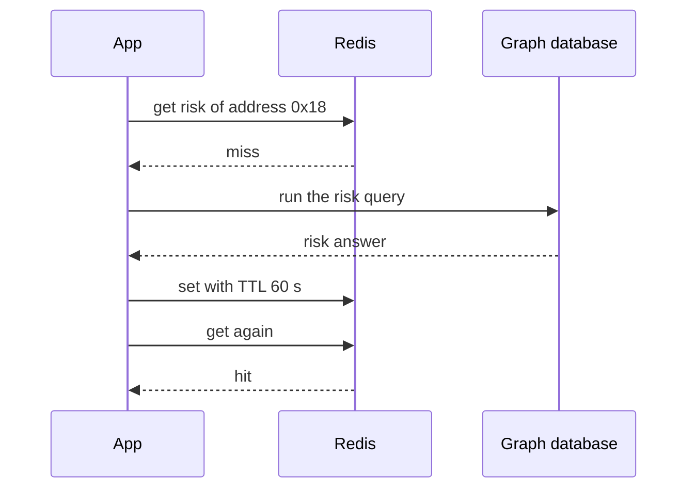

**Story.** An investigator screens an address for risk. The service looks in Redis by the address. It misses, so it runs the graph query and stores the answer for a minute. The next investigator who asks gets it from Redis.

**How it works.**
1. The app asks the cache (first arrow).
2. On a miss, the app reads the source itself.
3. The app writes the result into the cache with a time to live (TTL).
4. The next read is a hit. The cache never talks to the source.

**Read-through** is the same flow with the loading code moved into the cache library. The app only ever talks to the cache.

### In code

```text
function read(key):
  if key found and now < expires: return value   # hit, the database rests
  v = database.read(key)                         # miss: committed values only
  cache.set(key, v, ttl 60)                      # the app fills the cache
  return v

function update(key, v):
  database.commit(key, v)
  cache.delete(key)                              # after the commit, never before
```

```go
func (s *Service) Read(key string) (int, string) {
	if v, ok := s.cache.Get(key); ok {
		return v, "hit"
	}
	v := s.db.Read(key)      // miss: the app reads the source
	s.cache.Set(key, v, ttl) // the app fills the cache
	return v, "miss, loaded and set"
}

func (s *Service) UpdateDeleteAfter(key string, v int, beforeCommit func()) {
	beforeCommit() // the transaction is still open
	s.db.Commit(key, v)
	s.cache.Delete(key)
}
```

Run it: `handbook/code/05-cache-aside/` with `go run .` It uses a fake clock and fixed orderings, so the numbers never change. Delete first leaves the cache at 40 and the database at 90 from 11 s to 70 s. Delete after the commit gives 90 at 11 s. A reader that stalls across the commit can still set 40, and the TTL ends that at 70 s.

**What goes wrong.** An update deletes the key before the database commits. A reader misses, reads the old committed value and puts it back. The commit then lands, and nothing removes the old copy.

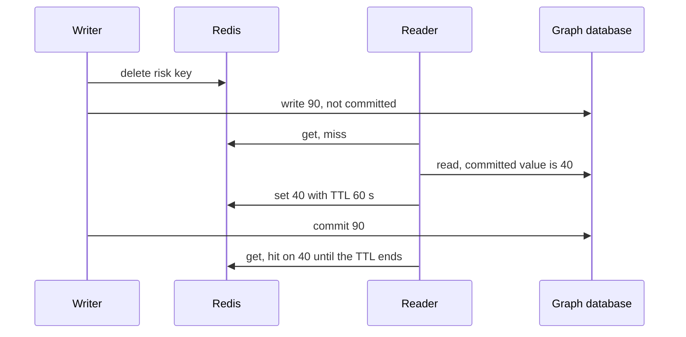

Fix: commit first, then delete the key. A miss after the delete can only load the new value. Keep the TTL as the safety net: a reader that stalls across the commit can still set the old value, and a delete can fail.

**Where you use it.**
- Read-heavy lookups: user profiles, address risk, product pages.
- A caching library with a loader function, such as Caffeine in Java or ristretto in Go, gives you read-through.

> Say it: "Cache-aside is my default: read the cache, on a miss read the source and fill the cache, and delete the key after the source commits."

▶ Watch it move: [Cache-aside](visual/05-cache-aside.html)

## Read-through: the cache loads for you

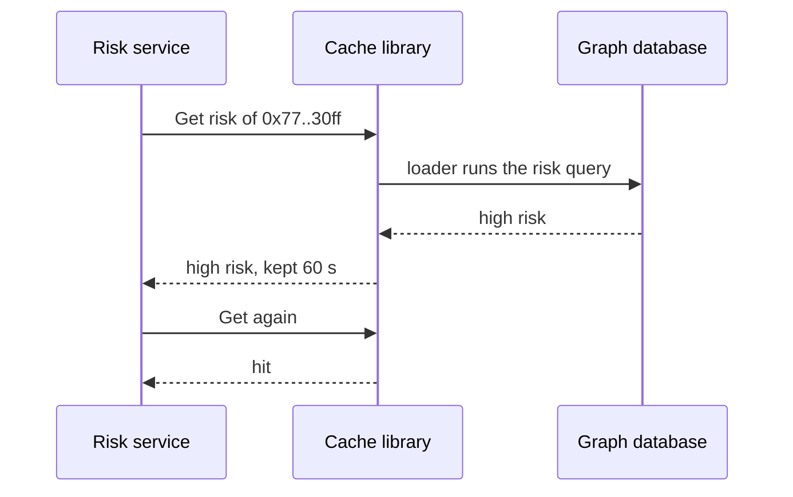

**Story.** In cache-aside, every place in the risk service that reads a risk answer repeats the same code: look in the cache, query the graph, store the result. With read-through, the service gives the cache library one loader function at startup. From then on the service only calls `Get`. The library runs the loader on a miss.

**How it works.**
1. At startup the app registers a loader: a function from key to value.
2. The app calls `Get(key)`. It never talks to the database itself.
3. On a miss the library calls the loader, stores the result with a TTL, and returns it.
4. A good library runs only one loader per key at a time, so many callers share one load.

### In code

```text
cache = ReadThrough(ttl 60s, loader = graph.runRiskQuery)
function Get(key):
  if key in items and now < expires:    # hit and still fresh
    return items[key]
  if a load for key is running:         # coalesce
    wait for it, return its result
  mark key as loading
  v, err = loader(key)                  # miss: one load per key
  unmark key
  if err is none:                       # never store a failure
    items[key] = v, expires now + 60s
  return v, err
```

```go
func (c *ReadThrough) Get(key string) (string, error) {
	c.mu.Lock()
	if it, ok := c.items[key]; ok && now.Before(it.expires) {
		c.mu.Unlock()
		return it.val, it.err // hit and still fresh
	}
	if cl, ok := c.inflight[key]; ok { // a load is running: join it
		c.mu.Unlock()
		cl.wg.Wait()
		return cl.val, cl.err
	}
	cl := &call{}
	cl.wg.Add(1)
	c.inflight[key] = cl
	c.mu.Unlock()

	cl.val, cl.err = c.load(key) // miss: the loader runs once

	c.mu.Lock()
	delete(c.inflight, key)
	if cl.err == nil || c.cacheErrors { // the fix: never store a failed load
		c.items[key] = item{cl.val, cl.err, now.Add(c.ttl)}
	}
	c.mu.Unlock()
	cl.wg.Done()
	return cl.val, cl.err
}
```

Run it: `handbook/code/05-read-through/` with `go run .` It prints one graph call for three callers after expiry. With errors cached, a Get 2 seconds after the graph recovers still fails. Without the bug, it gets "high".

**What goes wrong.** The loader fails, and the library stores the failure. Now every reader gets the error for the whole TTL. Fix: never cache errors, or cache them for a few seconds only, and put a timeout on the loader.

**Where you use it.**
- Caffeine in Java, ristretto or groupcache in Go, and `LoadingCache` in Guava.
- Pick read-through when many places read the same data and you want one loading rule. Pick cache-aside when each caller needs its own loading logic.

> Say it: "Read-through is cache-aside with the loader moved inside the cache, so callers only call Get, and I make sure a failed load is never cached for the full TTL."

▶ Watch it move: [Read-through versus cache-aside](visual/05-read-through.html)

## Cache key design: the key decides what is shared

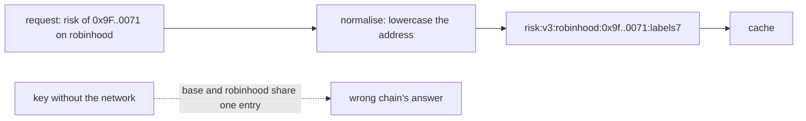

**Story.** The risk service caches answers by address. One day it starts serving two chains, robinhood and base. The key still holds only the address. A question about base gets the robinhood answer, because both build the same key. Nobody sees an error.

**How it works.**
1. List every input that changes the answer: network, address, labels version, code version.
2. Normalise each one, so equal requests build equal keys: lowercase the address, sort the parameters.
3. Join them with a fixed separator and a prefix that names the kind of answer: `risk:`.
4. Put a schema version in the prefix (`v3`). A code change that alters the answer bumps it, and old keys age out.
5. Leave out inputs that do not change the answer, such as a request id. They only split the cache.

### In code

```text
function goodKey(req):
  addr = lowercase(req.address)        # normalise: equal requests, equal keys
  return "risk:" + schema              # the kind of answer and its code version
       + ":" + req.network             # the answer changes per chain
       + ":" + addr
       + ":labels" + req.labelsVersion # the data it was built from

leave out req.requestId                # it never changes the answer
schema = "v4"                          # bump on a new model: old keys age out
```

```go
const schema = "v4" // bumped from v3 when the risk model changed

func goodKey(r Request) string {
	return fmt.Sprintf("risk:%s:%s:%s:labels%d",
		schema, r.Network, strings.ToLower(r.Address), r.LabelsVersion)
}
```

Run it: `handbook/code/05-cache-key-design/` with `go run .` With only the address as key, base gets the robinhood answer. With the full key, each chain gets its own answer and the lowercase request hits. With a request id in the key, there are 0 hits.

**What goes wrong.** Two opposite mistakes. A missing input serves the wrong answer, like base getting robinhood data, or one user getting another user's data. An extra or unnormalised input, like the address in mixed case, makes duplicate keys and the hit rate falls. Fix: write the key builder once, in one function, with a test of equal and different requests.

**Where you use it.**
- Any Redis cache: a prefix per kind of answer lets you count, scan and drop one kind.
- HTTP caches build the key from the URL plus the headers named in `Vary`. That is the same rule.

> Say it: "The key must hold every input that changes the answer and nothing that does not, normalised, with a version prefix, or the cache either serves wrong data or never hits."

▶ Watch it move: [Cache key design](visual/05-cache-key-design.html)

## Write patterns: through, behind, around

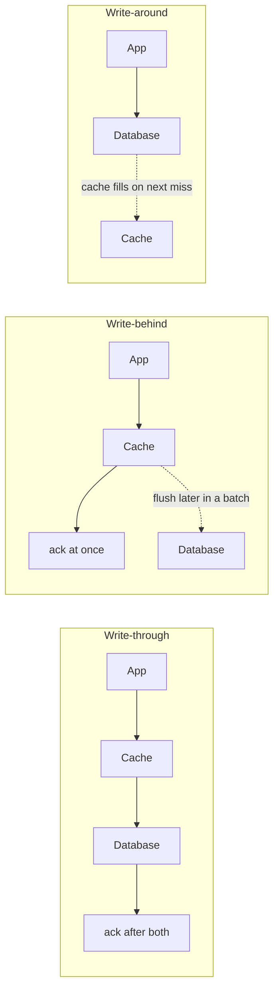

**Story.** A user changes their display name. With write-through, the cache and the database both change before the user sees "saved". A page view counter is different: it is bumped thousands of times a second, so it lives in the cache and is written to the warehouse once a minute. A backfill of old blocks goes straight to the database, because nobody will read it soon.

**How it works.**
1. **Write-through:** the app writes the cache and the source, then acknowledges. Reads are never stale for that key.
2. **Write-behind** (write-back): the app writes the cache and acknowledges at once. The cache flushes to the source later, in batches.
3. **Write-around:** the app writes the source only. The cache gets the value on the next miss.

### In code

```text
write-through:
  if database.write(key, v) fails:      # database first
    cache.delete(key); return the error # the cache can only lag, never lead
  cache.set(key, v); answer ok

write-behind:
  cache.set(key, v); pending += 1; answer ok at once
  every minute: if pending > 0: database.write(key, cache.get(key)); pending = 0
  on a crash: lost = pending
```

```go
func (s *Store) ThroughWrite(v int) error {
	if err := s.writeDB(v); err != nil {
		s.cached = false
		return err
	}
	s.cache, s.cached = v, true
	return nil
}

func (s *Store) Flush() {
	if s.pending > 0 {
		s.db = s.cache // many writes become one
		s.dbWrites++
		s.pending = 0
	}
}
```

Run it: `handbook/code/05-cache-aside-vs-write-through/` with `go run .` Cache first with a failed database write leaves 400 in the cache and 450 in the database. Three write-behind writes become 1 database write. A crash before the flush loses 2 writes.

**What goes wrong.** Write-behind loses every unflushed write if the cache process dies. Draw it as a red box over the dotted flush arrow. Fix: use it only where losing a short window is acceptable, and say the window out loud.

**Where you use it.**
- Write-through: profile data that must show on the next read.
- Write-behind: counters and rate limits. An actor holding device state and snapshotting later is write-behind too.
- Write-around: bulk imports and backfills.

> Say it: "Write-through is never stale but doubles write cost. Write-behind is fast but loses the unflushed window on a crash. Write-around suits writes nobody reads soon."

▶ Watch it move: [Cache-aside versus write-through](visual/05-cache-aside-vs-write-through.html)

## Write-behind (write-back): fast writes, a window of loss

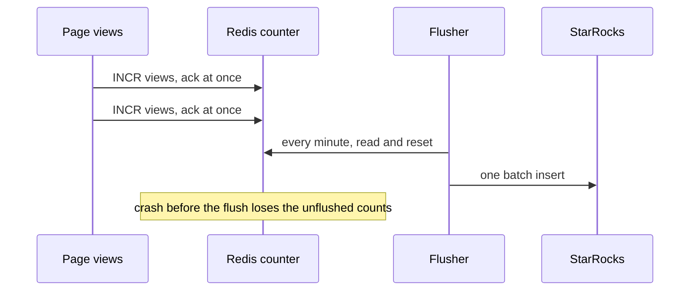

**Story.** Every page view on the website bumps a counter. Writing each view to StarRocks, a warehouse built for big batches, would mean thousands of tiny inserts a second. So each view only increments a counter in Redis. Once a minute a flusher reads the counts and writes one batch to StarRocks.

**How it works.**
1. The writer updates the cache and gets an acknowledgement at once.
2. The cache holds the change. It is now the only copy.
3. A flusher writes the changes to the source later, in one batch.
4. Many writes to one key become one write: a thousand increments become one number.

### In code

```text
on each page view:
  append 1 to the durable log          # the fix: on disk first
  unflushed += 1                       # INCR views in Redis
  answer "saved" at once

every 60 seconds, the flusher:
  n = unflushed; unflushed = 0         # read and reset
  insert (batchId, n) into StarRocks   # one row, not thousands
  if batchId was written before: skip  # a retry is written once

on a crash and restart:
  unflushed = 0                        # memory is gone
  if a log exists: unflushed = replay(log)
```

```go
func (c *Counter) Incr() {
	if c.useLog {
		c.log = append(c.log, 1) // the fix: write to disk first
	}
	c.unflushed++ // acknowledged at once
}

func flush(c *Counter, w *Warehouse, batchID int) {
	n := c.unflushed
	c.unflushed = 0
	w.Insert(batchID, n) // Insert skips a batch id it has seen
	c.log = c.log[:0]
}

func crash(c *Counter) {
	c.unflushed = 0
	if c.useLog {
		c.unflushed = len(c.log) // replay after the restart
	}
}
```

Run it: `handbook/code/05-write-behind/` with `go run .` Without the log the warehouse ends at 3,000 of 5,500 views. With the log it ends at 5,500, and a batch sent twice is counted once.

**What goes wrong.** The cache dies before the flush. Every change since the last flush is gone, and the writers were already told "saved". Fix: keep a durable log in front, such as Redis append-only file (AOF) or a Kafka topic, and replay it after a restart. Make the flush idempotent, so a retried batch does not count twice. Name the loss window out loud.

**Where you use it.**
- Counters, rate limits and view counts, where losing a minute is acceptable.
- An actor that holds device state in memory and snapshots it later is write-behind.
- CPU caches and disk controllers use write-back for the same reason: fewer slow writes.

> Say it: "Write-behind acknowledges from the cache and flushes later in batches, so it is fast and absorbs repeated writes, but a crash loses the unflushed window unless a durable log sits in front."

▶ Watch it move: [Write-behind](visual/05-write-behind.html)

## Write-around: keep cold writes out of the cache

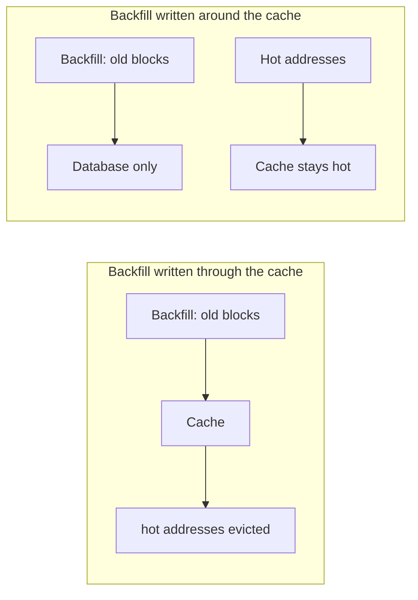

**Story.** A backfill re-reads ten million old blocks and writes their transfers to the database. Investigators meanwhile ask about the same few hundred live addresses. If the backfill wrote through the cache, the old rows would push the live addresses out. With write-around, the backfill writes the database only, and the cache keeps its hot set.

**How it works.**
1. The writer writes the source only.
2. The cache is not touched by the write.
3. A later read of that key misses and loads the new value.
4. The cache holds only what someone actually read.

### In code

```text
cache = LRU with 6 slots
function set(key, v):                           # LRU rule
  if key is new and the cache is full:
    evict the least recently used key

backfill, write-through: for each old row: db.write(row); cache.set(row)
backfill, write-around:  for each old row: db.write(row)   # cache untouched

function updateLabel(addr, v):
  db.write(addr, v)
  cache.delete(addr)                            # never leave the old copy
```

```go
for i := 0; i < 10_000_000; i++ { // the backfill
	k := fmt.Sprint("block-", i)
	db[k] = "row"
	if writeThrough {
		c.Set(k, "row") // each old row takes a slot
	}
}

func updateLabel(c *LRU, db map[string]string, k, v string) {
	db[k] = v   // the write goes to the database only
	c.Delete(k) // drop the old copy
}
```

Run it: `handbook/code/05-write-around/` with `go run .` Written through, the six live addresses get 0 of 6 hits after the backfill. Written around, they get 6 of 6. Without the delete, the next reader of C gets the old label.

**What goes wrong.** The written key was already in the cache. Write-around leaves the old copy there, so readers see stale data until the TTL ends. Fix: on every write, delete the key from the cache. That is the write path of cache-aside. The first read after the write is a miss, and that is accepted.

**Where you use it.**
- Bulk imports, backfills, log and audit writes: written once, rarely read soon.
- Any write-heavy table where reads are few, so caching writes only wastes memory.

> Say it: "Write-around sends writes to the source only, so cold bulk writes do not flush the hot set, and I still delete the key on write so no stale copy survives."

▶ Watch it move: [Write-around](visual/05-write-around.html)

## TTL and invalidation: how a copy dies

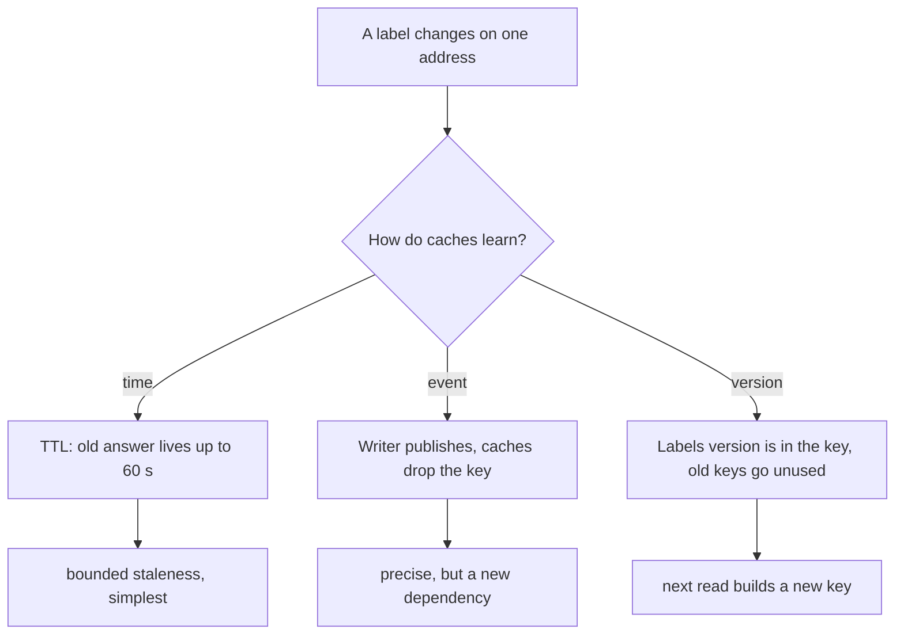

**Story.** A label changes on one address in the graph. Hundreds of cached risk answers used that label. Nothing links the label to those keys. So each risk answer carries a short TTL, and the labels version is part of the key. A label change bumps the version, and the old keys expire unused.

**How it works.**
1. **Time:** each entry expires after its TTL. You accept staleness up to that time.
2. **Event:** the writer publishes "changed", and every cache drops the key.
3. **Version:** the key includes a version of its inputs. A change creates a new key.
4. Add a small random jitter to every TTL, so keys set together do not expire together.

### In code

```text
function risk(addr, now):
  key = "risk:" + addr + ":v" + labelsVersion
  if key in cache and now < expires:
    return cache[key]                   # may be stale, at most one TTL
  answer = compute from the graph
  ttl = 60s + a little jitter           # 57, 61, 64
  cache[key] = answer, now + ttl
  return answer

on label change(addr):
  graph.write(addr, label)
  labelsVersion += 1                    # every key changes
```

```go
func (s *Service) Risk(addr string, now int) string {
	k := s.key(addr)
	if it, ok := s.cache[k]; ok && now < it.expires {
		return it.answer // may be stale, for at most one TTL
	}
	answer := "low risk"
	if s.label == "Scam" {
		answer = "high risk"
	}
	s.cache[k] = item{answer, now + s.ttl(k)}
	return answer
}
```

Run it: `handbook/code/05-ttl-invalidation/` with `go run .` With a TTL the answer is stale at second 30 and fresh at second 61. An event drops one key and leaves the hidden dependent wrong. A version in the key makes all 3 answers fresh, at the cost of 3 recomputes.

**What goes wrong.** Trying to invalidate precisely. You need a map from every source change to every dependent key, which is a second system. Fix: TTL by default, a version in the key when correctness after a change matters.

**Where you use it.**
- A token price: TTL of one minute.
- A final block header: cache forever, it never changes.
- **Negative caching:** cache "no such address" for a short time, so repeated misses do not hit the source.

> Say it: "Invalidation is hard because the writer does not know which cached answers used its data, so I default to a short jittered TTL and put a version in the key when it must be right after a change."

▶ Watch it move: [TTL and invalidation](visual/05-ttl-invalidation.html)

## Negative caching: remember that it is not there

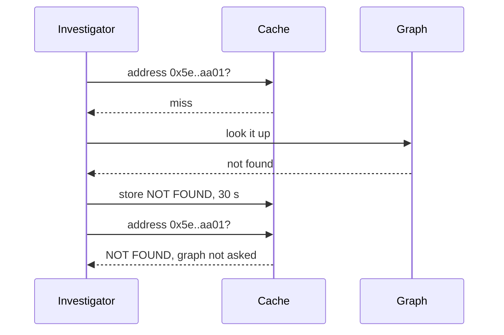

**Story.** An investigator pastes an address with a typo and retries it again and again. A bot polls a fresh address that has no transactions yet. Each request misses the cache, because there is no answer to keep. Each one runs a graph lookup that finds nothing. Caching "not found" for 30 seconds stops the repeats.

**How it works.**
1. The lookup misses the cache and asks the source.
2. The source says the thing does not exist.
3. The cache stores a special NOT FOUND marker with a short TTL.
4. Repeats get the marker and never reach the source.

### In code

```text
function lookup(addr, now):
  if addr in cache and now < expires:     # hit, also a NOT FOUND marker
    return cache[addr]
  graphLookups += 1                       # a full graph search
  v = graph.find(addr)
  if v is none:
    cache[addr] = NOT FOUND, now + 30s    # negative caching, short TTL
    return NOT FOUND
  cache[addr] = v, now + 300s
  return v

on graph sync adds addr:
  cache.delete(addr)                      # drop the marker
```

```go
func (s *Service) Lookup(addr string, now int) string {
	if e, ok := s.cache[addr]; ok && now < e.expires {
		return e.val // a hit, also for a NOT FOUND marker
	}
	s.lookups++ // a full graph search
	v, ok := s.graph[addr]
	if !ok {
		s.cache[addr] = entry{notFound, now + s.negativeTTL}
		return notFound
	}
	s.cache[addr] = entry{v, now + s.positiveTTL}
	return v
}
```

Run it: `handbook/code/05-negative-caching/` with `go run .` It prints 60 graph lookups a minute without the marker and 2 with it. A marker that is not deleted on create hides the new address.

**What goes wrong.** The address becomes real: its first transaction lands. The cache still says NOT FOUND until the marker expires. Fix: keep negative TTLs much shorter than positive ones, and delete the marker when the thing is created.

**Where you use it.**
- DNS caches "no such domain" for the time its server names.
- A lookup API for addresses, users or products that bots probe.
- It does not stop an attacker who asks for a new random key every time. That needs a Bloom filter.

> Say it: "Negative caching stores not found with a short TTL, so repeated misses stop hitting the source, and I delete the marker when the thing is created."

▶ Watch it move: [Negative caching](visual/05-negative-caching.html)

## Refresh-ahead and early expiration

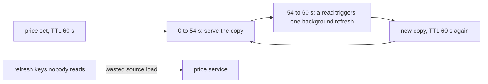

**Story.** The native token price is cached for 60 seconds and read fifty times a second. With plain expiry, second 60 is a miss for everyone, and every reader waits for the price service. With refresh-ahead, a read in the last six seconds starts one background refresh. The key never expires while people read it.

**How it works.**
1. Each entry knows its age and its TTL.
2. A read near the end of the TTL, say the last 10 percent, still returns the copy at once.
3. That read also starts one background refresh, guarded so only one runs.
4. The refresh replaces the copy before it expires.
5. **Probabilistic early expiration** spreads this out: each read refreshes with a small chance that grows near the end of the TTL.

### In code

```text
TTL = 60s, zone starts at 54s           # the last 10 percent
function read(key, now):
  if a refresh answered: replace the copy, age = 0
  age = now - key.loadedAt
  if age >= TTL:                        # expired
    wait while the price is loaded
    return
  if age > 54s and no refresh running:  # refresh-ahead rule
    start one background refresh
  return the cached price at once
```

```go
func read(k *key, now int, ahead bool, calls *int) bool {
	if k.refreshing && now >= k.refreshAt { // the refresh answered
		k.loadedAt, k.refreshing = k.refreshAt, false
	}
	age := now - k.loadedAt
	if age >= ttl { // expired: this reader waits
		*calls++
		k.loadedAt = now
		return true
	}
	if ahead && age > zone && !k.refreshing { // in the zone
		*calls++
		k.refreshing, k.refreshAt = true, now+1 // in the background
	}
	return false // served from the cache at once
}
```

Run it: `handbook/code/05-refresh-ahead/` with `go run .` Plain expiry costs 50 calls and 50 waiting readers at second 60. Refresh-ahead costs 1 call and nobody waits, and 10 calls in 10 minutes.

**What goes wrong.** Refreshing on a timer for every key, read or not. Keys nobody asks for any more keep loading the source. Fix: refresh only when a read sees the entry near expiry. A key that stops being read simply expires.

**Where you use it.**
- Hot keys with a costly source: prices, exchange lists, dashboard totals.
- Caffeine's `refreshAfterWrite` in Java. The XFetch algorithm for the probabilistic form.
- HTTP `stale-while-revalidate` is the same idea after expiry instead of before.

> Say it: "Refresh-ahead lets a read near the end of the TTL refresh the key in the background, so hot keys never expire under load, and keys nobody reads just die."

▶ Watch it move: [Refresh-ahead](visual/05-refresh-ahead.html)

## Eviction: what goes when the cache is full

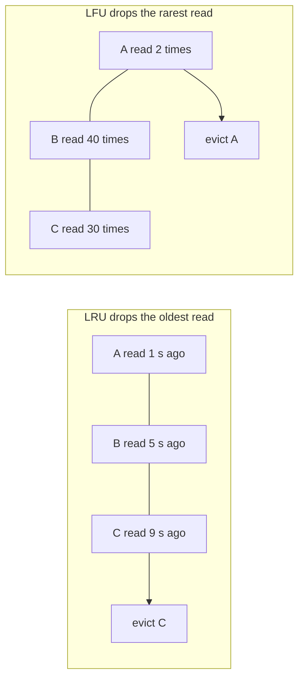

**Story.** A cache has four slots and is full. A new key arrives. Least recently used (LRU) throws out the key read longest ago. Least frequently used (LFU) throws out the key read the fewest times. On the same reads they can pick different victims.

**How it works.**
1. The cache keeps an order: by last read time for LRU, by count for LFU.
2. Every read moves the key to the front, or adds one to its count.
3. A new key needs a slot. The key at the back of the order is evicted.
4. Adaptive replacement cache (ARC) keeps both lists and shifts space to whichever is winning.

### In code

```text
function read(key):
  t = t + 1
  if key in slots: slot.count += 1; slot.last = t; return   # hit
  if a slot is empty: use it
  else: v = victim(); throw out v
  slot = key, count 1, last t

LRU victim(): lowest last                # read longest ago
LFU victim(): lowest count, then lowest last
```

```go
func (c *Cache) victim() int {
	best := 0
	for i, s := range c.slots {
		b := c.slots[best]
		if c.lfu { // lowest count, then read longest ago
			if s.count < b.count || (s.count == b.count && s.last < b.last) {
				best = i
			}
		} else if s.last < b.last { // LRU: read longest ago
			best = i
		}
	}
	return best
}
```

The scan keeps this simple for four slots. A real LRU uses a map plus a linked list, so a read and an eviction both cost O(1): see `Memo` in `handbook/code/05-memoization/`.

Run it: `handbook/code/05-lru-eviction/` with `go run .` Both start with the same 8 reads: A A A B C D E A. LRU throws out A when E arrives and pays a miss on A. LFU throws out B and hits A. Then each shows its own failure. LRU reads a scan of F G H I and ends at 2 hits and 10 misses. LFU reads F G H and ends at 3 hits and 8 misses, with A holding its slot and nobody reading it.

**What goes wrong.** A one-time scan under LRU. A backfill reads every old row once and pushes the whole hot set out. Live queries then miss. Fix: a scan-resistant policy (LFU, ARC), or a separate reader for the backfill.

**Where you use it.**
- Redis: approximate LRU or LFU by sampling, set by `maxmemory-policy`.
- Database page caches: usually LRU or a clock variant.
- Measure hit rate on a replay of real traffic before you switch policy.

> Say it: "LRU by default because it is cheap and fits recent reads, and LFU or ARC when one-time scans would flush the hot set."

▶ Watch it move: [LRU and LFU eviction](visual/05-lru-eviction.html)

## FIFO, random and ARC: other eviction policies

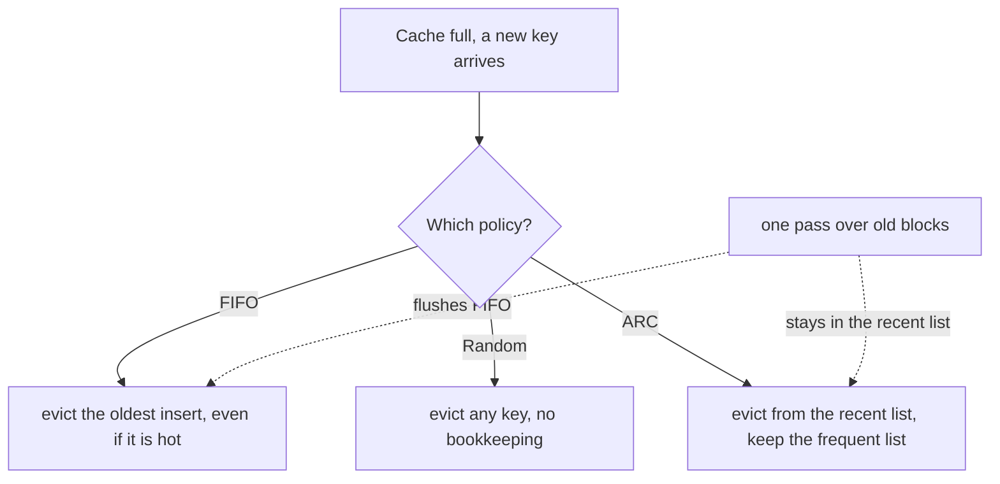

**Story.** A cache of four slots holds risk answers. Address A is read all day. Then a report reads three old addresses once each. FIFO evicts A, because A was inserted first. Random may or may not evict A. ARC keeps A, because A was read twice and lives in its frequent list.

**How it works.**
1. **FIFO** (first in, first out) keeps a queue of inserts and evicts the head. Reads do not change the order.
2. **Random** picks a victim at random. No list to update on a read, so it is cheap.
3. **ARC** (adaptive replacement cache) keeps two lists: seen once (recent) and seen twice or more (frequent).
4. ARC also remembers keys it recently evicted, the ghost lists. A hit on a ghost tells it which list should grow.
5. A policy is **scan-resistant** when one pass over many keys cannot push out the hot set. ARC is. FIFO and plain LRU are not.

### In code

```text
FIFO:    if full: evict queue[0]           # the oldest insert, hot or not
Random:  if full: slots[random(0..3)] = k  # a coin picks the victim
ARC:
  recent = []; frequent = []; ghosts = []; p = 0
  function read(k):
    if k in recent or frequent: move k to frequent; return   # hit
    if k in ghosts: p = p + 1          # recent was too small
    if cache is full:
      if size(recent) > p: move the oldest recent name to ghosts
      else: evict the oldest frequent key
    put k in recent                    # a scan only churns recent
```

```go
func (a *ARC) replace(inB2 bool) {
	if len(a.t1) > 0 && (len(a.t1) > a.p || (inB2 && len(a.t1) == a.p)) {
		v := a.t1[0] // evict from recent, keep the name as a ghost
		a.t1, a.b1 = a.t1[1:], append(a.b1, v)
	} else {
		v := a.t2[0] // evict from frequent
		a.t2, a.b2 = a.t2[1:], append(a.b2, v)
	}
}
```

Run it: `handbook/code/05-fifo-random-arc/` with `go run .` It replays A, B, A, C, D, S1, S2, A under each policy. FIFO misses A. Random keeps A in one run and loses it in another. ARC hits A and raises p to 1 when B's ghost is read.

**What goes wrong.** A scan flushes the hot set. One report or backup reads everything once, and the next minute every live read misses. Fix: a scan-resistant policy (ARC, 2Q, W-TinyLFU), or let the scan bypass the cache.

**Where you use it.**
- Redis offers `allkeys-random` and approximated LRU and LFU. Random is fine when access is fairly even.
- ZFS uses ARC for its file cache. Caffeine in Java uses W-TinyLFU.
- Postgres reads big scans through a small ring of buffers, so a scan cannot flush the buffer pool.

> Say it: "FIFO ignores how hot a key is, random is cheap and fair when access is even, and ARC keeps recent and frequent lists so one scan cannot flush the hot set."

▶ Watch it move: [FIFO, random and ARC](visual/05-fifo-random-arc.html)

## Cache sizing: the working set and the hit-rate curve

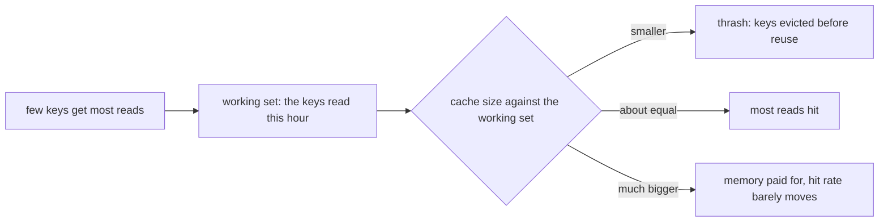

**Story.** The team asks how much memory the Redis cache for risk answers needs. Caching every address ever seen would need a huge box. But reads are skewed: a few thousand live addresses get most questions, and the long tail is asked once. The cache needs to hold the working set, not the whole graph.

**How it works.**
1. Real access is skewed. A small head of keys gets most reads. This is often called a Zipf-like distribution.
2. The **working set** is the set of keys read in a window, such as an hour.
3. Hit rate rises fast while the cache grows toward the working set.
4. Past it, each extra gigabyte adds less and less. The curve flattens.
5. Measure the curve from a real trace of keys, a miss-ratio curve, instead of guessing.

### In code

```text
weight(k) = 1 / k                       # key 1 is the hottest
hitRate(s) = sum of weight(1..s) / sum of weight(1..20)
for s in 2, 5, 10, 20: print s, hitRate(s)   # 42, 63, 81, 100 percent

function lruHits(trace, size):          # thrashing check
  for each key k in trace:
    if k in cache: hits += 1
    else if size(cache) == size: evict the least recently used key
    put k at the newest end
  return hits
```

```go
func lruHits(trace []int, size int) int {
	var c []int // c[0] = least recently used
	hits := 0
	for _, k := range trace {
		if i := slices.Index(c, k); i >= 0 {
			hits++
			c = append(c[:i], c[i+1:]...)
		} else if len(c) == size {
			c = c[1:] // evict the least recently used
		}
		c = append(c, k)
	}
	return hits
}
```

Run it: `handbook/code/05-cache-sizing/` with `go run .` It prints the model curve (42, 63, 81 and 100 percent), the same curve from a replayed trace of 100,000 reads, and the loop over 6 keys: 0 hits of 600 with 5 slots, 594 with 6.

**What goes wrong.** Two ways. Too small, below the working set: keys are evicted before their second read, and the hit rate collapses. That is **thrashing**. Too big: memory is paid for and the hit rate hardly moves. Fix: record a day of keys, replay it at several sizes, and pick the knee of the curve.

**Where you use it.**
- Redis `maxmemory`: set it from the measured working set, not the data size. Watch evictions and hit rate together.
- A database buffer pool: the hot pages are its working set.
- A CDN: a few files get most traffic, so a modest edge cache serves most bytes.

> Say it: "I size a cache to the working set, not the data, because access is skewed and the hit-rate curve flattens, and I measure the curve from a real key trace."

▶ Watch it move: [Cache sizing](visual/05-cache-sizing.html)

## Cache stampede: many misses at once

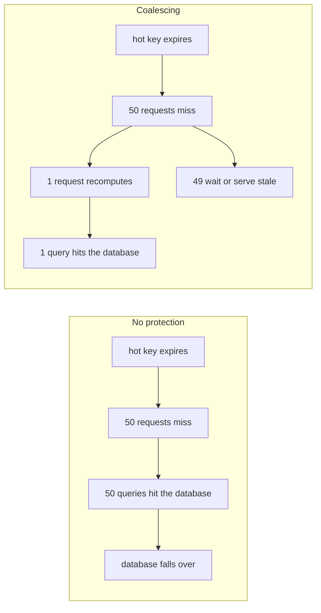

**Story.** A dashboard query is cached for exactly 60 seconds. At second 61 every open tab misses at the same moment. The warehouse gets fifty copies of one query. It slows, so the misses last longer, so more requests pile in. This is also called the thundering herd.

**How it works.**
1. A popular key expires (left box).
2. Every request in flight misses at once.
3. Without protection, all of them go to the source.
4. With coalescing, the first request takes a lock and recomputes. The rest wait for it, or serve the stale value.
5. The new value fills the cache and everyone reads it.

### In code

```text
function read(key):
  if key is fresh: return it             # hit
  if the lock is held and a stale copy exists:
    return the stale copy                # one reader refreshes, nobody waits
  if nobody holds lock:key:              # SET lock:key NX EX 5
    take the lock
    v = runQuery(); cache.set(key, v, ttl)
    release the lock; wake the waiters
    return v
  wait for the holder's result

ttl = 60 + random(-6 .. +6) seconds      # keys set together do not expire together
```

```go
func (c *Cache) ReadLocked(serveStale bool) string {
	c.mu.Lock()
	if c.fresh {
		defer c.mu.Unlock()
		return c.val
	}
	if c.loading { // someone holds the lock
		if serveStale {
			defer c.mu.Unlock()
			return c.stale // the old page, at once
		}
		done := c.done
		c.mu.Unlock()
		c.waited.Add(1)
		<-done
		return c.val
	}
	c.loading, c.done = true, make(chan struct{})
	c.mu.Unlock()
	v := c.query()
	c.mu.Lock()
	c.val, c.fresh, c.loading = v, true, false
	close(c.done)
	c.mu.Unlock()
	return v
}
```

Run it: `handbook/code/05-cache-stampede/` with `go run .` It uses real goroutines. Without protection, 50 readers make 50 queries. With a lock, 1 query and 49 wait. With a stale copy, 1 query and 0 wait. Jitter spreads 10 keys over several seconds.

**What goes wrong.** Raising the TTL. The stampede still comes, only later. A bigger cache does not help either: it is about timing, not size. Fix, used together:
1. One caller recomputes: a lock, or Go `singleflight`.
2. Early recompute: refresh a little before expiry, with a chance that rises near the end.
3. Jitter on the TTL, so different keys spread out.
4. `stale-while-revalidate`, so nobody waits.

**Where you use it.**
- An API in front of a warehouse: one in-flight query per key.
- After a deploy or a restart: warm the cache before taking traffic.

> Say it: "A stampede is many misses on one key at the same moment, so I let one caller recompute while the rest wait or serve stale, and I jitter TTLs."

▶ Watch it move: [Cache stampede](visual/05-cache-stampede.html)

## Request coalescing (singleflight): many callers, one load

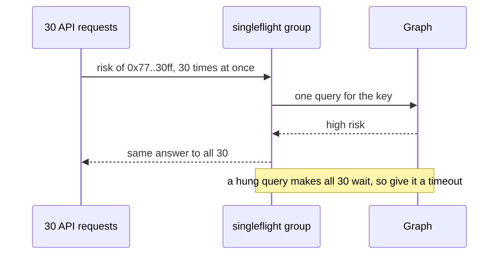

**Story.** A popular address shows up on social media. Thirty API requests ask for its risk in the same second, and the cache is cold. Without coalescing, the service sends thirty identical graph queries. With Go's `singleflight`, the first request runs the query. The other 29 wait for it and share its answer.

**How it works.**
1. Each call names a key, here the address.
2. The first call for a key starts the real load.
3. Calls for the same key that arrive while it runs join it and wait.
4. When the load finishes, every waiter gets the same result.
5. The key is then free, so the next call starts a new load.

### In code

```text
group = map of key -> call in flight
function Get(key, load, deadline):
  if key in group:                     # a call is in flight
    c = group[key]                     # join it, start nothing
  else:
    c = new call; group[key] = c       # the first caller
    run in the background:
      c.result = load() with timeout 2s
      delete group[key]                # the key is free again
      wake every waiter of c           # same result for all
  wait for c, or for my own deadline   # a waiter gives up alone
  return c.result
```

```go
func (g *Group) DoChan(key string, fn func() (string, error)) <-chan *call {
	g.mu.Lock()
	c, inFlight := g.m[key]
	if !inFlight { // the first caller starts the load
		c = &call{done: make(chan struct{})}
		g.m[key] = c
		go func() {
			c.val, c.err = fn() // fn has its own 2 s timeout
			g.mu.Lock()
			delete(g.m, key)
			g.mu.Unlock()
			close(c.done) // every waiter gets the same result
		}()
	}
	g.mu.Unlock()
	out := make(chan *call, 1)
	go func() { <-c.done; out <- c }()
	return out
}
```

In production use `golang.org/x/sync/singleflight`; the program writes it by hand to stay on the standard library.

Run it: `handbook/code/05-request-coalescing/` with `go run .` It prints 1 query for 30 requests, 30 callers failing after 2 seconds instead of 60, 10 queries from 10 instances, and 1 with a `SET NX` lock.

**What goes wrong.** Shared fate. If the one query hangs, all 30 requests hang with it. If it fails, all 30 get the error. Fix: a timeout on the shared load, and each waiter keeps its own deadline (Go's `DoChan` with a `select`). A second limit: coalescing works inside one process. Ten instances still send ten queries. Fix: a short lock key in Redis when that matters.

**Where you use it.**
- Go: `golang.org/x/sync/singleflight` in front of any cache loader.
- Caffeine and groupcache coalesce loads per key by default.
- CDNs call it request collapsing: one request to the origin per object.

> Say it: "Request coalescing lets identical concurrent calls share one load, which stops a stampede inside a process, and I give the shared load a timeout because every waiter shares its fate."

▶ Watch it move: [Request coalescing](visual/05-request-coalescing.html)

## Cache avalanche: many keys or the whole cache at once

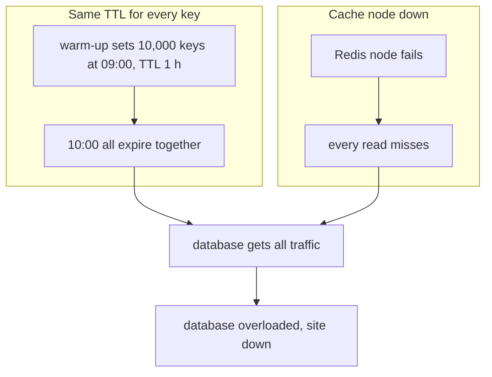

**Story.** A deploy warms the cache with ten thousand keys at 09:00, all with a TTL of one hour. At 10:00 they all expire in the same second. The database gets the full read traffic at once. On another day the Redis node itself dies, and the same thing happens to every key.

**How it works.**
1. A stampede is many misses on one key. An **avalanche** is misses on many keys, or on the whole cache.
2. Cause one: many keys share one expiry time.
3. Cause two: the cache layer itself is gone.
4. Either way, the database meets traffic it was never sized for.

### In code

```text
at 09:00, warm 20 keys:
  for each key:
    ttl = 1 hour + random(0 .. 6 minutes)   # jitter spreads the expiries
    cache.set(key, value, ttl)

on each read:
  if key in cache: return it
  if dbLimiter.allow():                     # protect the database
    return loadFromDatabase(key)
  return staleLocalCopy or quick error
```

```go
func warm(keys []string, r *rand.Rand) {
	for _, k := range keys {
		ttl := time.Hour
		if jitter {
			ttl += time.Duration(r.Int63n(int64(6 * time.Minute))) // + 0 to 6 minutes
		}
		cache.Set(k, load(k), ttl)
	}
}

func read(k string) (string, error) {
	if v, ok := cache.Get(k); ok {
		return v, nil
	}
	if limiter.Allow() { // at most 300 a second reach the database
		return db.Load(k)
	}
	if v, ok := localStale.Get(k); ok {
		return v, nil // a stale copy beats a dead database
	}
	return "", errBusy
}
```

Run it: `handbook/code/05-cache-avalanche/` with `go run .` Without jitter all 20 keys expire at 10:00. With jitter only 2 do, and the rest spread to 10:05. With Redis down, the limiter lets 300 of 2,000 reads a second reach the database. Of the other 1,700, 850 get a stale copy and 850 a quick error.

**What goes wrong.** The database falls over, and the site with it, because the cache was silently carrying the load. Fix: jitter every TTL so expiries spread out. Run the cache with replicas, so one node failing is not all keys. Put a rate limit or circuit breaker in front of the database, and serve stale or local copies while it recovers.

**Where you use it.**
- Any warm-up job or batch that sets many keys at once: add jitter.
- Redis Sentinel or Redis Cluster with replicas for the shared cache.
- A load test with the cache switched off tells you whether the database survives an avalanche.

> Say it: "An avalanche is many keys or the whole cache missing at once, so I jitter TTLs, replicate the cache, and protect the database with a limiter and stale copies."

▶ Watch it move: [Cache avalanche](visual/05-cache-avalanche.html)

## Cache penetration and Bloom filters

```mermaid
flowchart LR
  ATT["requests for random addresses that do not exist"] --> BF{"Bloom filter: could it exist?"}
  BF -- "definitely not" --> NO["answer not found, nothing else asked"]
  BF -- "maybe" --> C["cache"]
  C -- "miss" --> DB["graph database"]
  NEW["new address not added to the filter"] -. "real address refused" .-> NO
```

**Story.** A script sends lookups for random addresses that do not exist. Each one is new, so it misses the cache, and negative caching does not help. Every request reaches the graph. A **Bloom filter** of all known addresses sits in front. It answers "definitely not" for almost all of the fake ones without touching the graph.

**How it works.**
1. A Bloom filter is a row of bits, all zero at first.
2. Adding an address hashes it with a few hash functions and sets those bits to one.
3. A lookup hashes the address the same way. If any of those bits is zero, the address was never added: definitely not.
4. If all are one, it may exist. Then the request goes to the cache and the database.
5. A false "maybe" costs one database read. A false "definitely not" never happens, as long as every address was added.

### In code

```text
bits = 16 zeros                         # the filter holds no addresses
function add(addr):
  for p in hashes(addr):                # 3 hash functions, 3 positions
    bits[p] = 1

function lookup(addr):
  for p in hashes(addr):
    if bits[p] == 0:                    # one zero bit is proof
      return NOT FOUND                  # cache and graph never asked
  return cacheThenGraph(addr)           # all ones: maybe

graph sync, on a new address: graph.write(addr); add(addr)
```

```go
func (b *Bloom) Add(key string) {
	for _, p := range b.pos(key) {
		b.bits[p] = true
	}
}

func (b *Bloom) MayContain(key string) bool {
	for _, p := range b.pos(key) {
		if !b.bits[p] {
			return false // one zero bit: definitely not
		}
	}
	return true // all ones: maybe
}
```

Run it: `handbook/code/05-bloom-filter-penetration/` with `go run .` It replays the lesson's 16 bits, including the false positive and the refused new address. Then it runs a real filter: 100,000 addresses in 122 KB, and 0.89 percent of random fakes get a "maybe".

**What goes wrong.** Penetration means misses that pass through the cache to the database, because there is nothing to cache. The filter's own trap: a new address is written to the graph but not added to the filter. The filter now refuses a real address. Fix: add to the filter in the same write path, and rebuild it from the source on a schedule.

**Where you use it.**
- A public lookup API that bots probe with random keys.
- Databases use Bloom filters inside: Cassandra, RocksDB and HBase skip files that cannot hold a key.
- Redis has a Bloom filter module (RedisBloom).

> Say it: "Penetration is misses for keys that do not exist, so I put a Bloom filter in front: it says definitely not without a database read, and I add every new key to it on write."

▶ Watch it move: [Bloom filters against penetration](visual/05-bloom-filter-penetration.html)

## Hot keys and consistent hashing

```mermaid
flowchart TB
  subgraph RING["Consistent hashing ring"]
    N1["Node 1"] --> N2["Node 2"] --> N3["Node 3"] --> N1
  end
  K["price of the native token, read on every page"] --> N2
  N2 --> HOT["Node 2 at 100 percent"]
  N1 --> IDLE1["idle"]
  N3 --> IDLE3["idle"]
  LOC["Local cache in each service, TTL 10 s"] -. "absorbs most reads" .-> K
```

**Story.** The native token price is read on every transfer page. In a Redis cluster one key lives on one node. That node runs hot while the others idle. Adding nodes does nothing, because one key cannot be split.

**How it works.**
1. **Consistent hashing** puts keys and nodes on a ring. A key goes to the next node clockwise.
2. Adding or removing a node moves only the keys next to it.
3. Many points per node, called virtual nodes, keep the load even.
4. A hot key still lands on one node. Even spread of keys is not even spread of traffic.

### In code

```text
ring: for each node, for v in 1..points:   # virtual nodes keep it even
  put hash(node + "#" + v) on the circle, sorted

function node(key):
  h = hash(key)
  walk clockwise to the first point >= h   # binary search
  if past the top: wrap to the first point
  return the owner of that point

hot key: fix A: local cache for 10 seconds
         fix B: key + "#" + random(1..3)
```

```go
func (r *Ring) Node(key string) string {
	h := hash(key)
	i := sort.Search(len(r.points), func(i int) bool { return r.points[i] >= h })
	if i == len(r.points) {
		i = 0 // past the top: wrap around
	}
	return r.owner[r.points[i]]
}
```

Run it: `handbook/code/05-hot-keys-consistent-hashing/` with `go run .` With real hashes and 100,000 keys, going from 3 to 4 nodes moves 75 percent of keys with mod N and 28 percent on the ring with 100 points per node. Three suffixed copies split the hot key's reads onto three nodes. The hot-key load numbers are illustrative.

**What goes wrong.** Scaling the cluster to fix a hot key. Fix: a small local cache in each service for the hottest keys, or copies of the key under several names with a random suffix on read.

**Where you use it.**
- Memcached clients and Redis Cluster slots.
- Detect hot keys first: count in the client, or use Redis's hot-key report.

> Say it: "Consistent hashing spreads keys, not the traffic of one key, so a hot key gets a local cache in front or several copies."

▶ Watch it move: [Hot keys and consistent hashing](visual/05-hot-keys-consistent-hashing.html)

## Local or shared: two layers

```mermaid
flowchart LR
  subgraph S1["Service instance 1"]
    L1["Local cache, hottest 100 keys"]
  end
  subgraph S2["Service instance 2"]
    L2["Local cache, hottest 100 keys"]
  end
  L1 -- "miss" --> R["Shared Redis, the long tail"]
  L2 -- "miss" --> R
  R -- "miss" --> DB["Database"]
  PUB["Change event"] -. "drop key" .-> L1
  PUB -. "drop key" .-> L2
```

**Story.** Ten instances of one service each keep a copy of a config value. Someone changes it. Instance 3 serves the new value and instance 7 the old one, for up to the TTL. A user who saved on 3 and reads on 7 sees their change vanish.

**How it works.**
1. A **local** cache lives in the process: no network hop, no dependency, lost on restart, one copy per instance.
2. A **shared** cache like Redis is one view for all instances, one network hop away.
3. Put local in front of shared: local takes the hottest keys, shared takes the rest.
4. Keep copies in agreement (coherence) with a TTL, or a publish message that drops the key everywhere.

### In code

```text
function read(instance, key, now):
  if key in instance.local and now < expires:   # no network hop
    return it
  if Redis is up and key in Redis:              # one hop, one shared view
    copy to local, expires now + localTTL
    return it
  v = database.read(key)
  copy to local, expires now + localTTL
  return v

function save(instance, key, v):
  database.write(key, v); instance.local[key] = v; Redis[key] = v
  publish "drop key"                            # every instance
on "drop key": delete local[key]                # a lost message: the TTL ends it
```

```go
func (c *Cluster) Read(in *Instance, key string, now int) (int, string) {
	if e, ok := in.local[key]; ok && now < e.expires {
		return e.val, "local"
	}
	if c.redis != nil && !c.redisDown {
		if v, ok := c.redis[key]; ok {
			in.local[key] = entry{v, now + c.localTTL}
			return v, "redis"
		}
	}
	v := c.db[key]
	in.local[key] = entry{v, now + c.localTTL}
	return v, "database"
}
```

Run it: `handbook/code/05-local-or-shared/` with `go run .` With local caches only, Instance 7 returns 50 after the save, until second 31. With Redis and a drop message it returns 100. A lost message ends at second 5, and with Redis down the page still loads from the database.

**What goes wrong.** Promising read-your-own-write across instances with local caches. Fix: route the user to one instance, read that value from the shared cache, or accept the window and say so.

**Where you use it.**
- The Chain Insights proxy runs on each user's machine. There is no shared cache. It caches the exchange registry locally, refreshed from a public file, with the packaged copy as fallback.
- A Redis outage is a performance incident, not an outage. The app must still work, slower.
- Memcached for plain key-value with many threads. Redis for data structures, persistence and publish-subscribe.

> Say it: "Local is fastest but gives each instance its own view, shared gives one view at the cost of a hop, and most systems want both in layers."

▶ Watch it move: [Local or shared](visual/05-local-or-shared.html)

## Cache coherence: keeping copies in agreement

```mermaid
sequenceDiagram
  participant W as Writer
  participant A as Instance A
  participant B as Instance B
  W->>A: update fee to 0.3, version 2
  W->>B: update fee to 0.3, version 2
  W->>A: update fee to 0.5, version 3
  W->>B: update fee to 0.5, version 3
  Note over B: version 3 arrives first, then version 2 late
  Note over B: without versions B ends on 0.3, the old value
```

**Story.** Three instances of the swap service each keep the exchange fee for a pool in memory. An operator changes the fee twice in a row, to 0.3 and then to 0.5. The writer pushes each new value to every instance. On instance B the messages arrive in the wrong order. B ends on 0.3 while A and C say 0.5.

**How it works.**
1. **Coherence** means every copy of a key ends up with the same value.
2. Invalidate on write: send "drop the key". Each copy reloads from the source on its next read.
3. Update on write: send the new value itself. No reload, but every copy must apply updates in order.
4. Attach a version to every update. A copy ignores any update older than the one it holds.
5. A TTL under all of it bounds how long a copy can disagree if a message is lost.

### In code

```text
on update(fee, version):               # update on write
  if version <= my version: ignore it  # an old message came late
  my fee, my version = fee, version

on drop:                               # invalidate on write
  forget fee                           # any order says the same thing
on read(now):
  if no fee or now >= expires:         # a miss, or the TTL ran out
    fee = source.read(); expires = now + 30s
  return fee
```

```go
func (in *Instance) ApplyUpdate(fee float64, version int) {
	if in.checkVersion && version <= in.c.version {
		return // older than what I hold: ignore it
	}
	in.c = copyOf{fee, version, true, 0}
}

func (in *Instance) Drop() { in.c.has = false }

func (in *Instance) Read(source float64, now, ttl int) float64 {
	if !in.c.has || (ttl > 0 && now >= in.c.expires) {
		in.c = copyOf{source, 0, true, now + ttl} // reload
	}
	return in.c.fee
}
```

Run it: `handbook/code/05-cache-coherence/` with `go run .` Without the version check B ends on 0.30 while A and C hold 0.50. With it all three hold 0.50. A lost drop leaves C on 0.50 until its TTL ends at second 30.

**What goes wrong.** Updates arrive out of order, and a copy applies the old value last. It stays wrong with no error. Fix: version every value and drop older ones, or prefer invalidation, because "drop the key" is the same message whatever its order.

**Where you use it.**
- Local caches in many instances, kept close with Redis publish-subscribe.
- CPU cores keep their caches coherent in hardware with a protocol called MESI (Modified, Exclusive, Shared, Invalid). It invalidates, it does not update.
- Kafka per-key ordering makes update-on-write safe, because one key's updates stay in order.

> Say it: "Coherence keeps copies in agreement, and I prefer invalidation over pushing values, because a drop message is safe in any order, while pushed values need versions."

▶ Watch it move: [Cache coherence](visual/05-cache-coherence.html)

## Redis versus Memcached

```mermaid
flowchart LR
  subgraph MC["Memcached"]
    M1["many threads"] --> M2["plain key to blob"]
    M2 --> M3["no persistence, no replication"]
  end
  subgraph RD["Redis"]
    R1["one main thread runs commands"] --> R2["strings, hashes, lists, sets, sorted sets, streams"]
    R2 --> R3["expiry, persistence, replicas, publish-subscribe"]
  end
  BLOCK["KEYS star on a big Redis"] -. "blocks every client" .-> R1
```

**Story.** Chain Insights needs a shared cache for three jobs: rate limits per wallet, a top list of most-screened addresses, and messages that tell instances to drop a key. A rate limit is a counter with expiry. A top list is a sorted set. Drop messages are publish-subscribe. Memcached has none of these. Redis has all three, so Redis wins.

**How it works.**
1. **Memcached** stores keys and opaque values in memory. It is multi-threaded, so one box uses all its cores.
2. It has no persistence and no replication. A restart empties it, by design.
3. **Redis** runs commands on one main thread, one at a time, each one atomic.
4. Redis adds data structures (counters, sorted sets, streams), expiry per key, persistence, replicas and publish-subscribe.
5. One thread means one slow command makes every client wait.

### In code

```text
Memcached: 4 worker threads, values are bytes it never looks inside
  time for n gets = n / 4; a restart empties it

Redis: one main thread runs the queue in order
  for each command: run it to the end    # atomic, and nothing else runs
  INCR rl:0xd8; if 1: EXPIRE rl:0xd8 60; if > 100: refuse
  KEYS *            walks every key in one command    # all wait
  SCAN 0 COUNT 100  walks 100 keys per command        # others run between
  UNLINK bigset     frees memory on a background thread
```

```go
// one thread: each command waits for all before it
func Run(queue []cmd) map[string]int {
	t, done := 0, map[string]int{}
	for _, c := range queue {
		t += c.cost // nothing else runs meanwhile
		done[c.name] = t
	}
	return done
}

if r.Incr("rl:0xd8") == 1 {
	r.Expire("rl:0xd8", 60)
}
```

Run it: `handbook/code/05-redis-vs-memcached/` with `go run .` It is a model in work units, not a benchmark. 8 gets take 2 units on Memcached's 4 threads and 8 on Redis. A GET behind `KEYS *` finishes at unit 1,000,001, behind one SCAN step at unit 101.

**What goes wrong.** Someone runs `KEYS *` on a Redis with millions of keys, or deletes one huge set. The single thread is busy for seconds and every client times out. Fix: use `SCAN` instead of `KEYS`, `UNLINK` instead of `DEL` for big values, and watch the slow log.

**Where you use it.**
- Memcached: large plain caches of rendered pages or query results where many cores matter. Facebook ran it at huge scale.
- Redis: rate limits, sessions, leaderboards, queues, locks and invalidation messages.
- Either one is a cache, not the system of record, unless you configure and test persistence.

> Say it: "Memcached is a multi-threaded plain key-value cache, Redis is a single-threaded data-structure server with persistence and publish-subscribe, so I pick Redis unless I only need big plain blobs across many cores."

▶ Watch it move: [Redis versus Memcached](visual/05-redis-vs-memcached.html)

## HTTP caching: the browser and the CDN do the work

```mermaid
sequenceDiagram
  participant B as Browser
  participant E as CDN edge
  participant O as Origin
  B->>E: GET day 2026-10-06, If-None-Match v7
  E->>O: GET, If-None-Match v7
  O-->>E: 304 Not Modified
  E-->>B: 304 Not Modified
  Note over B,E: Both keep the body they already hold
```

**Story.** A public endpoint serves facts for a sealed day of chain data. A sealed day never changes. So it gets a day of `max-age` and an `ETag`. The live head endpoint changes every tenth of a second, so it gets `no-store`.

**How it works.**
1. `Cache-Control` says who may keep a copy and for how long: `max-age`, `public`, `private`, `no-store`.
2. `ETag` is a version tag of the response.
3. The client sends the tag back in `If-None-Match`.
4. If nothing changed, the server answers `304 Not Modified` with no body.
5. `stale-while-revalidate` lets the cache serve the old copy while it fetches a new one.

### In code

```text
browser.get(url):
  if a copy is younger than max-age: return it   # 0 network requests
  edge.get(url)

edge.get(url):
  if a public copy is younger than max-age: return it   # origin idle
  send to the origin, with If-None-Match: savedTag

origin.get(url):
  if If-None-Match == current ETag: answer 304, no body
  answer 200, Cache-Control, ETag
```

```go
if e, _, fresh := browser.lookup(path, w.now); fresh {
	return e.body, "browser cache, no request"
}
if e, ok, fresh := w.edge.lookup(path, w.now); ok && fresh && e.public {
	browser.store[path] = e
	return e.body, "edge hit, origin idle"
}
// otherwise a conditional GET to the origin: 200 with a body, or 304
```

Run it: `handbook/code/05-http-caching/` with `go run .` It uses a real origin server. The sealed day makes 1 body download for 4 reads, and the last read is a 304. A personal page marked `public` shows Alice's account to Bob. With `private`, Bob sees Bob's own account.

**What goes wrong.** A personalised response marked `public`, or a missing `Vary: Authorization`. One user sees another user's page at the edge. Fix: per-user answers are `private`, sensitive ones `no-store`. Also: `no-cache` does not mean "do not cache". It means "check before use".

**Where you use it.**
- Hashed static files, like `app.3f9a.js`: cache for a year. A deploy changes the name.
- A content delivery network (CDN) such as Cloudflare, Fastly or CloudFront: purge by tag, but prefer hashed URLs so you never need to.

> Say it: "Immutable things get a long max-age and a hashed URL, changing things get a short max-age with an ETag, per-user things are private, and sensitive things are no-store."

▶ Watch it move: [HTTP caching](visual/05-http-caching.html)

## Cache-Control directives: who keeps a copy, and for how long

```mermaid
flowchart TB
  R["one response"] --> Q1{"same for every user?"}
  Q1 -- "no" --> PRIV["private: browser only"]
  Q1 -- "yes" --> Q2{"may anyone keep it?"}
  Q2 -- "no" --> NS["no-store"]
  Q2 -- "yes" --> Q3{"does it ever change?"}
  Q3 -- "never" --> IMM["public, max-age one year, immutable"]
  Q3 -- "sometimes" --> SHORT["public, short max-age, s-maxage for the edge, ETag"]
```

**Story.** The Chain Insights website sends six kinds of responses. The hashed script file `app.3f9a.js` never changes. The facts of a sealed day never change either, but their URL has no hash. The exchange list changes now and then. The account page is different for every user. The payment page is sensitive. The live chain head changes every tenth of a second. Each one gets a different `Cache-Control` header.

**How it works.**
1. `max-age=N`: the copy is fresh for N seconds, in the browser and the edge.
2. `s-maxage=N`: a separate lifetime for shared caches like the CDN edge only.
3. `public` lets shared caches keep it. `private` allows the browser only.
4. `no-cache`: keep it, but check with the server before every use. `no-store`: keep nothing.
5. `immutable`: never revalidate, even on reload. `must-revalidate`: never serve it stale.
6. `stale-while-revalidate=N`: serve the old copy for N more seconds while fetching a new one.

### In code

```text
read the Cache-Control header, one directive at a time:
  max-age=N    browser and edge may keep it N seconds
  s-maxage=N   shared caches use N instead
  immutable    never check, even on reload
  no-cache     keep a copy, but check before every use
  private      browser yes, shared caches no
  no-store     nobody keeps a copy, wins over the rest
```

```go
func Decide(h string) Policy {
	p, sMaxAge := Policy{}, -1
	for _, d := range strings.Split(h, ",") {
		name, val, _ := strings.Cut(strings.TrimSpace(d), "=")
		n, _ := strconv.Atoi(val)
		switch name {
		case "max-age":
			p.BrowserTTL, p.EdgeTTL = n, n
			p.BrowserKeeps, p.EdgeKeeps = true, true
		case "s-maxage":
			sMaxAge, p.EdgeKeeps = n, true
		case "no-cache":
			p.BrowserKeeps, p.EdgeKeeps, p.CheckFirst = true, true, true
		}
	}
	if sMaxAge >= 0 {
		p.EdgeTTL = sMaxAge
	}
	if strings.Contains(h, "private") {
		p.BrowserKeeps, p.EdgeKeeps, p.EdgeTTL = true, false, 0
	}
	if strings.Contains(h, "no-store") {
		return Policy{}
	}
	return p
}
```

Run it: `handbook/code/05-cache-control/` with `go run .` It prints the six-row table, then runs a real HTTP server. With `public, max-age=300`, Bob sees Alice's account. With `private`, Bob sees Bob's own account.

**What goes wrong.** A per-user page sent as `public`. The edge keeps one user's page and shows it to the next user. Fix: per-user is `private`, sensitive is `no-store`, and both are checked in a test of response headers.

**Where you use it.**
- Hashed static files: `public, max-age=31536000, immutable`.
- The exchange list: `public, max-age=60, s-maxage=600`, so the edge, which can be purged, keeps it longer than browsers.
- The live chain head and payment pages: `no-store`.

> Say it: "Cache-Control says who may keep a copy and for how long: public or private, max-age and s-maxage, no-cache to check first, no-store to keep nothing, immutable for hashed files."

▶ Watch it move: [Cache-Control directives](visual/05-cache-control.html)

## Conditional requests: ETag, If-None-Match and If-Match

```mermaid
sequenceDiagram
  participant B as Browser
  participant S as Server
  B->>S: GET, If-None-Match v7
  S-->>B: 304 Not Modified, no body
  Note over B,S: reads: skip the download
  B->>S: PUT label, If-Match v7
  S-->>B: 412 Precondition Failed, it is now v8
  Note over B,S: writes: stop a lost update
```

**Story.** The browser holds the facts of a day, tagged `ETag: "v7"`. When the copy is stale it asks "still v7?" and gets a 304 with no body. The same tag guards writes. Two analysts edit the label of one address. The second save says "only if it is still v7". The server answers 412, because the first save made it v8.

**How it works.**
1. The server sends an **ETag**, a version tag of the response, often a hash of its content.
2. Reads: the client sends `If-None-Match: "v7"`. Same tag: `304 Not Modified`, no body.
3. `Last-Modified` and `If-Modified-Since` do the same with a time, at one-second precision.
4. Writes: the client sends `If-Match: "v7"`. Different tag: `412 Precondition Failed`, and nothing is written.
5. That is optimistic locking over HTTP. The client re-reads and tries again.

### In code

```text
server, on GET:
  tag = hash(body)                       # the same on every server
  send header ETag: tag
  if request.If-None-Match == tag:       # the copy is still right
    answer 304, no body
  answer 200 with the body

server, on PUT:
  tag = "v" + label.version
  if request has If-Match and it != tag: # someone saved first
    answer 412, write nothing
  label.text = new text; label.version += 1
```

```go
// GET
w.Header().Set("ETag", `"`+tag+`"`)
if r.Header.Get("If-None-Match") == `"`+tag+`"` {
	w.WriteHeader(http.StatusNotModified) // no body
	return
}
io.WriteString(w, facts)

// PUT
if m := r.Header.Get("If-Match"); m != "" && m != tag {
	w.WriteHeader(http.StatusPreconditionFailed) // 412: writes nothing
	return
}
```

Run it: `handbook/code/05-conditional-requests/` with `go run .` It uses real HTTP. It prints a 304 with 0 bytes, a full 200 when two servers tag by file time, a 304 when they tag by content, and Bob's save refused with 412 until Bob re-reads version 8.

**What goes wrong.** Behind a load balancer, each server builds the ETag from its own file time or inode. The same content gets a different tag on each server. Revalidation never matches, and every check downloads the full body. Fix: build the ETag from a hash of the content, or from the row version in the database.

**Where you use it.**
- Any API or static file behind a CDN: the edge revalidates with the origin the same way.
- Edit endpoints where two people can change one record: `If-Match` stops the lost update.
- S3 and most object stores return a content hash as the ETag.

> Say it: "An ETag is a version of a response: If-None-Match turns a re-download into a 304, and If-Match turns a lost update into a 412, as long as every server computes the same tag."

▶ Watch it move: [Conditional requests](visual/05-conditional-requests.html)

## Vary: one URL, several answers

```mermaid
flowchart LR
  J["Accept: JSON"] --> E["CDN edge"]
  CSV["Accept: CSV"] --> E
  E --> K1["key: URL plus JSON"]
  E --> K2["key: URL plus CSV"]
  UA["Vary: User-Agent"] -. "thousands of variants" .-> LOW["hit rate near zero"]
```

**Story.** The export endpoint `/facts/day/2026-10-06` returns JSON or CSV, chosen by the `Accept` header. Without `Vary`, the edge keeps one copy per URL. A spreadsheet user asks for CSV and gets the JSON a script asked for a minute earlier. The origin adds `Vary: Accept`, and the edge keeps one copy per format.

**How it works.**
1. A cache key starts as the method and the URL.
2. `Vary` names request headers that change the response.
3. The cache adds those headers' values to the key.
4. Each value gets its own stored copy, called a variant.
5. `Vary: Accept-Encoding` is the common case: gzip and Brotli copies kept apart.

### In code

```text
edge, on a request for url:
  names = the Vary header the origin last sent for url
  k = url
  for each name in names:
    k = k + name + "=" + request[name]  # the key grows per named header
  if k in store: return store[k]        # hit
  resp = ask the origin
  remember resp.Vary for url
  store[key(url, resp.Vary)] = resp     # one copy per value
```

```go
func key(url, vary string, h http.Header) string {
	k := url
	for _, name := range strings.Split(vary, ",") {
		if name = strings.TrimSpace(name); name != "" {
			k += "|" + name + "=" + h.Get(name)
		}
	}
	return k
}
```

Run it: `handbook/code/05-vary-header/` with `go run .` It uses real HTTP. With no Vary the CSV user gets JSON. With `Vary: Accept` there are 2 copies. With 500 User-Agent strings there are 500 copies and a 75 percent hit rate. Normalised at the edge there are 2 copies and 100 percent.

**What goes wrong.** Two opposite mistakes. A missing `Vary` serves the wrong variant, like JSON to the CSV user, or one user's page to another when `Authorization` is missing. Varying on a header with many values, like `User-Agent`, makes thousands of variants, and the hit rate falls to almost zero. Fix: vary on few headers, and let the edge normalise them first, for example into "mobile" or "desktop".

**Where you use it.**
- Compressed responses: `Vary: Accept-Encoding` on every text response.
- Content negotiation: `Vary: Accept` or `Accept-Language`.
- Per-user answers should be `private`, not varied on `Authorization` at a shared edge.

> Say it: "Vary adds request headers to the cache key, so each format gets its own copy, and I vary on few normalised headers, never User-Agent."

▶ Watch it move: [Vary](visual/05-vary-header.html)

## Browser cache: the copy on the user's own machine

```mermaid
flowchart LR
  P["page asks for app.js"] --> MEM{"memory cache, this tab?"}
  MEM -- "hit" --> USE["use at once"]
  MEM -- "miss" --> DISK{"disk cache, fresh?"}
  DISK -- "fresh" --> USE
  DISK -- "stale" --> REV["ask the server: still v7?"]
  REV --> USE
  DEP["deploy reuses the name app.js"] -. "old script with new page" .-> BROKEN["page breaks"]
```

**Story.** A user opens the Chain Insights website. On the first visit everything downloads. Moving to the next page, the script comes from memory. The next day it comes from disk without a network call, because its max-age is a year. Then a deploy changes the page, but the script keeps the name `app.js`. The browser serves the year-old script with the new page, and the page breaks.

**How it works.**
1. The **memory cache** holds files used by the open tab. It is gone when the tab closes.
2. The **disk cache**, the HTTP cache, keeps responses across visits, following `Cache-Control`.
3. A fresh copy is used with no request. A stale one is revalidated with its ETag.
4. A normal reload revalidates the page. A hard reload skips the cache.
5. A service worker can add its own cache in front, under the site's own code.

### In code

```text
function get(url):
  if url in memory and age < maxAge:    # this tab, the fastest copy
    return it
  if url in disk:
    if age < maxAge:                    # fresh: nobody is asked
      return it
    ask the server with If-None-Match   # stale, or no-cache (maxAge 0)
    if the answer is 304: keep the copy; return it
  download from the server (200)
  store in memory and on disk
```

```go
func (b *Browser) Get(url string) (string, string) {
	if e, ok := b.memory[url]; ok && b.now-e.stored < e.f.maxAge {
		return e.f.body, "memory cache"
	}
	if e, ok := b.disk[url]; ok {
		if b.now-e.stored < e.f.maxAge { // fresh: nobody is asked
			b.memory[url] = e
			return e.f.body, "disk cache, no request"
		}
		if s := b.server[url]; s.etag == e.f.etag { // ask with the ETag
			b.store(url, e.f)
			return e.f.body, "304, kept the copy"
		}
	}
	s := b.server[url] // nothing usable: full download
	b.store(url, s)
	return s.body, "200, downloaded"
}
```

Run it: `handbook/code/05-browser-cache/` with `go run .` It prints where each file came from: downloaded, memory, disk or 304. After the deploy, the new page meets the old `app.js` from disk and breaks. The hashed name downloads the new script.

**What goes wrong.** A long `max-age` on a file whose name never changes. Users keep the old file for up to a year, and there is no way to reach their browser and delete it. Fix: hashed names for static files (`app.3f9a.js`), and `no-cache` on the HTML page that names them. A deploy then changes the HTML, the HTML names new files, and old files are simply never asked for.

**Where you use it.**
- Every web front end built with a bundler: Vite and webpack hash file names for this reason.
- The back/forward cache keeps a whole page in memory for the back button.
- Telling a user to clear their cache is a sign the headers are wrong.

> Say it: "The browser keeps memory and disk caches that follow Cache-Control, and since I cannot reach into users' browsers, I give static files hashed names and the HTML no-cache."

▶ Watch it move: [Browser cache](visual/05-browser-cache.html)

## CDN and edge cache: copies near the user

```mermaid
flowchart LR
  WAW["user in Warsaw"] --> E1["edge Warsaw"]
  SAO["user in Sao Paulo"] --> E2["edge Sao Paulo"]
  SIN["user in Singapore"] --> E3["edge Singapore"]
  E1 --> SH["origin shield, one region"]
  E2 --> SH
  E3 --> SH
  SH --> O["origin in Frankfurt"]
  PURGE["purge everything on deploy"] -. "every edge misses at once" .-> O
```

**Story.** The Chain Insights website and its public facts endpoints are served from Frankfurt. Users in São Paulo and Singapore wait for a round trip across the world. A content delivery network (CDN) keeps copies at edges near them. A middle layer, the origin shield, means an edge miss goes to the shield, not to Frankfurt.

**How it works.**
1. DNS sends each user to the nearest edge, a point of presence (PoP).
2. A hit at the edge answers from nearby, with no trip to the origin.
3. A miss goes to the origin shield. Many edges share one shield.
4. Only a shield miss reaches the origin. Many users, one origin request.
5. The edge follows `Cache-Control`, `s-maxage` and `Vary`, and can be purged by URL or by tag.

### In code

```text
edge.get(url):
  if url in edge.store: return it        # hit, from nearby
  v = upstream.fetch(url)                # miss: the shield, or the origin
  edge.store[url] = v
  return v

shield.fetch(url):
  if url in shield.store: return it      # many edges share this copy
  v = origin.fetch(url)                  # one request per file
  shield.store[url] = v
  return v
```

```go
func (e *Edge) Get(url string) (string, string) {
	if v, ok := e.store[url]; ok {
		return v, "hit"
	}
	v := e.upstream.Fetch(url) // the shield, or the origin
	e.store[url] = v
	return v, "miss"
}
```

Run it: `handbook/code/05-cdn-edge-cache/` with `go run .` It is a model of the layers. Three regions and four users make 1 origin request. A global purge over 300 edges makes 300 origin requests without a shield and 1 with it. Hashed names need no purge.

**What goes wrong.** A deploy purges the whole CDN. Every edge in the world misses at once, and without a shield all of them ask the origin together. Fix: hashed URLs for static files, so nothing needs a purge. Purge by tag only what changed. Turn on the origin shield and `stale-while-revalidate`.

**Where you use it.**
- Cloudflare, Fastly, CloudFront and Akamai, for static files and public API answers.
- Not for per-user or live answers: those pass through the CDN to the origin.
- The CDN also absorbs traffic floods, because most requests never reach the origin.

> Say it: "A CDN keeps copies at edges near users, with an origin shield so edge misses do not all hit the origin, and I use hashed URLs so a deploy needs no global purge."

▶ Watch it move: [CDN and edge cache](visual/05-cdn-edge-cache.html)

## Cache warming and the database page cache

```mermaid
flowchart LR
  R["DozerDB restart"] --> COLD["page cache empty"]
  COLD --> W1["Warmer pass 1: graph structure"]
  W1 --> W2["Warmer pass 2: values, newest first"]
  W2 --> HOT["searches hit memory"]
  CH["chain keeps moving"] -. "new blocks go cold" .-> W2
  W2 -. "runs all the time, stays ahead" .-> W2
```

**Story.** DozerDB, the graph behind Chain Insights, keeps hot nodes and links in its page cache. The graph sync writes in block order and almost never misses. An investigator's search from a cold address misses often. After a restart, a warmer walks the structure first, then the values newest first. It runs all the time, because the chain keeps moving.

**How it works.**
1. The database keeps recent disk pages in memory, the **buffer pool**. The operating system keeps its own page cache below it.
2. A restart empties both.
3. A warmer reads what the first users will need, before they ask.
4. It warms in order of value: structure first, newest data first.
5. It keeps running, so the warm set follows the live data.

### In code

```text
warmer:
  read all structure pages               # pass 1: every search needs them
  for day from newest back:              # pass 2: values, newest first
    if memory is full: stop
    read the values of day
  loop forever:                          # never stop
    on a new day: read its values
    if memory is full: evict the oldest day
```

```go
func (c *Cache) warmValue(day int) {
	if c.has(day) {
		return
	}
	if len(c.values) == c.limit {
		oldest := slices.Index(c.values, slices.Min(c.values))
		c.values = slices.Delete(c.values, oldest, oldest+1)
	}
	c.values = append(c.values, day)
}
```

Run it: `handbook/code/05-cache-warming/` with `go run .` It is a model of pages by day. After a restart a search is cold. Pass 1 makes it half cold and pass 2 makes it warm. Two days later, a warmer that stopped is half cold on today and one that kept running is warm.

**What goes wrong.** A one-time warm pass at startup. Yesterday's warm set is cold tomorrow. Also double caching: a huge app cache in front of a database that already holds the same pages wastes memory twice. Fix: a continuous warmer, and memory to the buffer pool first.

**Where you use it.**
- Any database restart before traffic: Postgres `pg_prewarm`, a graph warmer.
- A service deploy: preload the hottest keys before joining the load balancer.

> Say it: "A restart empties every cache, so I warm the most valuable pages first and keep the warmer running, because the hot set moves with the data."

▶ Watch it move: [Cache warming](visual/05-cache-warming.html)

## Buffer pool and the OS page cache

```mermaid
flowchart TB
  Q["query needs page 7"] --> BP{"database buffer pool"}
  BP -- "hit" --> ANS["answer from database memory"]
  BP -- "miss" --> PC{"operating system page cache"}
  PC -- "hit" --> COPY["copy into the buffer pool"]
  PC -- "miss" --> DISK["read from disk"]
  DISK --> COPY
  COPY --> ANS
  BIG["buffer pool sized to 90 percent of RAM"] -. "page cache starved, swapping" .-> SLOW["everything slow"]
```

**Story.** Postgres reads table pages of 8 kilobytes. It keeps hot pages in its own memory, the buffer pool, called shared buffers. Below it, Linux keeps recently read file pages in its page cache. A page read from disk lands in both. So the same page can sit in memory twice: double caching.

**How it works.**
1. The database looks in its **buffer pool** first. A hit costs no system call.
2. A miss asks the operating system to read the file.
3. The **page cache** may already hold that page in RAM. Then no disk is touched.
4. Only a page cache miss reads the disk.
5. The page is now in both caches. Each one evicts on its own rules.

### In code

```text
read(page):
  if page in pool:                       # no system call, no disk
    usage[page] += 1, up to 5
    return it
  if page not in osPageCache:            # one system call first
    diskReads += 1
    osPageCache.add(page)
  put(page)                              # now in memory twice

put(page):                               # the clock sweep
  loop:
    b = the buffer under the hand; hand += 1
    if usage[b] > 0: usage[b] -= 1; continue  # a second chance
    evict b; b holds page; usage[b] = 1; return
```

```go
func (p *Pool) Put(page int) { // the clock sweep
	for {
		i := p.hand
		p.hand = (p.hand + 1) % len(p.pages)
		if p.usage[i] > 0 {
			p.usage[i]-- // a second chance
			continue
		}
		if p.pages[i] >= 0 {
			delete(p.lookup, p.pages[i])
		}
		p.pages[i], p.usage[i] = page, 1
		p.lookup[page] = i
		return
	}
}
```

Run it: `handbook/code/05-buffer-pool-page-cache/` with `go run .` Page 7 comes from the disk, then the buffer pool. After 8 other pages evict it, it comes from the page cache with no disk read. The RAM split shows why 90 percent leaves no page cache.

**What goes wrong.** Giving the buffer pool almost all the RAM. The page cache shrinks, the machine starts to swap, and every query slows down. A third copy in an application cache in front wastes memory again. Fix: follow the database's own guide. Postgres starts at about a quarter of RAM for shared buffers and leaves the rest to the page cache. Databases that bypass the page cache with direct I/O, such as InnoDB with `O_DIRECT`, get most of the RAM instead.

**Where you use it.**
- Postgres `shared_buffers` and `effective_cache_size`, MySQL `innodb_buffer_pool_size`.
- DozerDB, like Neo4j, maps its store files into its own page cache, sized by setting.
- `pg_prewarm` loads pages into the buffer pool after a restart.

> Say it: "The buffer pool is the database's page cache and the OS page cache sits under it, so a page can be cached twice, and I size the buffer pool by the database's guide, not to all of RAM."

▶ Watch it move: [Buffer pool and page cache](visual/05-buffer-pool-page-cache.html)

## Caches inside the database

```mermaid
flowchart LR
  SW["robinhood.core_dex_swaps, millions of rows"] --> MV["Materialized view: daily volume per pool"]
  MV -- "refreshed after each sealed day" --> MV
  D["Dashboard loads"] --> RC["Warehouse result cache, same SQL text"]
  RC -- "miss" --> MV
  NOW["SQL with now()"] -. "defeats the result cache" .-> RC
```

**Story.** A dashboard showed daily volume per exchange pool. Every load recomputed it from the swaps table. A materialized view, refreshed after each sealed day, made it a point read. Within the day, StarRocks's own query result cache answered the repeated loads.

**How it works.**
1. A **materialized view** stores a query result as a table. The database refreshes it on a schedule or incrementally.
2. Any query can join it, with full SQL.
3. A **query result cache** stores the answer to one exact SQL text. It drops the answer when the data changes.
4. Snowflake, BigQuery and StarRocks all have one.

### In code

```text
create materialized view daily_volume     # one row per pool per day
on a sealed day:
  read that day once, write its rows
on a load: read only the rows on screen

on a query with SQL text:
  if text in resultCache: return the answer   # exact text only, no rows read
  answer = run the query; resultCache[text] = answer
on a write: empty the result cache            # the data under it changed
```

```go
func (d *DB) Query(sql, pool, day string) (int, string) {
	if v, ok := d.resultCache[sql]; ok {
		return v, "cached"
	}
	v := d.scan(pool, day)
	d.resultCache[sql] = v
	return v, "ran"
}
```

The real thing is SQL inside StarRocks: `CREATE MATERIALIZED VIEW` and its query cache. This program is a model of what they do.

Run it: `handbook/code/05-caches-inside-database/` with `go run .` Ten loads read 100,000 rows without a view and 10 with it. The result cache reads 0 rows on the same text. `now()` in the SQL gets 0 hits of 10, and a time rounded to the hour gets 10 of 10.

**What goes wrong.** Readers assume the view is live. Fix: name the refresh interval next to the view. A second trap: `now()` in the SQL changes the text or result every run, so the result cache never hits.

**Where you use it.**
- Aggregates read by many dashboards: a materialized view.
- Repeated identical dashboard queries: let the result cache work, keep times fixed in the query.

> Say it: "When the expensive thing is an aggregate and the readers speak SQL, I use a materialized view with a named refresh interval instead of an application cache."

▶ Watch it move: [Caches inside the database](visual/05-caches-inside-database.html)

## When not to cache

```mermaid
flowchart TB
  Q1{"Read many times?"} -- no --> NO1["do not cache"]
  Q1 -- yes --> Q2{"Can it be a little stale?"}
  Q2 -- no --> NO2["do not cache, read the source"]
  Q2 -- yes --> Q3{"Is the source slow or costly?"}
  Q3 -- no --> NO3["do not cache"]
  Q3 -- yes --> Q4{"Is the slowness a fixable query?"}
  Q4 -- yes --> FIX["fix the query or index first"]
  Q4 -- no --> YES["cache it, with a TTL you can defend"]
```

**Story.** A graph search was slow. The first idea was to cache its answers. But each investigator asks about different addresses, so the hit rate would be low. The team added the two missing indexes instead. The cache was never built.

**How it works.**
1. Walk the questions top to bottom.
2. Read once: no cache.
3. Must be exact, like a balance before a transfer, or stock before a sale: no cache.
4. Cheap already: no cache.
5. Slow because of a bad query: fix the query first.
6. Only then cache it, and measure the hit rate.

### In code

```text
function decide(case):
  if it is not read often:        no cache   # read once never pays back
  if it must be exact:            no cache   # read the source
  if the source is not slow:      no cache   # nothing to save
  if the query can be fixed:      fix it first   # an index, not a copy
  else: cache it

after building it, measure:
  rate = hits / reads
  if rate < about 80 percent: remove it
```

```go
func Decide(c Case) string {
	switch {
	case !c.readOften:
		return "no cache: read once never pays back the copy"
	case !c.staleOK:
		return "no cache: read the source, a copy would be wrong"
	case !c.slow:
		return "no cache: the source is already fast"
	case c.fix:
		return "fix the query first: " + c.note
	}
	return "cache it, and track hit rate, source load and tail latency"
}
```

Run it: `handbook/code/05-when-not-to-cache/` with `go run .` It walks the four questions for the lesson's cases and prints each verdict. A 45 percent hit rate says remove it, and 95 percent says keep it.

**What goes wrong.** A cache that hides a slow query. It works until the key expires under load, and then the slow query returns at the worst time. Fix: treat caching as the last fix, not the first.

**Where you use it.**
- The chain head height changes every tenth of a second. Every reader wants the latest. Never cache it.
- Track hit rate, source load and tail latency. Below about 80 percent hits, the cache may cost more than it saves.

> Say it: "I cache only what is read often, can be a little stale, and is costly to fetch, and I fix a slow query before I hide it."

▶ Watch it move: [When not to cache](visual/05-when-not-to-cache.html)

## Small words

Terms with their own section above get one line. Plain words get a short explanation.

| Term | In plain words | Belongs to |
|---|---|---|
| Hit | The answer was in the cache, so the source was not asked. A hit is cheap: memory instead of a database or a network trip. Example: the second investigator who screens 0x77..30ff gets the risk answer from Redis. | Cache levels |
| Miss | The answer was not in the cache, so the read goes to the source and usually fills the cache on the way back. A miss costs the full price plus the cache check. Example: the first screening of an address after a deploy. | Cache levels |
| Hit rate | Hits divided by all reads, as a percentage. It tells you whether the cache earns its memory. Below about 80 percent, a cache may cost more than it saves. Example: a risk cache where every investigator asks a different address has a low hit rate. | When not to cache |
| L1, L2, L3 | The hardware caches inside the CPU. L1 is the smallest and fastest, about a nanosecond, and L3 is shared by all cores and slower. They move memory in 64-byte cache lines. Example: a tight decode loop over an array stays in L1 and L2. | Cache levels, CPU cache lines |
| Cache line | The block of memory the CPU moves at once, usually 64 bytes. Two variables in one line travel together. This is the root of false sharing. | CPU cache lines and false sharing |
| False sharing | Two threads write different variables that sit in one cache line, so the line bounces between cores. | CPU cache lines and false sharing |
| Memoization | Caching a pure function's result by its arguments. | Memoization |
| Pure function | A function whose output depends only on its arguments and which changes nothing outside itself. The same input always gives the same output. Only pure functions are safe to memoize. Example: decimals(token) is pure, balance(address) is not. | Memoization |
| Read-through | Cache-aside with the loader inside the cache library. | Read-through |
| Cache key | The string that names an entry. It must hold every input that changes the answer, normalised. | Cache key design |
| Stale window | The time a cache shows an old value after the source changed. Every cache with a TTL has one, up to the TTL long. You choose it on purpose and say it out loud. Example: a label changes and the old risk answer lives up to 60 more seconds. | Cache-aside, TTL and invalidation |
| Write-through | Write the cache and the source before acknowledging. | Write patterns |
| Write-back, write-behind | Acknowledge from the cache, write the source later in batches. | Write-behind |
| Write-around | Write the source only, so the cache fills on the next miss. | Write-around |
| TTL | Time to live: how long an entry is kept before the cache throws it away. It bounds staleness without any message from the writer. Choose it by how stale the answer may be. Example: a token price lives 60 seconds, a sealed block header forever. | TTL and invalidation |
| Invalidation | Removing or replacing a cached entry because its source changed. It can be by time (TTL), by an event (a drop message) or by a version in the key. It is hard because the writer rarely knows every key built from its data. | TTL and invalidation |
| Jitter | A small random amount added to each TTL. Keys set at the same moment then expire at different moments, so they do not all miss together. Example: 60 seconds plus or minus 6 instead of exactly 60. | TTL and invalidation, Cache avalanche |
| Negative caching | Caching "not found" with a short TTL. | Negative caching |
| Refresh-ahead | Refreshing a hot key in the background before it expires. | Refresh-ahead |
| Eviction | Removing an entry to make room when the cache is full. The eviction policy decides which one goes. It is different from expiry, which removes an entry because its TTL ended. | Eviction |
| LRU, LFU | Least recently used and least frequently used: evict the key read longest ago, or the key read least often. | Eviction |
| FIFO | First in, first out: evict the oldest insert. | FIFO, random and ARC |
| Random eviction | Evict any key at random. | FIFO, random and ARC |
| ARC | Adaptive replacement cache: a recent list and a frequent list, balanced by ghost lists. | FIFO, random and ARC |
| Scan-resistant | A policy where one pass over many keys cannot flush the hot set. ARC, 2Q and W-TinyLFU are. FIFO and plain LRU are not. Example: a nightly report that reads every old address once should not empty the risk cache. | FIFO, random and ARC |
| Working set | The keys actually read in a time window. A cache sized to it serves most reads. | Cache sizing |
| Thrashing | A cache smaller than the working set evicts keys just before they are read again, so almost every read misses. | Cache sizing |
| Stampede, thundering herd, dogpile | Three names for one thing: many requests miss the same key at the same moment and all load it. The fix is one loader and the rest wait, plus jitter. Example: fifty readers miss the home page key at second 61. | Cache stampede |
| singleflight, request coalescing | Many identical concurrent calls share one load. | Request coalescing |
| Cache avalanche | Many keys, or the whole cache, missing at once. | Cache avalanche |
| Cache penetration | Misses for keys that do not exist, so every request passes through to the source. | Cache penetration and Bloom filters |
| Bloom filter | A bit array that says "definitely not" or "maybe" for set membership. | Cache penetration and Bloom filters |
| Consistent hashing | Keys and nodes on a ring, so adding a node moves only its neighbours' keys. | Hot keys and consistent hashing |
| Virtual nodes | Many points on the hash ring for each real node. Each node then owns many small arcs, so keys spread evenly, and a leaving node hands its keys to many others instead of one. Example: Cassandra and many Memcached clients place each node many times. | Hot keys and consistent hashing |
| Hot key | One key read so often that its node is overloaded. Adding nodes does not help, because one key cannot be split. Example: the native token price read on every page. | Hot keys and consistent hashing |
| Local cache, near cache | A cache inside the process: no network hop, one copy per instance. Called a near cache when it sits in front of a shared one. | Local or shared |
| Coherence | Keeping several copies of one key in agreement. | Cache coherence |
| MESI | The hardware protocol CPU cores use to keep their caches coherent. Each line is Modified, Exclusive, Shared or Invalid. A write invalidates the other cores' copies. It is invalidation, not update. | Cache coherence |
| Redis, Memcached | The two common shared caches: Redis with data structures and one main thread, Memcached plain and multi-threaded. | Redis versus Memcached |
| CDN, edge, PoP | Content delivery network: servers near users, called edges or points of presence (PoP). | CDN and edge cache |
| Origin, origin shield | The origin is your own server. The shield is a middle cache that many edges share. | CDN and edge cache |
| Purge | Telling a CDN to drop copies, by URL or by tag. A global purge makes every edge miss at once. Hashed file names avoid the need. | CDN and edge cache |
| Browser cache | The memory and disk caches inside the user's browser. | Browser cache |
| Cache-Control | The response header that says who may keep a copy and for how long. | Cache-Control directives |
| max-age, s-maxage | Fresh lifetime in seconds: max-age everywhere, s-maxage for shared caches only. | Cache-Control directives |
| public, private | public lets shared caches keep a copy. private allows the browser only. | Cache-Control directives |
| no-cache | Keep the copy, but check with the server before every use. It does not mean do not cache. It is the right header for an HTML page that names hashed files. | Cache-Control directives |
| no-store | Never keep a copy anywhere, not even in the browser. Use it for sensitive data and for answers that change every moment, like the live chain head. | Cache-Control directives |
| immutable | Never revalidate, even on reload. Only safe for files whose name changes with their content. | Cache-Control directives |
| stale-while-revalidate | Serve the old copy for a few more seconds while a new one is fetched in the background. Readers never wait for the refresh. Example: a news home page a few seconds old. | HTTP caching, Cache-Control directives |
| ETag | A version tag of a response, ideally a hash of its content. | Conditional requests |
| If-None-Match, 304 | A read that says "only send it if it is not this version". 304 Not Modified means the copy is still good, and no body is sent. | Conditional requests |
| If-Match, 412 | A write that says "only if it is still this version". 412 Precondition Failed means someone changed it first. | Conditional requests |
| Last-Modified | A response time used like an ETag, with If-Modified-Since. It is only precise to the second, so prefer an ETag. | Conditional requests |
| Vary | Names the request headers that change the response, so caches key on them too. | Vary |
| Buffer pool | The database's own cache of disk pages. | Buffer pool and the OS page cache |
| Page cache | The operating system's cache of file pages in free RAM. | Buffer pool and the OS page cache |
| Double caching | The same data held in two caches, often the buffer pool and the page cache, so memory is spent twice. It is normal for Postgres, wasteful when you add a third layer. Example: an application cache of rows the database already holds in memory. | Buffer pool and the OS page cache |
| Cache warming | Loading the pages or keys the first users will need before they ask, and keeping it running as the data moves. | Cache warming |
| Materialized view | A query result stored as a table and refreshed by the database. Any query can read or join it with full SQL. Readers must know its refresh interval. Example: daily volume per pool from robinhood.core_dex_swaps, refreshed after each sealed day. | Caches inside the database |
| Result cache | The stored answer to one exact SQL text, dropped when the data underneath changes. Any change to the text, such as now(), makes it miss. Example: repeated identical dashboard queries in StarRocks. | Caches inside the database |

## Practise

1. **Where would you add a cache, and how do you decide?**
   Walk the "When not to cache" decision tree out loud. Read often, a little stale is fine, costly source, no fixable query: then cache. The proxy example: the exchange registry is read on nearly every agent question and changes about once a week, so it is cached in the process and refreshed on a timer.

2. **Explain the cache levels and their speeds.**
   Draw the levels column. Point at the CPU box, then memory, then the network hop to Redis, then disk. Say "about a thousand times" between the big jumps. The hop is the cost, not the memory: that is why a process cache beats Redis.

3. **Compare cache-aside, write-through and write-behind.**
   Draw the three write subgraphs. Point at who talks to the database. Cache-aside is stale until delete or TTL. Write-through is never stale but pays two writes. Write-behind acknowledges early and loses the unflushed window on a crash: point at the dotted flush arrow.

4. **What is a cache stampede and how do you stop it?**
   Draw the two subgraphs: 50 queries on the left, 1 query on the right. One caller recomputes, the rest wait or serve stale. Jitter the TTL. Say why a bigger cache and a longer TTL do not help: it is timing, not size.

5. **Why is cache invalidation hard?**
   Draw the label-change tree. The writer does not know which keys used its data. Pick time by default, version in the key when correctness matters, events only when all writes go through one place.

6. **Which eviction policy, and why?**
   Draw the LRU and LFU rows with the different victims. LRU by default. Then tell the backfill story: one scan flushed the hot set, so LFU or ARC, or a separate reader for the scan.

7. **How do you handle a hot key?**
   Draw the ring with Node 2 at 100 percent. Consistent hashing spreads keys, not one key's traffic. Add a local cache with a short TTL in front, or copy the key under several names.

8. **Walk me through HTTP caching for an API.**
   Draw the 304 sequence. Sealed day: long `max-age` and `ETag`. Live head: `no-store`. Per user: `private`. Name the trap: `no-cache` means "check first", and a missing `Vary` leaks one user's page to another.

9. **Local cache or Redis?**
   Draw the two-layer picture. Local for the hottest keys, shared for the long tail and anything all instances must agree on. Ask what breaks when two instances disagree. If nothing, go local.

10. **When would you refuse to add a cache?**
    Tell the missing-index story. The hit rate would have been low and the query was fixable. Exact values, read-once values and the chain head are never cached.

11. **When is memoization safe, and what is false sharing?**
    Draw the memo map beside the decoder. Safe only for a pure function: `decimals(token)` yes, `balance(address)` no, unless the block number joins the arguments. Then draw the two-core picture: two counters in one 64-byte line bounce between cores. Pad each to its own line.

12. **Read-through or cache-aside?**
    Draw the read-through sequence. The loader moves into the cache library, so callers only call Get and one load runs per key. Point at the failure: a failed load must never be stored for the full TTL.

13. **How do you design a cache key?**
    Draw the key-builder picture. Every input that changes the answer, normalised, plus a version prefix. Point at the two failures: a missing network served base the robinhood answer, and a request id in the key made the hit rate zero.

14. **When is write-behind acceptable, and when is write-around the right choice?**
    Draw the page-view sequence and cross out the flush arrow: the unflushed window is lost on a crash unless a durable log sits in front. Then draw the backfill subgraphs: write-around keeps cold bulk writes out of the cache, and the key is still deleted on write.

15. **A bot hammers addresses that do not exist. What do you do?**
    Draw the negative-caching sequence for repeats of one key. Then draw the Bloom filter row of bits for a new random key each time: a zero bit means definitely not, and the database is never asked. Add every new key to the filter on write.

16. **How do you stop a hot key from expiring under load?**
    Draw the age bar with its refresh zone. A read in the last part of the TTL refreshes in the background, so the key never expires while it is read. Point at the trap: never refresh unread keys on a timer.

17. **What is request coalescing, and what is its risk?**
    Draw thirty dots joining one load in the singleflight group. One query, one answer for all. Then the risk: shared fate. Give the shared load a timeout, and remember it only works inside one process.

18. **Stampede or avalanche: what is the difference?**
    Draw the twenty-key grid going grey at 10:00. A stampede is one key, an avalanche is many keys or the whole cache. Fix with jittered TTLs, cache replicas and a limiter in front of the database.

19. **Many instances each cache a value. How do they stay in agreement?**
    Draw the four lifelines with version 2 arriving late at instance B. Pushed values need versions. Drop messages are safe in any order. A short TTL underneath catches a lost message.

20. **Redis or Memcached?**
    Draw the server box: four busy threads for Memcached, one main thread with a queue for Redis. Pick Redis for counters, sorted sets and publish-subscribe. Name the trap: `KEYS *` blocks every client, so use `SCAN` and `UNLINK`.

21. **Which Cache-Control header for which response?**
    Draw the six-row table. Hashed file: `immutable`. Sealed day: `max-age` plus `ETag`. Exchange list: `s-maxage` for the edge. Account page: `private`. Payment and live head: `no-store`. Then the ETag sequence: `If-None-Match` gives a 304, `If-Match` gives a 412 instead of a lost update. `Vary` keeps JSON and CSV apart.

22. **Why did users see a broken page after a deploy, and how does a CDN make it worse?**
    Draw the browser lifelines: new HTML with an old `app.js` from disk. Fix with hashed file names and HTML on `no-cache`. Then draw the edges: a global purge makes every edge miss at once, so turn on the origin shield and avoid purges with hashed names.

23. **How much memory should a cache get, and which eviction policy?**
    Draw the hit-rate curve and point at the knee: size to the working set, measured from a key trace. Then draw the four-slot row: FIFO lets a scan evict the hot key, ARC keeps it in its frequent list.

24. **How do the database's own caches interact with yours?**
    Draw the four layers with page 7 in two of them. The buffer pool and the OS page cache already double-cache. Give Postgres about a quarter of RAM, and add an application cache only for costly answers, never raw pages.

25. **Should an update delete the cache key before or after the commit?**
    Draw the cache-aside race with the writer, the reader, Redis and the database. Delete first: the reader misses, reads the old committed 40 and sets it, then the commit lands and the old score stays until the TTL ends. Delete after the commit, and a miss can only load 90. Then name what is left: a stalled reader can still set the old value, so keep the TTL.

## Read next

- [3. Distributed systems](03-distributed-systems.md) for consistency and partitions behind the shared cache.
- [6. Actor systems](06-actor-systems.md) for state held in memory next to the logic, a write-behind cache in practice.
- [7. SQL fundamentals](07-sql-fundamentals.md) for buffer pools and indexes.
- [8. SQL optimisation](08-sql-optimisation.md) for materialized views and fixing the query before caching it.
