# 6. Actor Systems

> An actor system builds concurrency from small units that own their state and talk only by messages. It replaces locks with ownership, and it moves error handling into a supervisor.

```mermaid
flowchart LR
  subgraph ONE["One actor"]
    AC["Actor, mailbox, message"]
    LT["Location transparency"]
    TA["Tell and ask"]
    PT["Futures and pipe-to"]
    BS["Become and stash"]
    LW["Lifecycle and death watch"]
  end
  subgraph FAIL["When it fails"]
    SU["Supervision, let it crash"]
    ST["One-for-one, all-for-one"]
    BO["Restart backoff, poisoned message"]
    MO["Mailbox overflow, back-pressure"]
    MT["Mailbox types"]
    RS["Reactive Streams, Akka Streams"]
  end
  subgraph RUN["The runtime"]
    DI["Dispatchers"]
    RO["Routers"]
  end
  subgraph KEEP["Keeping state"]
    DE["Delivery guarantees"]
    PE["Persistence, snapshots"]
    PR["Projections, read models"]
  end
  subgraph MANY["Many machines"]
    SH["Cluster sharding"]
    PA["Passivation"]
    GO["Gossip, failure detection"]
    SB["Split brain, singleton"]
    SR["Split brain resolver"]
    CS["Cluster singleton"]
    CR["Distributed data, CRDTs"]
  end
  subgraph FAM["Where it comes from"]
    AM["Actor model, Hewitt"]
    FA["Families: Erlang, Akka, Orleans"]
    VA["Virtual actors, grains"]
    OT["Erlang OTP, gen_server"]
  end
  FIT["When actors fit, when they do not"]
  ONE --> FAIL
  ONE --> RUN
  RUN --> MANY
  KEEP --> MANY
  MANY --> FAM
  FAM --> FIT
```

## The map in words

The runnable code in this chapter is Go. C# appears only as Akka.NET / Orleans shape, not compiled here: a few inline names below and the C# view of the lessons.

Start with **one actor**: state with a mailbox, handling one message at a time, reached by a reference that works on any machine. It talks by tell and ask, pipes futures back as messages, and changes behaviour as its state changes. Then see what happens when it fails: a supervisor restarts it with a strategy and a backoff, and a flooded mailbox is the new overload, tamed by bounded mailboxes and streams with demand. The runtime shares a few threads between millions of actors and spreads work with routers. To survive a crash an actor stores events, and projections turn them into query tables. That makes it movable, so cluster sharding can place it across machines, gossip tells nodes who is alive, and a split brain resolver keeps one copy of everything. Last, know where the model comes from, the families that implement it, and when it is the wrong tool.

## Actor, mailbox, message: one at a time

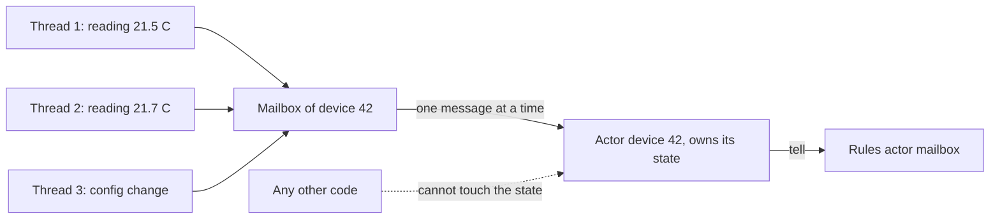

**Story.** An IoT backend on Akka.NET has one actor per physical device. Device 42 sends two readings at the same moment, on two threads. Both land in device 42's mailbox. The actor takes the first, updates its state, then takes the second. No lock is needed, because only that actor ever touches its state.

**How it works.**
1. A sender puts a **message** in the actor's **mailbox**, a queue.
2. Messages are immutable values, like `TelemetryReceived(deviceId, reading, timestamp)`.
3. The actor takes one message, runs its handler, and may change its own state.
4. It may send messages to actors it knows, and create new actors.
5. Then it takes the next message. Different actors run in parallel.
6. An actor is reached by a reference, the same in this process or on another machine. That is **location transparency**.

### In code

The pseudo code first. Any thread may send. Only the actor's own loop reads or writes its state.

```text
send(actor, msg): actor.mailbox.put(msg)     # any thread, no lock
actor loop, forever:
  m = mailbox.take()                         # the oldest message first
  handle(m) runs to the end before the next take
on Reading(c):     last = c; count += 1
on SetInterval(s): interval = s; tell(rules, ReadingStored(last))
```

The same in Go. The state lives in the closure of one goroutine. Other code holds only the `*Actor`, so it can call `Tell` and nothing else.

```go
func spawn(handle func(m Msg)) *Actor {
	a := &Actor{mailbox: make(chan Msg, 16)}
	go func() {
		for m := range a.mailbox { // one message at a time
			handle(m)
		}
	}()
	return a
}

func (a *Actor) Tell(m Msg) { a.mailbox <- m }

device42 := spawn(func(m Msg) {
	switch v := m.(type) {
	case Reading:
		last, count = v.C, count+1
	case SetInterval:
		interval = v.Seconds
		rules.Tell(ReadingStored{last})
	}
})
```

Run it: `handbook/code/06-actor-mailbox/` with `cd handbook/code/06-actor-mailbox && go run .`. It prints count 1 then 2 with no lock. Then the two traps: a shared list sums to 142.2 C instead of 65.2 C, and a shared row ends at 41 instead of 42. Then both fixes.

**What goes wrong.** Shared state smuggled back in: a mutable object inside a message, a static field, or one database row updated by many actors. The races return with no warning. Fix: messages are records, state lives in one actor only.

**Where you use it.**
- One actor per device, session, cart, connection or workflow instance.
- Not one big actor for all devices: that is a single-threaded bottleneck with extra steps.

> Say it: "An actor is state plus a mailbox plus behaviour, it handles one message at a time, and nothing else touches its state, so there is nothing to lock."

▶ Watch it move: [Actor and mailbox](visual/06-actor-mailbox.html)

## Location transparency

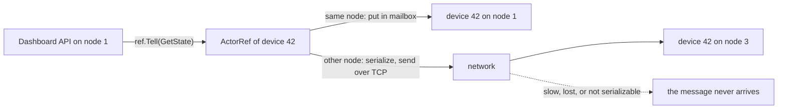

**Story.** The dashboard API holds a reference to device actor 42. On Monday device 42 lives on the same node, and a tell is a write into a queue in memory. On Tuesday sharding moved it to node 3. The API code did not change. The same tell now serializes the message and sends it over TCP (Transmission Control Protocol).

**How it works.**
1. Every actor is reached through a reference, an `ActorRef`, never through the object itself.
2. The reference holds an address: a local path, or a remote one with host and port.
3. For a local address the tell puts the message straight into the mailbox.
4. For a remote address the runtime serializes the message and sends it over the network.
5. The receiving node deserializes it and puts it into the real mailbox.
6. The sender's code is the same in both cases. That is location transparency.

### In code

The pseudo code first. The sender's line never changes. The reference picks the path from its address.

```text
ref.tell(msg):
  if ref.address is local:
    device42.mailbox.put(msg)        # the object itself, nothing copied
  else:
    bytes = serialize(msg)           # only data can be serialized
    if that fails: log, drop         # the sender is not told
    send bytes over TCP to ref.address
node 3: msg = deserialize(bytes); device42.mailbox.put(msg)
fix: a test serializes every message type, and the caller asks with a timeout
```

The same in Go. JSON stands in for the serializer, and a channel of bytes stands in for TCP.

```go
func (r Ref) Tell(m GetState) error {
	if r.addr == "local" {
		r.mailbox <- m // the object itself, nothing copied
		return nil
	}
	b, err := json.Marshal(m) // remote: serialize first
	if err != nil {
		return err // the send fails on this node
	}
	r.wire <- b
	return nil
}
```

Run it: `handbook/code/06-location-transparency/` with `cd handbook/code/06-location-transparency && go run .`. The message with a connection inside works locally. After the move it fails with `json: unsupported type: chan int`. A lost message ends in `ask timed out`, and the retry answers.

**What goes wrong.** Treating a remote send as if it were local. A message holding a database connection or a lambda cannot be serialized, so it fails only when the actor moves. A remote send can be slow or lost, while a local one almost never is. Fix: messages are small immutable records that serialize. Every design assumes at most once, and test with a real multi-node cluster.

**Where you use it.**
- Akka Remote and Akka Cluster, Orleans grains, Erlang distribution: the same send works across machines.
- The IoT backend: device actors moved between ingest nodes, and senders never knew.

> Say it: "Location transparency means the same reference works locally or remotely, so I design every message as if it crosses a network: small, immutable, serializable, and possibly lost."

▶ Watch it move: [Location transparency](visual/06-location-transparency.html)

## Tell and ask

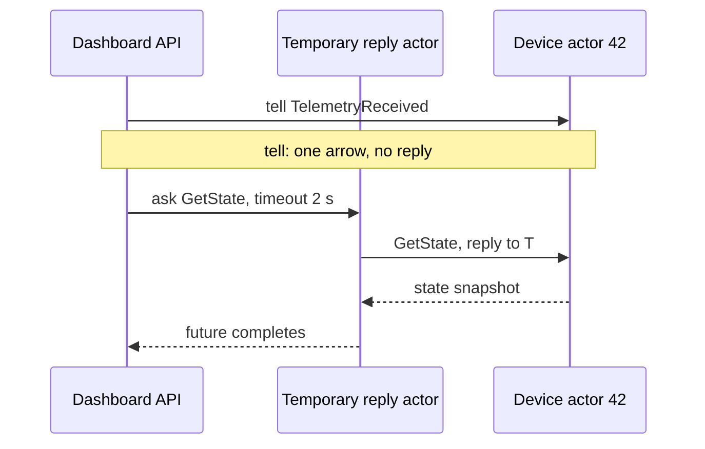

**Story.** Telemetry is told to the device actor: fire and forget. The dashboard needs an answer for an HTTP request, so it asks the actor for its state and waits up to two seconds. Under the hood, the ask creates a small temporary actor to catch the reply.

**How it works.**
1. **Tell** puts the message in the mailbox and returns at once.
2. **Ask** creates a temporary reply actor and a future.
3. The message carries the reply address.
4. The actor answers like any other send.
5. The future completes, or fails after the timeout.

### In code

The pseudo code first. Tell only puts a message in a mailbox. Ask is tell plus a temporary mailbox and a timer.

```text
tell(actor, msg):
  actor.mailbox.put(msg); return          # never waits
ask(actor, msg, timeout):
  reply = new temporary mailbox
  tell(actor, msg with replyTo = reply)   # the message carries the address
  wait on reply, at most timeout
  if a reply arrived: return it
  else: fail the future                   # a late reply goes to dead letters
# inside a handler, never ask and wait:
on Telemetry(r): tell(rules, GetLimit, replyTo = self)
on LimitIs(l):   check(state.last, l)     # the answer is just another message
```

The same in Go. A goroutine reading a channel is the actor. A one-slot channel is the temporary reply actor.

```go
func (a *Actor) Tell(m Msg) { a.mailbox <- m }

func Ask(a *Actor, build func(replyTo chan Msg) Msg, timeout time.Duration) (Msg, error) {
	reply := make(chan Msg, 1) // the temporary reply actor
	a.Tell(build(reply))       // the message carries the reply address
	select {
	case r := <-reply:
		return r, nil // the future completes
	case <-time.After(timeout):
		return nil, errTimeout // the future fails; a late reply is dropped
	}
}
```

Run it: `handbook/code/06-tell-and-ask/` with `cd handbook/code/06-tell-and-ask && go run .`. It prints the told reading, an answered ask, an ask that times out behind 50 messages, the two-way deadlock and the fix.

**What goes wrong.** Awaiting an ask inside a handler. The actor blocks, and so does the thread it borrows. Two actors that ask each other and wait deadlock until the timeout. Fix: tell, include a reply-to address, and handle the answer as a normal message. To use a future inside an actor, pipe its result back to yourself as a message.

**Where you use it.**
- Ask at the edge only: an HTTP handler that needs a reply. Its timeout must be shorter than the client's.
- Tell everywhere inside the system.

> Say it: "Tell is the default, ask is a tell with a reply and a timeout, and I use ask only at the edge, never awaited inside a handler."

▶ Watch it move: [Tell and ask](visual/06-tell-and-ask.html)

## Futures and pipe-to

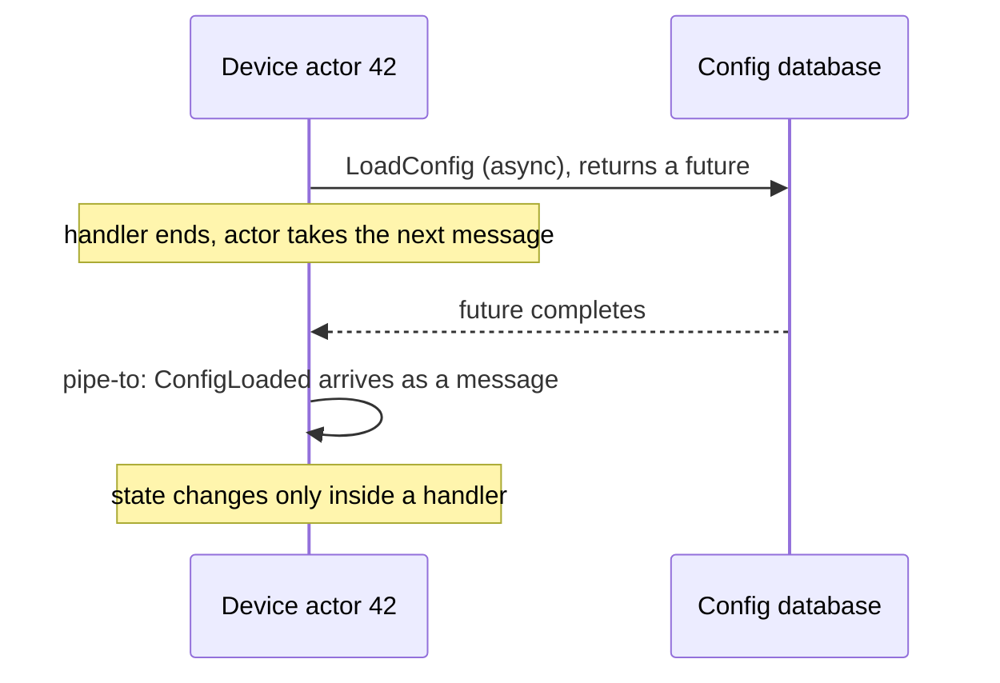

**Story.** Device actor 42 must load its configuration from the database. The call is asynchronous and returns a future. The actor does not wait. It pipes the future's result back to itself, so the answer arrives later as a `ConfigLoaded` message, in the mailbox, like any other.

**How it works.**
1. A **future** (a Task in .NET) is a placeholder for a result that comes later.
2. The handler starts the database call and gets the future.
3. It attaches **pipe-to**: when the future completes, send its result to this actor as a message.
4. The handler ends at once. The actor keeps taking other messages.
5. `ConfigLoaded`, or a failure message, arrives through the mailbox.
6. The actor changes its state inside that handler, one message at a time as always.

### In code

The pseudo code first. The slow call returns a future at once. Pipe-to turns its result into a message.

```text
on Start:
  fut = db.loadConfig()            # returns at once
  pipeTo(fut, self, requester)     # when done, send me a message
  return                           # the handler ends now
pipe-to callback: tell(self, ConfigLoaded(result, requester))   # only sends
on ConfigLoaded(c, req): config = c; tell(req, done)            # state changes here
# never: fut.onComplete(r => this.config = r)
```

The same in Go. A one-slot channel is the future. `pipeTo` is a goroutine that waits on it and only sends.

```go
func loadConfig(d time.Duration) <-chan Config {
	fut := make(chan Config, 1)
	go func() { time.Sleep(d); fut <- Config{IntervalS: 30, LimitC: 25} }()
	return fut
}

func pipeTo(fut <-chan Config, mailbox chan Msg, requester string) {
	go func() { mailbox <- ConfigLoaded{<-fut, requester} }()
}
```

Run it: `handbook/code/06-futures-and-pipe-to/` with `cd handbook/code/06-futures-and-pipe-to && go run .`. The reading is handled at 50 ms while the database works, and the config arrives at 200 ms. The callback version checks with interval 60 s and limit 25 C, and replies to `sensor` instead of `api`.

**What goes wrong.** Changing state inside the future's callback, such as `future.ContinueWith(r => this.config = r)` (Akka.NET / Orleans shape, not compiled here). The callback runs on another thread, while the actor may be handling a message. Two threads now touch the actor's state, and the race is back. Reading `Sender` in the callback gives the wrong sender too. Fix: never touch state or `Sender` in a callback. Pipe the result back and handle it as a message.

**Where you use it.**
- Any I/O (input and output) from inside an actor: database, HTTP, file.
- Akka `PipeTo`, Akka Typed `pipeToSelf`, Erlang's reply message after an async request.

> Say it: "Inside an actor I never await and never touch state in a callback: I pipe the future's result back to myself as a message, so state still changes one message at a time."

▶ Watch it move: [Futures and pipe-to](visual/06-futures-and-pipe-to.html)

## Become and stash

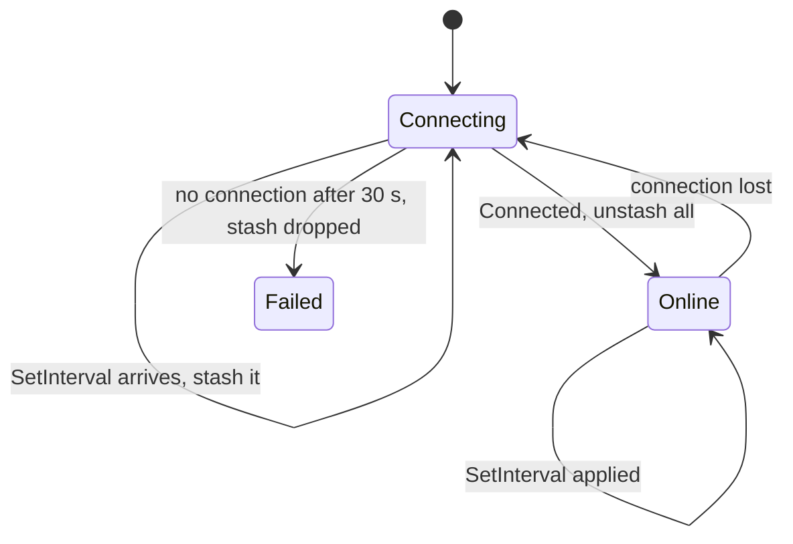

**Story.** Device actor 42 starts by opening a connection to its thermostat. A `SetInterval` command arrives before the connection is up. The actor cannot apply it yet, and must not lose it. So it stashes the command. When `Connected` arrives, it switches to its online behaviour and takes the stashed command back first.

**How it works.**
1. An actor's handler is its **behaviour**. `Become` swaps it for another one.
2. Each behaviour handles the messages that make sense in that state. This is a state machine with no flags.
3. In `Connecting`, a command it cannot handle yet is put in the **stash**, a side buffer.
4. `Connected` arrives. The actor calls `Become(Online)` and unstashes all.
5. The stashed messages go back to the front of the mailbox, in their original order.
6. `Online` handles them as if they had just arrived.

### In code

The pseudo code first. The current handler is the state. Early messages wait in a stash with a limit and a timer.

```text
behaviour = Connecting
Connecting(m):
  if m is Connected:      become(Online); unstashAll()   # to the front, in order
  if m is ConnectTimeout: drop stash to dead letters; become(Failed)
  else if stash.size < capacity: stash(m)
  else: dead letters
Online(m):
  on SetInterval(s): interval = s
  on GetState: reply(interval)
```

The same in Go. `become` swaps a function value. `unstashAll` puts the stash in front of the messages still pending.

```go
func (d *Device) become(b func(*Device, Msg)) { d.behavior = b }

func connecting(d *Device, m Msg) {
	switch m.(type) {
	case Connected:
		d.become(online)
		d.unstashAll()
	case ConnectTimeout:
		d.dead += len(d.stash)
		d.stash = nil
		d.become(failed)
	default:
		d.stashMsg(m) // not now: keep it, in order
	}
}

func (d *Device) unstashAll() {
	d.pending = append(d.stash, d.pending...) // back to the front, in order
	d.stash = nil
}
```

Run it: `handbook/code/06-become-and-stash/` with `cd handbook/code/06-become-and-stash && go run .`. It shows two stashed messages applied after Connected. Then 5,000 stashed with no limit, a forgotten unstash that leaves the interval at 60 s, and the fix: capacity 100, a 30 s timeout, and all 5,000 messages in dead letters.

**What goes wrong.** The connection never comes. The stash grows with every command, without a limit, until memory runs out. Or the actor forgets to unstash, and the commands sit there forever. Fix: a timeout in `Connecting` that fails or stops the actor. Give the stash a capacity, and unstash on every switch to `Online`.

**Where you use it.**
- Connection actors: connecting, online, reconnecting.
- Any actor with a start-up phase: loading state, waiting for a lease, recovering events.
- Akka `Become` and `Stash`, Akka Typed behaviours, Erlang `gen_statem`.

> Say it: "Become swaps the actor's handler so each state handles only what makes sense, and stash holds what arrives too early, always with a timeout and a limit."

▶ Watch it move: [Become and stash](visual/06-become-and-stash.html)

## Actor lifecycle and death watch

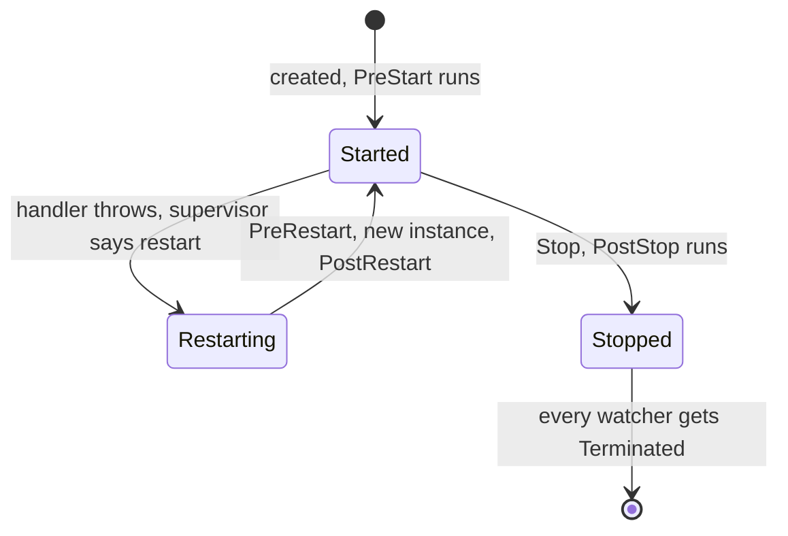

**Story.** A dashboard session actor shows a user the live state of device 42. It watches device 42. The device is unregistered and its actor stops. The session actor receives a `Terminated` message, shows "offline", and stops sending to a dead reference.

**How it works.**
1. Create: the runtime builds the actor and runs `PreStart`. Open resources here.
2. Restart: `PreRestart` on the old instance, a new instance, then `PostRestart`. The mailbox stays.
3. Stop: the actor finishes its current message, its children stop first, then `PostStop` runs. Close resources here.
4. **Death watch**: any actor can call `Watch(ref)` on any other, not only its children.
5. When the watched actor stops, for any reason, the watcher gets one `Terminated(ref)` message.
6. That works across nodes too: a node that dies counts as all its actors stopping.

### In code

The pseudo code first. The runtime calls the hooks. A stop tells every watcher exactly once.

```text
create:  instance = new Device(); instance.PreStart()      # open here, never in the constructor
restart: old.PostStop(); instance = new Device(); instance.PreStart()   # same mailbox
stop:    PostStop(); for each watcher: tell(watcher, Terminated(self))
watcher on Terminated(who): show offline; unwatch(who)
watcher with no Terminated handler: fails with DeathPactException
```

The same in Go. The loop owns one mailbox. It swaps instances on a restart and tells the watchers on a stop.

```go
d := newDevice(leaky)
d.PreStart()
for m := range mailbox {
	switch m.(type) {
	case Fail:
		d.PostStop() // PreRestart on the old instance calls PostStop
		d = newDevice(leaky)
		d.PreStart()
	case Stop:
		d.PostStop()
		for _, w := range *watchers {
			w <- Terminated{name} // death watch: exactly once per watcher
		}
		return
	}
}
```

Run it: `handbook/code/06-lifecycle-and-death-watch/` with `cd handbook/code/06-lifecycle-and-death-watch && go run .`. Paired hooks go from 1 to 0 open connections. The constructor leak ends with 3 open after two restarts. Watchers that handle `Terminated` show offline. Watchers that do not, fail with `DeathPactException`.

**What goes wrong.** Watching without handling `Terminated`. In classic Akka an unhandled `Terminated` makes the watcher fail with a `DeathPactException`, so one stopped device takes down every session watching it. A second trap: opening a resource in the constructor and closing it nowhere, so every restart leaks one. Fix: handle `Terminated` in every behaviour of a watcher. Pair every open in `PreStart` with a close in `PostStop`.

**Where you use it.**
- Session or subscription actors that watch the entity they show.
- A parent that must react when a child stops for good, not only when it fails.
- Erlang monitors work the same way. Links are the stricter form: one dies, both die.

> Say it: "Supervision is for a parent deciding about a failure, death watch is for anyone who needs to know an actor stopped, and they get it as a Terminated message."

▶ Watch it move: [Lifecycle and death watch](visual/06-lifecycle-and-death-watch.html)

## Supervision and let it crash

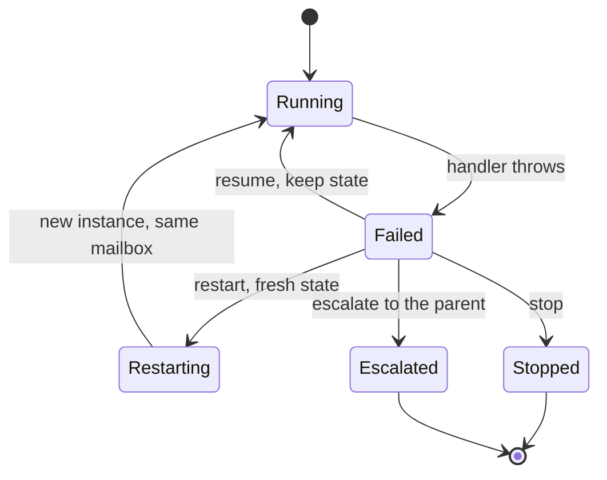

**Story.** Device 42 sends a corrupt packet. The actor does not catch the parse error. It throws, and its parent, the devices supervisor, decides. A bad packet should not reset a device, so the parent resumes it. A broken connection is different: the parent restarts the actor, so it reconnects from a clean state.

**How it works.**
1. Every actor has a parent. Actors form a tree, and the tree is also the naming scheme: `/user/devices/device-42`.
2. A child throws. The parent's strategy picks one of four.
3. **Resume:** keep state, drop the message, continue.
4. **Restart:** throw away the instance, build a new one with fresh state. The mailbox is kept.
5. **Stop:** remove the actor.
6. **Escalate:** the parent fails too, and its own parent decides.
7. One-for-one applies to the failed child. All-for-one applies to every sibling.

### In code

The pseudo code first. The child never catches. The runtime reports the crash, and the parent's decider picks one of four answers.

```text
actor loop: m = mailbox.take(); handle(m)     # no try/catch: let it crash
runtime: on a crash, tell parent Failed(child, error)
parent decider(error):
  ParseError      -> Resume     # keep state, drop the message
  ConnectionError -> Restart    # fresh instance, same mailbox
  DeviceRemoved   -> Stop       # queued messages to dead letters
  unknown         -> Escalate   # a restarted parent restarts all children
restart limit: 3 in 1 minute, backoff 1 s, 2 s, 4 s, then Stop and alert
```

The same in Go. `recover` plays the runtime. The loop over the mailbox channel applies the decider.

```go
func runOne(c *Child, m string) (failed bool) {
	defer func() {
		if r := recover(); r != nil {
			failed = true
		}
	}()
	c.handle(m)
	return false
}

for m := range c.mailbox { // the failing message is already off the queue
	if !runOne(c, m) {
		continue
	}
	switch d := decide(); d {
	case Resume:
	case Restart:
		c.readings = 0 // a fresh instance, the same mailbox
	case Stop:
		return
	case Escalate:
		for _, s := range siblings {
			s.readings = 0
		}
		return
	}
}
```

Run it: `handbook/code/06-actor-mailbox-and-supervision/` with `cd handbook/code/06-actor-mailbox-and-supervision && go run .`. It prints readings after each directive: Resume 7, Restart 2, Stop with 2 dead letters, Escalate with all three at 0. Then the poisoned message stops after 3 restarts. The overflow grows to 800, 48,000 and 2,880,000, and stays at 1,000 when bounded.

**What goes wrong.** A poisoned message that crashes the actor on every restart. That is a tight loop and an outage. Fix: a restart limit in a time window, with backoff. After the limit, stop the actor and alert.

**Where you use it.**
- Unexpected errors: let it crash, the supervisor restores a known good state.
- Expected errors, like a bad request: send a reply, do not crash.
- A flat tree with one parent for everything is a trap. One escalate restarts everything.

> Say it: "Let it crash means error handling lives in one place: the parent resumes, restarts, stops or escalates, with a restart limit so a poisoned message cannot loop."

▶ Watch it move: [Actor mailbox and supervision](visual/06-actor-mailbox-and-supervision.html)

## Supervision strategies: one-for-one and all-for-one

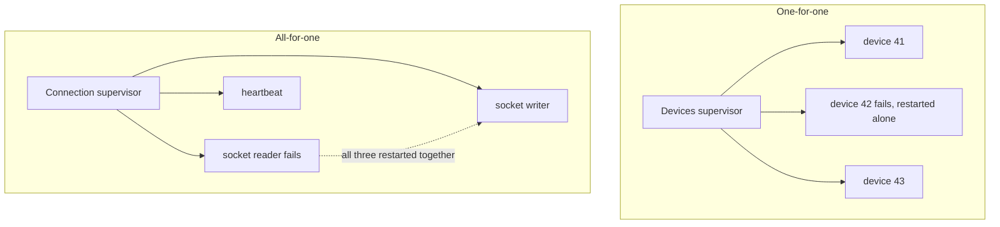

**Story.** Under the devices supervisor, each device actor stands alone. When device 42 fails, only device 42 restarts. Under a connection supervisor, a socket reader, a socket writer and a heartbeat share one TCP socket. When the reader fails, the socket is broken for all three, so all three restart together.

**How it works.**
1. A supervisor has a **strategy**: which children a directive applies to.
2. **One-for-one**: the directive (resume, restart, stop) hits only the failed child.
3. **All-for-one**: the directive hits every sibling, as one unit.
4. Erlang adds **rest-for-one**: the failed child and every child started after it.
5. Every strategy also has a restart limit, such as 3 restarts in 1 minute. Past it, the supervisor gives up and escalates.

### In code

The pseudo code first. The directive says what happens. The strategy builds the list of children it hits.

```text
on Failed(child, error):
  if restarts in the last minute >= 3: stop child; escalate; return
  restarts += 1
  targets = strategy.targets(child)
    one-for-one:  only the child
    all-for-one:  every child
    rest-for-one: the child and all started after it
  for t in targets: restart(t)     # fresh instance, same mailbox
group on restart: open a new socket, give it to every target
```

The same in Go. The strategy is one small function. The restart is a message to the child's own mailbox.

```go
func (s *Supervisor) targets(failed *Child) []*Child {
	switch s.strategy {
	case AllForOne:
		return s.children
	case RestForOne:
		for i, c := range s.children {
			if c == failed {
				return s.children[i:] // the child and all started after it
			}
		}
	}
	return []*Child{failed}
}
```

Run it: `handbook/code/06-supervision-strategies/` with `cd handbook/code/06-supervision-strategies && go run .`. One-for-one restarts 1 child, and the fourth failure stops it and escalates. All-for-one restarts 3 onto socket 2. Rest-for-one leaves the reader alone. The two mistakes show 10,000 restarts from one packet, and a writer still on dead socket 1.

**What goes wrong.** All-for-one on the devices supervisor. One bad packet from device 42 restarts ten thousand devices. Or the reverse: one-for-one on the connection, so the reader restarts with a new socket while the writer keeps the dead one. Fix: one-for-one when children are independent, all-for-one when they share a resource or only make sense together.

**Where you use it.**
- Entity actors (devices, sessions, carts): one-for-one, the default.
- Children that share a connection, a file, or a protocol state: all-for-one.
- Erlang OTP supervisors: `one_for_one`, `one_for_all`, `rest_for_one`.

> Say it: "One-for-one restarts only the failed child and fits independent entities, all-for-one restarts the whole group and fits children that share a resource."

▶ Watch it move: [Supervision strategies](visual/06-supervision-strategies.html)

## Restart backoff and the poisoned message

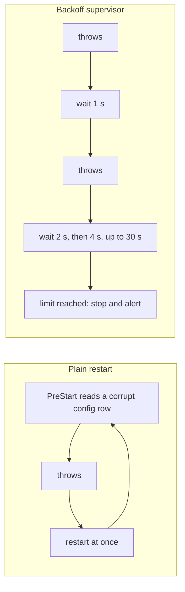

**Story.** Device actor 42 reads its configuration row in `PreStart`. A bad migration left that row corrupt. The actor throws, restarts at once, throws again, many times a second. The log fills, the database takes a query storm, and the CPU (central processing unit) spins on one device. A backoff supervisor waits longer after each failure, and after a limit stops the actor and raises an alert.

**How it works.**
1. A **poisoned message** or poisoned state fails every time it is handled. A restart cannot fix it.
2. A plain restart retries at once, so the failure becomes a tight loop.
3. A **backoff supervisor** waits before each restart: minimum 1 s, doubling, up to a maximum such as 30 s.
4. It adds jitter, a random part, so a thousand failing actors do not restart in step.
5. A restart limit counts failures in a time window. Past it the actor is stopped and an alert fires.
6. The cause is fixed by a person, not by more restarts.

### In code

The pseudo code first. Each failure buys a longer wait, the jitter spreads the herd, and the limit tells a person.

```text
on Failed(child):
  failures += 1
  if failures >= 4: stop child; alert; return
  wait = min(1 s * 2^(failures - 1), 30 s)    # 1, 2, 4 ... 30
  wait += random(0, 20% of wait)              # jitter
  after wait: start child
# a poisoned Kafka record:
record = partition.read(offset)
try handle(record); commit(offset + 1)
on failure: tries += 1
  if tries < 3: read the same offset again
  else: deadLetter.write(record, error); commit(offset + 1)
```

The same in Go. The supervisor is a goroutine reading failures from a channel. A timer sends the next start.

```go
case Failed:
	failures++
	if failures >= 4 { // the limit: 4 tries
		return
	}
	base, wait := nextWait(failures, r)
	fmt.Printf("  t=%4.1f s: failure %d, wait %.0f s + jitter = %.2f s\n", t, failures, base, wait)
	time.AfterFunc(time.Duration(wait*float64(time.Millisecond)), func() { in <- Start{} })
```

Run it: `handbook/code/06-restart-backoff/` with `cd handbook/code/06-restart-backoff && go run .`. Backoff stops after 4 queries in about 8 s, where a plain restart makes about 1,600 at an assumed 5 ms a try. Jitter lowers the busiest 10 ms from 1,000 queries to 66. Without a dead-letter topic the offset sticks at 9001. With one, the lag reaches 0.

**What goes wrong.** No limit and no backoff. One corrupt row becomes a CPU, log and database storm, and the same happens to a persistent actor replaying a bad event at every start. Fix: backoff with jitter, a restart limit, an alert on the restart rate. For a bad message from outside, move it to a dead-letter queue instead of retrying it.

**Where you use it.**
- Akka `BackoffSupervisor` around actors that touch databases or devices.
- Kubernetes `CrashLoopBackOff` is the same idea for pods.
- Kafka consumers: a poison record goes to a dead-letter topic, so the partition can move on.

> Say it: "A restart cannot fix a poisoned message, so I restart with exponential backoff and jitter, cap the restarts, and alert, and bad input goes to a dead-letter queue."

▶ Watch it move: [Restart backoff](visual/06-restart-backoff.html)

## Mailbox overflow and back-pressure

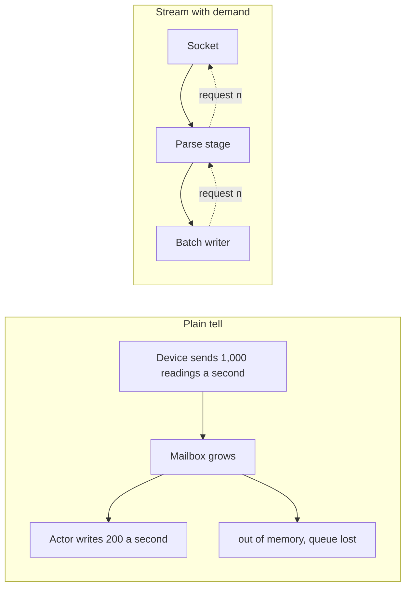

**Story.** A device actor receives readings faster than it can persist them. The mailbox grows for an hour. Then the process dies with out of memory, and every queued reading is lost on restart. Removing locks did not remove overload. It moved it into memory.

**How it works.**
1. A plain tell has no back-pressure. A fast sender always wins.
2. A **bounded mailbox** has a size limit and an overflow rule: drop newest, drop oldest, or block the sender briefly.
3. **Back-pressure** reverses the flow of control: the consumer asks for n items, the producer sends at most n. Reactive Streams is that contract.
4. Akka Streams builds pipelines on it. When the writer slows, demand falls, the socket reads less, and the device buffers on its side.

### In code

The pseudo code first. Tell never checks, so the difference between in and out lands in memory. A bound refuses it. A stream never asks for it.

```text
sender: tell(writer, reading)     # 1,000 a second, never checks
writer: take one, persist         # 200 a second
depth grows by 800 a second, and the heap fills
# bounded, capacity 10,000:
tell: if depth < 10,000: put
  else if pushTimeout == 0: deadLetters += 1
  else: block the sender          # its thread stalls
# stream:
writer: request(200)
source: read at most 200 from the socket, send them down
socket not read: TCP slows the device down
```

The same in Go. `select` with `default` is a bounded mailbox that drops. A demand channel is the stream.

```go
select {
case mailbox <- Reading{}:
default:
	dead++ // full: dead letters, counted
}

demand <- out // the writer asks for 200
for i := 0; i < out; i++ {
	<-data
}

for n := range demand { // only what was asked
	for i := 0; i < n; i++ {
		data <- Reading{}
	}
}
```

Run it: `handbook/code/06-mailbox-overflow/` with `cd handbook/code/06-mailbox-overflow && go run .`. The plain tell reaches 800, 48,000 and 2,880,000 waiting. The bounded mailbox fills in 12.5 s, then drops 800 a second. The stream reads 12,000 in 60 s, and the device holds back 48,000. A tell in the middle gives 48,000 in the mailbox again, and an ack keeps it at 1.

**What goes wrong.** A stream feeding an actor with a plain tell in the middle. The tell has no demand signal, so the mailbox grows anyway. Fix: keep the pipeline a stream end to end, or bound that mailbox.

**Where you use it.**
- Telemetry ingest: streams with demand.
- Actors that must stay actors: a bounded mailbox and a metric on its depth. Mailbox depth is the health signal of an actor system.

> Say it: "Actors swap lock contention for mailbox growth, so I bound mailboxes, alert on their depth, and use streams with demand for pipelines."

▶ Watch it move: [Mailbox overflow](visual/06-mailbox-overflow.html)

## Mailbox types: unbounded, bounded, priority

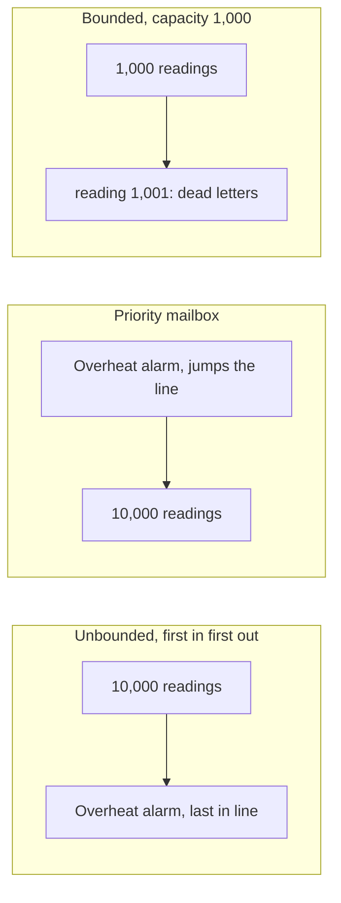

**Story.** Device actor 42 has ten thousand readings in its mailbox after a network catch-up. An overheat alarm arrives last. In a plain first-in-first-out mailbox it waits behind every reading. With a priority mailbox the alarm goes to the front and is handled next. A bounded mailbox would have refused the flood earlier.

**How it works.**
1. The default mailbox is **unbounded** and first in, first out: fair, and no limit.
2. A **bounded** mailbox has a capacity. When full, a new message waits briefly, then goes to dead letters.
3. A **priority** mailbox orders messages by a rule you write, such as alarms before readings.
4. A **control-aware** mailbox lets system messages, such as stop, jump the queue.
5. The mailbox type is configuration. The actor's code does not change.

### In code

The pseudo code first. The mailbox type decides the order and the limit. The actor code never changes.

```text
plain:    put at the back, take from the front
priority: priority(m): Alarm -> 0, Reading -> 1
          put(m): insert by (priority(m), arrival number)
          take(): lowest pair first
bounded:  put(m): if depth < 1,000: put at the back
            else wait pushTimeout for room
            still full: deadLetters += 1
fix:      the sender collapses repeated alarms, pushTimeout = 0
```

The same in Go. The priority mailbox is a heap ordered by rank, then arrival. The bounded mailbox is a channel with a capacity.

```go
func rank(m Msg) int {
	if m.Kind == "alarm" {
		return 0 // alarms before readings
	}
	return 1
}

func (q queue) Less(i, j int) bool {
	if rank(q[i]) != rank(q[j]) {
		return rank(q[i]) < rank(q[j])
	}
	return q[i].seq < q[j].seq
}

select {
case mailbox <- Msg{Kind: "reading"}:
	accepted++
default:
	dead++
}
```

Run it: `handbook/code/06-mailbox-types/` with `cd handbook/code/06-mailbox-types && go run .`. The alarm waits behind 10,000 readings in the plain mailbox and behind 1 in the priority one. A faulty sensor gives 1,000 alarms and 0 readings, and collapsing gives 1 alarm and 999 readings. The bounded mailbox accepts 1,000 and sends 9,000 to dead letters. A 50 ms push timeout would hold a shared thread for 450 s.

**What goes wrong.** A priority mailbox under steady alarm traffic. Low-priority readings never reach the front, which is starvation. A bounded mailbox set to block the sender stalls the sender's thread, which can starve a dispatcher. Fix: priority for rare urgent messages only. A bounded mailbox drops and counts, never blocks for long. Alert on its dead letters.

**Where you use it.**
- Alarms, stop and configuration ahead of telemetry: priority or control-aware.
- An actor fed by an untrusted fast source: bounded, with a dead-letter metric.
- Akka mailbox types, set per actor or per dispatcher in configuration.

> Say it: "The default mailbox is unbounded first-in-first-out, a bounded one drops past its capacity, and a priority one lets rare urgent messages jump the line, at the risk of starving the rest."

▶ Watch it move: [Mailbox types](visual/06-mailbox-types.html)

## Reactive Streams and Akka Streams

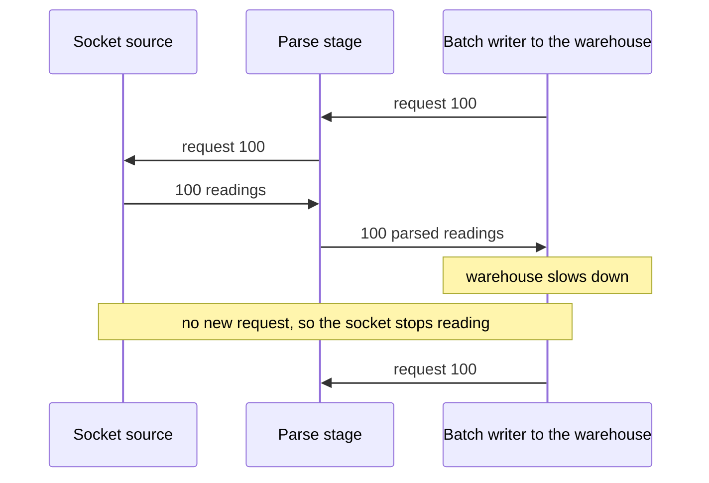

**Story.** Telemetry flows from a socket, through a parse stage, into a batch writer for the warehouse. The warehouse slows down during a big load. The writer stops asking for more. The parse stage stops asking the socket. The socket stops reading, and TCP tells the devices to slow down. Nothing grows in memory.

**How it works.**
1. **Reactive Streams** is a small standard with four parts: publisher, subscriber, subscription, processor.
2. The subscriber calls `request(n)`. The publisher may send at most n items.
3. Demand flows upstream, data flows downstream. A slow consumer slows the whole chain.
4. **Akka Streams** builds pipelines on it: a `Source`, some `Flow` stages, a `Sink`.
5. Each stage has a small fixed buffer. Running the graph is called materializing it.
6. At the edge, demand meets TCP: the socket stops reading and TCP flow control slows the sender.

### In code

The pseudo code first. Demand goes up, data comes down, and no stage sends more than was asked.

```text
writer: request(100) to parse           # demand starts at the slowest end
parse: pass it on: request(100) to source
source: read at most that many from the socket, send down
every link has a small buffer: 16
warehouse slow: writer sends no request # silence means send nothing
buffer full: that stage stops taking; source stops reading; TCP slows the devices
# a plain tell in the middle always succeeds, so the demand signal stops there
fix: tell one, wait for the ack, then the next
```

The same in Go. Stages are goroutines. A demand channel runs up, and small buffered channels run down.

```go
func (p *Pipeline) batch() {
	p.demand <- 100
	for i := 0; i < 100; i++ {
		<-p.toWriter
	}
}

for n := range upstream {
	for i := 0; i < n; i++ {
		p.read.Add(1)
		p.toParse <- Reading{i} // blocks when the buffer is full
	}
}
```

Run it: `handbook/code/06-reactive-streams/` with `cd handbook/code/06-reactive-streams && go run .`. A slow warehouse leaves 16 of 16 in each buffer and 151 of 200 asked read, and nothing is lost. A tell in the middle reaches 5,000 and then 201,000 in the mailbox. An ack keeps it at 1. The big dropping buffer loses 194,100 readings in 60 s with no error.

**What goes wrong.** A stage that hands items to an actor with a plain tell, such as `Sink.actorRef`. It has no demand signal, so the actor's mailbox grows and back-pressure is gone. A huge `buffer` stage with a drop strategy hides lost data too. Fix: `Sink.actorRefWithBackpressure` or `ask` with a parallelism limit. Keep buffers small and explicit.

**Where you use it.**
- Telemetry ingest into the warehouse, Kafka into a database with Alpakka.
- Project Reactor, RxJava and Akka Streams all speak Reactive Streams. Go gets the same effect with bounded channels.

> Say it: "Reactive Streams makes demand flow upstream, request n and the producer sends at most n, so a slow consumer slows the source instead of filling memory."

▶ Watch it move: [Reactive Streams](visual/06-reactive-streams.html)

## Dispatchers: many actors, few threads

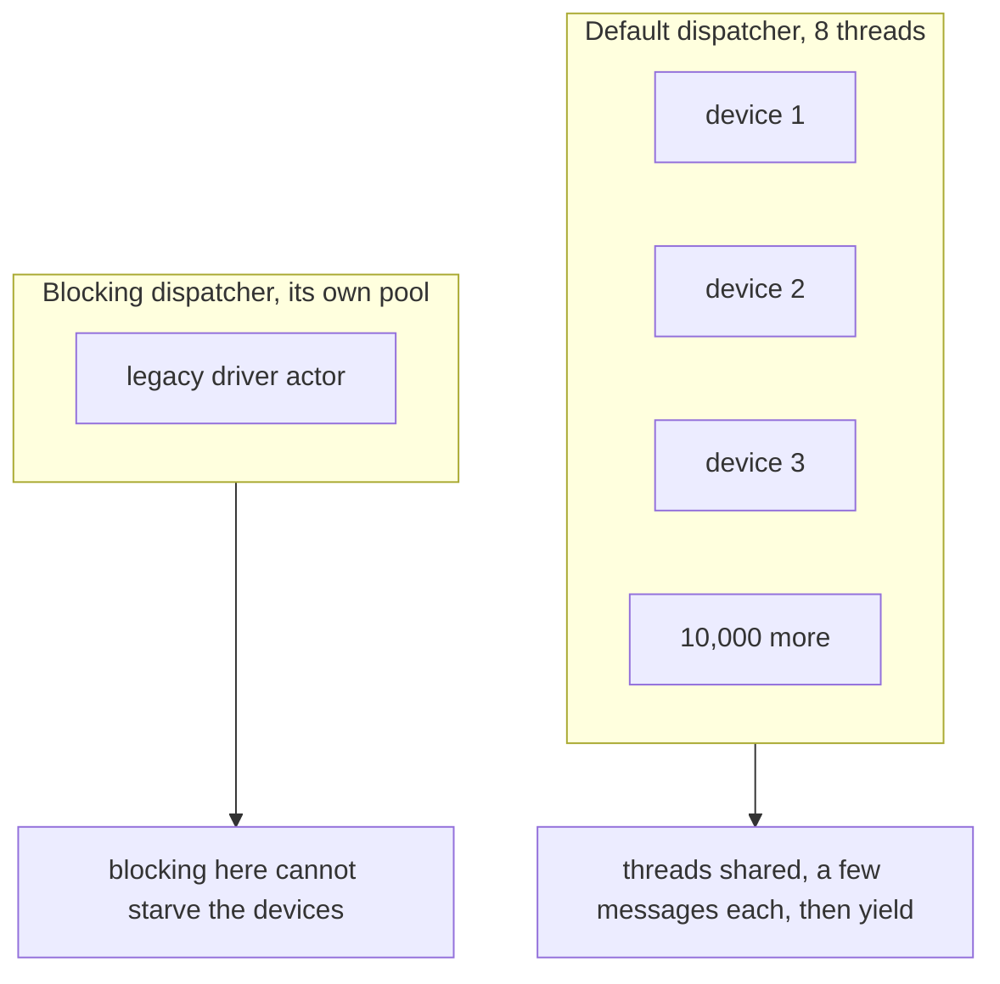

**Story.** Ten thousand device actors share eight threads. Each actor runs a few messages, then gives its thread back. One actor calls a legacy database driver that blocks for two seconds. If it shares the default pool, eight such calls freeze every device.

**How it works.**
1. A **dispatcher** schedules actors onto a thread pool.
2. An idle actor costs a few hundred bytes and no thread.
3. When a message arrives, the actor is given a thread, runs a batch, and yields.
4. Blocking work gets its own dispatcher, a **bulkhead**, so it can only starve itself.

### In code

The pseudo code first. Threads run actors in turns. A handler that blocks takes one thread out of the turns.

```text
tell(actor, m): actor.mailbox.put(m)
  if actor has no turn yet: runQueue.put(actor)
each of the 8 threads, forever:
  actor = runQueue.take()
  run at most 5 of its messages       # throughput: a batch
  give the thread back
  if it still has mail: runQueue.put(actor)
# the trap: on Query: db.querySync()  # holds this thread for 2 s
# fix 1: legacy actors run on a blocking dispatcher with 2 threads
# fix 2: on Query: pipeTo(db.queryAsync(), self)
```

The same in Go. Workers range over a run queue. An actor enters the queue only when it has mail.

```go
func (a *Actor) Tell(m func()) {
	a.mailbox <- m
	if a.scheduled.CompareAndSwap(false, true) {
		a.d.runQ <- a
	}
}

func (a *Actor) runBatch() {
	for i := 0; i < a.d.throughput; i++ {
		select {
		case m := <-a.mailbox:
			m()
		default:
			i = a.d.throughput
		}
	}
	a.scheduled.Store(false)
	if len(a.mailbox) > 0 && a.scheduled.CompareAndSwap(false, true) {
		a.d.runQ <- a
	}
}
```

Run it: `handbook/code/06-dispatchers/` with `cd handbook/code/06-dispatchers && go run .`. 10,000 idle actors add 0 goroutines. Eight blocking calls on the shared pool make the overheat alarm wait about 2 s. On their own pool of 2 threads the alarm waits 0.0 s, and the calls take 8 s. With an async call the alarm waits 0.0 s, and the calls take 2 s.

**What goes wrong.** `Thread.Sleep` (Akka.NET / Orleans shape, not compiled here) or a synchronous call in a handler, on the shared dispatcher. It stalls that actor and steals a thread from all the others. Fix: async calls with pipe-to, or move the blocking actor to its own pool.

**Where you use it.**
- Default dispatcher for ordinary actors.
- A separate pool for file, legacy driver or CPU-heavy actors.

> Say it: "Millions of actors share a handful of threads, so one blocking handler starves them all, and blocking work goes on its own dispatcher."

▶ Watch it move: [Dispatchers](visual/06-dispatchers.html)

## Routers: spreading work

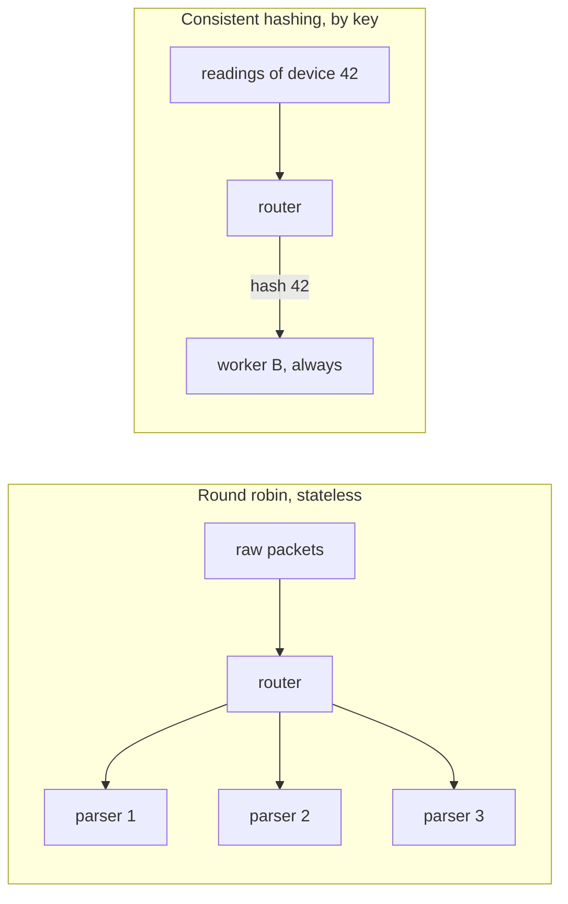

**Story.** Raw packets need parsing, and any parser will do, so a router hands them out round robin. Readings for one device must stay in order. So a second router hashes the device id and always sends device 42 to the same worker.

**How it works.**
1. A **router** stands in front of a pool of routees.
2. Round robin gives each message to the next routee.
3. Consistent hashing sends the same key to the same routee.
4. That routee can then hold state for that key and keep its order.

### In code

The pseudo code first. Round robin reads a counter. A consistent hash router reads the key.

```text
round robin, on message m:
  routees[next % n].tell(m); next += 1     # only a counter
smallest mailbox: send to the shortest queue
consistent hash, on message m:
  h = hash(m.deviceId)
  w = first ring point clockwise from h    # same key, same worker
  w.tell(m)                                # one mailbox keeps the order
pool changes: remove the worker's points   # only its keys move
```

The same in Go. A goroutine reading a channel is each worker. The ring is a sorted list of hash points.

```go
func (r *RoundRobin) Pick() *Worker {
	w := r.workers[r.next%len(r.workers)]
	r.next++
	return w
}

func (r Ring) Lookup(device int) string {
	h := crc32.ChecksumIEEE([]byte(fmt.Sprintf("device-%d", device)))
	i := sort.Search(len(r), func(i int) bool { return r[i].hash >= h }) // first point clockwise
	return r[i%len(r)].worker
}
```

Run it: `handbook/code/06-routers/` with `cd handbook/code/06-routers && go run .`. Parser 2 holds 4 waiting packets under round robin and 0 under smallest mailbox. Round robin leaves the store at the older 21.5 C. Hashing keeps device 42 on worker B and ends at 21.7 C. When worker B leaves, the ring moves 3,111 of 10,000 devices, where plain modulo moves 6,666.

**What goes wrong.** Round robin for stateful work. Two readings for device 42 land on two workers and are applied out of order. Fix: consistent hashing by the entity key.

**Where you use it.**
- Stateless work: parsing, enrichment, round robin.
- Keyed work inside one node: consistent hashing. Across nodes, use cluster sharding instead.

> Say it: "Round robin for stateless work, consistent hashing by key when order or state per key matters."

▶ Watch it move: [Routers](visual/06-routers.html)

## Delivery guarantees

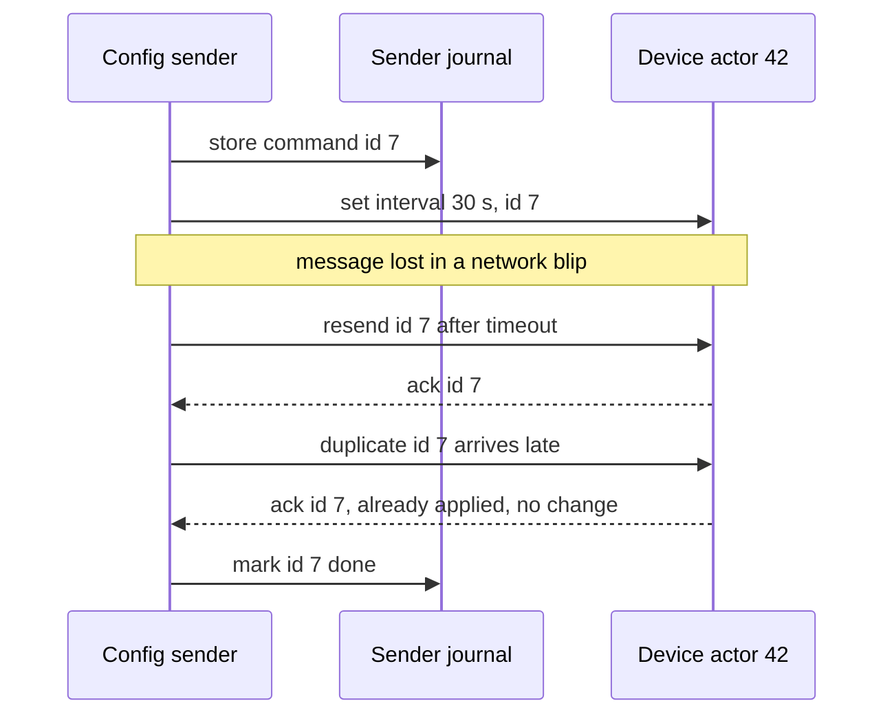

**Story.** Telemetry is fine at most once. A lost reading is replaced seconds later. A configuration command is not. So the sender stores it, resends until the device actor acknowledges, and the actor ignores a command id it has already applied.

**How it works.**
1. **At most once** is the default: a send may be lost, is never repeated. Local sends almost never fail. Remote ones can.
2. **At least once** needs a sender journal, an acknowledgement, and a resend on timeout.
3. Duplicates now happen, so the receiver must be **idempotent**, or de-duplicate by message id.
4. At least once plus idempotency looks like exactly once from outside. True exactly once across a network does not exist.
5. Order is kept between one sender and one receiver, not across several.

### In code

The pseudo code first. At least once is four parts: a journal, an ack, a resend and an idempotent receiver.

```text
sender:
  journal.store(id, pending)               # before the send
  send(command, id)
  if no ack before the timer: send again   # where duplicates come from
  on Ack(id): journal.mark(id, done)
  after a crash: resend every pending id
receiver, on Command(id, change):
  if id in seen: tell(sender, Ack(id)); return
  apply(change); seen.add(id)
  tell(sender, Ack(id))
```

The same in Go. The sender is a `select` over the ack channel and a timer. The receiver is a goroutine reading its mailbox.

```go
j[cmd.ID] = "pending" // store first
for {
	select {
	case a := <-acks:
		j[a.ID] = "done"
		return
	case <-time.After(20 * time.Millisecond):
		mb <- cmd
	}
}

case Command:
	if rememberIDs && seen[v.ID] {
		fmt.Printf("  device 42: id %d already seen, no change, ack again\n", v.ID)
	} else {
		if v.Add != 0 {
			interval += v.Add
		} else {
			interval = v.Set
		}
		seen[v.ID] = true
	}
	if ackTo != nil {
		ackTo <- Ack{v.ID}
	}
```

Run it: `handbook/code/06-delivery-guarantees/` with `cd handbook/code/06-delivery-guarantees && go run .`. A lost command leaves the interval at 60 s. With the seen set, the late copy of id 7 changes nothing. A duplicate `add 5 s` without the set gives 40 s, and both fixes give 35 s.

**What goes wrong.** At least once without idempotent handling. A duplicate "add 5" makes 10. Fix: absolute commands ("set to 30") or a seen-id set.

**Where you use it.**
- Readings: at most once, cheap.
- Commands that change state: at least once with ids.

> Say it: "Actors deliver at most once by default, and for at least once I add a sender journal, acknowledgements and an idempotent receiver."

▶ Watch it move: [Delivery guarantees](visual/06-delivery-guarantees.html)

## Persistence: events and snapshots

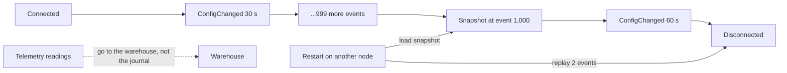

**Story.** Device 42's actor stores events, not state: `Connected`, `ConfigChanged`, `Disconnected`. Its node dies. On another node the actor loads its last snapshot and replays the two events after it. It is back exactly where it was.

**How it works.**
1. The actor handles a command and decides an outcome.
2. It writes the outcome as an **event** to a journal.
3. Only after the write does it apply the event to its state.
4. Every thousand events or so it writes a **snapshot**.
5. On restart it loads the newest snapshot and replays only the events after it.

### In code

The pseudo code first. Write the event, then apply it. Recovery uses the same `apply`.

```text
on command SetInterval(s):
  if s == state.interval: return     # the command decides: no event
  persist(ConfigChanged(s)), then:   # write first
    apply(event)                     # apply only after the write
    if event.seq % 1000 == 0: saveSnapshot(state)
recovery on a new node:
  state = loadSnapshot() or empty
  for event in journal after state.seq: apply(event)
  only then take messages
```

The same in Go. `apply` is the only code that changes state, and it is called from both paths.

```go
e := store.Persist(c.Kind, c.N) // write first
st.apply(e)
if every > 0 && e.Seq%every == 0 {
	snap := st
	store.snapshot = &snap
}

func recoverState(s *Store) (State, int) {
	st := State{Interval: 60}
	if s.snapshot != nil {
		st = *s.snapshot
	}
	replayed := 0
	for _, e := range s.journal[st.Seq:] {
		st.apply(e)
		replayed++
	}
	return st, replayed
}
```

Run it: `handbook/code/06-persistence-events-snapshots/` with `cd handbook/code/06-persistence-events-snapshots && go run .`. It writes 1,002 events and a snapshot at 1,000. Node 2 replays 2 events and gets the same state as node 1. Every reading as an event would be 864,000,000 events a day for 10,000 devices. With decisions only, recovery replays 3.

**What goes wrong.** Persisting every telemetry reading as an event. Millions of events per device, a huge journal, slow recovery. Fix: persist decisions and configuration only. Readings go to the warehouse in batches.

**Where you use it.**
- Any actor that must survive a restart or move between nodes.
- Persistence is what makes cluster sharding safe: a moved actor rebuilds itself.

> Say it: "A persistent actor stores events and rebuilds by replay from its last snapshot, and I persist decisions, never the raw telemetry."

▶ Watch it move: [Events and snapshots](visual/06-persistence-events-snapshots.html)

## Projections: read models from the journal

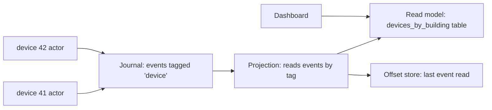

**Story.** The dashboard needs every device in building A that is offline. Asking ten thousand actors is the wrong way. Instead each device actor's events, `Connected` and `Disconnected`, are tagged. A projection reads all tagged events in order and updates a `devices_by_building` table. The dashboard runs one query against that table.

**How it works.**
1. Persistent actors write events to the journal, each with a tag such as `device`.
2. A **projection** reads the events of one tag from the journal, in order.
3. For each event it updates the **read model**, a table shaped for the query.
4. It saves its **offset**, the position of the last event it handled.
5. After a restart it continues from the saved offset.
6. The write side (actors) and the read side (tables) are separate. That split is called CQRS (Command Query Responsibility Segregation).

### In code

The pseudo code first. Where the offset is saved decides the guarantee. An idempotent update makes a replay harmless.

```text
offset = loadOffset()
for event in eventsByTag("device") from offset:
  if lastSeq[device] >= event.seq: skip    # already applied
  lastSeq[device] = event.seq
  upsert(row[device], event.online)
  saveOffset(event.seq)                    # after the write
```

The same in Go. The projection is one goroutine reading events in order. `OffsetFirst` replays the trap, and `Idempotent` the fix.

```go
for e := range mailbox {
	write(r, e, c)
	if e.Seq == c.CrashOnSeq {
		return
	}
	r.offset = e.Seq
}

func write(r *Read, e Event, c Config) {
	if c.Idempotent && r.lastSeq[e.Device] >= e.Seq {
		return
	}
	r.lastSeq[e.Device] = e.Seq
	r.online[e.Device] = e.Online // an upsert: applying it twice changes nothing
	if !e.Online {
		r.offlineCount++ // adding: applying it twice counts twice
	}
}
```

Run it: `handbook/code/06-projections/` with `cd handbook/code/06-projections && go run .`. Offset first, a crash at event 4 leaves device 41 online for ever. Offset after the write, the replay makes the offline count 3 with 2 devices offline. With the last event number per device, the replay is skipped and the count stays 2.

**What goes wrong.** Saving the offset before writing the read model. A crash in between skips that event for ever. Saving it after the write means a crash replays the event, so the write runs twice. Fix: save the offset after the write, or in the same database transaction. Make the update idempotent, such as an upsert by device id.

**Where you use it.**
- Akka Projections and Akka.NET persistence queries, Marten, EventStoreDB subscriptions.
- The IoT backend: dashboards read projected tables, never the actors.
- The read model is eventually consistent: a second behind the actors is normal.

> Say it: "Actors own the writes as events, a projection reads the journal by tag into a query table and saves its offset, and the update is idempotent because it may replay."

▶ Watch it move: [Projections](visual/06-projections.html)

## Cluster sharding

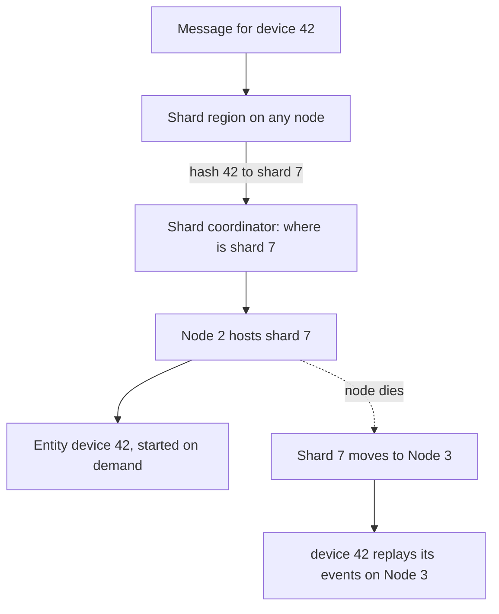

**Story.** A hundred device actors are spread over three nodes. A message for device 42 can arrive at any node. That node hashes 42 to shard 7, learns shard 7 is on node 2, and forwards it. Node 2 dies. Shard 7 moves to node 3, and device 42 rebuilds from its events there.

**How it works.**
1. Every **entity** has an id. Ids hash to **shards**, many entities per shard.
2. Each shard lives on exactly one node.
3. The local **shard region** asks the **coordinator** where a shard lives, and caches the answer.
4. The message is forwarded. The entity starts on demand if it is not running.
5. When a node joins or leaves, shards rebalance. Messages buffer briefly at the region.

### In code

The pseudo code first. The region finds the owner and asks at most once per shard. The coordinator moves only the orphan shards.

```text
region on message(id, m):
  shard = hash(id) % 10
  owner = cache[shard], else ask the coordinator    # once per shard
  if owner is me: entity(id).tell(m)                # starts on its first message
  else: forward(owner, m)
coordinator on a dead node:
  each orphan shard goes to the node with the fewest shards
  regions buffer messages for a shard with no owner, then send them on
resolver, keep majority: if my side's nodes * 2 > all nodes: stay, else down myself
```

The same in Go. Each region and the coordinator is a goroutine reading a mailbox channel.

```go
func shardOf(entity string) int { return int(crc32.ChecksumIEEE([]byte(entity)) % shards) }

for e := range r.mailbox {
	s := shardOf(e.Entity)
	owner, known := r.cache[s]
	if !known { // asked once per shard, never once per message
		r.coord.mailbox <- Where{s, reply}
		owner = <-reply
		if owner == 0 { // no owner: hold it, lose nothing
			r.buffer = append(r.buffer, e)
			continue
		}
		r.cache[s] = owner
	}
	if owner != r.node {
		r.peers[owner].mailbox <- e // forward
		continue
	}
}
```

Run it: `handbook/code/06-cluster-sharding/` with `cd handbook/code/06-cluster-sharding && go run .`. `entity-42` hashes to shard 7 on node 2, and the coordinator is asked once for 2 messages. When node 2 dies, the reading waits in the buffer, shards 7 and 4 go to node 3 and shard 3 to node 1, and device 42 rebuilds from a snapshot plus 2 events. In the split, side A with 2 of 3 stays and side B downs itself.

**What goes wrong.** A shard key with few distinct values, or uneven traffic. All entities pile into a few shards on a few nodes. Fix: a high-cardinality key with even traffic, such as the device id, and more shards than nodes (about ten per node).

**Where you use it.**
- Device actors sharded by device id across ingest nodes.
- Classic Akka gets "virtual actor" behaviour only through sharding.

> Say it: "Sharding hashes each entity id to a shard, places each shard on one node, routes messages by id, and moves shards when nodes change, with persistence so actors rebuild."

▶ Watch it move: [Cluster sharding](visual/06-cluster-sharding.html)

## Passivation and remember entities

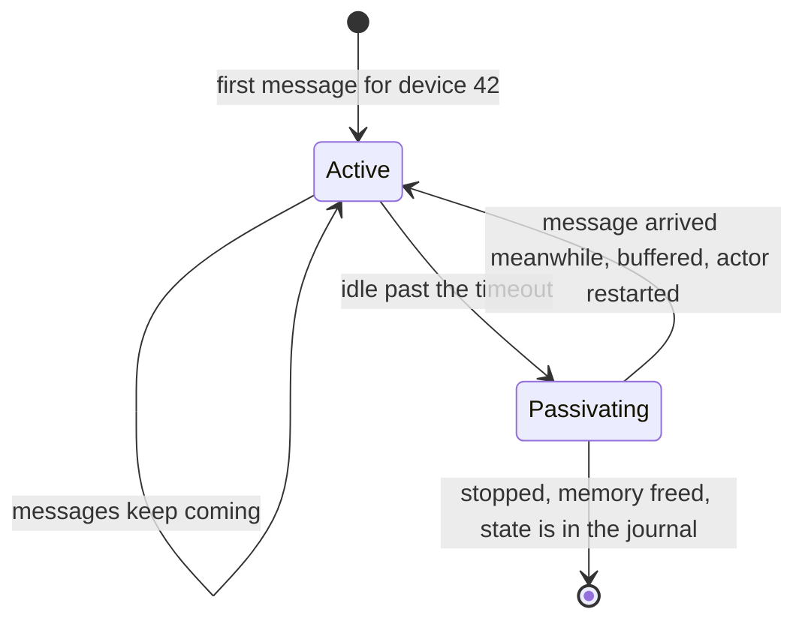

**Story.** A million devices are sharded across the cluster. Most report once an hour. Keeping a million actors in memory for one message an hour wastes most of the heap. So an idle device actor is passivated: stopped, its memory freed. The next message for it starts it again, and it replays its state from the journal.

**How it works.**
1. Sharding starts an entity on its first message.
2. After an idle timeout, such as two minutes, the entity is **passivated**: asked to stop.
3. Messages that arrive while it stops are buffered by its shard, not lost.
4. The next message starts a fresh instance, which recovers from its snapshot and events.
5. **Remember entities** is the opposite choice: the shard records which entities are running and restarts all of them after a rebalance or a crash.

### In code

The pseudo code first. The shard checks idle time, buffers while an entity stops, and starts it again when a message waits.

```text
shard on message(device, m):
  if stopping[device]: buffer[device].add(m); return
  if no actor for device: start it
  lastSeen[device] = now; deliver m
on every tick: if now - lastSeen[device] >= 2 min: tell it Passivate
on Stopped(device):
  if buffer[device] is not empty: start it again, deliver the buffer
recovery: state = snapshot + events after it
```

The same in Go. The shard is one goroutine, so its tables need no lock. A simulated clock in minutes makes the run repeat.

```go
case Msg:
	if s.stopping[v.Device] { // stopping: hold it, lose nothing
		s.buffer[v.Device] = append(s.buffer[v.Device], v)
		continue
	}
	if _, up := s.active[v.Device]; !up {
		s.start(v.Device)
	}
	s.active[v.Device] = s.now
case Tick:
	s.now = v.Minute
	for _, d := range devices {
		last := s.active[d]
		if s.now-last >= s.idleLimit && !s.stopping[d] {
			s.stopping[d] = true
		}
	}
```

Run it: `handbook/code/06-passivation/` with `cd handbook/code/06-passivation && go run .`. Device 42 passivates at 09:03, its command waits in the buffer, and it recovers: 1, 3, 2, then 3 of 8 slots. With passivation off, the ninth device runs the node out of memory. Remembering every entity makes 4 recoveries with no message waiting, and only the timer entity makes 1.

**What goes wrong.** No passivation: memory grows with every device that ever sent a message, until the node runs out. The reverse trap is remember entities on a million devices. After a node restart every one of them recovers at once, a storm on the journal. Fix: passivate by idle time. Use remember entities only for the few entities that must run without a message, such as a timer per device.

**Where you use it.**
- Akka Cluster Sharding passivation, Orleans grain deactivation on idle: the same idea.
- Devices, sessions and carts with long quiet periods.

> Say it: "Passivation stops idle entities to free memory and restarts them on the next message from their events, and remember entities is only for the few that must run without one."

▶ Watch it move: [Passivation](visual/06-passivation.html)

## Gossip and failure detection

```mermaid
stateDiagram-v2
  [*] --> Joining
  Joining --> Up: leader sees all nodes agree
  Up --> Unreachable: heartbeats late, phi above threshold
  Unreachable --> Up: heartbeats return
  Unreachable --> Down: split brain resolver decides
  Up --> Leaving: graceful leave
  Leaving --> Removed
  Down --> Removed
```

**Story.** Node 3 joins a three-node Akka.NET cluster. It tells one node, and gossip spreads the news until every node agrees it is up. Later node 3 pauses for eight seconds in a long garbage collection. Its heartbeats stop. The others mark it unreachable, but not yet down. When it wakes, its heartbeats return and it is reachable again.

**How it works.**
1. Each node keeps a view of the members and their state: joining, up, leaving, removed.
2. Every second or so it **gossips** that view to a random other node. Views merge, and the cluster converges.
3. Nodes send each other heartbeats. A **phi accrual failure detector** turns late heartbeats into a suspicion level, phi.
4. When phi passes a threshold, the node is marked **unreachable**. That is a suspicion, not a verdict.
5. The leader, the first node by address, moves members between states once the views converge.
6. Unreachable becomes down only by a decision: a split brain resolver or an operator.

### In code

The pseudo code first. Gossip merges views member by member. The detector turns a late heartbeat into a number, phi.

```text
every 1 s: send my view to a random peer
on view v: for each member keep the newer status      # joining < up < down
if every view is the same: leader (lowest address) moves joining -> up
phi(t) = how unlikely a gap of t is, given the normal gap plus the pause limit
if phi > 8: mark unreachable, gossip it               # a suspicion
unreachable -> down only by a decision: resolver, operator, auto-down
```

The same in Go. A view is a map from node to status. Phi uses Akka's formula with the pause limit added to the mean.

```go
func merge(a, b View) View {
	out := View{}
	for k, v := range a {
		out[k] = v
	}
	for k, v := range b {
		if cur, ok := out[k]; !ok || v > cur {
			out[k] = v
		}
	}
	return out
}

func phi(elapsed, mean, std, acceptable float64) float64 {
	y := (elapsed - (mean + acceptable)) / std
	e := math.Exp(-y * (1.5976 + 0.070566*y*y))
	if elapsed > mean+acceptable {
		return -math.Log10(e / (1 + e))
	}
	return -math.Log10(1 - 1/(1+e))
}
```

Run it: `handbook/code/06-gossip-failure-detection/` with `cd handbook/code/06-gossip-failure-detection && go run .`. Node 3 joins and the views converge in two rounds. With a 3 s pause limit, phi is 7.3 at 5 s and 37.6 at 6 s, so node 3 becomes unreachable. Auto-down after 2 s downs it at 8 s. With a 10 s pause limit, phi stays at 0 through the 8 s pause.

**What goes wrong.** A threshold set too low. A garbage collection pause or a busy network marks healthy nodes unreachable, and shards move for nothing. A threshold set too high means a dead node holds its shards for a long time. Fix: tune the acceptable heartbeat pause to the worst pause you measure, and fix long pauses at their source.

**Where you use it.**
- Akka Cluster, Orleans membership, Cassandra and Consul all gossip.
- The rule: unreachable is a suspicion. Down is a decision. Never auto-down on a timer.

> Say it: "Nodes gossip their membership view until it converges, a phi accrual detector turns late heartbeats into suspicion, and unreachable only becomes down by a resolver's decision."

▶ Watch it move: [Gossip and failure detection](visual/06-gossip-failure-detection.html)

## Split brain and the cluster singleton

```mermaid
flowchart LR
  subgraph SIDE_A["Side A: nodes 1 and 2"]
    A42["device 42 actor"]
  end
  subgraph SIDE_B["Side B: node 3"]
    B42["device 42 actor, second copy"]
  end
  SIDE_A x--x SIDE_B
  A42 --> J["Journal"]
  B42 --> J
  J --> BAD["two writers, conflicting state"]
  SBR["Split brain resolver: keep majority"] -- "down side B" --> SIDE_B
```

**Story.** The network between node 3 and the others breaks. Each side thinks the other died. Without a resolver, both sides start device 42 and both write its journal. The device's state forks. A split brain resolver downs the minority side, so only one copy runs.

**How it works.**
1. Nodes know each other through **gossip**: small messages about who is up.
2. A **partition** splits them into sides that cannot see each other.
3. The **resolver** waits a short stable time, then picks a side.
4. Strategies: keep the majority, keep the side with the oldest node, keep the side with a referee node, or down everything when unsure.
5. The losing side shuts itself down. Its shards move to the winner.

### In code

The pseudo code first. Both sides run the same code with a different view of the members. That is what doubles the entity.

```text
each side: members = the nodes I can reach            # auto-down
on a message for device 42:
  h = home(device 42, members)                        # node 3 sees only itself
  if no copy runs on h: start one from the journal
  apply the command, append the event                 # two writers
# with a resolver: keep majority
wait until the view is stable for 20 s
if my side has more than half of the nodes: down the other side
else: down myself
```

The same in Go. Each node is a goroutine with its own `members`. The check `2*size > 3` is the whole keep-majority rule.

```go
switch resolver {
case "auto-down":
	n.members = s // down everyone unreachable
case "keep-majority":
	if 2*size > 3 {
		n.members = s // majority: down the other side
	} else {
		n.members = nil // minority: down myself
		n.device = 0
	}
}
```

Run it: `handbook/code/06-split-brain/` with `cd handbook/code/06-split-brain && go run .`. With auto-down, node 3 starts its own device 42, the journal gets 30 s from node 2 and 60 s from node 3, and the program prints 2 writers. With keep majority, node 3 downs itself and the program prints 1 writer.

**What goes wrong.** No resolver, or "auto-down after a timeout". Both sides keep running sharded entities and singletons. Fix: always configure a resolver. Keep majority with an odd node count.

A **cluster singleton** is exactly one actor in the whole cluster, such as a scheduler that books maintenance windows. Two would double-book. It is a bottleneck by design, so use it to coordinate, not to carry traffic.

**Where you use it.**
- Every production Akka cluster: a split brain resolver.
- Singletons for schedulers and leader-style coordination.

> Say it: "A partition makes each side think the other is dead, so a split brain resolver downs one side, or the same entity runs twice."

▶ Watch it move: [Split brain](visual/06-split-brain.html)

## Split brain resolver strategies

```mermaid
flowchart TB
  P["Partition: nodes 1, 2, 3 cannot see nodes 4, 5"] --> ST["Stable for a set time, such as 20 s"]
  ST --> KM["keep majority: side with 3 lives"]
  ST --> KO["keep oldest: side with the oldest node lives"]
  ST --> SQ["static quorum: a side with at least 3 lives"]
  ST --> KR["keep referee: side that sees the referee node lives"]
  ST --> DA["down all: everyone stops, safest when unsure"]
  KM & KO & SQ & KR --> LOSE["losing side downs itself, its shards move"]
```

**Story.** A five-node IoT cluster splits: nodes 1, 2 and 3 on one side, nodes 4 and 5 on the other. Both sides see the other as unreachable. The resolver waits 20 seconds to be sure the split is stable. Then, with keep majority, the side of three keeps running and the side of two shuts itself down. Its shards restart on the three.

**How it works.**
1. Each side sees the same partition and runs the same strategy, without talking to the other side.
2. It waits a **stable-after** time, so a short blip does not down anyone.
3. **Keep majority**: the side with more than half the nodes lives. Use an odd number of nodes.
4. **Keep oldest**: the side with the oldest node lives, which suits a cluster singleton.
5. **Static quorum**: a side lives only with at least N nodes. **Keep referee**: the side that reaches one named node lives.
6. **Down all**: everyone stops. **Lease majority**: the side that takes a lock in an outside store, such as Kubernetes, lives.

### In code

The pseudo code first. Every node runs the same rule on its own view. No message crosses the cut.

```text
wait until reachability has not changed for 20 s
keep majority:  if 2 * side > all: keep. A tie: keep the lowest address.
keep oldest:    keep only the side that holds the oldest member
  down-if-alone: the oldest, alone, downs itself instead
static quorum:  if side >= size: keep          # size must be above half
```

The same in Go. Each rule is a pure function of the side and the whole cluster. That is why the two sides agree without talking.

```go
func keepMajority(side, all []int) bool {
	if 2*len(side) != len(all) {
		return 2*len(side) > len(all)
	}
	return has(side, lowest(all)) // an even split: the lowest address wins
}

func staticQuorum(size int) Rule {
	return func(side, all []int) bool { return len(side) >= size }
}
```

Run it: `handbook/code/06-split-brain-resolver/` with `cd handbook/code/06-split-brain-resolver && go run .`. Keep majority keeps side `[1 2 3]` of five, with at most 4 shards per node. A 2 and 2 tie keeps `[1 2]`. Keep oldest keeps node 1 alone with 10 shards, and down-if-alone keeps the other four. Static quorum 2 on five nodes keeps both sides, and quorum 3 fixes it.

**What goes wrong.** Keep oldest when the oldest node itself is cut off alone. That one node keeps itself, and the four healthy nodes shut down. Static quorum breaks when the cluster grows past twice the quorum minus one, because then both sides can reach it. Fix: keep oldest with `down-if-alone`. Keep quorum sizes in step with the cluster size, or use keep majority or a lease.

**Where you use it.**
- Every production Akka or Akka.NET cluster with sharding or singletons.
- Kubernetes clusters: lease majority, with the lease held in the Kubernetes API.

> Say it: "Both sides run the same rule without talking, keep majority with an odd node count is my default, and the losing side downs itself so no entity runs twice."

▶ Watch it move: [Split brain resolver](visual/06-split-brain-resolver.html)

## Cluster singleton

```mermaid
flowchart LR
  P1["Proxy on node 2"] --> S["Maintenance scheduler singleton on the oldest node, node 1"]
  P3["Proxy on node 3"] --> S
  S --> J["Bookings journal"]
  S -. "node 1 leaves: handover" .-> N2["singleton starts on node 2, the new oldest"]
  N2 --> J
```

**Story.** One actor books maintenance windows for every building, so two technicians are never sent to the same device. There must be exactly one in the cluster: two would double-book. It runs on the oldest node. Any node reaches it through a local proxy. When node 1 is upgraded and leaves, the singleton moves to node 2 and recovers its bookings from the journal.

**How it works.**
1. A **singleton manager** runs on every node. Only the one on the oldest node starts the actor.
2. A **singleton proxy** on each node finds the current singleton and forwards messages to it.
3. When the oldest node leaves, the singleton stops there, then starts on the next oldest. That is the **handover**.
4. During the handover the proxies buffer messages, up to a limit.
5. The singleton persists its state, so the new one recovers it.

### In code

The pseudo code first. A manager on every node compares itself with the oldest member. A proxy hides where the singleton is.

```text
if my node is the oldest in my view: start the singleton
proxy: if the singleton is known: forward, else buffer up to a limit
singleton on Book(device, slot):
  if the slot is taken: refuse
  else: persist the booking; reply booked
new oldest: start, replay the journal, then take messages
partition, no resolver: each side has its own oldest, so two singletons
fix: keep oldest, down-if-alone
```

The same in Go. The scheduler is a goroutine with a mailbox, and it recovers from the journal before it takes a message.

```go
func oldest(members []int) int { return members[0] } // members are kept oldest first

func (p *Proxy) Tell(b Book) {
	if p.target == nil {
		p.buffer = append(p.buffer, b)
		return
	}
	p.target <- b
}

for b := range mailbox {
	key := fmt.Sprintf("%d@%s", b.Device, b.Slot)
	if who, taken := booked[key]; taken {
		b.Reply <- "refused, already " + who
		continue
	}
	booked[key] = b.Tech
	j.Append(b)
	b.Reply <- fmt.Sprintf("booked by node %d scheduler", node)
}
```

Run it: `handbook/code/06-cluster-singleton/` with `cd handbook/code/06-cluster-singleton && go run .`. After the handover, node 2 recovers 1 booking and refuses Ben's double booking. With a partition, nodes 1 and 2 both book device 42 at 10:00, and the journal holds 2 bookings. With down-if-alone, it holds 1.

**What goes wrong.** A singleton without a split brain resolver. After a partition each side has its own oldest node, so each side runs a scheduler, and both double-book. Using a singleton for traffic, not coordination, makes it the bottleneck of the cluster. Fix: always run a resolver, ideally keep oldest. Keep the singleton small, and persist its state.

**Where you use it.**
- Schedulers, a leader that hands out work, the shard coordinator of Akka sharding itself.
- Kubernetes leader election with a lease is the same idea outside actors.

> Say it: "A cluster singleton is one actor on the oldest node reached through proxies, handed over when that node leaves, and it needs a split brain resolver or it runs twice."

▶ Watch it move: [Cluster singleton](visual/06-cluster-singleton.html)

## Distributed data and CRDTs

```mermaid
flowchart LR
  subgraph N1["Node 1"]
    C1["online counter: node1 = 4,000"]
  end
  subgraph N2["Node 2"]
    C2["online counter: node2 = 3,500"]
  end
  subgraph N3["Node 3"]
    C3["online counter: node3 = 2,500"]
  end
  C1 <-- "gossip, merge" --> C2
  C2 <-- "gossip, merge" --> C3
  C1 --> T["every node reads total 10,000 after merging"]
```

**Story.** The dashboard header shows how many devices are online. Each of three nodes knows only its own devices. A CRDT (Conflict-free Replicated Data Type) counter keeps one slot per node. Each node updates only its own slot, and gossip merges the slots. After a moment every node reads the same total, 10,000, with no coordinator and no lock.

**How it works.**
1. A CRDT is a data type whose copies can be changed on different nodes and always merge to the same value.
2. A **G-Counter** (grow-only) keeps one count per node. The value is the sum. Merging takes the maximum of each slot.
3. A **PN-Counter** pairs two G-Counters, for increments and decrements. An **OR-Set** handles adds and removes in a set.
4. Each node writes locally and gossips its copy. Merges can happen in any order, any number of times.
5. A write or read can ask for more: to the local node, to a majority, or to all.

### In code

The pseudo code first. A write touches only the local copy. A merge can never fail, and that is also why it can never say no.

```text
increment(n): slots[me] += n                # at once, no waiting
merge(other): slots[i] = max(slots[i], other[i])
read:         total = the sum of all slots
OR-Set add:   set[new tag] = value
OR-Set merge: set = union(set, other)
book(job):    if my copy is empty: accept   # checks one copy only
fix:          one technician actor owns the rule
```

The same in Go. The counter is an array with one slot per node. Merging an old or repeated copy changes nothing.

```go
type GCounter [3]int

func (c GCounter) Merge(o GCounter) GCounter {
	for i := range c {
		if o[i] > c[i] {
			c[i] = o[i] // the larger number wins, slot by slot
		}
	}
	return c
}

func (c GCounter) Total() int { return c[0] + c[1] + c[2] }
```

Run it: `handbook/code/06-crdt-distributed-data/` with `cd handbook/code/06-crdt-distributed-data && go run .`. The totals go 7,500, then 10,000, then 10,010 after a local write. An old copy and a repeated copy change nothing. The OR-Set merge keeps both of Anna's 10:00 bookings. The owner actor accepts device 42 and refuses device 17.

**What goes wrong.** Using a CRDT where a rule must hold across nodes, such as "a technician has at most one booking". Two nodes each accept a booking, and the merge keeps both. A last-writer-wins register loses a write when two node clocks disagree. Fix: CRDTs for counters, sets and flags that tolerate brief disagreement. Rules that must never break go to one owner, an actor or a database.

**Where you use it.**
- Akka Distributed Data: online counts, feature flags, a set of banned devices.
- Riak, Redis Enterprise active-active and collaborative editors use CRDTs.

> Say it: "A CRDT can be changed on any node and always merges to the same value, which fits counters, sets and flags, never a rule that must hold across nodes."

▶ Watch it move: [Distributed data and CRDTs](visual/06-crdt-distributed-data.html)

## The actor model: Hewitt's three moves

```mermaid
flowchart LR
  M["One message arrives"] --> A["Actor"]
  A -- "1. send messages to actors it knows" --> O["other actors"]
  A -- "2. create new actors" --> N["child actors"]
  A -- "3. decide how to handle the next message" --> B["its next behaviour"]
  X["shared memory, locks"] -. "not in the model" .-> A
```

**Story.** In 1973 Carl Hewitt described computation as actors that only send messages. A new device registers with the IoT backend. The registry actor receives `Register(42)`. It creates a device actor, sends the new reference to the rules actor, and from now on answers `Register(42)` with "already exists". Those are the only three things it can do.

**How it works.**
1. Everything is an actor. An actor has an address and handles one message at a time.
2. On a message, an actor can do three things, and only these.
3. One: send a finite number of messages to actors whose addresses it knows.
4. Two: create a finite number of new actors.
5. Three: decide how it will handle the next message, which is how its state changes.
6. There is no shared memory and no global clock. Messages may arrive in any order and may be lost.

### In code

The pseudo code first. An actor gets three moves per message. Anything else is outside the model.

```text
registry on Register(id), id not in known:
  dev = create(Device(id))           # move 2
  send(rules, DeviceIs(id, dev))     # move 1: the address travels in a message
  become(registry with known + id)   # move 3
registry on Register(id), id in known: reply("already exists")
# the fix for shared state: the list has one owner
owner on Change(id, field): list[id][field] = true   # one at a time
```

The same in Go. A goroutine reads the mailbox. Each handler returns the behaviour for the next message, so move 3 is a return value.

```go
type Behaviour func(self *Actor, m Msg) Behaviour

func spawn(name string, b Behaviour) *Actor {
	a := &Actor{name: name, mailbox: make(chan Msg, 4)}
	go func() {
		for m := range a.mailbox {
			b = b(a, m)
		}
	}()
	return a
}

r := m.(Register)
if known[r.ID] {
	r.ReplyTo <- "already exists" // no device actor is created
	return registry(rules, known)
}
dev := spawn(fmt.Sprintf("device-%d", r.ID), idle) // move 2
send(rules, DeviceIs{r.ID, dev})                   // move 1
return registry(rules, next)
```

Run it: `handbook/code/06-actor-model/` with `cd handbook/code/06-actor-model && go run .`. The second Register(42) answers `already exists`. The static cache ends as `{Registered:true Online:false}`, even with a lock around each read and write. The owner actor keeps both changes.

**What goes wrong.** Learning the frameworks, not the model, and smuggling shared state back in: a static cache, a singleton service, a mutable object passed in a message. The races return, inside a system that looks like actors. Fix: test every design against the three moves. If a step needs something else, it is not actor code.

**Where you use it.**
- It explains every framework in this chapter: Erlang, Akka, Orleans, Akka Typed behaviours.
- Go's goroutines and channels are a cousin, CSP (Communicating Sequential Processes): channels are named, actors are.

> Say it: "Hewitt's actor model says an actor, on each message, can only send messages, create actors, and choose how to handle the next message, with no shared memory at all."

▶ Watch it move: [The actor model](visual/06-actor-model.html)

## The families: Erlang, Akka, Orleans

```mermaid
flowchart TB
  ER["Erlang OTP, 1980s: processes, gen_server, supervisors"] --> AK["Akka and Akka.NET: classic actors, supervision tree"]
  AK --> AKS["plus cluster sharding: placement on demand"]
  OR["Orleans: virtual actors called grains"] --> ORA["always exist, activated by key, no tree"]
  HE["Hewitt, 1973: the actor model"] --> ER
  HE --> OR
```

**Story.** A game keeps one grain per player in Orleans: `GetGrain<IPlayer>(playerId)` (Akka.NET / Orleans shape, not compiled here) from anywhere, no lifecycle code. The IoT backend on Akka.NET needed something else: a supervision tree that treated a broken connection differently from a corrupt packet. Erlang, where it all started, runs telephone switches, WhatsApp and RabbitMQ.

**How it works.**
1. **Classic actors** (Erlang, Akka): you create, supervise and stop them. You manage the lifecycle.
2. **Virtual actors** (Orleans grains): conceptually always exist. The runtime activates one on some node when a message arrives, and deactivates it when idle.
3. Grains have no supervision tree. A failure is an exception at the caller.
4. In Erlang a `gen_server` is the standard actor: `call` is ask, `cast` is tell. A supervisor restarts its children by a declared strategy.

### In code

The pseudo code first. Both families run one message at a time. They differ in who owns the lifecycle.

```text
# classic: you own it
supervisor creates child device-42     # a reference comes back
child crashes: tell parent Failed(reason)
decide(reason): "connection broke" -> Restart, "corrupt packet" -> Resume
tell to a stopped actor -> dead letters
# virtual: the runtime owns it
call(7, method):
  if 7 is not in the directory: pick a silo, load state   # activate
  run the method, one call at a time
on idle timeout: save state, remove from the directory
a thrown exception returns to the caller
```

The same in Go. The classic `tell` needs a child in the map. The virtual `activation` creates one when the key is missing.

```go
func (s *Supervisor) tell(name, m string) {
	if mb, ok := s.children[name]; ok {
		mb <- m
		return
	}
	s.dead++ // nothing appears because a message names it
}

func (rt *Runtime) activation(key int) *Grain {
	if g, ok := rt.active[key]; ok {
		return g
	}
	silo := rt.silos[0]
	g := &Grain{key: key, state: rt.storage[key], silo: silo, mailbox: make(chan func(*Grain))}
	go func() {
		for call := range g.mailbox {
			call(g)
		}
	}()
	rt.active[key] = g
	return g
}
```

Run it: `handbook/code/06-actor-families/` with `cd handbook/code/06-actor-families && go run .`. Classic ends with `dead letters 1`. Virtual activates player 7 on silo 2, saves score 120 when idle, loads it again on silo 1, and hands the exception to the game server.

**What goes wrong.** Expecting a supervision tree in Orleans, or on-demand placement in classic Akka without sharding. Fix: pick by how rich your failure handling must be.

**Where you use it.**
- Rich failure handling as part of the domain: classic actors.
- Simple entity state, games, sessions: virtual actors, less code.

> Say it: "Erlang invented the production model, Akka copied it with a supervision tree, and Orleans traded the tree for actors that always exist and activate by key."

▶ Watch it move: [Actor families](visual/06-actor-families.html)

## Virtual actors: Orleans grains

```mermaid
sequenceDiagram
  participant C as Game server
  participant P as Player grain 7
  participant M as Match grain 9
  C->>P: JoinMatch(9)
  P->>M: AddPlayer(7)
  M->>P: GetRating() — call back into player 7
  Note over P,M: player 7 is busy with JoinMatch and not reentrant
  Note over P,M: both wait until the call times out
```

**Story.** A game keeps one grain per player and one per match. Player grain 7 is asked to join match 9 and calls match grain 9. The match grain calls back into player 7 for its rating. Player 7 is still inside `JoinMatch`, and grains take one call at a time. Neither can finish. Both wait until the call times out.

**How it works.**
1. A grain is identified by a key and conceptually always exists. `GetGrain<IPlayer>(7)` works from anywhere.
2. The first call activates it on some silo. Idle grains are deactivated.
3. The runtime keeps one activation per key, so one grain holds one player's state.
4. Calls are **turn-based**: a grain runs one call at a time, including the awaits inside it.
5. A grain marked **reentrant** may interleave calls at await points, which breaks call cycles but brings back interleaving.
6. A failure inside a grain comes back to the caller as an exception. There is no supervision tree.

### In code

The pseudo code first. The directory decides activation. The turn rule decides who waits.

```text
call(key, method):
  if key is not in the directory:
    silo = runtime picks one; state = storage.load(key)   # activate
  put the call in the grain's mailbox
grain loop: take one call, run its whole turn, awaits included
on idle timeout: storage.save(state); remove from the directory
# the cycle
player.JoinMatch(9): await match.AddPlayer(7)     # the turn stays open
match.AddPlayer(7):  await player.GetRating()     # queues behind JoinMatch
# fix 1: player.JoinMatch(9): await match.AddPlayer(7, rating)
# fix 2: [AlwaysInterleave] GetRating(): runs at an await point
```

The same in Go. `send` is the directory. `Await` shows the reentrancy rule: only calls marked reentrant run during a wait.

```go
func (rt *Runtime) send(key string, c Call) {
	rt.mu.Lock()
	defer rt.mu.Unlock()
	g, ok := rt.active[key]
	if !ok {
		silo := rt.silos[0]
		rt.silos = rt.silos[1:]
		g = &Grain{key: key, silo: silo, score: rt.storage[key], rt: rt, mailbox: make(chan Call, 16)}
		rt.active[key] = g
		go g.run()
	}
	g.mailbox <- c
}

timer := time.After(callTimeout)
for {
	select {
	case r := <-c.Reply:
		return r.Val, r.Err
	case <-timer:
		return 0, errTimeout
	case in := <-g.mailbox:
		if in.Reentrant || all {
			g.turn(in) // runs now, in the middle of this turn
		} else {
			g.pending = append(g.pending, in) // waits its turn
		}
	}
}
```

Run it: `handbook/code/06-virtual-actors/` with `cd handbook/code/06-virtual-actors && go run .`. Time is scaled: 300 ms stands for Orleans' 30 s call timeout. The cycle fails at the game server at 300 ms, yet match 9 still adds player 7 at about 311 ms. Both fixes finish at 20 ms. A fully reentrant grain ends at score 110, and the +20 is lost.

**What goes wrong.** Call cycles between grains that are not reentrant: A calls B, B calls A, and both wait until the timeout. Fix: avoid cycles, so B gets what it needs in the first call. Or make the call one-way. Or mark the one method reentrant, knowing its state can change across an await.

**Where you use it.**
- Orleans: games (Halo's cloud services), sessions, IoT devices, carts.
- Akka sharding with passivation gives the same behaviour on top of classic actors.

> Say it: "A grain always exists, is activated by key on some silo and runs one call at a time, so a call cycle between grains deadlocks until timeout unless you break the cycle or mark it reentrant."

▶ Watch it move: [Virtual actors](visual/06-virtual-actors.html)

## Erlang OTP: gen_server and supervisors

```mermaid
flowchart TB
  APP["Application: rabbit"] --> SUP["Top supervisor, one_for_one, 10 restarts in 10 s"]
  SUP --> QS["Queue supervisor"]
  QS --> Q1["gen_server: queue orders"]
  QS --> Q2["gen_server: queue emails"]
  Q1 -- "handle_call: publish, reply" --> C["client process"]
  Q1 -- "handle_cast: ack, no reply" --> C
```

**Story.** In RabbitMQ, written in Erlang, every queue is one Erlang process built on OTP's `gen_server`. A client publishes to the orders queue with a call and waits for the reply. An acknowledgement is a cast, with no reply. When the orders queue process crashes, its supervisor restarts it and the emails queue never notices.

**How it works.**
1. OTP (Open Telecom Platform) is Erlang's standard library of behaviours for building servers.
2. A `gen_server` is the standard actor. You write callbacks: `init`, `handle_call`, `handle_cast`, `handle_info`.
3. `call` is ask: send, wait for the reply, crash the caller after a timeout, 5 seconds by default.
4. `cast` is tell: send, never wait.
5. A **supervisor** starts children and restarts them by strategy: `one_for_one`, `one_for_all` or `rest_for_one`, with a limit of restarts per period.
6. Processes are tiny, each with its own heap and garbage collector, so one process's pause or crash does not stop the others.

### In code

The pseudo code first. OTP runs the loop. You write the callbacks and the supervisor's limits.

```text
gen_server:call(Pid, Msg, 5 s): send it, block for the reply
  no reply after 5 s: exit(timeout)     # the caller crashes
gen_server:cast(Pid, Msg): send it, return at once
handle_call(publish, From, S) -> store; {reply, ok, S2}
handle_cast(ack, S) -> {noreply, S2}
handle_info(expire, S) -> expire old; {noreply, S2}
one_for_one supervisor on an exit signal:
  restarts = restarts in the last 10 s, plus this one
  if restarts > 10: exit too            # the top supervisor decides
  else: start a fresh child, touch no sibling
```

The same in Go. A goroutine runs the loop over the mailbox, and an interface holds the callbacks. The supervisor reads exit signals from a channel.

```go
for e := range g.mailbox { // one message at a time
	switch e.kind {
	case "call":
		e.reply <- cb.HandleCall(e.msg)
	case "cast":
		cb.HandleCast(e.msg)
	case "info":
		cb.HandleInfo(e.msg)
	}
}

for reason := range exit {
	recent = append(kept, now)
	if len(recent) > intensity {
		return fmt.Errorf("%s: restart %d in 10 s is past the intensity of %d: %v", name, len(recent), intensity, reason)
	}
	restart() // a fresh child, no sibling touched
}
```

Run it: `handbook/code/06-erlang-otp/` with `cd handbook/code/06-erlang-otp && go run .`. Time is scaled: 100 ms stands for the 5 s call timeout. The call behind a busy mailbox of 40 times out. After a crash, emails never notices. Restart 11 passes the limit of 10. At an assumed 1,500 messages a second against 1,000, the mailbox reaches 25,000 after 50 s, and two parts keep up at 750 each.

**What goes wrong.** One `gen_server` that everything calls. It handles one message at a time, so it becomes the bottleneck of the whole node: one hot RabbitMQ queue uses one CPU core at most. Callers pile up and hit the call timeout. Fix: split the state across many processes, such as one per key, and use casts where no reply is needed.

**Where you use it.**
- RabbitMQ, WhatsApp, Discord's chat backend in Elixir, telephone switches.
- The design Akka copied: Akka's supervision tree is OTP's supervisor tree.

> Say it: "In OTP a gen_server is the standard actor, call is ask with a timeout and cast is tell, and supervisors restart children by strategy, but one gen_server everyone calls is a bottleneck."

▶ Watch it move: [Erlang OTP](visual/06-erlang-otp.html)

## When actors fit, and when they do not

```mermaid
flowchart TB
  Q1{"Many small independent things with their own state?"} -- no --> NO["not actors: CRUD, reports, batch, pipelines"]
  Q1 -- yes --> Q2{"Natural key per thing?"}
  Q2 -- no --> NO
  Q2 -- yes --> Q3{"Most queries touch one thing?"}
  Q3 -- no --> MIX["actors for per-thing state, a read model for cross-thing queries"]
  Q3 -- yes --> YES["actors: devices, sessions, carts, workflows"]
```

**Story.** The IoT backend fit: tens of thousands of devices, each with its own state, order and lifecycle. The Go blockchain indexer did not. It is a pipeline: fetch blocks, decode, write in batches to StarRocks. There is no entity with a lifecycle. Bounded Go channels gave it back-pressure, and actors would have added only mailboxes.

**How it works.**
1. Walk the decision tree.
2. Actors answer concurrency inside one service.
3. Microservices answer deployment and team ownership, with a network between them.
4. Threads are just execution with shared memory and locks.
5. A service can hold millions of actors on a handful of threads. "Actors or microservices" is a false choice.

### In code

The pseudo code first. Three questions decide, and a fourth adds the read model.

```text
decide(workload):
  if not many small things with state: return "not actors"
  if no natural key:                   return "not actors"
  if most queries do not touch one:    return "not actors"
  if some queries cross many:          return "actors + read model"
  return "actors"
```

The same in Go, with the send that gives a pipeline its back-pressure.

```go
func decide(w Workload) string {
	if !w.ManyThingsWithState {
		return "not actors: a pipeline, a pool or a service"
	}
	if !w.NaturalKey {
		return "not actors: no key for a message to find its actor"
	}
	if !w.MostQueriesTouchOne {
		return "not actors: a database"
	}
	if w.CrossesMany {
		return "actors, plus a read model for the cross-device query"
	}
	return "actors"
}

ch := make(chan int, size)
ch <- i // a full channel makes decode wait: back-pressure
```

Run it: `handbook/code/06-when-actors-fit/` with `cd handbook/code/06-when-actors-fit && go run .`. A channel of size 8 peaks at 8 batches, and a writer actor with no bound peaks near 499 of 500. Asking 1,000 actors gets 950 answers and 50 timeouts, and the average comes out 22.11 C. One read-model query over 1,000 rows gives the true 22.00 C.

**What goes wrong.** Wrapping a repository call in an actor and calling it a design. Every database call now queues behind one mailbox. A second trap: reporting by asking every actor. Fix: each actor writes to a read model, and reports query that.

**Where you use it.**
- The IoT backend: four services, and only the device-state service held actors.
- Cross-device dashboards: read the warehouse, never ask a thousand actors.

> Say it: "Actors fit many small independent stateful things with a natural key, and for CRUD, reports and pipelines the database or a stream is the better tool."

▶ Watch it move: [When actors fit](visual/06-when-actors-fit.html)

## Small words

| Term | Plain meaning, with an example | Belongs to |
|---|---|---|
| Actor model | Hewitt's 1973 model: on each message an actor can send messages, create actors, and choose its next behaviour. Nothing else, and no shared memory. | The actor model |
| Location transparency | The same reference works whether the actor is in this process or on another machine. | Location transparency |
| Immutable message | A message nobody can change after it is sent. `TelemetryReceived(42, 21.5, time)` is a record with read-only fields. If a sender could still change a list inside it, two actors would share state and the races would return. Immutable messages are also safe to serialize and send to another node. | Actor, mailbox, message |
| Future | A placeholder for a result that comes later, a Task in .NET. An ask returns one, and so does an async database call. The danger is touching actor state in its callback. Pipe it back as a message instead. | Futures and pipe-to |
| Pipe-to | Sending a future's result to an actor as a message. | Futures and pipe-to |
| Behaviour, become | The current handler of an actor, and the act of swapping it. | Become and stash |
| Stash | A side buffer for messages that arrive too early. | Become and stash |
| Death watch | Asking to receive `Terminated` when another actor stops. | Actor lifecycle and death watch |
| Dead letters | Where messages go when their actor is gone or its mailbox is full. A reading sent to a stopped device actor ends there and is logged. One dead letter is normal. A steady stream means senders hold stale references. | Supervision |
| Resume | The supervisor keeps the actor's state and drops the message that failed. Use it when the input was bad but the actor is fine, such as a corrupt packet from device 42. The next reading is handled as normal. | Supervision |
| Restart | The supervisor throws the instance away and builds a fresh one with fresh state. The mailbox is kept, and the failing message is not retried. Use it when the state may be broken, such as a dead connection. A persistent actor then rebuilds its state from its events. | Supervision |
| Escalate | The supervisor fails too, and hands the decision to its own parent. Use it when the failure is bigger than one child, such as the database being down for all devices. The parent then decides for the whole subtree. | Supervision |
| One-for-one, all-for-one | Restart only the failed child, or the whole group of siblings. | Supervision strategies |
| Poisoned message | A message that crashes its actor every time it is handled. | Restart backoff |
| Backoff | Waiting longer before each retry: 1 s, 2 s, 4 s, up to a limit. | Restart backoff |
| Bounded mailbox | A mailbox with a capacity and a rule for what happens when it is full. | Mailbox types |
| Priority mailbox | A mailbox that orders messages by a rule, such as alarms first. | Mailbox types |
| Reactive Streams | The standard where a consumer requests n items and the producer sends at most n. | Reactive Streams and Akka Streams |
| Akka Streams | Akka's pipeline library built on Reactive Streams: source, flows, sink. | Reactive Streams and Akka Streams |
| Bulkhead | A separate resource pool, so one failure cannot sink the rest, like the walls inside a ship. A legacy driver that blocks gets its own dispatcher, so the device actors keep their threads. The same idea gives each downstream service its own connection pool. | Dispatchers |
| Routee | One worker behind a router. A round-robin router with three parsers has three routees. The router picks one routee per message, by turn or by the hash of a key. | Routers |
| Idempotent | Doing it twice has the same effect as doing it once. "Set interval to 30 s" is idempotent: a duplicate changes nothing. "Add 5 s" is not: a duplicate adds 10. At least once delivery needs idempotent receivers. | Delivery guarantees |
| Journal | The append-only store of a persistent actor's events, usually a database table. Device 42's journal holds `Connected`, `ConfigChanged` and `Disconnected` in order. On restart the actor replays it, starting from its newest snapshot. | Persistence |
| Event sourcing | Storing what happened as events, and rebuilding state by replaying them. A bank account stores deposits and withdrawals, not a balance, and the balance is the sum. Persistent actors are event sourcing, one actor per stream of events. | Persistence |
| Snapshot | A saved copy of an actor's whole state at one event number. Device 42 saves one every thousand events. On restart it loads the newest snapshot and replays only the events after it. | Persistence |
| Projection, offset | A reader that turns journal events into a query table, and its saved position. | Projections |
| CQRS | Command Query Responsibility Segregation: writes and reads use different models. | Projections |
| Entity | An actor with an id that cluster sharding places and moves. Device 42's actor is an entity with id `42`. You never create it by hand: the first message for id 42 starts it on the node that owns its shard. | Cluster sharding |
| Shard region | The local router on each node for sharded entities. A message for device 42 goes to the region on whichever node received it. The region finds the shard's node and forwards it, caching the answer. | Cluster sharding |
| Shard coordinator | The cluster singleton that knows which node owns which shard. Regions ask it once per shard and cache the answer. When nodes join or leave, it decides the rebalance. | Cluster sharding |
| Rebalance | Moving shards between nodes when nodes join or leave. Node 4 joins, so the coordinator moves some shards from busy nodes to it. Messages for a moving shard are buffered until it starts again on its new node. | Cluster sharding |
| Passivation | Stopping an idle entity to free memory, and restarting it on its next message. | Passivation |
| Gossip | Nodes telling random peers what they know about the cluster until all agree. | Gossip and failure detection |
| Phi accrual detector | A failure detector that turns late heartbeats into a level of suspicion. | Gossip and failure detection |
| Partition | The network splits the cluster into sides that cannot reach each other. A switch fails, and nodes 1 to 3 can no longer see nodes 4 and 5. Each side sees the other as unreachable and cannot tell a dead node from a cut cable. | Split brain |
| Split brain resolver | The rule that decides which side of a partition keeps running. | Split brain resolver strategies |
| Cluster singleton | Exactly one actor of a kind in the whole cluster, on the oldest node. | Cluster singleton |
| CRDT | Conflict-free Replicated Data Type: copies changed anywhere that always merge to one value. | Distributed data and CRDTs |
| Grain | An Orleans virtual actor: always exists, activated by key. | Virtual actors |
| Silo | An Orleans server process that hosts grain activations. A cluster of three silos shares all the grains. A grain lives on one silo at a time and may come back on another after deactivation. | Virtual actors |
| Reentrancy | Letting a grain take another call while one waits on an await. | Virtual actors |
| gen_server | Erlang's standard actor behaviour, with call for ask and cast for tell. | Erlang OTP |
| OTP | Open Telecom Platform: Erlang's libraries for servers, supervisors and applications. | Erlang OTP |
| CSP | Communicating Sequential Processes, the model behind Go channels. Go goroutines send to a named channel, not to a named process. A bounded channel gives back-pressure for free, which is why the Go indexer needed no actors. | The actor model |
| Read model | A table built for queries that cross many actors. "Offline devices in building A" is read from a `devices_by_building` table, not by asking ten thousand actors. A projection keeps it up to date from the journal. | When actors fit |

## Practise

1. **What is the actor model, and where does it come from?**
   Draw Hewitt's three moves around one actor: send, create, choose the next behaviour. Cross out the "shared memory" arrow. Then name the families: Erlang made it production-grade, Akka copied it, Orleans made actors virtual.

2. **Why does an actor need no lock?**
   Draw the mailbox picture with three threads feeding device 42. Point at "one message at a time" and the dotted "cannot touch" arrow. Close with the trap: a mutable object in a message, or one database row that many actors update.

3. **What is location transparency, and what does it hide?**
   Draw the reference with two roads: into a local mailbox, or serialized over TCP to node 3. Point at the red "slow, lost, or not serializable" arrow. Messages are small immutable records, and every design assumes at most once.

4. **Ask or tell?**
   Draw the sequence with the temporary reply actor. Tell inside, ask at the edge, with a timeout shorter than the client's. Never await inside a handler.

5. **How does an actor call a database without blocking?**
   Draw the pipe-to sequence: start the call, end the handler, `ConfigLoaded` arrives as a message. The trap is changing state in the future's callback, which brings the race back.

6. **How do you model an actor with phases, such as connecting and online?**
   Draw the become-and-stash state diagram. Commands that arrive while connecting are stashed, and unstashed on `Connected`. Add the 30-second timeout and the stash limit.

7. **Supervision or death watch?**
   Draw the supervision state diagram, then the lifecycle with `Terminated` going to every watcher. A parent decides about a failure. Anyone who must know that an actor stopped watches it, and must handle `Terminated`.

8. **How does supervision work, and why "let it crash"?**
   Walk resume for a corrupt packet and restart for a broken connection. Then draw the two trees: one-for-one for independent devices, all-for-one for a socket reader and writer that share one connection.

9. **What happens with a poisoned message?**
   Draw the tight restart loop next to the backoff picture: 1 s, 2 s, 4 s up to 30 s, then stop and alert. Bad input from outside goes to a dead-letter queue.

10. **How do you avoid mailbox overflow?**
    Draw the plain-tell picture growing for an hour into out of memory. Then the bounded mailbox with dead letters, and the stream with "request n" arrows. A priority mailbox lets an overheat alarm jump the line.

11. **What is back-pressure in Reactive Streams?**
    Draw the socket, parse and writer sequence with `request 100`. Demand flows up, data flows down, and TCP slows the device. The trap is a plain tell in the middle of the stream.

12. **Why does one blocking call freeze ten thousand actors?**
    Draw eight thread slots all blocked by the legacy driver. Then move the driver to its own dispatcher, a bulkhead. Better still, call it asynchronously and pipe the result back.

13. **Round robin or consistent hashing?**
    Draw both routers. Round robin for stateless parsing. Hash by device id when order or state per device matters. Across machines, use cluster sharding.

14. **What delivery guarantee do actors give, and how do you get more?**
    Draw the config command sequence with the lost message and the duplicate. At most once by default. At least once needs a journal, acks, resends and an idempotent receiver.

15. **How does a persistent actor survive a crash, and how do you query across actors?**
    Draw the journal with the snapshot at event 1,000 and the replay on node 2. Then the projection reading events by tag into a `devices_by_building` table, saving its offset after the write.

16. **How do you scale actors across machines?**
    Draw the sharding flow: region, coordinator, node 2, then node 2 dying and shard 7 moving. Add passivation for idle devices, so a million entities do not all sit in memory.

17. **What is split brain, and what do you do about it?**
    Draw gossip and the phi detector marking node 3 unreachable. Then the two sides with two copies of device 42 writing one journal. A resolver keeps the majority, with an odd node count. A cluster singleton needs the same resolver, or it runs twice.

18. **When would you use a CRDT, and when not?**
    Draw the three-node G-Counter merging to 10,000. Counters, sets and flags fit. A rule like "one booking per technician" goes to one owner, because a merge never says no.

19. **Orleans grains versus Akka actors versus Erlang processes?**
    Draw the family tree. Classic actors give a supervision tree and an explicit lifecycle. Grains always exist, activate by key, and deadlock on a call cycle unless reentrant. In OTP a `gen_server` is the actor, and one that everyone calls is a bottleneck.

20. **When would you not use actors, and how would you design a backend for a million IoT devices?**
    Walk the decision tree to the "no" box with the Go indexer: a pipeline with bounded channels. Then combine the pictures: streams into the warehouse, sharded device actors by id, persisting only config and connection events, with snapshots. Add a split brain resolver and projections for the dashboards. Watch mailbox depth per shard first, then restart rate.

## Read next

- [3. Distributed systems](03-distributed-systems.md) for partitions, membership and delivery guarantees.
- [4. Messaging patterns](04-messaging-patterns.md) for brokers, which sit between services where actors sit inside one.
- [5. Caching](05-caching.md) for state kept in memory and what it costs to be stale.
- [1. Domain-driven design](01-domain-driven-design.md) for aggregates, which map well onto one actor per entity.
