# 7. SQL Fundamentals

> SQL (Structured Query Language) is how almost every system stores and asks for facts. Interviewers ask about it to see if you know what the database does with your query, not only how to type it.

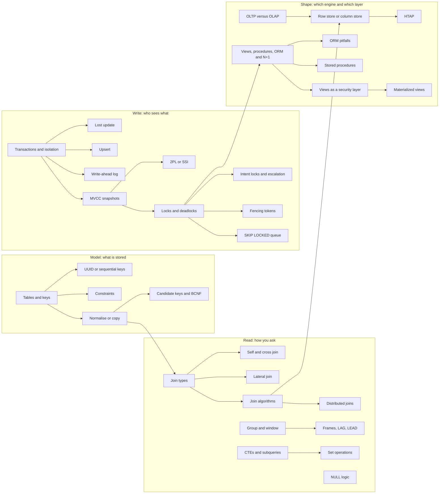

## The map in words

A database holds **tables**, and keys say which row is which thing. You decide how often a fact is stored: once (normalised) or copied for speed. Reading means joining tables, grouping rows and handling NULL, the value for "unknown". Writing means transactions, and the isolation level decides what one transaction sees of another. Finally the engine shape, row store or column store, decides which of all this is cheap.

Rule of thumb: know the data shape, know the join, know the isolation level. Everything else is syntax.

---

## Tables and keys

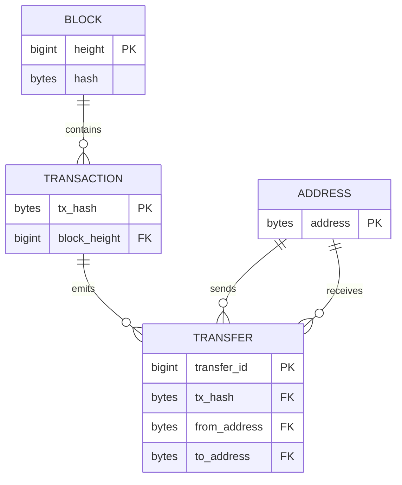

**Story.** A Go EVM (Ethereum Virtual Machine) indexer reads block 9,506 from a chain node. It writes one row in `blocks`, forty rows in `transactions`, and ninety rows in `transfers`. A transfer does not hold a pointer to its transaction. It holds the value `tx_hash`, and that value is the link.

**How it works**

1. Each table holds facts about one kind of thing: `BLOCK`, `TRANSACTION`, `TRANSFER`, `ADDRESS`.
2. The **primary key** (PK) picks one row: `height` for a block, `tx_hash` for a transaction.
3. A **foreign key** (FK) holds another table's primary key: `TRANSFER.tx_hash` points at `TRANSACTION`.
4. `tx_hash` is a natural key: it comes from the chain. `transfer_id` is a surrogate key: the system made it up.
5. Rows have no order. Only `ORDER BY` gives you one.

### In code

```text
node -> indexer: block 9506 (40 transactions, 90 transfers)
blocks:       key = height                  # 9506: one row only
transactions: key = tx_hash, block_height = 9506   # FK: a copied key value
transfers:    key = transfer_id, tx_hash = 0xab12 or 0xcd34
follow: transfer.tx_hash -> transaction.block_height -> block
natural key: the chain made it              # height, tx_hash
surrogate key: the indexer made it up       # transfer_id
read without ORDER BY: any order            # 3, 1, 2 here
```

```python
-- one table per kind of thing, a row holds key values, never pointers
CREATE TABLE blocks (
  height INT PRIMARY KEY,                       -- natural key: the chain made it
  hash   TEXT
);
CREATE TABLE transactions (
  tx_hash      TEXT PRIMARY KEY,                -- natural key
  block_height INT REFERENCES blocks (height)   -- foreign key: a copy of the block's key
);
CREATE TABLE transfers (
  transfer_id INTEGER PRIMARY KEY,              -- surrogate key: the indexer made it up
  tx_hash     TEXT REFERENCES transactions (tx_hash)
);
CREATE INDEX transfers_by_tx ON transfers (tx_hash DESC, transfer_id);

WRITE_BLOCK = "INSERT INTO blocks VALUES (?, ?)"
WRITE_TX = "INSERT INTO transactions VALUES (?, ?)"
WRITE_TRANSFER = "INSERT INTO transfers (tx_hash) VALUES (?)"

def index_block(db):
    db.execute(WRITE_BLOCK, (9506, "0x7f3c"))
    tx_hashes = ["0xab12", "0xcd34"] + [f"0x{n:04x}" for n in range(1, 39)]
    for h in tx_hashes:
        db.execute(WRITE_TX, (h, 9506))
    emitters = ["0xab12", "0xab12", "0xcd34"] + [tx_hashes[2 + n % 38] for n in range(87)]
    for h in emitters:
        db.execute(WRITE_TRANSFER, (h,))

-- a join walks the same links: transfer -> transaction -> block
SELECT f.transfer_id, f.tx_hash, b.height
FROM transfers f
JOIN transactions t ON t.tx_hash = f.tx_hash
JOIN blocks b ON b.height = t.block_height
WHERE f.transfer_id <= 3
ORDER BY f.transfer_id;

-- no ORDER BY: the engine returns rows in whatever order its plan reads them
SELECT transfer_id, tx_hash FROM transfers
WHERE tx_hash IN ('0xab12', '0xcd34');
```

Run it: `handbook/code/07-tables-and-keys/`, then `python3 main.py`.

**What goes wrong.** You choose a natural key that can change, such as an e-mail address. Every foreign key that copies it must change too. Fix: use a surrogate key when the natural key is wide or unstable. A warehouse may add `tx_id BIGINT` because a 32-byte hash is a wide join column.

**Where you use it**

- Indexer tables in StarRocks (a columnar warehouse): natural keys from the chain, because they never change.
- A user table in an app: a surrogate id, because e-mail and name change.
- A join-heavy warehouse: a narrow integer key beside the wide natural one.

> A table is a set of facts about one kind of thing, and the key says which thing.

▶ Watch it move: [Tables and keys](visual/07-tables-and-keys.html)

---

## UUID or sequential keys

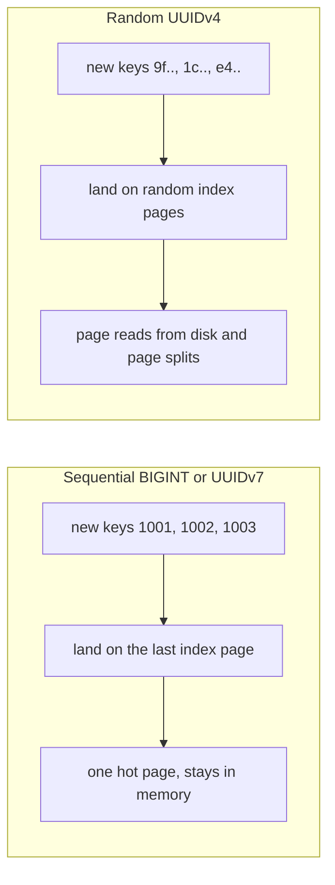

**Story.** An order service in PostgreSQL gives each order a random UUIDv4 (Universally Unique Identifier, version 4) as its primary key. At first inserts are fast. When the index grows past memory, each new key lands on a random index page. That page must be read from disk, and a full page splits in two. Switching to UUIDv7, which starts with a timestamp, sends new keys to the end of the index again.

**How it works**

1. An auto-increment `BIGINT` (8 bytes) grows by one. Every new key goes to the right edge of the B-tree index.
2. A UUID is 128 bits (16 bytes). Any node can make one without asking the database, even offline.
3. UUIDv4 is random. Each insert lands on a random page of the index.
4. UUIDv7 puts a millisecond timestamp first, then random bits. New ids sort roughly by time, so inserts land near the right edge.
5. A sequential id leaks a count: order 1005 tells a competitor you have about a thousand orders.

### In code

```text
index: leaf pages of 100 keys in key order, memory holds 2 pages
insert(key):
  page = the page whose range holds key
  not in memory: read it from disk         # the oldest cached page goes
  full, key past its end: a new page at the right edge
  full, key in the middle: split into two half-empty pages
  put key on the page in sorted order
start: 7 pages, last page 601-660 not full
counter: 661 lands on the last page, in memory
662 to 700: the same last page, now 100 keys
701: a new page 701, nothing split
phone, offline: make a UUID, no database needed
/orders/1005 and /orders/1405: about 400 a week
```

```go
// Index is the leaf level of a B-tree plus the pages cached in memory.
type Index struct {
	pages     []*Page // in key order
	capacity  int     // keys per page
	cache     []*Page // most recently used first
	cacheSize int
	align     int // a split boundary is rounded down to this
	diskReads int
	splits    int
}

// touch brings a page into memory. A page not in memory is a disk read,
// and the least recently used page is pushed out.
func (ix *Index) touch(p *Page) (diskRead bool) {
	for i, c := range ix.cache {
		if c == p {
			ix.cache = append([]*Page{p}, append(ix.cache[:i:i], ix.cache[i+1:]...)...)
			return false
		}
	}
	ix.diskReads++
	ix.cache = append([]*Page{p}, ix.cache...)
	if len(ix.cache) > ix.cacheSize {
		ix.cache = ix.cache[:ix.cacheSize]
	}
	return true
}

func (ix *Index) remember(p *Page) {
	ix.cache = append([]*Page{p}, ix.cache...)
	if len(ix.cache) > ix.cacheSize {
		ix.cache = ix.cache[:ix.cacheSize]
	}
}

// Insert puts a key on the page where it belongs in key order.
func (ix *Index) Insert(key int) (p *Page, diskRead, split bool) {
	i, p := ix.find(key)
	diskRead = ix.touch(p)
	if len(p.keys) == ix.capacity {
		last := i == len(ix.pages)-1 && key > p.keys[len(p.keys)-1]
		if last {
			// Right edge: start a new page. The full page stays full.
			np := &Page{lo: key, hi: p.hi}
			p.hi = key - 1
			ix.pages = append(ix.pages, np)
			ix.remember(np)
			p = np
		} else {
			// Middle: split the full page into two half-empty pages.
			mid := p.keys[len(p.keys)/2] / ix.align * ix.align
			cut := sort.SearchInts(p.keys, mid)
			right := &Page{lo: mid, hi: p.hi, keys: append([]int{}, p.keys[cut:]...)}
			p.hi, p.keys = mid-1, p.keys[:cut]
			ix.pages = append(ix.pages[:i+1], append([]*Page{right}, ix.pages[i+1:]...)...)
			ix.splits++
			split = true
			if key >= mid {
				p = right
			}
		}
	}
	at := sort.SearchInts(p.keys, key)
	p.keys = append(p.keys[:at], append([]int{key}, p.keys[at:]...)...)
	return p, diskRead, split
}

// newUUIDv4 is 122 random bits: no database needed, unique anyway.
func newUUIDv4(r io.Reader) [16]byte {
	var u [16]byte
	io.ReadFull(r, u[:])
	u[6] = u[6]&0x0f | 0x40 // version 4
	u[8] = u[8]&0x3f | 0x80
	return u
}

func sequential() {
	fmt.Println("== key = BIGINT identity")
	ix := &Index{capacity: 100, cacheSize: 2, align: 1}
	for lo := 1; lo <= 601; lo += 100 {
		p := &Page{lo: lo, hi: lo + 99}
		for k := lo; k <= lo+99 && k <= 660; k++ {
			p.keys = append(p.keys, k)
		}
		ix.pages = append(ix.pages, p)
	}
	last := ix.pages[len(ix.pages)-1]
	last.hi = math.MaxInt
	ix.cache = []*Page{last, ix.pages[len(ix.pages)-2]}
	lastLabel := seqLabel(last)
	fmt.Printf("start: %d pages, last page %s holds %d keys\n", len(ix.pages), lastLabel, len(last.keys))

	p, read, _ := ix.Insert(661) // the next number from the counter
	fmt.Printf("insert 661: page %s, disk read %v\n", seqLabel(p), read)

	for k := 662; k <= 700; k++ {
		ix.Insert(k)
	}
	label := seqLabel(p)
	fmt.Printf("inserts 662-700: page %s holds %d keys, disk reads %d\n", label, len(p.keys), ix.diskReads)

	np, read, split := ix.Insert(701)
	fmt.Printf("insert 701: page %s is full, new page %s at the right edge, disk read %v, split %v\n", seqLabel(p), seqLabel(np), read, split)

	first, later := 1005, 1405 // two order ids a customer sees a week apart
	fmt.Printf("/orders/%d on 1 March, /orders/%d on 8 March: about %d orders a week\n", first, later, later-first)
}
```

Run it: `handbook/code/07-uuid-vs-sequential-keys/`, then `go run .`.

**What goes wrong.** A random UUIDv4 primary key on a big B-tree table. Writes slow down as the index outgrows memory, and the index fills with half-empty split pages. Fix: use UUIDv7, or keep a `BIGINT` key inside and a UUID as the public id column.

**Where you use it**

- App tables in PostgreSQL: a `BIGINT` identity inside, a UUID in URLs.
- Ids made before the insert, such as event ids for idempotency or ids made on a phone offline: UUIDv7.
- Chain data: the natural key, `tx_hash`, is already unique. It needs no made-up id.

> Sequential keys append and random keys scatter, so when ids must be made outside the database I use UUIDv7: unique, and still sorted by time.

▶ Watch it move: [UUID or sequential keys](visual/07-uuid-vs-sequential-keys.html)

---

## Constraints and referential integrity

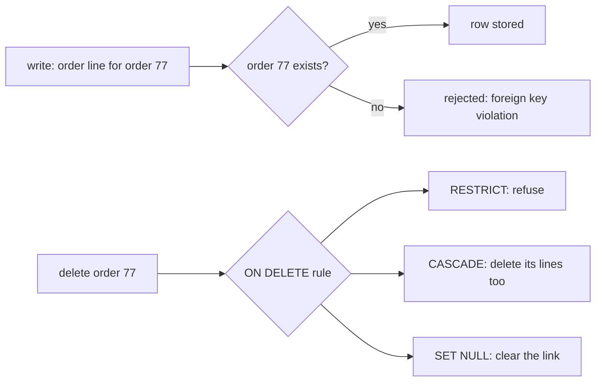

**Story.** An app stores orders and order lines. A bug deletes order 77 but leaves its three lines behind. Months later the revenue report still counts those lines, which belong to no order. A foreign key constraint would have refused the delete, or removed the lines with it.

**How it works**

1. `NOT NULL`: the column must hold a value.
2. `UNIQUE`: no two rows share the value. An index enforces it.
3. `CHECK`: a rule on each row, such as `CHECK (amount >= 0)`.
4. `FOREIGN KEY`: the value must exist as a key in the other table. This is referential integrity.
5. `ON DELETE` says what happens to children when the parent goes. RESTRICT refuses. CASCADE deletes the children too. SET NULL clears the link.
6. The database checks every write from every client. A forgotten code path cannot skip the rule.

### In code

```text
orders: 77, 78      lines: L1 L2 L3 -> 77, L4 -> 78
schema: order_lines.order_id names an order, no rule
delete order 77                      # nothing checks its lines
orphans = lines whose order is gone  # L1, L2, L3
revenue = sum(every line)            # 150, should be 50
fix: order_id REFERENCES orders ON DELETE RESTRICT
delete order 77 -> refused, lines exist
```

```python
-- order_lines names its order, but nothing checks it
CREATE TABLE orders (order_id INT PRIMARY KEY);
CREATE TABLE order_lines (line_id TEXT, order_id INT, amount INT);

INSERT INTO orders VALUES (77), (78);
INSERT INTO order_lines VALUES ('L1', 77, 40), ('L2', 77, 25), ('L3', 77, 35), ('L4', 78, 50);

DELETE_77 = "DELETE FROM orders WHERE order_id = 77;"

-- lines whose order is gone
SELECT l.line_id FROM order_lines l
LEFT JOIN orders o ON o.order_id = l.order_id
WHERE o.order_id IS NULL;

-- the revenue report sums every line
SELECT SUM(amount) FROM order_lines;

-- every rule in the schema, checked on every write
CREATE TABLE orders (order_id INT PRIMARY KEY);
CREATE TABLE order_lines (
  line_id  TEXT,
  order_id INT NOT NULL REFERENCES orders ON DELETE RESTRICT,
  amount   INT CHECK (amount >= 0)
);

def try_write(db, sql):
    try:
        db.execute(sql)
        return "accepted"
    except sqlite3.IntegrityError as e:
        return f"refused: {e}"

    db = connect(NO_FK)
    print(f"no foreign key, delete order 77: {try_write(db, DELETE_77)}")
    print(f"orphans: {[r[0] for r in db.execute(ORPHANS)]}")
    print(f"revenue: {db.execute(REVENUE).fetchone()[0]} (order 78 alone is 50)")
    print(f"RESTRICT, delete order 77: {try_write(db, DELETE_77)}")
```

Run it: `handbook/code/07-constraints/`, then `python3 main.py`.

**What goes wrong.** CASCADE on a big parent deletes millions of children in one transaction and holds their locks the whole time. Second trap: column stores such as StarRocks do not enforce foreign keys, so orphans slip in silently. Fix: use RESTRICT by default and delete children in batches on purpose. In a warehouse, run an orphan check: `LEFT JOIN` to the parent `WHERE parent.key IS NULL`.

**Where you use it**

- App database: orders and lines with a foreign key and RESTRICT.
- A wallet: `CHECK (balance >= 0)` as the last guard behind the conditional `UPDATE`.
- A warehouse: an orphan count runs as a data check after every load.

> A constraint is a rule the database checks on every write, so a forgotten code path cannot break it.

▶ Watch it move: [Constraints and referential integrity](visual/07-constraints.html)

---

## Normalise or copy

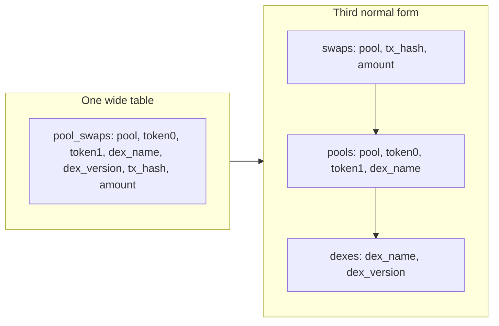

**Story.** The first swap table repeated `token0`, `token1` and `dex_version` on every swap. A pool with a million swaps stored its tokens a million times. One wrong token name meant a million updates. Splitting the table stored each fact once.

**How it works**

1. **1NF** (first normal form): one value per cell. `pool_swaps` already holds it.
2. **2NF**: no column depends on part of a composite key. The key is `(pool, tx_hash)`, but `token0` depends on `pool` alone. Move it to `pools`.
3. **3NF**: no non-key column depends on another non-key column. `dex_version` depends on `dex_name`. Move it to `dexes`.
4. **BCNF** (Boyce-Codd Normal Form): every column that decides another is a candidate key. If `(token0, token1, dex)` also picks one pool, it is a candidate key, and BCNF holds.
5. **Denormalise** on purpose when reads dominate: copy `block_timestamp` onto every transfer so a day filter needs no join to `blocks`.

### In code

```text
load pool_swaps: 1,000,000 swaps of p1, each repeats token0, token1, dex_name, dex_version
fix(wide): UPDATE every swap row of p1             # 1,000,000 rows
1nf: count cells that hold a list                  # 0
2nf: one value per pool -> the column needs pool alone, not (pool, tx_hash)
split: pools(pool key, tokens, exchange) and swaps(pool, tx_hash, amount)
3nf: one dex_version per dex_name -> move it to dexes(dex_name key)
fix(normalised): UPDATE one pools row              # 1 row, every swap reads it by join
```

```sql
-- one wide table: every swap repeats its pool's tokens and exchange
CREATE TABLE pool_swaps (pool TEXT, tx_hash TEXT, amount INT, token0 TEXT,
  token1 TEXT, dex_name TEXT, dex_version TEXT, PRIMARY KEY (pool, tx_hash));
WITH RECURSIVE n(i) AS (SELECT 1 UNION ALL SELECT i + 1 FROM n WHERE i < 1000000)
INSERT INTO pool_swaps
SELECT 'p1', printf('0xa%d', i), i % 200, 'WETH', 'USCD', 'aerodrome', 'v2' FROM n;

-- the typo lives in every swap row of p1
UPDATE pool_swaps SET token1 = 'USDC' WHERE pool = 'p1' AND token1 = 'USCD';

-- 1NF: a cell holding a list would carry a comma
SELECT COUNT(*) FROM pool_swaps
WHERE token0 LIKE '%,%' OR token1 LIKE '%,%' OR dex_name LIKE '%,%';

-- 2NF: does each pool column take one value per pool? Then it needs pool alone
SELECT pool, COUNT(DISTINCT token0), COUNT(DISTINCT token1),
       COUNT(DISTINCT dex_name), COUNT(DISTINCT dex_version)
FROM pool_swaps GROUP BY pool;

-- move the columns that need only pool into pools; swaps keeps its key
CREATE TABLE pools (pool TEXT PRIMARY KEY, token0 TEXT, token1 TEXT,
  dex_name TEXT, dex_version TEXT);
INSERT INTO pools SELECT DISTINCT pool, token0, token1, dex_name, dex_version
FROM pool_swaps;
CREATE TABLE swaps (pool TEXT REFERENCES pools (pool), tx_hash TEXT, amount INT,
  PRIMARY KEY (pool, tx_hash));
INSERT INTO swaps SELECT pool, tx_hash, amount FROM pool_swaps;

-- 3NF: does dex_version take one value per dex_name? Then dex_name decides it
SELECT dex_name, COUNT(DISTINCT dex_version) FROM pools GROUP BY dex_name;

-- move dex_version to dexes, keyed by dex_name
CREATE TABLE dexes (dex_name TEXT PRIMARY KEY, dex_version TEXT);
INSERT INTO dexes SELECT DISTINCT dex_name, dex_version FROM pools;
ALTER TABLE pools DROP COLUMN dex_version;

-- the typo lives in one pools row
UPDATE pools SET token1 = 'USDC' WHERE pool = 'p1' AND token1 = 'USCD';

-- every swap of p1 reads the fixed name through the join
SELECT p.token1, COUNT(*) FROM swaps s JOIN pools p ON p.pool = s.pool
GROUP BY p.token1;
```

Run it: `handbook/code/07-normalise-or-copy/`, then `python3 main.py`.

**What goes wrong.** A copied fact drifts. The source is corrected, the copies are not. Fix: rebuild copies from the source of truth, never patch them in place. The opposite failure is a warehouse normalised like an app database: every report pays for five joins over billions of rows.

**Where you use it**

- App database (OLTP): third normal form, so an update touches one row.
- Warehouse (OLAP): repeat the timestamp and the day on every transfer row.
- A pipeline: the copy is a derived table, rebuilt from the raw facts.

Mnemonic for 3NF: "The key, the whole key, and nothing but the key."

> Normalise where you write, copy where you read, and rebuild copies from the source.

▶ Watch it move: [Normalise or copy](visual/07-normalise-or-copy.html)

---

## Candidate keys and BCNF

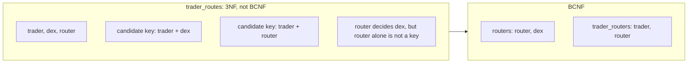

**Story.** A table records which router each trader uses on each exchange. A trader uses one router per exchange, and each router belongs to exactly one exchange. So the fact "router R belongs to Aero" is repeated on every row of every trader who uses R. When the last such trader is deleted, the fact is gone too.

**How it works**

1. A **superkey** is any set of columns that picks one row.
2. A **candidate key** is a superkey with nothing extra: drop any column and it no longer picks one row.
3. `trader_routes` has two candidate keys: `(trader, dex)` and `(trader, router)`.
4. `router` is a determinant: it decides `dex`.
5. BCNF (Boyce-Codd Normal Form) says every determinant must be a candidate key. `router` is not, so the table breaks BCNF.
6. 3NF allows it, because `dex` is part of a candidate key. That is the whole gap between 3NF and BCNF.
7. Fix: split into `routers(router, dex)` and `trader_routers(trader, router)`.

### In code

```text
rows: (ana, Aero, R1) (ben, Aero, R1) (ana, Topaz, R7)
rules: trader + dex -> router,  router -> dex
closure(cols): add every column the rules decide, until nothing changes
superkey(cols): its closure is all three columns
candidate key: a superkey with no smaller superkey inside
keys found: trader + dex, trader + router
one column alone repeats a value: not a key
check a rule on the rows: no left value maps to two right values
```

```python
-- three rows: ana uses R1 on Aero and R7 on Topaz, ben uses R1 on Aero
CREATE TABLE trader_routes (trader TEXT, dex TEXT, router TEXT);
INSERT INTO trader_routes VALUES ('ana', 'Aero', 'R1');
INSERT INTO trader_routes VALUES ('ben', 'Aero', 'R1');
INSERT INTO trader_routes VALUES ('ana', 'Topaz', 'R7');

COLS = ("trader", "dex", "router")
# functional dependencies: left side decides right side
FDS = [(("trader", "dex"), "router"), (("router",), "dex")]

def closure(attrs):
    # every column the rules let these columns decide
    got = set(attrs)
    changed = True
    while changed:
        changed = False
        for left, right in FDS:
            if set(left) <= got and right not in got:
                got.add(right)
                changed = True
    return got

def is_superkey(attrs):
    return closure(attrs) == set(COLS)

def candidate_keys():
    # a superkey with nothing extra: drop any column and it stops being one
    keys = []
    for size in range(1, len(COLS) + 1):
        for attrs in itertools.combinations(COLS, size):
            if is_superkey(attrs) and not any(set(k) <= set(attrs) for k in keys):
                keys.append(attrs)
    return keys

-- value combinations of these columns that appear more than once
SELECT {cols}, COUNT(*) AS n FROM trader_routes
GROUP BY {cols}
HAVING COUNT(*) > 1;

-- rows where one left value maps to two right values (empty: the rule holds)
SELECT {left} FROM trader_routes
GROUP BY {left}
HAVING COUNT(DISTINCT {right}) > 1;
```

Run it: `handbook/code/07-candidate-keys-and-bcnf/`, then `python3 main.py`.

**What goes wrong.** The repeated fact causes update and delete anomalies: change one router's exchange and you must change many rows, delete the last trader and the router's exchange is lost. But the split has a price. The rule "one router per trader per exchange" can no longer be enforced by one key. BCNF does not always keep every dependency. Fix: when the lost rule matters more, stay in 3NF and accept the repeat, or enforce the rule with a check or a trigger.

**Where you use it**

- Schema review of an app database: list the determinants and ask if each is a key.
- An interview: "3NF lets a part of a candidate key be decided by a non-key, BCNF does not."
- Warehouses: they denormalise on purpose and skip this, because they rebuild from the source.

> A candidate key is a smallest set of columns that picks one row, and BCNF says every column that decides another must be one.

▶ Watch it move: [Candidate keys and BCNF](visual/07-candidate-keys-and-bcnf.html)

---

## Join types: which rows survive

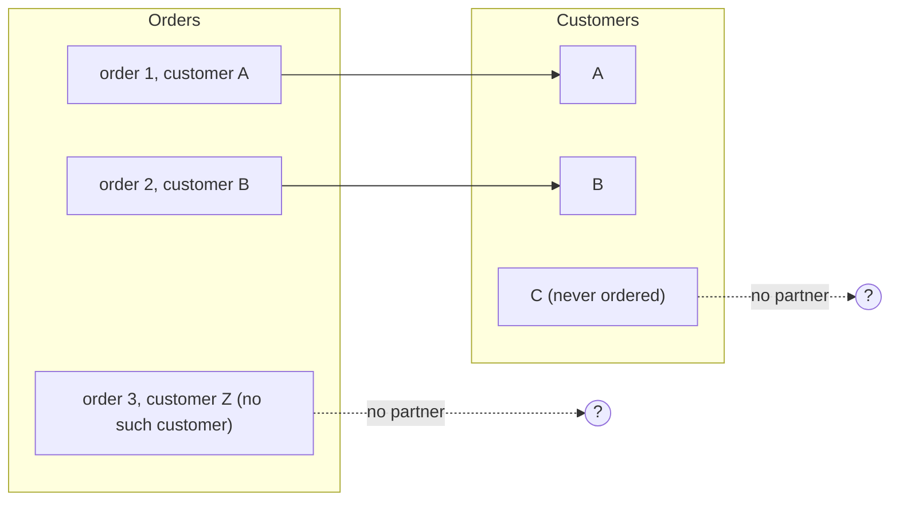

**Story.** A report joins `transfers` to daily `prices` by token and day. Some tokens have no price that day. The join type decides whether those transfers vanish from the report or stay with an empty price.

**How it works**

1. **INNER** keeps only pairs: order 1 with A, order 2 with B.
2. **LEFT** keeps every left row: order 3 stays, with NULL for the customer.
3. **RIGHT** is the mirror: customer C stays, with NULL for the order.
4. **FULL OUTER** keeps both: order 3 and customer C, each with NULLs.
5. **SEMI** (`EXISTS`) returns left rows that have a partner, once each, with no columns from the right.
6. **ANTI** (`NOT EXISTS`) returns left rows with no partner: order 3 alone.
7. **CROSS** pairs every row with every row. A **self join** joins a table to itself.
8. **LATERAL** runs a subquery per left row, for example the latest swap of each pool.

### In code

```text
orders: o1..o5 (o5 -> c9, no such customer)   customers: c1..c5 (c5 never ordered)
for o in orders:
  c = the customer with c.id = o.customer_id
  if c found: emit (o, c)
  else: drop o                      # no partner, no row
customers nobody matched (c5): dropped
result: 4 rows
```

```sql
INSERT INTO orders VALUES ('o1', 'c1'), ('o2', 'c2'), ('o3', 'c3'), ('o4', 'c4'), ('o5', 'c9');
INSERT INTO customers VALUES ('c1', 'Ana'), ('c2', 'Ben'), ('c3', 'Cleo'), ('c4', 'Dev'), ('c5', 'Eli');

-- INNER: only pairs survive
SELECT o.id, o.customer_id, c.name
FROM orders o
JOIN customers c
  ON c.id = o.customer_id
ORDER BY o.id;
```

Run it: `handbook/code/07-join-types/`, then `python3 main.py`.

**What goes wrong.** Two traps. First: a filter on the right table in `WHERE` turns a left join back into an inner join. `WHERE price.day = X` drops every unpriced transfer. Put the filter in `ON`. Second: `NOT IN (subquery)` returns no rows at all when the subquery holds one NULL. Use `NOT EXISTS`.

**Where you use it**

- Transfers with prices: `LEFT JOIN`, so a missing price shows as NULL, not as a missing transfer.
- "Addresses that never received a swap": `NOT EXISTS`.
- Reconciling two sources: `FULL OUTER JOIN`, where rows on one side only are the differences.

> The join type is the answer to one question: what happens to a row with no partner.

▶ Watch it move: [Join types](visual/07-join-types.html)

---

## Self join and cross join, worked

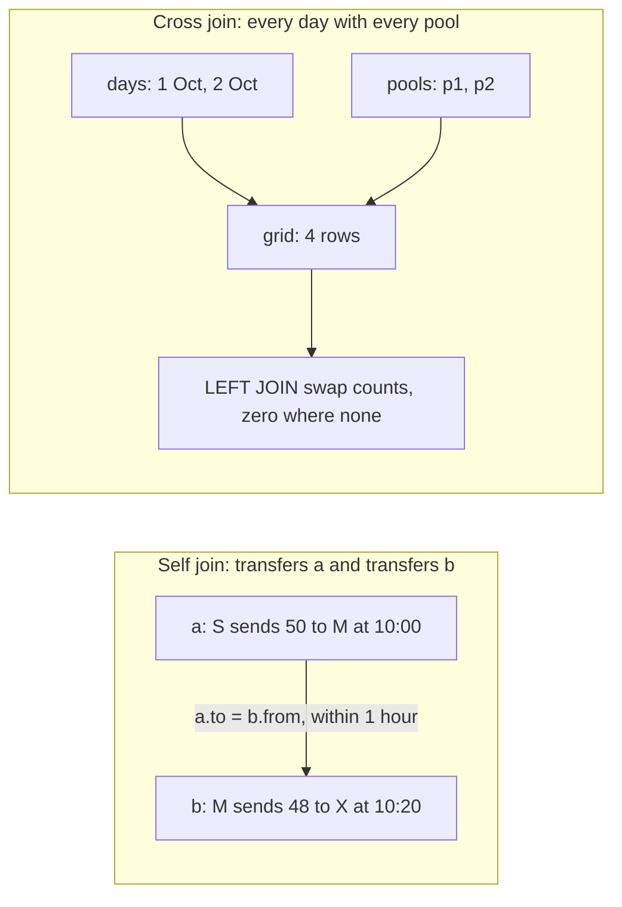

**Story.** An investigator wants money that moved on fast: an address that received funds and sent them on within an hour. Both facts live in `transfers`, so the table is joined to itself under two names. Separately, a dashboard must show a zero on days when a pool had no swaps. `GROUP BY` cannot invent rows that do not exist, so a cross join of days and pools builds the full grid first.

**How it works**

1. Self join: name the table twice, `transfers a JOIN transfers b`.
2. The condition links two rows: `a.to_address = b.from_address`, and `b.ts` within one hour after `a.ts`.
3. Each result row is a two-hop path: S to M, then M to X.
4. Cross join: `days CROSS JOIN pools` pairs every day with every pool. Two days times two pools is four rows.
5. Left join the swap counts onto the grid. A missing count becomes 0 with `COALESCE(n, 0)`.

```sql
SELECT a.from_address, a.to_address AS middle, b.to_address
FROM transfers a JOIN transfers b
  ON b.from_address = a.to_address
 AND b.ts BETWEEN a.ts AND a.ts + INTERVAL '1 hour';

SELECT d.day, p.pool, COALESCE(s.n, 0) AS swaps
FROM days d CROSS JOIN pools p
LEFT JOIN daily_swaps s ON s.day = d.day AND s.pool = p.pool;
```

### In code

```text
transfers: S to M 50 10:00, M to X 48 10:20, M to Y 2 13:00, K to S 30 08:00
for a in transfers:                  # first hop
  for b in transfers:                # second hop, same table
    if b.from == a.to:              # the hops link
      if a.time <= b.time <= a.time + 60 minutes:
        emit (a.from, a.to, b.to)    # one two-hop path
busy M, no time bound: every in pairs with every out
```

```sql
INSERT INTO transfers VALUES ('S', 'M', 50, 600), ('M', 'X', 48, 620), ('M', 'Y', 2, 780), ('K', 'S', 30, 480);

-- name the table twice and link the hops
SELECT a.from_address, a.to_address, b.to_address, b.ts - a.ts, a.ts
FROM transfers a JOIN transfers b
  ON b.from_address = a.to_address
ORDER BY a.ts;

-- money that moved on within one hour
SELECT a.from_address, a.to_address AS middle, b.to_address, a.amount, b.amount
FROM transfers a JOIN transfers b
  ON b.from_address = a.to_address
 AND b.ts BETWEEN a.ts AND a.ts + 60;

-- a busy address, no time bound: every in pairs with every out
SELECT COUNT(*)
FROM busy a JOIN busy b
  ON b.from_address = a.to_address;
```

Run it: `handbook/code/07-self-and-cross-join/`, then `python3 main.py`.

**What goes wrong.** An accidental cross join. The old comma syntax, `FROM a, b`, with the `WHERE` condition forgotten, pairs every row with every row: a million times a million. A self join can explode too: a busy address with 10,000 transfers in and 10,000 out gives 100 million pairs. Fix: always write `JOIN ... ON`, bound self joins by time, and check the row count before running on everything.

**Where you use it**

- Self join: two-hop money paths, an employee and their manager in one table, pairs of rows that must agree.
- Cross join: calendar grids that show zeros, every combination of two settings in a test.
- Comparing a row with the previous one: use `LAG` today, where older code used a self join.

> A self join compares rows of one table under two names, a cross join builds every pair on purpose, and either one by accident multiplies rows.

▶ Watch it move: [Self join and cross join](visual/07-self-and-cross-join.html)

---

## Lateral join: a subquery per left row

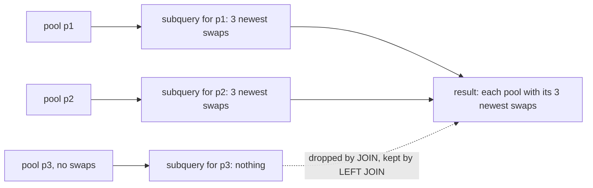

**Story.** A dashboard shows each pool with its three newest swaps. A plain join cannot say "the top three for each pool". A `LATERAL` subquery runs once per pool. It can see that pool's id, sort its swaps by time and keep three.

**How it works**

1. The query reads each row of `pools`.
2. For each pool, the `LATERAL` subquery runs with `p.pool` set to that pool.
3. It sorts that pool's swaps newest first and keeps three.
4. The three rows are joined to the pool row.
5. A pool with no swaps drops out with `JOIN`. It stays, with NULLs, with `LEFT JOIN LATERAL ... ON true`.

```sql
SELECT p.pool, x.ts, x.amount
FROM pools p
JOIN LATERAL (
  SELECT ts, amount FROM swaps s
  WHERE s.pool = p.pool ORDER BY ts DESC LIMIT 3
) x ON true
```

### In code

```text
for pool in pools:                     # the left side
  rows = newest_3(pool)                # the subquery sees this pool
  newest_3: swaps WHERE pool = this pool ORDER BY ts DESC LIMIT 3
  if rows is empty:
    JOIN drops the pool, LEFT JOIN keeps it with NULLs
  emit (pool, row) for each row
index (pool, ts DESC): each run reads at most 3 entries
```

```python
-- the left side: one row per pool
SELECT pool FROM pools ORDER BY pool;

-- the subquery, run once per pool with that pool's id
SELECT ts, amount FROM swaps
WHERE pool = ? ORDER BY ts DESC LIMIT 3;

-- the index the subquery needs: its filter, then its sort
CREATE INDEX swaps_pool_ts ON swaps (pool, ts DESC);

def lateral(db, keep_empty):
    """JOIN LATERAL by hand. keep_empty=True is LEFT JOIN LATERAL ... ON true."""
    out = []
    for (pool,) in db.execute(POOLS).fetchall():
        rows = db.execute(NEWEST_3, (pool,)).fetchall()
        if not rows and keep_empty:
            out.append((pool, None, None))
        for ts, amount in rows:
            out.append((pool, ts, amount))
    return out
```

Run it: `handbook/code/07-lateral-join/`, then `python3 main.py`.

**What goes wrong.** There is no index on `(pool, ts)`. Every run of the subquery scans the whole swaps table, so a thousand pools mean a thousand scans. Fix: add the index, so each run is a short index read. In an engine without `LATERAL`, use `ROW_NUMBER() ... <= 3` in a CTE instead.

**Where you use it**

- PostgreSQL: top N per group with `LATERAL` and an index.
- SQL Server: `CROSS APPLY` and `OUTER APPLY` are the same idea.
- A warehouse such as StarRocks: the window function version, `ROW_NUMBER` filtered outside.

> LATERAL is a correlated subquery in FROM: it runs per left row and can return many rows, which is how I write top N per group.

▶ Watch it move: [Lateral join](visual/07-lateral-join.html)

---

## Join algorithms: how the engine pairs rows

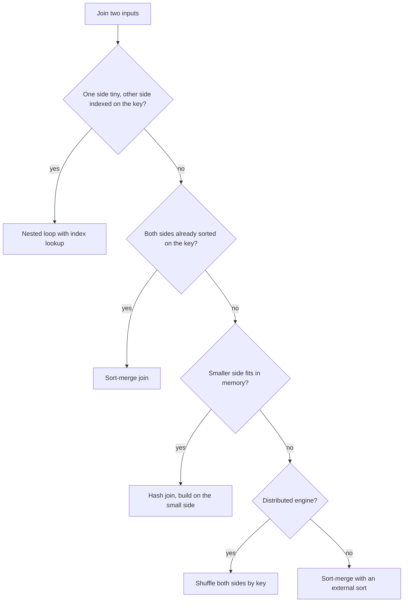

**Story.** One day of swaps, 10,000 rows, must be joined to a 30-million-row address table. A nested loop would compare 10,000 times 30 million pairs. A hash join builds a table from the 10,000 swaps and probes it once per address row. The planner picks this, not you, and it picks from its row estimates.

**How it works**

1. **Nested loop**: for each outer row, find matching inner rows. Cost grows as n times m, unless the inner side has an index, then n times a few page reads.
2. **Hash join**: read the small side into a hash table (build). Read the big side once and look each key up (probe). Cost grows as n plus m.
3. **Sort-merge**: sort both sides on the key, then walk two pointers forward together. Cheap when both sides are already sorted.
4. In a **distributed** engine the rows live on many nodes. **Broadcast** copies the small side to every node. **Shuffle** repartitions both sides by the key so matching rows meet. **Colocate** means both tables are already bucketed the same way, so no data moves.

### In code

```text
for each swap s:                 # outer: 5 rows
  for each pool p:               # inner: all 4, every time
    comparisons += 1
    if s.pool == p.pool: emit (s, p)
work = 5 x 4 = 20 comparisons
with an index: per swap, index.lookup(s.pool)   # 5 lookups
wrong estimate, no index: 10,000 x 30,000,000 comparisons
```

```go
// nestedLoop compares every swap with every pool.
func nestedLoop() {
	cmp, found := 0, 0
	for n, s := range swaps { // outer loop: each swap once
		for _, p := range pools { // inner loop: every pool, every time
			cmp++
			if s == p {
				found++
			}
		}
		fmt.Printf("nested loop: swap %d (%s) done, comparisons %d\n", n+1, s, cmp)
	}
	fmt.Printf("nested loop: %d matches, %d comparisons = %d x %d\n", found, cmp, len(swaps), len(pools))
}

// indexedLoop looks each swap up in an index on pools.pool.
func indexedLoop() {
	index := map[string]bool{} // stands for the B-tree on pools.pool
	for _, p := range pools {
		index[p] = true
	}
	lookups, found := 0, 0
	for _, s := range swaps {
		lookups++ // one root-to-leaf walk per swap
		if index[s] {
			found++
		}
	}
	fmt.Printf("indexed loop: %d matches, %d lookups\n", found, lookups)
	fmt.Printf("no index, wrong estimate: %d x %d = %d comparisons\n", 10000, 30000000, 10000*30000000)
}
```

Run it: `handbook/code/07-join-algorithms/`, then `go run .`.

**What goes wrong.** Statistics are stale, so the planner thinks a side is small when it is not. A hash join's build side then does not fit in memory and spills or fails. In StarRocks the same mistake broadcasts gigabytes to every node. Fix: refresh statistics, check estimated against actual rows, and put the small side on the build side.

**Where you use it**

- StarRocks: a 100-row DEX (decentralised exchange) registry against billions of swaps is a broadcast join.
- Swaps joined to transfers, both huge: shuffle on `tx_hash`, or colocate both tables on it.
- Postgres: a lookup of one user's orders is a nested loop over an index.

> Nested loop for tiny or indexed, hash for one side in memory, merge for both sorted, and the planner chooses from its estimates.

▶ Watch it move: [Join algorithms](visual/07-join-algorithms.html)

---

## Distributed joins: broadcast, shuffle, colocate

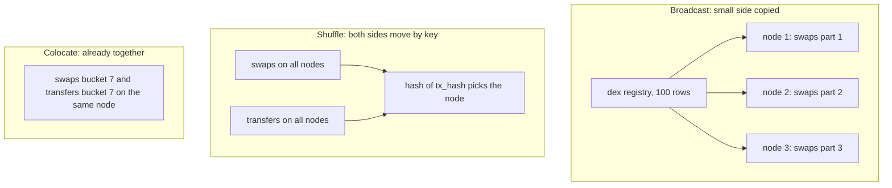

**Story.** StarRocks spreads billions of swaps over three backend nodes. One query joins swaps to a 100-row DEX (decentralised exchange) registry. Another joins swaps to transfers on `tx_hash`. Two rows can only be joined on the same node. The engine has three ways to bring them together.

**How it works**

1. Each table is split into buckets by a key, and the buckets are spread over the nodes.
2. **Broadcast**: copy the small table to every node. Each node joins it to its own part of the big table. The cost is the small table times the number of nodes.
3. **Shuffle**: both tables are big. Each node sends each row to the node that owns the hash of the join key. Matching rows meet. Both tables cross the network once.
4. **Colocate**: both tables were bucketed on the same key, with the same bucket count, and placed together. Matching rows already sit on one node. Nothing moves.
5. The planner picks from its statistics: row counts and sizes.

### In code

```text
plan(big, small):
  if small.estimated_rows <= broadcast_limit: BROADCAST
  else: SHUFFLE
BROADCAST: copy small to every other node
  each node joins its own part locally
  rows sent = small.real_rows x (nodes - 1)
stale statistics: estimate 100, real 2,000,000,000
ANALYZE, then read the plan in EXPLAIN
```

```go
const nodes = 3
const broadcastLimit = 1000000 // the planner copies a side to every node only below this

// plan picks how to join big with other, the way the planner does.
func plan(big, other Table) string {
	if big.group != "" && big.group == other.group && big.key == other.key && big.buckets == other.buckets {
		return "COLOCATE" // matching buckets already sit on the same node
	}
	if other.est <= broadcastLimit {
		return "BROADCAST" // copy the small side to every node
	}
	return "SHUFFLE" // send both sides to the node their key hashes to
}

// broadcastSent is what a broadcast copies: every real row to every other node.
func broadcastSent(t Table) int { return t.rows * (nodes - 1) }

func broadcast() {
	fmt.Printf("broadcast limit %s rows\n", comma(broadcastLimit))
	swaps := Table{name: "swaps", rows: 3000000000, est: 3000000000}
	registry := Table{name: "dex registry", rows: 100, est: 100}
	fmt.Printf("swaps join dex registry: plan %s, rows sent %s\n", plan(swaps, registry), comma(broadcastSent(registry)))
	transfers := Table{name: "transfers", rows: 2000000000, est: 100} // stale statistics
	fmt.Printf("swaps join transfers, statistics say %d: plan %s, rows sent %s\n", transfers.est, plan(swaps, transfers), comma(broadcastSent(transfers)))
	transfers.est = transfers.rows // ANALYZE refreshes the statistics
	fmt.Printf("after ANALYZE: plan %s\n", plan(swaps, transfers))
}
```

Run it: `handbook/code/07-distributed-joins/`, then `go run .`.

**What goes wrong.** Statistics are stale, so a big table looks small. The engine broadcasts gigabytes to every node, and memory runs out. Fix: refresh statistics, read the plan (`EXPLAIN` shows BROADCAST or SHUFFLE), and colocate tables that you always join on the same key.

**Where you use it**

- The DEX registry against swaps: broadcast.
- Swaps against transfers on `tx_hash`: a colocation group, so the daily join moves nothing.
- Spark: a broadcast hash join under a size limit, otherwise a shuffle and sort-merge join.

> In a distributed join matching rows must meet: broadcast the small side, shuffle both when both are big, or colocate tables always joined on the same key so nothing moves.

▶ Watch it move: [Distributed joins](visual/07-distributed-joins.html)

---

## Group by and window functions

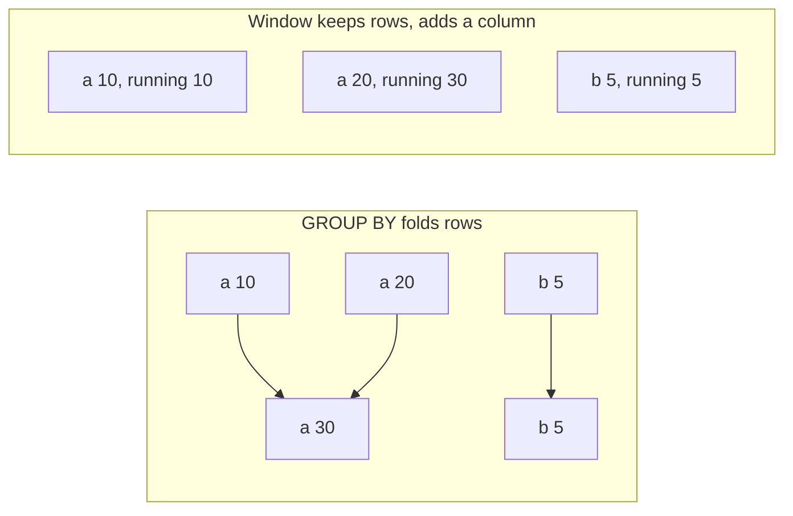

**Story.** An analyst wants two things about wallet addresses. First: how many swaps each pool had on 1 October. Second: the running balance of each address over time. The first folds rows into one per pool. The second keeps every row and adds a balance column.

**How it works**

1. `GROUP BY pool` folds rows with the same pool into one row.
2. Aggregates (`SUM`, `COUNT`, `MIN`, `MAX`, `AVG`) summarise each group.
3. `WHERE` filters rows before the fold. `HAVING` filters groups after it: `HAVING COUNT(*) > 1000`.
4. A window function keeps each row. `OVER (PARTITION BY address ORDER BY ts)` says which rows it looks at.
5. `SUM(amount) OVER (...)` gives a running balance. `LAG(ts)` gives the previous row's time. `ROW_NUMBER() ... ORDER BY ts DESC` filtered to 1 gives the latest row per address.

```sql
SELECT address, ts, amount,
       SUM(amount) OVER (PARTITION BY address ORDER BY ts) AS balance,
       ROW_NUMBER() OVER (PARTITION BY address ORDER BY ts DESC) AS rn
FROM ledger
```

### In code

```text
swaps: 6 rows   p1 x3 (one on 30 Sep)   p2 x2 (one NULL amount)   p3 x1
rows = filter(swaps, day == '1 Oct')        # WHERE: on rows, before the fold
groups = bucket(rows, by pool)              # GROUP BY
for each group g:
  out(g.pool, count(g.rows), sum(g.amount))  # one row per group
keep groups where count(g.rows) > 1         # HAVING: on groups, after the fold
count(g.amount) skips rows with a NULL amount  # COUNT(col) is not COUNT(*)
```

```sql
CREATE TABLE swaps (day TEXT, pool TEXT, amount INT);
INSERT INTO swaps VALUES ('30 Sep', 'p1', 10), ('1 Oct', 'p1', 10), ('1 Oct', 'p1', 20),
  ('1 Oct', 'p2', 5), ('1 Oct', 'p2', NULL), ('1 Oct', 'p3', 7);

-- fold the rows of 1 October into one row per pool
SELECT pool, COUNT(*) AS swaps, SUM(amount) AS volume
FROM swaps
WHERE day = '1 Oct'
GROUP BY pool
ORDER BY pool;

-- HAVING filters groups, after the fold
SELECT pool, COUNT(*) AS swaps, SUM(amount) AS volume
FROM swaps
WHERE day = '1 Oct'
GROUP BY pool
HAVING COUNT(*) > 1
ORDER BY pool;

-- COUNT(amount) skips rows where amount is NULL
SELECT pool, COUNT(amount) AS swaps, SUM(amount) AS volume
FROM swaps
WHERE day = '1 Oct'
GROUP BY pool
HAVING COUNT(*) > 1
ORDER BY pool;
```

Run it: `handbook/code/07-group-by-and-window/`, then `python3 main.py`.

**What goes wrong.** `COUNT(column)` skips NULLs, `COUNT(*)` does not. `SUM` on a big integer column can overflow: StarRocks wraps silently on BIGINT. And ties: `RANK` leaves gaps (1, 1, 3), `DENSE_RANK` does not (1, 1, 2), `ROW_NUMBER` breaks ties at random. Pick on purpose. You cannot filter a window column in `WHERE`: wrap it in a CTE and filter outside.

**Where you use it**

- Daily volume per DEX: `GROUP BY day, dex`.
- Latest swap per pool: `ROW_NUMBER` instead of a self join.
- A running balance per address: one sort per partition, one scan.

> GROUP BY folds rows into one per key, a window keeps every row and adds a computed column.

▶ Watch it move: [GROUP BY and window functions](visual/07-group-by-and-window.html)

---

## Window frames, LAG and LEAD

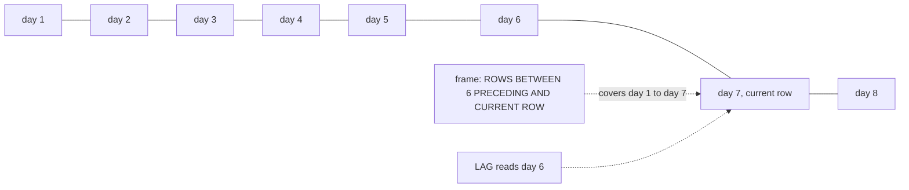

**Story.** An analyst wants the 7-day moving average of daily DEX volume, and the change from the day before. A frame tells the window which neighbour rows to look at. `LAG` reaches one row back.

**How it works**

1. `AVG(volume) OVER (ORDER BY day ROWS BETWEEN 6 PRECEDING AND CURRENT ROW)` looks at this day and the six before it.
2. The frame slides down one row for each new day.
3. `LAG(volume) OVER (ORDER BY day)` returns the day before. `volume - LAG(volume)` is the daily change.
4. `LEAD` returns the next row's value. On the first row `LAG` returns NULL, on the last row `LEAD` does.
5. With `ORDER BY` and no frame, the default frame runs from the first row to the current row: a running total.

### In code

```text
volume by day: 10, 12, 8, 14, 9, 11, 13, 15
for each row r, sorted by day:
  frame = r and the 6 rows before it      # ROWS BETWEEN 6 PRECEDING
  avg7 = average(frame)                   # day 7: 11.0   day 8: 11.7
  near the top the frame is shorter       # day 1: 10 alone
no frame written: first row to this row   # running total 10, 22, 30, 44
default frame is RANGE: equal days are peers   # tie on day 3: 40, 40
ROWS frame counts each row on its own          # 30, then 40
```

```sql
CREATE TABLE daily_volume (day INT, volume INT);
INSERT INTO daily_volume VALUES (1, 10), (2, 12), (3, 8), (4, 14), (5, 9), (6, 11), (7, 13), (8, 15);
CREATE TABLE tied (day INT, volume INT);
INSERT INTO tied VALUES (1, 10), (2, 12), (3, 8), (3, 10), (4, 14);

-- each row gets its own frame: itself and the six rows before it
SELECT day, volume,
       ROUND(AVG(volume) OVER (ORDER BY day
             ROWS BETWEEN 6 PRECEDING AND CURRENT ROW), 1) AS avg7
FROM daily_volume ORDER BY day;

-- no frame written: from the first row to this one
SELECT day, volume, SUM(volume) OVER (ORDER BY day) AS total
FROM daily_volume ORDER BY day;

-- the default frame is RANGE: rows with the same day are peers
SELECT day, volume,
       SUM(volume) OVER (ORDER BY day) AS range_total,
       SUM(volume) OVER (ORDER BY day ROWS UNBOUNDED PRECEDING) AS rows_total
FROM tied ORDER BY day, volume;
```

Run it: `handbook/code/07-window-frames/`, then `python3 main.py`.

**What goes wrong.** `ROWS` counts rows, not days. A missing day makes "6 preceding" reach eight days back, and the average is wrong with no error. Fix: join to a calendar table first so every day has a row. Second trap: the default frame is `RANGE`, which treats rows with the same `ORDER BY` value as one step, so a running total jumps over ties. Write `ROWS` explicitly.

**Where you use it**

- Dashboards: a 7-day moving average of volume.
- Time between a wallet's transfers: `ts - LAG(ts)`.
- Sessions: a gap of more than 30 minutes from `LAG(ts)` starts a new session.

> The frame is the window's view: ROWS BETWEEN says which neighbours count, and LAG and LEAD reach one row back or forward.

▶ Watch it move: [Window frames, LAG and LEAD](visual/07-window-frames.html)

---

## CTEs and subqueries

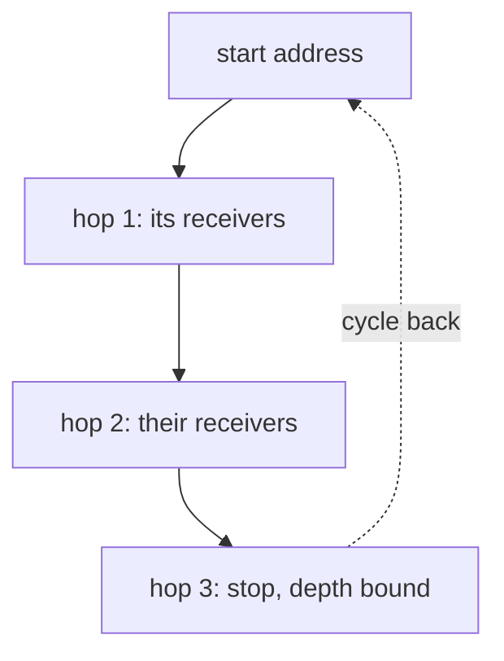

**Story.** An investigator asks where money went, three hops from one address. A recursive CTE (Common Table Expression) starts at the address, adds its receivers, then their receivers. A depth bound stops it at hop 3. Without the bound, a cycle back to the start would loop for ever.

**How it works**

1. `WITH name AS (SELECT ...)` names a subquery so the main query reads top-down.
2. A recursive CTE has two parts: the start rows, then `UNION ALL` a step that joins the last rows to the table again.
3. It stops when the step adds no rows, or when `depth < 3` fails.
4. An **uncorrelated** subquery runs once: `WHERE pool IN (SELECT pool FROM pools WHERE dex = 'aerodrome')`.
5. A **correlated** subquery names the outer row, so in principle it runs once per row: `WHERE amount > (SELECT AVG(amount) FROM swaps s2 WHERE s2.pool = s.pool)`.

```sql
WITH RECURSIVE hops AS (
  SELECT to_address, 1 AS depth FROM transfers WHERE from_address = :start
  UNION ALL
  SELECT t.to_address, h.depth + 1
  FROM hops h JOIN transfers t ON t.from_address = h.to_address
  WHERE h.depth < 3
) SELECT DISTINCT to_address FROM hops
```

### In code

```text
transfers: S->A  S->B  A->C  B->D  D->E  C->S
hops = receivers of S, depth 1            # start rows: A, B
repeat:
  new = receivers of last round's rows, depth + 1
  only expand rows with depth < 3        # the bound
  if new is empty: stop
  hops += new                             # UNION ALL keeps every row
result: A 1, B 1, C 2, D 2, E 3, S 3
no bound: S at 3 -> A, B at 4 -> ... S at 6 -> never empty
```

```sql
CREATE TABLE transfers (from_address TEXT, to_address TEXT);
INSERT INTO transfers VALUES ('S', 'A'), ('S', 'B'), ('A', 'C'), ('B', 'D'), ('D', 'E'), ('C', 'S');

-- walk the money out of S, at most three hops
WITH RECURSIVE hops(to_address, depth) AS (
  SELECT to_address, 1 FROM transfers WHERE from_address = 'S'
  UNION ALL
  SELECT t.to_address, h.depth + 1
  FROM hops h JOIN transfers t ON t.from_address = h.to_address
  WHERE h.depth < 3
)
SELECT to_address, depth FROM hops ORDER BY depth, to_address;

-- the same walk with no bound: the cycle C -> S feeds it for ever
WITH RECURSIVE hops(to_address, depth) AS (
  SELECT to_address, 1 FROM transfers WHERE from_address = 'S'
  UNION ALL
  SELECT t.to_address, h.depth + 1
  FROM hops h JOIN transfers t ON t.from_address = h.to_address
)
SELECT to_address, depth FROM hops LIMIT 20;
```

Run it: `handbook/code/07-ctes-and-subqueries/`, then `python3 main.py`.

**What goes wrong.** A recursive CTE on a graph with cycles never ends without a depth bound or a visited set. And trusting the planner to rewrite every correlated subquery into a join: good planners do it for common shapes, not for all, and not in every engine.

**Where you use it**

- Short, bounded walks in SQL: two or three hops for a report.
- Real graph walks: a graph database such as DozerDB (Neo4j-compatible), fed by a graph sync.
- Readable reports: a chain of named CTEs, each one step.

> A CTE names a step, a recursive CTE walks until no new rows appear, so always give it a bound.

▶ Watch it move: [CTEs and subqueries](visual/07-ctes-and-subqueries.html)

---

## Set operations: UNION, UNION ALL, INTERSECT, EXCEPT

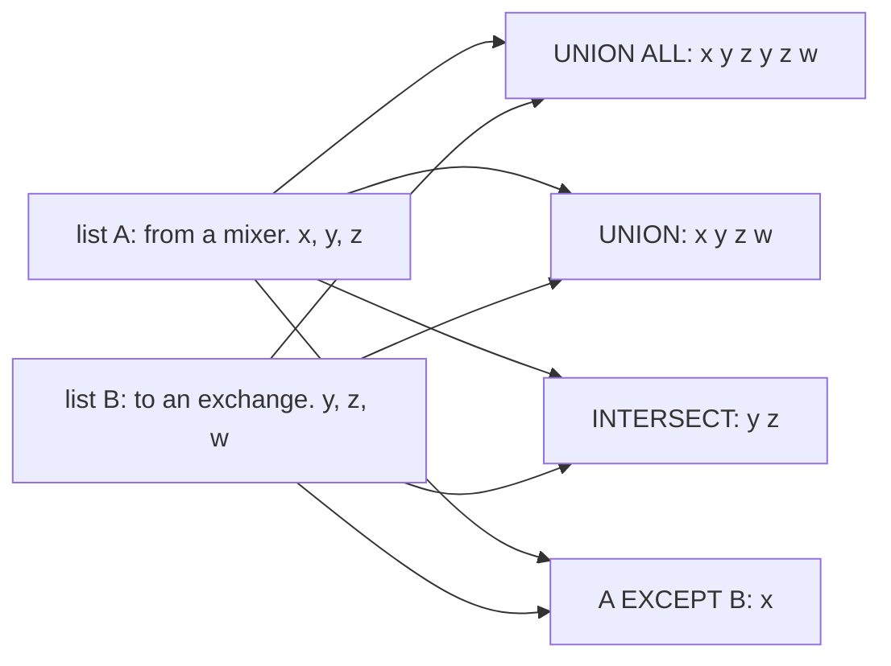

**Story.** An investigator has two lists of addresses. List A received money from a mixer. List B sent money to an exchange. `UNION ALL` stacks both lists. `UNION` removes the repeats. `INTERSECT` finds addresses on both lists. `EXCEPT` finds mixer receivers that never reached an exchange.

**How it works**

1. Both sides must return the same number of columns, with matching types. Columns match by position, not by name.
2. `UNION ALL` stacks the rows and keeps duplicates. No extra work.
3. `UNION` stacks the rows, then removes duplicates. That costs a sort or a hash over the whole result.
4. `INTERSECT` keeps rows found on both sides.
5. `EXCEPT` keeps rows of the first side that the second side lacks. Order matters: A EXCEPT B is not B EXCEPT A.
6. Set operations treat two NULLs as the same value, unlike `=`.

### In code

```text
lists: A = x, y, z (mixer)   B = y, z, w (exchange)
union_all(A, B): A's rows, then B's rows          # repeats kept
union(A, B):
  rows = union_all(A, B)
  sort or hash rows, keep one copy of each          # the extra cost
intersect(A, B): keep a row of A if B also has it
except(A, B):    keep a row of A if B does not have it
order matters:   except(B, A) is a different answer
```

```sql
INSERT INTO list_a VALUES ('x'), ('y'), ('z');
INSERT INTO list_b VALUES ('y'), ('z'), ('w');

-- stack both lists, keep repeats
SELECT addr FROM list_a
UNION ALL
SELECT addr FROM list_b;

-- stack, then keep one copy of each row
SELECT addr FROM list_a
UNION
SELECT addr FROM list_b
ORDER BY addr;

-- rows found in both lists
SELECT addr FROM list_a
INTERSECT
SELECT addr FROM list_b
ORDER BY addr;

-- rows of A that B lacks
SELECT addr FROM list_a
EXCEPT
SELECT addr FROM list_b;

-- order matters: rows of B that A lacks
SELECT addr FROM list_b
EXCEPT
SELECT addr FROM list_a;
```

Run it: `handbook/code/07-set-operations/`, then `python3 main.py`.

**What goes wrong.** `UNION` where `UNION ALL` was meant. The engine sorts or hashes the whole result, which is slow. Worse, it silently drops rows that were really repeated, such as two equal transfers in one block. Fix: write `UNION ALL` by default, and `UNION` only when you want distinct rows.

**Where you use it**

- Recursive CTEs: the step is joined with `UNION ALL`.
- Reconciling two sources: `A EXCEPT B` and `B EXCEPT A` are the differences.
- Combining partitions or chains with the same shape: `UNION ALL`.

> UNION ALL stacks and is cheap, UNION also removes duplicates and pays a sort or hash, INTERSECT keeps rows in both, and EXCEPT keeps rows in the first only.

▶ Watch it move: [Set operations](visual/07-set-operations.html)

---

## NULL and three-valued logic

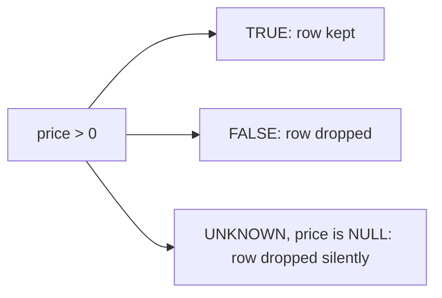

**Story.** A `price` column is NULL for days with no sealed price. A report filters `WHERE price > 0`. Every unpriced transfer disappears, with no error. The report looks complete and is wrong.

**How it works**

1. NULL means "unknown", not "empty" and not zero.
2. Any comparison with NULL gives UNKNOWN, not FALSE. Even `NULL = NULL` is UNKNOWN.
3. `WHERE` keeps only TRUE rows. UNKNOWN rows drop out like FALSE ones.
4. So `WHERE x <> 5` also drops every row where x is NULL.
5. Use `IS NULL`, `IS DISTINCT FROM` and `COALESCE` to handle NULL on purpose.

### In code

```text
transfers: t1 2.5, t2 NULL, t3 4.0, t4 NULL
for each row: test = price > 0
  NULL compared with anything gives UNKNOWN
  WHERE keeps the row only if test is TRUE
report = the kept rows             # t2, t4 gone, no error
NULL = NULL is UNKNOWN, only IS NULL gives TRUE
fix: unpriced = rows WHERE price IS NULL
     missing  = COUNT(*) - COUNT(price)
```

```sql
INSERT INTO transfers VALUES ('t1', 2.5), ('t2', NULL), ('t3', 4.0), ('t4', NULL);

-- what price > 0 gives for each row: 1 TRUE, 0 FALSE, NULL UNKNOWN
SELECT tx, price, price > 0 FROM transfers;

-- the report: WHERE keeps only TRUE
SELECT tx, price FROM transfers
WHERE price > 0;

-- three comparisons with a NULL
SELECT NULL = NULL, NULL <> 5, NULL IS NULL;

-- fix: show the unknown prices on purpose
SELECT tx FROM transfers
WHERE price IS NULL;

-- count the NULL prices
SELECT COUNT(*) - COUNT(price) FROM transfers;
```

Run it: `handbook/code/07-null-three-valued-logic/`, then `python3 main.py`.

**What goes wrong.** `NOT IN (1, 2, NULL)` is UNKNOWN for every row, so it returns nothing. Also: aggregates skip NULLs, and `GROUP BY` puts all NULLs in one group. Fix: report missing values on purpose with `WHERE price IS NULL`, and use `NOT EXISTS` instead of `NOT IN`.

**Where you use it**

- Price joins: count the NULL prices and show them, never filter them away.
- Left joins: the NULL on the right side is how you find rows with no partner.
- Data checks: `COUNT(*) - COUNT(col)` is the number of NULLs.

> NULL is unknown, a comparison with unknown is unknown, and WHERE throws unknown away.

▶ Watch it move: [NULL and three-valued logic](visual/07-null-three-valued-logic.html)

---

## Transactions and isolation levels

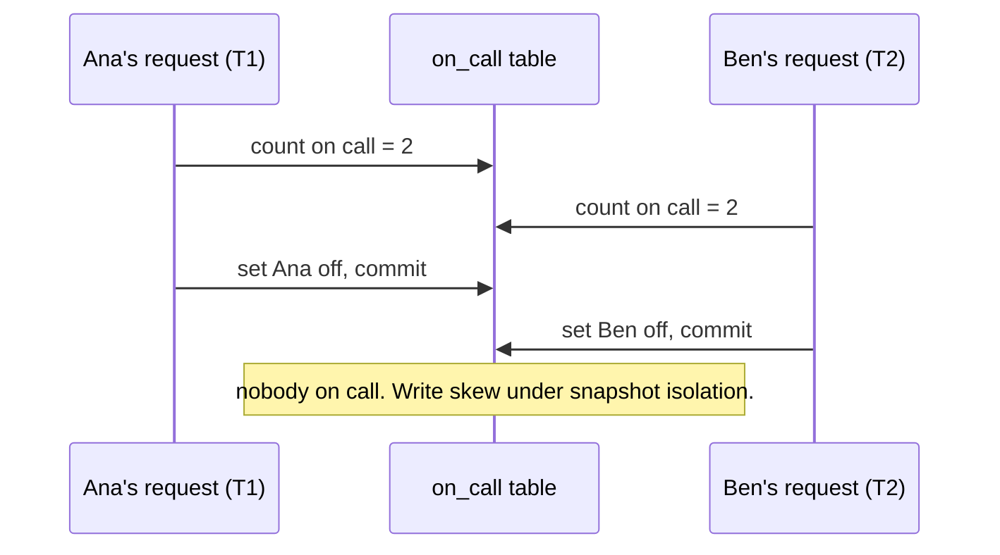

**Story.** Two engineers, Ana and Ben, are on call. The rule says at least one must stay. Both ask to go off at the same moment. Under snapshot isolation each request counts 2, each sets its own row off, and both commit. Each transaction kept the rule. Together they broke it, and nobody is on call.

**How it works**

1. A **transaction** groups statements so all apply or none do. ACID: Atomic (all or nothing), Consistent (rules hold before and after), Isolated (looks like it ran alone), Durable (kept after a crash once committed).
2. The isolation level says how much one running transaction sees of another.
3. **Read uncommitted** allows a dirty read: seeing a change not yet committed.
4. **Read committed** stops dirty reads, but a row read twice can return two values (non-repeatable read).
5. **Repeatable read** keeps rows stable, but a range query run twice can gain a new row (phantom).
6. **Snapshot** gives each transaction a frozen view. It still allows write skew, as in the picture: the two writes touch different rows, so no conflict is seen.
7. **Serializable** stops everything: the result equals some one-at-a-time order. The engine aborts a transaction that would break this, and the app retries.

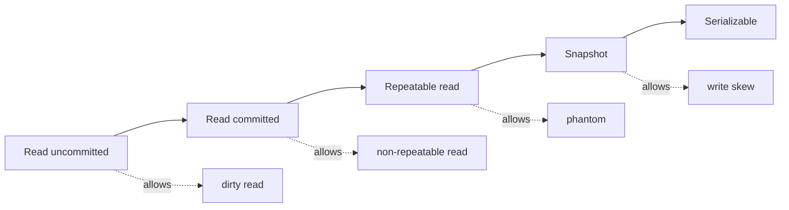

### In code

```text
read rule, read uncommitted: the newest version, committed or not
read rule, read committed: the newest committed version
wallet 7 = 100
T1: write 20                       # a new version, not committed
T2: read wallet 7                  # read uncommitted sees 20
T1: rollback                       # the 20 never existed
fix: T2 at read committed reads 100
```

```go
// visible is the read rule of each level: which version this tx may see.
func (t *Tx) visible(r *Row) *Version {
	if t.snapshot < 0 {
		t.snapshot = t.db.clock // the picture is taken at the first statement
	}
	for j := len(r.versions) - 1; j >= 0; j-- {
		v := r.versions[j]
		switch {
		case v.writer == t.id && v.committed == 0:
			return v // a transaction sees its own writes
		case t.level == ReadUncommitted:
			return v // the newest version, committed or not
		case t.level <= RepeatableRead && v.committed > 0:
			return v // the newest committed version, now
		case v.committed > 0 && v.committed <= t.snapshot:
			return v // committed before my snapshot
		}
	}
	return nil // the row did not exist for me
}

// Write adds a new, uncommitted version. Other levels cannot see it yet.
func (t *Tx) Write(r *Row, value int) {
	r.versions = append(r.versions, &Version{value: value, writer: t.id})
	t.writes[r] = true
}

// Rollback removes every version this tx wrote. The value never existed.
func (t *Tx) Rollback() {
	for r := range t.writes {
		kept := r.versions[:0]
		for _, v := range r.versions {
			if v.writer != t.id {
				kept = append(kept, v)
			}
		}
		r.versions = kept
	}
}

func dirtyRead(level Level) (seen, after int) {
	db := &DB{}
	w := db.Add("wallet 7", "wallets", 100)
	t1 := db.Begin(ReadCommitted) // the payment
	t2 := db.Begin(level)         // the fraud check
	t1.Write(w, 20)               // not committed
	seen = t2.Read(w)             // the fraud check reads
	t1.Rollback()                 // the payment fails
	after = db.Begin(ReadCommitted).Read(w)
	return seen, after
}

	fmt.Println("== read uncommitted: wallet 7 = 100, T1 writes 20, does not commit")
	seen, after := dirtyRead(ReadUncommitted)
	fmt.Printf("T2 at read uncommitted reads %d: a dirty read; T1 rolls back, wallet 7 = %d\n", seen, after)
	seen, _ = dirtyRead(ReadCommitted)
	fmt.Printf("fix, T2 at read committed reads %d while T1 is open\n", seen)
```

Run it: `handbook/code/07-isolation-levels/`, then `go run .`.

**What goes wrong.** Assuming "repeatable read" means the same everywhere. In PostgreSQL it is snapshot isolation and stops phantoms. In MySQL InnoDB some phantoms pass with locking reads. The fix for the on-call rule without serializable: lock the rows you checked with `SELECT ... FOR UPDATE`, so the second request waits and then counts 1.

The same-row cousin is the **lost update**. Two agent calls each read a wallet balance of 10 and each write `balance = 2` after spending 8. One spend vanishes. Fix: make the check and the write one statement, `UPDATE wallet SET balance = balance - :cost WHERE id = :id AND balance >= :cost`, and treat zero rows changed as "not enough money".

**Where you use it**

- An indexer writes one block's rows and its checkpoint row in one transaction, so a crash never leaves the checkpoint ahead of the data.
- Money and quota: one conditional `UPDATE`, or serializable with a retry loop.
- Never hold a transaction open across a network call: its locks and snapshot stay alive for the whole wait.

> Name the anomaly first, then name the weakest level that stops it.

▶ Watch it move: [Isolation levels](visual/07-isolation-levels.html)

---

## Lost update

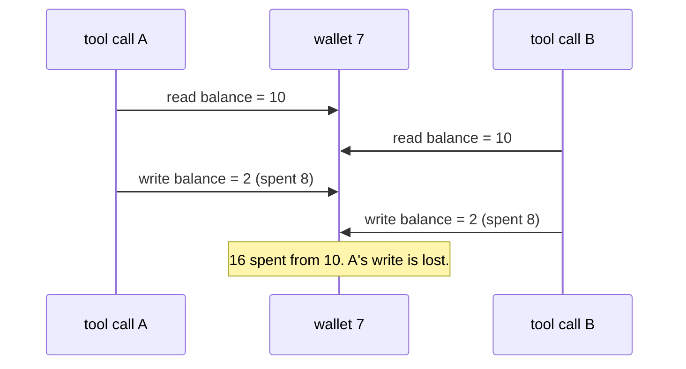

**Story.** Two agent tool calls spend from the same wallet at the same moment. Each reads a balance of 10, subtracts its cost of 8, and writes 2. Both succeed. The wallet paid for 16 with 10, and one spend left no trace.

**How it works**

1. The app does read, modify, write: `SELECT balance`, compute in code, `UPDATE ... SET balance = :new`.
2. Both calls read 10 before either one writes.
3. A writes 2. B writes 2 on top. A's change is gone.
4. Fix one: make the check and the write one statement. `UPDATE wallet SET balance = balance - 8 WHERE id = 7 AND balance >= 8`. The second call changes zero rows: not enough money.
5. Fix two: lock first. `SELECT ... FOR UPDATE` makes B wait for A, then B reads 2.
6. Fix three: a version column. `UPDATE ... WHERE version = :seen` changes zero rows for the loser, who re-reads and retries.

### In code

```text
wallet 7: balance 10, each call spends 8
read_modify_write(call):
  balance = SELECT balance WHERE id = 7      # no lock, no check
  new = balance - 8                          # computed in the app
  UPDATE wallet SET balance = new            # overwrites what is there
call A reads 10, call B reads 10
call A writes 2
call B writes 2 on top: 16 spent from 10
```

```go
const cost = 8 // what each tool call spends

// Read is a plain SELECT balance, version: no lock, no check.
func (w *Wallet) Read() (balance, version int) {
	return w.balance, w.version
}

// Write is UPDATE wallet SET balance = :new. It overwrites whatever is there.
func (w *Wallet) Write(newBalance int) {
	w.balance = newBalance
	w.version++
}

func lost() {
	fmt.Println("== lost update: read, compute in the app, write back")
	w := &Wallet{balance: 10, version: 1}
	a, _ := w.Read()
	fmt.Printf("call A reads %d, plans %d\n", a, a-cost)
	b, _ := w.Read()
	fmt.Printf("call B reads %d, plans %d\n", b, b-cost)
	w.Write(a - cost)
	fmt.Printf("call A writes %d\n", w.balance)
	w.Write(b - cost) // B's write lands on top of A's
	fmt.Printf("call B writes %d: %d spent from 10, A's spend is lost\n", w.balance, 2*cost)
}
```

Run it: `handbook/code/07-lost-update/`, then `go run .`.

**What goes wrong.** Trusting the default level. Read committed does not stop a lost update. PostgreSQL's repeatable read detects it and aborts the second writer. MySQL's repeatable read does not. Fix: never compute a new value in the app and write it back. Push the arithmetic into the `UPDATE`.

**Where you use it**

- Wallets and quotas: one conditional `UPDATE`, and zero rows means "refused".
- Stock counts: `SET stock = stock - 1 WHERE stock > 0`.
- Counters: `SET views = views + 1`, never read, add one, write.

> A lost update is two read-modify-writes on one row, so I make the check and the write one statement, or lock the row first.

▶ Watch it move: [Lost update](visual/07-lost-update.html)

---

## Upsert: INSERT ON CONFLICT and MERGE

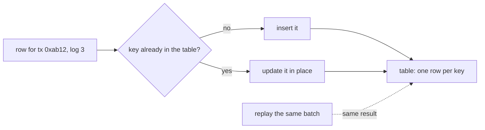

**Story.** An indexer writes block 9,506's transfers, then crashes before it saves its checkpoint. On restart it writes block 9,506 again. A plain `INSERT` now fails on the unique key, or, with no key, stores every transfer twice. An upsert keyed on `(tx_hash, log_index)` leaves the table exactly as it was.

**How it works**

1. A unique key says what "the same row" means: `(tx_hash, log_index)`.
2. PostgreSQL: `INSERT ... ON CONFLICT (tx_hash, log_index) DO UPDATE SET amount = EXCLUDED.amount`. MySQL: `ON DUPLICATE KEY UPDATE`. Standard SQL: `MERGE`.
3. A new key is inserted. An existing key is updated in place.
4. Replaying the same batch gives the same table. The write is idempotent.
5. StarRocks primary key tables do this on every load: a row with a key that exists replaces the old row.

### In code

```text
block 9506: (0xab12,0,5) (0xab12,1,7) (0xcd34,0,3)   checkpoint 9505
write_block: insert each row of the block
  crash here: the checkpoint still says 9505
  save checkpoint 9506                       # after the rows
restart: resume after the checkpoint -> write block 9506 again
unique key: insert of an existing key fails -> crash loop
no key: the insert succeeds -> 6 rows, total 30
```

```python
BLOCK_9506 = [("0xab12", 0, 5), ("0xab12", 1, 7), ("0xcd34", 0, 3)]

-- the key says what 'the same row' means
CREATE TABLE transfers (tx_hash TEXT, log_index INT, amount INT,
                        PRIMARY KEY (tx_hash, log_index));
CREATE TABLE checkpoint (block INT);
INSERT INTO checkpoint VALUES (9505);

-- no key: nothing can tell a replayed row from a new one
CREATE TABLE transfers (tx_hash TEXT, log_index INT, amount INT);
CREATE TABLE checkpoint (block INT);
INSERT INTO checkpoint VALUES (9505);

-- a plain insert: a second write of the same key fails
INSERT INTO transfers (tx_hash, log_index, amount) VALUES (?, ?, ?);

-- saved after the rows, so a crash can fall in between
UPDATE checkpoint SET block = ?;

def write_block(db, write_sql, block, crash):
    for row in BLOCK_9506:
        db.execute(write_sql, row)
    if crash:
        return "crashed before the checkpoint"
    db.execute(SAVE_CHECKPOINT, (block,))
    return "checkpoint saved"

def run(schema, write_sql, label):
    db = sqlite3.connect(":memory:")
    db.executescript(schema)
    print(label)
    print("  first write:", write_block(db, write_sql, 9506, crash=True), "->", state(db))
    try:
        print("  replay:", write_block(db, write_sql, 9506, crash=False), "->", state(db))
    except sqlite3.IntegrityError as e:
        print("  replay failed:", e, "->", state(db))
```

Run it: `handbook/code/07-upsert/`, then `python3 main.py`.

**What goes wrong.** Two traps. An upsert with no unique key has no conflict to detect, so it inserts duplicates. And `DO UPDATE SET count = count + EXCLUDED.count` is not idempotent: a replay counts twice, so a count of 3 becomes 6. Fix: put a unique key on the natural identity, and in replayable writes set values from the source, never add to them. In SQL Server, `MERGE` needs a `HOLDLOCK` hint to be safe with concurrent writers.

**Where you use it**

- An indexer replaying a page after a crash.
- A sync from a supplier feed: upsert each product by its supplier id.
- StarRocks: the primary key table model for rows that can be written again.

> An upsert keyed on the natural identity makes a write idempotent, so a crash and a replay leave the table unchanged.

▶ Watch it move: [Upsert](visual/07-upsert.html)

---

## Write-ahead log and durability

```mermaid
sequenceDiagram
  participant C as client
  participant DB as database memory
  participant L as WAL file on disk
  participant P as table pages on disk
  C->>DB: UPDATE, then COMMIT
  DB->>L: append the change, flush to disk
  DB->>C: committed
  Note over DB,P: power fails before the page is written
  L->>DB: on restart, replay the log
  DB->>P: page now holds the change
```

**Story.** A payment commits. One millisecond later the server loses power. The changed table page was still only in memory. On restart the database reads its write-ahead log (WAL), finds the committed payment and applies it again. The payment survives.

**How it works**

1. Every change is first written as a record to the WAL, a file that only grows at the end.
2. At commit the WAL is flushed to disk (fsync). Only then does the client hear "committed".
3. The table pages change in memory and go to disk later, in the background.
4. A checkpoint writes the changed pages and records how far the log is applied.
5. After a crash, the database replays the log from the last checkpoint. Committed changes are redone. Uncommitted ones are dropped.
6. Replicas read the same log stream. That is streaming replication.

### In code

```text
wallet 7 = 10 in memory and on disk
update(wallet 7, 2):
  page in memory = 2                       # the disk is untouched
  log buffer += record 42: wallet 7 = 2
commit():
  append the log buffer to the WAL file
  fsync: wait until the disk holds it      # one small sequential write
  answer "committed"                       # the page is not written yet
power cut: memory and the log buffer are wiped
restart(disk):
  load the pages from disk                 # wallet 7 = 10
  for each WAL record after the checkpoint:
    committed: redo it, else drop it
checkpoint(): write changed pages, move the checkpoint
```

```go
// Record is one WAL record: "wallet 7 set to 2", and whether it committed.
type Record struct {
	lsn     int
	wallet  int
	balance int
	commit  bool
}

// Update changes the page in memory and writes a record into the log buffer.
// Nothing reaches the disk yet.
func (e *Engine) Update(wallet, balance int) Record {
	e.pages[wallet] = balance
	r := Record{lsn: e.nextLSN, wallet: wallet, balance: balance}
	e.nextLSN++
	e.logBuf = append(e.logBuf, r)
	return r
}

// Commit appends the log buffer to the WAL file. With fsync and
// synchronous_commit on, it waits until the disk holds the record. Only then
// does it answer "committed".
func (e *Engine) Commit() string {
	for _, r := range e.logBuf {
		r.commit = true
		e.osCache = append(e.osCache, r) // write(): the OS has it, the disk may not
	}
	e.logBuf = nil
	if e.fsync && e.syncCommit {
		e.Flush()
	}
	return "committed"
}

// Flush is fsync: the OS cache of the WAL file goes to the disk. With
// synchronous_commit = off, the WAL writer calls it a moment after commit.
func (e *Engine) Flush() {
	if !e.fsync {
		return // fsync = off: the write stays in the OS cache
	}
	e.disk.wal = append(e.disk.wal, e.osCache...)
	e.osCache = nil
}

// PowerCut wipes everything that is not on disk: memory and the OS cache.
func (e *Engine) PowerCut() *Disk {
	return e.disk
}

// Restart loads the pages from disk and replays the WAL after the
// checkpoint: committed records are redone, the rest are dropped.
func Restart(d *Disk) (e *Engine, replayed int) {
	e = &Engine{disk: d, pages: map[int]int{}, fsync: true, syncCommit: true}
	for id, b := range d.pages {
		e.pages[id] = b
	}
	for _, r := range d.wal {
		if r.lsn > d.checkpoint && r.commit {
			e.pages[r.wallet] = r.balance
			replayed++
		}
		e.nextLSN = r.lsn + 1
	}
	return e, replayed
}

// Checkpoint writes the changed pages to disk and records how far the log
// is applied. WAL before that point can be recycled.
func (e *Engine) Checkpoint() {
	for id, b := range e.pages {
		e.disk.pages[id] = b
	}
	e.disk.checkpoint = e.disk.wal[len(e.disk.wal)-1].lsn
}

func walOn() {
	fmt.Println("== fsync on: wallet 7, 10 to 2")
	e, _ := Restart(newDisk())
	fmt.Printf("start: memory %d, page on disk %d\n", e.pages[7], e.disk.pages[7])

	r := e.Update(7, 2)
	fmt.Printf("UPDATE: page in memory %d, log buffer record %d: wallet %d = %d\n", e.pages[7], r.lsn, r.wallet, r.balance)

	answer := e.Commit()
	last := e.disk.wal[len(e.disk.wal)-1]
	fmt.Printf("COMMIT: record %d flushed to the WAL, then %q; page on disk still %d\n", last.lsn, answer, e.disk.pages[7])

	d := e.PowerCut()
	fmt.Printf("power cut: memory wiped, page on disk %d, WAL ends at record %d\n", d.pages[7], d.wal[len(d.wal)-1].lsn)

	e, n := Restart(d)
	fmt.Printf("restart: replayed %d record after checkpoint %d, wallet 7 = %d\n", n, d.checkpoint, e.pages[7])

	e.Checkpoint()
	fmt.Printf("checkpoint: page on disk %d, log applied up to record %d\n", d.pages[7], d.checkpoint)
}
```

Run it: `handbook/code/07-write-ahead-log/`, then `go run .`.

**What goes wrong.** Turning off durability for speed. With `fsync` off, a crash can corrupt the database. With PostgreSQL's `synchronous_commit` off, a crash loses the last moments of commits the client was told were saved, but nothing is corrupted. Fix: keep `fsync` on, and relax synchronous commit only for data you can afford to lose.

**Where you use it**

- PostgreSQL: the WAL is both crash recovery and replication.
- Kafka: the log is the product, and the same idea.
- Hardware choice: the disk's flush latency sets the commit latency.

> Durable means the change is in the log on disk before the client hears committed, and after a crash the log is replayed.

▶ Watch it move: [Write-ahead log](visual/07-write-ahead-log.html)

---

## MVCC: readers never block writers

```mermaid
flowchart LR
  subgraph Row["row id 7, three versions"]
    V1["v1 balance 10, made by tx 100, ended by tx 120"]
    V2["v2 balance 2, made by tx 120, ended by tx 140"]
    V3["v3 balance 50, made by tx 140, live"]
  end
  R1["report, snapshot at tx 110"] --> V1
  R2["app read, snapshot at tx 150"] --> V3
```

**Story.** A long report starts at transaction 110 and reads row 7. Meanwhile the app updates row 7 twice. The report still sees balance 10, the version that was committed when it started. The app sees 50. Nobody waited for anybody.

**How it works**

1. A write does not overwrite a row. It makes a new version and marks the old one as ended.
2. Each version records the transaction that made it and the one that ended it.
3. A reader gets a snapshot: the set of transactions committed when it began.
4. The reader picks the version its snapshot can see.
5. Old versions stay until nothing can see them. Then cleanup (`VACUUM` in PostgreSQL) removes them.

### In code

```text
version = (balance, made_by, ended_by)     # no ended_by: live
update(row, tx, balance):
  live.ended_by = tx                         # never overwrite
  append new version, made_by = tx
visible(version, snapshot):
  made_by < snapshot and (live or ended_by > snapshot)
read(row, snapshot): the one visible version
vacuum(row, horizon):                        # horizon = oldest open snapshot
  remove versions with ended_by <= horizon
row 7: v1 balance 10, made by tx 100
report = snapshot at tx 110
tx 120 sets balance 2
tx 140 sets balance 50
app = snapshot at tx 150
report done: vacuum(row, horizon = tx 150)
```

```go
// Version is one copy of a row. made is the transaction that wrote it
// (xmin in PostgreSQL), ended the one that replaced it (xmax), 0 = live.
type Version struct {
	name    string
	balance int
	made    int
	ended   int
}

// Update never overwrites. It ends the live version and adds a new one.
func (r *Row) Update(tx, balance int) {
	live := r.versions[len(r.versions)-1]
	live.ended = tx
	name := fmt.Sprintf("v%d", len(r.versions)+1)
	r.versions = append(r.versions, &Version{name: name, balance: balance, made: tx})
}

// Visible is the rule: made before my snapshot, and not ended before it.
func (s Snapshot) Visible(v *Version) bool {
	madeBefore := v.made < s.tx
	stillLive := v.ended == 0 || v.ended > s.tx
	return madeBefore && stillLive
}

// Read returns the one version this snapshot can see.
func (s Snapshot) Read(r *Row) *Version {
	for _, v := range r.versions {
		if s.Visible(v) {
			return v
		}
	}
	return nil
}

// Vacuum removes versions ended at or before the horizon: the oldest open
// snapshot. A version ended after it may still be read, so it stays.
func (r *Row) Vacuum(horizon int) (removed int) {
	kept := r.versions[:0]
	for _, v := range r.versions {
		if v.ended != 0 && v.ended <= horizon {
			removed++
			continue
		}
		kept = append(kept, v)
	}
	r.versions = kept
	return removed
}

func versions() {
	fmt.Println("== row 7 over time")
	row := &Row{versions: []*Version{{name: "v1", balance: 10, made: 100}}}
	fmt.Println("v1 balance 10, made by tx 100, live")

	report := Snapshot{tx: 110}
	v := report.Read(row)
	fmt.Printf("report snapshot tx %d reads %s: %d\n", report.tx, v.name, v.balance)

	row.Update(120, 2)
	v = report.Read(row)
	fmt.Printf("tx 120 makes v2 balance 2, v1 ended by 120; report still reads %s: %d\n", v.name, v.balance)

	row.Update(140, 50)
	fmt.Printf("tx 140 makes v3 balance 50; versions kept: %d\n", len(row.versions))

	app := Snapshot{tx: 150}
	a := app.Read(row)
	r := report.Read(row)
	fmt.Printf("app snapshot tx %d reads %s: %d, report reads %s: %d\n", app.tx, a.name, a.balance, r.name, r.balance)

	// The report finishes. The oldest open snapshot is now the app's, tx 150.
	removed := row.Vacuum(app.tx)
	fmt.Printf("report done, VACUUM horizon tx %d removes %d (v1, v2), keeps %d\n", app.tx, removed, len(row.versions))
}
```

Run it: `handbook/code/07-mvcc-snapshots/`, then `go run .`.

**What goes wrong.** A report holds its snapshot for an hour. Every update in that hour leaves a version behind it, and cleanup cannot remove any of them. The table doubles in size (bloat). Fix: move long analytics to the warehouse, and keep transactions short. The second trap: MVCC gives snapshots, not serializability. Write skew remains unless the engine adds SSI (Serializable Snapshot Isolation).

**Where you use it**

- PostgreSQL and Oracle: MVCC is how reads stay fast under writes.
- Column stores: a delete writes a mask, and compaction rewrites the segment later.
- Long-running analytics: run it on a copy, not on the app database.

> A write makes a new version, each reader sees the versions of its snapshot, and old versions are garbage someone must collect.

▶ Watch it move: [MVCC snapshots](visual/07-mvcc-snapshots.html)

---

## Serializable: two-phase locking or SSI

```mermaid
flowchart LR
  subgraph PL["Two-phase locking (2PL)"]
    P1["reads take shared locks"] --> P2["writes take exclusive locks"]
    P2 --> P3["all locks held to commit"]
    P3 --> P4["readers and writers wait for each other"]
  end
  subgraph SSI["Serializable Snapshot Isolation (SSI)"]
    S1["reads use a snapshot, no read locks"] --> S2["engine records who read what the other wrote"]
    S2 --> S3["a dangerous pair is found at commit"]
    S3 --> S4["one transaction is aborted and retried"]
  end
```

**Story.** Ana and Ben are on call, and both ask to go off at once. Under two-phase locking, both reads take shared locks on the on-call rows. When Ana tries to write, she waits for Ben's lock, and Ben waits for hers: a deadlock, and one is aborted. Under SSI (Serializable Snapshot Isolation), nobody waits. At commit the engine sees that each read what the other then wrote, and aborts Ben.

**How it works**

1. 2PL, growing phase: take locks as you go. Shared for reads, exclusive for writes.
2. 2PL, shrinking phase: release locks only at commit (strict 2PL).
3. So readers block writers and writers block readers. Correct, but slow when many touch the same rows.
4. SSI: every transaction reads its snapshot, with no read locks.
5. The engine records read-write dependencies: T1 read a row that T2 later wrote.
6. Two such dependencies in a row form a dangerous structure. The engine aborts one transaction at commit. The app retries it.

### In code

```text
request(person):                       # one transaction
  n = count on call                    # each read takes a shared lock
  if n < 2: refuse
  set person off                       # needs the exclusive lock
  commit                               # releases every lock
shared(row): granted unless another tx holds it exclusive
exclusive(row): wait while another tx holds a shared lock
deadlock: the waits-for edges form a cycle: abort one
T1 counts 2: shared locks on Ana and Ben
T2 counts 2: shared locks do not conflict
T1 waits for T2 on Ana
T2 waits for T1 on Ben
abort T2: T1 sets Ana off and commits
T2 retries: counts 1, refused
```

```go
// countOnCall is the read each request makes: SELECT count(*) WHERE on_call.
func countOnCall(rows map[string]bool) int {
	n := 0
	for _, p := range people {
		if rows[p] {
			n++
		}
	}
	return n
}

// Shared is the lock a read takes. Readers never block readers.
func (m *LockManager) Shared(tx, row string) bool {
	l := m.rows[row]
	if l.exclusive != "" && l.exclusive != tx {
		return false
	}
	l.shared[tx] = true
	return true
}

// Exclusive is the lock a write takes. Any other reader of the row blocks it.
func (m *LockManager) Exclusive(tx, row string) (granted bool, waitsFor string) {
	l := m.rows[row]
	for holder := range l.shared {
		if holder != tx {
			m.waitsFor[tx] = holder
			return false, holder
		}
	}
	l.exclusive = tx
	delete(m.waitsFor, tx)
	return true, ""
}

// Deadlock follows the waits-for edges from tx. Coming back to tx is a cycle.
func (m *LockManager) Deadlock(tx string) bool {
	next, ok := m.waitsFor[tx]
	for hops := 0; ok && hops <= len(m.waitsFor); hops++ {
		if next == tx {
			return true
		}
		next, ok = m.waitsFor[next]
	}
	return false
}

// Release drops every lock of tx. It runs at commit or abort, never before.
func (m *LockManager) Release(tx string) {
	for _, l := range m.rows {
		delete(l.shared, tx)
		if l.exclusive == tx {
			l.exclusive = ""
		}
	}
	delete(m.waitsFor, tx)
	for waiter, on := range m.waitsFor {
		if on == tx {
			delete(m.waitsFor, waiter)
		}
	}
}

func twoPhase() {
	fmt.Println("== 2PL: locks held to commit")
	onCall := map[string]bool{"Ana": true, "Ben": true}
	m := newLockManager()
	m.Shared("T1", "Ana") // T1 reads both rows
	m.Shared("T1", "Ben")
	fmt.Printf("T1 counts %d, holds shared on Ana: %s\n", countOnCall(onCall), holders(m.rows["Ana"]))
	m.Shared("T2", "Ana") // T2 reads both rows: shared locks do not conflict
	m.Shared("T2", "Ben")
	fmt.Printf("T2 counts %d; shared on Ana: %s; shared on Ben: %s\n", countOnCall(onCall), holders(m.rows["Ana"]), holders(m.rows["Ben"]))

	ok, on := m.Exclusive("T1", "Ana")
	fmt.Printf("T1 asks exclusive on Ana: granted %v, waits for %s\n", ok, on)
	ok, on = m.Exclusive("T2", "Ben")
	fmt.Printf("T2 asks exclusive on Ben: granted %v, waits for %s\n", ok, on)

	if m.Deadlock("T2") {
		fmt.Println("deadlock: T1 waits for T2, T2 waits for T1; the engine aborts T2")
		m.Release("T2") // abort: T2's locks go
	}
	ok, _ = m.Exclusive("T1", "Ana")
	onCall["Ana"] = false
	m.Release("T1") // commit
	fmt.Printf("T1 gets exclusive on Ana: %v, sets Ana off, commits\n", ok)

	// The app retries T2 from the start: new locks, a new count.
	for _, p := range people {
		m.Shared("T2", p)
	}
	n := countOnCall(onCall)
	if n < 2 {
		fmt.Printf("T2 retries: counts %d, refused; Ben on call: %v\n", n, onCall["Ben"])
	}
	m.Release("T2")
}
```

Run it: `handbook/code/07-ssi-vs-2pl/`, then `go run .`.

**What goes wrong.** An app with no retry loop. Under SSI an abort is normal, not a bug, and SSI also aborts some transactions that were safe. Without a retry the user sees an error. 2PL fails differently: deadlocks and long waits. Fix: wrap the whole transaction in a retry loop and keep it short.

**Where you use it**

- PostgreSQL: `SERIALIZABLE` is SSI.
- MySQL InnoDB: `SERIALIZABLE` turns plain reads into locking reads, the 2PL style.
- CockroachDB: serializable by default, so every client needs the retry loop.

> Serializable is either locking, where readers and writers wait for each other, or SSI, where nobody waits and the engine aborts one of a dangerous pair, and both need a retry loop.

▶ Watch it move: [2PL or SSI](visual/07-ssi-vs-2pl.html)

---

## Locks, deadlocks, optimistic and pessimistic

```mermaid
flowchart LR
  S["graph sync"] -- "holds" --> A["node A"]
  S -. "waits for" .-> B["node B"]
  M["migration"] -- "holds" --> B
  M -. "waits for" .-> A
```

**Story.** A graph sync writes address nodes in page order: A, then B. A migration writes the same nodes in key order: B, then A. Each takes its first lock and waits for the other's. Neither can move. The database spots the cycle and kills one of them.

**How it works**

1. A **shared lock** lets many readers in and no writer.
2. An **exclusive lock** lets one writer in and nobody else.
3. An **intent lock** on a table says "row locks exist below", so a table lock check reads one flag.
4. A **deadlock** is a cycle of waits, as in the picture. The engine finds it in a wait-for graph and aborts one side.
5. **Pessimistic** concurrency: lock first, then write.
6. **Optimistic** concurrency: write with a version check, `UPDATE ... WHERE version = :seen`, and retry when zero rows changed.

### In code

```text
sync order A, B · migration order B, A
lock(tx, node):
  if another tx holds node: add tx -> node to the wait-for graph, wait
  else: tx becomes the holder of node
sync: lock A
migration: lock B
sync: lock B -> waits
migration: lock A -> waits
detect: follow the waits from tx; back at tx = deadlock
abort the victim: release its locks; the other commits
retry the victim: same orders, same risk next run
```

```go
// Lock asks for an exclusive lock. If another transaction holds it,
// the caller waits: an edge goes into the wait-for graph.
func (t *LockTable) Lock(tx, node string) bool {
	if h, ok := t.holder[node]; ok && h != tx {
		t.waits[tx] = node
		return false
	}
	t.holder[node] = tx
	delete(t.waits, tx)
	return true
}

// Cycle follows the wait-for graph from tx: tx waits for a node,
// the node's holder waits for another node, and so on.
// It returns the path when the walk comes back to tx: a deadlock.
func (t *LockTable) Cycle(tx string) []string {
	path := []string{tx}
	cur := tx
	for len(path) < 20 {
		node, ok := t.waits[cur]
		if !ok {
			return nil // somebody in the chain is running: no cycle
		}
		h := t.holder[node]
		path = append(path, node, h)
		if h == tx {
			return path
		}
		cur = h
	}
	return nil
}

// Release is commit or abort: every lock of tx is freed.
func (t *LockTable) Release(tx string) {
	for node, h := range t.holder {
		if h == tx {
			delete(t.holder, node)
		}
	}
	delete(t.waits, tx)
}

func twoOrders() {
	fmt.Println("== two writers, two lock orders")
	t := NewLockTable()
	sync := []string{"A", "B"}      // page order
	migration := []string{"B", "A"} // key order
	fmt.Printf("sync order %v, migration order %v\n", sync, migration)
	fmt.Printf("sync locks A: %v\n", t.Lock("sync", sync[0]))
	fmt.Printf("migration locks B: %v\n", t.Lock("migration", migration[0]))
	fmt.Printf("sync locks B: %v, sync waits\n", t.Lock("sync", sync[1]))
	fmt.Printf("cycle from sync: %d steps, none (the migration still runs)\n", len(t.Cycle("sync")))
	fmt.Printf("migration locks A: %v, migration waits\n", t.Lock("migration", migration[1]))
	cycle := t.Cycle("migration")
	fmt.Printf("cycle from migration: %s: a deadlock\n", strings.Join(cycle, " -> "))
	t.Release("migration") // the engine picks a victim and aborts it
	fmt.Println("engine aborts migration: its lock on B is freed, its work is thrown away")
	fmt.Printf("sync locks B: %v, sync commits\n", t.Lock("sync", "B"))
	t.Release("sync")
	ok := t.Lock("migration", "B") && t.Lock("migration", "A")
	t.Release("migration")
	fmt.Printf("migration retries alone: %v; the same two orders can deadlock again\n", ok)
}
```

Run it: `handbook/code/07-locks-and-deadlocks/`, then `go run .`.

**What goes wrong.** Retrying deadlocks instead of preventing them. Fix: one lock order for every writer, so sort the keys before writing. Keep transactions small and short. Second trap: lock escalation, where many row locks turn into one table lock and every other writer stalls. Third: optimistic under heavy contention retries for ever (live-lock).

**Where you use it**

- An indexer lane has one writer at a time. The lease is one statement: `UPDATE lease SET owner = :me, epoch = epoch + 1 WHERE owner IS NULL OR expires < now()`. Zero rows means someone else holds it. The epoch fences a stale writer that wakes up late.
- A booking system with many fights for one seat: pessimistic, `SELECT ... FOR UPDATE`.
- A profile edit that rarely conflicts: optimistic, with a version column.

> Prevent deadlocks with one lock order, and pick optimistic or pessimistic by how often writers collide.

▶ Watch it move: [Locks and deadlocks](visual/07-locks-and-deadlocks.html)

---

## Intent locks and lock escalation

```mermaid
flowchart TB
  T["table swaps: intent-exclusive (IX) flag"] --> R1["row 7: exclusive lock, writer 1"]
  T --> R2["row 9: exclusive lock, writer 2"]
  J["nightly job asks for a table lock"] -.checks one flag, waits.-> T
  subgraph ESC["escalation"]
    M["one statement holds 5,000 row locks"] --> X["swapped for one table lock"]
    X --> W["every other writer waits"]
  end
```

**Story.** A nightly job wants to lock the whole swaps table to rebuild it. Without intent locks it would have to inspect millions of row locks to learn whether anyone is writing. With intent locks it checks one flag on the table. Later, a bulk update in SQL Server locks thousands of rows. The engine swaps those row locks for one table lock, and every other writer stalls.

**How it works**

1. A writer that locks row 7 first puts an intent-exclusive (IX) lock on the table.
2. Many writers can hold IX at once. Intent locks do not conflict with each other.
3. A request for an exclusive table lock conflicts with IX. It checks one flag and waits.
4. Each lock costs memory. When one transaction holds too many row locks, some engines trade them for one table lock. That is lock escalation.
5. After escalation the whole table is locked by one writer, and everyone else waits.

### In code

```text
swaps table: 1,000,000 rows · the job wants X on the table
lock_row(writer, row):
  put IX on the table        # the flag: some row below is locked
  put X on the row
writer 1: lock_row(7)
writer 2: lock_row(9)
without flags: check every row's lock, 1,000,000 checks
lock_table(job): read the IX flags once
  any IX from another writer: wait
commit: drop the row locks and IX · then the job gets X
```

```go
const tableRows = 1_000_000 // rows in the swaps table

// LockRow puts IX on the table, then X on the row.
// It returns false when another writer owns the whole table: the caller waits.
func (t *Table) LockRow(w string, row int) bool {
	if t.owner != "" && t.owner != w {
		return false // the table lock conflicts with IX
	}
	if t.owner == w {
		return true // the table lock already covers the row
	}
	t.intent[w] = true // the flag: some row below is locked
	t.rows[row] = w
	t.held[w]++
	if t.escalate && t.held[w] >= escalateAt {
		t.Escalate(w)
	}
	return true
}

// LockTable asks for an exclusive table lock. It reads the intent flags once:
// any IX held by another writer conflicts, so the caller waits.
func (t *Table) LockTable(w string) (ok bool, checks int) {
	checks = 1
	for other := range t.intent {
		if other != w {
			return false, checks
		}
	}
	t.owner = w
	return true, checks
}

// LockTableByScan is the same question without intent flags:
// it must look at the lock state of every row.
func (t *Table) LockTableByScan(w string) (ok bool, checks int) {
	ok = true
	for row := 0; row < tableRows; row++ {
		checks++
		if h, locked := t.rows[row]; locked && h != w {
			ok = false
		}
	}
	return ok, checks
}

// Commit frees every lock of w.
func (t *Table) Commit(w string) {
	for row, h := range t.rows {
		if h == w {
			delete(t.rows, row)
		}
	}
	t.held[w] = 0
	delete(t.intent, w)
	if t.owner == w {
		t.owner = ""
	}
}

func intentLocks() {
	fmt.Println("== intent locks: a nightly job wants the whole table")
	t := NewTable(false)
	t.LockRow("writer 1", 7)
	t.LockRow("writer 2", 9)
	fmt.Printf("writer 1 locks row 7, writer 2 locks row 9: IX flags on the table %d\n", len(t.intent))
	_, scanChecks := t.LockTableByScan("job")
	fmt.Printf("without the flag: the job checks %d rows\n", scanChecks)
	ok, checks := t.LockTable("job")
	fmt.Printf("with the flag: %d check, table lock granted %v, the job waits\n", checks, ok)
	t.Commit("writer 1")
	t.Commit("writer 2")
	ok, _ = t.LockTable("job")
	fmt.Printf("writers commit, IX flags %d, table lock granted %v\n", len(t.intent), ok)
}
```

Run it: `handbook/code/07-lock-escalation/`, then `go run .`.

**What goes wrong.** Escalation stalls a busy table during a bulk update. SQL Server tries it at about 5,000 locks held by one statement. Fix: split the big update into batches below that size, or turn escalation off for that table where the engine allows. PostgreSQL never escalates row locks, because it keeps them in the rows themselves.

**Where you use it**

- SQL Server: watch escalation on bulk updates and deletes.
- MySQL InnoDB: intention locks guard table locks and DDL (Data Definition Language, such as `ALTER TABLE`).
- PostgreSQL: no escalation, but an `ALTER TABLE` waits for every open reader of the table.

> An intent lock is a flag on the table saying row locks exist below, and escalation swaps many row locks for one table lock, which stalls everyone else.

▶ Watch it move: [Intent locks and escalation](visual/07-lock-escalation.html)

---

## Fencing tokens

```mermaid
sequenceDiagram
  participant A as indexer pod A
  participant L as lease row
  participant B as indexer pod B
  participant C as checkpoint row
  A->>L: take lease, epoch 7
  Note over A: long pause, lease expires
  B->>L: take lease, epoch 8
  B->>C: write height 9,600 with epoch 8
  A->>C: write height 9,506 with epoch 7
  C-->>A: 0 rows changed, epoch 7 is stale
```

**Story.** Two indexer pods share one lane, and only one may write. Pod A holds the writer lease with epoch 7. It freezes for a minute in a long garbage collection pause, and its lease expires. Pod B takes the lease with epoch 8 and moves on. Pod A wakes, still believes it is the writer, and tries to save an old checkpoint. The write carries epoch 7, the row already holds 8, and the write is refused.

**How it works**

1. Take the lease in one statement: `UPDATE lease SET owner = :me, epoch = epoch + 1, expires = now() + interval '30 seconds' WHERE owner IS NULL OR expires < now()`.
2. The new epoch is the fencing token.
3. Every write carries it: `UPDATE checkpoint SET height = :h, epoch = :e WHERE lane = :lane AND epoch <= :e`.
4. A stale writer's token is lower, so its write changes zero rows.
5. The writer sees zero rows and stops itself.

### In code

```text
take_lease(pod, now):
  if the lease is live: refuse
  owner = pod, epoch = epoch + 1, expires = now + 30s
write(height, token): UPDATE checkpoint SET height, epoch = token
  WHERE epoch <= token           # the storage checks the token
  0 rows: a newer token wrote, refuse
pod A: take_lease(A, 0s) -> epoch 7
pod A: write(9,500, 7) -> 1 row
pod A pauses 60s, the lease expires at 30s
pod B: take_lease(B, 40s) -> epoch 8
pod B: write(9,600, 8) -> 1 row
pod A wakes: write(9,506, 7) -> 0 rows
on 0 rows: stop writing, go to standby
```

```go
// Acquire takes the lease when it is free or expired. Each take bumps the epoch.
func (l *Lease) Acquire(pod string, now int) (epoch int, ok bool) {
	if l.owner != "" && now < l.expires {
		return 0, false // someone holds a live lease
	}
	l.owner = pod
	l.epoch++
	l.expires = now + leaseSeconds
	return l.epoch, true
}

// FencedWrite is UPDATE checkpoint SET height = :h, epoch = :e WHERE epoch <= :e.
// It returns the number of rows changed.
func (c *Checkpoint) FencedWrite(h, e int) (rows int) {
	if c.epoch > e {
		return 0 // a newer token already wrote: refuse
	}
	c.height = h
	c.epoch = e
	return 1
}

func withToken() {
	fmt.Println("== with a fencing token")
	lease := &Lease{epoch: 6}
	cp := &Checkpoint{height: 9_400, epoch: 6}
	a, _ := lease.Acquire("A", 0)
	fmt.Printf("t=0s pod A takes the lease: epoch %d, expires at t=%ds\n", a, lease.expires)
	rows := cp.FencedWrite(9_500, a)
	fmt.Printf("pod A writes height 9500 WHERE epoch <= %d: %d row, checkpoint epoch %d\n", a, rows, cp.epoch)
	fmt.Println("t=5s pod A freezes in a 60 second pause")
	_, ok := lease.Acquire("B", 20)
	fmt.Printf("t=20s pod B asks for the lease: granted %v, still live\n", ok)
	b, ok := lease.Acquire("B", 40)
	fmt.Printf("t=40s pod B takes the expired lease: granted %v, epoch %d\n", ok, b)
	rows = cp.FencedWrite(9_600, b)
	fmt.Printf("pod B writes height 9600 WHERE epoch <= %d: %d row, checkpoint epoch %d\n", b, rows, cp.epoch)
	rows = cp.FencedWrite(9_506, a)
	fmt.Printf("t=65s pod A wakes, writes 9506 WHERE epoch <= %d: %d rows, height stays %d\n", a, rows, cp.height)
	if rows == 0 {
		fmt.Println("pod A reads 0 rows as: no longer the writer. It stops and goes to standby.")
	}
}
```

Run it: `handbook/code/07-fencing-token/`, then `go run .`.

**What goes wrong.** A lease with no token. The lease says who should write, not who is writing, and a paused process cannot know that its lease ran out. Fix: the storage must check the token on every write. Use the database clock for expiry, never the pod's clock.

**Where you use it**

- An indexer writer lease, with the epoch on every checkpoint write.
- Kafka: a transactional producer's epoch fences an old "zombie" producer.
- etcd and ZooKeeper: the revision number of a lock serves as the token.

> A lease says who should write, and a fencing token makes the storage refuse anyone who no longer should.

▶ Watch it move: [Fencing tokens](visual/07-fencing-token.html)

---

## SKIP LOCKED: a job queue in SQL

```mermaid
flowchart LR
  W1["worker 1"] -- "locks" --> J1["job 1"]
  W2["worker 2"] -. "job 1 locked, skips" .-> J1
  W2 -- "locks" --> J2["job 2"]
  W3["worker 3"] -- "locks" --> J3["job 3"]
  J4["job 4, ready"]
```

**Story.** Price fetch jobs wait in a PostgreSQL table. Three workers poll it. With plain `FOR UPDATE`, all three ask for the same first job, and two of them wait. With `SKIP LOCKED`, each worker takes the first job nobody holds, and all three work at once.

**How it works**

1. Each worker runs `SELECT id FROM jobs WHERE status = 'ready' ORDER BY id LIMIT 1 FOR UPDATE SKIP LOCKED`.
2. Worker 1 locks job 1.
3. Worker 2 runs the same query. Job 1 is locked, so it skips to job 2.
4. Worker 3 takes job 3.
5. Each worker does its job, marks it done and commits. The lock is released.
6. If a worker crashes, its transaction rolls back, the lock goes away, and the job is ready again.

### In code

```text
jobs 1 to 5: status ready · workers 1, 2, 3
pick(worker): SELECT id ... WHERE status = 'ready' ORDER BY id LIMIT 1 FOR UPDATE
  walk the ready rows in id order
  row locked by another worker: wait for it
  row free: lock it, return it
worker 1: pick -> job 1
workers 2 and 3: pick -> wait for job 1
commit, then the next worker moves: 1 job per round
right when everyone needs the same row: one seat, one wallet
```

```go
// Pick is SELECT id FROM jobs WHERE status = 'ready' ORDER BY id LIMIT 1
// FOR UPDATE, with SKIP LOCKED when skip is true.
// It returns the job it locked, or the job it must wait for.
func (q *Queue) Pick(tx string, skip bool) (id, waitsFor int) {
	for _, j := range q.jobs {
		if j.status != "ready" {
			continue
		}
		if h, locked := q.locks[j.id]; locked && h != tx {
			if skip {
				continue // SKIP LOCKED: a locked row is treated as not there
			}
			return 0, j.id // plain FOR UPDATE: wait for this row
		}
		q.locks[j.id] = tx
		return j.id, 0
	}
	return 0, 0
}

// drain runs rounds of three workers until no job is ready.
// It returns how many jobs ran in each round.
func drain(q *Queue, skip bool) []int {
	rounds := []int{}
	for q.Ready() > 0 {
		ran := 0
		for w := 1; w <= 3; w++ {
			if id, _ := q.Pick(fmt.Sprintf("worker %d", w), skip); id != 0 {
				ran++
			}
		}
		for w := 1; w <= 3; w++ {
			q.Commit(fmt.Sprintf("worker %d", w), "done")
		}
		rounds = append(rounds, ran)
	}
	return rounds
}

func plain() {
	fmt.Println("== plain FOR UPDATE, five jobs, three workers")
	q := NewQueue(5)
	id, _ := q.Pick("worker 1", false)
	fmt.Printf("worker 1 locks job %d\n", id)
	_, w2 := q.Pick("worker 2", false)
	_, w3 := q.Pick("worker 3", false)
	fmt.Printf("worker 2 waits for job %d, worker 3 waits for job %d, jobs 2 to 5 free\n", w2, w3)
	q.Commit("worker 1", "done")
	fmt.Printf("jobs per round for a fresh queue: %v\n", drain(NewQueue(5), false))
}
```

Run it: `handbook/code/07-skip-locked-queue/`, then `go run .`.

**What goes wrong.** Holding the transaction open while a job runs for minutes. The lock and the snapshot stay alive the whole time, and dead row versions pile up. Fix: claim the job in a short transaction (set `status = 'running'` and a `claimed_until` time), commit, do the work, then mark it done. A reaper resets claims that ran out. The job must be idempotent, because a crash after the work and before the commit runs it twice.

**Where you use it**

- PostgreSQL job queues: River (Go) and good_job (Ruby) are built on `SKIP LOCKED`.
- MySQL 8 supports `SKIP LOCKED` too.
- High volume or many consumers of one event: move to Kafka or a real queue.

> FOR UPDATE SKIP LOCKED lets many workers each take a different row, so a table becomes a safe job queue.

▶ Watch it move: [SKIP LOCKED job queue](visual/07-skip-locked-queue.html)

---

## OLTP versus OLAP

```mermaid
flowchart LR
  subgraph OLTP["OLTP: the checkout"]
    C1["read one cart, write one order"] --> C2["by key, milliseconds, thousands per second"]
  end
  subgraph OLAP["OLAP: the finance report"]
    R1["revenue per region per month, 3 years"] --> R2["scan millions of rows, seconds, a few per hour"]
  end
  OLTP -- "copy: change data capture or batch" --> OLAP
```

**Story.** A shop's checkout reads one customer and writes one order, thousands of times a second. Each must finish in milliseconds. The finance team asks for revenue per region per month for three years: one query that reads millions of rows. It is the same data, but two workloads that want opposite things from a database.

**How it works**

1. OLTP (Online Transaction Processing): many short transactions, each touching a few rows by key.
2. It wants indexes, row storage, normalised tables and correct isolation.
3. OLAP (Online Analytical Processing): few long queries, each scanning many rows but few columns.
4. It wants column storage, compression, wide denormalised tables and parallel scans.
5. Data flows from the OLTP side to the OLAP side, by change data capture (CDC, streaming each change from the log) or by batch copies.
6. Each side is tuned for its own work, and neither runs the other's.

### In code

```text
disk: reads 1,000,000 values a second, one job at a time
checkout(): read 1 customer by key, write 1 order
  row store and an index: the key finds one piece
report(): every row, region and amount only
  column store: rows x 2 values, not rows x 50
copy new orders to the warehouse: change data capture or batches
```

```go
const (
	rows            = 1000000 // orders, standing for millions
	cols            = 50      // columns per order row
	valuesPerSecond = 1000000 // what the disk reads in a second
)

// DB is one database with one disk. busyUntil is when the disk is free.
type DB struct {
	name      string
	columnar  bool
	busyUntil float64
	segments  int
}

// run books the disk for a number of values, after whatever is queued.
func (d *DB) run(at float64, values int) (wait, took float64) {
	start := max(at, d.busyUntil)
	took = float64(values) / valuesPerSecond
	d.busyUntil = start + took
	return start - at, took
}

// checkout reads one customer by key and writes one order.
func (d *DB) checkout(at float64) (wait float64, values int) {
	values = 2 // row store: one piece read, one piece written
	if d.columnar {
		values = 2 * cols // one place per column file, for the read and the write
		d.segments++      // a one-row insert makes its own segment
	}
	wait, _ = d.run(at, values)
	return wait, values
}

// report is revenue per region per month: every row, two columns.
func (d *DB) report(at float64) (values int, took float64) {
	values = rows * cols // row store: whole rows come off disk
	if d.columnar {
		values = rows * 2 // column store: the region and amount files only
	}
	_, took = d.run(at, values)
	return values, took
}

func twoWorkloads() {
	shop := &DB{name: "checkout database"}
	_, v := shop.checkout(0)
	fmt.Printf("OLTP checkout: %d values, by key\n", v)
	dw := &DB{name: "warehouse", columnar: true}
	v, took := dw.report(0)
	fmt.Printf("OLAP report on the warehouse: %s values, %.0f s\n", comma(v), took)
}
```

Run it: `handbook/code/07-oltp-vs-olap/`, then `go run .`.

**What goes wrong.** Mixing them. The finance report runs on the checkout database, fills its disk and memory, and checkouts slow down. Or the reverse: single-row writes and lookups by key on a column store. A read replica is a half step: it takes reports off the primary, but long scans on it make it fall behind. Fix: keep two systems and copy between them, or use an HTAP engine when freshness matters.

**Where you use it**

- PostgreSQL for orders, a warehouse such as StarRocks, Snowflake or BigQuery for reports.
- A chain indexer: the node is the source, StarRocks holds the history for scans, a graph database serves lookups by address.
- The interview check: ask "is this many small requests by key, or few big scans?" before naming any database.

> OLTP is many small transactions by key and needs fast rows, OLAP is few big scans over few columns and needs columns, so I keep them apart and copy between them.

▶ Watch it move: [OLTP versus OLAP](visual/07-oltp-vs-olap.html)

---

## Row store or column store

```mermaid
flowchart LR
  subgraph RS["Row store: OLTP"]
    R1["row 1: id, from, to, amount, ... 50 columns"]
    R2["row 2: id, from, to, amount, ... 50 columns"]
  end
  subgraph CS["Column store: OLAP"]
    C1["id: 1, 2, 3 ..."]
    C2["from: a, b, c ..."]
    C3["amount: 10, 20, 30 ..."]
  end
  Q["SUM of amount for one day"] --> C3
  Q -.reads every column.-> R1
```

**Story.** A wallet app asks for one address's balance: one row, by key, in a millisecond. An analyst asks for the total amount moved per day for a year. In PostgreSQL that reads all fifty columns of every transfer. In StarRocks it reads the `amount` and `day` column files and nothing else.

**How it works**

1. **OLTP** (Online Transaction Processing): many small reads and writes by key, low latency.
2. **OLAP** (Online Analytical Processing): few large scans and aggregates over millions of rows.
3. A row store writes all columns of a row together. Good for "give me this row".
4. A column store writes each column in its own file. Same type, similar values, so it compresses well.
5. A query on a column store reads only the columns it names.

### In code

```text
row store get(key): one piece holds every column
column store get(key): for each column file, read the value at key's position
  stitch the values back into a row
insert, row store: append one piece
insert, column store: append to every column file
```

```go
// Get reads one row: one piece holds every column.
func (s *RowStore) Get(key string) []string {
	s.places++
	return s.rows[s.index[key]]
}

// Get reads one row: one place per column file, then stitches them.
func (s *ColumnStore) Get(key string) []string {
	r, row := s.index[key], []string{}
	for c := range s.files {
		s.places++
		row = append(row, s.files[c][r])
	}
	return row
}

// Insert appends one piece.
func (s *RowStore) Insert(row []string) {
	s.index[row[0]] = len(s.rows)
	s.rows = append(s.rows, row)
	s.places++
}

// Insert appends to every column file.
func (s *ColumnStore) Insert(row []string) {
	s.index[row[0]] = len(s.files[0])
	for c, v := range row {
		s.files[c] = append(s.files[c], v)
		s.places++
	}
}

func wallets() {
	rows := [][]string{{"0xa1", "12", "4", "1 Oct", "-"}, {"0xb2", "0", "9", "2 Oct", "-"},
		{"0xc3", "75", "2", "2 Oct", "dex"}, {"0xd4", "3", "1", "3 Oct", "-"}}
	rs, cs := NewRowStore(rows), NewColumnStore(5, rows)
	row := rs.Get("0xc3")
	fmt.Printf("row store: balance of 0xc3 = %s, places read %d\n", row[1], rs.places)
	row = cs.Get("0xc3")
	fmt.Printf("column store: balance of 0xc3 = %s, places read %d, then stitched\n", row[1], cs.places)
	rs.places, cs.places = 0, 0
	rs.Insert([]string{"0xe5", "40", "7", "3 Oct", "-"}) // a new wallet
	cs.Insert([]string{"0xe5", "40", "7", "3 Oct", "-"})
	fmt.Printf("new wallet: row store %d append, column store %d appends\n", rs.places, cs.places)
}
```

Run it: `handbook/code/07-row-vs-column-store/`, then `go run .`.

**What goes wrong.** Two mirror mistakes. OLAP scans on the OLTP database: one report slows the whole app. Single-row inserts into a column store: each one makes a tiny segment, and compaction falls behind. Fix: copy data from the app store to the warehouse, and write to the warehouse in batches per page.

**Where you use it**

- The indexer writes to StarRocks in batches, one page of blocks per load.
- Lookups by address are served by the graph database, not the warehouse.
- An app keeps PostgreSQL for orders and copies them out for reports.

> Row store for many small reads and writes by key, column store for scans over a few columns of many rows.

▶ Watch it move: [Row store or column store](visual/07-row-vs-column-store.html)

---

## HTAP: one engine for both

```mermaid
flowchart LR
  subgraph Classic["Classic: two systems"]
    A1["app"] --> O1["row store: PostgreSQL"]
    O1 -- "nightly copy" --> W1["warehouse"]
    W1 --> R1["report, a day old"]
  end
  subgraph HTAP["HTAP: one system"]
    A2["app"] --> O2["row copy"]
    O2 -- "same log, seconds behind" --> C2["column copy"]
    C2 --> R2["report, seconds old"]
  end
```

**Story.** An app keeps orders in PostgreSQL and copies them to a warehouse every night. The morning report is a day old. An HTAP (Hybrid Transactional and Analytical Processing) engine such as TiDB keeps a row copy for the app and a column copy for reports in one system, fed from the same log. The report sees orders from seconds ago.

**How it works**

1. Writes go to the row store, as in any OLTP database.
2. The engine copies each change, from its log, into a column copy.
3. The planner sends lookups by key to the row copy and big scans to the column copy.
4. Reports read data seconds old, and there is no copy pipeline to run.
5. The column copy runs on its own nodes, so a scan does not slow the app.

### In code

```text
app: write(order) into PostgreSQL, one row by key
02:00: copy every order written before 02:00 into the warehouse
10:00: report = scan the warehouse
  newest order there: yesterday's 500, so 501 is missing
report on PostgreSQL: fresh, but the scan shares the app's disk
```

```go
// Store is one copy of the orders table.
type Store struct {
	name   string
	orders []Order
}

func (s *Store) Write(o Order) { s.orders = append(s.orders, o) }

func (s *Store) Newest() Order { return s.orders[len(s.orders)-1] }

// nightlyCopy is the pipeline: it copies every order written before it runs.
func nightlyCopy(from, to *Store, now time.Time) {
	for _, o := range from.orders {
		if o.at.Before(now) && !to.Has(o.id) {
			to.Write(o)
		}
	}
}

func classic() {
	pg, dw := &Store{name: "PostgreSQL"}, &Store{name: "warehouse"}
	pg.Write(Order{500, at(-1, 18, 0, 0)}) // yesterday's last order
	nightlyCopy(pg, dw, at(0, 2, 0, 0))    // the 02:00 copy job
	pg.Write(Order{501, at(0, 9, 0, 0)})   // order 501 at 09:00
	n := dw.Newest()                       // the 10:00 report reads the warehouse
	fmt.Printf("classic, 10:00 report: newest order %d from %s, has 501: %v\n", n.id, n.at.Format("2 Jan 15:04"), dw.Has(501))
	fmt.Printf("classic, report on PostgreSQL instead: has 501: %v, but the scan shares the app's disk\n", pg.Has(501))
}
```

Run it: `handbook/code/07-htap/`, then `go run .`.

**What goes wrong.** Believing HTAP removes the trade-off. If the column copy shares nodes with the row copy, a heavy report still slows the app. The column copy also lags a little. Fix: put the column copies on their own nodes and watch their lag. For a huge, append-only history, such as every transfer of a chain, a separate warehouse is still often cheaper.

**Where you use it**

- TiDB: TiKV is the row copy, TiFlash the column copy.
- SingleStore: row and column tables in one engine.
- A chain indexer feeding StarRocks: the classic split, because the history is huge and never changes.

> HTAP keeps a row copy and a column copy of the same data in one system, so reports are fresh without a pipeline, at the price of shared resources.

▶ Watch it move: [HTAP](visual/07-htap.html)

---

## Views, procedures and the ORM

```mermaid
flowchart LR
  subgraph NP["N+1: 101 round trips"]
    A1["app"] -->|"1: load 100 pools"| D1[("db")]
    A1 -->|"100: load swaps of pool i"| D1
  end
  subgraph One["Batched: 2 round trips"]
    A2["app"] -->|"1: load 100 pools"| D2[("db")]
    A2 -->|"1: swaps WHERE pool IN (...)"| D2
  end
```

**Story.** A dashboard loads 100 pools through an ORM (Object-Relational Mapper). For each pool it touches `pool.swaps`, and the ORM lazily runs one more query. That is 101 round trips. The page takes seconds. One batched `IN` query for all the swaps makes it two.

**How it works**

1. A **view** is a saved query. It runs every time it is read.
2. A **materialized view** stores the result and refreshes it, on a schedule or on change.
3. A **stored procedure** is code that runs inside the database: fewer round trips, but hard to test, version and trace.
4. An **ORM** maps rows to objects. It hides the SQL, and with it the round trips.
5. **N+1**: one query for a list of N parents, then one query per parent for its children.

### In code

```text
pools = Pool.all()                  # 1 query
for pool in pools:
  pool.swaps                        # lazy: 1 hidden query per pool
# N+1: 1 + 100 = 101 queries

pools = Pool.all()                  # 1 query
swaps WHERE pool IN (all pool ids)  # 1 query
# batched: 2 queries
```

```go
// Swaps is lazy loading: the first read sends a hidden SELECT *.
func (p *Pool) Swaps() []int {
	if !p.loaded {
		p.log.Run(fmt.Sprintf("SELECT * FROM swaps WHERE pool = %d", p.ID), swapsPerPool, swapsPerPool, allCols)
		p.swaps = make([]int, swapsPerPool)
		p.loaded = true
	}
	return p.swaps
}

func dashboard(l *Log) {
	for _, p := range AllPools(l) {
		_ = p.Swaps() // looks like a field read
	}
}

// PoolsWithSwaps is eager loading with named columns: two queries in all.
func PoolsWithSwaps(l *Log, cols []string) []*Pool {
	ps := AllPools(l)
	l.Run("SELECT "+strings.Join(cols, ", ")+" FROM swaps WHERE pool IN (1, 2, ..., 100)", pools*swapsPerPool, pools*swapsPerPool, cols)
	for _, p := range ps {
		p.swaps = make([]int, swapsPerPool)
		p.loaded = true
	}
	return ps
}
```

The program prints `loop over 100 pools: queries 101`, then `eager loading: queries 2, test passes true`.

Run it: `handbook/code/07-orm-pitfalls/`, then `go run .`.

**What goes wrong.** Views stacked on views: each layer hides cost and the planner may not see through them. Keep a view as a read-only security layer over base tables only. ORM traps beyond N+1: `SELECT *` by default, implicit casts that defeat an index, transactions held open across a request. Find N+1 by logging the query count per request: a count that grows with the result size is N+1.

**Where you use it**

- A read-only view over `transfers` is what an outside reader is granted.
- A materialized view `daily_dex_volume` refreshes when `swaps` gets new rows.
- Keep the ORM for simple CRUD (create, read, update, delete). Write SQL by hand for reports and hot paths.

> N+1 is a round-trip bug, not a row-count bug, and one join or one IN query fixes it.

▶ Watch it move: [N+1 and batched writes](visual/08-n-plus-one.html)

---

## ORM pitfalls: lazy loading, N+1, hidden queries

```mermaid
flowchart LR
  CODE["code: for each pool, read pool.swaps"] --> ORM["ORM"]
  ORM --> Q1["hidden: 1 query per pool, 100 times"]
  ORM --> Q2["hidden: SELECT star, every column"]
  ORM --> Q3["hidden: string id, cast skips the index"]
  ORM --> Q4["hidden: transaction open during a price API call"]
```

**Story.** A dashboard's code is a simple loop over 100 pools. Under it, the ORM (Object-Relational Mapper) runs a hidden query every time the code touches `pool.swaps`. It loads every column, and it keeps one transaction open while the page also calls a slow price API. Nothing in the code says any of this. The page takes seconds, and the database shows hundreds of queries and a long-open transaction.

**How it works**

1. **Lazy loading**: a relation is fetched the first time code touches it. Convenient, and invisible.
2. Touch it inside a loop and you get N+1: one query for the list, one per item.
3. `SELECT *` by default: every column comes back, including big text or JSON, and no covering index can serve the query.
4. An implicit cast: the code sends a number where the column is text (MySQL), or a Unicode string where the column is plain text (SQL Server). The database casts every row's value to compare, and its index is skipped. A string sent to a number column is cast once and keeps the index.
5. A unit of work holds one transaction for the whole request, slow outside calls included. Locks and the snapshot stay open.
6. Fix: eager loading with a join or one `IN` query, select only the columns you need, and open the transaction around database work only.

### In code

```text
pools = Pool.all()                       # 1 query
for pool in pools:
  pool.swaps                             # first touch: a hidden query
    SELECT * FROM swaps WHERE pool = :id   # every column
100 pools -> 1 + 100 = 101 queries
SELECT *: 6 columns sent, 2 shown
find(pool = 42): a number against a text column
  every row's value is cast -> index skipped
unit of work: BEGIN ... price API 2 s ... COMMIT
```

```go
// colBytes are the sizes of the six swaps columns in this model.
var colBytes = map[string]int{"id": 8, "pool": 8, "ts": 8, "amount": 16, "raw_log": 2_000, "decoded": 1_500}

var allCols = []string{"id", "pool", "ts", "amount", "raw_log", "decoded"}

// Swaps is lazy loading: the first read sends a hidden SELECT *.
func (p *Pool) Swaps() []int {
	if !p.loaded {
		p.log.Run(fmt.Sprintf("SELECT * FROM swaps WHERE pool = %d", p.ID), swapsPerPool, swapsPerPool, allCols)
		p.swaps = make([]int, swapsPerPool)
		p.loaded = true
	}
	return p.swaps
}

// AllPools is session.query(Pool).all(): one query, swaps not loaded yet.
func AllPools(l *Log) []*Pool {
	l.Run("SELECT * FROM pools", pools, pools, []string{"id"})
	ps := make([]*Pool, pools)
	for i := range ps {
		ps[i] = &Pool{ID: i + 1, log: l}
	}
	return ps
}

// FindSwaps is WHERE pool = :id. The pool column is text (VARCHAR) holding '42'.
// A number against the text column makes MySQL cast every row's value
// to a number to compare, so the index on pool is skipped.
func FindSwaps(l *Log, id any) {
	switch v := id.(type) {
	case int:
		l.Run(fmt.Sprintf("SELECT ts, amount FROM swaps WHERE pool = %d", v), swapsRows, swapsPerPool, []string{"ts", "amount"})
	case string:
		l.Run("SELECT ts, amount FROM swaps WHERE pool = '"+v+"'", swapsPerPool, swapsPerPool, []string{"ts", "amount"})
	}
}

// Request runs one dashboard request and returns how long the transaction stayed open.
// apiInside is the ORM unit of work: one transaction around everything.
func Request(apiInside bool) (openMs int) {
	const writesMs, apiMs = 10, 2_000
	open := writesMs // BEGIN, the writes, COMMIT
	if apiInside {
		open += apiMs // the price API call runs inside the transaction
	}
	return open
}

func dashboard(l *Log) {
	for _, p := range AllPools(l) {
		_ = p.Swaps() // looks like a field read
	}
}

func hidden() {
	fmt.Println("== hidden costs")
	l := &Log{}
	ps := AllPools(l)
	fmt.Printf("load 100 pools: queries %d\n", len(l.queries))
	ps[0].Swaps()
	fmt.Printf("first touch of pool.swaps: queries %d, the new one: %s\n", len(l.queries), l.queries[1])
	l = &Log{}
	dashboard(l)
	fmt.Printf("loop over 100 pools: queries %d\n", len(l.queries))
	fmt.Printf("SELECT *: columns %d, shown 2, bytes per row %d, of which shown %d\n", len(allCols), rowBytes(allCols), rowBytes([]string{"ts", "amount"}))
	l = &Log{}
	FindSwaps(l, 42)
	fmt.Printf("pool id 42 as a number against the text column: rows read %d, every value cast, index skipped\n", l.rowsRead)
	fmt.Printf("unit of work around the 2000 ms price API: transaction open %d ms\n", Request(true))
}
```

Run it: `handbook/code/07-orm-pitfalls/`, then `go run .`.

**What goes wrong.** You find these in production, not in tests, because the code looks fine. Fix: log the SQL in development, and add a test that asserts the query count per request, for example "this page makes at most 3 queries". A count that grows with the result size is N+1.

**Where you use it**

- Django: `select_related` and `prefetch_related`. Rails: `includes`.
- Entity Framework: `Include`, and `AsNoTracking` for read-only queries. Hibernate: fetch joins.
- Keep the ORM for simple create, read, update and delete. Write SQL by hand for reports and hot paths.

> An ORM hides the SQL and with it the round trips, so I log queries per request, load children eagerly and keep transactions around database work only.

▶ Watch it move: [ORM pitfalls](visual/07-orm-pitfalls.html)

---

## Stored procedures: pros and cons

```mermaid
flowchart LR
  subgraph App["Logic in the app"]
    A1["app"] -- "5 round trips, locks held between them" --> D1[("database")]
  end
  subgraph Proc["Logic in a procedure"]
    A2["app"] -- "CALL transfer_funds: 1 round trip" --> D2[("database runs 5 statements inside")]
  end
```

**Story.** Moving money between two accounts takes five statements: lock both rows, check the balance, debit, credit, write a ledger row. From the app that is five network round trips, with locks held the whole time. A stored procedure, `transfer_funds`, runs all five inside the database in one call. It is fast and atomic. But now business logic lives where it is hard to test, version, review and trace.

**How it works**

1. A procedure is code stored in the database: `CREATE PROCEDURE transfer_funds(from_id, to_id, amount)`.
2. The app makes one call. The statements run next to the data: one round trip, and locks are held for less time.
3. Permissions: the app gets `EXECUTE` on the procedure, not `UPDATE` on the tables. Money can only move by the procedure's rules.
4. The cost: it is written in a database language (PL/pgSQL, T-SQL, PL/SQL), deployed by migrations, and outside the app's tests, logs and traces.
5. The database is the hardest part to scale, and logic inside it spends that scarce CPU.
6. Moving to another engine means rewriting every procedure.

### In code

```text
transfer(A, B, 100) = lock A and B, check A >= 100, debit A, credit B, write a ledger row
app_transfer: for each statement: one round trip, then run it     # 5 trips
call_transfer: one round trip, then all 5 statements run inside   # 1 trip
commit: the locks were held only while the statements ran          # 200 us, not 8,200
permission: app has EXECUTE on transfer_funds only
  run(role, statement): refuse when the role lacks the statement's privilege
```

```go
func newDB() *DB {
	return &DB{
		accounts: map[string]int{"A": 1000, "B": 1000},
		grants: map[string]map[string]bool{
			"owner":  {"UPDATE accounts": true, "SELECT accounts": true, "INSERT ledger": true},
			"app_rw": {"UPDATE accounts": true, "SELECT accounts": true, "INSERT ledger": true},
			"app":    {"EXECUTE transfer_funds": true},
		},
	}
}

func transferStmts(from, to string, amount int) []Stmt {
	return []Stmt{
		{"SELECT * FROM accounts WHERE id IN (A, B) FOR UPDATE", "UPDATE accounts",
			func(d *DB) error { d.lockedAt = d.clock; return nil }},
		{"SELECT balance FROM accounts WHERE id = A", "SELECT accounts",
			func(d *DB) error {
				if d.accounts[from] < amount {
					return errNotEnough
				}
				return nil
			}},
		{"UPDATE accounts SET balance = balance - amount WHERE id = A", "UPDATE accounts",
			func(d *DB) error { d.accounts[from] -= amount; return nil }},
		{"UPDATE accounts SET balance = balance + amount WHERE id = B", "UPDATE accounts",
			func(d *DB) error { d.accounts[to] += amount; return nil }},
		{"INSERT INTO ledger VALUES (A, B, amount)", "INSERT ledger",
			func(d *DB) error { d.ledger = append(d.ledger, fmt.Sprintf("%s->%s %d", from, to, amount)); return nil }},
	}
}

// roundTrip is one message from the app to the database and back.
func (d *DB) roundTrip(what string) {
	d.trips++
	d.clock += rttMicros
	d.trace = append(d.trace, "app -> db: "+what)
}

// run checks the role's privilege, then runs the statement next to the data.
func (d *DB) run(role string, s Stmt) error {
	if !d.grants[role][s.Needs] {
		return fmt.Errorf("permission denied: %s has no %s", role, s.Needs)
	}
	d.clock += stmtMicros
	d.stmts++
	return s.Run(d)
}

// commit releases the row locks and records how long they were held.
func (d *DB) commit() { d.held = d.clock - d.lockedAt }

// AppTransfer sends each statement on its own round trip.
func AppTransfer(d *DB, role, from, to string, amount int) error {
	for _, s := range transferStmts(from, to, amount) {
		d.roundTrip(s.SQL)
		if err := d.run(role, s); err != nil {
			return err
		}
	}
	d.commit()
	return nil
}

// CallTransfer is CALL transfer_funds: one round trip, and the statements
// run with the owner's rights (SECURITY DEFINER), so the caller needs
// only EXECUTE.
func CallTransfer(d *DB, role, from, to string, amount int) error {
	d.roundTrip("CALL transfer_funds")
	if !d.grants[role]["EXECUTE transfer_funds"] {
		return fmt.Errorf("permission denied: %s has no EXECUTE transfer_funds", role)
	}
	for _, s := range transferStmts(from, to, amount) {
		if err := d.run("owner", s); err != nil {
			return err
		}
	}
	d.commit()
	return nil
}

	debit := transferStmts("A", "B", 100)[2]
	fmt.Println("app sends UPDATE accounts directly:", d.run("app", debit))
```

Run it: `handbook/code/07-stored-procedures/`, then `go run .`.

**What goes wrong.** Over years, business rules drift into procedures. Nobody can test or change them safely, and the version in staging differs from production. Fix: keep procedures small and data-shaped, such as one atomic multi-row write or a permission boundary. Version them in migrations, and test them against a real database. Business rules stay in the app.

**Where you use it**

- Banks and older enterprise systems: Oracle PL/SQL and SQL Server T-SQL are full of them.
- PostgreSQL: a function for one atomic operation that several services share.
- The modern default: app code, and one conditional `UPDATE` or one short transaction.

> A stored procedure saves round trips and can be a permission boundary, but its logic is hard to test, version and trace, so I keep it small and data-shaped.

▶ Watch it move: [Stored procedures](visual/07-stored-procedures.html)

---

## Views: the read-only security layer

```mermaid
flowchart LR
  PR["partner"] -- "SELECT granted" --> V["view transfers_public: 5 public columns, one chain"]
  PR -. "no grant" .-> BT["base table transfers: all columns, internal notes"]
  V --> BT
  MV["materialized view: stored copy, refreshed"] -. "a copy, secured on its own" .-> BT
```

**Story.** A partner needs to read transfers, but not the internal columns such as `ingest_node` and `risk_note`. Granting the base table would show everything. A view selects only the public columns and rows, and the partner gets `SELECT` on the view alone. The view runs against the base table on every read, so it is always current.

**How it works**

1. `CREATE VIEW transfers_public AS SELECT tx_hash, from_address, to_address, amount, block_ts FROM transfers WHERE chain = 'robinhood'`.
2. `GRANT SELECT ON transfers_public TO partner`. There is no grant on `transfers`.
3. The partner queries the view. The engine expands it into a query on the base table.
4. A view stores nothing, so its results are always current.
5. The base table can change its internals. While the view's columns stay the same, the partner's queries keep working. The view is a contract.
6. A materialized view stores the result instead. It is fast, but stale between refreshes, and it is a separate copy that needs its own grants.

### In code

```text
transfers: 5 public columns + ingest_node, risk_note; rows for robinhood and base
grant(partner, transfers): partner reads every column of every chain
view transfers_public = 5 columns where chain = robinhood     # a saved query, stores nothing
grant(partner, transfers_public) only
  on each column read: allow if the table, or the view around it, is granted
read the view: the engine runs its query on transfers now       # 0xa3 shows at once
change transfers behind the view: its 5 columns stay the same
```

```python
-- five public columns, two internal ones, rows for two chains
CREATE TABLE transfers (chain TEXT, tx_hash TEXT, from_address TEXT,
  to_address TEXT, amount INT, block_ts TEXT, ingest_node TEXT, risk_note TEXT);
CREATE INDEX transfers_day ON transfers (block_ts);
INSERT INTO transfers VALUES
  ('robinhood', '0xa1', '0xf1', '0xt1', 120, '2026-10-01', 'node-3', 'watch list'),
  ('robinhood', '0xa2', '0xf2', '0xt2', 80, '2026-10-02', 'node-3', ''),
  ('base', '0xb1', '0xf3', '0xt3', 45, '2026-10-02', 'node-7', 'under review');
CREATE TABLE grants (grantee TEXT, object TEXT);

-- the quick way: the partner may read the base table
INSERT INTO grants VALUES ('partner', 'transfers');

-- a saved query: five public columns, one chain
CREATE VIEW transfers_public AS
SELECT tx_hash, from_address, to_address, amount, block_ts
FROM transfers WHERE chain = 'robinhood';

-- the view is the only door: no grant on transfers
DELETE FROM grants WHERE grantee = 'partner';
INSERT INTO grants VALUES ('partner', 'transfers_public');

def as_partner(db):
    # read the grants once, then check every column the engine reads
    granted = {o for (o,) in db.execute("SELECT object FROM grants WHERE grantee = 'partner'")}

    def check(action, table, column, schema, inside_view):
        if action != sqlite3.SQLITE_READ:
            return sqlite3.SQLITE_OK
        if table in granted or inside_view in granted:
            return sqlite3.SQLITE_OK
        return sqlite3.SQLITE_DENY

    db.set_authorizer(check)

-- the indexer writes a new robinhood transfer
INSERT INTO transfers VALUES
  ('robinhood', '0xa3', '0xf4', '0xt4', 60, '2026-10-02', 'node-3', '');

-- the team renames an internal column and adds one
ALTER TABLE transfers RENAME COLUMN ingest_node TO source_node;
ALTER TABLE transfers ADD COLUMN gas_used INT;
```

Run it: `handbook/code/07-views-security-layer/`, then `python3 main.py`.

**What goes wrong.** Views stacked on views. Each layer hides cost, the planner may not push filters through, and nobody knows what a query really reads. Fix: a view reads base tables only, one layer deep. Second trap: in PostgreSQL a view that filters rows for security should be created `WITH (security_barrier)`, or a crafted function in the reader's query can see rows the view filters out.

**Where you use it**

- Outside readers and reporting tools get views, never base tables.
- A view as a stable contract over tables that are still changing.
- Speed is a different job: that is the materialized view, next.

> A view is a saved query and the read-only door I grant, a materialized view is a saved result for speed, and a view reads base tables only.

▶ Watch it move: [Views as a security layer](visual/07-views-security-layer.html)

---

## Materialized views

```mermaid
flowchart LR
  S["swaps: billions of rows"] -- "refresh: today's partition" --> MV["daily_dex_volume: a few hundred rows"]
  D["dashboard"] --> MV
  Q["query on swaps grouped by day and dex"] -. "rewritten by the engine" .-> MV
```

**Story.** A dashboard shows daily volume per DEX. Computing it from billions of swaps takes a long time on every page load. A materialized view, `daily_dex_volume`, stores the result. The dashboard reads a few hundred rows. When new swaps land, the view refreshes.

**How it works**

1. `CREATE MATERIALIZED VIEW daily_dex_volume AS SELECT day, dex, SUM(amount_usd) FROM swaps GROUP BY day, dex`.
2. The result is stored like a table.
3. Reads hit the stored result, not the base table.
4. A refresh recomputes it: all of it (full), or only the partitions that changed (incremental).
5. Some engines rewrite a query on the base table to read the view instead. StarRocks does this.

### In code

```text
page_load(): GROUP BY day, dex over every swap          # 400,000 rows scanned
create_mv(): run the query once, store 400 rows, unique key (day, dex)
dashboard(day): read the stored row and its as_of time     # a key search
refresh_day(today): delete today's rows, recompute from today's swaps only   # 5,000 rows
answer(query): if it equals a view's query, read the view instead
```

```python
-- daily volume per exchange, computed from every swap
SELECT day, dex, SUM(amount_usd) AS volume_usd, COUNT(*) AS swaps
FROM swaps GROUP BY day, dex

-- run the query once and store the result like a table
CREATE TABLE daily_dex_volume AS
SELECT day, dex, SUM(amount_usd) AS volume_usd, COUNT(*) AS swaps
FROM swaps GROUP BY day, dex;
CREATE UNIQUE INDEX daily_dex_volume_key ON daily_dex_volume (day, dex);

-- the dashboard reads the stored rows and the age of the copy
SELECT d.volume_usd, s.as_of FROM daily_dex_volume d, mv_state s
WHERE s.name = 'daily_dex_volume' AND d.day = :day AND d.dex = 'aero';

-- incremental refresh: recompute one day's partition only
DELETE FROM daily_dex_volume WHERE day = :day;
INSERT INTO daily_dex_volume
SELECT day, dex, SUM(amount_usd), COUNT(*) FROM swaps WHERE day = :day GROUP BY day, dex;

def refresh_day(db, day, now):
    db.execute("BEGIN")
    run_all(db, REFRESH_DAY, {"day": day})
    mark(db, now)
    db.execute("COMMIT")
    return rows_read(db, day)

# the view's own query, so a matching query can be sent to the stored rows
VIEWS = {" ".join(DAILY_VOLUME.split()): "daily_dex_volume"}

def answer(db, sql):
    # query rewrite: a query that equals a view's query reads the stored rows
    target = VIEWS.get(" ".join(sql.split()))
    if target:
        return "rewritten to read " + target, db.execute("SELECT COUNT(*) FROM " + target).fetchone()[0]
    return "ran on swaps", len(db.execute(sql).fetchall())
```

Run it: `handbook/code/07-materialized-view/`, then `python3 main.py`.

**What goes wrong.** Two traps. Between refreshes the view lags the base table, and the dashboard shows old numbers as if they were current. And a full refresh over billions of rows every few minutes can cost more than the queries it saves. Fix: refresh by partition, only today's, and show "data as of" on the dashboard. In PostgreSQL, `REFRESH MATERIALIZED VIEW` blocks readers unless you add `CONCURRENTLY`, which needs a unique index on the view.

**Where you use it**

- StarRocks: an asynchronous materialized view refreshed per partition.
- PostgreSQL: `REFRESH MATERIALIZED VIEW CONCURRENTLY` on a schedule.
- The rule of thumb: a plain view is for security, a materialized view is for speed.

> A view is a saved query, a materialized view is a saved result, and the price is staleness and refresh work.

▶ Watch it move: [Materialized views](visual/07-materialized-view.html)

---

## Small words

| Term | Plain meaning, with an example | Concept |
|---|---|---|
| Relation | The formal, mathematical name for a table. A relation is a set of rows that share the same columns. Being a set, it has no duplicates and no order. Example: `transfers` is a relation of transfer facts. | Tables and keys |
| Tuple | The formal name for one row. It holds one value for each column. Example: `(9506, 0x7f3c..)` is one tuple of `blocks`. | Tables and keys |
| Candidate key | Any smallest set of columns that picks exactly one row. A table can have several, and you choose one as the primary key. Full section: Candidate keys and BCNF. | Candidate keys and BCNF |
| Superkey | Any set of columns that picks one row, extra columns allowed. Every candidate key is a superkey with nothing to spare. Example: `(tx_hash, block_height)` is a superkey of transactions, `tx_hash` alone is the candidate key. | Candidate keys and BCNF |
| BCNF | Boyce-Codd Normal Form: every column that decides another must be a candidate key. Full section: Candidate keys and BCNF. | Candidate keys and BCNF |
| Natural key | A key that comes from the real world. It needs no extra column, but it may be wide or may change. Example: a transaction hash, made by the chain, which never changes. | Tables and keys |
| Surrogate key | A key the system makes up, such as an auto-increment number or a UUID. It means nothing, so nothing in the real world can force it to change. Example: `user_id = 42`, while the user's e-mail is a plain column. | Tables and keys |
| UUID | Universally Unique Identifier, a 128-bit id that any machine can make without asking the database. Version 4 is random, version 7 starts with a timestamp. Full section: UUID or sequential keys. | UUID or sequential keys |
| Determinant | A column whose value decides another column's value. Normalisation moves the decided column next to its determinant. Example: `dex_name` decides `dex_version`, so both go to the `dexes` table. | Normalise or copy |
| Denormalisation | Copying a fact on purpose so a read needs no join. It makes reads cheap and updates risky. Example: `block_timestamp` copied onto every transfer row, rebuilt from `blocks` when it changes. | Normalise or copy |
| Cross join | Every row of one table paired with every row of the other. Full section: Self join and cross join, worked. | Self and cross join |
| Self join | A table joined to itself under two names. Full section: Self join and cross join, worked. | Self and cross join |
| Lateral join | A subquery in `FROM` that runs once per left row and can see that row. Full section: Lateral join. | Lateral join |
| Build side | In a hash join, the side read into memory as a hash table. It should be the smaller side. Example: 10,000 swaps of one day are the build side against 30 million addresses. | Join algorithms |
| Probe side | In a hash join, the side streamed past the hash table, one lookup per row. It can be any size, because it is never held in memory. Example: the 30 million address rows. | Join algorithms |
| Broadcast join | Copy the small side to every node. Full section: Distributed joins. | Distributed joins |
| Shuffle join | Send both sides across the network by a hash of the key, so matching rows meet. Full section: Distributed joins. | Distributed joins |
| Colocate join | Both tables bucketed the same way on the same nodes, so no data moves. Full section: Distributed joins. | Distributed joins |
| HAVING | A filter on groups, applied after `GROUP BY`. `WHERE` cannot see a count, `HAVING` can. Example: `HAVING COUNT(*) > 1000` keeps only busy pools. | Group by and window |
| Frame | Which neighbour rows a window looks at, such as `ROWS BETWEEN 6 PRECEDING AND CURRENT ROW`. Full section: Window frames, LAG and LEAD. | Window frames |
| LAG, LEAD | The value from the row before or after, in window order. Full section: Window frames, LAG and LEAD. | Window frames |
| DENSE_RANK | A rank that leaves no gaps after a tie: 1, 1, 2. `RANK` would give 1, 1, 3. Example: the top three volume days, where two days tie for first. | Group by and window |
| UNION ALL | Stack two results and keep duplicates. Full section: Set operations. | Set operations |
| UNION | Stack two results and remove duplicates, which costs a sort or a hash. Full section: Set operations. | Set operations |
| INTERSECT, EXCEPT | Rows found in both results, and rows found in the first only. Full section: Set operations. | Set operations |
| COALESCE | Returns the first argument that is not NULL. Use it to give an unknown value a stated default, on purpose. Example: `COALESCE(label, 'unlabelled')` in a report. Never use it to turn an unknown price into 0. | NULL logic |
| IS DISTINCT FROM | An inequality test that treats two NULLs as equal and NULL against a value as different. It always returns TRUE or FALSE, never UNKNOWN. Example: `WHERE old.price IS DISTINCT FROM new.price` finds changed rows, including ones that became NULL. | NULL logic |
| Dirty read | Seeing another transaction's change before it commits. If that transaction rolls back, you acted on a value that never existed. Example: a fraud check reads a balance of 20 that is then rolled back to 100. | Isolation levels |
| Phantom | A new row appears when the same range query runs again inside one transaction. The rows already read did not change, a new one arrived. Example: a count of pool p2's swaps says 2, the list a moment later shows 3. | Isolation levels |
| Write skew | Two transactions read overlapping data, each writes a different row, and together they break a rule neither broke alone. Snapshot isolation allows it. Example: Ana and Ben both go off call, and nobody is left. | Isolation levels |
| Lost update | Two read-modify-writes on one row, where the second write wipes out the first. Full section: Lost update. | Lost update |
| Upsert | Insert a row, or update it if its key already exists. Full section: Upsert. | Upsert |
| WAL | Write-ahead log, the file where every change is written before the data pages. Full section: Write-ahead log and durability. | Write-ahead log |
| Savepoint | A named point inside a transaction that you can roll back to without undoing the whole transaction. Example: an import tries one bad row, rolls back to the savepoint, logs the row and carries on. | Transactions |
| 2PL | Two-phase locking: take locks while working, release them only at commit. Full section: Serializable: two-phase locking or SSI. | 2PL or SSI |
| SSI | Serializable Snapshot Isolation: snapshots plus detection of dangerous read-write pairs. Full section: Serializable: two-phase locking or SSI. | 2PL or SSI |
| VACUUM | PostgreSQL's cleanup of dead row versions. It runs on its own as autovacuum, and it can only remove versions no open snapshot can see. Example: after a long report ends, VACUUM finally frees the versions it held back. | MVCC |
| Bloat | A table or index grown large with dead versions nobody cleaned. Scans read more pages, so everything slows down. Example: a report holding a snapshot for an hour doubles a busy table. | MVCC |
| Intent lock | A flag on a table saying row locks exist below it. Full section: Intent locks and lock escalation. | Intent locks |
| Lock escalation | Many row locks swapped for one table lock. Full section: Intent locks and lock escalation. | Intent locks |
| Fencing token | An epoch number on every write that lets the storage refuse a stale writer. Full section: Fencing tokens. | Fencing tokens |
| SKIP LOCKED | A locking read that skips rows other transactions hold. Full section: SKIP LOCKED. | SKIP LOCKED |
| Live-lock | Workers keep retrying and none of them finishes, though none is blocked. Each retry collides with another. Example: six optimistic buyers retry for one seat, round after round. Fix: lock first, or back off with random delays. | Locks |
| OLTP | Online Transaction Processing: many short reads and writes by key. Full section: OLTP versus OLAP. | OLTP versus OLAP |
| OLAP | Online Analytical Processing: few large scans and aggregates. Full section: OLTP versus OLAP. | OLTP versus OLAP |
| CDC | Change data capture: stream each committed change from the database log to another system. It keeps a warehouse seconds behind instead of a day. Example: every new order flows from PostgreSQL to the warehouse as it commits. | OLTP versus OLAP |
| HTAP | Hybrid Transactional and Analytical Processing: a row copy and a column copy in one engine. Full section: HTAP. | HTAP |
| View | A saved query, granted to readers as a read-only door. Full section: Views: the read-only security layer. | Views |
| Stored procedure | Code stored and run inside the database. Full section: Stored procedures: pros and cons. | Stored procedures |
| Lazy loading | The ORM fetches a relation the first time code touches it. Full section: ORM pitfalls. | ORM pitfalls |
| Trigger | Code the database runs on its own when a row is inserted, updated or deleted. It is handy for audit logs, and hidden: a slow trigger slows every write and nobody sees why. Example: a trigger copies each changed order into `orders_history`. | Views and ORM |
| Materialized view | A stored query result that is refreshed. Full section: Materialized views. | Materialized views |
| Eager loading | The ORM loads the children together with the parents, in one join or one `IN` query, instead of one query per parent. It is the usual fix for N+1. Example: load 100 pools and all their swaps in two queries, not 101. | Views and ORM |

## Practise

**1. Explain normalisation and when you would break it.** Draw the "Normalise or copy" picture. Point at `token0` depending on `pool` alone (2NF) and `dex_version` on `dex_name` (3NF). Then say the warehouse copies `block_timestamp` onto every transfer because reads dominate, and the copy is rebuilt from the source, never patched.

**2. Left join versus inner join, and where people get it wrong.** Draw the orders and customers picture. Inner drops order 3. Left keeps it with NULL. Then the trap: a `WHERE` filter on the right table turns left back into inner. Move it into `ON`. Add `NOT IN` with a NULL returning nothing.

**3. How does the database execute a join?** Draw the decision tree in "Join algorithms". Say n times m for nested loop, n plus m for hash. In a distributed engine, broadcast the small side or shuffle both. Close with: the first thing I check in a slow join is estimated against actual rows.

**4. Window functions with an example.** Draw the two-box picture: GROUP BY folds, a window keeps rows. Write the running balance `SUM ... OVER (PARTITION BY address ORDER BY ts)`. Mention `ROW_NUMBER` = 1 for the latest row, and that you filter a window in an outer query.

**5. Isolation levels and the anomaly each stops.** Draw the ladder. Then the on-call sequence: both count 2, both go off, nobody is left. That is write skew, allowed by snapshot because the writes touch different rows. The fix is `SELECT ... FOR UPDATE` on the checked rows, or serializable with retries. For one row, such as a wallet, one conditional `UPDATE` stops the lost update. Note that "repeatable read" differs between PostgreSQL and MySQL.

**6. How does MVCC work and what does it cost?** Draw the three versions of row 7 and two readers with different snapshots. Readers never wait. The cost is dead versions, and a long report pins them all, so the table bloats.

**7. A deadlock you have seen.** Draw the two-writer cycle: graph sync A then B, migration B then A. The fix is one lock order for every writer, not a retry loop. Retry is the last line, so the work must be idempotent.

**8. Optimistic or pessimistic for a writer lease?** Write the one-statement lease `UPDATE ... WHERE owner IS NULL OR expires < now()`. Zero rows means someone else holds it. Conflicts are rare, so optimistic. The epoch fences a stale writer. Use the database clock, never the app clock.

**9. Row store or column store?** Draw the two layouts with the `SUM of amount` arrow. Point lookups by key: row store. Scans over few columns: column store. Most systems copy from one to the other.

**10. What is N+1?** Draw the 101 arrows against 2. Find it by query count per request. Fix with a join, one `IN` query, or eager loading.

**11. UUID or auto-increment for a primary key?** Draw the two index pictures: sequential keys append at the right edge, random UUIDv4 keys land on random pages and split them. Say UUIDv7 when ids must be made outside the database, and a `BIGINT` inside with a UUID outside when the id is public.

**12. Why put rules in constraints instead of code?** Draw order 77 deleted with its lines left behind. A foreign key with RESTRICT refuses it for every client, including the one you forgot. Add the traps: CASCADE on a huge parent, and warehouses that do not enforce foreign keys, so you run an orphan check.

**13. What is BCNF and how does it differ from 3NF?** Draw `trader_routes` with its two candidate keys and the arrow "router decides dex". 3NF allows it because `dex` is part of a key. BCNF does not. Split it, then name the price: one rule can no longer be one key.

**14. Write a query with a self join, and tell me when a cross join is right.** Draw the S to M to X path from `transfers a JOIN transfers b`, bounded by one hour. Then the calendar grid: days cross pools, left join the counts, zeros appear. Close with the accidental comma join that multiplies rows.

**15. Top three swaps per pool.** Draw the pools with one subquery arrow each: `JOIN LATERAL ... ORDER BY ts DESC LIMIT 3`, with an index on `(pool, ts)`. Where `LATERAL` is missing, `ROW_NUMBER() <= 3` in a CTE.

**16. How does a distributed database join two big tables?** Draw three nodes. Broadcast the 100-row registry, shuffle swaps and transfers by `tx_hash`, or colocate them so nothing moves. The failure: stale statistics broadcast a huge table.

**17. A 7-day moving average and the day-over-day change.** Draw the sliding frame `ROWS BETWEEN 6 PRECEDING AND CURRENT ROW` and the `LAG` arrow one row back. The trap: a missing day stretches the frame, so join a calendar first.

**18. Correlated or uncorrelated subquery, and the cost.** Draw the inner query box with its run counter. Uncorrelated runs once. Correlated runs once per row in principle. Rewrite it as one grouped CTE and a join, and check with `EXPLAIN`.

**19. Walk a graph in SQL.** Draw S, its hops and the arrow back to S. A recursive CTE with `UNION ALL` and `WHERE depth < 3`. Without the bound, the cycle never ends. Real walks go to a graph database.

**20. UNION or UNION ALL?** Draw the two address lists. `UNION ALL` stacks, `UNION` removes duplicates with a sort or hash, and can silently drop two real equal transfers. `INTERSECT` and `EXCEPT` for overlap and differences.

**21. Why did my report lose rows with no error?** Draw the price column with two NULLs and the TRUE, UNKNOWN evaluation. `WHERE` drops UNKNOWN. Count NULLs on purpose, and use `NOT EXISTS` instead of `NOT IN`.

**22. Two requests spend from one wallet. What can go wrong?** Draw both reading 10 and both writing 2. That is a lost update, and read committed allows it. Make the check and the write one `UPDATE ... WHERE balance >= 8`, or lock with `FOR UPDATE`.

**23. Your indexer crashed mid-batch. How do you make the replay safe?** Draw the replay arrow into the table. Upsert on `(tx_hash, log_index)`, set values from the source, never `count + 1`. StarRocks primary key tables do this on every load.

**24. What does durable mean, and how does a database survive a power cut?** Draw commit, then the log flushed to disk, then "committed" to the client, then the crash and the replay. Turning `fsync` off risks corruption. Relaxing synchronous commit only risks the last moments.

**25. How does a database make transactions serializable?** Draw Ana and Ben twice. Under 2PL, shared locks lead to a deadlock. Under SSI nobody waits, and the engine aborts one of the dangerous pair. Either way the app needs a retry loop.

**26. What are intent locks, and why did a bulk update freeze the table?** Draw the IX flag on the table and the rows below. A table lock checks one flag. Then thousands of row locks escalate to one table lock. Batch the update below the threshold. PostgreSQL never escalates.

**27. Two workers both think they are the writer.** Draw pod A paused, pod B on epoch 8, and pod A's late write with epoch 7 refused. The lease says who should write, the token on every write makes the storage enforce it.

**28. Build a job queue on PostgreSQL.** Draw three workers each taking a different job with `FOR UPDATE SKIP LOCKED`. Claim in a short transaction, work outside it, reap expired claims, make jobs idempotent. Move to Kafka for high volume or fan-out.

**29. OLTP versus OLAP, and where HTAP fits.** Draw the checkout next to the three-year report and the copy arrow between them. Then HTAP: a row copy and a column copy fed from one log, fresh reports, but keep the column copies on their own nodes.

**30. View or materialized view?** Draw the partner granted the view and not the base table. A view is a saved query, always current, the security layer, one layer deep. A materialized view is a saved result: fast, stale between refreshes, and refreshed by partition.

**31. Stored procedures: for or against?** Draw five round trips against one `CALL`. For: fewer round trips, shorter locks, `EXECUTE` as a permission boundary. Against: hard to test, version, trace and scale. Keep them small and data-shaped.

**32. What goes wrong with ORMs beyond N+1?** Draw the loop with its hidden queries. Lazy loading, `SELECT *`, an implicit cast that skips the index, a transaction open across an outside call. Catch them with a query-count test and SQL logging.

## Read next

- [8. SQL Optimisation](08-sql-optimisation.md): plans, indexes, partitions, warehouse scans.
- [3. Distributed Systems](03-distributed-systems.md): consensus, leases, idempotency.
- [5. Caching](05-caching.md): when a cache replaces a join.
