# 8. SQL Optimisation

> Why a query is slow and how to make it fast. Interviewers ask because a senior engineer reads the plan instead of guessing.

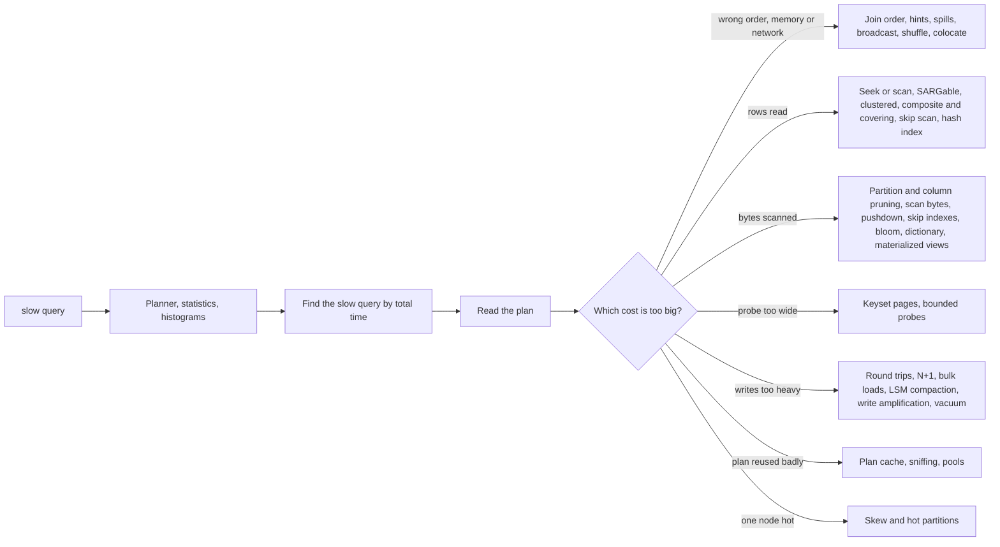

## The map in words

A query is slow for one of a few reasons, and the plan tells you which one. The **planner** guesses row counts from statistics, so a wrong guess is the first suspect. Then the cost is either a bad join order or a spill to disk, too many rows read (an index problem), too many bytes scanned (a layout problem in a warehouse), a probe that reads a whole range to answer a yes-or-no question, too many round trips or too heavy writes, a cached plan that fits the wrong value, or one node doing all the work.

Rule of thumb: read fewer bytes, touch fewer rows, make fewer round trips. In that order.

---

## The planner guesses from statistics

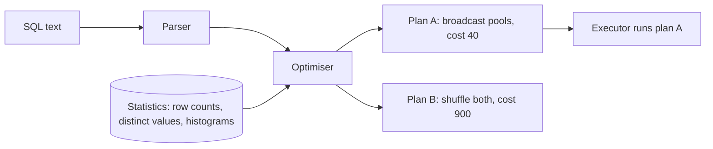

**Story.** A new table of 30 million addresses was bulk loaded, and nobody ran `ANALYZE`. The planner saw no statistics and believed the table was empty. It chose a nested loop. The query ran for an hour. After `ANALYZE` the same query picked a hash join and ran in seconds.

**How it works**

1. The parser turns SQL into a tree of operators: scan, filter, join, sort, aggregate.
2. The cost-based optimiser builds candidate trees, Plan A and Plan B in the picture.
3. It scores each with a cost model that reads the statistics.
4. **Cardinality** is the estimated row count out of each operator.
5. The cheapest plan goes to the executor.

### In code

```text
plan(sql):
  tree = parse(sql)                     # scan, join, group
  n_out = stats.rows(transfers)         # 200,000 for 1 October
  n_in  = stats.rows(addresses)         # 0 when never analysed
  cost_nl   = n_out + n_out * n_in      # walk the inner side per outer row
  cost_hash = n_out + 2 * n_in + 1000   # build a hash once, probe once
  plan = the cheaper of the two
  run(plan)
analyze(table):
  stats.rows(table) = row count from a sample
```

```sql
ANALYZE addresses;                       -- after every bulk load

EXPLAIN ANALYZE
SELECT a.label, sum(t.amount)
FROM   transfers t
JOIN   addresses a ON a.address = t.to_address
WHERE  t.block_day = '2026-10-01'
GROUP  BY a.label;
-- before: Nested Loop, Scan addresses est 0, actual 30,000,000
-- after:  Hash Join,   Scan addresses est 30,000,000, actual 30,000,000

-- correlated columns: tell the planner they move together
CREATE STATISTICS users_city_post (dependencies) ON city, postcode FROM users;
ANALYZE users;
```

The program is an in-memory model of the planner: statistics plus the cost formula, no database. It prints nested loop 200,000 against hash 201,000 with no statistics, then 6,000,000,200,000 against 60,201,000 after `ANALYZE`, and 3,000 estimated against 30,000 actual for the correlated filter.

Run it: `handbook/code/08-planner-statistics/` with `go run .`

**What goes wrong.** Estimates compound. A 10 times error on one filter becomes 100 times after a join. Correlated columns, such as city and postcode, break the planner's assumption that filters are independent, so it under-estimates. Fix: analyse after every bulk load, and add multi-column statistics where columns move together.

**Where you use it**

- After loading a new day partition into a warehouse: collect statistics for it.
- StarRocks choosing broadcast or shuffle for `swaps JOIN pools`: it decides by the estimated size of `pools`.
- An engine upgrade: plans can change, so diff the plans of hot queries.

> The planner picks from estimates, so a slow plan is usually a wrong guess, and you check estimated against actual rows first.

▶ Watch it move: [Planner and statistics](visual/08-planner-statistics.html)

---

## Histograms and selectivity

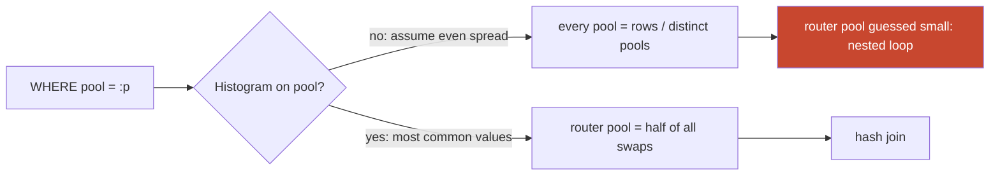

**Story.** The `swaps` table holds millions of rows spread over many pools. Without a histogram the planner assumes every pool holds the same share: total rows divided by distinct pools. The router pool really holds half of all swaps. The planner guessed a few hundred rows for it and picked a nested loop. A histogram on `pool` told it the truth, and it picked a hash join.

**How it works**

1. **Selectivity** is the fraction of rows a predicate keeps. `pool = 'router'` keeps one half.
2. Estimated rows = table rows times selectivity.
3. With no histogram, an equality guess is 1 divided by the number of distinct values. That is the even-spread guess in the picture.
4. A **histogram** splits the values into buckets and stores the row count per bucket.
5. Most engines also keep a list of the **most common values** with their real share.
6. The planner looks the constant up: a common value gets its real share, the rest share what is left. A range reads the fraction of buckets it covers.

### In code

```text
estimate(column = value):
  rows, distinct = stats.rows, stats.distinct   # 10,000,000 and 20,000
  if there is no most-common list:
    return rows / distinct            # even spread: 500 for every pool
  if value is unknown:                # a generic plan, $1
    return rows / distinct
  if value in stats.most_common:
    return stats.most_common[value]   # router pool: 5,000,000
  left = rows - sum(stats.most_common)
  return left / (distinct - len(stats.most_common))   # 95
choose_plan(est):
  if est <= 10,000: nested loop
  else:             hash join
```

```sql
-- StarRocks: a histogram on the skewed column
ANALYZE TABLE swaps UPDATE HISTOGRAM ON pool WITH 64 BUCKETS;
-- PostgreSQL: keep more common values for this column
ALTER TABLE swaps ALTER COLUMN pool SET STATISTICS 1000;
ANALYZE swaps;

SELECT most_common_vals, most_common_freqs
FROM   pg_stats WHERE tablename = 'swaps' AND attname = 'pool';
-- router pool: est rows 5,000,000  actual 5,000,000  -> Hash Join
-- tiny pool:   est rows 95         actual 200        -> Nested Loop
```

The program builds the swap counts per pool in memory. Without a histogram every pool is estimated at 500 rows, so the router pool (5,000,000 rows) gets a nested loop. With the 5 most common values kept, the router pool is estimated at 5,000,000 and gets a hash join, and the tiny pool at 95 against 200 actual. A generic plan with `$1` falls back to 500.

Run it: `handbook/code/08-histograms/` with `go run .`

**What goes wrong.** Skewed data with no histogram: the even-spread guess is far too low for the heavy value and too high for the rare ones. A generic cached plan has the same blind spot: it is built without the value, so the histogram cannot help. Fix: collect histograms on skewed columns (`ANALYZE TABLE swaps UPDATE HISTOGRAM ON pool` in StarRocks, a higher statistics target in PostgreSQL), and re-collect after big loads.

**Where you use it**

- Chain data: `pool`, `sender` and `token` are always skewed by routers and hot wallets.
- A multi-tenant SaaS table filtered by `customer_id`, where one customer is a hundred times bigger.
- A `status` column where 99 percent of rows are `done`: the histogram makes `status = 'failed'` look as rare as it is.

> Selectivity is the share of rows a filter keeps, and on a skewed column only a histogram makes that share right.

▶ Watch it move: [Histograms and selectivity](visual/08-histograms.html)

---

## Finding the slow query

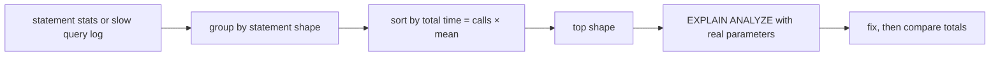

**Story.** Warehouse CPU sat high all day, yet no single query looked slow. Grouping the query log by statement shape and sorting by total CPU showed one per-page statement. It ran thousands of times an hour and took a few seconds each time: the join to the 30-million-row `addresses` table. Fixing that one shape cut the load, while the slowest report of the day mattered far less.

**How it works**

1. Collect every statement with its time: `pg_stat_statements` in PostgreSQL, the slow query log in MySQL, the audit log and query profiles in StarRocks.
2. Normalise: replace constants with placeholders, so `WHERE pool = 'a'` and `WHERE pool = 'b'` are one shape.
3. Sort shapes by total time, which is calls times mean time.
4. A few shapes usually take most of the time.
5. Run `EXPLAIN ANALYZE` on the top shape with real parameter values.
6. Fix it, then compare the shape's total before and after.

### In code

```text
for each statement in the log:
  shape = replace every constant with ?   # = 9506000 -> = ?
  s = shapes[shape]
  s.calls += 1
  s.total += statement.time
  s.max = max(s.max, statement.time)
by_slowest = sort shapes by s.max, descending    # the trap
by_load    = sort shapes by s.total, descending  # calls x mean
top = by_load[0]                       # page write, 6,000 s per hour
explain_analyze(top, real parameter values)
fix(top); compare top.total before and after
```

```sql
-- PostgreSQL: pg_stat_statements normalises and groups for you
CREATE EXTENSION IF NOT EXISTS pg_stat_statements;

SELECT query, calls, mean_exec_time, total_exec_time
FROM   pg_stat_statements
ORDER  BY total_exec_time DESC LIMIT 5;

-- StarRocks: the audit log, grouped by statement digest
SELECT digest, count(*) AS calls, sum(query_time) AS total_ms
FROM   starrocks_audit_db__.starrocks_audit_tbl__
WHERE  `timestamp` >= now() - INTERVAL 1 HOUR
GROUP  BY digest ORDER BY total_ms DESC LIMIT 5;
```

The program writes one day of log lines in memory and groups them by shape. Sorted by slowest run, the daily report (60,000 ms) comes first. Sorted by total, the page write comes first with 6,000 of 7,452.5 seconds per hour (81 percent). After the fix it drops to 240 s per hour.

Run it: `handbook/code/08-find-slow-query/` with `go run .`

**What goes wrong.** Chasing the slowest single query: a rare report that runs once a day for a minute. Meanwhile a query of two seconds, run a hundred thousand times, burns the machine. Fix: sort by total time first. Check the 99th percentile separately for paths a user waits on.

**Where you use it**

- PostgreSQL: `pg_stat_statements` ordered by `total_exec_time`.
- StarRocks: group the audit log by statement digest, sort by CPU and scan bytes.
- An APM (application performance monitoring) tool's database view: the same grouping, joined to the service that sent it.

> Find the slow query by grouping statements by shape and sorting by total time, because a fast query run a million times costs more than one slow report.

▶ Watch it move: [Finding the slow query](visual/08-find-slow-query.html)

---

## Read the plan

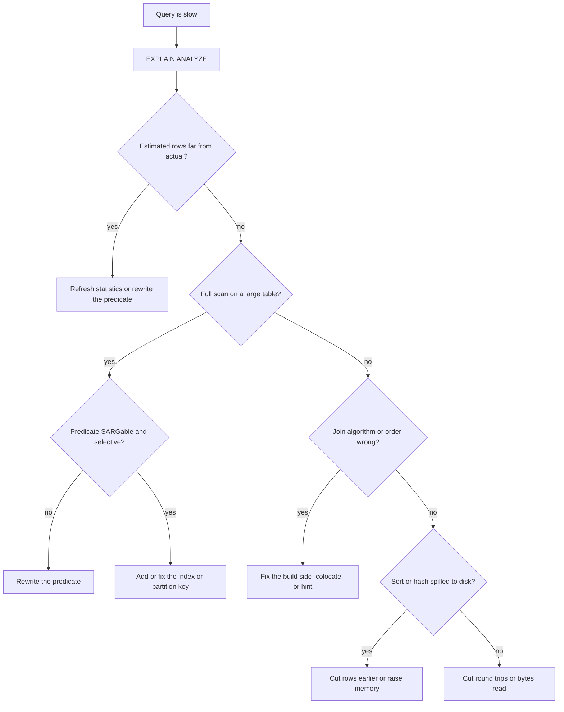

**Story.** A query got slow overnight and no code changed. A lookup table had crossed the size where the planner no longer called it small. The join flipped from broadcast to shuffle, and every per-page statement began to move gigabytes. `EXPLAIN ANALYZE` showed the flip in one line.

**How it works**

1. `EXPLAIN` shows the chosen plan with estimates.
2. `EXPLAIN ANALYZE` runs it and adds actual rows, time and memory per operator.
3. Read from the innermost leaf upward.
4. Walk the decision tree in the picture, top to bottom.
5. Stop at the first operator that is wrong. That one is the fix.

### In code

```text
diagnose(plan):
  for op in plan, leaves first:
    if op.actual > 10 * op.est or op.est > 10 * op.actual:
      return "estimate wrong: refresh statistics"
    if op is a scan and it reads every partition:
      return "full scan: fix the predicate or the key"
    if op is a join and op.rows_moved > 1,000,000:
      return "join shape wrong: colocate or hint"
    if op.spilled:
      return "spilled: cut rows or raise memory"
  return "plan fine: look at round trips and bytes"

choose_join(big, small, nodes):
  if both tables colocated on the key: return colocate, 0 moved
  broadcast = small * nodes
  shuffle   = big + small
  return the one that moves fewer rows
```

```sql
EXPLAIN ANALYZE
SELECT p.dex, count(*)
FROM   swaps s JOIN pools p ON p.pool = s.pool
WHERE  s.block_day = '2026-10-01'
GROUP  BY p.dex;
-- yesterday: HASH JOIN (BROADCAST), EXCHANGE BROADCAST rows moved 8,000
-- today:     HASH JOIN (PARTITIONED), EXCHANGE SHUFFLE pools 2,100,000 and swaps 4,000,000

-- fix: one colocate group, so the join moves nothing
CREATE TABLE pools (pool VARCHAR(42), dex VARCHAR(32))
  DISTRIBUTED BY HASH(pool) BUCKETS 16
  PROPERTIES ("colocate_with" = "dex_pool");
```

The program holds the plan tree as data, so no database is needed. With pools at 2,000 rows it picks broadcast (8,000 rows moved) and finds nothing wrong. At 2,100,000 rows it picks shuffle (6,100,000 rows moved against 8,400,000 for broadcast), and the walk stops at the join. Colocated, the join moves 0 rows.

Run it: `handbook/code/08-read-the-plan/` with `go run .`

**What goes wrong.** Reading only the total time. The total says "slow", the one operator with the bad estimate says why. Typical finds: a full scan where an index was expected, estimated 100 rows against 3 million actual, a sort that spilled, a nested loop with a large inner side, a hash join whose build side is the big one.

**Where you use it**

- Every slow-query ticket: paste the plan text into the issue, so a later plan can be diffed against it.
- A columnar warehouse: also read the scan bytes per operator, not only rows.
- A plan that flips with data size: fix the shape, not just the statistics.

> I run EXPLAIN ANALYZE, find the one operator whose estimate is far from actual, and fix that.

▶ Watch it move: [Read the plan](visual/08-read-the-plan.html)

---

## Join order and join hints

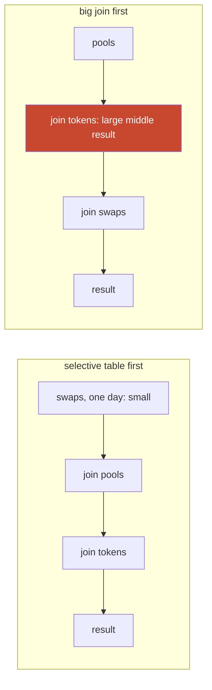

**Story.** A report joins `swaps`, `pools` and `tokens`, filtered to one day of swaps. Filtering swaps first leaves a small set, so every later join stays small. The planner misjudged the day filter and joined `pools` to `tokens` first. The middle result was huge, and the report ran for minutes. A hint fixed the order while the statistics were repaired.

**How it works**

1. N tables can be joined in N! orders: 3 tables give 6, 10 tables give over 3 million.
2. The planner searches the orders: exhaustively for a few tables, greedily for many.
3. The goal is small middle results: the most selective table or filter goes first.
4. For each join it also picks the algorithm and the build side. The smaller side builds the hash table.
5. A **join hint** forces a choice the planner would not make: `/*+ BROADCAST(pools) */`, `LEADING(swaps pools tokens)`, or StarRocks `JOIN [broadcast]`.

### In code

```text
choose_order(tables):
  best = none
  for order in all orders of tables:      # 3 tables: 6 orders
    rows = est_rows(order[0]); cost = 0
    for next in order[1:]:
      out = join_size(rows, next)         # no shared key: rows x next
      cost += rows + est_rows(next) + out
      rows = out
    if cost < best.cost: best = order
  return best
est_rows(swaps where day = d):
  if partition d has statistics: its row count     # 3,000,000
  else: a default guess                            # 1,500,000,000
with a hint LEADING(a b c):
  return [a, b, c]                        # no search, frozen
```

```sql
SELECT t.symbol, p.dex, sum(s.amount_usd)
FROM   swaps s
JOIN   pools  p ON p.pool  = s.pool
JOIN   tokens t ON t.token = s.token_in
WHERE  s.block_day = '2026-10-01'
GROUP  BY t.symbol, p.dex;

-- the fix: statistics for the new day partition
ANALYZE TABLE swaps PARTITION (p20261001);

-- the stopgap: a dated, commented hint (pg_hint_plan)
/*+ Leading((s p) t) */  -- 2026-10-02, stats missing, ticket 1234
```

The program scores all 6 orders in memory with a cost of rows in plus rows out. With statistics, swaps first wins at 12,070,000. With the default guess of 1,500,000,000 rows for the day, pools-then-tokens (a 1,000,000,000-row cross product) scores lower and is picked. Its true cost is 2,006,070,000, 166 times the work. The hint brings it back to 12,070,000.

Run it: `handbook/code/08-join-order/` with `go run .`

**What goes wrong.** A hint freezes a choice. Data grows, the hinted order becomes wrong, and nobody remembers why the hint is there. Fix: repair statistics first. Use a hint only as a dated, commented exception, with the plan diff in the ticket that added it.

**Where you use it**

- StarRocks: `[broadcast]` or `[shuffle]` on a join whose estimate is known to be wrong.
- PostgreSQL with 10 or more joined tables: past `join_collapse_limit` it stops searching all orders.
- ORM queries that join many tables: check the order in the plan, not in the code.

> Join order decides the size of every middle result, so the selective table goes first, and a hint is the last resort, not the fix.

▶ Watch it move: [Join order and join hints](visual/08-join-order.html)

---

## Spill to disk

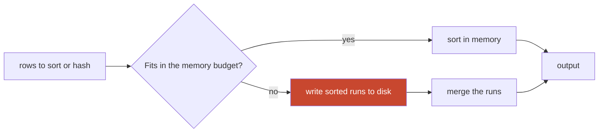

**Story.** A daily report sorted all swaps of a day by amount to show the top 100. The sort needed more memory than its budget, so it wrote sorted runs to disk and merged them back. The plan said "external merge, Disk". Rewritten as `ORDER BY amount DESC LIMIT 100`, the engine kept only the best 100 rows in memory and never touched disk.

**How it works**

1. Each sort, hash join or hash aggregate gets a memory budget: `work_mem` in PostgreSQL, a query memory limit in StarRocks.
2. If its rows fit, it works in memory.
3. If not, it **spills**: it writes sorted runs, or hash partitions, to disk.
4. Then it reads them back and merges them.
5. `EXPLAIN ANALYZE` shows it: "Sort Method: external merge Disk" in PostgreSQL, spill bytes in a StarRocks profile.

### In code

```text
sort(rows, budget):                  # budget = 4 rows
  buf = []
  for r in rows:
    buf.append(r)
    if len(buf) == budget:            # memory is full
      write sorted(buf) to disk as a run   # the spill
      buf = []
  if buf: write sorted(buf) as a last run
  return merge(runs)                 # read every run back

top_n(rows, n):                      # n = 3
  heap = min-heap                    # the smallest kept row on top
  for r in rows:
    if len(heap) < n: push(heap, r)
    else if r > heap.min: replace heap.min with r
    else: drop r                     # never stored, never on disk
```

```sql
EXPLAIN (ANALYZE, BUFFERS)
SELECT tx_hash, amount FROM swaps
WHERE  block_day = '2026-10-01'
ORDER  BY amount DESC;              -- Sort Method: external merge  Disk

SELECT tx_hash, amount FROM swaps
WHERE  block_day = '2026-10-01'
ORDER  BY amount DESC LIMIT 3;      -- Sort Method: top-N heapsort  Memory

-- raise the budget for one session only
BEGIN; SET LOCAL work_mem = '256MB'; SELECT ...; COMMIT;
```

The program runs both sorts on the 12 amounts of the lesson. The full sort spills three runs (7 12 41 93, 5 33 58 88, 20 64 71 99), writes 12 rows to disk and reads 12 back. The top-N heap keeps 93 41 12 after 4 rows, 93 88 58 after 8, and 99 93 88 at the end, with 0 rows on disk.

Run it: `handbook/code/08-spill/` with `go run .`

**What goes wrong.** Raising the memory budget for everyone. A budget is per operator per query, so 100 concurrent queries with a big budget can take the server out of memory. Fix: cut rows earlier (filter first, top-N with `LIMIT`, pre-aggregate), and raise the budget only for the one session that needs it.

**Where you use it**

- A hash join whose build side is the big table: swap the sides and the spill goes away.
- `GROUP BY` on millions of distinct keys: aggregate per partition first.
- StarRocks with spill turned on: a big query finishes slowly instead of failing with out of memory.

> A spill means an operator ran out of memory and paid disk speed, so cut the rows first and raise memory only for that query.

▶ Watch it move: [Spill to disk](visual/08-spill.html)

---

## Broadcast, shuffle and colocate joins

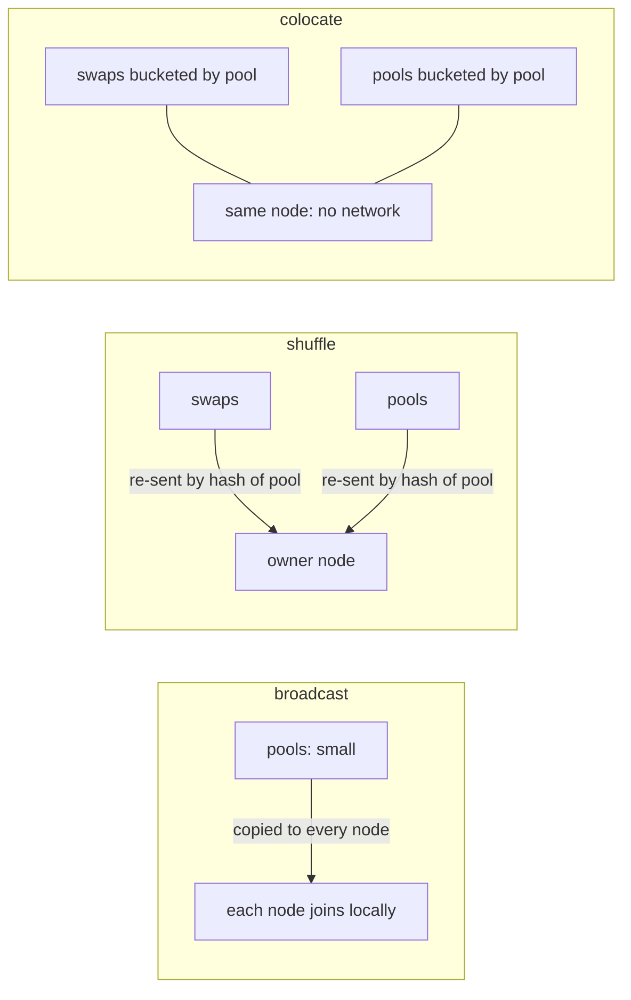

**Story.** `swaps` joins `pools` on `pool` in a StarRocks cluster of four nodes. While `pools` was small, the planner broadcast it: one copy to every node. When `pools` grew, the plan switched to shuffle and re-sent both tables over the network on every query. Bucketing both tables by `pool`, with the same bucket count, in one colocation group let each node join its own buckets with no network at all.

**How it works**

1. Rows live on nodes by bucket, a hash of the bucket key.
2. **Broadcast**: send the small side to every node. Cost is the small side times the number of nodes.
3. **Shuffle**: hash both sides by the join key and send each row to the node that owns that hash. Cost is both sides, once.
4. **Bucket shuffle**: one side is already bucketed by the join key, so only the other side moves.
5. **Colocate**: both sides are bucketed by the join key, with the same bucket count, in one group. Each node joins locally.

### In code

```text
plan_join(big, small):
  if same key, same bucket count, same group:
    return colocate                     # 0 rows moved
  if big is bucketed by the join key:
    return bucket shuffle               # only small moves
  if bytes(small) <= 10 MB:
    return broadcast                    # bytes(small) x 4 nodes
  return shuffle                        # both sides by key
shuffle a row:
  owner = hash(row.pool) mod nodes
  if owner != this node: send the row to owner
```

```sql
-- one colocate group: same key, same bucket count
CREATE TABLE swaps (tx_hash VARCHAR(66), pool VARCHAR(42), amount DECIMAL(38,0))
DUPLICATE KEY (tx_hash)
DISTRIBUTED BY HASH(pool) BUCKETS 16
PROPERTIES ("colocate_with" = "pool_group");

CREATE TABLE pools (pool VARCHAR(42), dex VARCHAR(32))
DISTRIBUTED BY HASH(pool) BUCKETS 16
PROPERTIES ("colocate_with" = "pool_group");

SHOW PROC '/colocation_group';   -- IsStable must be true
EXPLAIN SELECT p.dex, count(*) FROM swaps s JOIN pools p ON p.pool = s.pool GROUP BY p.dex;
-- HASH JOIN (COLOCATE)
```

The program places 40,000,000 swap rows on 4 nodes in memory, with a row taken as 100 bytes. With pools at 1,000 rows it broadcasts 400,000 bytes. At 4,000,000 rows (400 MB, over the 10 MB limit) it shuffles 3.4 GB per query. Colocated, the join moves 0 rows. With pools rebuilt at 8 buckets, the bucket shuffle moves 350 MB.

Run it: `handbook/code/08-distributed-joins/` with `go run .`

**What goes wrong.** A broadcast side that grew: every node holds a full copy, memory times the node count. A colocation group that broke, because one table got a different bucket count or a replica moved: the join silently falls back to a shuffle, a bucket shuffle when one side can stay where it is. A shuffle on a skewed key puts the heavy key on one node. Fix: read the join distribution in `EXPLAIN`, and colocate the pair of tables joined on every query.

**Where you use it**

- StarRocks `colocate_with` for `swaps` and `pools` on `pool`.
- Spark: `spark.sql.autoBroadcastJoinThreshold` decides when a side is small enough to broadcast.
- Any cluster: a join that moves gigabytes per query is a layout problem, not a query problem.

> A cluster join either copies the small side everywhere, re-sends both sides by key, or finds both already on the same node, and colocation takes the network out of the hot join.

▶ Watch it move: [Broadcast, shuffle and colocate joins](visual/08-distributed-joins.html)

---

## Seek or scan: the B-tree

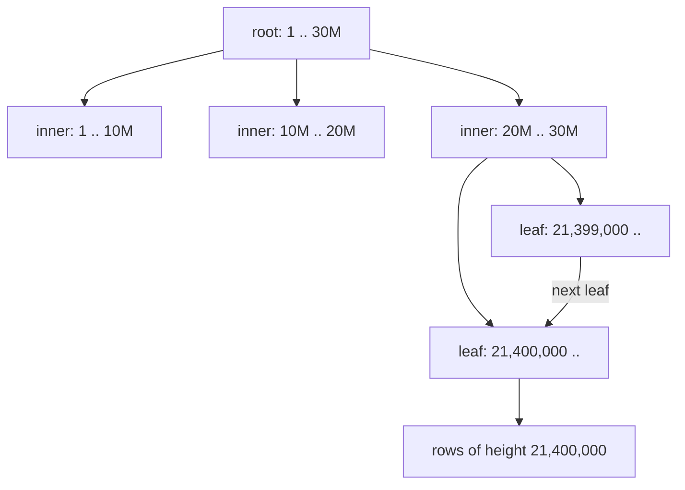

**Story.** Someone asks for block 21,400,000. With a B-tree index on `block_height` the engine reads the root, one inner page and one leaf: three or four page reads, even for billions of rows. Without the index it reads every page of the table. For a range of 1,000 blocks it seeks to the first leaf and walks sideways along the linked leaves.

**How it works**

1. A **B-tree** is a balanced tree: every leaf sits at the same depth.
2. Inner pages hold key ranges, leaves hold keys and row pointers.
3. A **seek** goes root to leaf, one page per level.
4. A **range scan** seeks to the start key, then walks the leaf chain to the end key.
5. A **table scan** reads every page.
6. A **clustered** index stores the rows themselves in key order, one per table. A **non-clustered** index points at the rows.

### In code

```text
seek(key):
  page = root
  while page is not a leaf:
    page = the child whose key range holds key   # one page read per level
  entry = binary search for key in the leaf
  read the table page the entry points at        # one more read
range(lo, hi):
  seek(lo), then walk the linked leaves to the right while key <= hi
  read a table page for each key
scan(predicate):
  for each table page:                           # every page, found or not
    for each row: compute the predicate, keep the matches
```

```sql
-- no index
SELECT id, name FROM users WHERE email = 'ana@x.io';
-- Seq Scan   Filter: email = 'ana@x.io'   Buffers: shared read=10000

CREATE INDEX users_email ON users (email);
-- Index Scan using users_email   Index Cond: email = 'ana@x.io'   Buffers: shared read=4

-- a function on the column: the scan is back
SELECT id, name FROM users WHERE lower(email) = 'ana@x.io';
-- Seq Scan   Filter: lower(email) = 'ana@x.io'   Buffers: shared read=10000
```

The program is an in-memory model of the tree, with 300 keys per page. The `Buffers` numbers in the shapes above come from it, not from a real engine. It prints 10,000 page reads for the scan, 3 levels and 4 page reads for the seek, 7 for the range across two leaves, and 4 levels for a billion keys.

Run it: `handbook/code/08-seek-vs-scan/` with `go run .`

**What goes wrong.** A function on the column. `WHERE lower(email) = 'x'` cannot use an index on `email`, because the tree is sorted by `email`, not by `lower(email)`. The seek turns back into a scan. Fix: move the function to the constant side, store the value already lower-cased, or build an index on the expression.

Other ways to break a seek: an implicit cast (`address = 123` when address is text), a leading wildcard (`LIKE '%abc'`), arithmetic on the column (`height + 1 > :h`), `OR` across two columns. A predicate that can use the index is called **SARGable** (Search ARGument able). `WHERE date(ts) = '2026-10-01'` scans. `WHERE ts >= '2026-10-01' AND ts < '2026-10-02'` seeks.

**Where you use it**

- `WHERE tx_hash = :h`: a seek. `WHERE block_height BETWEEN 100 AND 200`: a range scan.
- An ORM that sends a string parameter to an integer column: the cast lands on the column, and the index goes unused.
- A query that reads most of the table: a scan is right. Millions of seeks would cost more.

> A seek walks root to leaf in a few page reads, and a function or cast on the column turns it back into a full scan.

▶ Watch it move: [Seek versus scan](visual/08-seek-vs-scan.html)

---

## SARGable predicates

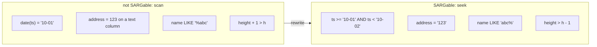

**Story.** A dashboard filtered transfers by `WHERE date(block_ts) = '2026-10-01'`. An index on `block_ts` existed and was never used, so every page load scanned the table. Rewritten as a half-open range, `block_ts >= '2026-10-01' AND block_ts < '2026-10-02'`, it became a seek. In StarRocks the same function hid the partition column, so every partition was read.

**How it works**

1. **SARGable** means Search ARGument able: the engine can use an index for the predicate.
2. The index is sorted by the column's raw value.
3. The engine can seek only on a range of that raw value: `=`, `<`, `>`, `BETWEEN`, `IN`, `LIKE 'prefix%'`.
4. A function or arithmetic on the column must be computed for every row, so the engine scans.
5. An implicit cast on the column side does the same.
6. `OR` across two columns cannot be one seek. It needs two seeks merged, or a `UNION`.

### In code

```text
access_path(predicate, index):
  if left side is the bare indexed column:   # the SARGable check
    lo, hi = range from the constants        # =, <, >, BETWEEN, LIKE 'pre%'
    pos = binary search for lo               # the seek
    read entries from pos while entry < hi   # stop at the first one past hi
  else:                                      # function, arithmetic, cast, '%x'
    for each entry in the index:             # the scan
      compute the left side, then compare
rewrites that make it SARGable:
  date(col) = d   ->  col >= d AND col < d + 1 day
  col + x > t     ->  col > t - x
  a OR b          ->  seek on a UNION seek on b
  param type      ->  same type as the column
```

```sql
-- before: a function on the column
SELECT * FROM transfers WHERE date(block_ts) = '2026-10-01';
-- Seq Scan   Filter: date(block_ts) = '2026-10-01'

-- after: a half-open range on the bare column
SELECT * FROM transfers
WHERE  block_ts >= '2026-10-01' AND block_ts < '2026-10-02';
-- Index Scan  Index Cond: block_ts >= ... AND block_ts < ...

-- a prefix is a range, a leading wildcard is not
SELECT * FROM dexes WHERE name LIKE 'aero%';   -- seek
SELECT * FROM dexes WHERE name LIKE '%drome';  -- scan

-- when the function must stay: index the expression
CREATE INDEX dexes_lower_name ON dexes (lower(name));
```

The program models the index in memory as a sorted list. It prints 10 read against 3 read for the date filter, 10 against 4 for the arithmetic, 10 against 2 for the wildcard and the prefix, and 10 against 1 for the cast and the matched type.

Run it: `handbook/code/08-sargable/` with `go run .`

**What goes wrong.** The ORM sends a parameter of another type: a string to an integer column, or `nvarchar` to a `varchar` column in SQL Server. The engine converts the column, not the constant, and the index is ignored. Fix: move the work to the constant side, match parameter types to column types, or build an index on the expression.

**Where you use it**

- Date filters on timestamps: always a half-open range.
- Case-insensitive email: store it lower-cased, or index `lower(email)`.
- StarRocks partition pruning: the partition column must be bare in the predicate.

> A predicate is SARGable when the bare column meets a constant of the same type, so the engine can seek, and any function or cast on the column turns it into a scan.

▶ Watch it move: [SARGable predicates](visual/08-sargable.html)

---

## Clustered index and page splits

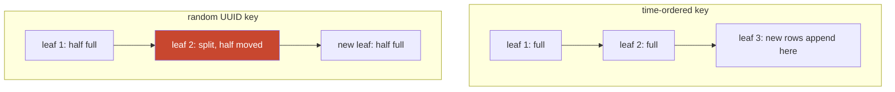

**Story.** An `orders` table in MySQL InnoDB used a random UUID as its primary key. InnoDB stores the rows themselves in primary key order: a clustered index. Every new UUID landed in a random leaf. Full leaves split in two, pages stayed half empty, and the buffer cache kept loading old pages just to insert. A time-ordered key (UUIDv7 or a sequence) made every insert append at the right edge.

**How it works**

1. A **clustered index** keeps the table rows in its leaf pages, in key order. A table has one.
2. Secondary indexes point at the primary key (InnoDB) or at a row location (a PostgreSQL heap table).
3. An insert goes to the leaf where its key belongs.
4. If that leaf is full, it **splits**: half the rows move to a new page and the parent gets a new pointer.
5. A time-ordered key always lands in the last leaf, so pages fill up completely.
6. A random key lands anywhere, so pages split everywhere and settle at about two thirds full.

### In code

```text
insert(key, row):
  leaf = the last page whose first key <= key   # walk from the root
  if leaf has room:
    put the row in key order; write leaf
  else if leaf is the last page and key > its last key:
    new page after it, holding the row           # nothing moves
    write new page and parent
  else:                                          # a full page in the middle
    move the top half of leaf to a new page
    add a pointer to the new page in the parent
    put the row in key order; write 3 pages
```

```sql
-- MySQL InnoDB: the primary key is the clustered index
CREATE TABLE orders (
  id      BIGINT AUTO_INCREMENT PRIMARY KEY,   -- grows, so inserts append
  buyer   BIGINT NOT NULL
);

-- a random key splits pages. Watch the counter:
SELECT name, count FROM information_schema.innodb_metrics
WHERE  name = 'index_page_splits';

-- fix: swap the time bits of a UUIDv1 to the front, or use UUIDv7
INSERT INTO orders_v2 VALUES (UUID_TO_BIN(UUID(), 1), 7);
```

The program is an in-memory model of the leaf pages. It replays 113 to 117 and the split at 4c. Then it inserts one million keys at 100 rows per page: a sequence gives 10,000 pages, 0 splits, 100 percent fill. Random keys give 14,500 pages, 14,499 splits, 69 percent fill.

Run it: `handbook/code/08-clustered-page-split/` with `go run .`

**What goes wrong.** A random UUID as the clustered key: more pages, more disk reads, more cache misses, slower inserts. A wide primary key is also copied into every secondary index. Fix: a time-ordered id (UUIDv7, ULID, a sequence), a narrow key, and a fill factor that leaves room where updates grow rows.

**Where you use it**

- MySQL InnoDB and SQL Server: the primary key is the clustered key, so choose it for insert order.
- PostgreSQL stores a heap. `CLUSTER` reorders once, and new rows do not follow.
- StarRocks: the sort key is the column-store cousin, rows sorted inside each segment.

> A clustered index stores rows in key order, so a random key splits pages all over the tree and a time-ordered key appends at the end.

▶ Watch it move: [Clustered index and page splits](visual/08-clustered-page-split.html)

---

## Composite and covering indexes

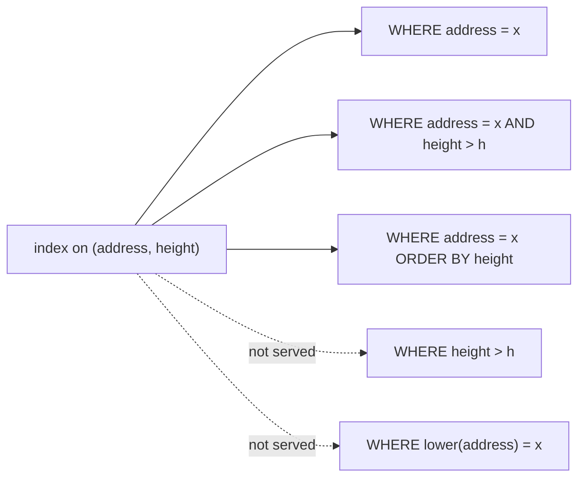

**Story.** A wallet history page asks for the transfers of one address after a height, in height order. An index on `(from_address, block_height)` finds the address, then walks the heights in order. The sort is free. A new query filtered by height alone, and ran a full scan: the index is sorted by address first.

**How it works**

1. A **composite** index on `(a, b, c)` is sorted by `a`, then `b` inside `a`, then `c`.
2. It serves predicates on `a`, on `a and b`, on `a, b and c`. This is the **leftmost-prefix** rule.
3. It does not serve `b` alone. Think of a phone book: you find all Smiths, or John Smith, never every John.
4. A range on a column ends the seek. `a = 1 AND b > 5 AND c = 3`: `a` seeks, `b` walks, `c` only filters.
5. So put equality columns first and the range column last.
6. A **covering** index holds every column the query needs. `(from_address, block_height) INCLUDE (to_address, amount)` answers without touching the table.

### In code

```text
query(a = :addr AND b > :h, select to, amount):
  key = equality columns from the left, then the first range
  pos = binary search for key               # the seek
  walk from pos while the equality prefix still matches
  entries come out in b order               # so ORDER BY b needs no sort
  for each entry:
    if a selected column is not in the entry: read the table page
  INCLUDE columns ride in the entry: no table read
  if the leftmost column has no predicate: scan every entry
```

```sql
CREATE INDEX t_from_height_cover
  ON transfers (from_address, block_height)
  INCLUDE (to_address, amount);

SELECT to_address, amount
FROM   transfers
WHERE  from_address = '0xb7' AND block_height > 21400000
ORDER  BY block_height;
-- Index Only Scan   Heap Fetches: 0   no Sort node

-- the wrong order: height first
-- Index Cond: block_height > 21400000 AND from_address = '0xb7'
-- reads 7 entries to keep 3
```

The program models the index in memory. It prints 3 read plus 3 lookups, then 3 read plus 0 lookups with `INCLUDE`, 12 read for height alone, 7 read to keep 3 with height first, and 18 reads against a 12-read sweep for the low-selectivity index.

Run it: `handbook/code/08-composite-covering/` with `go run .`

**What goes wrong.** Column order by habit: `(block_height, from_address)` makes the range on height stop the seek on address. And covering everything: each extra column makes every write heavier. **Selectivity** is the test for any index: an index on `is_contract` (true or false) is never used, one on `tx_hash` always is.

**Where you use it**

- The wallet history: `(from_address, block_height)` plus included columns, which also serves keyset pages.
- A low-selectivity filter such as status: put it behind a selective column, or partition by it.
- In a column store there are no such indexes: sort the table by `(from_address, block_height)` so zone maps do the same job.

> Equality columns first, the range column last, and include the selected columns when the query is hot.

▶ Watch it move: [Composite and covering indexes](visual/08-composite-covering.html)

---

## Index skip scan

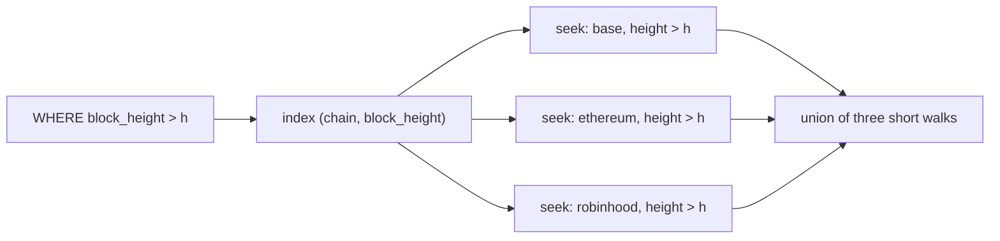

**Story.** An index on `(chain, block_height)` holds three chains. A query filters on height alone. The leftmost-prefix rule says the index cannot seek. An engine with **skip scan** does it anyway: one seek per distinct chain, three short walks instead of a full scan.

**How it works**

1. The query lacks the first index column.
2. The planner sees that the first column has few distinct values.
3. For the first value it seeks to `(base, h)` and walks to the end of `base`.
4. Then it jumps to the next distinct value and seeks again.
5. The results of the walks are combined.

### In code

```text
query(b > :h) on index (a, b):
  d = stats.distinct(a)                       # 3 chains, or 10,000 tenants
  skip_cost  = d * depth + matching leaves
  sweep_cost = all leaves
  if skip_cost < sweep_cost:
    v = first value of a
    loop:
      seek (v, :h), walk while a = v, keep matches
      v = the value the walk stopped on; end the loop at the end of the index
    return the walks combined
  else: sweep every leaf
```

```sql
CREATE INDEX t_chain_height ON transfers (chain, block_height);

SELECT chain, block_height FROM transfers
WHERE  block_height > 21400000;
-- MySQL 8 EXPLAIN Extra: Using where; Using index for skip scan

-- what it means, written by hand: one seek per chain
SELECT chain, block_height FROM transfers WHERE chain = 'base'      AND block_height > 21400000
UNION ALL
SELECT chain, block_height FROM transfers WHERE chain = 'ethereum'  AND block_height > 21400000
UNION ALL
SELECT chain, block_height FROM transfers WHERE chain = 'robinhood' AND block_height > 21400000;
```

The program is an in-memory model, and its page costs are a formula, not an engine's. It prints 3 seeks and 6 entries kept. For one million entries it prints 109 pages against a 10,000-page sweep with 3 chains, 30,100 pages with 10,000 tenants, and 103 pages with an index on `block_height`.

Run it: `handbook/code/08-index-skip-scan/` with `go run .`

**What goes wrong.** A first column with many distinct values. Ten thousand tenants mean ten thousand seeks, slower than one scan, so the planner refuses or, worse, guesses wrong. It also hides a missing index. Fix: when a query runs often, give it an index whose leading column it filters on.

**Where you use it**

- A leading column with few values: chain, region, a handful of tenants, a status.
- MySQL 8 shows "Using index for skip scan", Oracle has had it for years, PostgreSQL 18 added it to B-trees.
- A rarely run report: skip scan saves a second index you would only pay writes for.

> Skip scan runs one seek per distinct value of the missing first column, so it only pays off when that column has few values.

▶ Watch it move: [Index skip scan](visual/08-index-skip-scan.html)

---

## Hash index

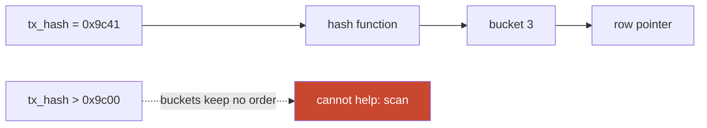

**Story.** A lookup table maps `tx_hash` to its block. Every query is `tx_hash = :h`. A hash index jumps straight to one bucket: about one probe, however big the table grows. Then a new report asked for a range of hashes in hash order, and the hash index could not help at all.

**How it works**

1. A hash function turns the key into a bucket number.
2. The bucket holds the key and a pointer to the row.
3. A lookup hashes the key, reads that bucket and compares keys, because two keys can share a bucket.
4. On average that is constant time, independent of the table size.
5. Buckets keep no order: no range, no sort, no prefix search.
6. The index grows by splitting buckets as they fill.

### In code

```text
get(key):
  bucket = hash(key) mod bucket_count     # no tree to walk
  for each entry in bucket:
    if entry.key = key:                   # two keys can share a bucket
      return entry.row_pointer
range or LIKE 'x%':
  no key to hash: read every bucket, compare every key
when buckets fill up:
  double bucket_count; each key stays in b or moves to b + old count
```

```sql
CREATE INDEX tx_by_hash ON transfers USING hash (tx_hash);

SELECT block_height, amount FROM transfers WHERE tx_hash = '0xfcc1';
-- Index Scan using tx_by_hash   Index Cond: tx_hash = '0xfcc1'

SELECT * FROM transfers WHERE tx_hash > '0x9c00';
-- Seq Scan   Filter: tx_hash > '0x9c00'
```

The program is an in-memory model with a real FNV hash. It prints 1 comparison for `0xfcc1`, 2 for `0x48e5`, 8 of 8 buckets read for the range, and 1.53 comparisons per lookup at 1,000 keys against 1.50 at 1,000,000.

Run it: `handbook/code/08-hash-index/` with `go run .`

**What goes wrong.** Using it for a range or an `ORDER BY`: the planner ignores it and scans. A key with many duplicates piles into one long bucket. In PostgreSQL before version 10, hash indexes were not crash-safe. Fix: the B-tree stays the default. Use a hash index only for pure equality on long keys, where it is smaller than a B-tree.

**Where you use it**

- PostgreSQL `CREATE INDEX ... USING hash (tx_hash)` for a pure equality lookup.
- InnoDB builds an adaptive hash index by itself over hot B-tree pages.
- The same idea runs a hash join's in-memory table and every Redis key lookup.

> A hash index finds one key in about one probe but keeps no order, so it serves equality and nothing else.

▶ Watch it move: [Hash index](visual/08-hash-index.html)

---

## Skip indexes in a column store

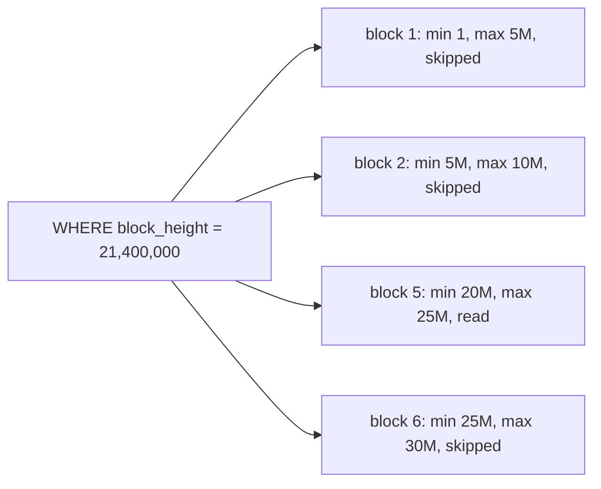

**Story.** StarRocks has no B-tree on `swaps`. The table is sorted by `(pool, block_height)` inside each day. A query for one pool on one day reads the small min and max summary of each block of rows, and skips every block whose range cannot match. It reads a sliver of the day.

**How it works**

1. A **zone map** stores min and max per block of rows.
2. A query skips every block whose range cannot hold the value.
3. That only works on a column the data is sorted by: the **sort key**.
4. A **bloom filter** stores a compact set per block: "maybe here" or "surely not here". It helps equality on an unsorted column, such as `tx_hash`.
5. A **bitmap** index keeps one bit per row per value. Good for few distinct values: `dex_name` with 30 values.
6. An **inverted** index lists the rows that contain each term. Good for full text and array membership, such as a `labels` array.
7. A **hash** index answers equality only: no range, no order.

### In code

```text
zone_scan(column = v):
  for each block:
    if v < block.min or v > block.max:
      skip the block                     # it cannot hold v
    else: read the block
bloom_scan(tx_hash = v):                 # the zone map skipped nothing
  for each block:
    if any bit of v is 0 in the block's filter: skip the block
    else: read it, and maybe find nothing
bitmap_scan(a = x AND b = y):
  bits = bitmap(a, x) AND bitmap(b, y)   # one bit per row
  read only the rows whose bit is 1
```

```sql
-- StarRocks: sorted inside each day, no B-tree
CREATE TABLE swaps (block_day DATE, pool BIGINT, block_height BIGINT, tx_hash VARCHAR(66))
DUPLICATE KEY (pool, block_height)
PARTITION BY RANGE (block_day) ();

-- the zone map on the sort key does the skipping
SELECT * FROM swaps WHERE block_day = '2026-10-01' AND pool = 431;

-- a column outside the sort key needs a bloom filter
ALTER TABLE swaps SET ("bloom_filter_columns" = "tx_hash");
```

The program is an in-memory model of the eight blocks. It prints blocks 5 and 6 for pool 431, block 6 once the height is added, 8 of 8 ranges for `tx_hash`, and 3 of 16 rows after the bitmap AND. The bloom filter has its own program, in the next section.

Run it: `handbook/code/08-skip-indexes/` with `go run .`

**What goes wrong.** A zone map on an unsorted column: every block's range covers everything, so nothing is skipped. A bitmap on a column with millions of values. A hash index for a range query. Fix: choose the sort key from the filters people actually run.

**Where you use it**

- `swaps` sorted by `(pool, block_height)`: one-pool queries prune blocks.
- `tx_hash` lookups on a table sorted by height: declare a bloom filter on `tx_hash`.
- `dex_name = 'aerodrome' AND token = 'WETH'`: two bitmaps combined with one AND.

> Skip indexes do not find rows, they skip blocks, and they only skip when the data is laid out for them.

▶ Watch it move: [Skip indexes](visual/08-skip-indexes.html)

---

## Bloom filter

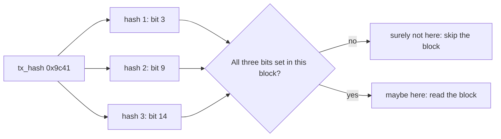

**Story.** The `swaps` table is sorted by pool, so a lookup by `tx_hash` would read every block. A bloom filter per block stores each hash as a few set bits in a small bit array. A lookup checks those bits. If any bit is 0, the hash is surely not in that block. Most blocks are skipped, and now and then a false alarm is read for nothing.

**How it works**

1. A block's filter is an array of bits, all 0.
2. To add a key, k hash functions each pick a bit, and those bits are set to 1.
3. To look up a key, compute the same k bits.
4. Any bit 0: the key is surely absent.
5. All bits 1: the key is maybe present, because other keys may have set those bits.
6. More bits per key means fewer false alarms: about 10 bits per key gives about 1 percent.

### In code

```text
add(key):
  for i in 1 to k:
    bits[hash(key, i) mod m] = 1        # setting never checks
maybe(key):
  for i in 1 to k:
    if bits[hash(key, i) mod m] = 0:
      return false                      # surely not here
  return true                           # maybe here
lookup across a day:
  for each block: if maybe(key): read the block
```

```go
func (b *Bloom) Add(key string) {
	for _, p := range b.positions(key) {
		b.bits[p] = true
	}
}

// Maybe is false only when a bit is 0.
func (b *Bloom) Maybe(key string) bool {
	for _, p := range b.positions(key) {
		if !b.bits[p] {
			return false
		}
	}
	return true
}
```

```sql
-- declaring one in StarRocks
ALTER TABLE swaps SET ("bloom_filter_columns" = "tx_hash");
```

The program is a real bloom filter over SHA-256, in memory. It prints the story's bits, 2 of 8 blocks read across the day, all 16 bits set after 5,000 keys, and 0.78 percent false alarms with 0 real keys missed at 10 bits per key.

Run it: `handbook/code/08-bloom-filter/` with `go run .`

**What goes wrong.** A filter too small for its keys: almost every bit is 1, so every lookup says maybe, and nothing is skipped. A bloom filter on a range query or on a column with few values helps nothing. A plain bloom filter cannot delete a key. Fix: size it by the number of keys, and use it only for equality on a column with many values.

**Where you use it**

- StarRocks `bloom_filter_columns` on `tx_hash` in a table sorted by pool or height.
- LSM stores (RocksDB, Cassandra): one filter per file, so a read skips files that cannot hold the key.
- Runtime filters: a hash join sends a bloom filter of its build keys to the probe-side scan.

> A bloom filter answers "surely not here" or "maybe here" in a few bits per key, so it skips blocks on equality lookups of an unsorted column.

▶ Watch it move: [Bloom filter](visual/08-bloom-filter.html)

---

## Dictionary encoding

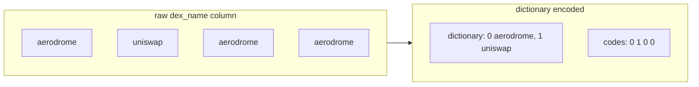

**Story.** `dex_name` in `swaps` holds about 30 distinct strings over billions of rows. Dictionary encoding stores each string once and the column as small integer codes. `WHERE dex_name = 'aerodrome'` becomes `code = 0`, an integer compare. `GROUP BY dex_name` groups small integers and turns 30 codes back into names at the very end.

**How it works**

1. The engine collects the distinct values of a column in a segment and numbers them: the dictionary.
2. Each value in the column is replaced by its code.
3. The codes compress further: runs of the same code, and few bits per code.
4. A filter translates its constant into a code once. If the constant is not in a segment's dictionary, the whole segment is skipped.
5. Group-bys and joins run on codes. Strings are decoded last.

### In code

```text
encode(column of one segment):
  for each value:
    if value is not in the dictionary:
      dictionary[value] = next free code
    codes.append(dictionary[value])
filter(column = constant):
  code = dictionary.get(constant)
  if there is no code: skip the whole segment
  keep rows where codes[row] = code   # integers, not strings
choose: if encoded size >= raw size: store the column plain
```

```go
func Encode(col []string) *Segment {
	s := &Segment{index: map[string]int{}}
	for _, v := range col {
		c, ok := s.index[v]
		if !ok {
			c = len(s.dict)
			s.index[v] = c
			s.dict = append(s.dict, v)
		}
		s.codes = append(s.codes, c)
	}
	return s
}
```

The program is a real encoder, in memory. For one million rows it prints `dex_name` with 6 values at 8,000,001 bytes raw and 375,048 encoded, and `tx_hash` at 66,000,000 raw and 68,500,000 encoded, so the hash column stays plain.

Run it: `handbook/code/08-dictionary-encoding/` with `go run .`

**What goes wrong.** A column with millions of distinct values, such as `tx_hash`. The dictionary is as big as the data, so it saves nothing, and the engine falls back to plain storage. Fix: let the engine decide per segment. Low-cardinality optimisations apply only below a limit of distinct values.

**Where you use it**

- StarRocks low-cardinality optimisation: a global dictionary for string columns with few values speeds up filters and group-bys.
- Parquet dictionary pages, ClickHouse `LowCardinality(String)`.
- Model `dex_name`, `token_symbol` and `status` as strings and let the encoding make them small.

> Dictionary encoding stores each distinct string once and the column as small integers, so filters and group-bys run on integers.

▶ Watch it move: [Dictionary encoding](visual/08-dictionary-encoding.html)

---

## Partition pruning and column pruning

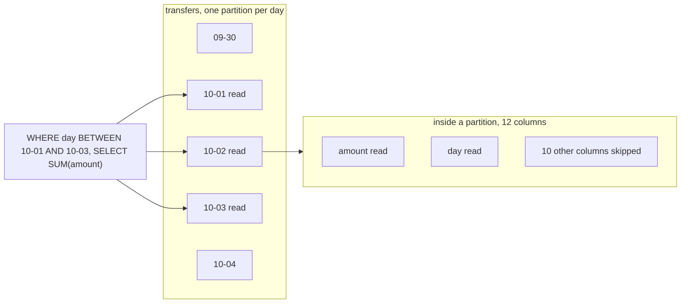

**Story.** `transfers` is partitioned by day, 700 days. A query for one week names `day BETWEEN '2026-10-01' AND '2026-10-07'` and reads 7 partitions out of 700. The same question written as `WHERE date(block_ts) BETWEEN ...` names a function, not the partition column, and reads all 700.

**How it works**

1. **Partitioning** splits a table by a key. Range: by day or height. List: by a set of values. Hash: by a hash of the key for even spread.
2. **Partition pruning**: the planner reads only partitions the predicate can match.
3. The predicate must name the partition column, bare, with no function and no cast.
4. **Projection pushdown** (column pruning): a column store reads only the columns the query names.
5. **Predicate pushdown**: the filter runs at the storage scan, before the join or the network.
6. Cost in a warehouse is **bytes scanned**: partitions read times columns read.

### In code

```text
plan(query):
  for each partition of the table:
    if the filter names the partition column, bare:
      keep the partition only if its day fits the range   # from metadata
    else:
      keep it: nothing can be proved                       # a cast, a join
  columns = columns the query names                        # SELECT * names all
  open files = kept partitions x columns
```

```sql
-- 3 x 2 = 6 files of 360
SELECT to_address, sum(amount)
FROM   transfers
WHERE  day BETWEEN '2026-10-10' AND '2026-10-12'
GROUP  BY to_address;
-- OlapScanNode  partitions=3/30

-- a cast on the column: nothing can be proved
SELECT * FROM transfers
WHERE  CAST(day AS VARCHAR) BETWEEN '2026-10-10' AND '2026-10-12';
-- OlapScanNode  partitions=30/30
```

The program models the table's metadata in memory. It prints 360 files with no filter, 36 with the day range, 360 again with the cast, and 6 files (1.7 percent) with the day range and two named columns.

Run it: `handbook/code/08-partition-pruning/` with `go run .`

**What goes wrong.** A cast or function on the partition column lights every partition. `SELECT *` reads every column file. A join whose day filter sits on the other table may not be pushed through to this one. A view boundary the planner cannot see through. Fix: name the partition column bare, name only the columns you need, put the filter on the table that is partitioned.

**Where you use it**

- BigQuery bills per byte scanned: `SELECT *` on a terabyte table costs a terabyte.
- StarRocks: a one-pool, one-day query reads one partition and two of forty columns.
- Materialized views: StarRocks rewrites `SUM(amount) GROUP BY day` onto a stored aggregate of the same shape.

> In a warehouse the cost is bytes scanned, so prune partitions with a bare partition column and name only the columns you need.

▶ Watch it move: [Partition pruning](visual/08-partition-pruning.html)

---

## Scan bytes as the cost

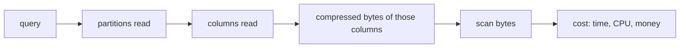

**Story.** A dashboard in BigQuery ran `SELECT *` over a year of transfers, with `LIMIT 100`. It billed about a terabyte to show three columns of one day. Naming the three columns and the day partition gave the same answer for a few gigabytes. In StarRocks the same number, scan bytes in the query profile, predicted how long a query would take.

**How it works**

1. A warehouse stores each column of each partition as its own compressed file.
2. Scan bytes are the compressed sizes of the named columns, summed over the partitions read.
3. Wide columns cost more than narrow ones: a long string column outweighs ten integer columns.
4. The query profile shows the bytes after a run. A BigQuery dry run estimates them before.
5. To cut them: prune partitions, name columns, use materialized views, sort the data so blocks are skipped.

### In code

```text
scan_bytes(query):
  partitions = partitions that match the filter on the partition column
  columns = columns the query names          # SELECT * names all
  return sum of file size for each column in each partition
guard rail:
  if the table requires a partition filter and the query has none: refuse
```

```sql
-- before: every column, every day
SELECT * FROM transfers;

-- after: named columns, one partition
SELECT day, pool, amount FROM transfers WHERE day = '2026-10-01';

-- BigQuery guard rail: refused before any byte is read
ALTER TABLE transfers SET OPTIONS (require_partition_filter = true);
```

The program sums assumed file sizes, not measured ones. It prints 430.3 GB for `SELECT *` over a year, 10.6 GB with three named columns, 29 MB for one day, and 929 MB once the wide `input_data` is added. `LIMIT 100` leaves it at 430.3 GB.

Run it: `handbook/code/08-scan-bytes/` with `go run .`

**What goes wrong.** Thinking rows returned is the cost. `LIMIT 100` on `SELECT *` still reads every column of every partition it touches. Fix: dry-run before running, require a partition filter on big tables (`require_partition_filter` in BigQuery), and ban `SELECT *` in dashboards.

**Where you use it**

- BigQuery on-demand pricing bills per byte scanned.
- Athena and Trino on object storage: bytes read are both the time and the bill.
- StarRocks: scan bytes per statement shape, next to CPU, when looking for the heavy query.

> In a warehouse the cost is bytes scanned, partitions times columns, so LIMIT does not save you and naming columns and partitions does.

▶ Watch it move: [Scan bytes as the cost](visual/08-scan-bytes.html)

---

## Predicate and projection pushdown

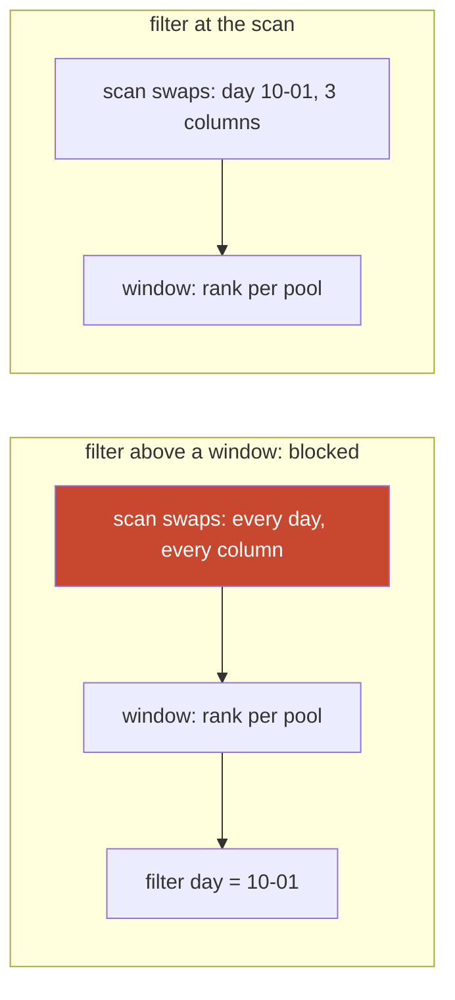

**Story.** A view ranks swaps per pool with a window function. A dashboard queries the view with `WHERE day = '2026-10-01'`. The filter sits above the window, the planner may not move it below, and the scan reads every day. Putting the day filter inside the view made the scan read one partition and three columns.

**How it works**

1. **Predicate pushdown**: the planner moves each filter as close to the scan as it can.
2. At the scan, the filter prunes partitions and skips blocks by zone maps.
3. **Projection pushdown**: only the columns the query names are read.
4. Across a join, a filter on the join key can be copied to the other side.
5. Into an external source: Parquet row-group statistics, or a `WHERE` sent to a remote database.

### In code

```text
optimise(plan):
  for each filter, from the top of the plan:
    while the filter can cross the operator below it:
      # can cross = the answer cannot change
      move the filter below that operator
  scan.columns = columns needed by the operators above
check: the predicate shows on the scan node of EXPLAIN
```

```sql
SELECT p.name, sum(s.amount)
FROM   swaps s JOIN pools p ON p.pool = s.pool
WHERE  s.day = '2026-10-01'
GROUP  BY p.name;
-- OlapScanNode  TABLE: swaps
--   PREDICATES: day = '2026-10-01'
--   partitions=1/7

-- a barrier: the window ranks over all days, so the filter stays above it
SELECT * FROM v_pool_rank WHERE day = '2026-10-01';
```

The program runs generated rows through a modelled plan, in memory. It prints 700,000 rows into the join without pushdown and 100,000 with it, both keeping 100,000. It also prints rank 3 when ranked first and rank 1 when filtered first, which is why the window is a barrier.

Run it: `handbook/code/08-pushdown/` with `go run .`

**What goes wrong.** A barrier the filter cannot cross: a window function partitioned by another column, a `LIMIT`, the nullable side of an outer join, a non-deterministic function, a view the planner cannot see into. Fix: put the filter inside, below the barrier, and check that the predicate shows on the scan node of the plan.

**Where you use it**

- StarRocks `EXPLAIN`: the predicate should appear under the scan node, not in a filter above the join.
- Spark and Trino reading Parquet: pushdown to row groups decides how many bytes leave storage.
- A federated query to PostgreSQL: a pushed filter sends 100 rows over the network, not 100 million.

> Pushdown moves filters and the column list down to the scan, so rows and columns are dropped before joins, and a window or LIMIT can block it.

▶ Watch it move: [Predicate and projection pushdown](visual/08-pushdown.html)

---

## Materialized views and query rewrite

```mermaid
flowchart LR
  Q["SUM(amount) GROUP BY day, pool"] --> RW{"Rewriter: does a view match?"}
  RW -->|"yes"| MV[("mv_daily_pool_volume: small")]
  RW -->|"no"| T[("swaps: billions of rows")]
  T -->|"refresh per partition"| MV
```

**Story.** A dashboard shows daily volume per pool. Each load summed billions of swaps. A materialized view stores the sum per day and pool, and StarRocks rewrites the dashboard query onto it without any change to the dashboard. One week the refresh fell behind, and the dashboard showed yesterday's numbers as today's.

**How it works**

1. A **materialized view** stores a query's result as a table.
2. A refresh brings it up to date: full, or only the changed partitions, on a schedule or on change.
3. The **query rewriter** matches an incoming query to a view with the same filters and the same or finer group keys, and reads the view.
4. A coarser question rolls up: total per day is computed from the per day and pool view.
5. A staleness setting decides whether a view that is behind may still answer, or the base table is read.

### In code

```text
rewrite(query):
  for each view:
    if query group keys are inside the view's, and the aggregates can roll up:
      if view.through >= the day the query asks for:   # the staleness check
        answer from the view; sum its rows when the keys are coarser
      else if behind by more than the limit:
        read swaps for the missing days
  no view matches: read swaps
refresh:
  for each base partition changed since the last run: rewrite that view partition
```

```sql
-- StarRocks: stored, refreshed per partition
CREATE MATERIALIZED VIEW mv_daily_pool_volume
PARTITION BY day
REFRESH ASYNC EVERY (INTERVAL 10 MINUTE)
AS
SELECT day, pool, sum(amount) AS volume FROM swaps GROUP BY day, pool;

-- the dashboard is unchanged, and never names the view
SELECT day, pool, sum(amount) FROM swaps GROUP BY day, pool;
```

The program is an in-memory model. It prints 700,000 rows read without the view and 210 with it, 0 against the true 100,000 for a view one day behind, and 3,000 summed against 1,000 merged for distinct senders.

Run it: `handbook/code/08-materialized-views/` with `go run .`

**What goes wrong.** Stale answers when the refresh falls behind. Refresh cost higher than the savings for a view nobody reads. Aggregates that do not roll up: a distinct count per pool cannot be summed into a distinct count per day. Fix: refresh per partition, set a staleness limit, check the rewrite in `EXPLAIN`, and use a bitmap or HLL (HyperLogLog) column for distinct counts.

**Where you use it**

- StarRocks async materialized views with automatic rewrite, for dashboards over `swaps`.
- PostgreSQL `REFRESH MATERIALIZED VIEW CONCURRENTLY`: no automatic rewrite, the query must name the view.
- BigQuery materialized views: smaller scans, so a smaller bill.

> A materialized view stores a query's answer and the rewriter reads it instead of the base table, at the price of refresh cost and staleness.

▶ Watch it move: [Materialized views](visual/08-materialized-views.html)

---

## Keyset pages and bounded probes

```mermaid
flowchart LR
  subgraph Off["OFFSET 1,000,000 LIMIT 100"]
    O1["read 1,000,000 rows"] --> O2["throw them away"] --> O3["return 100"]
  end
  subgraph Key["WHERE key > last LIMIT 100"]
    K1["seek to last key"] --> K2["read 100"] --> K3["return 100"]
  end
```

**Story.** A sync found its position with `MAX(block_height)` on a billion-row table. As the table grew, the query went from seconds to minutes. Rewritten as `ORDER BY block_height DESC LIMIT 1` on the newest day partition, it read one block and stopped. Constant time, however big the table gets.

**How it works**

1. `OFFSET n LIMIT k` reads and discards n rows on every page. Page 1,000 reads a million rows.
2. **Keyset** pagination remembers the last key and asks `WHERE key > :last ORDER BY key LIMIT k`. Every page is one seek.
3. The key must be unique and ordered. Add a tiebreaker: `(block_height, log_index)`.
4. A **bounded probe** answers "is there any?" with `SELECT 1 ... LIMIT 1`: it stops at the first row.
5. It answers "what is newest?" with `ORDER BY k DESC LIMIT 1` on a sorted key, inside the newest partition.
6. `COUNT(*) > 0` and `MAX(k)` read every matching row before answering.

### In code

```text
offset_page(offset, limit):
  read rows from the start of the sort; keep after offset
  stop at offset + limit                    # read = offset + limit
keyset_page(last, limit):
  pos = binary search for the first key > last
  read limit rows from pos                  # read = limit
exists_probe: COUNT(*) > 0 reads every match
  better: SELECT 1 LIMIT 1                  # stop at the first match
anti_join(range):
  build a hash of every distinct address in the range
  fix: one day partition, or one writer page, at a time
```

```sql
-- offset: every page reads the pages before it
SELECT block_height, log_index, amount FROM transfers
WHERE  to_address = :a
ORDER  BY block_height, log_index LIMIT 3 OFFSET 15;

-- keyset: one seek
SELECT block_height, log_index, amount FROM transfers
WHERE  to_address = :a AND (block_height, log_index) > (108, 0)
ORDER  BY block_height, log_index LIMIT 3;

-- bounded probes
SELECT block_height FROM transfers WHERE day = CURRENT_DATE ORDER BY block_height DESC LIMIT 1;
SELECT 1 FROM transfers WHERE to_address = :a LIMIT 1;
```

The program models the table in memory. It prints read 18 for `OFFSET 15`, read 3 for keyset, the lost row `(108, 1)` with a height-only key, and 700,000,000 hash entries against a limit of 500,000,000 for the wide anti join.

Run it: `handbook/code/08-keyset-probes/` with `go run .`

**What goes wrong.** An anti join over a wide range. "Addresses in `transfers` not yet in `addresses`" across the whole table builds a hash of every distinct address, does not fit in memory, and dies with OOM (out of memory). Fix: run it per day partition or per page of the writer, so each build side is small. Running it once "to catch up" takes the warehouse down with it.

**Where you use it**

- Walking every transfer of a busy address: keyset on `(block_height, log_index)`.
- A writer finding where it stopped: newest partition, `ORDER BY DESC LIMIT 1`.
- A UI with page numbers: offset for the first pages, keyset for deep walks.

> Bound every probe to what the question needs: keyset for pages, LIMIT 1 for existence and for the newest row.

▶ Watch it move: [Keyset pages and bounded probes](visual/08-keyset-probes.html)

---

## Round trips: N+1 and batched writes

```mermaid
flowchart LR
  subgraph PerRow["per-row: 10,000 statements"]
    W1["indexer"] -->|"INSERT row 1"| S1[("StarRocks")]
    W1 -->|"INSERT row 2"| S1
    W1 -->|"... row 10,000"| S1
  end
  subgraph Batch["per page: 1 load"]
    W2["indexer"] -->|"one Stream Load, 10,000 rows"| S2[("StarRocks")]
  end
```

**Story.** An early indexer wrote one `INSERT` per transaction into StarRocks. Each insert made a tiny column segment. Compaction fell behind, and reads merged hundreds of segments each. Writing one page of blocks as one bulk load per table fixed both the write cost and the read cost.

**How it works**

1. The cost of a statement is mostly fixed: parse, plan, network, transaction, sync to disk.
2. In a column store each write also makes a new segment.
3. So 10,000 rows in one statement cost about the same as one row.
4. Use a bulk path: `COPY` in PostgreSQL, Stream Load in StarRocks, `LOAD DATA` in MySQL.
5. The read side has the same bug: **N+1**, one query for a list and one per item. Fix it with a join or one `IN (...)` query.
6. **Write amplification** is bytes the storage writes per byte you wrote: indexes, logs, versions and compaction rewrites. Fewer, larger segments mean fewer rewrites.

### In code

```text
load_page(order_id):
  order = query(order and its lines)        # the 1
  for each line in order.lines:
    show(line.product)                      # the ORM queries here: the N
fix:
  rows = one query that joins orders, lines and products
write_page(rows):
  send the page as one bulk load, per table # 1 statement, 1 segment
```

```go
// the bug: a round trip inside the loop
for rows.Next() {
	var pid int64
	rows.Scan(&pid)
	var name string
	db.QueryRowContext(ctx,
		"SELECT name FROM products WHERE id = $1", pid).Scan(&name)
}
```

```sql
-- the fix: one round trip
SELECT o.id, l.qty, p.name
FROM   orders o
JOIN   order_lines l ON l.order_id = o.id
JOIN   products p    ON p.id = l.product_id
WHERE  o.id = 1001;
```

The program runs this loop against an in-memory stand-in for the database that counts each call. It prints 6, 21 and 1,051 round trips for the lazy loop, 1 for the join, 2 for the list page with `IN`, and 10,000 statements against 1 for the write.

Run it: `handbook/code/08-n-plus-one/` with `go run .`

**What goes wrong.** Batches so large they hit a statement size ceiling or a transaction timeout. Fix: size the batch by rows and bytes under the engine's limit. Make it idempotent, with a primary key that replaces on duplicate or a page id the writer checks first, so a retry after a timeout does not duplicate.

**Where you use it**

- The Go indexer: one Stream Load per table per page of blocks.
- A dashboard: two queries for 100 pools and their swaps, not 101.
- A per-page statement whose cost grows with a lookup table: replace it. The real case was a join to a 30-million-row `addresses` table twice per page, once for sender and once for receiver. The fix collected the page's distinct addresses, looked them up in one keyed `IN` query, and wrote the page with ids already filled.

```mermaid
flowchart LR
  subgraph Before["Before: cost grows with the table"]
    P1["page of blocks"] --> J1["join addresses as sender"] --> J2["join addresses as receiver"] --> W1["write page"]
  end
  subgraph After["After: cost grows with the page"]
    P2["page of blocks"] --> D["distinct addresses of the page"] --> L["one keyed IN lookup"] --> W2["write page with ids"]
  end
```

> Write per page, not per row, and a writer's per-page cost must depend on the page, never on the size of the table.

▶ Watch it move: [N+1 and batched writes](visual/08-n-plus-one.html)

---

## Bulk load paths

```mermaid
flowchart LR
  SRC["page of 10,000 rows"] --> A["INSERT per row: 10,000 statements"]
  SRC --> B["multi-row INSERT: a few big statements"]
  SRC --> C["COPY or Stream Load: one data stream"]
  SRC --> D["files in object storage, then a parallel load"]
  style A fill:#c8472f,color:#fff
```

**Story.** The indexer started with one `INSERT` per row. Multi-row `INSERT` helped, but StarRocks still parsed huge SQL texts. Stream Load sends each page as CSV or JSON over HTTP: one transaction per table per page, with a label so a retry is never loaded twice. Backfills of years of history go another way: files written to object storage, then loaded in parallel.

**How it works**

1. Per-row `INSERT`: a parse, a plan and a commit for every row.
2. Multi-row `INSERT ... VALUES (...), (...)`: fewer statements, but limited by the SQL text size.
3. A bulk protocol sends rows as data, not SQL: `COPY FROM STDIN` in PostgreSQL, `LOAD DATA` in MySQL, Stream Load in StarRocks.
4. File loads: write Parquet to object storage, then Broker Load or a pipe in StarRocks, or `COPY INTO` in Snowflake, read the files in parallel.
5. Idempotency: each load carries a label or load id, and a repeated label is refused.

### In code

```text
per-row: for each row: INSERT, parse, plan, commit
bulk: send the page as data in one request
  one commit, one segment per table
write_page(table, page):
  send the page; the reply may never arrive   # a timeout means unknown
  on a timeout, send the same page again
  label = table + page number
  the engine refuses a label it already holds; treat that as done
```

```go
label := fmt.Sprintf("%s-page-%d", table, page)
for attempt := 0; attempt < 5; attempt++ {
	req, _ := http.NewRequestWithContext(ctx, http.MethodPut,
		baseURL+table+"/_stream_load", bytes.NewReader(body))
	req.Header.Set("label", label) // the same label on every attempt
	req.Header.Set("format", "csv")
	resp, err := client.Do(req)
	if err != nil {
		continue // a timeout means unknown: send it again
	}
	var r struct{ Status string }
	json.NewDecoder(resp.Body).Decode(&r)
	resp.Body.Close()
	switch r.Status {
	case "Success", "Label Already Exists":
		return nil // the page is in the table, once
	}
}
```

The program runs this loop against an in-memory stand-in for the StarRocks front end, so it opens no connection. It prints 10,000 commits against 1, then 20,000 rows after a retry with no label, and 10,000 rows with one.

Run it: `handbook/code/08-bulk-load/` with `go run .`

**What goes wrong.** A retry after a timeout with no label: the first load had committed, and the rows land twice. A single load too big for its timeout. Many concurrent small loads: too many versions for compaction. Fix: a label per table per page, loads sized by rows and bytes, one load per table per page.

**Where you use it**

- The Go indexer: Stream Load with the label `<table>-<page id>`.
- PostgreSQL backfills: `COPY`, with indexes created after the load.
- Snowflake Snowpipe or StarRocks pipes for files that land continuously.

> Pick the load path by volume: a bulk protocol like COPY or Stream Load for pages, files for history, never per-row inserts, and always a label so a retry cannot load twice.

▶ Watch it move: [Bulk load paths](visual/08-bulk-load.html)

---

## LSM tree and compaction

```mermaid
flowchart LR
  W["write"] --> M["memtable in memory"]
  M -->|"flush when full"| L0["level 0: small sorted files"]
  L0 -->|"compaction merges"| L1["level 1: bigger files"]
  L1 -->|"compaction merges"| L2["level 2: biggest files"]
  R["read"] -.-> M
  R -.-> L0
  R -.-> L1
  R -.-> L2
```

**Story.** The Go indexer loads rows into StarRocks. Each load becomes a new immutable segment, the way an LSM tree flushes a file. Background compaction merges small segments into big ones. When an early version wrote one row per insert, segments piled up faster than compaction could merge them. Reads had to merge hundreds of segments, and loads were refused with "too many versions".

**How it works**

1. A write goes to a log and to a sorted table in memory, the **memtable**.
2. When the memtable is full it is flushed as a sorted, immutable file.
3. A read checks the memtable, then the files from newest to oldest. Bloom filters skip files that cannot hold the key.
4. **Compaction** merges files, keeps the newest version of each key and drops deleted rows.
5. Each level is about ten times bigger than the one above it.

### In code

```text
write(key, value):
  append to the log; put in the memtable    # nothing on disk is rewritten
  if the memtable is full:
    write it as a sorted file at level 0
read(key):
  check the memtable, then files newest first
  stop at the first place that holds the key
compact(level 0):
  merge the files, oldest first              # a newer version overwrites
  a delete marker removes the key
before a load:
  if the version count is at the limit: refuse the load
```

```go
func (l *LSM) write(e Entry) {
	l.mem[e.Key] = e
	if len(l.mem) >= l.memCap {
		l.flush()
	}
}
```

```sql
-- StarRocks: the version count per tablet
SHOW TABLET FROM swaps;
-- ERROR at the limit: Too many versions. tablet_id: 10123
```

The program is a small real LSM store in memory, and its compaction rate is a model. It prints 5 places for a read before compaction and 2 after, 16 entries in and 8 out, and "too many versions" in round 7 when 400 files per round arrive and 300 are removed.

Run it: `handbook/code/08-lsm-compaction/` with `go run .`

**What goes wrong.** Writes faster than compaction. Small files pile up, every read merges more of them, and the store slows or refuses writes. Fix: bigger batches, fewer partitions written at once, and compaction given enough threads.

**Where you use it**

- RocksDB, Cassandra and ScyllaDB are LSM stores. StarRocks and ClickHouse segments and parts follow the same idea.
- LSM against B-tree: writes are cheap appends, reads may merge several files.
- The indexer's rule: one load per table per page of blocks, so segments stay few and large.

> An LSM tree buffers writes and flushes sorted files, then compaction merges them, so writes are cheap until they outrun compaction.

▶ Watch it move: [LSM tree and compaction](visual/08-lsm-compaction.html)

---

## Write amplification

```mermaid
flowchart LR
  U["app writes 1 row"] --> L["write-ahead log"]
  U --> T["table page rewritten"]
  U --> I1["index 1 page rewritten"]
  U --> I2["index 2 page rewritten"]
  U --> I3["index 3 page rewritten"]
  T --> C["compaction or vacuum rewrites it again later"]
```

**Story.** A hot `balances` table had five indexes, most added "just in case". Each update of one row wrote the log, the table page and every index page it touched. In the LSM store beside it, each row was rewritten again every time compaction merged its level. A small stream of app writes turned into a disk that was busy all day.

**How it works**

1. **Write amplification** is bytes written to storage divided by bytes the app wrote.
2. Sources: the write-ahead log, each index, new row versions, and rewrites by compaction or vacuum.
3. A B-tree rewrites a whole page for a small change.
4. An LSM store rewrites data once per level as compaction moves it down.
5. Measure it: disk write bytes against the bytes your service sent.

### In code

```text
update(row):                          # 100 bytes change
  append a record to the log           # 150 bytes
  write the whole table page           # 8,192 bytes
  for each index on the table:
    if the update changed its key: write that index page
lsm_write(row):
  append to the log; flush to level 0  # 2 writes per byte
  for each level: compaction rewrites the byte about 10 times
```

```sql
-- bytes logged for one update, in PostgreSQL
EXPLAIN (ANALYZE, WAL) UPDATE balances SET balance = 12 WHERE address = :a;

-- indexes no query has read
SELECT indexrelname, idx_scan FROM pg_stat_user_indexes
WHERE  relname = 'balances' AND idx_scan = 0;
```

The program is a byte counter with stated sizes, not a storage engine. Its B-tree numbers are the worst case, with each change flushed alone. It prints 83× for log and page, 493× with five indexes, 329× with two dropped, and 32× levelled against 5× tiered for an LSM store.

Run it: `handbook/code/08-write-amplification/` with `go run .`

**What goes wrong.** Indexes nobody reads, and tiny batches. Each multiplies every write: the disk saturates, SSDs wear out, replication lags. Fix: drop unused indexes, batch writes, and choose the compaction style. Tiered compaction writes less but makes reads merge more files.

**Where you use it**

- PostgreSQL: an update that touches no indexed column can skip index writes (a HOT, heap-only tuple, update).
- RocksDB tuning: levelled compaction for reads, tiered for writes.
- StarRocks: one big load per page instead of many small ones.

> Write amplification is bytes the storage writes per byte you wrote, and every index, version and compaction pass multiplies it.

▶ Watch it move: [Write amplification](visual/08-write-amplification.html)

---

## Vacuum and dead row versions

```mermaid
flowchart LR
  U["UPDATE balance"] --> V2["new version: live"]
  U --> V1["old version: dead"]
  VAC["autovacuum"] -->|"frees space once nobody can see it"| V1
  TX["transaction open for hours"] -.->|"still might see it: blocks cleanup"| V1
  style TX fill:#c8472f,color:#fff
```

**Story.** In PostgreSQL an `UPDATE` writes a new row version and leaves the old one behind, dead. A `balances` table updated on every block grew to many times its live size. Autovacuum ran but could not remove the dead versions: an analytics session had left a transaction open for hours. Ending that transaction let vacuum reclaim the space.

**How it works**

1. MVCC (multi-version concurrency control): an update writes a new version and marks the old one as replaced.
2. An old version is dead once no open transaction could still see it.
3. `VACUUM` marks the space of dead versions as reusable. It also updates the visibility map, which makes index-only scans possible.
4. Autovacuum starts by itself when a table's share of dead rows passes a threshold.
5. `VACUUM FULL` rewrites the table to give space back to the disk, under an exclusive lock.

### In code

```text
update(row, new value), by transaction tx:
  write the new version where there is free space, else at the end
  old.xmax = tx; new.xmin = tx
vacuum(table):
  horizon = the oldest snapshot still open
  for each version: if xmax is set and xmax < horizon:
    mark its space free; update the visibility map
```

```sql
SELECT xmin, xmax, balance FROM balances WHERE address = :a;

-- the oldest open transaction: what holds the horizon back
SELECT pid, state, age(backend_xmin), now() - xact_start
FROM   pg_stat_activity
WHERE  backend_xmin IS NOT NULL
ORDER  BY age(backend_xmin) DESC LIMIT 1;

SET idle_in_transaction_session_timeout = '5min';
```

The program models row versions in memory with `xmin` and `xmax`. It prints 2 versions freed with no open transaction, 0 freed with snapshot 101 open and 7 dead, and 7 freed once that session ends.

Run it: `handbook/code/08-vacuum/` with `go run .`

**What goes wrong.** One long-running transaction, or a forgotten replication slot, holds back the oldest visible version for the whole database. Dead rows pile up: **bloat**. Scans read dead rows, and indexes grow. Fix: `idle_in_transaction_session_timeout`, alerts on the oldest open transaction, and per-table autovacuum settings for hot tables.

**Where you use it**

- Hot update tables in PostgreSQL: balances, counters, a job queue kept in a table.
- StarRocks and LSM stores have no vacuum: compaction drops replaced and deleted rows.
- Interview probe: why did the table grow when the row count stayed the same? Dead versions.

> In PostgreSQL every update leaves a dead version, vacuum reclaims it, and one long open transaction stops vacuum and bloats the table.

▶ Watch it move: [Vacuum and dead row versions](visual/08-vacuum.html)

---

## Plan cache, parameter sniffing and pools

```mermaid
sequenceDiagram
  participant App
  participant Cache as Plan cache
  participant DB as Executor
  App->>Cache: pool = tiny pool, 200 swaps
  Cache->>DB: compile nested loop, store it
  App->>Cache: pool = router pool, 50M swaps
  Cache->>DB: reuse nested loop
  Note over DB: runs for minutes with the plan built for 200 rows
```

**Story.** A query by `pool` is prepared once. The first call is for a tiny pool, so the plan is a nested loop, and the cache keeps it. The next call is for the biggest pool, millions of swaps. It reuses the nested loop and runs for minutes. Nothing changed but the parameter.

**How it works**

1. A **prepared statement** is parsed and planned once, then run many times with parameters.
2. The **plan cache** stores plans by statement text.
3. **Parameter sniffing**: the plan is built for the first value and reused for all values.
4. A **connection pool** keeps open connections and lends them out, because a new connection costs a handshake, login and server memory.
5. Prepared statements live per connection, so pools multiply them.

### In code

```text
execute(text, value):
  plan = cache.get(text)              # the key is the text, not the value
  if plan is none:
    est = estimate(value)             # tiny pool: 200 rows
    plan = nested loop if est <= 10,000 else hash join
    cache.put(text, plan)             # sniffed: built for the first value
  run(plan, value)                    # router pool: 50,000,000 rows
fix, a plan per class of value:
  cls = big if value in histogram.most_common else small
  plan = cache.get(text, cls)

connections the database sees = pods x pool size     # 50 x 20 = 1,000
statement copies = connections x prepared statements
```

```sql
-- SQL Server: compiled for the first value, then reused
EXEC swaps_by_pool 'tiny pool';    -- Nested Loops, est 200
EXEC swaps_by_pool 'router pool';  -- same plan, actual 50,000,000
... WHERE s.pool = @pool OPTION (OPTIMIZE FOR (@pool = 'router pool'));
-- PostgreSQL: plan each EXECUTE with its own value
SET plan_cache_mode = force_custom_plan;
```

```go
db.SetMaxOpenConns(5) // 50 pods x 5 = 250, into a shared pooler
db.SetMaxIdleConns(5)
db.SetConnMaxLifetime(30 * time.Minute)

// database/sql prepares the statement again on each connection it runs on
stmt, err := db.PrepareContext(ctx,
	"SELECT count(*) FROM swaps WHERE pool = ?")
if err != nil {
	return err
}
defer stmt.Close()
```

The program keys a plan cache by text in memory. The tiny pool compiles a nested loop for 200 rows, and the router pool reuses it over 50,000,000 rows. Keyed by class, the router pool gets a hash join. For pools it prints 50 × 20 = 1,000 connections and 3,000 statement copies, against 250 into the pooler and 16 out (8 cores × 2). It also runs the pool code above on database/sql with an in-memory driver: 10 queries at once on a pool of 5 open 5 connections and prepare the one statement 5 times.

Run it: `handbook/code/08-plan-cache-pools/` with `go run .`

**What goes wrong.** Sniffing a plan for a rare value and using it for a common one. Fix: a plan per class of value, a hint on the known-skewed shape, or a histogram so the planner knows the skew exists. "Recompile every call" trades the problem for compile cost. The pool failure: 50 pods with 20 connections each is 1,000 connections. A warehouse front end filled its heap with their prepared statements and restarted under load. Fix: a shared pooler and a pool of five per pod.

**Where you use it**

- The indexer's page write: one prepared statement, parse paid once.
- A pool size: pods times pool should stay near the database's useful parallelism, roughly cores times a small factor.
- Prepared statements nobody closes: close them, or the server's memory grows.

> A cached plan fits the value it was built for, and pods times pool size is the connection count the database really sees.

▶ Watch it move: [Plan cache, sniffing and pools](visual/08-plan-cache-pools.html)

---

## Skew and hot partitions

```mermaid
flowchart LR
  S["shuffle join on sender"] --> N1["node 1: router contract, half of all swaps"]
  S --> N2["node 2: small share"]
  S --> N3["node 3: small share"]
  S --> N4["node 4: small share"]
  style N1 fill:#c8472f,color:#fff
```

**Story.** One router contract appears in half of all swaps. A shuffle join on `sender` hashes every row with that sender to the same node. That node does half the work while three nodes sit idle. The join runs as slow as its busiest node.

**How it works**

1. **Data skew**: one key value holds most of the rows.
2. A hash spreads distinct keys evenly, not rows. One heavy key lands on one node.
3. A **hot partition** gets most reads or writes. A table partitioned by time always has one: today.
4. Every indexer write and every live query lands in today's partition. The other 699 are cold.

### In code

```text
shuffle_join(rows, key):
  for each row: node = hash(row.key) mod nodes
  send the row to that node                # same key, same node
  the join ends when the busiest node ends
fix A, the other side is small:
  copy it to every node, leave rows where they are stored
fix B, both sides are big:
  key = key + '#' + (row number mod 4); copy the other side's row 4 times
fix for the hot day:
  bucket = hash(tx) mod 8, not mod 4
```

```sql
-- find the heavy key first
SELECT sender, count(*) AS n FROM swaps GROUP BY sender ORDER BY n DESC LIMIT 5;

-- fix A: StarRocks hint, copy the small side
SELECT s.sender, l.label
FROM   swaps s
JOIN   [broadcast] labels l ON l.address = s.sender;

-- the hot day gets more buckets
ALTER TABLE transfers ADD PARTITION p20261102
  VALUES LESS THAN ('2026-11-03')
  DISTRIBUTED BY HASH (tx_hash) BUCKETS 8;
```

The program is an in-memory model with a real hash and generated rows. It prints 62.5, 12.5, 12.5 and 12.5 percent per node with the router, 25 percent each once it is salted, and a busiest bucket of 250,103 writes with 4 buckets against 125,117 with 8.

Run it: `handbook/code/08-skew-hot-partitions/` with `go run .`

**What goes wrong.** Hash partitioning by a skewed key: the even spread is a myth for that key. Bucketing today's partition the same as a cold one. Fixes: broadcast the small side instead of shuffling on the skewed key, split the heavy key with a salt (a small random suffix), give today's partition more buckets, or add a second partition dimension.

**Where you use it**

- Router contracts and exchange hot wallets in chain data: always skewed.
- Kafka topics keyed by customer, where one customer is huge: the same problem, one hot partition.
- A time-partitioned warehouse: plan the hot partition's buckets on purpose.

> A hash spreads keys, not rows, so one heavy key makes one node do the work of all.

▶ Watch it move: [Skew and hot partitions](visual/08-skew-hot-partitions.html)

---

## Small words

| Term | Plain meaning | Concept |
|---|---|---|
| Cost-based optimiser | The part of the planner that builds candidate plans and scores each one. The score comes from a cost model fed by statistics. The cheapest plan wins. Example: it scores a nested loop and a hash join for `transfers JOIN addresses` and runs the cheaper one. | Planner |
| Cardinality | The estimated number of rows that comes out of one operator. Every choice above that operator is sized by it. A wrong cardinality low in the tree breaks the plan above it. Example: an estimate of 0 rows for a 30-million-row table. | Planner |
| Histogram | Statistics that show how a column's values are spread, not only how many there are. | Histograms and selectivity |
| Selectivity | The fraction of rows a predicate keeps. | Histograms and selectivity |
| ANALYZE | The command that collects fresh statistics for a table. It reads a sample and stores row counts, distinct values and histograms. Run it after every bulk load. Example: `ANALYZE addresses` turned a one-hour nested loop into a hash join of seconds. | Planner |
| EXPLAIN ANALYZE | Runs the query and prints the plan with estimated and actual rows, time and memory per operator. It really runs the statement, so wrap a write in a transaction you roll back. Example: it showed estimated 0 against actual 30,000,000. | Read the plan |
| Spill | A sort or hash that ran out of its memory budget and wrote to disk. | Spill to disk |
| Join hint | A note in the SQL that forces a planner choice, like `/*+ BROADCAST(pools) */`. | Join order and join hints |
| Join order | The order in which tables are joined. N tables have N! orders. | Join order and join hints |
| Broadcast and shuffle join | Two ways a cluster joins. Broadcast copies the small table to every node, and the big one stays put. Shuffle re-sends both tables by a hash of the join key. Example: `swaps JOIN pools` broadcasts `pools` while `pools` is small. | Broadcast, shuffle and colocate joins |
| Colocate join | A join where both tables are bucketed by the join key on the same nodes, so no rows cross the network. | Broadcast, shuffle and colocate joins |
| Bucket shuffle | A cluster join where one side is already bucketed by the join key, so only the other side is re-sent. It sits between broadcast and full shuffle. Example: `swaps` bucketed by pool, `pools` re-sent to match. | Broadcast, shuffle and colocate joins |
| Runtime filter | A filter built from the keys of a hash join's build side and sent to the probe-side scan while the query runs. The big scan then skips rows that cannot match. It is often a bloom filter or a min and max. Example: the pools of one dex sent to the `swaps` scan. | Bloom filter |
| Table scan | Reading every page of a table from start to end. It is the fallback when no index helps. It is the right choice when the query needs most rows anyway. Example: a report on 60 percent of all users. | Seek or scan |
| Index scan | Walking the whole index in key order instead of the table. It is useful when the order is needed or the index is much smaller than the table. It still reads every entry. Example: `ORDER BY email` over all users through the email index. | Seek or scan |
| Index-only scan | A read answered from the index alone, with no visit to the table. It needs a covering index. In PostgreSQL it also needs the visibility map that vacuum keeps up to date. Example: the wallet history served from `(from_address, block_height) INCLUDE (to_address, amount)`. | Composite and covering |
| Range scan | A seek to a start key, then a walk along the leaves to an end key. The cost grows with the range, not the table. It is the plan for `BETWEEN` and `>` on an indexed column. Example: `block_height BETWEEN 100 AND 200`. | Seek or scan |
| SARGable | Search ARGument able: a predicate that can use an index. | SARGable predicates |
| Hash index | An index of buckets found by hashing the key: equality only, no order. | Hash index |
| Page split | A full B-tree page split in two, common with random keys like UUIDs. | Clustered index and page splits |
| Clustered index | The table rows stored in the index leaves, in key order. | Clustered index and page splits |
| Included column | A column stored in the index leaf but not in its sort key. It answers the SELECT list without a table lookup. It does not help the seek. Example: `INCLUDE (to_address, amount)`. | Composite and covering |
| Index skip scan | Using a composite index without its first column, one seek per distinct first value. | Index skip scan |
| Zone map | The min and max of each block of rows. A query skips every block whose range cannot hold the value. It only skips on a column the data is sorted by. Example: one pool's swaps read from 2 of 8 blocks. | Skip indexes |
| Bloom filter | A compact bit array that answers "maybe here" or "surely not here". | Bloom filter |
| Bitmap index | One bit string per value, one bit per row. Filters combine by AND and OR of bit strings. It fits columns with few values. Example: `dex_name = 'aerodrome' AND token = 'WETH'`. | Skip indexes |
| Inverted index | For each term, the list of rows that hold it. It serves full-text search and array membership. Example: every address whose `labels` array holds `Mixer`. | Skip indexes |
| Dictionary encoding | Each distinct string stored once, the column stored as small integer codes. | Dictionary encoding |
| Projection pushdown | Reading only the columns a query names. | Predicate and projection pushdown |
| Predicate pushdown | Running a filter at the scan, before joins and the network. | Predicate and projection pushdown |
| Materialized view | A stored query result that a rewriter can read instead of the base table. | Materialized views |
| Scan bytes | The bytes the engine read from storage. In a warehouse it is the main cost of a query, and BigQuery bills by it. It is partitions read times columns read. Example: `SELECT *` on a terabyte table scans a terabyte. | Scan bytes as the cost |
| Keyset pagination | Next page by `WHERE key > :last`, also called seek pagination. Every page is one seek. It needs a unique, ordered key. Example: walking every transfer of a busy address by `(block_height, log_index)`. | Keyset and probes |
| Tiebreaker | An extra column that makes a sort key unique. Without it, keyset pages lose or repeat rows that share a value. Example: `log_index` after `block_height`. | Keyset and probes |
| Anti join | A join that keeps rows with no match on the other side, written as `NOT EXISTS` or `LEFT JOIN ... IS NULL`. Its build side holds every key of the other side. Example: addresses in `transfers` not yet in `addresses`, run per day partition. | Keyset and probes |
| OOM | Out of memory: the process or query asked for more memory than it may have and was stopped. In a shared warehouse it can take other queries down too. Example: a whole-table anti join on all addresses. | Keyset and probes |
| Stream Load | The StarRocks bulk load over HTTP. One request carries many rows and commits them as one load. It is the batched write path. Example: the indexer sends one Stream Load per table per page of blocks. | Bulk load paths |
| Load label | A unique name attached to one bulk load. The engine refuses a second load with the same label. It makes a retry after a timeout safe. Example: `swaps-page-81200`. | Bulk load paths |
| Statement shape | A query with its constants replaced by placeholders, also called a digest or fingerprint. Grouping the query log by shape shows which kind of query costs the most in total. Example: `WHERE pool = ?`. | Finding the slow query |
| Segment | One immutable chunk of column files written by one load. Many small segments slow reads until compaction merges them. Example: one `INSERT` per transaction made one tiny segment each. | LSM tree and compaction |
| Compaction | Rewriting many small files or segments into fewer large ones. | LSM tree and compaction |
| LSM tree | Log-Structured Merge tree: writes buffered in memory, flushed as sorted files, merged later. | LSM tree and compaction |
| Write amplification | Bytes storage writes per byte you wrote. | Write amplification |
| Vacuum | PostgreSQL cleanup that frees the space of dead row versions. | Vacuum and dead row versions |
| Bloat | Space held by dead row versions or half-empty pages. The table or index grows while the live row count stays flat. Scans read the dead space too. Example: a `balances` table many times its live size behind a long open transaction. | Vacuum and dead row versions |
| Prepared statement | A statement parsed and planned once, then run many times with parameters. It saves the parse on every call. It lives per connection. Example: the indexer's page write. | Plan cache |
| Plan cache | Stored plans keyed by statement text. A cached plan is reused for every value, which is how sniffing hurts. Example: a nested loop built for a tiny pool reused for the router pool. | Plan cache |
| Pooler | A shared proxy that holds the real database connections, such as PgBouncer. Many pods connect to it, and it keeps a small fixed set to the database. Example: 50 pods with pools of five behind one pooler. | Plan cache |
| Salting | Adding a small random suffix to a heavy key so its rows spread over several nodes. The other side of the join is copied once per suffix. Example: `router#0` to `router#3`. | Skew |
| Bucket | A hash slice inside a partition, stored as its own tablet. Buckets spread one partition over nodes. A hot partition needs more of them. Example: today's partition with 8 buckets instead of 4. | Skew |

## Practise

**1. A query got slow overnight and no code changed.** Draw the planner picture, then the decision tree. The plan changed because statistics or data size changed. Run `EXPLAIN ANALYZE`, find the operator whose estimate is far off, refresh statistics, and fix the shape if a size threshold flipped the plan. Then check the cheap things in order: statistics, plan, segment count, pool.

**2. Design an index for `WHERE from_address = :a AND block_height > :h ORDER BY block_height`.** Draw the composite-index picture. `(from_address, block_height) INCLUDE (to_address, amount)`. Equality first, range second, so the range is one seek and a walk, and the sort is free. Say why `(block_height, from_address)` is wrong. In a column store, sort the table that way instead.

**3. Explain the leftmost-prefix rule.** Draw the phone book: last name, then first. All Smiths, yes. John Smith, yes. Every John, no. A range ends the seek: `a = 1 AND b > 5 AND c = 3`, only `a` and `b` use the tree.

**4. Why does `lower(email) = 'x'` not use the index?** Draw the B-tree sorted by `email`. The engine cannot walk a tree sorted by one value to find another. Move the function to the constant, store the lower-cased value, or index the expression. Name the other breakers: casts, leading wildcards, arithmetic, `OR` across columns.

**5. How does a columnar warehouse avoid reading the whole table without B-trees?** Draw the partition strip and the zone map blocks. Prune partitions with a bare partition column, skip blocks by zone maps on the sort key, use bloom filters for equality on unsorted columns, read only the named columns. Each needs the data laid out for it.

**6. Tell me about a query you optimised.** Draw the before-and-after: two joins to a 30-million-row table per page, against one keyed `IN` lookup of the page's distinct addresses. Found by grouping the warehouse query profile by statement shape and sorting by CPU. The rule: a writer's per-page cost depends on the page, never on the table.

**7. OFFSET is slow on page 1,000.** Draw the two pipes: offset reads a million and throws them away, keyset seeks to the last key. Keyset needs a unique order, so add a tiebreaker. It cannot jump to page N, so keep offset for the first pages of a UI.

**8. Why `ORDER BY height DESC LIMIT 1` instead of `MAX(height)`?** `MAX` reads every matching row. The bounded probe reads the top of a sorted key and stops. Same rule for existence: `LIMIT 1`, not `COUNT(*) > 0`. Same rule for anti joins: bound them per partition or per page, never over the whole range.

**9. Per-row inserts or batches into a warehouse?** Draw the 10,000 arrows against one. Fixed cost per statement plus one segment per write. Batch per page, under the statement ceiling and the timeout, and make the batch idempotent so a retry does not duplicate.

**10. What is parameter sniffing, and how many connections should a service hold?** Draw the sequence: tiny pool compiles a nested loop, the router pool reuses it. Fix with a plan per value class or a hint. For pools: pods times pool size is the real number, keep it near the database's parallelism, and put a pooler in front.

**11. The plan estimates 10 rows and reads 2 million. Why?** Draw the histogram bars. The planner assumed values spread evenly, but one value holds most of the rows. A histogram or most-common-values list fixes the guess for that value. Two columns that move together also fool it, so add multi-column statistics.

**12. How do you find which query to fix first?** Draw the bar chart of total time by statement shape. Group the slow log or `pg_stat_statements` by normalised text, then sort by calls times average time. A fast query called a million times often beats one slow report.

**13. When would you force a join order or a join type?** Draw the two plans side by side: small table first against big table first. Hints are a last step, after statistics are fresh. A hint freezes one plan while the data keeps changing, so write down why it is there and test it again later.

**14. A sort or hash join suddenly got ten times slower.** Draw the memory box filling and the arrow to disk. The working set passed the memory grant, so the operator spilled. Read the spill line in the plan, then cut the rows earlier, raise the memory per query, or pick a join that streams.

**15. Broadcast, shuffle or colocate: which join in a distributed warehouse?** Draw the three network pictures. Broadcast copies a small table to every node. Shuffle moves both sides by the join key. Colocate moves nothing because both tables are bucketed on the same key, so design the bucket key for the join you run most.

**16. `WHERE created_at::date = '2026-10-01'` is slow. Fix it.** Draw the B-tree sorted by `created_at` and the function in the way. Rewrite it as a range on the bare column: `created_at >= '2026-10-01' AND created_at < '2026-10-02'`. Also check for implicit casts, such as a number column compared with a text value, and for `LIKE '%x'`.

**17. Why do random UUID primary keys slow inserts in a clustered table?** Draw the full page splitting in two. A random key lands in the middle of the tree, so pages split and the cache holds cold pages. A time-ordered key appends at the right edge. If the id must be random, keep it as a second index.

**18. Can an index on `(country, user_id)` serve `WHERE user_id = 7`?** Draw the skip scan: one small seek per country. It works when the leading column has few values. With many values it becomes a scan, so add an index that starts with `user_id`.

**19. When is a hash index better than a B-tree?** Draw the buckets against the sorted tree. Hash is one step for exact equality, but it cannot answer a range, a prefix or an order. Most engines default to B-tree because one tree serves all of those.

**20. What is a bloom filter, and when does it lie?** Draw the bit array with three bits per value. It says "maybe here" or "surely not here". A false "maybe" costs one wasted block read. It never says "not here" for a value that is there, so it is safe for skipping blocks on equality.

**21. Why does a column store compress a status column so well?** Draw the dictionary: each string once, then small integer codes. Few distinct values means tiny codes and fast comparisons on integers. A column with millions of distinct values gains little, and the dictionary can grow too large for memory.

**22. In a columnar warehouse, what do you measure as the cost?** Draw the scan bytes bar per query. The cost is bytes read, not rows returned. `SELECT *` on a wide table reads every column. Name the columns, prune partitions and check the bytes in the query profile or `EXPLAIN`.

**23. What is predicate pushdown?** Draw the filter moving down past the join to the scan. Filtering at the scan means fewer rows travel up the plan and across the network. A function on the column, or a view the planner cannot see through, stops the push.

**24. When do you use a materialized view?** Draw the raw table, the view and the rewrite arrow. The view stores a pre-computed aggregate, and the planner can answer a matching query from it. The cost is refresh time and staleness, so use it for queries that run often over data that changes slowly.

**25. Why load a warehouse with Stream Load or `COPY` instead of `INSERT`?** Draw the two load paths. A bulk path ships a whole file in one transaction, with one label for safe retries. Per-row `INSERT` pays the statement cost and makes a new segment each time. Use a label so a retried load does not double the rows.

**26. How does an LSM tree trade reads for writes?** Draw the memtable, the flushed files and the compaction merge. Writes go to memory and append to new files, so they are fast. Reads may check many files until compaction merges them. When compaction falls behind, reads slow down and disk fills.

**27. What is write amplification?** Draw one logical row becoming many physical writes: the log, the index pages, the compaction rewrites. Every index you add multiplies it. Measure bytes written to disk against bytes the application wrote, and drop indexes no query uses.

**28. Why did a Postgres table grow while its row count stayed the same?** Draw the dead row versions piling up. Every update writes a new version and leaves the old one behind. Vacuum reclaims them only when no open transaction can still see them, so a long-running transaction blocks the cleanup.

**29. One node in the cluster runs at 100 percent and the rest are idle.** Draw the buckets with one tall bar. One key, such as a busy contract address, holds most of the rows. Find it by counting rows per bucket. Then salt the key, split the hot value, or pick a bucket key with more spread.

## Read next

- [7. SQL Fundamentals](07-sql-fundamentals.md): joins, isolation, MVCC, row versus column.
- [5. Caching](05-caching.md): when a cache beats an index.
- [3. Distributed Systems](03-distributed-systems.md): partitioning and skew at the cluster level.
