# 11. Famous Architectures

> What the big public systems look like, and the one pressure that shaped each. Interviewers ask about them to see if you read beyond your own job.

Every famous architecture is a fix for one pressure that company felt first. Name the pressure, then the fix, then what they changed later.

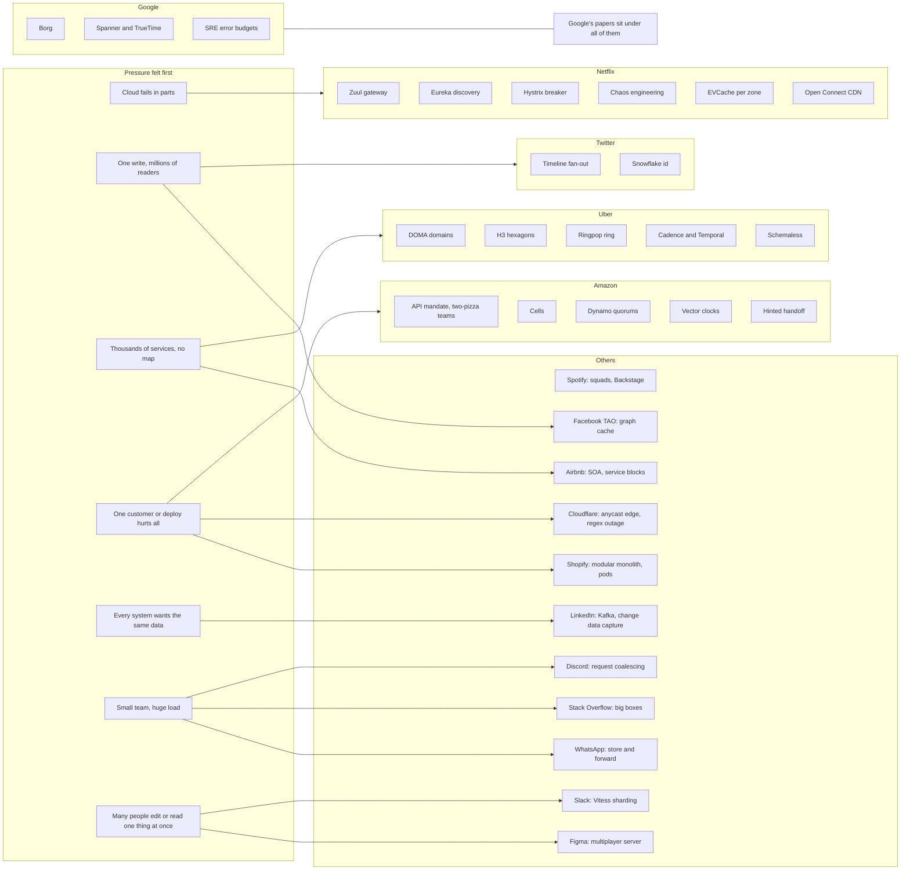

## The map in words

Read the picture from left to right. Each company felt one pressure first, and the pressure picks the fix. Inside each company box sit the concept sections of this chapter, in the order they appear below. Netflix comes first with its six building blocks, then Twitter, Uber, Amazon and Google with theirs, then eleven shorter company stories. Google sits under all of them: it built the cluster manager, the clock and the reliability practice the rest copied.

A second rule runs through the chapter. Big companies retire their own famous tools: Hystrix, the Spotify model, Ringpop. Saying so in an interview shows you read the sequel, not only the first blog post.

---

## Netflix: the cloud fails, so practise the failure

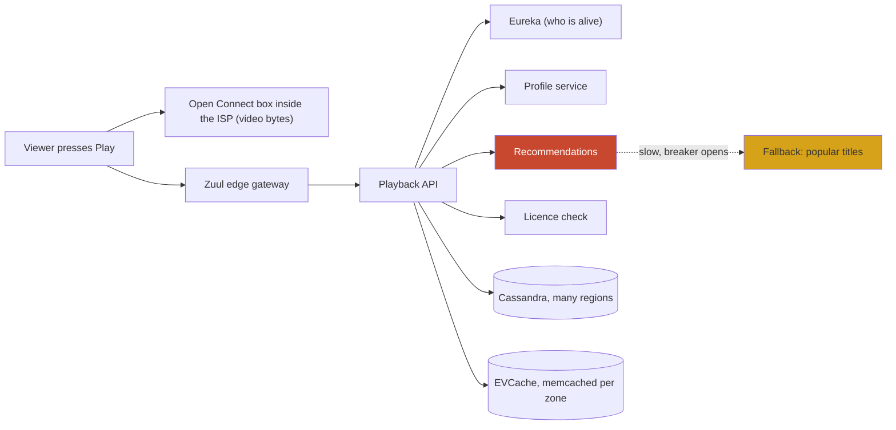

**The story.** Netflix streams video to the whole world on rented cloud (AWS, Amazon Web Services). That cloud fails in small parts every day: an instance dies, a zone slows, once a whole region. Hundreds of teams ship every day on top of it. So Netflix decided failure is normal and built every layer to expect it.

**How it works.**

1. The viewer presses Play. The video bytes come from an Open Connect box that sits inside the viewer's internet provider. AWS never carries the video.
2. Only the control calls go to AWS: login, catalogue, recommendations, start of playback. They enter through Zuul, the edge gateway. Zuul routes, checks auth and sends a small share to canaries.
3. The playback service finds its peers through Eureka, the service registry. Netflix built Eureka because AWS had no good one. Clients cache the registry, so Eureka itself can die.
4. Every call to another service is wrapped with a timeout, a circuit breaker and a fallback. When recommendations are slow, the breaker opens and the viewer gets popular titles instead.
5. User state lives in Cassandra, copied across regions with eventual consistency. EVCache, a memcached layer copied per availability zone, serves hot reads.
6. Chaos Monkey kills instances in production during work hours. Chaos Kong empties a whole AWS region. Regional failover is a rehearsed button, not a hope.

### In code

```text
on Play(ola):
  zuul: check who she is, then route to the Playback API
  copies = cached eureka list for "playback-api"   # refreshed every 30 s
  for dep in [profile, licence, recommendations], in parallel:
    if breaker[dep] is open: answer[dep] = fallback(dep)   # no network call
    else: answer[dep] = call(dep) with timeout 1 s
      if it timed out: breaker[dep].fails += 1; answer[dep] = fallback(dep)
      if breaker[dep].fails >= 5: breaker[dep] = open
  video = stream from the Open Connect box in her provider   # not from AWS

chaos: every workday, kill one random copy
  a call to a dead copy fails: retry once on another copy   # a read, so safe
  eureka drops a copy after its heartbeats stop
  autoscaler: if alive copies < 3: start one, it registers with eureka
  BUG: a client with a fixed address never asks eureka
```

```go
func Play(user string, deps []*Dep) map[string]string {
	answer := map[string]string{}
	for _, d := range deps {
		if d.Open {
			answer[d.Name] = "fallback"
			continue
		}
		if d.LatencyMs > 1000 {
			d.Fails++
			answer[d.Name] = "fallback"
			if d.Fails >= 5 {
				d.Open = true
			}
			continue
		}
		answer[d.Name] = "ok"
	}
	answer["video"] = "Open Connect box"
	return answer
}

func Zuul(token string) bool                           { return token == "valid" }
func ChaosMonkey(alive map[string]bool, victim string) { alive[victim] = false }

func CallAPI(copies []string, alive map[string]bool) (tried []string, ok bool) {
	for i := 0; i < len(copies) && i < 2; i++ {
		tried = append(tried, copies[i])
		if alive[copies[i]] {
			return tried, true
		}
	}
	return tried, false
}

func Heal(registry []string, alive map[string]bool, next string) (live []string) {
	for _, c := range registry {
		if alive[c] {
			live = append(live, c)
		}
	}
	if len(live) < 3 && next != "" {
		alive[next] = true
		live = append(live, next)
	}
	return live
}

var fixedAddress = []string{"api-2"} // BUG: never asks Eureka

```

Run it: `handbook/code/11-netflix-request/` with `cd handbook/code/11-netflix-request && go run .`

**What went wrong, and what changed later.** Hystrix, the library behind step 4, used fixed thresholds set by hand for each service. They aged badly as traffic changed. Netflix stopped developing Hystrix in 2018 and moved to resilience4j and adaptive concurrency limits, which learn the limit from measured latency.

**What you take from it.**

- Split the heavy data path from the control path. In a blockchain indexer, the warehouse and graph run in two identical lanes and a pointer names the live one. Switching lanes is rehearsed every release.
- Wrap every remote call. Timeout first, then breaker, then fallback. See [12. Circuit breaker](12-scalability-and-reliability.md#circuit-breaker-stop-calling-a-sick-service).
- Kill things on purpose on staging before production kills them for you.

> Netflix keeps video on the edge, wraps every call with a breaker and a fallback, and practises losing a whole region so failover is a button they have already pressed.

▶ Watch it move: [A Netflix play request](visual/11-netflix-request.html)

---

## Zuul: one front door for every call

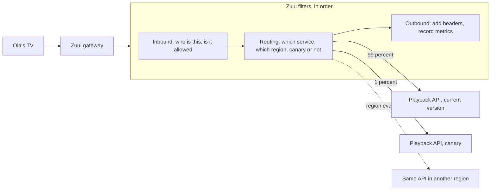

**The story.** Ola's TV, phone and laptop all talk to Netflix. Hundreds of services sit behind them. If every device knew every service, each change would break some device. Netflix put one front door in front of all of them: Zuul, an API gateway. Every control call from a device passes through it.

**How it works.**

1. Ola's TV sends one request, "start playback", to Zuul.
2. Inbound filters run first. They check who Ola is, whether the device is allowed, and whether the request is too big or too frequent.
3. A routing filter picks the target. Most requests go to the current Playback API. A small share, say 1 percent, goes to a canary, the new version under test.
4. During a regional drill or outage, the routing filter sends traffic to the same service in another region.
5. Outbound filters add headers and record metrics on the way back.
6. Filters are code, so teams change routing rules without changing any device.

### In code

```text
on request r:
  for f in inbound filters:                  # run in order, any can stop it
    if not f(r): return reject(f.status)
  # auth: is r.token valid? else 401
  # rate: has r.device sent more than 10 per second? then 429
  route = "playback-api in " + home region
  if home region is drained: route = same API in other region   # failover
  if r.device % 100 < 1: route = canary                         # 1 % canary
  if inFlight[route] >= 100: return 503     # Zuul 2: shed only this route
  resp = call(route) with timeout 1 s       # Zuul 2: per-route timeout
  for f in outbound filters: f(r, resp)     # metrics, headers
  return resp

blocking Zuul 1: one thread waits for each call
  threadsNeeded = arrivals per second * latency     # 50 * 5 s = 250 > 200
```

```go
var inbound = []Filter{
	{"auth", 401, func(r Request) bool { return r.Token == "valid" }},
	{"rate", 429, func(r Request) bool { return r.PerSecond <= 10 }},
}

func (g *Gateway) Handle(r Request, home, other string) (int, string) {
	for _, f := range inbound {
		if !f.Pass(r) {
			return f.Status, "stopped by " + f.Name
		}
	}
	route := "playback-api@" + home
	if g.Drained[home] {
		route = "playback-api@" + other
	}
	if r.Device%100 < 1 {
		route = "playback-canary@" + home
	}
	if g.InFlight[route] >= 100 {
		return 503, "shed: " + route
	}
	if g.Latency[route] > time.Second {
		return 504, "timeout after 1 s: " + route
	}
	g.Metrics[route]++
	return 200, route
}

// ThreadsNeeded is Little's law for blocking Zuul 1: each call holds a thread.
func ThreadsNeeded(perSecond int, latency time.Duration) int {
	return int(float64(perSecond) * latency.Seconds())
}

```

Run it: `handbook/code/11-zuul-gateway/` with `cd handbook/code/11-zuul-gateway && go run .`

**What goes wrong.** Zuul 1 gave each request its own thread, which waited while the backend worked. When one backend got slow, threads piled up waiting on it, and the gateway itself ran out of threads. Every service then looked down. Netflix rebuilt it as Zuul 2, which handles requests asynchronously on a few threads, so a slow backend holds memory, not threads. Add per-route timeouts and load shedding at the gateway as well.

**Where you use it.**

- Any public API in front of many services: Kong, Envoy, AWS API Gateway, Spring Cloud Gateway and NGINX play this role.
- Canary releases: send 1 percent of traffic to the new version at the gateway, compare error rates, then widen.
- Keep the gateway thin. Authentication, routing and limits belong there. Business logic does not, or the gateway becomes a new monolith.

> Zuul is Netflix's API gateway: every device call enters through one door where filters check, route, canary and shed load, and it went asynchronous so a slow backend cannot exhaust it.

▶ Watch it move: [Zuul gateway](visual/11-zuul-gateway.html)

---

## Eureka: service discovery that keeps working when it is sick

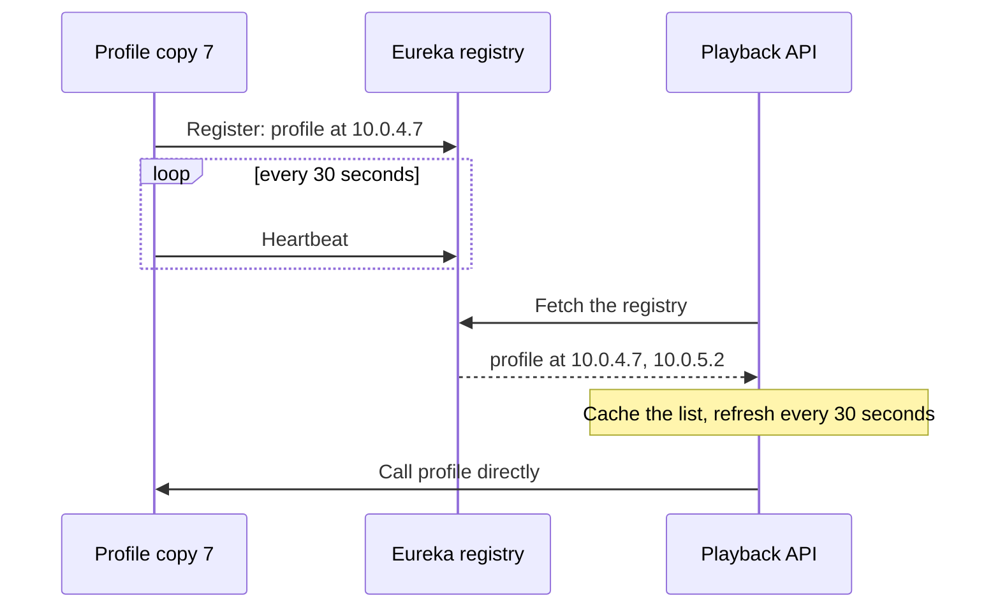

**The story.** On AWS, servers come and go all day. Copy 7 of the Profile service starts at 10:00 with a new IP address, and copy 3 dies at 10:05. The Playback API must always know which copies are alive. AWS had no good registry when Netflix moved in, so Netflix built Eureka.

**How it works.**

1. When Profile copy 7 starts, it registers with Eureka: name, IP address, port.
2. Every 30 seconds it sends a heartbeat. Eureka treats the registration as a lease that the heartbeat renews.
3. If heartbeats stop for about 90 seconds, Eureka drops copy 7 from the list.
4. The Playback API fetches the whole registry and keeps a copy in memory. It refreshes every 30 seconds.
5. The Playback API picks a copy from its cached list and calls it directly. Eureka is not in the call path.
6. Eureka runs as several peers that copy registrations to each other. It prefers answering with old data to not answering.

### In code

```text
on register(copy): leases[copy] = now
on heartbeat(copy), every 30 s: leases[copy] = now   # renew the lease
every 60 s, evict():
  expected = len(leases) * 2              # 2 heartbeats a minute per copy
  if renewsLastMinute < 0.85 * expected:  # too many vanished at once
    selfPreservation = true; return       # expire nobody
  selfPreservation = false
  for copy, last in leases:
    if now - last > 90 s: delete leases[copy]
client, every 30 s: cache = fetch(registry)   # works while Eureka is down
client call:
  for copy in cache:                      # Eureka is not in the call path
    if call(copy) ok: return answer
    # failed: retry on the next copy
```

```go
type Registry struct {
	Leases           map[string]int // copy -> second of last renewal
	Renews           []int          // seconds at which heartbeats arrived
	SelfPreservation bool
}

func (r *Registry) Register(copy string, now int) { r.Leases[copy] = now }

func (r *Registry) Heartbeat(copy string, now int) {
	r.Leases[copy] = now
	r.Renews = append(r.Renews, now)
}

func (r *Registry) Evict(now int) (evicted []string) {
	expected := len(r.Leases) * 2
	got := 0
	for _, t := range r.Renews {
		if t > now-60 {
			got++
		}
	}
	if float64(got) < 0.85*float64(expected) {
		r.SelfPreservation = true
		return nil
	}
	r.SelfPreservation = false
	for copy, last := range r.Leases {
		if now-last > 90 {
			delete(r.Leases, copy)
			evicted = append(evicted, copy)
		}
	}
	return evicted
}

// Fetch is what each client copies into its cache every 30 s.
func (r *Registry) Fetch() []string { return r.list() }

// Call tries each cached copy until one answers.
func Call(cache []string, alive map[string]bool) (tried []string) {
	for _, c := range cache {
		tried = append(tried, c)
		if alive[c] {
			return tried
		}
	}
	return tried
}

```

Run it: `handbook/code/11-eureka-discovery/` with `cd handbook/code/11-eureka-discovery && go run .`

**What goes wrong.** A network problem cuts many heartbeats at once. A strict registry would drop half the fleet that is actually fine, and clients would stop calling healthy servers. Eureka spots the sudden drop and enters self-preservation: it stops expiring anyone until heartbeats recover. The cost is stale entries. A client may call a copy that really died. So clients retry on another copy, which keeps a dead entry from becoming an error.

**Where you use it.**

- Kubernetes Services and DNS, Consul, and AWS Cloud Map do the same job today.
- Choose availability for a registry: stale data plus client retries beats a registry that refuses to answer.
- Cache the registry in the client. Then the registry can be down for a minute and calls still flow.

> Eureka is a registry where servers renew a lease by heartbeat and clients cache the list, and in a mass outage it stops expiring entries, so clients retry instead of losing healthy servers.

▶ Watch it move: [Eureka discovery](visual/11-eureka-discovery.html)

---

## Hystrix: the circuit breaker, and why it was retired

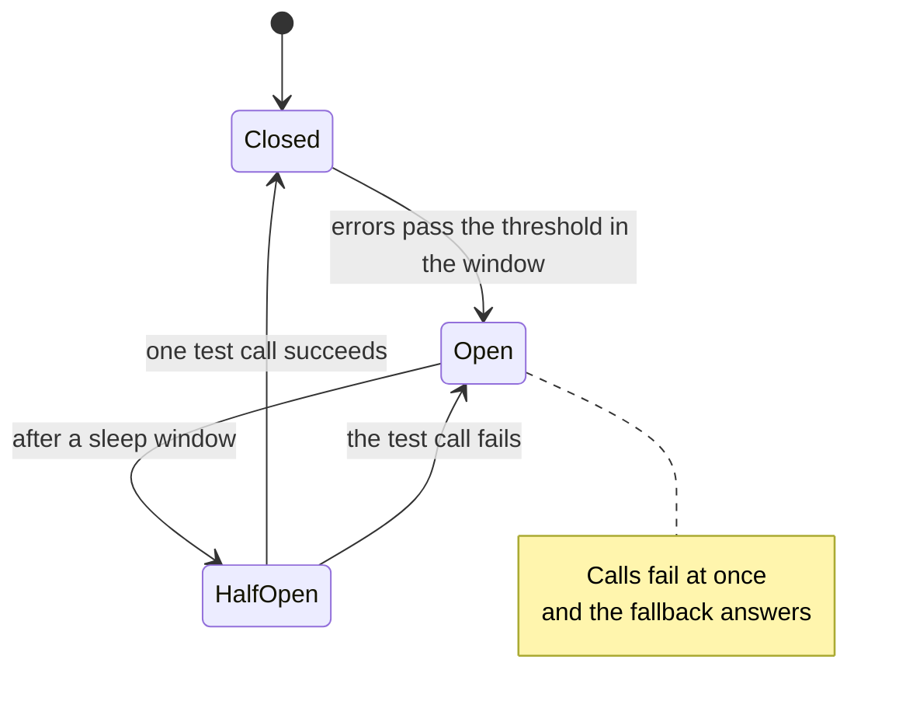

**The story.** The Playback API calls Recommendations for every home screen. One night a bad node makes Recommendations answer in five seconds instead of fifty milliseconds. Without protection, every Playback thread ends up waiting on it, and the whole home screen goes down. Netflix wrote Hystrix to stop one sick dependency from taking everything with it.

**How it works.**

1. Each call to Recommendations runs inside a Hystrix command with a timeout.
2. Each dependency gets its own small thread pool, a bulkhead. If Recommendations fills its pool, calls to Profile still have threads.
3. Hystrix counts successes and failures in a rolling window. Real Hystrix uses the last 10 seconds, with at least 20 calls before it judges. The model below keeps the last 20 calls.
4. When failures pass a threshold, such as half of the calls, the breaker opens. New calls fail at once, with no network call.
5. While open, a fallback answers: popular titles instead of personal ones.
6. After a sleep window, the breaker lets one test call through. If it works, the breaker closes again.

### In code

```text
on call(req) at time now:
  if state == OPEN:
    if now - openedAt < 5s: return fallback()   # fail fast, no network call
    state = HALF_OPEN                           # sleep window over: test once
  else if state == HALF_OPEN: return fallback() # test already in flight
  if pool.inUse == 10: ok = false               # bulkhead full: refuse at once
  else: ok = run(req) with timeout 300 ms       # slower counts as a failure
  record(ok)                                    # rolling window, last 20 calls
  if state == HALF_OPEN:
    if ok: state = CLOSED; window.clear()       # healed
    else: state = OPEN; openedAt = now          # still sick: sleep again
  else if window.size >= 20 and window.failRate >= 50%:
    state = OPEN; openedAt = now                # trip
  return ok ? answer : fallback()

adaptive limit, what replaced the fixed numbers:
  limit = limit * minRTT / sampleRTT            # 40 * 50/62.5 = 32
```

```go
// Call runs one request that takes latency, at simulated time now.
func (b *Breaker) Call(now, latency time.Duration) (ok bool, path string) {
	switch b.State {
	case Open:
		if now-b.OpenedAt < sleepWindow {
			return false, "fallback (open, fail fast)"
		}
		b.State = HalfOpen
	case HalfOpen:
		return false, "fallback (test in flight)"
	}
	if b.InUse == poolSize {
		ok, path = false, "fallback (bulkhead full)"
	} else {
		ok, path = latency <= b.Timeout, "answer"
	}
	b.Window = append(b.Window, ok)
	if len(b.Window) > windowSize {
		b.Window = b.Window[1:]
	}
	if b.State == HalfOpen {
		if ok {
			b.State, b.Window = Closed, nil
		} else {
			b.State, b.OpenedAt = Open, now
		}
	} else if len(b.Window) >= windowSize && b.failRate() >= 0.5 {
		b.State, b.OpenedAt = Open, now
	}
	if !ok && path == "answer" {
		path = "fallback (timeout)"
	}
	return ok, path
}

// AdaptiveLimit is the gradient rule from Netflix concurrency-limits.
func AdaptiveLimit(limit float64, minRTT, sampleRTT time.Duration) float64 {
	return limit * float64(minRTT) / float64(sampleRTT)
}

```

Run it: `handbook/code/11-hystrix-breaker/` with `cd handbook/code/11-hystrix-breaker && go run .`

**What goes wrong.** Every threshold in Hystrix was a number a person set: pool size, timeout, error percentage. Traffic, hardware and code changed every week, so the numbers aged. Too tight, and breakers opened on a normal busy day. Too loose, and they opened too late. In 2018 Netflix put Hystrix in maintenance mode. It moved to resilience4j and to adaptive concurrency limits, which measure latency and lower the number of calls in flight when latency rises, with no hand-set threshold.

**Where you use it.**

- Wrap every remote call: timeout first, then a breaker, then a fallback. resilience4j, Polly in .NET and Envoy's outlier detection all provide this.
- Prefer limits that adapt to measured latency over thresholds set once by hand.
- A fallback must be cheap and safe: a cached answer, a default, or a clear error. A fallback that calls another remote service just moves the problem.

> Hystrix wrapped each call with a timeout, a bulkhead and a circuit breaker so a sick dependency fails fast, and Netflix retired it because hand-set thresholds aged, in favour of limits that adapt to latency.

▶ Watch it move: [Hystrix circuit breaker](visual/11-hystrix-breaker.html)

---

## Chaos engineering: break it on purpose, in daylight

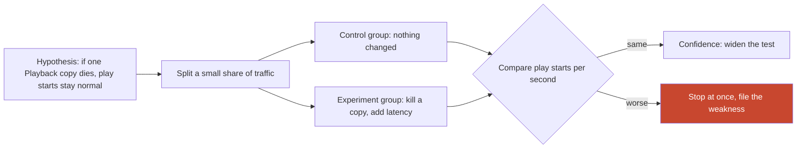

**The story.** Netflix moved to AWS knowing that servers would die without warning. The team could wait for that to happen at 3 in the morning, or make it happen at 11 on a Tuesday while everyone was at their desks. In 2011 Netflix released Chaos Monkey, which kills random production servers in work hours. Chaos Kong later took a whole AWS region out of service.

**How it works.**

1. Pick a steady-state number that shows the business is healthy. For Netflix it is play starts per second.
2. Write a hypothesis: "If one Playback copy dies, play starts stay normal."
3. Send a small share of real traffic into two groups: a control group and an experiment group.
4. In the experiment group, inject the failure: kill a copy, add latency, or fail a dependency.
5. Compare the steady-state number between the two groups.
6. If the experiment group gets worse, stop at once and fix the weakness. If not, widen the test.

### In code

```text
steady state: sps(group) = play starts per second
hypothesis: experiment.sps stays within 5 % of control.sps
group(user) = user % 100: 0 -> control, 1 -> experiment, else untouched
inject into experiment only: kill 1 of 10 Playback copies, or +300 ms on Profile
every 10 s while the experiment runs:
  if experiment.sps < control.sps * 0.95: stop(); report(fail)   # stop line
at the end: report(pass)

one play start, the thing both groups measure:
  t = 500 ms in Playback
  if the copy is dead: retry another copy, t += 50 ms
  p = Profile latency (150..350 ms, +300 if injected)
  if timeout is set and p > 300 ms: p = 300 ms; use default profile   # the fix
  success if t + p <= 1000 ms                  # the device gives up after 1 s
```

```go
type Inject struct {
	KillCopy       bool // 1 of 10 Playback copies is dead
	ProfileExtraMs int
}

func Group(user int) string {
	switch user % 100 {
	case 0:
		return "control"
	case 1:
		return "experiment"
	}
	return "untouched"
}

// PlayStart is one attempt; k picks the copy and the Profile latency.
func PlayStart(k int, in Inject, profileTimeout bool) bool {
	t := 500
	if in.KillCopy && k%10 == 0 {
		t += 50
	}
	p := 150 + (k%11)*20 + in.ProfileExtraMs
	if profileTimeout && p > 300 {
		p = 300
	}
	return t+p <= 1000
}

// SPS counts successful starts out of 100 attempts in one second.
func SPS(in Inject, profileTimeout bool) int {
	n := 0
	for k := 0; k < 100; k++ {
		if PlayStart(k, in, profileTimeout) {
			n++
		}
	}
	return n
}

func Check(control, experiment int) string {
	if float64(experiment) < float64(control)*0.95 {
		return "STOP: fail"
	}
	return "pass"
}

```

Run it: `handbook/code/11-chaos-engineering/` with `cd handbook/code/11-chaos-engineering && go run .`

**What goes wrong.** Chaos without limits is just an outage you caused. An experiment that hits every customer at once, or has no stop button, turns a test into an incident. Keep the blast radius small, start with a tiny share of traffic, stop automatically when the steady-state number drops, and never run an experiment the team cannot explain.

**Where you use it.**

- Kill pods on staging first, with Chaos Mesh or Litmus on Kubernetes, then move to production with a small share of traffic.
- GameDays: a planned session where the team breaks one thing and practises the response. Amazon runs them.
- Rehearse the big switch. Two identical serving lanes with a pointer are only safe if the pointer flip is practised every release.

> Chaos engineering tests a hypothesis about steady state by injecting real failures into a small share of production traffic, so weaknesses show up in daylight, not at 3 in the morning.

▶ Watch it move: [Chaos engineering experiment](visual/11-chaos-engineering.html)

---

## EVCache: a cache copied into every zone

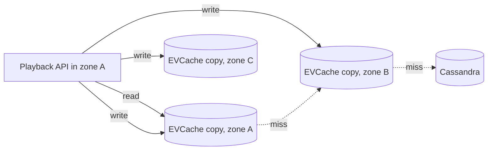

**The story.** Ola opens Netflix and her home screen needs her profile, her viewing history and her rows of titles. Millions of people do this every minute. Reading all of it from Cassandra each time would be slow and costly. Netflix keeps the hot data in EVCache, a layer built on memcached, and keeps a full copy of it in every availability zone.

**How it works.**

1. An AWS region has several availability zones: separate buildings with separate power.
2. EVCache keeps one full copy of the cache in each zone.
3. A write, such as "Ola watched episode 4", goes to the copies in every zone.
4. A read goes only to the copy in the reader's own zone, which is close and fast.
5. If the local copy misses, the client tries another zone's copy before it goes to Cassandra.
6. If a whole zone fails, the other zones still hold a full copy, so the database does not suddenly take every read.

### In code

```text
write(key, value):
  for zone in [A, B, C]:                # three separate writes, no transaction
    ok = zone.set(key, value, ttl 10 min)
    if not ok: log(zone, "write failed")  # that copy stays old until ttl or next write
read(key) in my zone:
  v = myZone.get(key)
  if found: return v                    # same building, fast
  v = otherZone.get(key)                # miss: ask one other zone
  if found: return v
  v = cassandra.get(key)                # last resort
  myZone.set(key, v, ttl 10 min); return v
before a new copy takes traffic:
  for key in otherZone: newCopy.set(key, otherZone.get(key))   # warm it
```

```go
type Client struct {
	Zones     []*Zone // [A, B, C]
	Cassandra map[string]string
	DBReads   int
}

func (c *Client) Write(key, value string) (failed []string) {
	for _, z := range c.Zones {
		if z.Down {
			failed = append(failed, z.Name)
			continue
		}
		z.Data[key] = value
	}
	return failed
}

// Read runs in zone `me` and falls back to zone `other`.
func (c *Client) Read(me, other *Zone, key string) (string, string) {
	me.Reads++
	if v, ok := me.Data[key]; ok {
		return v, me.Name
	}
	other.Reads++
	if v, ok := other.Data[key]; ok {
		return v, other.Name
	}
	c.DBReads++
	v := c.Cassandra[key]
	me.Data[key] = v
	return v, "Cassandra"
}

func Warm(newCopy, from *Zone) {
	for k, v := range from.Data {
		newCopy.Data[k] = v
	}
}

```

Run it: `handbook/code/11-evcache-zones/` with `cd handbook/code/11-evcache-zones && go run .`

**What goes wrong.** The writes to each zone are sent separately and are not one transaction. If the write to zone B fails, zone B serves the old value until the item expires or is written again. A second trap is a cold copy: a zone's cache restarts empty and every read crosses to another zone, which is slower and doubles that zone's load. If no zone holds it, the read falls through to the database. Netflix warms a new copy from an existing one before it takes traffic, and keeps expiry times short where staleness matters.

**Where you use it.**

- Any read-heavy service with a database behind it: Redis or memcached as a look-aside cache, one copy per zone when a zone loss must not flood the database.
- Warm a new cache node before giving it traffic, and spread expiry times so items do not all expire together.
- Decide per item how stale is acceptable. A recommendation row can be minutes old. A payment status cannot be cached at all.

> EVCache writes every item to a memcached copy in each availability zone and reads from the local one, so reads are fast and losing a zone does not stampede the database.

▶ Watch it move: [EVCache across zones](visual/11-evcache-zones.html)

---

## Open Connect: Netflix's own CDN inside internet providers

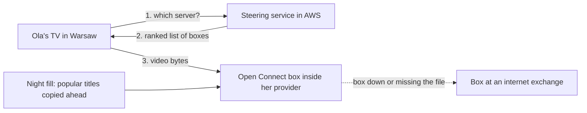

**The story.** Video is most of Netflix's traffic. Sending it from AWS across the internet to every home would be slow for viewers and very costly. So Netflix built its own CDN, a content delivery network, called Open Connect. It gives internet providers free storage boxes full of Netflix films, placed inside their own buildings.

**How it works.**

1. Netflix places Open Connect boxes inside internet providers and at internet exchange points, where networks meet.
2. Every night, during quiet hours, each box is filled with the titles people near it are likely to watch the next day.
3. Ola presses Play. Her TV asks the steering service, which runs in AWS, where to get the video.
4. The steering service returns a ranked list of boxes that hold the file, starting with the closest healthy one.
5. Ola's TV streams the video bytes straight from the box inside her provider, a few network hops away.
6. AWS handles only the small control calls. The heavy bytes never leave the provider's network.

### In code

```text
every night, 02:00 to 06:00, fill(box):
  wanted = titles for this area by predicted views, until the box is full
  copy each wanted title the box does not hold yet
steer(title, client):                   # a small control call to AWS
  boxes = nearby boxes that hold title and are healthy
  return boxes sorted by network hops from client   # the ranked list
client play(title):
  list = steer(title, me)
  for box in list:
    stream from box until the film ends or stalls
    if ended: return
    # stalled: take the next box, quality may dip for a moment
# with the list in hand, AWS is not on the video path at all
```

```go
type Box struct {
	Name     string
	Hops     int
	Capacity int
	Titles   map[string]bool
	Healthy  bool
}

func Fill(b *Box, byViews []string) {
	for _, t := range byViews {
		if len(b.Titles) == b.Capacity {
			return
		}
		b.Titles[t] = true
	}
}

func Steer(title string, nearby []*Box) []*Box {
	var list []*Box
	for _, b := range nearby {
		if b.Titles[title] && b.Healthy {
			list = append(list, b)
		}
	}
	sort.Slice(list, func(i, j int) bool { return list[i].Hops < list[j].Hops })
	return list
}

// Play streams from the list; dies says at which minute a box stalls.
func Play(list []*Box, minutes int, dies map[string]int) []string {
	var log []string
	at := 0
	for _, b := range list {
		stall, ok := dies[b.Name]
		if !ok || stall >= minutes {
			return append(log, fmt.Sprintf("%s min %d-%d, ended", b.Name, at, minutes))
		}
		log = append(log, fmt.Sprintf("%s min %d-%d, stalled", b.Name, at, stall))
		at = stall
	}
	return append(log, "no box left")
}

```

Run it: `handbook/code/11-open-connect-cdn/` with `cd handbook/code/11-open-connect-cdn && go run .`

**What goes wrong.** A new hit series is released and the local box does not have every episode yet, or the box dies mid-film. The TV moves down its ranked list to the next box, perhaps one at an internet exchange. The picture keeps playing, maybe at a lower quality for a moment. Prediction errors cost distance, not failure, because there is always another box on the list.

**Where you use it.**

- Any heavy static content: video, game downloads, software updates. Use a CDN such as CloudFront, Akamai or Cloudflare, and keep the origin for control traffic.
- Pre-position content you can predict, such as a launch day download, instead of waiting for the first viewer to pull it.
- Split the control path from the data path. The control service can live in one cloud, while the bytes come from the edge.

> Open Connect puts Netflix's own storage boxes inside internet providers, fills them overnight with what people will watch, and steers each viewer to the nearest box, so video never crosses the cloud.

▶ Watch it move: [Open Connect CDN](visual/11-open-connect-cdn.html)

---

## Twitter, now X: one tweet, millions of timelines

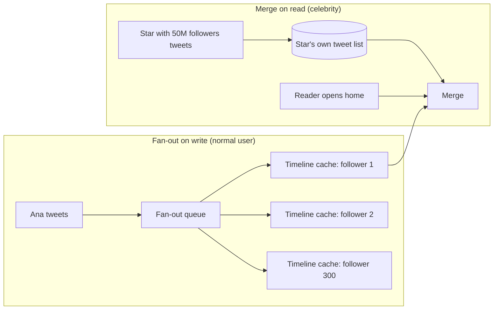

**The story.** Ana has 300 followers. When she tweets, her tweet id must appear in 300 home timelines in seconds. A pop star has tens of millions of followers. Reads of a home timeline happen far more often than writes, roughly a hundred to one. Twitter chose to pay at write time for most users and to make an exception for stars.

**How it works.**

1. Ana's tweet gets a Snowflake id: 64 bits made of a timestamp, a machine id and a sequence. Ids sort by time with no central counter.
2. The tweet is stored once in Manhattan, the in-house key-value store.
3. A fan-out job pushes the id into the cached home timeline of each of Ana's 300 followers. This is fan-out on write.
4. When a follower opens the app, the home timeline is one cache read. No join, no search.
5. The pop star is not fanned out. Pushing into tens of millions of timelines would take too long and cost too much.
6. At read time, the reader's cached timeline is merged with the recent tweets of the stars they follow. This is the hybrid.

### In code

```text
post(author, text):
  id = snowflake()                    # 64-bit id that sorts by time
  store[id] = text; writes += 1       # the only copy of the text
  if hybrid and followerCount(author) > 10,000:
    starTweets[author].add(id); return    # stars are not fanned out
  for f in followers(author): timeline[f].push(id); writes += 1
open(user), fan-out on write:
  ids = timeline[user]                # one lookup
open(user), fan-out on read:
  ids = merge(recent(f) for f in following(user))   # one lookup per followee
open(user), hybrid:
  ids = merge(timeline[user], recent(s) for each star the user follows)
show(ids): [store[id] for id in ids if id in store]   # hide deleted tweets
delete(id):
  del store[id]
  for f in followers(author): timeline[f].remove(id)  # one cleanup per copy
```

```go
func (s *Site) Post(author, text string) int64 {
	s.next++
	id := s.next
	s.Store[id], s.Writes = text, s.Writes+1
	s.Recent[author] = append(s.Recent[author], id)
	if s.Hybrid && s.Count[author] > 10000 {
		s.StarTweets[author] = append(s.StarTweets[author], id)
		return id
	}
	for _, f := range s.Followers[author] {
		s.Timeline[f] = append(s.Timeline[f], id)
		s.Writes++
	}
	return id
}

func (s *Site) OpenWrite(u string) ([]int64, int) { return s.Timeline[u], 1 }

func (s *Site) OpenRead(u string) (ids []int64, lookups int) {
	for _, f := range s.Following[u] {
		ids, lookups = append(ids, s.Recent[f]...), lookups+1
	}
	sort.Slice(ids, func(i, j int) bool { return ids[i] > ids[j] })
	return ids, lookups
}

func (s *Site) OpenHybrid(u string, stars []string) ([]int64, int) {
	ids := append([]int64{}, s.Timeline[u]...)
	for _, st := range stars {
		ids = append(ids, s.StarTweets[st]...)
	}
	sort.Slice(ids, func(i, j int) bool { return ids[i] > ids[j] })
	return ids, 1 + len(stars)
}

func (s *Site) Show(ids []int64) (texts []string) {
	for _, id := range ids {
		if t, ok := s.Store[id]; ok {
			texts = append(texts, t)
		}
	}
	return texts
}

func (s *Site) Delete(author string, id int64) (cleanups int) {
	delete(s.Store, id)
	for _, f := range s.Followers[author] {
		s.Timeline[f] = without(s.Timeline[f], id)
		cleanups++
	}
	return cleanups
}

```

Run it: `handbook/code/11-twitter-timeline-fanout/` with `cd handbook/code/11-twitter-timeline-fanout && go run .`

**What went wrong, and what changed later.** Pure fan-out on write breaks on the celebrity. One tweet turns into tens of millions of writes, the queue backs up, and fans see the tweet minutes late. A delete is also expensive, because it must touch every copy. The hybrid fixed the first. Twitter also replaced Cassandra with Manhattan for core data, because it wanted predictable latency and an operations model it controlled.

**What you take from it.**

- A graph projection is fan-out on write: every transfer updates the summary links of both addresses, so a trace reads one neighbourhood. A hot exchange address is the celebrity: cap its links and expand on demand.
- Use time-sortable ids (Snowflake, ULID, UUIDv7) when rows are read in time order. Random UUIDs index badly.

> Twitter pushes a tweet into every follower's cached timeline so reads are one fetch, and merges celebrity tweets at read time because fanning them out costs too much.

▶ Watch it move: [Twitter timeline fan-out](visual/11-twitter-timeline-fanout.html)

---

## Snowflake id: time-sortable ids with no central counter

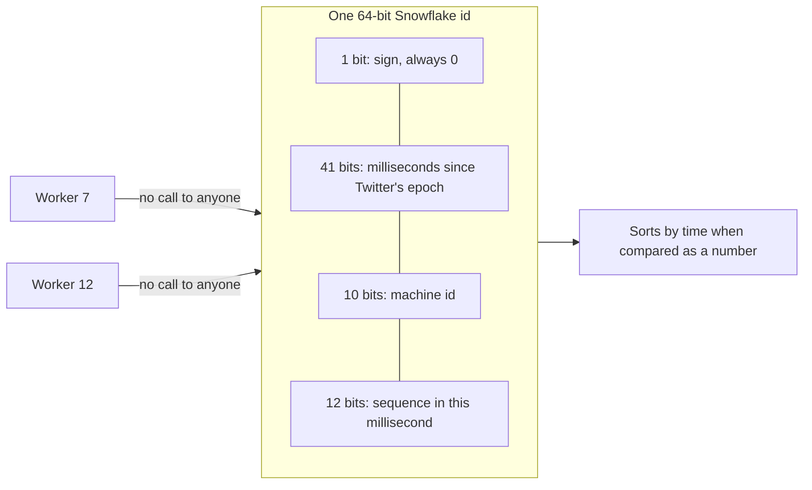

**The story.** Ana tweets at 10:00:00.123. Thousands of other people tweet in the same second, on hundreds of machines. Each tweet needs a unique id at once. A central database counter would be one slow point that every tweet waits on. Twitter built Snowflake so every machine makes ids on its own.

**How it works.**

1. Each worker gets a machine id once, at start-up. No two live workers share one.
2. For Ana's tweet, worker 7 reads its clock: 10:00:00.123, as milliseconds since Twitter's own start date in 2010.
3. It puts the time in the top 41 bits. That is about 69 years of milliseconds.
4. It puts its machine id, 7, in the next 10 bits. So up to 1,024 workers never clash.
5. It puts a sequence number in the last 12 bits. The sequence counts up inside one millisecond, so one worker can make 4,096 ids per millisecond.
6. The result is one 64-bit number. Bigger time means bigger number, so sorting ids sorts tweets by time.

### In code

```text
at start: machine = coordinator.assign()    # the only network call
next():
  now = clock ms since the 2010 epoch
  if now < last: wait until now >= last     # the clock went back: refuse
  if now == last:
    seq = seq + 1                           # same millisecond: count up
    if seq == 4096: wait until now > last; seq = 0   # this ms is used up
  else: seq = 0                             # a new millisecond
  last = now
  return now << 22 | machine << 12 | seq    # 41 + 10 + 12 bits
BUG: machine read from a hand-written config: two workers share 7
```

```go
type Worker struct {
	Machine, Seq, Last int64
	Clock              *Clock
	Waited             int64
}

func NewWorker(assigned int64, c *Clock) *Worker {
	return &Worker{Machine: assigned, Last: -1, Clock: c}
}

func (w *Worker) Next() int64 {
	now := w.Clock.Now
	for now < w.Last {
		w.tick()
		now = w.Clock.Now
	}
	if now == w.Last {
		w.Seq++
		if w.Seq == 4096 {
			w.tick()
			now = w.Clock.Now
			w.Seq = 0
		}
	} else {
		w.Seq = 0
	}
	w.Last = now
	return now<<22 | w.Machine<<12 | w.Seq
}

func (w *Worker) tick() { w.Clock.Now++; w.Waited++ } // simulated wait of 1 ms

```

Run it: `handbook/code/11-snowflake-id/` with `cd handbook/code/11-snowflake-id && go run .`

**What goes wrong.** The clock jumps backwards, for example after a time sync. The worker would make an id with an older time, which may repeat an id or break the order. Snowflake refuses to make ids until the clock reaches the last time it used. A second trap is two workers given the same machine id: they make the same ids. Hand out machine ids from one coordinator, such as ZooKeeper, and check them at start-up.

**Where you use it.**

- Primary keys for rows read in time order. UUIDv7 and ULID (Universally Unique Lexicographically Sortable Identifier) follow the same idea. Random UUIDs scatter inserts over the whole index and slow it down.
- Logs and events from many writers that must merge in rough time order without a central counter.
- A blockchain indexer needs none of this: block height and log index already give a total order for free.

> A Snowflake id packs time, machine and a sequence into 64 bits, so every machine makes unique ids alone and the ids sort by time.

▶ Watch it move: [Snowflake id](visual/11-snowflake-id.html)

---

## Uber: thousands of services, so group them into domains and cells

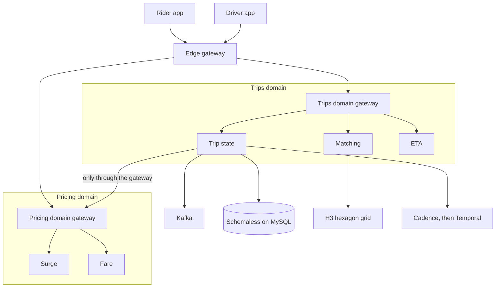

**The story.** A rider in Warsaw asks for a car. Uber is a two-sided market per city, with live location for every driver. Its services grew fast and without a plan, to thousands. Any service called any other. A change in one place broke something three hops away, and nobody could draw the map.

**How it works.**

1. DOMA (Domain-Oriented Microservice Architecture) groups related services into a domain: Trips, Pricing, Payments.
2. Each domain has one gateway. Other domains call only the gateway, never the inner services. In the picture, Trip state calls Pricing through its door.
3. Domains sit in layers. A low layer never calls a higher one. The web of calls becomes a tree.
4. Matching uses H3, a grid of hexagons over the earth. A hexagon has the same distance to all six neighbours, so demand per cell can be summed and smoothed fairly. Squares have two distances.
5. Long jobs, such as a trip, a payout or a refund, run in Cadence, later Temporal. The workflow is code whose state is replayed from its history after a restart.
6. Events flow through Kafka, at trillions of messages a day, with a federation layer so producers do not know which cluster they hit. Schemaless shards append-only JSON cells over MySQL.
7. Later, Uber copied whole stacks into cells, each serving a slice of users behind a thin router. A bad deploy then hurts one cell, not every city.

### In code

```text
call(from, to):
  if no rules yet: allow                  # before: any service calls any other
  if domain(from) == domain(to): allow    # inside a domain, free
  if to is not a gateway: refuse "use the door"
  if layer(domain(to)) > layer(domain(from)): refuse "up is not allowed"
  allow                                   # down, through the gateway
gateway(domain).handle(req): pick the inner service   # callers never see it

route(rider): cell = rider id % 3 + 1     # always the same cell
release(version):
  for cell in [2, 1, 3]:                  # one cell at a time
    deploy(version, cell)
    if errorRate(cell) > 1 %: rollback(cell); stop   # blast radius: one cell
db(cell) = that cell's own database
  BUG: all cells share one database: a lock stops every cell
```

```go
func Allowed(from, to Service, rules bool) string {
	if !rules {
		return "allowed: no rules"
	}
	if from.Domain == to.Domain {
		return "allowed: same domain"
	}
	if !to.Gateway {
		return "refused: use the gateway"
	}
	if layer[to.Domain] > layer[from.Domain] {
		return "refused: up is not allowed"
	}
	return "allowed: down, through the gateway"
}

func GatewayRoute(domain, op string) string {
	return map[string]string{"fare": "Fare", "surge": "Surge"}[op]
}

func Route(rider int) int { return rider%3 + 1 }

// Release deploys cell by cell and stops at the first bad cell.
func Release(errorRate map[int]float64) (done []int, rolledBack int) {
	for _, cell := range []int{2, 1, 3} {
		done = append(done, cell)
		if errorRate[cell] > 0.01 {
			return done[:len(done)-1], cell
		}
	}
	return done, 0
}

// RidersDown counts riders stopped by a lock in `lockedDB`.
func RidersDown(dbOf map[int]string, lockedDB string, ridersPerCell int) int {
	down := 0
	for _, db := range dbOf {
		if db == lockedDB {
			down += ridersPerCell
		}
	}
	return down
}

```

Run it: `handbook/code/11-uber-doma-and-cells/` with `cd handbook/code/11-uber-doma-and-cells && go run .`

**What went wrong, and what changed later.** Ringpop, Uber's consistent-hash ring with gossip membership, routed a request to the node that owned a key. It was clever, and it was hard to run. Uber moved away from it. The bigger lesson was the first one: services without borders became a "distributed monolith" that nobody could change safely.

**What you take from it.**

- One door per domain. The indexer, the warehouse and the graph each expose one surface: the proxy for agents, the SQL views for analysts. Nobody reaches into an inner table.
- A workflow engine is the answer when a business process lives for days and must survive restarts.

> Uber turned a web of thousands of services into a tree by grouping them into domains with one gateway each, and limits a bad deploy to one cell.

▶ Watch it move: [Uber domains and cells](visual/11-uber-doma-and-cells.html)

---

## H3: a hexagon grid over the earth

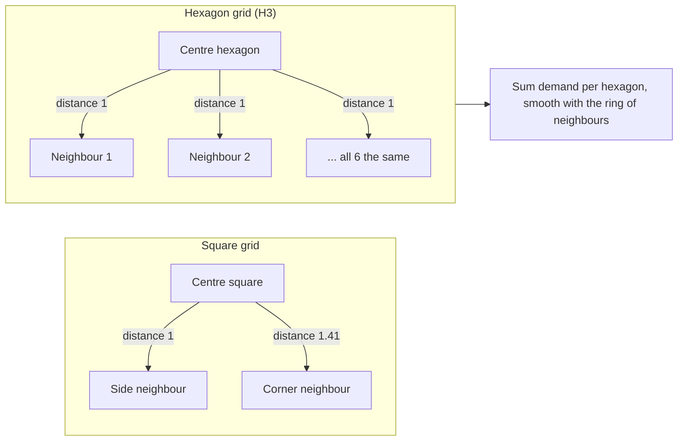

**The story.** It is Friday night in Warsaw and it starts to rain. Ride requests pile up in the city centre. Drivers sit two streets away. Uber must decide where prices rise and where to send drivers. It needs to cut the map into equal cells and count riders and drivers in each one. Uber built H3, a grid of hexagons, and released it as open source.

**How it works.**

1. The earth is covered with hexagons at 16 sizes, from very large down to about a square metre.
2. Every rider's location turns into one 64-bit cell id at the chosen size. That is a cheap calculation, no database needed.
3. Uber counts requests and free drivers per hexagon. The centre hexagon now shows 40 requests and 3 drivers.
4. A single hexagon is noisy, so the count is smoothed with its ring of six neighbours. Every neighbour is the same distance away, so each gets the same weight.
5. Surge pricing and driver hints are set per hexagon from the smoothed numbers.
6. To zoom out, each hexagon has a parent at the larger size. Counts roll up from children to parents.

### In code

```text
cellOf(point):                          # simplified grid, not the real H3 library
  q, r = point in hexagon axial coordinates
  return round to the nearest hexagon   # a calculation, no database call
count per cell: requests[cell] += 1, drivers[cell] += 1
ring(cell) = the 6 neighbours            # all the same distance away
smooth(cell):
  sum = value[cell] + sum of value over ring(cell)
  return sum / 7                         # one weight for every neighbour
price: if smooth(requests) / smooth(drivers) > 2: surge on
hint: if drivers[cell] > requests[cell]:
  send drivers to the ring cell with the highest requests/drivers
roll up: parent(cell) = the big cell that holds this cell's centre
  BUG: 7 small cells do not cover a big one exactly: edges stick out
square grid: side neighbours are 1.0 away, corner neighbours 1.41
  equal weights let a far corner count like a side
```

```go
func CellOf(x, y, size, rot float64) Cell {
	c, s := math.Cos(rot), math.Sin(rot)
	x, y = x*c+y*s, -x*s+y*c
	q := (math.Sqrt(3)/3*x - y/3) / size
	r := (2.0 / 3 * y) / size
	return round(q, r)
}

func Ring(c Cell) []Cell {
	d := []Cell{{1, 0}, {1, -1}, {0, -1}, {-1, 0}, {-1, 1}, {0, 1}}
	out := make([]Cell, 6)
	for i, v := range d {
		out[i] = Cell{c.Q + v.Q, c.R + v.R}
	}
	return out
}

func Smooth(v map[Cell]float64, c Cell) float64 {
	sum := v[c]
	for _, n := range Ring(c) {
		sum += v[n]
	}
	return sum / 7
}

func Surge(req, drv map[Cell]float64, c Cell) bool {
	return Smooth(req, c)/Smooth(drv, c) > 2
}

func Hint(req, drv map[Cell]float64, c Cell) (Cell, bool) {
	if drv[c] <= req[c] {
		return c, false
	}
	best, top := c, 0.0
	for _, n := range Ring(c) {
		if drv[n] > 0 && req[n]/drv[n] > top {
			best, top = n, req[n]/drv[n]
		}
	}
	return best, true
}

func Count(m map[Cell]float64, c Cell) { m[c]++ }

func Parent(c Cell, size, big, rot float64) Cell {
	x, y := centre(c, size)
	return CellOf(x, y, big, rot)
}

// SquareDist: a side neighbour is 1.0 away, a corner one about 1.41.
func SquareDist(dx, dy float64) float64 { return math.Hypot(dx, dy) }

func EqualWeight(own float64, near []float64) float64 {
	sum := own
	for _, v := range near {
		sum += v
	}
	return sum / float64(len(near)+1)
}

```

Run it: `handbook/code/11-h3-hexagons/` with `cd handbook/code/11-h3-hexagons && go run .`

**What goes wrong.** With squares, a corner neighbour is about 1.41 times further than a side neighbour. Smoothing then treats near and far cells the same and bends the result. That is why Uber chose hexagons. Hexagons have their own catch: seven small hexagons do not cover their parent exactly. A roll-up by parent is close, not exact. Keep the fine counts when exact totals matter.

**Where you use it.**

- Geo analytics: heat maps, delivery zones, "how many orders near here". H3 libraries exist for most languages, and several data warehouses ship H3 functions.
- Joining two location data sets fast: turn both into cell ids, then join on the id instead of on distance.
- Choose the cell size by the question: a city block for surge, a district for weekly reports.

> H3 cuts the earth into hexagons because every neighbour is the same distance away, so counting and smoothing demand per cell is fair.

▶ Watch it move: [H3 hexagons](visual/11-h3-hexagons.html)

---

## Ringpop: a consistent-hash ring with gossip

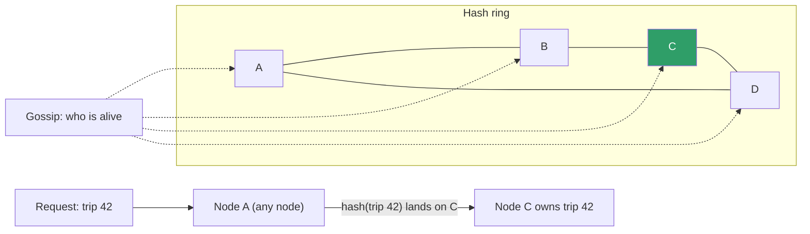

**The story.** Uber's dispatch service keeps the live state of each trip in memory, for speed. Trip 42 must always be handled by the same node, or two nodes would hold two different versions of it. Nodes start and stop all day. Uber built Ringpop, a library inside each service node, so every node knows who owns which trip without a central coordinator.

**How it works.**

1. Each node is placed on a ring by hashing its address. In practice each node takes many places, called virtual nodes, to spread the load evenly.
2. A key such as "trip 42" is hashed to a point on the ring. The first node clockwise owns it. Here that is node C.
3. A request for trip 42 can land on any node, say A. A computes the owner and forwards the request to C.
4. Nodes learn who is alive by gossip. Every second each node pings a random peer and passes on what it heard. Uber used the SWIM protocol for this.
5. When node D joins, it takes over only the keys between its place and the node before it. That is about one key in N, not a full reshuffle. This is the point of consistent hashing.
6. When a node dies, gossip spreads the news and its keys move to the next node clockwise.

### In code

```text
position(node) = hash(node address), a point on the ring 0..359
owner(key, view):
  p = hash(key)
  walk clockwise from p
  return the first node in view        # every node does this sum alone
on request(key) at node n:
  o = owner(key, n.view)
  if o == n: handle it here
  else: forward to o
every second: ping a random peer, share who is alive   # gossip
  no answer: mark that peer dead in my view
join(E): add E to the view             # only keys from B up to E move
split: each side marks the other dead, so the views differ
  two owners change the same key       # nothing in the ring decides
heal: views agree again; the old owner's copy is dropped   # its update is lost
```

```go
var pos = map[string]int{"A": 0, "B": 90, "C": 180, "D": 270, "E": 160}

type Node struct {
	Name string
	View map[string]bool // who this node believes is alive
	Trip string          // its copy of trip 42
}

func Owner(key int, view map[string]bool) string {
	var names []string
	for n := range view {
		names = append(names, n)
	}
	sort.Slice(names, func(i, j int) bool { return pos[names[i]] < pos[names[j]] })
	for _, n := range names {
		if pos[n] >= key {
			return n
		}
	}
	return names[0]
}

func (n *Node) Request(key int) string {
	o := Owner(key, n.View)
	if o == n.Name {
		return "handled at " + n.Name
	}
	return n.Name + " forwards to " + o
}

// Gossip marks every peer this node cannot reach as dead in its view.
func (n *Node) Gossip(reach func(a, b string) bool) {
	for p := range n.View {
		if !reach(n.Name, p) {
			delete(n.View, p)
		}
	}
}

// Moved counts keys 0..359 that change owner when a node joins.
func Moved(before, after map[string]bool) int {
	moved := 0
	for k := 0; k < 360; k++ {
		if Owner(k, before) != Owner(k, after) {
			moved++
		}
	}
	return moved
}

// Heal keeps only the true owner's copy; the other side's update is lost.
func Heal(all map[string]bool, nodes map[string]*Node) string { return nodes[Owner(trip42, all)].Trip }

```

Run it: `handbook/code/11-ringpop-hash-ring/` with `cd handbook/code/11-ringpop-hash-ring && go run .`

**What goes wrong.** During a network split, gossip gives two groups two views of the ring. Both node C and node D think they own trip 42, and both change it. Even without a split, nodes that flap up and down move keys back and forth. Ringpop was clever and hard to run. Uber moved away from it toward simpler routing and storage that owns the state.

**Where you use it.**

- Consistent hashing is everywhere: Cassandra and Dynamo place data on a ring, memcached clients pick a server by it, and Envoy can load-balance with a ring hash.
- Gossip membership runs in Cassandra, Consul and Serf.
- Prefer a store that owns its own partitioning over building a ring into your app. Build one only when in-memory state per key is the product.

> Ringpop hashes each key onto a ring so one node owns it, and spreads membership by gossip, so adding a node moves only a small share of keys. Uber dropped it because a split view lets two nodes own one key.

▶ Watch it move: [Ringpop hash ring](visual/11-ringpop-hash-ring.html)

---

## Durable workflows: Cadence and Temporal

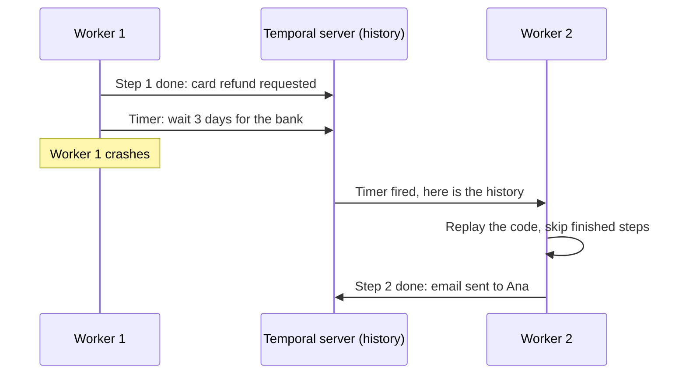

**The story.** Ana's trip was cancelled after she paid. Uber must refund her card, wait up to three days for the bank to confirm, then email her. A process that lives for three days will see servers restart. Before workflow engines, teams spread such logic over queues, cron jobs and status columns, and steps were lost or done twice. Uber built Cadence. Its authors later forked it as Temporal.

**How it works.**

1. A developer writes the refund as ordinary code: refund the card, sleep three days, check the bank, email Ana.
2. Each side effect is an activity. Before and after an activity runs, the server records it in the workflow's event history.
3. The three-day sleep is a durable timer kept by the server, not a thread that waits.
4. Worker 1 crashes during the wait. Nothing is lost, because the state is the history on the server.
5. When the timer fires, worker 2 gets the history and replays the code from the start. Finished activities return their recorded results at once, without running again.
6. The code reaches the email step, which is new, and runs it for real.

### In code

```text
workflow refund(ana):
  ref = activity("refund card")
  sleep(3 days)                  # a timer on the server, not a waiting thread
  activity("check bank")
  activity("email Ana")
activity(name), the engine's rule:
  e = history[next]; next += 1
  if e exists and e.name != name: stop with a non-determinism error
  if e exists: return e.result   # replay: no real call
  r = run it for real; history.append(name, r); return r
sleep: if no "timer fired" in history: record it and give up the worker
crash: memory is lost, the history stays on the server
any worker: run the code from line 1 with the history
safe change: if version("fraud-check") == new: activity("fraud check")
BUG: time.Now() or rand in workflow code: new value on replay; use the engine's
```

```go
type Run struct {
	History []Event // lives on the server, survives any worker
	next    int
	Real    int // real activity calls by this worker
	Fired   bool
}

func (r *Run) Activity(name string, do func() string) string {
	if r.next < len(r.History) {
		e := r.History[r.next]
		r.next++
		if e.Name != name {
			panic(fmt.Errorf("non-determinism: code says %q, history says %q", name, e.Name))
		}
		return e.Result
	}
	res := do()
	r.Real++
	r.History = append(r.History, Event{name, res})
	r.next++
	return res
}

func (r *Run) Sleep(name string) {
	r.Activity(name, func() string { return "timer started" })
	if !r.Fired {
		panic(errStop)
	}
}

func (r *Run) Version(change string) int {
	if r.next < len(r.History) && r.History[r.next].Name != "version "+change {
		return 1
	}
	r.Activity("version "+change, func() string { return "2" })
	return 2
}

// Execute is any worker running the code from line 1 with the history.
func Execute(r *Run, wf func(*Run)) (err error) {
	r.next, r.Real = 0, 0
	defer func() {
		if p := recover(); p != nil {
			err = p.(error)
		}
	}()
	wf(r)
	return nil
}

// Now is the safe clock: the first run records it, a replay reads it back.
func (r *Run) Now() string {
	return r.Activity("now", func() string { return "10:00" })
}

func Refund(r *Run) {
	// BUG to avoid here: time.Now() or rand gives a new value on replay.
	r.Activity("refund card", func() string { bank.Refunds++; return "R-881" })
	r.Sleep("sleep 3 days")
	r.Activity("check bank", func() string { return "confirmed" })
	r.Activity("email Ana", func() string { return "sent" })
}

```

Run it: `handbook/code/11-durable-workflow/` with `cd handbook/code/11-durable-workflow && go run .`

**What goes wrong.** Replay only works if the code makes the same decisions every time. A developer adds a new step in the middle, or reads the current time or a random number directly. The replay no longer matches the history and the workflow gets stuck. The fix is versioning: mark changed code with a version check, and use the engine's own clock and random functions.

**Where you use it.**

- Business processes that last minutes to months: payouts, refunds, onboarding, order fulfilment. Temporal has SDKs for Go, Java, TypeScript and Python.
- Long-running agent jobs: a coding agent that waits for a review or a test run can be a workflow, so a restart resumes it.
- Pick a workflow engine when a process must survive restarts and has timers. A queue is enough when each step is short and independent.

> A durable workflow is code whose state is its recorded history, so after a crash another worker replays it and carries on, as long as the code stays deterministic.

▶ Watch it move: [Durable workflow replay](visual/11-durable-workflow.html)

---

## Schemaless: append-only cells on sharded MySQL

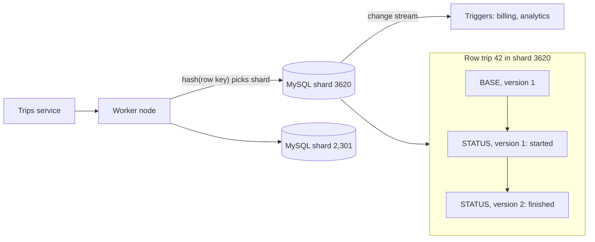

**The story.** In 2014 Uber's trip data lived in one Postgres database, and it was filling up fast. The team needed a store that grew by adding machines, on technology they already knew how to run. They built Schemaless on top of MySQL. Every trip, such as trip 42, is a row of small JSON cells that are never changed, only added.

**How it works.**

1. A cell has three keys: the row key (trip 42), a column name (STATUS) and a version number. Its body is a JSON blob.
2. The row key is hashed to one of a fixed number of shards. The shards are spread over many MySQL servers.
3. When trip 42 starts, the service writes a BASE cell and a STATUS cell with version 1.
4. When the trip finishes, the service does not update the STATUS cell. It appends a new STATUS cell with version 2.
5. A read asks for the newest version of a column, or a given version.
6. Every new cell also appears in a change stream. Billing and analytics subscribe to it as triggers.

### In code

```text
shard(row) = hash(row) % 4096           # fixed count; grow by moving shards
put(row, column, body):
  version = newest version of (row, column) + 1
  shards[shard(row)].append(row, column, version, body)   # never update
  stream.append(cell)                   # every new cell feeds the change stream
get(row, column):
  return the cell with the highest version   # one shard, always current
billing, on each stream cell:
  if column == STATUS and body == finished: charge the rider
index builder, on each stream cell:
  if column == BASE: index[driver].add(row)   # runs after the write
my trips(driver): return index[driver]   # may lag behind the write
after my own write: merge index[driver] with get(my row by key)   # the fix
```

```go
type Store struct {
	Shards map[uint32][]Cell
	Stream []Cell
	Index  map[string][]string // driver -> rows
	Read   int                 // stream position of the index builder
}

func Shard(row string) uint32 {
	h := fnv.New32a()
	h.Write([]byte(row))
	return h.Sum32() % 4096
}

func (s *Store) Put(row, column, body string) Cell {
	c := Cell{row, column, s.newest(row, column).Version + 1, body}
	s.Shards[Shard(row)] = append(s.Shards[Shard(row)], c)
	s.Stream = append(s.Stream, c)
	return c
}

func (s *Store) newest(row, column string) (best Cell) {
	for _, c := range s.Shards[Shard(row)] {
		if c.Row == row && c.Column == column && c.Version > best.Version {
			best = c
		}
	}
	return best
}

func Billing(c Cell) string {
	if c.Column == "STATUS" && c.Body == "finished" {
		return "charge rider of " + c.Row
	}
	return ""
}

func (s *Store) BuildIndex(driverOf func(Cell) string) {
	for ; s.Read < len(s.Stream); s.Read++ {
		c := s.Stream[s.Read]
		if c.Column == "BASE" {
			s.Index[driverOf(c)] = append(s.Index[driverOf(c)], c.Row)
		}
	}
}

func (s *Store) MyTrips(driver string, justWrote ...string) []string {
	out := append([]string{}, s.Index[driver]...)
	for _, row := range justWrote {
		if s.newest(row, "BASE").Version > 0 && !has(out, row) {
			out = append(out, row)
		}
	}
	return out
}

```

Run it: `handbook/code/11-schemaless-cells/` with `cd handbook/code/11-schemaless-cells && go run .`

**What goes wrong.** Secondary indexes, such as "trips by driver", are built after the write, not inside it. A driver who just finished a trip may not see it in their list for a moment. Reads by the row key are always current. Reads through an index are eventually current. Design screens around that, or read by key after a write. Uber later built Docstore on the same ideas, with stronger guarantees.

**Where you use it.**

- Append-only fact tables: a blockchain indexer writes each transfer once and never updates it. Corrections are new rows, so history is never lost.
- An append-only store gives a change feed and an audit trail for free.
- Choose a fixed shard count large enough for years, so you move shards between servers and never rehash keys.

> Schemaless stores each trip as immutable JSON cells, sharded by row key over MySQL, so a change is a new version and the change stream drives everything downstream.

▶ Watch it move: [Schemaless cells](visual/11-schemaless-cells.html)

---

## Amazon: one codebase every team edited, so services and cells

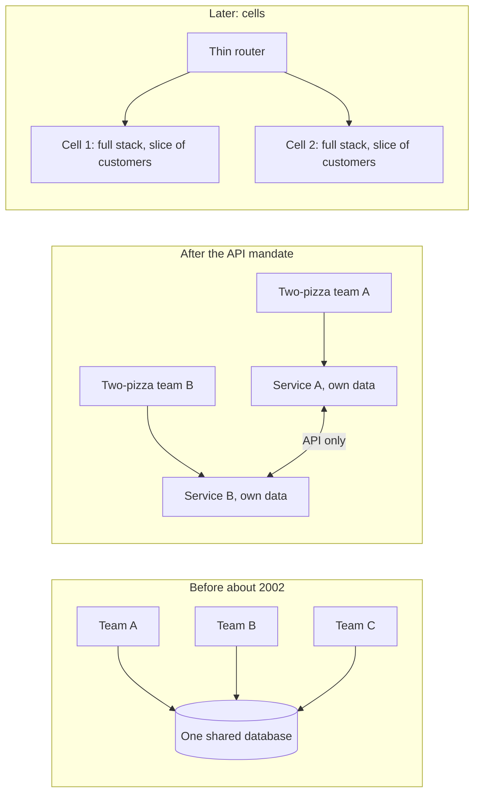

**The story.** Amazon retail was one giant codebase. Every team edited it. Every team read and wrote the same database. Before Christmas the database could not keep up, and any change could break any other team. Around 2002 Jeff Bezos sent the API mandate.

**How it works.**

1. Every team exposes its data and functions only through a service interface. No shared databases, no back doors.
2. Every interface is built as if outside customers would use it. This is where AWS came from.
3. A two-pizza team, small enough to be fed by two pizzas, owns one service end to end, including being on call.
4. The shopping cart must always accept a write. The Dynamo paper (2007) chose availability: consistent hashing, vector clocks to detect conflicts, hinted handoff when a node is down.
5. DynamoDB (2012) is the product. It kept the partitioning and the always-on promise. It dropped vector clocks for simple conditional writes, and Amazon runs it for you.
6. Later came cells: many identical stacks, each serving a slice of customers. A bad deploy or a poison request hurts one cell.

### In code

Amazon's two mechanisms are their own sections, each with pseudo code and a program:

- [The API mandate and two-pizza teams](#the-api-mandate-and-two-pizza-teams): `handbook/code/11-api-mandate/`
- [Cells](#cells-many-small-copies-instead-of-one-big-system): `handbook/code/11-cells/`

**What went wrong, and what changed later.** The Dynamo paper pushed conflict merging onto the application. Teams found that hard. So the product, DynamoDB, hid most of it. A paper is a design. A product is the later compromise.

**What you take from it.**

- Each repository owns its tables. Others read through views or an API, never by joining a stranger's table. When a table changes, only its owner's tests break.
- Cells are a known size, so you can test one, scale by adding one, and lose one.

> Amazon made every team talk only through service interfaces, which made it service-oriented years before microservices had a name, and later cut the fleet into cells so a failure stays small.

▶ Watch it move: [API mandate](visual/11-api-mandate.html) and [Cells](visual/11-cells.html)

---

## The API mandate and two-pizza teams

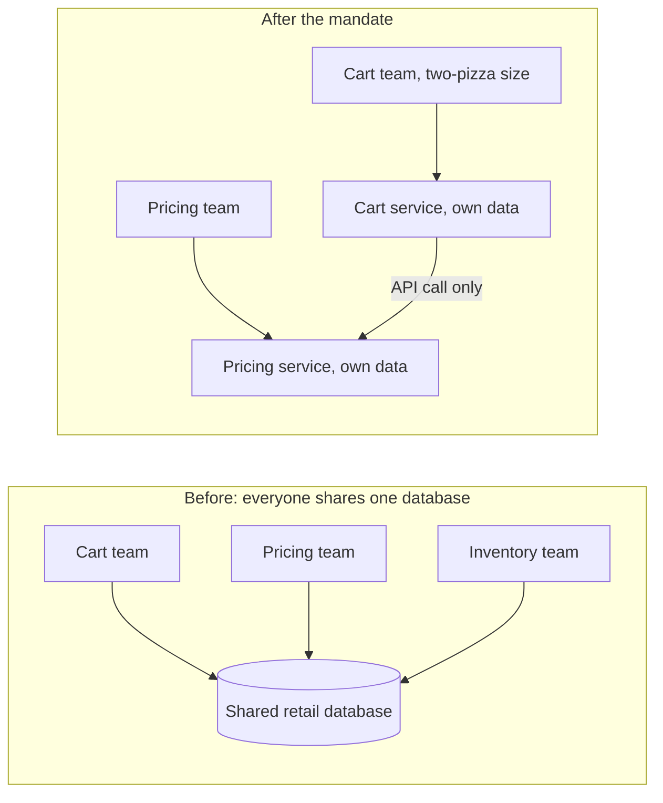

**The story.** Around 2002, Amazon's retail site was one large program and one shared database. The cart team, the pricing team and the inventory team all read and changed the same tables. A pricing team change to a column broke the cart in December. Jeff Bezos sent a memo, later retold by Steve Yegge: every team must expose its data and functions only through service interfaces.

**How it works.**

1. Each team exposes its data and functions through a service interface. Nothing else.
2. No team reads another team's database directly, links its code, or shares memory. The only way in is the interface, over the network.
3. The technology does not matter: any protocol, any language.
4. Every interface is designed as if outside developers would use it one day. This habit became AWS.
5. Each service is owned by a two-pizza team: small enough that two pizzas feed it, so about six to ten people.
6. The team owns the service end to end, including being on call for it. "You build it, you run it."

### In code

```text
before, one shared database:
  pricing: RENAME COLUMN price TO list_price   # pricing's own tests pass
  cart: SELECT price FROM items                # nobody re-ran cart's tests
  BUG: column price is gone, so checkout fails
after, the mandate:
  rule: a team reads another team's data only through its API
  pricing.GetPrice(item):                      # the contract
    read my own table, with any column names I like
    return the price
  cart.Checkout(item):
    answer = pricing.GetPrice(item) with timeout 200 ms
    if ok: lastPrice[item] = answer
    else: use lastPrice[item], marked "may be old"   # the fallback
  BUG before the fix: no timeout, so checkout waits as long as pricing does
  on call: a slow pricing service pages the pricing team, not a central team
```

```go
// Before: the cart reads a table that another team owns.
func CartReadShared(items map[int]Row, item int) (int, error) {
	v, ok := items[item]["price"]
	if !ok {
		return 0, fmt.Errorf("column price does not exist")
	}
	return v, nil
}

func RenameColumn(items map[int]Row, from, to string) {
	for _, r := range items {
		r[to] = r[from]
		delete(r, from)
	}
}

// After: only the pricing service touches its table.
type Pricing struct {
	table     map[int]Row
	LatencyMs int
	Pages     int
}

func (p *Pricing) GetPrice(item int) (price, latencyMs int) {
	if p.LatencyMs > 1000 {
		p.Pages++
	}
	return p.table[item]["list_price"], p.LatencyMs
}

type Cart struct {
	TimeoutMs int // 0 means no timeout
	LastPrice map[int]int
}

func (c *Cart) Checkout(p *Pricing, item int) (price, waitedMs int, note string) {
	v, ms := p.GetPrice(item)
	if c.TimeoutMs == 0 {
		return v, ms, "waited for pricing"
	}
	if ms <= c.TimeoutMs {
		c.LastPrice[item] = v
		return v, ms, "fresh"
	}
	return c.LastPrice[item], c.TimeoutMs, "may be old"
}

```

Run it: `handbook/code/11-api-mandate/` with `cd handbook/code/11-api-mandate && go run .`

**What goes wrong.** Teams now depend on each other over the network. A call that was a function call is now a remote call that can be slow or fail. Debugging one customer order means tracing it across ten services. Without timeouts, retries and tracing, the mandate trades one big tangle for a slow distributed one. Amazon paid this cost on purpose and built the tooling for it.

**Where you use it.**

- Each repository owns its tables. Others read through a view or an API, never by joining a stranger's table. Then a table change breaks only its owner's tests.
- Keep teams small and give each one a service it owns and runs. Ownership without on-call is not ownership.
- Design internal APIs as if a customer will call them: versioned, documented, stable.

> Amazon's API mandate made every team share data only through service interfaces, owned by two-pizza teams that build and run them, which turned a shared-database monolith into services and later into AWS.

▶ Watch it move: [API mandate](visual/11-api-mandate.html)

---

## Cells: many small copies instead of one big system

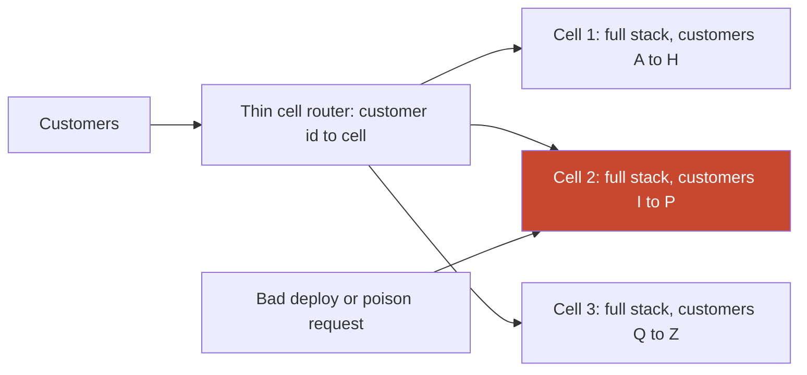

**The story.** A cloud service has one million customers on one big shared stack. One customer sends a strange request that crashes the servers. It crashes every server, because every server takes every customer. Amazon's answer is cells: cut the service into many identical small copies, each serving a fixed slice of customers.

**How it works.**

1. A cell is a complete copy of the service: load balancers, servers and its own database.
2. Each customer is assigned to one cell. A thin router looks up the cell for each request and forwards it.
3. Cells share nothing with each other. No cross-cell calls on the request path.
4. A deploy goes to one cell first, waits, checks health, then moves to the next cell.
5. A bad deploy or a poison request breaks one cell. The other cells keep serving their customers.
6. To grow, add a cell. Every cell has a known, tested maximum size.

### In code

```text
route(customer):                       # a lookup and a forward, nothing else
  cell = table[first letter]           # A-H: 1, I-P: 2, Q-Z: 3
  forward to that cell
each cell: its own servers and database; no call goes to another cell
deploy(version):
  for cell in [1, 2, 3]:               # one cell at a time
    cell.version = version; watch its errors
    if cell.errorRate > 1 %: roll back this cell; stop the wave
handle(request) in a cell:
  if the request is poison: this cell crashes and restarts   # others never see it
grow: add a cell with the same tested size, send new customers there
BUG: a bad router table: every request fails, in every cell
fix: keep the router tiny and deploy it more carefully than anything else
```

```go
type Cell struct {
	Name      string
	Version   int
	ErrorRate float64
	Restarts  int
}

type Router struct{ Table map[byte]int } // first letter -> cell index

func (r *Router) Route(customer string) (int, error) {
	i, ok := r.Table[customer[0]]
	if !ok {
		return 0, fmt.Errorf("no cell for %s", customer)
	}
	return i, nil
}

func Deploy(cells []*Cell, version int, errorsOf map[string]float64) (done []string, stoppedAt string) {
	for _, c := range cells {
		old := c.Version
		c.Version, c.ErrorRate = version, errorsOf[c.Name]
		if c.ErrorRate > 0.01 {
			c.Version = old
			return done, c.Name
		}
		done = append(done, c.Name)
	}
	return done, ""
}

func Handle(c *Cell, poison bool) string {
	if poison {
		c.Restarts++
		return c.Name + " crashed and restarted"
	}
	return c.Name + " ok"
}

// Table builds the router's lookup: letters from..to go to one cell.
func Table(t map[byte]int, from, to byte, cell int) {
	for l := from; l <= to; l++ {
		t[l] = cell
	}
}

```

Run it: `handbook/code/11-cells/` with `cd handbook/code/11-cells && go run .`

**What goes wrong.** The router is shared by every cell, so a bug in the router hurts everyone. Keep it as simple as possible: a lookup and a forward, with no business logic, and deploy it more carefully than anything else. A second problem is a feature that needs data from every cell, such as a global report. It must run outside the request path, reading from each cell.

**Where you use it.**

- Multi-tenant services: put each tenant in one cell, so a loud tenant fills one cell. Shopify calls them pods.
- Staged deploys: one cell, then a few, then all. The first cell is the canary.
- Shuffle sharding, used by AWS Route 53, gives each customer a random small set of servers, so two customers rarely share all the same ones.

> Cells cut a service into identical full copies, each serving a slice of customers behind a thin router, so a bad deploy or a poison request breaks one cell, not everyone.

▶ Watch it move: [Cells](visual/11-cells.html)

---

## Dynamo: always writable, with quorums

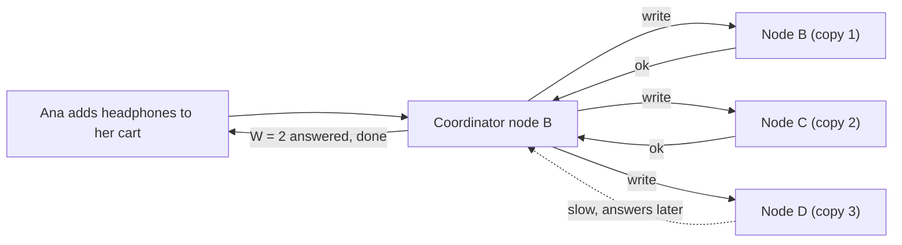

**The story.** It is Black Friday. Ana adds headphones to her Amazon cart. If the cart refuses the write, Amazon loses a sale. Amazon decided that the cart must always accept a write, even when some machines are down or the network is split. The 2007 Dynamo paper describes how.

**How it works.**

1. Keys sit on a consistent-hash ring. Ana's cart key belongs to node B, and is copied to the next two nodes, C and D. So N, the number of copies, is 3.
2. Any of them can coordinate. There is no leader. Here node B takes the write.
3. B sends the write to all three copies and waits for W answers. With W = 2, B and C answering is enough. Ana sees "added" at once.
4. A read asks R copies and returns the newest. With R = 2 and W = 2, R + W is bigger than N, so every read overlaps at least one copy that saw the last write.
5. Lower W or R for speed, raise them for safety. Each request can choose.
6. If a copy is down, the coordinator writes to the next healthy node instead. This is a sloppy quorum, and the stand-in keeps a hint for the missing node. See hinted handoff below.

### In code

```text
preference list(key) = next 3 nodes clockwise from hash(key)   # N = 3
put(key, value), at the coordinator:
  targets = first N healthy nodes on the ring          # sloppy: walk past dead ones
  for t in targets:
    if t is not on the preference list: attach hint(owner)    # stand-in
    send write to t
  wait for W = 2 answers, then tell the client "added"  # slow nodes do not block
get(key):
  ask R = 2 copies
  return the newest version, or all versions that do not include each other
rule: R + W > N: 2 + 2 > 3, so any read overlaps any write
split: each side meets W on its own, so two versions exist
heal: both come back as siblings; the app merges
  BUG: merging by union brings back an item Ana removed
```

```go
const N, W, R = 3, 2, 2

type Node struct {
	Name   string
	Up     bool
	Slow   bool
	Copies map[string]Version
	Hints  []string // owners this node holds writes for
}

func Put(ring []*Node, key string, v Version) (acks int, hint string) {
	written := 0
	for i := 0; i < len(ring) && written < N; i++ {
		n := ring[i]
		if !n.Up {
			if i < N {
				hint = n.Name
			}
			continue
		}
		n.Copies[key] = v
		written++
		if !n.Slow {
			acks++
		}
	}
	return acks, hint
}

// Includes says whether clock a has seen everything in clock b.
func Includes(a, b map[string]int) bool {
	for k, v := range b {
		if a[k] < v {
			return false
		}
	}
	return true
}

func Get(copies []Version) []Version {
	asked := copies[:R]
	if Includes(asked[0].Clock, asked[1].Clock) {
		return asked[:1]
	}
	if Includes(asked[1].Clock, asked[0].Clock) {
		return asked[1:]
	}
	return asked
}

func MergeUnion(a, b Version) []string {
	seen := map[string]bool{}
	for _, x := range append(append([]string{}, a.Items...), b.Items...) {
		seen[x] = true
	}
	var out []string
	for x := range seen {
		out = append(out, x)
	}
	sort.Strings(out)
	return out
}

```

Run it: `handbook/code/11-dynamo-quorum/` with `cd handbook/code/11-dynamo-quorum && go run .`

**What goes wrong.** During a network split, Ana's phone writes through one side and her laptop through the other. Both writes succeed, so now there are two carts. Dynamo keeps both and detects the conflict with vector clocks. The application must merge them. The cart merged by union, so an item Ana deleted on one side could come back. That was the price of always writable.

**Where you use it.**

- Cassandra, ScyllaDB and Riak are leaderless stores in this family. Their consistency levels, such as QUORUM or ONE, are R and W.
- DynamoDB, the product, kept partitioning and high availability but uses a leader per partition. It hides conflicts behind conditional writes.
- Choose leaderless when refusing a write costs more than merging later. Choose a leader when a conflict would be wrong, such as a bank balance.

> Dynamo writes to N copies and waits for W, reads R, and keeps R plus W above N, so a cart always takes a write and conflicts are merged later.

▶ Watch it move: [Dynamo quorum write](visual/11-dynamo-quorum.html)

---

## Vector clocks: detect conflicting writes

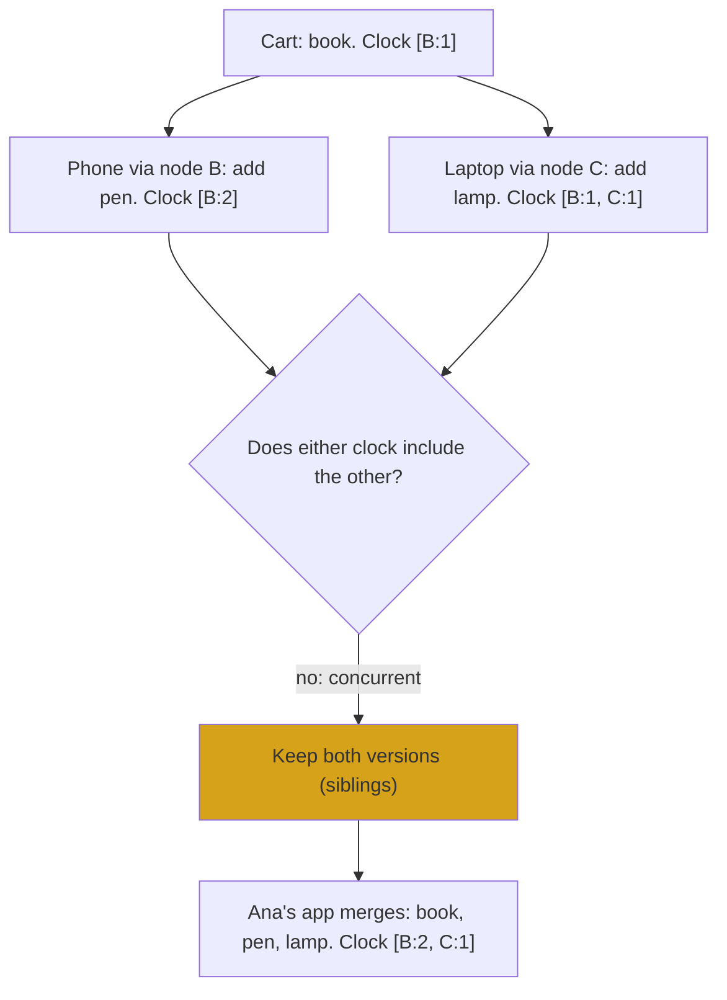

**The story.** Ana's cart holds a book. The network splits. On her phone she adds a pen, and the write goes to node B. On her laptop she adds a lamp, and the write goes to node C. Neither node knows about the other write. When the network heals, the store must decide: is one version newer, or did both happen at once?

**How it works.**

1. Each version carries a vector clock: a list of counters, one per node that coordinated a write. The book version has [B:1].
2. The phone's write goes through node B, which bumps its own counter: [B:2].
3. The laptop's write goes through node C, starting from [B:1]. It adds its own counter: [B:1, C:1].
4. Compare the two. A clock includes another if every counter is equal or bigger. [B:2] has no C counter. [B:1, C:1] has a smaller B. Neither includes the other.
5. So the writes are concurrent. The store keeps both versions, called siblings, and returns both on the next read.
6. Ana's app merges them into book, pen and lamp, and writes back with [B:2, C:1], which includes both.

### In code

```text
write(key, value, base clock, coordinator c):
  clock = copy of base; clock[c] += 1      # only c's counter moves
includes(a, b): for every node n: a[n] >= b[n]
compare(a, b):
  if includes(a, b) and includes(b, a): same
  if includes(a, b): a is newer, drop b
  if includes(b, a): b is newer, drop a
  else: concurrent, keep both as siblings  # a real conflict
merge(siblings): value = app rule; clock[n] = max over siblings for every n
truncate: if the clock holds over 10 entries: drop the oldest entry
  BUG: a truncated clock can turn real history into a false conflict
  BUG: a union merge brings back deleted items unless deletes are recorded
last-write-wins instead:
  keep the version with the larger wall-clock time; drop the other silently
  BUG: wall clocks drift, so the earlier write can win
```

```go
func Write(base Clock, c string) Clock {
	out := Clock{}
	for k, v := range base {
		out[k] = v
	}
	out[c]++
	return out
}

func Includes(a, b Clock) bool {
	for n, v := range b {
		if a[n] < v {
			return false
		}
	}
	return true
}

func Compare(a, b Clock) string {
	switch {
	case Includes(a, b) && Includes(b, a):
		return "same"
	case Includes(a, b):
		return "first is newer, drop second"
	case Includes(b, a):
		return "second is newer, drop first"
	}
	return "concurrent: keep both as siblings"
}

// MergeItems is the app rule for values: a union, so a removed item returns.
func MergeItems(a, b []string) (out []string) {
	seen := map[string]bool{}
	for _, x := range append(append([]string{}, a...), b...) {
		if !seen[x] {
			seen[x] = true
			out = append(out, x)
		}
	}
	return out
}

func Merge(a, b Clock) Clock {
	// The clock merge is safe. A union of values is not: deleted items return.
	out := Write(a, "")
	delete(out, "")
	for n, v := range b {
		if v > out[n] {
			out[n] = v
		}
	}
	return out
}

func Truncate(c Clock, oldest string) Clock {
	if len(c) > 10 {
		delete(c, oldest)
	}
	return c
}

func LWW(t1, t2 time.Time) string {
	// t1 and t2 come from two machines' clocks, and those clocks drift.
	if t2.After(t1) {
		return "second wins, first dropped silently"
	}
	return "first wins, second dropped silently"
}

```

Run it: `handbook/code/11-vector-clocks/` with `cd handbook/code/11-vector-clocks && go run .`

**What goes wrong.** Last-write-wins, the simple rule many stores use, would keep one cart and silently drop the pen or the lamp. Vector clocks prevent that, but they bring their own costs. With many coordinators the list grows. Dynamo cut it at about ten entries, which can turn real history into a false conflict. And merging by union brings back items Ana deleted, unless deletes are also recorded.

**Where you use it.**

- Riak exposes siblings and uses a refined form called dotted version vectors.
- CRDTs (conflict-free replicated data types) build the merge into the data type, so no app code is needed: a shopping cart becomes a set that records adds and removes.
- Git is the same question in another form: two commits that do not include each other must be merged.

> A vector clock keeps one counter per node, so when neither clock includes the other the store knows the writes were concurrent and keeps both for a merge.

▶ Watch it move: [Vector clocks](visual/11-vector-clocks.html)

---

## Hinted handoff: a neighbour holds the write

```mermaid
sequenceDiagram
  participant A as Ana's cart write
  participant B as Coordinator B
  participant D as Node D (stand-in)
  participant C as Node C (down)
  A->>B: add headphones
  B--xC: write fails, C is down
  B->>D: write, with a hint: this belongs to C
  D-->>B: stored
  Note over C: C comes back 20 minutes later
  D->>C: hand over the hinted write
  C-->>D: stored, D deletes the hint
```

**The story.** Node C holds one of the three copies of Ana's cart. C is rebooting after a kernel update. Ana adds headphones. Dynamo promises the cart always takes a write, so it cannot wait for C. A neighbour keeps the write for C and hands it over later.

**How it works.**

1. Coordinator B sends Ana's write to the three copies: B, C and the next one. C does not answer.
2. B picks the next healthy node on the ring, D, as a stand-in.
3. B sends the write to D with a hint: "this belongs to C".
4. D stores it in a separate hint area, not with its own data. The write now counts toward W, so Ana sees "added".
5. D checks from time to time whether C is back.
6. C returns. D hands over the hinted write. C stores it and D deletes the hint. All three copies match again.

### In code

```text
write(key, value):
  for owner in preference list [B, A, C]:
    if owner is up: store at owner
    else if now - owner.downSince < 3 hours:      # the hint window
      next healthy node D stores (owner, key, value) as a hint
  wait for W = 2 answers, then tell Ana "added"
every few seconds, at D, for each hint:
  if hint.owner is up: send it; on ack delete the hint   # the handoff
past the window: no new hints for C        # so stand-ins do not fill up
repair(B, C):
  build a Merkle tree on each: a hash per key range, then hashes of hashes
  if the top hashes match: done
  walk down: skip every half whose hashes match
  copy only the leaf ranges that differ
```

```go
type Node struct {
	Name      string
	Up        bool
	DownSince int // hour
	Data      map[string]string
	Hints     []Hint
}

func Write(owners []*Node, standIn *Node, hour int, k, v string) (acks int) {
	for _, o := range owners {
		if o.Up {
			o.Data[k] = v
			acks++
		} else if hour-o.DownSince < 3 {
			standIn.Hints = append(standIn.Hints, Hint{o.Name, k, v})
		}
	}
	return acks
}

func (d *Node) Deliver(owner *Node) (sent int) {
	var keep []Hint
	for _, h := range d.Hints {
		if h.Owner == owner.Name && owner.Up {
			owner.Data[h.Key] = h.Value
			sent++
		} else {
			keep = append(keep, h)
		}
	}
	d.Hints = keep
	return sent
}

// Tree holds hashes: index 1 is the top, 2 and 3 its halves, 4..7 the leaves.
func Tree(n *Node) [8]uint32 {
	var t [8]uint32
	for i := 0; i < 4; i++ {
		t[4+i] = hashRange(n, i*25, i*25+24)
	}
	for i := 3; i >= 1; i-- {
		t[i] = t[2*i] ^ t[2*i+1]*16777619
	}
	return t
}

// Diff walks down from the top and returns the leaves that differ.
func Diff(a, b [8]uint32, i int, compared *int) []int {
	*compared++
	if a[i] == b[i] {
		return nil
	}
	if i >= 4 {
		return []int{i}
	}
	return append(Diff(a, b, 2*i, compared), Diff(a, b, 2*i+1, compared)...)
}

```

Run it: `handbook/code/11-hinted-handoff/` with `cd handbook/code/11-hinted-handoff && go run .`

**What goes wrong.** C never comes back, or D dies before the handover. The hint is lost and C's copy stays old. Hints are a fast path, not the only repair. Dynamo-style stores also run anti-entropy: nodes compare Merkle trees, which are trees of hashes over key ranges, and copy only the ranges that differ. Stores also cap how long they keep hints. In Cassandra the default window is three hours, so a node down longer needs a full repair.

**Where you use it.**

- Cassandra and ScyllaDB run hinted handoff by default, with a hint window you can tune.
- After a long outage of one node, run a repair. Do not trust hints alone.
- The idea fits anywhere a stand-in can buffer for a missing peer, such as a message broker that queues for an offline consumer.

> Hinted handoff lets a healthy neighbour hold a write for a node that is down and hand it over when the node returns, with Merkle-tree repair as the backstop.

▶ Watch it move: [Hinted handoff](visual/11-hinted-handoff.html)

---

## Google: cheap machines that fail, one way to run them

```mermaid
flowchart TB
  subgraph Run["Running jobs"]
    B["Borg packs every job onto shared machines"] --> K8["Kubernetes, the public rewrite"]
  end
  subgraph Store["Storing data"]
    BT["Bigtable: sorted wide rows"] --> SP["Spanner: SQL across continents"]
    TT["TrueTime: GPS and atomic clocks"] --> SP
  end
  subgraph Proc["Processing"]
    MR["MapReduce: batch"] --> DF["Dataflow and Beam: batch and stream"]
  end
  subgraph Rel["Reliability"]
    SRE["SRE with error budgets"]
  end
  SRE --- B
```

**The story.** Google runs on a planet of cheap machines. Some fail every hour. Thousands of engineers need one way to run a job, store data and keep it up. Google built that way, then published papers, and the industry copied them.

**How it works.**

1. Borg packed every Google job onto shared machines for about a decade. Kubernetes is its public rewrite: pods, labels, declared desired state kept, Borg's mistakes dropped.
2. Bigtable is a sparse sorted map of rows, column families and timestamps. It has no transactions across rows.
3. Spanner adds SQL, schemas and transactions across the world. Each shard is copied by Paxos.
4. TrueTime gives every node a time interval, not a point, from GPS and atomic clocks. A commit takes a timestamp at the top of the interval and waits out the uncertainty, a few milliseconds. Then timestamps order transactions across continents.
5. MapReduce made batch simple and streams awkward. Dataflow (the Beam model) handles both with windows and watermarks.
6. SRE (Site Reliability Engineering) sets a target, say 99.9 percent. The missing 0.1 percent is an error budget spent on releases. Budget gone, releases stop.

### In code

```text
submit(job, copies, priority):            # nobody names a machine
  for each copy: place(copy)
place(copy):
  pick the machine with the fewest production copies, ties to the lowest number
  if it has no free slot: throw off a batch job, back to the queue
  put the copy in the slot
fill: while a slot is free and the batch queue is not empty: run a batch job
machine dies:
  its batch jobs go back to the queue
  for each of its production copies: place(copy)
port: if the wanted port is taken on this machine: hand out another, clients look it up
Spanner: stamp = now().latest
  while now().earliest <= stamp: wait; then release the locks
  BUG, plain clock: a later write in Iowa, 5 ms behind, gets an earlier stamp
SRE: budget = 0.1 % of 30 days, about 43 minutes
  each failure: left -= minutes of failure
  if left <= 0: freeze feature releases   # nobody argues
new month: old failures drop out, releases open
```

```go
type Machine struct {
	Prod  []string
	Batch []string
	Ports map[int]string
	Dead  bool
}

type Borg struct {
	M     []*Machine
	Queue []string
}

func (b *Borg) Place(copyName string) int {
	best := -1
	for i, m := range b.M {
		if !m.Dead && len(m.Prod) < Slots && (best < 0 || len(m.Prod) < len(b.M[best].Prod)) {
			best = i
		}
	}
	m := b.M[best]
	if len(m.Prod)+len(m.Batch) == Slots {
		last := len(m.Batch) - 1
		b.Queue = append(b.Queue, m.Batch[last])
		m.Batch = m.Batch[:last]
	}
	m.Prod = append(m.Prod, copyName)
	return best
}

func (b *Borg) Submit(job string, copies int) {
	for c := 1; c <= copies; c++ {
		b.Place(fmt.Sprintf("%s %d", job, c))
	}
}

func (b *Borg) Fill() {
	for _, m := range b.M {
		for !m.Dead && len(b.Queue) > 0 && len(m.Prod)+len(m.Batch) < Slots {
			m.Batch = append(m.Batch, b.Queue[0])
			b.Queue = b.Queue[1:]
		}
	}
}

func (b *Borg) Die(i int) {
	m := b.M[i]
	m.Dead = true
	b.Queue = append(b.Queue, m.Batch...)
	for _, c := range m.Prod {
		b.Place(c)
	}
}

func Port(m *Machine, job string, want, other int) int {
	if _, taken := m.Ports[want]; taken {
		want = other
	}
	m.Ports[want] = job
	return want
}

func TrueTimeCommit(trueNow, doubt int) (stamp, doneAt int) {
	stamp = trueNow + doubt
	for trueNow <= stamp {
		trueNow++
	}
	return stamp, trueNow
}

func PlainStamp(trueNow, behind int) int { return trueNow - behind }

func Budget(left int, failures ...int) (int, bool) {
	for _, f := range failures {
		left -= f
	}
	return left, left <= 0
}

```

Run it: `handbook/code/11-google-borg-spanner/` with `cd handbook/code/11-google-borg-spanner && go run .`

**What went wrong, and what changed later.** MapReduce could not handle streams well, so it was replaced inside Google by Flume and Dataflow. Borg's own lessons, such as one IP address per pod instead of shared ports, went into Kubernetes.

**What you take from it.**

- Pick a clock everyone agrees on. An EVM indexer orders by block height, so the chain is the clock and ordering is cheap.
- Turn reliability into a number teams negotiate. See [12. SLOs and error budgets](12-scalability-and-reliability.md#slo-and-the-error-budget-reliability-as-a-number).

> Google made a planet of failing machines feel like one computer: Borg to run, Spanner with TrueTime to agree on time, and SRE error budgets to trade speed for reliability in numbers.

▶ Watch it move: [Google Borg, Spanner and error budgets](visual/11-google-borg-spanner.html)

---

## Spanner and TrueTime: one global order from honest clocks

```mermaid
sequenceDiagram
  participant F as Frankfurt leader
  participant T as TrueTime
  participant P as Paxos copies
  F->>T: What time is it?
  T-->>F: Between 10:00:00.000 and 10:00:00.006
  Note over F: Stamp the commit at the top: .006
  F->>P: Copy the write
  Note over F: Commit wait until earliest passes .006
  F-->>P: Commit is visible
```

**The story.** Ana in Frankfurt moves money from one account to another. A second later, Ben in Iowa reads both accounts. Spanner, Google's global SQL database, must make sure Ben never sees the money gone from one account and not yet in the other, and never sees the two writes in the wrong order. Clocks on different machines disagree, so plain timestamps cannot be trusted.

**How it works.**

1. Every data centre has GPS receivers and atomic clocks. TrueTime uses them to keep a bound on how wrong each machine's clock can be.
2. Asked for the time, TrueTime answers with an interval: earliest and latest. The true time is inside it. It is usually a few milliseconds wide.
3. Frankfurt stamps Ana's commit with the latest value of the interval.
4. The write is copied to other replicas by Paxos, a voting protocol.
5. Before making the commit visible, Frankfurt waits until TrueTime's earliest is past the stamp. This is commit wait.
6. Now any transaction that starts later anywhere gets a bigger stamp. Ben in Iowa reads at his own stamp and sees a consistent picture. Reads at a past stamp need no locks at all.

### In code

```text
now():                                  # TrueTime
  return [earliest, latest]             # true time is surely inside
commit(transfer):
  take the locks; ask now()
  stamp = latest                        # no true time inside is later than this
  send the change to the copies; wait for a majority
  while now().earliest <= stamp: wait   # commit wait
  release the locks; tell the client "done"
read():
  readStamp = now().latest
  a copy that has caught up to readStamp answers, no locks
  every commit with stamp <= readStamp is included
GPS lost: the interval widens
  commit wait grows with it; writes slow down; order stays correct
BUG if the wait is skipped: the client hears done before the stamp has passed
  another clock may read below the stamp and miss the commit
```

```go
type Clock struct {
	True  int // the real time, which nobody can read
	Doubt int // the width of the interval
	Skew  int // how far this clock runs behind, inside the interval
}

func (c *Clock) Now() (earliest, latest int) {
	return c.True - c.Skew, c.True - c.Skew + c.Doubt
}

// LoseGPS widens the interval. Commit wait below grows with it.
func (c *Clock) LoseGPS(doubt int) { c.Doubt = doubt }

type Row struct{ Stamp, Balance int }

// Commit returns the stamp and how long the leader waited.
func Commit(c *Clock, log *[]Row, balance int, skipWait bool) (stamp, waited int) {
	_, latest := c.Now()
	stamp = latest
	*log = append(*log, Row{stamp, balance})
	if skipWait {
		return stamp, 0
	}
	for {
		earliest, _ := c.Now()
		if earliest > stamp {
			return stamp, waited
		}
		c.True++
		waited++
	}
}

// Read stamps itself from the clock, then a copy answers, taking no locks.
func Read(c *Clock, log []Row) (readStamp, balance int) {
	_, readStamp = c.Now()
	for _, r := range log {
		if r.Stamp <= readStamp {
			balance = r.Balance
		}
	}
	return readStamp, balance
}

```

Run it: `handbook/code/11-spanner-truetime/` with `cd handbook/code/11-spanner-truetime && go run .`

**What goes wrong.** If a data centre loses its GPS and its atomic clocks drift, TrueTime widens the interval. Commit wait grows with it, and every write gets slower. Correctness holds, because TrueTime admits the uncertainty, but speed drops. The danger would be a clock that is wrong while TrueTime thinks it is right. Google guards against that by checking time sources against each other and removing machines whose clocks misbehave.

**Where you use it.**

- Cloud Spanner gives this as a service. CockroachDB and YugabyteDB use the same idea with ordinary clocks and a larger uncertainty bound.
- When you need one order across regions, pick a clock everyone trusts. A blockchain indexer already has one: block height.
- Price the wait. A few milliseconds per write is the cost of global order, and it rises if clock quality falls.

> Spanner stamps each commit at the top of TrueTime's honest uncertainty interval and waits it out, so timestamps give one global order across continents and reads need no locks.

▶ Watch it move: [Spanner TrueTime](visual/11-spanner-truetime.html)

---

## SRE error budgets: reliability as a number you spend

```mermaid
flowchart LR
  SLI["SLI: share of good requests"] --> SLO["SLO: 99.9 percent over 30 days"]
  SLO --> EB["Error budget: 0.1 percent, about 43 minutes"]
  EB -->|"budget left"| SHIP["Ship features"]
  EB -->|"budget burning fast"| PAGE["Alert on burn rate"]
  EB -->|"budget gone"| FREEZE["Freeze features, fix reliability"]
  style FREEZE fill:#c8472f,color:#fff
```

**The story.** The product team wants to ship a new feature every day. The operations team wants nothing to change, because changes break things. They argue in every meeting. Google's SRE (Site Reliability Engineering) practice ends the argument with a number both sides accept: the error budget.

**How it works.**

1. Choose an SLI, a service level indicator: what share of requests succeed fast enough.
2. Set an SLO, a service level objective: for example, 99.9 percent of requests succeed over a rolling 30 days.
3. The error budget is what is left: 0.1 percent. Over 30 days that is about 43 minutes of full failure.
4. Releases, experiments and incidents spend the budget. A bad release that fails 1 percent of requests for an hour spends some of it.
5. Alerts fire on the burn rate: how fast the budget is being used. A burn of 14.4 times the even rate, which would empty it in about two days, pages someone now.
6. When the budget is gone, feature releases stop until it recovers. Only reliability work ships.

### In code

```text
budget = (1 - target) x 30 days              # 99.9 % gives 43.2 minutes
spend(errorRate, minutes):
  budget left -= errorRate x minutes         # 100 % for 9 min costs 9
burnRate(errorRate) = errorRate / (1 - target)   # 1 means exactly on budget
check(errorRate, window):
  if burn >= 14.4 over 1 hour: page the on-call engineer
  if burn >= 1 over 3 days: open a ticket
  else: nothing
canRelease():
  if budget left <= 0: freeze features       # the signed policy
  else: ship
window slides: spend older than 30 days comes back
BUG: target 100 % gives a budget of 0
  every error misses the target, alerts get muted, the freeze never ends
```

```go
type Spend struct {
	Name string
	Min  float64
}

type SLO struct {
	Target float64
	Spent  []Spend
}

func (s *SLO) Budget() float64 { return (1 - s.Target) * windowMin }

func (s *SLO) Spend(name string, errorRate, minutes float64) {
	s.Spent = append(s.Spent, Spend{name, errorRate * minutes})
}

func (s *SLO) Left() float64 {
	left := s.Budget()
	for _, x := range s.Spent {
		left -= x.Min
	}
	return left
}

func (s *SLO) Burn(errorRate float64) float64 {
	return errorRate / (1 - s.Target)
}

// Check picks the alert. The caller measures errorRate over the window.
func (s *SLO) Check(errorRate, windowHours float64) string {
	b := s.Burn(errorRate)
	if b >= 14.4 && windowHours >= 1 {
		return "page"
	}
	if b >= 1 && windowHours >= 72 {
		return "ticket"
	}
	return "nothing"
}

func (s *SLO) CanRelease() bool {
	if s.Left() <= 0 {
		return false
	}
	return true
}

// Slide drops spend that is now older than 30 days.
func (s *SLO) Slide(names ...string) {
	for _, n := range names {
		for i, x := range s.Spent {
			if x.Name == n {
				s.Spent = append(s.Spent[:i], s.Spent[i+1:]...)
				break
			}
		}
	}
}

```

Run it: `handbook/code/11-error-budget/` with `cd handbook/code/11-error-budget && go run .`

**What goes wrong.** A team sets the SLO at 100 percent. Then the budget is zero, and every release breaks the rule, so people ignore it. Another team sets a sensible SLO but writes no policy for what happens when the budget is gone, so nothing happens. An error budget only works with an SLO below 100 percent that users actually feel, and a freeze rule leaders agreed to in advance.

**Where you use it.**

- Set SLOs per user-facing journey: play starts, checkout, a graph query. Measure them from logs or a metrics store like Prometheus.
- Alert on burn rate, not on every error. One failed request is not an incident. A budget that will be gone by tonight is.
- Remember the SLA, a service level agreement, is a contract with money attached. Keep the SLO stricter than the SLA so you notice before you pay.

> An error budget is 100 percent minus the SLO, spent by releases and incidents, so when it runs out features stop and reliability work starts, and nobody argues about it.

▶ Watch it move: [Error budget](visual/11-error-budget.html)

---

## Spotify: many squads, and the model that never quite worked

```mermaid
flowchart LR
  subgraph Org["Organisation"]
    S1["Squad"] --> TR["Tribe"]
    S2["Squad"] --> TR
    S1 -. "same skill" .-> CH["Chapter"]
    S2 -. "shared interest" .-> GU["Guild"]
  end
  subgraph Plat["Platform"]
    BS["Backstage: catalogue of every service"] --> SV["Hundreds of services on Google Cloud"]
    SV --> EV["Event delivery: Pub/Sub to BigQuery"]
  end
  Org --> Plat
```

**The story.** Spotify had many small product teams shipping to one app. It also had a flood of play events: every play drives royalties and recommendations. The company published a picture of its team model, and many companies copied the picture.

**How it works.**

1. A squad is a small autonomous team. A tribe groups squads that work in one area.
2. Chapters group people with the same skill across squads. Guilds are voluntary interest groups across tribes.
3. Squads own services, so services multiplied. Backstage is the open source developer portal that lists every service, its owner, its docs and its templates.
4. Every play event goes to one pipeline, hundreds of billions a day, so teams do not build private feeds.
5. Around 2016 to 2018 Spotify moved to Google Cloud and moved event delivery from Kafka to Google Cloud Pub/Sub. It traded owning a cluster for less operations work.

### In code

```text
# squads, tribes, chapters and guilds: a way to organise people. No code runs them.
register(service, owner):                  # the Backstage catalog
  if owner is missing: refuse
  catalog[service] = owner
beforeBuilding(need):
  found = search the catalog for need
  if found: reuse it, ask its owner
  else: build it and register it
play(user, song):
  event = {user, song, time}
  send it to the one pipe
  append it to the one table
royalties and recommendations: read the same table
BUG: a team counts plays from its own feed
  the feed misses some, so two numbers exist for the same plays
  fix: delete the feed, read the table
```

```go
type Catalog map[string]string // service -> owning squad

func (c Catalog) Register(service, owner string) error {
	if owner == "" {
		return fmt.Errorf("%s: no owner, refused", service)
	}
	c[service] = owner
	return nil
}

func (c Catalog) Before(need, squad string) string {
	for s, owner := range c {
		if strings.Contains(s, need) {
			return "reuse " + s + ", ask " + owner
		}
	}
	c.Register(need+"-service", squad)
	return "build " + need + "-service"
}

type Event struct{ User, Song string }

type Pipe struct{ Table []Event }

func (p *Pipe) Play(user, song string) {
	e := Event{user, song}
	p.Table = append(p.Table, e)
}

// Count is what royalties and recommendations both run.
func Count(table []Event) int { return len(table) }

// PrivateFeed loses every nth event, as a team's own feed can.
func PrivateFeed(table []Event, loseEvery int) (out []Event) {
	for i, e := range table {
		if (i+1)%loseEvery != 0 {
			out = append(out, e)
		}
	}
	return out
}

```

Run it: `handbook/code/11-spotify-squads-backstage/` with `cd handbook/code/11-spotify-squads-backstage && go run .`

**What went wrong, and what changed later.** Spotify people later said the model never worked the way the slides showed. Autonomy without alignment made teams drift and duplicate work. Managers lost sight of the whole. The lesson is to copy the goal, not the chart.

**What you take from it.**

- Many services need a map. An agent harness needs the same: a skill and runbook index, because agents, like new hires, cannot find what has no catalogue.
- Conway's law runs both ways. Team shape becomes system shape.

> Spotify's squad model gave teams autonomy but not alignment, and Backstage exists because hundreds of services with no map is chaos.

▶ Watch it move: [Spotify squads and Backstage](visual/11-spotify-squads-backstage.html)

---

## Discord: a hot channel melts one partition

```mermaid
flowchart LR
  CL["Millions of clients on websockets"] --> GW["Gateway in Elixir"]
  GW --> GP["One Elixir process per guild"]
  GP --> RS["Rust data service: coalesce reads"]
  RS --> DB[("ScyllaDB, was Cassandra")]
  H1["1,000 readers of one busy channel"] --> RS
  RS -- "one query" --> DB
```

**The story.** One Discord server can hold millions of people. A message in a busy channel goes to everyone connected. When a big channel lit up, its partition in Cassandra became hot. The Java garbage collector paused, compactions fell behind, and tail latency jumped for everyone on that node. Discord ran this with a small team.

**How it works.**

1. Clients hold websockets to a gateway written in Elixir on the Erlang VM. One lightweight process per connection, one per guild.
2. A message to a guild is a message to the one process that knows its members. Millions of processes are cheap.
3. Rust data services sit between the gateway and the database. When a thousand readers ask for the same channel at once, the service sends one query and shares the answer. This is request coalescing.
4. The messages moved from Cassandra to ScyllaDB, a C++ rewrite of the same data model with one shard per CPU core and no garbage collector.
5. Result: fewer nodes and a flatter tail.

### In code

```text
place(channel, bucket):
  node = hash(channel, bucket) mod 3        # all of one channel's recent rows, one node
before, every read goes to the database:
  node.load += 1
  if node.load > limit: heap fills, Java GC stops the whole node
  every channel on that node waits, quiet ones too
after, the Rust service in front:
read(key):
  if key is in flight: wait for that answer   # no query sent
  else: mark it in flight, send one query
answer(key):
  give the answer to everyone waiting; clear in flight
ScyllaDB: written in C++, no Java heap, so no GC stop
BUG, swap the database only: nothing coalesces
  1,000 readers still send 1,000 queries to node 2
```

```go
func NodeOf(channel string, bucket int) int {
	h := fnv.New32a()
	fmt.Fprintf(h, "%s/%d", channel, bucket)
	return int(h.Sum32()%3) + 1
}

type Node struct {
	Load    int
	Queries int
	NoGC    bool // ScyllaDB: no Java heap
	Stopped bool
}

func (n *Node) Query() {
	n.Load++
	n.Queries++
	if n.Load > Limit && !n.NoGC {
		n.Stopped = true
	}
}

type Service struct {
	InFlight map[string]int // key -> readers waiting
}

// Read returns true when this reader sends the query.
func (s *Service) Read(key string, n *Node) bool {
	if _, busy := s.InFlight[key]; busy {
		s.InFlight[key]++
		return false
	}
	s.InFlight[key] = 0
	n.Query()
	return true
}

func (s *Service) Answer(key string) int {
	waiting := s.InFlight[key]
	delete(s.InFlight, key)
	return waiting
}

// SwapOnly is a new database with no service in front.
func SwapOnly(n *Node, readers int) {
	for i := 0; i < readers; i++ {
		n.Query()
	}
}

```

Run it: `handbook/code/11-discord-hot-channel/` with `cd handbook/code/11-discord-hot-channel && go run .`

**What went wrong, and what changed later.** The database change alone would have moved the pain, not removed it. The hot key had to be fixed in the service layer, by coalescing, before the database saw it.

**What you take from it.**

- A hot address in a transfer graph is a hot channel. Cap its fan-out and cache its neighbourhood.
- Attack the hot key above the database.

> Discord fixed hot channels by coalescing identical reads in Rust before the database, and swapped Cassandra for ScyllaDB to kill garbage-collector pauses.

▶ Watch it move: [Discord hot channel](visual/11-discord-hot-channel.html)

---

## WhatsApp: a relay, not an archive

```mermaid
flowchart LR
  A["Ana's phone (keeps history)"] -- "message" --> S["Big FreeBSD server running Erlang, millions of connections"]
  S -- "deliver" --> B["Ben's phone (keeps history)"]
  S -. "stored only until delivered" .-> Q[("Short queue")]
```

**The story.** WhatsApp served hundreds of millions of users with a few dozen engineers. Ana sends Ben a message. The server holds it only until Ben's phone takes it. Then it is gone from the server.

**How it works.**

1. A small number of large FreeBSD servers ran Erlang. More than a million connections per box was reported.
2. Erlang gives the actor model, supervision trees and hot code loading. One process per connection fits chat exactly.
3. The server stores a message only until delivery. History lives on the phone.
4. The product had few features and no ads. Fewer features meant fewer moving parts and fewer people.

### In code

```text
connect(user):
  process[user] = a new tiny process       # a few kilobytes each
  for each message in queue[user]: hand it to the process
send(message, to):
  if process[to] is alive: hand it over
  else: queue[to].append(message)          # the only storage on the server
ack(user, message):                        # the phone confirms
  delete it from queue[user]               # now only on the two phones
crash(user):
  only process[user] dies
  supervisor starts a fresh one when the phone reconnects
  every other process keeps running
history(user):
  return queue[user]                       # delivered messages are gone
BUG for a new device: the history is on the phone, not here
fix: the laptop asks the phone, which must be online
```

```go
type Server struct {
	Process  map[string]bool
	Queue    map[string][]string
	Restarts int
}

type Phone struct {
	Online  bool
	History []string
}

func (s *Server) Connect(user string) []string {
	s.Process[user] = true
	return s.Queue[user]
}

func (s *Server) Send(msg, to string) string {
	if s.Process[to] {
		s.Queue[to] = append(s.Queue[to], msg)
		return "handed to " + to + "'s process"
	}
	s.Queue[to] = append(s.Queue[to], msg)
	return to + " offline: queued"
}

func (s *Server) Ack(user string) {
	delete(s.Queue, user)
}

func (s *Server) Crash(user string) {
	delete(s.Process, user)
	s.Restarts++
	s.Process[user] = true
}

func (s *Server) History(user string) []string {
	return s.Queue[user]
}

func LaptopSees(s *Server, user string, phone *Phone) []string {
	if len(s.History(user)) > 0 {
		return s.History(user)
	}
	if phone.Online {
		return phone.History
	}
	return nil
}

```

Run it: `handbook/code/11-whatsapp-relay/` with `cd handbook/code/11-whatsapp-relay && go run .`

**What went wrong, and what changed later.** Because history was not on the server, multi-device sync and server-side search came late and were hard to add.

**What you take from it.**

- An IoT backend on Akka.NET uses the same actor model: a device is an actor. The runtime does the hard concurrency, so the team stays small.
- Choose not to store what you do not need to store. It removes most of the storage problem.

> WhatsApp ran on a few big Erlang boxes because the server was only a relay, so a tiny team could run it.

▶ Watch it move: [WhatsApp relay](visual/11-whatsapp-relay.html)

---

## LinkedIn: every system wants the same data, so one log

```mermaid
flowchart LR
  subgraph Before["Before: N times N feeds"]
    P1["Profile"] --> H1["Search"]
    P1 --> H2["Hadoop"]
    P2["Activity"] --> H1
    P2 --> H2
  end
  subgraph After["After: one log"]
    PR["Every producer"] --> K["Kafka, the central log"]
    K --> ES[("Espresso: source of truth")]
    K --> HD["Hadoop and stream jobs"]
    HD --> VE[("Venice: derived data for fast reads")]
  end
```

**The story.** LinkedIn had many systems that all needed the same activity data: search, analytics, recommendations. Every pair had its own custom feed. Each feed was a snowflake that broke in its own way.

**How it works.**

1. Kafka was born at LinkedIn (2011) as a distributed commit log: one durable, ordered stream.
2. Producers write once. Any consumer reads at its own pace. Producers and consumers stop knowing each other. N times N feeds become N plus N.
3. Espresso is the document store on MySQL that holds the truth for profiles and messages. Change capture streams its changes into Kafka.
4. Batch and stream jobs compute derived data: recommendations, features.
5. Venice serves that derived data at low latency. Truth, log and derived view are three stores, each good at one thing.

### In code

```text
before: feeds = producers x consumers       # 3 x 3 = 9, 10 x 10 = 100
  each feed: read one producer's format, write to one consumer
  BUG: a renamed field: the feed drops the record, no alarm fires
after, one log:
append(record):                             # every producer, once
  log[next offset] = record; next offset += 1
links = producers + consumers               # 3 + 3 = 6
read(consumer, batch):                      # each keeps its own place
  records = log[consumer.offset : consumer.offset + batch]
  consumer.offset += len(records)
  saving the offset is the consumer's own job
a consumer stops:
  producers keep appending; other consumers keep reading
  the log keeps every record
it returns: read from its saved offset, in order, until it reaches the end
```

```go
type Record map[string]string

func Feeds(producers, consumers int) int { return producers * consumers }
func Links(producers, consumers int) int { return producers + consumers }

// Feed reads one field by name. A missing field drops the record, silently.
func Feed(rows []Record, field string) (out []string) {
	for _, r := range rows {
		if v, ok := r[field]; ok {
			out = append(out, v)
		}
	}
	return out
}

type Log struct{ Rows []Record }

func (l *Log) Append(r Record) { l.Rows = append(l.Rows, r) }

type Consumer struct {
	Name   string
	Offset int
}

func (c *Consumer) Read(l *Log, batch int) int {
	end := min(c.Offset+batch, len(l.Rows))
	n := end - c.Offset
	c.Offset = end
	return n
}

// Produce never looks at who reads, so a stopped consumer blocks nothing.
func Produce(l *Log, n int) {
	for i := 0; i < n; i++ {
		l.Append(Record{"n": fmt.Sprint(len(l.Rows))})
	}
}

func CatchUp(c *Consumer, l *Log, batch int) (total int) {
	for {
		n := c.Read(l, batch)
		if n == 0 {
			return total
		}
		total += n
	}
}

```

Run it: `handbook/code/11-linkedin-one-log/` with `cd handbook/code/11-linkedin-one-log && go run .`

**What went wrong, and what changed later.** Nothing famous broke. The lesson is the "before" picture: point-to-point integration does not grow.

**What you take from it.**

- An indexer writes facts to the warehouse and the graph sync reads them later. The warehouse table plays the log. No consumer reaches the chain node directly.

> LinkedIn built Kafka so every producer writes once to one log and every consumer reads at its own pace, which replaced N times N custom feeds.

▶ Watch it move: [LinkedIn one log](visual/11-linkedin-one-log.html)

---

## Change data capture: the database's changes as events

```mermaid
flowchart LR
  APP["Profile service"] -->|"UPDATE title"| DB[("Espresso on MySQL")]
  DB --> LOG["Database log (binlog)"]
  LOG --> CDC["CDC reader tails the log"]
  CDC -->|"event: member 7, title before and after"| K["Kafka topic profile-changes"]
  K --> SE["Search index"]
  K --> RE["Recommendations"]
  K --> WH["Warehouse"]
```

**The story.** Ana changes her LinkedIn job title to "Staff Engineer". Search must find her by the new title, recommendations must notice, and the warehouse must record it. If the profile service also had to call all three, any one of them failing would break the save. LinkedIn read the database's own change log instead, first with a system called Databus, and published each change as an event.

**How it works.**

1. The profile service writes the new title to the database, and only to the database. The transaction commits.
2. The database writes the change to its log, the binlog in MySQL or the WAL (write-ahead log) in Postgres. Every committed change is there, in order.
3. A CDC reader tails that log like a replica would.
4. It turns the row change into an event: member 7, title before, title after, and the log position.
5. It publishes the event to Kafka, keyed by member id, so changes to one member stay in order.
6. Search, recommendations and the warehouse each read the topic at their own pace.

### In code

```text
dual write:
  db.save(title)                           # committed
  a crash here: nothing will ever retry
  kafka.send(event)                        # never ran
  BUG: the other order: a crash leaves an event with no commit
CDC, one write:
  db.commit(change):
    log.append(position, change)           # in commit order, same step as the commit
reader.run():
  for each entry after savedPosition:
    event = {key, before, after, position}
    publish to the topic, keyed by member  # same key, same order
    savedPosition = entry.position
consumer: upsert by key
database.purge(days): drop old log files
  if savedPosition is older than the oldest log entry:
    the reader cannot resume: take a snapshot, then follow the log
```

```go
type Entry struct {
	Pos           int
	Key, Old, New string
}

type DB struct {
	Rows map[string]string
	Log  []Entry
	Next int
}

func (d *DB) Commit(key, val string) {
	d.Next++
	d.Log = append(d.Log, Entry{d.Next, key, d.Rows[key], val})
	d.Rows[key] = val
}

func (d *DB) Purge(before int) {
	for len(d.Log) > 0 && d.Log[0].Pos < before {
		d.Log = d.Log[1:]
	}
}

// DualWrite saves then sends. A crash between them loses the event.
func DualWrite(d *DB, topic *[]Entry, key, val string, crash bool) {
	d.Rows[key] = val
	if crash {
		return
	}
	*topic = append(*topic, Entry{0, key, "", val})
}

type Reader struct{ Saved int }

func (r *Reader) Run(d *DB, topic *[]Entry) (string, int) {
	if len(d.Log) > 0 && r.Saved+1 < d.Log[0].Pos {
		for k, v := range d.Rows {
			*topic = append(*topic, Entry{0, k, "", v})
		}
		r.Saved = d.Next
		return "snapshot", len(d.Rows)
	}
	n := 0
	for _, e := range d.Log {
		if e.Pos > r.Saved {
			*topic = append(*topic, e)
			r.Saved = e.Pos
			n++
		}
	}
	return "followed", n
}

func Upsert(view map[string]string, topic []Entry) {
	for _, e := range topic {
		view[e.Key] = e.New
	}
}

```

Run it: `handbook/code/11-change-data-capture/` with `cd handbook/code/11-change-data-capture && go run .`

**What goes wrong.** The tempting shortcut is a dual write: save to the database, then send to Kafka. If the service crashes between the two, the database has the new title and Kafka never hears of it. Search stays wrong for good. CDC removes the gap, because the log is the database's own record of the commit. CDC has its own trap: if the reader falls behind longer than the log is kept, the old log is deleted and the reader must start again from a full snapshot.

**Where you use it.**

- Debezium reads the MySQL binlog and the Postgres WAL and publishes to Kafka. It is the common open source choice.
- The outbox pattern is the hand-made version: write the event to an outbox table in the same transaction, and let CDC publish the outbox.
- An indexer writes chain facts to a warehouse, and a graph sync reads them later by height. The table plays the log.

> Change data capture reads the database's own commit log and publishes each change as an event, so other systems follow the database without a dual write.

▶ Watch it move: [Change data capture](visual/11-change-data-capture.html)

---

## Shopify: a monolith on purpose, cut into pods

```mermaid
flowchart LR
  M["One Rails codebase, components with enforced borders"] --> DEP["One deploy"]
  DEP --> P1
  DEP --> P2
  DEP --> P3
  R["Router by shop"] --> P1["Pod 1: shops A to F, own MySQL"]
  R --> P2["Pod 2: shops G to M, own MySQL"]
  R --> P3["Pod 3: shops N to Z, own MySQL"]
  FS["Flash sale on shop H"] --> P2
  style P2 fill:#d6a21a
```

**The story.** Shopify runs one of the largest Ruby on Rails codebases. A famous shop starts a flash sale and traffic spikes a hundredfold. If every shop shared one database, that one sale would slow every shop on the platform.

**How it works.**

1. The code stays one deployable, a modular monolith. It is split into components.
2. A tool called Packwerk fails the build when a component reaches into another's internals.
3. Every shop lives in exactly one pod, with its own MySQL and workers. A router sends each request to the shop's pod.
4. A flash sale fills one pod. The other pods do not notice.
5. Pods can move between regions. Capacity is planned in pods.
6. One deploy still ships to every pod at once, so the team keeps one test suite and one release train.

### In code

```text
route(shop):
  pod = map[shop's first letter]            # A-F 1, G-M 2, N-Z 3
  send the request to that pod
load(pod) = sum of its shops' requests per second
if load(pod) / capacity(pod) > 80 %: this pod runs hot
  only its own shops slow down; other pods share nothing
crossShopPage(buyer):
  no pod holds every order: ask each pod, then merge    # a shared service
deploy(change):
  packwerk check, for each call in the change:
    if callee's component != caller's and callee is private: fail the build
  all pass: one version goes to every pod
```

```go
type Pod struct {
	Name     string
	From, To byte
	Capacity int
	Orders   map[string]int // buyer -> orders in this pod
}

func Route(pods []*Pod, shop string) *Pod {
	for _, p := range pods {
		if shop[0] >= p.From && shop[0] <= p.To {
			return p
		}
	}
	return nil
}

func Loads(pods []*Pod, reqs map[string]int) map[string]int {
	out := map[string]int{}
	for shop, n := range reqs {
		out[Route(pods, shop).Name] += n
	}
	return out
}

func Hot(load, capacity int) bool { return load*100 > capacity*80 }

func CrossShop(pods []*Pod, buyer string) int {
	total := 0
	for _, p := range pods {
		total += p.Orders[buyer]
	}
	return total
}

type Call struct{ FromComp, ToComp, Name string }

func Packwerk(private map[string]bool, calls []Call) error {
	for _, c := range calls {
		if c.FromComp != c.ToComp && private[c.ToComp+"."+c.Name] {
			return fmt.Errorf("privacy violation: %s calls %s.%s", c.FromComp, c.ToComp, c.Name)
		}
	}
	return nil
}

```

Run it: `handbook/code/11-shopify-pods/` with `cd handbook/code/11-shopify-pods && go run .`

**What went wrong, and what changed later.** Features that cross shops do not fit a pod model. They need a separate shared service. The codebase is very large and needs heavy build tooling.

**What you take from it.**

- Default to a modular monolith until one module needs its own scale or owner. Splitting early buys network calls and tracing, and nothing else.
- Pods are cells by another name.

> Shopify keeps one Rails monolith with enforced borders and puts each shop in a pod with its own database, so a flash sale hurts one pod and a deploy still ships once.

▶ Watch it move: [Shopify pods](visual/11-shopify-pods.html)

---

## Stack Overflow: vertical scaling works longer than you think

```mermaid
flowchart LR
  U["Visitor"] --> HA["HAProxy"]
  HA --> W["About nine .NET web servers (monolith)"]
  W --> RC[("Redis cache")]
  W --> ESR[("Elasticsearch")]
  W --> SQL[("Two big SQL Server boxes, hot data in RAM")]
```

**The story.** Stack Overflow was one of the top 50 websites. It ran on a budget, with a small team. Most visitors read questions that rarely change.

**How it works.**

1. HAProxy spreads traffic over about nine web servers running one .NET monolith.
2. A couple of SQL Server machines with hundreds of gigabytes of RAM hold the hot data in memory.
3. Pages are cached at every layer: output cache, Redis, in-process.
4. Elasticsearch handles search.
5. The team measured everything and tuned page renders to single milliseconds.

### In code

```text
read(question):
  web = load balancer picks one of 9 servers    # same monolith on each
  if question is in web's output cache: return the bytes
  if question is in Redis: render, store in the output cache
  else: read SQL Server, mostly from its RAM, store in Redis and output cache
search(words): ask Elasticsearch, never SQL Server
write(post):
  skip the caches; every write goes to the one primary
  clear this question from the caches
limit:
  if writes per second > the biggest box: no bigger box to buy
  shard, or replicate across regions: a different system
distance: a read from far away waits for the round trip, however fast the server
choose: mostly reads in one region: a few big boxes fit
  write-heavy or many regions: the scale-out shape
```

```go
type Site struct {
	Output, Redis map[int]bool
	SQLReads      int
	Next          int
	Servers       int
}

func (s *Site) Read(q int) (server int, from string) {
	s.Next = s.Next%s.Servers + 1
	if s.Output[q] {
		return s.Next, "output cache"
	}
	if s.Redis[q] {
		s.Output[q] = true
		return s.Next, "Redis"
	}
	s.SQLReads++
	s.Redis[q], s.Output[q] = true, true
	return s.Next, "SQL Server"
}

func Search(words string) string { return "Elasticsearch" }

func (s *Site) Write(q int) string {
	delete(s.Output, q)
	delete(s.Redis, q)
	return "primary"
}

func Fits(writesPerSec, biggestBox int) string {
	if writesPerSec > biggestBox {
		return "no bigger box: shard or replicate"
	}
	return "fits"
}

func RoundTrip(serverMs, networkMs int) int { return serverMs + networkMs }

func Shape(readShare float64, regions int) string {
	if readShare >= 0.9 && regions == 1 {
		return "a few big boxes"
	}
	return "scale out"
}

```

Run it: `handbook/code/11-stackoverflow-big-boxes/` with `cd handbook/code/11-stackoverflow-big-boxes && go run .`

**What went wrong, and what changed later.** The cost is one main region and hardware managed by hand. A write-heavy load or a need for many regions would break the model.

**What you take from it.**

- A graph server with a page cache sized to the hot set, on one big box, beats a cluster of small ones for read-heavy traversal.
- Horizontal scaling is a choice, not a law.

> Stack Overflow served billions of page views a month from a handful of big servers, because reads dominate and a cached monolith on big boxes is fast and cheap.

▶ Watch it move: [Stack Overflow big boxes](visual/11-stackoverflow-big-boxes.html)

---

## Airbnb: from one Rails monolith to services, then to service blocks

```mermaid
flowchart TB
  subgraph Before["Before: Monorail"]
    MR["One Ruby on Rails app: search, booking, payments, messages"] --> MDB[("Shared database")]
  end
  subgraph After["After: layered services"]
    PR["Presentation: builds a page"] --> MT["Middle tier: business rules"]
    MT --> DS1["Data service: listings"]
    MT --> DS2["Data service: reservations"]
  end
  subgraph Later["Later: service blocks"]
    FB["Listing block: one simple API"] --> BS["Many small services inside"]
  end
  Before --> After --> Later
```

**The story.** Airbnb began as one Ruby on Rails app, called the Monorail. Search, booking, payments and messages all lived in it. By the late 2010s, hundreds of engineers changed the same app. A deploy took hours and one bad change blocked everyone. Airbnb moved to a service-oriented architecture (SOA), and later grouped its many small services into larger blocks.

**How it works.**

1. Data services each own one area of data, such as listings or reservations. Only that service reads and writes its tables.
2. Middle-tier services hold business rules, such as "can this guest book these dates".
3. Presentation services gather what a page needs and shape it for the app.
4. The move was gradual. A new service ran beside the Monorail on real traffic, and its answers were compared with the old code's answers before it took over.
5. Services multiplied. A product team then had to learn and call dozens of small services to build one feature.
6. So Airbnb grouped related services into service blocks. Each block, such as listings, offers one simple API and hides the small services inside.

### In code

```text
pick first: the code every page reads      # listings data
service: the only owner of the listings tables
shadow(request):
  old = monorail(request); new = service(request)
  if old != new: mismatches += 1; log both
  return old                               # users still see the old answer
a mismatch: fix the service, set mismatches back to 0
switch():
  if requests >= N and mismatches == 0: send reads to the service
  delete the old listings code
BUG, years later, page(listing):
  for each of 12 services: call it, write glue    # one slow call slows the page
block.Listing(id):                         # one team, one facade
  call the block's own services; return one answer
page(listing): call the block once
rule: other blocks use only this API; insides and data stay hidden
```

```go
type Req struct {
	ID      int
	Special bool
}

func Monorail(r Req) int {
	if r.Special {
		return 90
	}
	return 100
}

type Service struct{ HandlesSpecial bool }

func (s Service) Price(r Req) int {
	if r.Special && s.HandlesSpecial {
		return 90
	}
	return 100
}

type Shadow struct {
	Svc                  Service
	Requests, Mismatches int
}

func (x *Shadow) Handle(r Req) int {
	old, cand := Monorail(r), x.Svc.Price(r)
	x.Requests++
	if old != cand {
		x.Mismatches++
	}
	return old
}

func (x *Shadow) CanSwitch(n int) bool {
	return x.Requests >= n && x.Mismatches == 0
}

func PageBefore(calls []int) (count, slowest int) {
	for _, ms := range calls {
		count++
		slowest = max(slowest, ms)
	}
	return
}

func BlockListing(id int, calls []int) int {
	_, slowest := PageBefore(calls)
	return slowest
}

func PageAfter(id int, calls []int) (count, ms int) {
	return 1, BlockListing(id, calls)
}

```

Run it: `handbook/code/11-airbnb-soa/` with `cd handbook/code/11-airbnb-soa && go run .`

**What went wrong, and what changed later.** The first wave split too finely. Every feature crossed many service boundaries, and each team had to understand a large web of calls. The fix kept the services but added a layer of ownership and a simpler door: the block. The lesson is the same as Uber's domains, reached from the other direction.

**What you take from it.**

- Migrate by running the new path beside the old one on real traffic and comparing answers before you switch.
- Split by data ownership first. Group small services behind one facade when callers drown in them.

> Airbnb broke its Rails monolith into data, middle-tier and presentation services, checked each against the old code on real traffic, then grouped the many small services into blocks with one simple API.

▶ Watch it move: [Airbnb SOA migration](visual/11-airbnb-soa.html)

---

## Slack: one big customer outgrows its shard

```mermaid
flowchart LR
  subgraph Old["Before: shard by workspace"]
    W1["Small workspace"] --> S1[("MySQL shard 1")]
    W2["Small workspace"] --> S1
    BIG["Huge company workspace"] --> S9[("MySQL shard 9: overloaded")]
  end
  subgraph New["After: Vitess, shard by channel"]
    VT["Vitess router"] --> C1[("Shard: channels A")]
    VT --> C2[("Shard: channels B")]
    VT --> C3[("Shard: channels C")]
  end
  style S9 fill:#c8472f,color:#fff
```

**The story.** Slack stored each workspace on one MySQL shard. That was simple: every query for a company went to one place. Then very large companies joined, with hundreds of thousands of people in one workspace. Their single shard ran hot while the others sat calm, and no bigger machine fixed it. Slack moved its data to Vitess so it could split data by other keys, such as channel.

**How it works.**

1. A client keeps a websocket open to a gateway server near the user. Slack runs these at the edge, in several regions, to keep the connection close.
2. Channel servers keep track of who is subscribed to which channel and push new messages out.
3. Messages are stored in MySQL. Originally every table was sharded by workspace.
4. Vitess, a sharding layer for MySQL first built at YouTube, sits in front of many MySQL servers. The app sends normal SQL to Vitess, and Vitess routes it to the right shard.
5. With Vitess, Slack chose a shard key per table: messages by channel, for example. A huge workspace now spreads across many shards.
6. Moving tables to Vitess happened one table at a time, with double writes and comparisons, over several years.

### In code

```text
before: shard = workspaceShard[workspace]   # BigCorp on 1
  every message of BigCorp lands on shard 1
router(query):                              # the app sends plain SQL
  read the channel from the query
  first letter A-H: 1, I-P: 2, Q-Z: 3       # the shard key is the channel
reshard:
  copy rows to the new shards; follow the MySQL log until caught up
  switch reads, then writes
fanOut(workspace):                          # no channel in the query
  ask every shard, merge the answers
before, boot(client): the core sends everything
  after an outage: clients x everything hits the core at once
Flannel, boot(client): a small answer from the edge cache
lookup(name):
  if Flannel has it: answer here; else ask the core and store it
change(name): the core pushes the new value to every Flannel holding it
```

```go
func ByWorkspace(ws string) int {
	return map[string]int{"BigCorp": 1, "Studio": 2}[ws]
}

func ByChannel(channel string) int {
	switch c := channel[0]; {
	case c <= 'H':
		return 1
	case c <= 'P':
		return 2
	}
	return 3
}

// Reshard copies rows, then flips the router. Nothing is lost in the copy.
func Reshard(rows []string) map[int][]string {
	out := map[int][]string{}
	for _, ch := range rows {
		out[ByChannel(ch)] = append(out[ByChannel(ch)], ch)
	}
	return out
}

func FanOut(shards map[int][]string) (asked, rows int) {
	for _, r := range shards {
		asked++
		rows += len(r)
	}
	return
}

type Core struct{ Items int }

func (c *Core) Boot(everything int) { c.Items += everything }

type Flannel struct {
	Cache map[string]string
	Core  *Core
}

func (f *Flannel) Lookup(name string) string {
	if v, ok := f.Cache[name]; ok {
		return v
	}
	f.Core.Items++
	f.Cache[name] = "from core"
	return f.Cache[name]
}

func (f *Flannel) Change(name, v string) { f.Cache[name] = v }

```

Run it: `handbook/code/11-slack-vitess/` with `cd handbook/code/11-slack-vitess && go run .`

**What went wrong, and what changed later.** Sharding by customer works until one customer is bigger than one machine. Slack's big enterprise customers were exactly that. The fix was not a bigger shard but a different shard key, which needed a routing layer that could handle many keys. Slack also built Flannel, an edge cache for the data a client needs at start-up, because loading a big workspace at every reconnect overloaded the backend.

**What you take from it.**

- Shard by tenant only if no tenant can outgrow one shard. Otherwise plan the second key early.
- Put a routing layer in front of the shards, so changing the shard key does not mean changing every query in the app.

> Slack sharded MySQL by workspace until huge companies outgrew a shard, then moved to Vitess so each table could be sharded by its own key, such as channel.

▶ Watch it move: [Slack and Vitess](visual/11-slack-vitess.html)

---

## Figma: many cursors, one server per document

```mermaid
flowchart LR
  ANA["Ana's browser"] -->|"set button colour: blue"| MP["Multiplayer server for this file"]
  BEN["Ben's browser"] -->|"set button colour: red"| MP
  MP -->|"last write per property wins: red"| ANA
  MP -->|"red"| BEN
  MP --> PG[("Postgres, sharded by file")]
```

**The story.** Ana and Ben edit the same Figma design at the same time. Ana moves a button while Ben changes its colour. Both must see each other's changes within a blink, and the file must never end up broken. Figma built its own multiplayer system, borrowing ideas from CRDTs (conflict-free replicated data types) but keeping one server in charge of each file.

**How it works.**

1. When a file opens, one multiplayer process on the server owns that file. Every editor connects to it.
2. The file is a tree of objects. Each object has properties: position, colour, text.
3. Ana's browser applies her change at once, so it feels instant, and sends it to the server.
4. The server orders all changes. For two changes to the same property of the same object, the last one the server receives wins.
5. Changes to different properties never conflict. Ana's move and Ben's colour change both survive.
6. The server sends every accepted change to all editors. A browser that guessed wrong rolls its own change back to the server's value.

### In code

```text
one server holds each open file in memory    # all edits of a file meet here
apply(edit):
  objects[edit.object][edit.property] = edit.value   # per property
  send it to everyone in the file
two properties: two separate cells, both survive
one property: arrival order decides, the last one wins
browser: shows its own edit at once; takes the server's value when it comes
move(node, newParent):
  for p = newParent, up to the root:
    if p == node: reject, tell the browser to undo
  parent[node] = newParent
database: first move whole tables to their own databases
dbproxy(query):
  parse the query; find the shard key
  if it has the key: shard = hash(key); ask that one
  else: ask every shard, merge the answers
```

```go
type File struct {
	Props  map[string]string // "object.property" -> value
	Parent map[string]string
}

func (f *File) Apply(object, prop, value string) {
	f.Props[object+"."+prop] = value
}

// Browser shows an edit at once, then takes what the server says.
func Browser(mine, server string) (first, final string) {
	return mine, server
}

func (f *File) Move(node, newParent string) error {
	for p := newParent; p != ""; p = f.Parent[p] {
		if p == node {
			return fmt.Errorf("move %s into %s makes a loop: undo", node, newParent)
		}
	}
	f.Parent[node] = newParent
	return nil
}

// HomeOf is the first step: rarely joined tables get their own database.
func HomeOf(table string) string {
	switch table {
	case "users", "teams", "billing":
		return "db-2"
	}
	return "db-1"
}

func DBProxy(fileID string, shards int) []int {
	if fileID != "" {
		h := fnv.New32a()
		h.Write([]byte(fileID))
		return []int{int(h.Sum32())%shards + 1}
	}
	all := []int{}
	for i := 1; i <= shards; i++ {
		all = append(all, i)
	}
	return all
}

```

Run it: `handbook/code/11-figma-multiplayer/` with `cd handbook/code/11-figma-multiplayer && go run .`

**What went wrong, and what changed later.** Some edits can break the tree: Ana moves group A into group B while Ben moves B into A, which would make a loop. The server checks such moves and rejects the one that would create a cycle. On the storage side, Figma's single Postgres database grew too large. Figma first moved groups of tables to separate databases, then sharded tables horizontally behind a proxy it wrote, which routes each query to the right shard.

**What you take from it.**

- A central server that orders changes is simpler than a fully peer-to-peer CRDT, when you have a server anyway.
- Resolve conflicts per property, not per object, so most concurrent edits never collide.

> Figma gives each file one server process that orders every change and lets the last write per property win, so editors see changes instantly and conflicts stay small, and it sharded Postgres behind its own proxy as files grew.

▶ Watch it move: [Figma multiplayer](visual/11-figma-multiplayer.html)

---

## Cloudflare: every server runs everything, so one bad rule hits everywhere

```mermaid
flowchart LR
  U["Visitor in Warsaw"] -->|"anycast: same IP everywhere"| POP["Nearest Cloudflare data centre"]
  POP --> WAF["Firewall rules"]
  WAF --> WK["Workers: customer code in V8 isolates"]
  WK --> ORG["Customer's origin server"]
  RULE["New firewall rule, pushed worldwide in seconds"] --> WAF
  style RULE fill:#c8472f,color:#fff
```

**The story.** Cloudflare sits in front of millions of websites. A visitor in Warsaw who opens a site behind Cloudflare reaches a Cloudflare data centre in or near Warsaw. Every Cloudflare server runs every service: the cache, the firewall, the DNS (Domain Name System) and customer code. On 2 July 2019, one new firewall rule took almost all of that offline for about half an hour.

**How it works.**

1. Cloudflare announces the same IP addresses from data centres in hundreds of cities. This is anycast: the internet sends each visitor to the nearest one.
2. Every server in every data centre runs the full stack, so any server can handle any request.
3. The firewall checks each request against rules, many written as regular expressions.
4. Workers run customers' own code at the edge inside V8 isolates, the sandbox from the Chrome browser. An isolate starts in milliseconds, much faster than a container.
5. Configuration, including new firewall rules, spreads to every server worldwide within seconds.
6. A cache hit is answered at the edge. A miss goes on to the customer's origin server.

### In code

```text
nearest(user):                     # one address, announced from every city
  the network picks the closest city
handle(request):
  run every WAF rule; if one matches: block
  run the shop's Worker in a light sandbox
  if the file is cacheable and in the cache: return it; else ask the origin
backtrack(pattern, text):          # the old engine
  for .*: try every length, longest first; on failure come back and try the next
  nest them, and the tries multiply: steps grow as length x length
linear(pattern, text):             # the new engine
  keep one set of live positions in the pattern
  read each character once; steps grow as length
push(rule), 2 July 2019:
  every server in every city at once; CPU 100 %
killSwitch(): managed WAF rules off; CPU falls
staged(rule):
  for stage in [canary, a few cities, all]:
    set the rule; watch CPU
    if CPU > limit: roll back; stop
```

```go
func Nearest(km map[string]int) (best string) {
	for city, d := range km {
		if best == "" || d < km[best] {
			best = city
		}
	}
	return best
}

func Handle(wafMatch, cached bool) string {
	if wafMatch {
		return "blocked"
	}
	page := "page with PLN prices" // the shop's Worker adds them
	if cached {
		return page + ", image from the cache"
	}
	return page + ", stock from the origin"
}

// Backtrack: a token ".*" tries every length. Steps counts every attempt.
func Backtrack(toks []string, s string, steps *int) bool {
	*steps++
	if len(toks) == 0 {
		return s == ""
	}
	if toks[0] == ".*" {
		for n := len(s); n >= 0; n-- {
			if Backtrack(toks[1:], s[n:], steps) {
				return true
			}
		}
		return false
	}
	return strings.HasPrefix(s, toks[0]) && Backtrack(toks[1:], s[len(toks[0]):], steps)
}

// Linear holds a set of live pattern positions and reads each char once.
func Linear(toks []string, s string) (ok bool, steps int) {
	close := func(set map[int]bool) {
		for i := range toks {
			if set[i] && toks[i] == ".*" {
				set[i+1] = true
			}
		}
	}
	set := map[int]bool{0: true}
	close(set)
	for _, c := range s {
		next := map[int]bool{}
		for i := range set {
			steps++
			if i < len(toks) && (toks[i] == ".*" || toks[i] == string(c)) {
				if toks[i] == ".*" {
					next[i] = true
				} else {
					next[i+1] = true
				}
			}
		}
		set = next
		close(set)
	}
	return set[len(toks)], steps
}

// CPU is a model: a base of 30 % plus the rule's cost against a step budget.
func CPU(wafOn bool, steps, budget int) int {
	if !wafOn {
		return 30
	}
	return min(100, 30+70*steps/budget)
}

// Staged pushes through stages and stops at the first hot one.
func Staged(stages []string, cpu func(string) int) (reached []string, stopped string) {
	for _, st := range stages {
		if cpu(st) > 80 {
			return reached, st
		}
		reached = append(reached, st)
	}
	return reached, ""
}

```

Run it: `handbook/code/11-cloudflare-regex-outage/` with `cd handbook/code/11-cloudflare-regex-outage && go run .`

**What went wrong, and what changed later.** In 2019 an engineer deployed a new firewall rule with a regular expression that backtracked badly: on some inputs it tried a huge number of ways to match. The rule went to every server at once. CPUs everywhere hit 100 percent, and sites behind Cloudflare returned errors for about 27 minutes. Cloudflare changed two things: firewall rules now roll out in stages, and the rule engine moved to a regular expression library that never backtracks, so run time stays linear in the input size.

**What you take from it.**

- "Every server runs everything" makes capacity simple and makes a bad config global. Stage every config change like a code deploy.
- Regular expressions on untrusted input need an engine with a linear-time guarantee, such as RE2 or Rust's regex.

> Cloudflare runs every service on every server in hundreds of cities behind anycast, which made one backtracking firewall regex, pushed everywhere at once, a global outage, so config now rolls out in stages on a linear-time regex engine.

▶ Watch it move: [Cloudflare regex outage](visual/11-cloudflare-regex-outage.html)

---

## Facebook TAO: a cache shaped like the social graph

```mermaid
flowchart LR
  WEB["Web server"] -->|"likes of photo 9"| FOL["Follower cache, Ana's region"]
  FOL -->|"miss"| LEAD["Leader cache"]
  LEAD -->|"miss"| DB[("MySQL shard")]
  WEB -->|"Ana likes photo 9"| FOL
  FOL --> LEAD
  LEAD --> DB
  LEAD -->|"invalidate"| FOL2["Other follower caches"]
```

**The story.** Every Facebook page is a graph question: who are Ana's friends, which of them liked this photo, what did they comment. Billions of these reads happen every second. Facebook first used memcached in front of MySQL, with lookup logic spread through the web code. In 2013 it described TAO ("The Associations and Objects"), a cache and API built around the graph itself.

**How it works.**

1. Data is two kinds of thing. Objects are nodes: a user, a photo, a comment. Associations are typed links: Ana LIKES photo 9.
2. Each object and its associations live on one MySQL shard, chosen by the object id.
3. A web server asks TAO a graph question: "the newest 50 likes of photo 9". It never writes SQL.
4. Follower caches answer most reads. On a miss, a follower asks a leader cache, and the leader reads MySQL.
5. A write, such as Ana's like, goes through the follower to the leader, and the leader writes MySQL.
6. The leader updates its own copy and tells the other followers to drop or refresh theirs.

### In code

```text
read(follower, key):
  if follower has key: return it          # a hit, the usual case
  if leader has key: follower stores it; return it
  leader reads MySQL; leader and follower store it; return it
write(follower, key, value):
  send it to the leader of this shard
  leader writes MySQL and updates its own copy
  follower takes the new value on the way back    # Ana reads her own like
other region:
  its follower still holds the old copy until told   # Ben sees 2
replication carries the row to that region
invalidate(key): delete the copy from that follower
  the next read refills it from the region's own copy
hot key: reads per follower = reads / followers
  if over the limit: put copies on more followers
```

```go
type Cache map[string]int

type Region struct {
	Follower Cache
	MySQL    map[string]int
}

type Leader struct {
	Copy    Cache
	Primary *Region
}

func Read(r *Region, l *Leader, key string) (val int, from string) {
	if v, ok := r.Follower[key]; ok {
		return v, "follower"
	}
	if v, ok := l.Copy[key]; ok {
		r.Follower[key] = v
		return v, "leader"
	}
	v := r.MySQL[key]
	l.Copy[key], r.Follower[key] = v, v
	return v, "MySQL"
}

func Write(r *Region, l *Leader, key string, v int) {
	l.Primary.MySQL[key] = v
	l.Copy[key] = v
	r.Follower[key] = v
}

func Replicate(from, to *Region, key string) {
	to.MySQL[key] = from.MySQL[key]
	Invalidate(to, key)
}

func Invalidate(r *Region, key string) {
	delete(r.Follower, key)
}

func FollowersNeeded(reads, limit int) int {
	n := 1
	for reads/n > limit {
		n *= 2
	}
	return n
}

```

Run it: `handbook/code/11-facebook-tao/` with `cd handbook/code/11-facebook-tao && go run .`

**What went wrong, and what changed later.** TAO is eventually consistent across regions. Ana likes a photo in Europe while the master copy of that shard lives in the United States. For a moment, a follower in another region still shows the old count. TAO makes sure Ana herself sees her own like by updating the cache she wrote through, and accepts that strangers see it a little later. Hot objects, such as a celebrity's post, are a second problem. TAO keeps many follower copies of them and can cache their data at the client.

**What you take from it.**

- Shape the cache like the queries: if every read is "edges of a node, newest first", cache edge lists, not rows.
- Give the writer read-your-own-writes and let everyone else be eventually consistent. Users notice their own action missing. They rarely notice a stranger's like arriving a second late.

> TAO caches the social graph as objects and typed associations in two tiers, followers and leaders, over sharded MySQL, giving billions of graph reads a second with read-your-own-writes and eventual consistency for everyone else.

▶ Watch it move: [Facebook TAO](visual/11-facebook-tao.html)

---

## Patterns that repeat

```mermaid
flowchart TB
  P["A pressure"] --> C["Cells limit the blast"]
  P --> E["Edge keeps bytes out of the core"]
  P --> D["Denormalized copies make reads cheap"]
  P --> I["Idempotent writes make retries safe"]
  P --> X["Chaos proves all of the above"]
  P --> T["A platform team keeps it usable"]
```

| Pattern | Who proved it | What it buys |
|---|---|---|
| Cells, pods, regions | Amazon, Shopify, Netflix, Uber | a failure hits one slice, scaling is copy-paste |
| CDN at the edge | Netflix Open Connect, every big site | bytes near the user, the origin only runs control |
| Denormalized read models | Twitter timelines, LinkedIn Venice, Netflix EVCache | one cheap read per request, writes pay |
| Idempotent writes | Uber payments, Amazon, every queue consumer | a retry cannot double charge |
| Chaos engineering | Netflix, Amazon GameDays | failure is practised in daylight |
| Platform teams | Spotify Backstage, Google Borg, Amazon two-pizza | hundreds of teams share one paved road |

> Every pattern answers one pressure: cells answer a bad deploy, the edge answers bandwidth, read models answer read-heavy traffic, idempotency answers retries, chaos answers untested failover, a platform answers too many services.

## Compare

| Company | Core store | Org shape | Signature pattern |
|---|---|---|---|
| Netflix | Cassandra, EVCache | many small teams | chaos, regional failover, CDN |
| Twitter X | Manhattan | platform teams | fan-out on write, Snowflake ids |
| Uber | Schemaless, Kafka | domains with gateways | DOMA, H3, workflows, cells |
| Amazon | DynamoDB | two-pizza teams | API mandate, cells |
| Google | Bigtable, Spanner | SRE and error budgets | Borg, TrueTime |
| Spotify | Pub/Sub, BigQuery | squads, later reformed | Backstage, one event pipeline |
| Discord | ScyllaDB | small team | Elixir gateway, Rust coalescing |
| WhatsApp | relay only | tiny team | Erlang on big boxes |
| LinkedIn | Espresso, Venice | data platform | Kafka log |
| Shopify | MySQL per pod | monolith teams | modular monolith, pods |
| Stack Overflow | SQL Server | a handful of engineers | vertical scale, caching |
| Airbnb | MySQL behind data services | product teams, later blocks | SOA migration, service blocks |
| Slack | MySQL on Vitess | platform and product teams | shard key per table, edge gateways |
| Figma | Postgres, sharded behind a proxy | small infra team | one server orders each file's edits |
| Cloudflare | config pushed to every server | network and edge teams | anycast, Workers, staged config |
| Facebook TAO | sharded MySQL under a graph cache | infra teams | objects and associations, leader and follower caches |

## Small words

| Term | In plain words, with an example | Belongs to |
|---|---|---|
| Open Connect | Netflix's own CDN (content delivery network) boxes, placed inside internet providers. The video travels a few hops from a box in your provider's building, not across the internet from AWS. When you press Play in Warsaw, the film comes from a box in Warsaw. See [Open Connect](#open-connect-netflixs-own-cdn-inside-internet-providers). | Netflix |
| Zuul | Netflix's edge gateway, the front door for every control call. It checks who you are, routes the call to the right service and sends a small share of traffic to a canary. A new playback version can get 1 percent of requests through Zuul before everyone gets it. See [Zuul](#zuul-one-front-door-for-every-call). | Netflix |
| Eureka | Netflix's service registry: a live list of which copies of each service are running. Every copy sends a heartbeat, and clients cache the list. If Eureka dies for a minute, clients keep calling the copies they already know. See [Eureka](#eureka-service-discovery-that-keeps-working-when-it-is-sick). | Netflix |
| EVCache | Netflix's cache layer, built on memcached and copied into every availability zone. Hot reads, such as your profile, come from the cache in your own zone. If one zone fails, the copies in the other zones still answer. See [EVCache](#evcache-a-cache-copied-into-every-zone). | Netflix |
| Hystrix | Netflix's old circuit-breaker library: timeout, breaker and fallback around each remote call. Its limits were set by hand per service and aged as traffic changed. Netflix stopped developing it in 2018 and moved to resilience4j and adaptive concurrency limits. See [Hystrix](#hystrix-the-circuit-breaker-and-why-it-was-retired). | Netflix |
| Chaos Monkey, Chaos Kong | Tools that break production on purpose, in work hours. Chaos Monkey kills one random instance. Chaos Kong moves all traffic out of a whole AWS region, so a real regional failure is a drill the team has already run. See [Chaos engineering](#chaos-engineering-break-it-on-purpose-in-daylight). | Netflix |
| Snowflake id | A 64-bit id made of time, machine id and a sequence. Every machine makes ids on its own, and the ids sort by time. See [Snowflake id](#snowflake-id-time-sortable-ids-with-no-central-counter). | Twitter |
| ULID, UUIDv7 | Open standards with the Snowflake idea: the time comes first, then randomness. Database indexes stay tidy because new ids land at the end. Use one as a primary key when you read rows in time order. | Twitter |
| Manhattan | Twitter's own key-value store, which replaced Cassandra for core data. Twitter wanted predictable latency and an operations model it controlled. Tweets are stored there once, by id. | Twitter |
| Fan-out on write / on read | Two ways to build a feed. On write, a new tweet is pushed into every follower's cached timeline, so reading is one fetch. On read, the feed is gathered from everyone you follow when you open it. Twitter pushes for normal users and gathers for stars. | Twitter |
| DOMA | Domain-Oriented Microservice Architecture: Uber's way of grouping related services into a domain with one gateway. Trips, Pricing and Payments are domains. Trips may call Pricing only through Pricing's gateway, never its inner services. | Uber |
| H3 | A grid of hexagons over the earth, at 16 sizes. Uber counts riders and drivers per hexagon to set surge prices. See [H3](#h3-a-hexagon-grid-over-the-earth). | Uber |
| Ringpop | Uber's library that put services on a consistent-hash ring with gossip membership. One node owned each key, such as one trip. See [Ringpop](#ringpop-a-consistent-hash-ring-with-gossip). | Uber |
| Consistent hashing | Place nodes and keys on the same ring, and give each key to the next node clockwise. Adding a node moves only about one key in N, not all of them. Cassandra, Dynamo and memcached clients use it. | Uber, Amazon |
| Gossip | A way for nodes to learn who is alive without a central list. Every second each node tells a random peer what it knows, and news spreads in a few rounds. Cassandra and Consul use it. | Uber |
| Schemaless | Uber's store of immutable JSON cells, sharded by row key over MySQL. A change is a new cell with a higher version. See [Schemaless](#schemaless-append-only-cells-on-sharded-mysql). | Uber |
| Cadence, Temporal | Durable workflow engines: code whose state is its recorded history, so it survives restarts. A refund that waits three days for a bank is one workflow. See [Durable workflows](#durable-workflows-cadence-and-temporal). | Uber |
| API mandate | Amazon's rule from about 2002: teams share data only through service interfaces, never a shared database. Every interface is built as if outside customers would use it. AWS grew from that habit. See [The API mandate and two-pizza teams](#the-api-mandate-and-two-pizza-teams). | Amazon |
| Two-pizza team | A team small enough to be fed with two pizzas, so about six to ten people. It owns one service end to end, including being on call. Small teams need few meetings and can own a thing fully. See [The API mandate and two-pizza teams](#the-api-mandate-and-two-pizza-teams). | Amazon |
| Dynamo paper | Amazon's 2007 design for a store that always takes a write: quorums on a ring, vector clocks, hinted handoff. See [Dynamo](#dynamo-always-writable-with-quorums). It is not the same as the DynamoDB product. | Amazon |
| Quorum (N, R, W) | N copies of each key, W answers to finish a write, R answers to finish a read. If R plus W is bigger than N, every read meets the last write. With N = 3, W = 2 and R = 2 is the common choice. | Amazon |
| Sloppy quorum | When a copy is down, write to the next healthy node instead, so the write still counts. The stand-in keeps a hint and hands the write over later. It keeps writes flowing at the cost of a short window of weaker reads. | Amazon |
| Vector clock | One counter per node, carried with each version. When neither clock includes the other, the writes were concurrent. See [Vector clocks](#vector-clocks-detect-conflicting-writes). | Amazon |
| Siblings | Two versions of one key that conflict, kept side by side for the application to merge. Ana's cart with a pen and her cart with a lamp are siblings. Riak returns both on a read. | Amazon |
| Last-write-wins | The simple conflict rule: keep the version with the latest timestamp. It never asks the app to merge, but it silently drops the other write. Cassandra uses it by default. | Amazon |
| Hinted handoff | A neighbour holds a write for a node that is down and hands it over when the node returns. See [Hinted handoff](#hinted-handoff-a-neighbour-holds-the-write). | Amazon |
| Merkle tree | A tree of hashes over ranges of keys. Two nodes compare the top hash, and walk down only where hashes differ. Cassandra repair uses it to find and copy just the missing data. | Amazon |
| Cell | A full copy of the stack that serves one slice of users behind a thin router. A bad deploy or a poison request hurts one cell, not everyone. Amazon, Uber and Shopify (as pods) all use cells. See [Cells](#cells-many-small-copies-instead-of-one-big-system). | Amazon, Uber |
| Borg | Google's cluster manager, which packs every job onto shared machines. Teams say what they want and Borg decides where it runs. Kubernetes is its public rewrite. | Google |
| TrueTime | Google's clock API, which returns an interval, not a single time. GPS receivers and atomic clocks keep the interval to a few milliseconds. Spanner uses it to order transactions across continents. See [Spanner and TrueTime](#spanner-and-truetime-one-global-order-from-honest-clocks). | Google |
| Commit wait | Spanner waits out the clock uncertainty before a commit becomes visible. That is a few milliseconds per write. After the wait, the timestamp is in the past on every clock, so the order is safe. See [Spanner and TrueTime](#spanner-and-truetime-one-global-order-from-honest-clocks). | Google |
| Paxos | A voting protocol that lets a group of copies agree on each write, even if some copies fail. Spanner copies every shard with Paxos. Raft is a simpler protocol with the same job. | Google |
| Error budget | 100 percent minus the reliability target. A 99.9 percent target over 30 days leaves about 43 minutes of failure, spent mostly on releases. When the budget is gone, feature releases stop until it recovers. See [SRE error budgets](#sre-error-budgets-reliability-as-a-number-you-spend). | Google |
| Squad, tribe, chapter, guild | Spotify's team words. A squad is a small product team, a tribe is a group of squads, a chapter is people with one skill across squads, and a guild is an open interest group. Spotify later said the model did not work like the slides. | Spotify |
| Backstage | Spotify's open source developer portal. It lists every service, its owner, its docs and a template for a new one. Before building a service, a team searches Backstage and often finds one that exists. | Spotify |
| Request coalescing | Many identical reads in flight share one backend call. A thousand readers of one Discord channel cause one database query, not a thousand. In Go the same idea is called singleflight. | Discord |
| ScyllaDB | A C++ rewrite of Cassandra's data model, with one shard per CPU core and no garbage collector. Discord moved its messages to it to remove long pauses. Cassandra drivers and queries mostly work unchanged. | Discord |
| Store and forward | Keep a message only until it is delivered, then delete it. WhatsApp's server held Ana's message until Ben's phone took it. Email servers work the same way between hops. | WhatsApp |
| Change data capture | Read a database's own change log and publish each change as an event. See [Change data capture](#change-data-capture-the-databases-changes-as-events). | LinkedIn |
| Dual write | Saving to two systems from the application, such as the database and then Kafka. A crash between the two leaves them disagreeing for good. CDC or an outbox table removes the gap. | LinkedIn |
| Outbox | A table written in the same transaction as the business change, holding the event to publish. A separate reader, often CDC, publishes it. The event exists if and only if the change committed. | LinkedIn |
| Venice | LinkedIn's store that serves derived data, such as recommendations, at low latency. Batch and stream jobs compute the data, then push it into Venice. The source of truth stays in Espresso. | LinkedIn |
| Packwerk | Shopify's tool that fails the build when one component reaches into another's private code. Checkout must call Inventory's public API, not its internal classes. It keeps a big monolith modular. | Shopify |
| Pod | Shopify's cell: a group of shops with their own MySQL database and workers. A router sends each request to its shop's pod. A flash sale on one shop fills one pod only. | Shopify |
| Modular monolith | One deployable application split into components with enforced borders. It ships as one unit with one test suite, but the code is organised like services. Shopify runs one of the largest. | Shopify |
| Bulkhead | A separate, limited pool of threads or connections for each dependency. If one dependency fills its pool, calls to the others still have room. Hystrix gave Recommendations and Profile separate pools for this reason. | Netflix |
| Self-preservation | Eureka's safety mode. When many heartbeats vanish at once, Eureka assumes a network problem and stops removing servers. Clients may then call a dead server, so they retry on another. | Netflix |
| Steady state | The one number that shows the business is healthy, such as play starts per second. A chaos experiment compares it between a control group and an experiment group. If it drops, the experiment stops. | Netflix |
| SLI, SLO, SLA | An SLI (service level indicator) is what you measure, such as the share of fast, successful requests. An SLO (service level objective) is the target, such as 99.9 percent. An SLA (service level agreement) is a contract with money attached, kept looser than the SLO. | Google |
| Burn rate | How fast the error budget is being spent. A burn rate that would empty a month's budget in a day pages someone now. Alerting on burn rate ignores a single failed request but catches a slow leak. | Google |
| Shuffle sharding | Give each customer a random small set of servers out of a big pool. Two customers rarely share all the same servers, so one bad customer hurts few others. AWS Route 53 uses it. | Amazon |
| Service block | Airbnb's grouping of related small services behind one simple API. A product team calls the listings block, not ten listing services. It is a facade over services, owned by one group. | Airbnb |
| Vitess | A sharding layer for MySQL, first built at YouTube. The app sends normal SQL, and Vitess routes each query to the right shard. Slack used it to shard each table by its own key. | Slack |
| Multiplayer server | Figma's process that owns one open file. It orders every edit and sends it to all editors. For two edits to the same property, the last one it receives wins. | Figma |
| Anycast | Many data centres announce the same IP address, and the internet routes each visitor to the nearest one. Cloudflare uses it so a visitor in Warsaw lands in or near Warsaw. If one data centre goes dark, traffic flows to the next. | Cloudflare |
| V8 isolate | A lightweight sandbox from the Chrome JavaScript engine. Many isolates share one process, and each starts in milliseconds. Cloudflare Workers run customer code in them instead of containers. | Cloudflare |
| Catastrophic backtracking | A regular expression that tries a huge number of ways to match some inputs, so run time explodes. Cloudflare's 2019 outage came from one. Engines like RE2 and Rust's regex never backtrack and run in linear time. | Cloudflare |
| Object and association | TAO's two kinds of data. An object is a node, such as a user or a photo. An association is a typed link, such as Ana LIKES photo 9, stored as a list per object, newest first. | Facebook |
| Read-your-own-writes | A guarantee that you always see your own change, even if others see it later. TAO gives it to the writer by updating the cache the write passed through. Users notice their own action missing far more than a stranger's. | Facebook |

## Practise

1. **How does Netflix survive an AWS region going down?** Draw the Netflix picture and point at Open Connect: the video is not in AWS, so playback goes on. Then point at Cassandra and EVCache in several regions, and at Chaos Kong, which rehearses the move. Close on Hystrix's retirement: fixed thresholds aged, adaptive limits replaced them.
2. **What does an API gateway like Zuul do, and how can it fail?** Draw the Zuul filter chain: inbound checks, routing with a 1 percent canary, outbound metrics. Then show the failure: one slow backend holds every Zuul 1 thread. Say why Zuul 2 went asynchronous, and keep business logic out of the gateway.
3. **How do services find each other on a cloud where servers come and go?** Draw the Eureka sequence: register, heartbeat every 30 seconds, clients cache the list. Then the mass heartbeat loss and self-preservation. Close on the choice: stale data plus client retries beats a registry that refuses to answer.
4. **What is a circuit breaker, and why did Netflix retire Hystrix?** Draw the three states: closed, open, half-open, with the fallback beside open. Name the bulkhead. Then say why it was retired: hand-set thresholds aged, and adaptive concurrency limits learn the limit from latency.
5. **What is chaos engineering, beyond killing servers?** Draw the experiment: steady state, hypothesis, control group and experiment group, compare, stop. Say the rule that keeps it safe: small blast radius and an automatic stop. Name Chaos Monkey and Chaos Kong.
6. **How does Netflix cache across availability zones?** Draw EVCache: writes to every zone's copy, reads from the local one, a miss falls to another zone, then Cassandra. Name the two traps: a failed write leaves one zone stale, and a cold copy stampedes the database. Warm before traffic.
7. **How does Netflix deliver video without the cloud carrying it?** Draw Open Connect: the steering service in AWS hands back a ranked list, the TV streams from the box inside its provider, the night fill pre-positions titles. A missing title falls back to the next box on the list.
8. **How does Twitter build a home timeline fast?** Draw the two subgraphs. Left: Ana's tweet pushed into 300 caches, so a read is one fetch. Right: the star's tweets merged at read time. Say why: reads are far more common than writes, and the celebrity makes write fan-out too expensive.
9. **Why do Snowflake ids sort by time, and what breaks them?** Draw the 64 bits: sign, 41 bits of time, 10 bits of machine, 12 bits of sequence. Then the clock going backwards and the refusal to issue ids until it passes the last time. Name ULID and UUIDv7.
10. **How does Uber stop thousands of services becoming a web?** Draw two domains with one gateway each and the call that goes only through the door. Add layers: low never calls high. Then add cells: a bad deploy turns one cell red, not all cities.
11. **Why does Uber use hexagons for H3?** Draw the square with side and corner neighbours at 1.0 and 1.41, then the hexagon with six at one distance. Smoothing demand with equal weights is fair only on hexagons. Add the catch: children do not cover the parent exactly.
12. **What is consistent hashing, and why did Uber drop Ringpop?** Draw the ring with four nodes and trip 42 owned by the next node clockwise. Show a new node taking only its arc of keys. Then the split: two gossip views, two owners, one lost update.
13. **When do you need a workflow engine like Temporal?** Draw the sequence: activity recorded, durable timer, worker crash, another worker replays the history. Then the trap: changed or non-deterministic code breaks the replay, fixed with a version check.
14. **Why is Schemaless append-only?** Draw the row of cells: BASE version 1, STATUS version 1, STATUS version 2. History and a change stream come for free. Then the lag: reads by key are current, reads through an index catch up later.
15. **Explain the Amazon API mandate.** Draw the before and after: one shared database, then services that talk only by API. Name the two-pizza team, the Dynamo paper versus DynamoDB, and cells for blast radius.
16. **What is a cell-based architecture?** Draw the thin router and three cells, with a poison request turning one cell red. Say why the router must stay tiny, how deploys go cell by cell, and name Shopify's pods and shuffle sharding.
17. **How does Dynamo stay writable during failures?** Draw N = 3 copies, W = 2 answers, R = 2 reads, and say R plus W above N means reads overlap the last write. Then the split: two carts, a union merge, and a deleted book coming back.
18. **What does a vector clock tell you that a timestamp cannot?** Draw [B:2] against [B:1, C:1]: neither includes the other, so the writes were concurrent and both are kept. Contrast last-write-wins, which silently drops the pen.
19. **What is hinted handoff, and what backs it up?** Draw the sequence: C is down, D keeps the write with a hint, hands it over when C returns. Then the long outage past the hint window and the Merkle tree walk that copies one range only.
20. **How does Spanner order transactions across the world?** Point at TrueTime in the Google picture. Each node gets an interval. A commit waits out the uncertainty, a few milliseconds, so timestamps order everything. Paxos copies each shard.
21. **What did Borg teach Kubernetes?** Draw the three machines, the jobs packed with batch in the gaps, and machine 2 dying. Borg restarts serving jobs elsewhere by evicting batch work. Close on the shared-IP port pain, which is why every Kubernetes pod has its own IP address.
22. **What is an error budget, and how do you alert on it?** Draw the SLI, the SLO at 99.9 percent and the 43-minute budget. Show the three outcomes: ship, page on burn rate, freeze. Name the two ways it fails: an SLO at 100 percent, or no agreed freeze rule.
23. **What was the Spotify model and what went wrong?** Draw squads in a tribe with dotted lines to a chapter and a guild. Then say the retraction: autonomy without alignment. Copy the goal, not the chart. Backstage is the part worth copying.
24. **Why did Discord move from Cassandra to ScyllaDB?** Draw a thousand readers of one channel hitting one partition. Then put the Rust service in between and show one query. The coalescing fixed the hot key, the database swap removed garbage-collector pauses.
25. **How did WhatsApp run with so few engineers?** Draw Ana, the server and Ben, with the short queue. The server is a relay, history is on the phone, Erlang holds a million connections per box. Give the cost: multi-device sync came late.
26. **Why did LinkedIn build Kafka?** Draw the before picture: three producers, three consumers, nine custom feeds, one breaking quietly. Then the after: one log, every producer writes once, every consumer reads at its own pace from its offset. Name Espresso for truth and Venice for derived reads.
27. **How does change data capture beat a dual write?** Draw the dual write with the crash between the database save and the Kafka send. Then CDC: one write, the binlog, the reader, Kafka keyed by member. Name the outbox pattern and the retention trap.
28. **Why does Shopify keep a monolith?** Draw the one deploy feeding three pods and the flash sale lighting one pod. Packwerk keeps the borders. Pods give isolation, the monolith keeps one release.
29. **When is scaling up better than scaling out?** Draw the Stack Overflow picture: HAProxy, about nine web servers, caches at every layer, two big SQL Server boxes with hot data in RAM. Say why it works: reads dominate. Then where it breaks: far-away users and a write-heavy load with no bigger box to buy.
30. **How did Airbnb move off its monolith?** Draw the three stages: Monorail, layered services, service blocks. Say how each service was proven: run beside the old code on real traffic and compare answers. Close on why blocks came later: callers drowned in small services.
31. **Why did Slack move to Vitess?** Draw shard-by-workspace with one huge company overloading its shard. Then Vitess routing tables by their own key, such as channel. The lesson: shard by tenant only if no tenant can outgrow a machine.
32. **How does Figma let many people edit one file?** Draw two browsers sending changes to one multiplayer server, which orders them and lets the last write per property win. Show the cycle check on reparenting, and the Postgres sharding behind a proxy.
33. **What took Cloudflare down in 2019, and what changed?** Draw anycast to the nearest data centre where every server runs everything. Then the regex rule pushed everywhere at once and CPUs at 100 percent. The fixes: staged config rollout and a regex engine that never backtracks.
34. **How does Facebook TAO serve the social graph?** Draw objects and associations, follower and leader caches over sharded MySQL. Walk Ana's like through the write path and the invalidation. Say who sees it at once (Ana) and who sees it slightly later (everyone else).
35. **Which patterns repeat?** Draw the patterns tree. Name each pressure, then the pattern, then the company that proved it.

## Read next

- [12. Scalability and Reliability](12-scalability-and-reliability.md) for the breaker, sharding, percentiles and canaries behind these designs.
- [2. Architecture styles](02-architecture-styles.md) for monolith versus microservices.
- [4. Messaging patterns](04-messaging-patterns.md) and [5. Caching](05-caching.md) for Kafka, fan-out and cache patterns in depth.
