# 12. Scalability and Reliability

> How a system grows and how it stays up. Interviewers ask about it because every senior role owns a service that will fail.

Make it stateless, measure the tail, retry with care, and practise the failure before it happens.

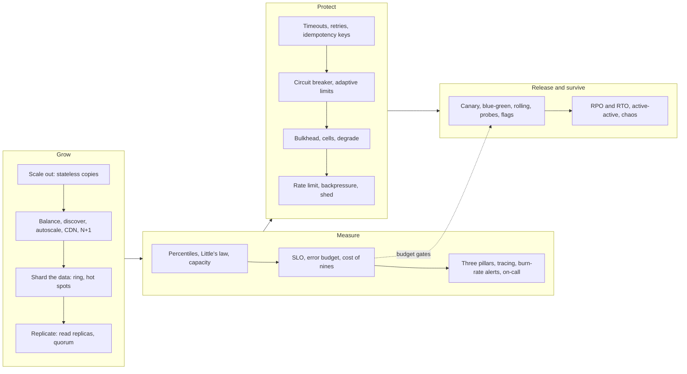

## The map in words

Read the picture from left to right. First you grow: copies of a stateless service, then the data split into shards, then copies of each shard. Then you measure, because growth without numbers is guessing: the tail latency, a target, alerts on what users feel. Then you protect each call, so one slow dependency cannot take the whole service down. Last you release and survive: ship in small steps, and practise losing a region before it happens. The dotted arrow is the link that matters most: the error budget decides how fast you may release.

The protection stack has a mnemonic: **TRIBE**. Timeouts, Retries with backoff, Idempotency, Breakers, bulkhEads.

---

## Scale out: stateless copies behind a balancer

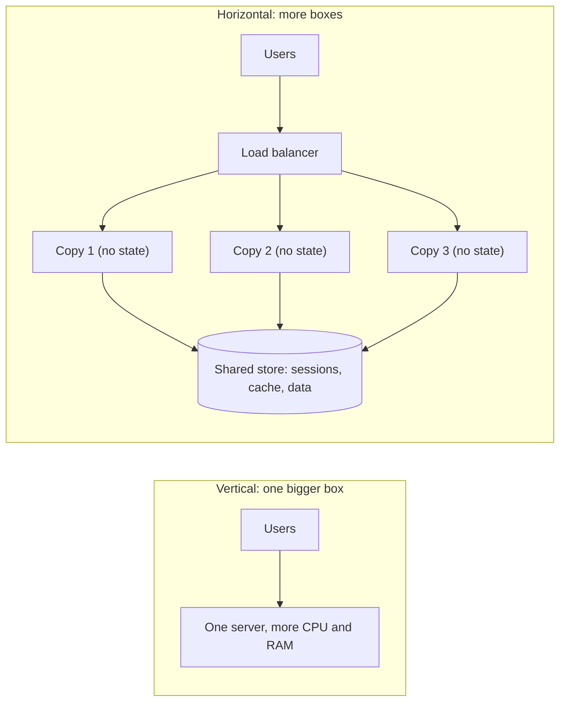

**The story.** An MCP (Model Context Protocol) proxy forwards agent queries to a graph database. On day one it runs as one process. Then a hundred agents arrive at once. Because the proxy holds no session, the team starts three copies behind a balancer, and any copy can answer any call.

**How it works.**

1. Vertical scaling adds CPU, RAM or disk to one machine. It needs no code change, and it works far longer than people think. Stack Overflow ran on a handful of big boxes.
2. Horizontal scaling adds machines. It needs the service to be stateless first.
3. Stateless means the copy keeps nothing between requests. Sessions, caches and data move to a shared store.
4. A load balancer spreads requests. L4 (transport layer) balances TCP connections by address and port. L7 (application layer) reads the HTTP request and can route by path, header or cookie.
5. The balancer picks a copy: round robin, least connections, weighted, or "power of two choices" (pick two at random, send to the less busy one).
6. Autoscaling adds or removes copies on a metric such as queue depth, with a cool-down so it does not flap.

### In code

```text
on request r from agent a:
  c1, c2 = two random copies
  c = c1 if c1.inFlight <= c2.inFlight else c2   # power of two choices
  s = store.get(a)          # the session lives in the shared store, never in c's RAM
  if s is missing: reply 401 "who are you?"
  reply c.handle(r, s)
every 30 s, the autoscaler:
  depth = waiting requests / copies
  if now - lastChange < 5 min: return            # cool-down
  if depth > 20: copies += 1; lastChange = now
  if depth < 5 and copies > 1: copies -= 1; lastChange = now
```

```go
// PickOfTwo is "power of two choices": of two random copies, take the less busy.
func PickOfTwo(c1, c2 *Copy) *Copy {
	if c1.InFlight <= c2.InFlight {
		return c1
	}
	return c2
}

// Tick runs every 30 seconds.
func (a *Autoscaler) Tick(now time.Time, waiting int) (float64, string) {
	depth := float64(waiting) / float64(a.Copies)
	if now.Sub(a.LastChange) < 5*time.Minute {
		return depth, "cool-down: wait"
	}
	if depth > 20 {
		a.Copies++
		a.LastChange = now
		return depth, "add a copy"
	}
	if depth < 5 && a.Copies > 1 {
		a.Copies--
		a.LastChange = now
		return depth, "remove a copy"
	}
	return depth, "hold"
}
```

Run it: `handbook/code/12-scale-out/` with `go run .` It prints the pick (copy 3, with 4 in flight against 12), the cool-down that holds a remove at depth 4.3, and the 401 from a copy that never saw the login.

**What goes wrong.** Hidden state. An in-memory cache, a local file or a sticky connection works fine until the second copy starts. Then a user logs in on copy 1 and is a stranger on copy 2. The fix is to move the state out, not to add sticky sessions, which hide the state and defeat even spreading.

**Where you use it.**

- An EVM indexer that walks blocks in ranges scales out: one worker per range, a dead worker's range is re-queued.
- A graph database with the hot set in RAM scales up: a bigger box with more page cache beats a cluster for read-heavy traversal.
- Scale an I/O-bound service on queue depth, never on CPU.

> I make the service stateless first, then add copies behind a balancer, and I keep vertical scaling on the table because a bigger box is often cheaper than a redesign.

▶ Watch it move: [Scale out](visual/12-scale-out.html)

---

## Load balancing: L4, L7 and the picking rules

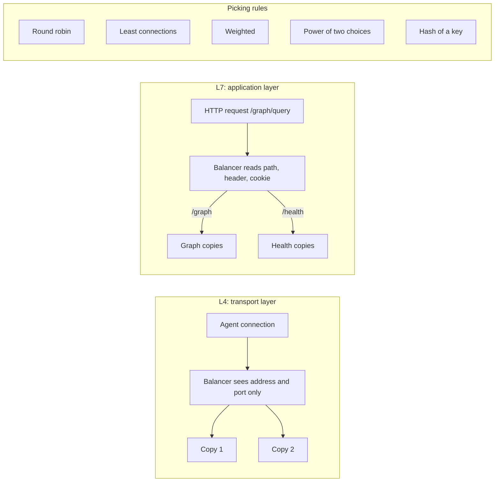

**The story.** Three copies of an MCP (Model Context Protocol) proxy sit behind a balancer. Most agent queries take milliseconds. A few graph walks take seconds. With round robin, one copy gets three long walks in a row and its queue grows, while the others idle. Switching the rule to least connections, or power of two choices, sends new queries to the copy that is actually free.

**How it works.**

1. An L4 (transport layer) balancer forwards TCP (Transmission Control Protocol) connections. It sees only addresses and ports. It is fast and cheap, and cannot read the request.
2. An L7 (application layer) balancer ends the HTTP connection and reads the request. It can route by path, header or cookie, retry, and terminate TLS (Transport Layer Security).
3. Round robin hands requests out in turn. Fine when every request costs the same.
4. Least connections sends to the copy with the fewest open requests. Better when request cost varies.
5. Weighted rules give a bigger copy a bigger share.
6. Power of two choices picks two copies at random and sends to the less busy one. Almost as good as checking all, far cheaper at scale.
7. Hashing a key (user id, address) always sends the same key to the same copy. Good for caches, bad when one key is hot.

### In code

```text
roundRobin: c = copies[next mod len(copies)]; next += 1
leastConnections:
  best = first copy
  for each other copy: if c.open < best.open: best = c
weighted:
  each copy: score += weight; total += weight
  c = the highest score
  c.score -= total
powerOfTwo(a, b): two random copies
  c = a if a.open <= b.open else b
byHash(key): copies[hash(key) mod len(copies)]
l4Connect(calls):       # L4 sees only addresses and ports
  conn = leastConnections()  # decided once, at connect time
  every call rides conn: conn.open += calls
l7Calls(calls):         # L7 reads each request
  for each call:
    leastConnections().open += 1  # decided again per call
```

```go
func (r *RoundRobin) Pick(cs []*Copy) *Copy {
	c := cs[r.next%len(cs)]
	r.next++
	return c
}

func LeastConnections(cs []*Copy) *Copy {
	best := cs[0]
	for _, c := range cs[1:] {
		if c.Open < best.Open {
			best = c
		}
	}
	return best
}

func Weighted(cs []*Copy) *Copy {
	total := 0
	var best *Copy
	for _, c := range cs {
		c.cur += c.Weight
		total += c.Weight
		if best == nil || c.cur > best.cur {
			best = c
		}
	}
	best.cur -= total
	return best
}

func PowerOfTwo(a, b *Copy) *Copy {
	if a.Open <= b.Open {
		return a
	}
	return b
}

func ByHash(cs []*Copy, key string) *Copy {
	h := fnv.New32a()
	h.Write([]byte(key))
	return cs[h.Sum32()%uint32(len(cs))]
}

func L4Connect(cs []*Copy, calls int) *Copy {
	conn := LeastConnections(cs)
	conn.Open += calls
	return conn
}

func L7Calls(cs []*Copy, calls int) {
	for i := 0; i < calls; i++ {
		LeastConnections(cs).Open++
	}
}
```

Run it: `handbook/code/12-load-balancing/` with `go run .` prints each pick: round robin going 1, 2, 3, 1 and blind to load, least connections choosing copy 3 at 8, 2 and 1 open, weights 1, 2, 1 giving 1, 2 and 1 calls, power of two choosing copy 3, hash(0x4a) mod 3 giving copy 3, then one L4 connection with 1000, 0, 0 against L7 with 3, 3, 3.

**What goes wrong.** Long-lived connections behind an L4 balancer. A gRPC (Google remote procedure call) client opens one HTTP/2 connection and sends every call down it. The L4 balancer balanced the connection once, so one copy gets all the load and new copies get none. The fix is an L7 balancer that balances each request, or client-side balancing across all copies.

**Where you use it.**

- An L7 ingress such as Traefik or NGINX in front of HTTP services, routing by path.
- An L4 load balancer in front of a database proxy or a TCP service, where reading the request adds nothing.
- Least connections or power of two choices for a proxy whose queries vary from milliseconds to seconds.

> L4 balances connections and is fast, L7 reads each request and can route and retry, and when request cost varies I use least connections or power of two choices instead of round robin.

▶ Watch it move: [Load balancing](visual/12-load-balancing.html)

---

## Service discovery: find the copies that are alive right now

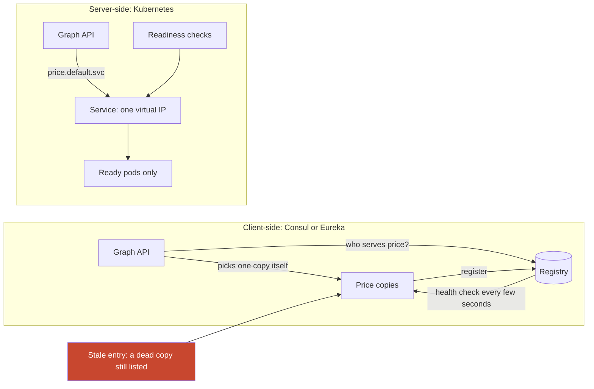

**The story.** The graph API calls the price service. The price service runs three copies, and every deploy gives them new IP addresses. A list of addresses in the graph API's config would be wrong by the next morning. So copies register with a registry, the registry checks their health, and the graph API asks "who serves price?" at call time.

**How it works.**

1. Each copy registers its name and address when it starts: price service at 10.0.0.11.
2. The registry calls each copy's health endpoint every few seconds and removes a copy that stops answering.
3. Client-side discovery: the client asks the registry for the list and picks a copy itself. Consul and Netflix Eureka work this way.
4. Server-side discovery: the client calls one stable name. In Kubernetes, DNS (Domain Name System) turns `price.default.svc` into a Service's virtual IP, and the Service forwards to a pod whose readiness check passes.
5. On a graceful shutdown, the copy deregisters before it exits, so no new calls reach it.
6. Clients may cache the list, but only for seconds, and retry another copy when a connection is refused.

### In code

```text
shutdown hook: deregister("price", addr)   # before exit
every 5 s, for each row:
  if checks are off: skip
  if the copy answers: misses = 0 else: misses += 1
  if misses >= 2: delete the row
client list():
  if now - cachedAt < ttl: return cache
  l, ok = lookup("price")
  if ok: cache = l          # down: keep the last list
  return cache
client call():
  addr = next address in list (round robin)
  if refused and retry: expire cache, refresh, try next
  if refused: wait the 2 s timeout, fail
  if another service answers: wrong answer
  else: ok
```

```go
func (r *Registry) Deregister(service, addr string) {
	r.Rows[service] = slices.DeleteFunc(r.Rows[service], func(e *Entry) bool { return e.Addr == addr })
}

func (r *Registry) HealthCheck(service string, net map[string]*Copy) {
	if !r.Checks {
		return // turned off: dead copies stay listed
	}
	r.Rows[service] = slices.DeleteFunc(r.Rows[service], func(e *Entry) bool {
		if c := net[e.Addr]; c != nil && c.Alive && c.Service == service {
			e.Misses = 0 // answered
		} else {
			e.Misses++ // no answer
		}
		return e.Misses >= r.MaxMiss
	})
}

func (c *Client) List(r *Registry, now int) []string {
	if c.Cache != nil && now-c.CachedAt < c.TTL {
		return c.Cache // trust the cache
	}
	if l, ok := r.Lookup("price"); ok {
		c.Cache, c.CachedAt = l, now
	}
	return c.Cache // registry down: keep the last known list
}

func (c *Client) Call(r *Registry, net map[string]*Copy, now int) string {
	list := c.List(r, now)
	for try := 0; try < len(list); try++ {
		addr := list[c.next%len(list)]
		c.next++
		cp := net[addr]
		switch {
		case cp == nil || !cp.Alive:
			if !c.Retry {
				return "timeout (2 s) at " + addr
			}
			c.CachedAt = now - c.TTL // refused: expire the cache
			list = c.List(r, now)    // refresh, then try another copy
		case cp.Service != "price":
			return "wrong service at " + addr + ": " + cp.Service
		default:
			return "ok from " + addr
		}
	}
	return "no copy"
}
```

Run it: `handbook/code/12-service-discovery/` with `go run .` prints the registry list after each health check, then 3 of 9 calls failing on the stale entry (timeout, then the labels service at the reused address), and 0 of 9 after the fix and while the registry is down.

**What goes wrong.** A stale entry. A copy is killed without deregistering, the health check is off or slow, and a client holds the list in a long cache. A share of calls go to the dead address and wait their full timeout. Worse, the platform can give that address to a different service, which then receives the calls. The fix is three layers: deregister on shutdown, health-check on a short interval, and keep client caches short with a retry on another copy.

**Where you use it.**

- Kubernetes Services for anything inside one cluster: the client knows a name and nothing else.
- Consul when services span clusters or virtual machines and need one registry.
- A service mesh such as Istio or Linkerd when you want discovery, retries and mutual TLS (Transport Layer Security) in a sidecar instead of in code.

> Service discovery keeps a live list of healthy copies, either in a registry the client asks or behind one stable service address, and health checks plus deregistration on shutdown stop traffic going to a dead copy.

▶ Watch it move: [Service discovery](visual/12-service-discovery.html)

---

## Sticky sessions: one client, always one copy

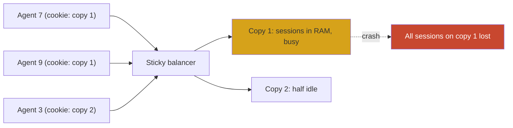

**The story.** A proxy keeps each agent's session in memory. When a second copy starts, agents get logged out half the time. The quick fix is session affinity: the balancer sets a cookie that pins each agent to one copy. It works until a busy agent pins a copy at full load, and until that copy is restarted by a deploy and every pinned agent loses its session at once.

**How it works.**

1. The first request reaches any copy. The copy creates a session in its own memory.
2. The balancer marks the client: a cookie naming the copy, or a hash of the client IP (Internet Protocol) address.
3. Every later request from that client goes to the same copy.
4. New copies only get new clients. Existing clients stay where they are.
5. When the pinned copy dies or is drained, its clients are moved and their sessions are gone.

### In code

```text
route(request):
  if request has a cookie: send to the copy it names   # load ignored
  c = least loaded copy that is up      # first request only
  set cookie = c on the reply; send to c
leastLoaded(copies): the up copy with the lowest load
ipHash(ip): copies[hash(ip) mod len(copies)]
handle(request) on copy c:
  c.load += request.cost
  if a shared store exists: found = store[agent]
  else: found = c.memory[agent]     # not found: logged out
restart(c): c.memory = empty        # its sessions are gone
soft(last):
  if last is up and last.load < 80%: use last   # warm cache
  else: leastLoaded(copies)
```

```go
func (b *Sticky) Route(r *Request) *Copy {
	if r.Cookie != "" {
		for _, c := range b.Copies {
			if c.Name == r.Cookie {
				return c // follow the cookie, whatever the load
			}
		}
	}
	c := LeastLoaded(b.Copies) // first request: pick once
	r.Cookie = c.Name          // and pin the agent to it
	return c
}

func LeastLoaded(cs []*Copy) *Copy {
	var best *Copy
	for _, c := range cs {
		if c.Up && (best == nil || c.Load < best.Load) {
			best = c
		}
	}
	return best
}

func IPHash(ip string, cs []*Copy) *Copy {
	h := fnv.New32a()
	h.Write([]byte(ip))
	return cs[h.Sum32()%uint32(len(cs))]
}

func (c *Copy) Handle(r *Request, store map[string]bool) bool {
	c.Load += r.Cost
	if store != nil {
		return store[r.Agent]
	}
	return c.Mem[r.Agent] // false: "who are you?", the agent is logged out
}

func (c *Copy) Restart() int {
	lost := len(c.Mem)
	c.Mem = map[string]bool{}
	return lost
}

func Soft(last *Copy, cs []*Copy, busy int) *Copy {
	if last != nil && last.Up && last.Load < busy {
		return last // warm cache
	}
	return LeastLoaded(cs)
}
```

Run it: `handbook/code/12-sticky-sessions/` with `go run .` prints the cookie pick, copy 1 at 120% while copy 2 sits at 20%, the whole office on copy 1, 800 of 800 logged out by the deploy, then 0 logged out with the shared store.

**What goes wrong.** Stickiness hides state instead of removing it. Load spreads by client, not by request, so one heavy client makes one hot copy. IP-based affinity sends a whole office behind one NAT (network address translation) address to one copy. A rolling deploy logs everyone out in waves. The fix is to move sessions to a shared store, such as Redis or a signed token the client carries, and turn stickiness off.

**Where you use it.**

- Acceptable as a cache-warmth hint: a client that returns to the same copy finds its data warm, but loses nothing if it moves.
- WebSocket connections are sticky by nature. Design them to reconnect to any copy and resume from shared state.
- Never as the only home of a login, a cart or a half-done workflow.

> Sticky sessions pin a client to one copy, which hides state and spreads load unevenly, so I use them at most as a cache hint and keep real session state in a shared store.

▶ Watch it move: [Sticky sessions](visual/12-sticky-sessions.html)

---

## Autoscaling and the cool-down: add copies on a signal

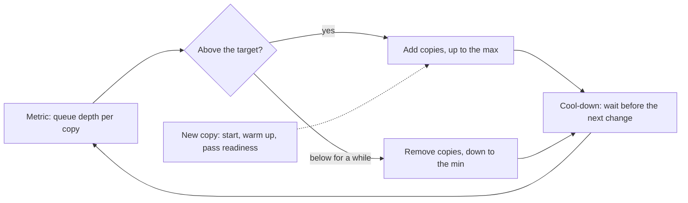

**The story.** A graph sync worker pool drains a queue of block ranges. At night the chain is quiet and two workers are enough. During a busy market hour the queue grows. An autoscaler watches queue depth per worker, adds workers when it climbs, and removes them when it falls. A cool-down stops it adding and removing workers every minute.

**How it works.**

1. Pick a metric that tracks the work: queue depth, requests in flight, or request rate. CPU only when the work is CPU-bound.
2. Set a target per copy, for example 20 items in the queue per worker.
3. When the metric stays above the target, the autoscaler adds copies, never beyond the max.
4. When it stays below, it removes copies, never below the min.
5. After each change it waits, the cool-down, so the new copies can start and the metric can settle.
6. A new copy is not useful until it has started, warmed up and passed its readiness check. That delay is the scale-up lag.

### In code

```text
desired(workers, metric):
  d = ceil(workers * metric / target)      # target 20 per worker
  return clamp(d, min 2, max 8)
every 30 s: tick(now, workers, metric):
  if now - lastChange < coolDown: keep workers   # 300 s
  want = desired(workers, metric)
  if want > workers:
    if above target for less than window: wait   # 60 s
    lastChange = now; return want
  if want < workers:
    if below target for less than downAfter: wait # 600 s
    lastChange = now
    if oneByOne: return workers - 1
    return want
  return workers
```

```go
func (s *Scaler) Desired(cur int, metric float64) int {
	d := int(math.Ceil(float64(cur) * metric / s.Target))
	return max(s.Min, min(s.Max, d))
}

func (s *Scaler) Tick(now, cur int, metric float64) int {
	if now-s.last < s.CoolDown {
		return cur // cool-down: let the last change show in the metric
	}
	want := s.Desired(cur, metric)
	switch {
	case want > cur:
		s.below = -1
		if s.above < 0 {
			s.above = now
		}
		if now-s.above < s.Window {
			return cur // maybe a blip: wait
		}
		s.last, s.above = now, -1
		return want
	case want < cur:
		s.above = -1
		if s.below < 0 {
			s.below = now
		}
		if now-s.below < s.DownAfter {
			return cur
		}
		s.last, s.below = now, -1
		if s.OneByOne {
			return cur - 1 // keep spares in case the burst comes back
		}
		return want
	}
	s.above, s.below = -1, -1
	return cur
}
```

Run it: `handbook/code/12-autoscaling/` with `go run .` prints each decision: wait at t=60 s, 2 to 4 workers at t=90 s, readings ignored in the cool-down until t=390 s, 4 to 3 at t=990 s, then CPU holding 2 workers while the queue reaches 60, the 2, 6, 2, 6 flapping and the 4 minutes of full queue after a spike.

**What goes wrong.** Two failures. Flapping: no cool-down and a tight target, so the pool grows and shrinks every minute and each start costs a warm-up. And the wrong metric: an I/O-bound proxy waiting on a database shows low CPU while its queue explodes, so a CPU autoscaler never adds a copy. The fixes: scale on queue depth or in-flight requests, add a cool-down longer than the warm-up, and keep a min large enough to survive the scale-up lag of a sudden spike.

**Where you use it.**

- Kubernetes HPA (Horizontal Pod Autoscaler) on a custom metric such as queue depth, through KEDA (Kubernetes Event-Driven Autoscaling).
- Scale-to-zero for batch workers, with the first job paying the start time.
- Never for a database primary: adding a copy of state is resharding, not autoscaling.

> I autoscale on the metric that tracks the work, usually queue depth, with a min that covers the start-up lag and a cool-down that stops flapping.

▶ Watch it move: [Autoscaling](visual/12-autoscaling.html)

---

## CDN and edge: answer close to the user

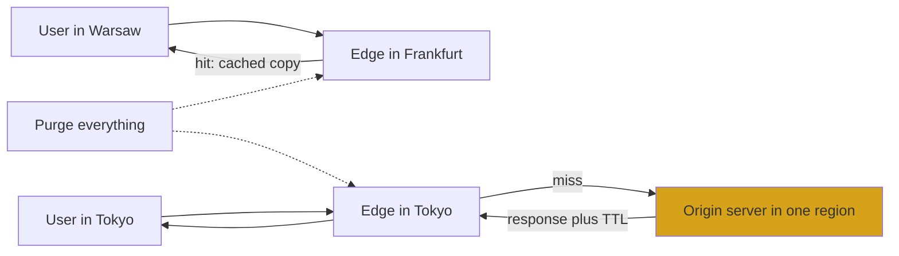

**The story.** A product website and its documentation are served from one origin in Europe. A launch post goes viral in Asia. Without a CDN (Content Delivery Network), every visitor crosses the world to the origin, and the origin falls over. With a CDN, edge servers in hundreds of cities keep copies, and the origin sees one request per page per edge instead of millions.

**How it works.**

1. DNS (Domain Name System) sends each user to the nearest edge server.
2. The edge checks its cache. A hit is answered at once, from a few milliseconds away.
3. A miss goes to the origin. The response comes back with a TTL (time to live), for example one hour.
4. The edge keeps the copy until the TTL ends, then asks the origin again.
5. A purge removes a copy early, when content changes.
6. Edge computing runs small pieces of code at the edge: redirects, auth checks, A/B choices, without a trip to the origin.

### In code

```text
get(path, user, now) at one edge:
  if path == "/help": return 301 to /docs     # edge function
  if a copy of path exists:
    if now < copy.expires: return copy           # hit
    if no refresh is running: start one refresh
    return copy                                  # stale
  return fetch(path)                             # miss
fetch(path):
  origin.calls += 1
  if not private and ttl > 0: store until now + ttl
purgeAll(): drop every copy
purge(path): copy.expires = 0   # keep it to serve stale
```

```go
func (e *Edge) Get(path, user string, now int) (string, string) {
	if path == "/help" {
		return "301 to /docs", "edge function" // code at the edge, no origin call
	}
	if c, ok := e.Cache[path]; ok {
		if now < c.Expires {
			return c.Resp.Body, "hit"
		}
		if !c.Refreshing {
			c.Refreshing = true // one request refreshes, the rest get stale
			e.fetch(path, user, now)
		}
		return c.Resp.Body, "stale"
	}
	r := e.fetch(path, user, now)
	return r.Body, "miss"
}

func (e *Edge) fetch(path, user string, now int) Response {
	e.O.Calls++
	r := e.O.Pages(path, user)
	if !r.Private && r.TTL > 0 {
		e.Cache[path] = &Entry{Resp: r, Expires: now + r.TTL}
	}
	return r
}

func (e *Edge) PurgeAll() { e.Cache = map[string]*Entry{} }

func (e *Edge) Purge(paths ...string) {
	for _, p := range paths {
		if c, ok := e.Cache[p]; ok {
			c.Expires = 0 // mark stale, keep the copy to serve meanwhile
		}
	}
}
```

Run it: `handbook/code/12-cdn-and-edge/` with `go run .` prints the origin call count after each request: 1 miss, then hits, 2 after Tokyo, still 2 after 1,000,000 viral hits, 3 after one stale refresh; then 6,000 misses (300% of the origin) after purge all, 10 refreshes after a narrow purge, and Ben seeing Ana's balance until the page is marked private.

**What goes wrong.** Two failures. A purge of everything at once: every edge misses at the same moment and the whole world hits the origin, a stampede. And a cached private response: a page with one user's data is cached and served to the next user. The fixes: purge by path or tag, stagger, and let the edge serve the stale copy while it refreshes. Mark personal responses `Cache-Control: private` and keep the cache key free of cookies unless the response varies by them.

**Where you use it.**

- Static files, images, documentation, the website: long TTL, versioned file names.
- Public, slow-changing API answers with a short TTL in front of an expensive origin.
- Edge functions for redirects and geo rules, never for anything that needs the database on every call.

> A CDN answers from an edge near the user and protects the origin, as long as I purge narrowly and never cache a response that belongs to one user.

▶ Watch it move: [CDN and edge](visual/12-cdn-and-edge.html)

---

## Redundancy and N+1: no single point of failure

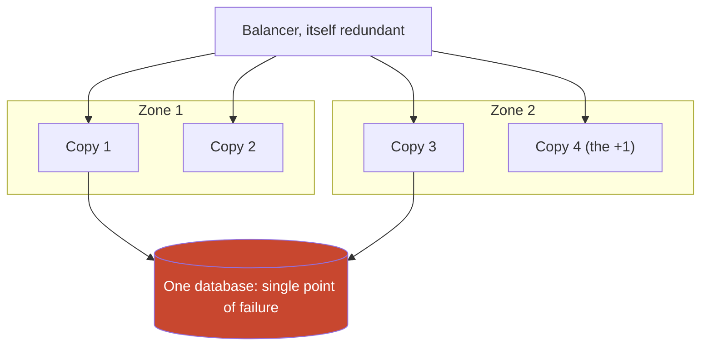

**The story.** A team runs four copies of an API because three can carry the peak. They call it N+1: N copies for the load, one spare. All four run in one zone, and they all read one database. A power fault in that zone takes all four down at once. The spare was real, but it shared the same failure domain, so it did not help.

**How it works.**

1. Find the single points of failure: anything that, alone, stops the service. One database, one balancer, one DNS (Domain Name System) provider, one secrets store, one person who knows the deploy.
2. Size for N, the copies the peak needs. Run N+1, so one can fail or be upgraded without overload.
3. Run N+2 when one copy is often down for maintenance while another fails.
4. Spread copies across failure domains: racks, zones, regions. A failure domain is a set of things that fail together.
5. Make the shared pieces redundant too: a database replica with failover, two balancers.

### In code

```text
load(copies, database):
  up = number of copies that are up
  if up == 0 or the database is down: nothing is served
  each copy carries N * 100 / up percent   # over 100%: overloaded
failDomain(domain):
  every copy in that zone or rack goes down together
roll(config, oneFirst):
  for each copy: apply config
    if it crashes and oneFirst: stop the roll
perZone(zones): ceil(N / (zones - 1))   # survive one zone
```

```go
func Load(cs []*Copy, dbUp bool) (int, int) {
	up := 0
	for _, c := range cs {
		if c.Up {
			up++
		}
	}
	if up == 0 || !dbUp {
		return up, -1 // nothing is served
	}
	return up, n * 100 / up
}

func FailDomain(cs []*Copy, domain string) {
	for _, c := range cs {
		if c.Zone == domain || c.Rack == domain {
			c.Up = false
		}
	}
}

func Roll(cs []*Copy, crashes bool, oneFirst bool) int {
	hit := 0
	for _, c := range cs {
		hit++
		if crashes {
			c.Up = false
			if oneFirst {
				return hit // watched it crash: stop the roll
			}
		}
	}
	return hit
}

func PerZone(zones int) int {
	return (n + zones - 2) / (zones - 1) // ceil(n / (zones-1))
}
```

Run it: `handbook/code/12-redundancy-n-plus-one/` with `go run .` prints the load per copy after each failure: 75%, 100%, 150% during an upgrade, nothing served with the one database down, 150% after a zone loss and the 3-zones-of-2 sizing, then 0 copies after a one-zone outage or a push to all, and 3 copies at 100% when the roll stops after one.

**What goes wrong.** Correlated failure. The spares share a zone, a power feed, a bad config push or a bug, so they fail together. N+1 inside one zone is N+0 against a zone outage. The fix is to spread copies across independent domains, roll config changes gradually so one bad push cannot reach every copy at once, and test by taking one domain away.

**Where you use it.**

- Kubernetes pod anti-affinity and topology spread across zones.
- A database with a replica in another zone and tested failover.
- Two serving lanes on separate machines: the second lane is the +1 for the whole stack.

> I size for N, run N+1 or N+2, and spread the copies across failure domains, because spares that fail together are not spares.

▶ Watch it move: [Redundancy and N+1](visual/12-redundancy-n-plus-one.html)

---

## Sharding and rebalancing: split the data by a key

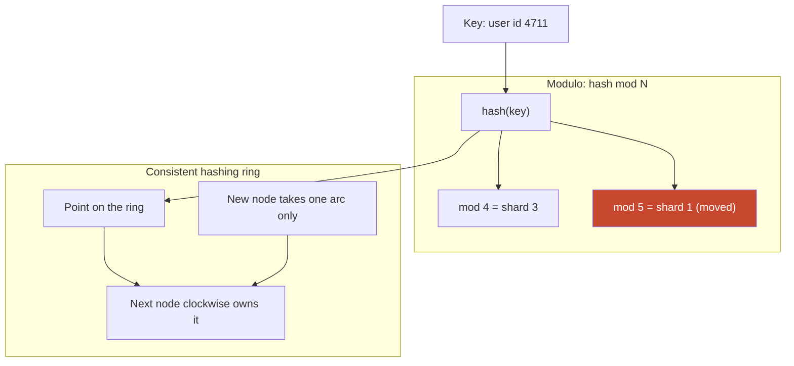

**The story.** A warehouse of user profiles outgrows one database. The team splits users across four shards by hashing the user id. A year later they add a fifth shard. With plain modulo, most users change shard overnight and the move takes days. With consistent hashing, only about one fifth move.

**How it works.**

1. Pick a shard key: the field most queries filter by, with an even spread.
2. Choose the split. Range: contiguous key ranges per shard. Hash: the hash of the key picks the shard. Directory: a lookup table says where each key lives. Geo: by the user's region.
3. With modulo, the shard is `hash mod N`. Change N from 4 to 5 and about four of every five keys land somewhere new.
4. With consistent hashing, keys and nodes sit on a ring. A key belongs to the next node clockwise. A new node takes one arc from one neighbour, about 1 over N of the keys.
5. Virtual nodes put each real node on the ring many times, so the arcs stay even.
6. A directory moves one key at a time. Shopify pods are a directory: shop to pod.

### In code

```text
modulo(h, n): return h mod n
owner(angle, ring):
  for each shard point p on the ring:
    d = (p.at - angle + 360) mod 360    # clockwise distance
  return the shard of the point with the smallest d
moved(before, after):
  count keys where before(key) != after(key)
arcs(ring): for each degree: arc[owner(degree)] += 1
load(ring, hot, split):
  each shard gets ordinary / shards       # 400 / 4 = 100
  if no hot key: return
  if not split: shard owner(hot) gets all of it  # +400
  else for each part: owner(part) gets hot / parts  # +100
```

```go
func Modulo(h, n int) int { return h % n }

func Owner(a int, ring []Point) int {
	best, dist := -1, 361
	for _, p := range ring {
		d := (p.At - a + 360) % 360
		if d < dist {
			best, dist = p.Shard, d
		}
	}
	return best
}

func Moved(before, after func(k int) int) int {
	n := 0
	for k := range hash {
		if before(k) != after(k) {
			n++
		}
	}
	return n
}

func Arcs(ring []Point, shards int) []int {
	arc := make([]int, shards)
	for a := 0; a < 360; a++ {
		arc[Owner(a, ring)]++
	}
	return arc
}

func Load(ring []Point, shards int, hot int, split []int) []int {
	load := make([]int, shards)
	for s := range load {
		load[s] = 400 / shards // the ordinary users, spread evenly
	}
	if hot < 0 {
		return load
	}
	if split == nil {
		load[Owner(angle[hot], ring)] += 400 // one key, one shard
		return load
	}
	for _, a := range split {
		load[Owner(a, ring)] += 400 / len(split) // key#0..key#3 on four shards
	}
	return load
}
```

Run it: `handbook/code/12-sharding-and-rebalance/` with `go run .` prints 10 of 12 users moved with modulo, 2 of 12 with the ring, the degrees each shard owns with one and two points, and requests per second per shard: 500 on the hot shard, still 480 after adding a shard, and 200 everywhere after the split.

**What goes wrong.** The hot shard. One key gets far more traffic than the rest: an exchange hot wallet in a transfer graph, a big chat channel. Adding nodes does not help, because the hot key still lands on one node. The fix is to split the key (key plus a suffix), cache the hot item, coalesce identical reads, or cap fan-out. A second trap: range sharding on time puts every new write on the last shard.

**Where you use it.**

- A warehouse partitioned by day of block time is range sharding. Old days are cold, today is hot, and that is fine for append-only data.
- A graph keyed by address hash is hash sharding. Range scans by address die, point reads stay fast.
- Discord's hot channels were fixed above the database, by coalescing reads.

> I shard on the key the queries use, I use consistent hashing so adding a node moves a slice instead of everything, and I fix a hot key by splitting or caching it, not by adding nodes.

▶ Watch it move: [Sharding and rebalancing](visual/12-sharding-and-rebalance.html)

---

## Consistent hashing and virtual nodes: the ring

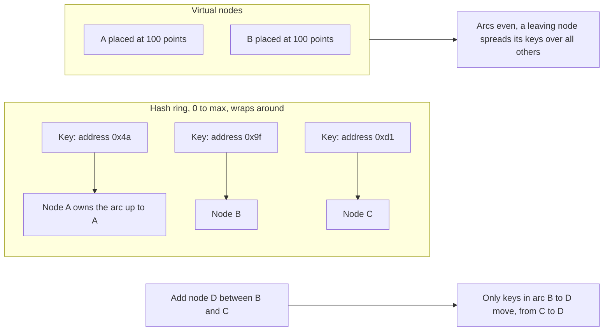

**The story.** A cache for graph lookups runs on three nodes. Each address is hashed to a point on a ring, and the next node clockwise owns it. A fourth node is added before a busy day. Only the addresses in one arc move to it, about a quarter. With plain `hash mod N`, about three quarters would have moved and the cache would have gone cold everywhere at once.

**How it works.**

1. Hash every node name to a point on a ring of numbers that wraps around.
2. Hash every key to a point on the same ring.
3. A key belongs to the first node clockwise from its point.
4. Adding a node takes over one arc, from one neighbour. About 1 over N of the keys move.
5. Removing a node hands its arc to the next node clockwise.
6. Virtual nodes place each real node at many points, often around a hundred. The arcs even out, and a leaving node spreads its keys over all the others instead of dumping them on one.
7. A bigger machine gets more virtual nodes: weighting for free.

### In code

```text
point: a node name and a place on the ring (0 to 359)
owner(key, ring):
  sort the points by place
  for each point: if point.at >= key: return its node
  return the first point's node        # wrap round
moved(before, after):
  for each key: if owner(key, after) != owner(key, before):
    moved += 1; to[new owner] += 1
count(ring): for each key: count[owner(key, ring)] += 1
without(ring, node): keep the points of every other node
a node with virtual nodes: many points with the same name
```

```go
type Point struct {
	Node string
	At   int
}

func Owner(key int, ring []Point) string {
	s := append([]Point{}, ring...)
	sort.Slice(s, func(i, j int) bool { return s[i].At < s[j].At })
	for _, p := range s {
		if p.At >= key {
			return p.Node
		}
	}
	return s[0].Node
}

func Moved(before, after []Point) (int, map[string]int) {
	to := map[string]int{}
	n := 0
	for _, k := range Keys {
		if o := Owner(k, after); o != Owner(k, before) {
			n++
			to[o]++
		}
	}
	return n, to
}

func Count(ring []Point) map[string]int {
	c := map[string]int{}
	for _, k := range Keys {
		c[Owner(k, ring)]++
	}
	return c
}

func Without(ring []Point, node string) []Point {
	out := []Point{}
	for _, p := range ring {
		if p.Node != node {
			out = append(out, p)
		}
	}
	return out
}
```

Run it: `handbook/code/12-consistent-hashing/` with `go run .` prints who owns each key and how many move: 2 of 16 when D joins (hash mod would move 13), A owning 13 of 16 with no virtual nodes, all 13 dumped on B when A fails, then 6 keys split 3 and 3 with four points per node.

**What goes wrong.** Without virtual nodes, three random points make very uneven arcs: one node can own half the ring. And when a node leaves, its whole arc lands on one neighbour, which can tip that neighbour over and cascade. The fix is many virtual nodes per real node. Consistent hashing also does nothing for a hot key: one key still lands on one node.

**Where you use it.**

- Cassandra and DynamoDB place partitions on a ring with virtual nodes.
- Memcached clients and many proxies use a ring to pick a cache node.
- Rendezvous hashing is a rival with the same goal: each key picks the node with the highest hash of key plus node.

> Consistent hashing puts keys and nodes on a ring so a new node takes one arc instead of reshuffling everything, and virtual nodes keep the arcs even and spread a leaving node's keys.

▶ Watch it move: [Consistent hashing](visual/12-consistent-hashing.html)

---

## Hot spots: one key gets the traffic

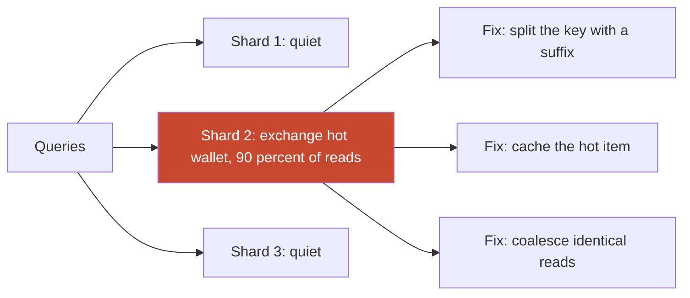

**The story.** A transfer graph is sharded by address. Most addresses have a handful of transfers. One exchange hot wallet has millions, and every analyst opens it. The shard that holds it runs hot while the others idle. Adding shards does nothing, because the one hot address still lives on one shard.

**How it works.**

1. Measure load per key and per shard, not only the total. A hot spot hides in an average.
2. Split a hot write key: append a suffix, `wallet#0` to `wallet#9`, so writes land on ten shards. Readers read all ten and merge.
3. Cache a hot read: put the answer in front of the shard, with a short TTL (time to live).
4. Coalesce identical reads: when a thousand callers ask the same question at once, send one query and share the answer.
5. Cap fan-out: page a walk through a hot node instead of loading every link.
6. For time-ordered data, avoid a key that puts every new write on the last range: prefix with a hash, or accept it for append-only data.

### In code

```text
shard(key, n): hash(key) mod n, numbered 1 to n
reads(n, reaching):
  each shard gets ordinary / n
  shard("0x4a", n) also gets what reaches it
cache get(now, ttl):
  if now < expires: answer from cache     # shard not asked
  queries += 1; expires = now + ttl
coalesce(asks):
  if no query is in flight: run one query
  everyone shares its answer
splitWrites(key, parts, writes, n):
  for p in parts: s = shard(key#p, n)
    load[s] += writes / parts
    where[s] += p       # a read of key visits every part
```

```go
func Shard(key string, n int) int {
	h := fnv.New32a()
	h.Write([]byte(key))
	if s := int(h.Sum32() % uint32(n)); s != 0 {
		return s
	}
	return n
}

func Reads(n, reachShard int) []int {
	load := make([]int, n+1)
	for s := 1; s <= n; s++ {
		load[s] = ordinary / n
	}
	load[Shard("0x4a", n)] += reachShard
	return load
}

func (c *Cache) Get(now, ttl int) {
	if now < c.Expires {
		return // a hit: the shard is not asked
	}
	c.Queries++
	c.Expires = now + ttl
}

func Coalesce(asks int) (queries, answered int) {
	inFlight := false
	for k := 0; k < asks; k++ {
		if !inFlight {
			inFlight = true // the first asker runs the query
			queries++
		}
		answered++ // everyone shares its answer
	}
	return queries, answered
}

func SplitWrites(key string, parts, writes, n int) ([]int, map[int][]int) {
	load := make([]int, n+1)
	where := map[int][]int{}
	for p := 0; p < parts; p++ {
		s := Shard(fmt.Sprintf("%s#%d", key, p), n)
		load[s] += writes / parts
		where[s] = append(where[s], p)
	}
	return load, where
}
```

Run it: `handbook/code/12-hot-spots/` with `go run .` prints reads per shard: 200, 1,400, 200 with the hot key, 10 of 360,000 asks reaching the shard with a cache, 1 query for 1,000 asks, the ten split parts, then 1,300 on one of six shards, all 1,300 rows on the today shard, and 370, 432, 498 with a hash prefix.

**What goes wrong.** Treating a hot spot as a capacity problem. The team adds nodes, the bill goes up, and the hot shard stays hot. The second trap is range sharding on time: every new row goes to today's shard, which runs at full load while old shards sleep. The fix is to name the hot key and change how that key is stored or read.

**Where you use it.**

- An exchange address in a graph: cap the walk and page its links.
- Discord fixed hot channels by coalescing reads above the database.
- A warehouse partitioned by day: today's partition is hot by design, which is fine for append-only writes.

> A hot spot is one key with far more traffic than the rest, so adding nodes does not help, and I fix it by splitting, caching or coalescing that key.

▶ Watch it move: [Hot spots](visual/12-hot-spots.html)

---

## Replication: copies for safety and for reads

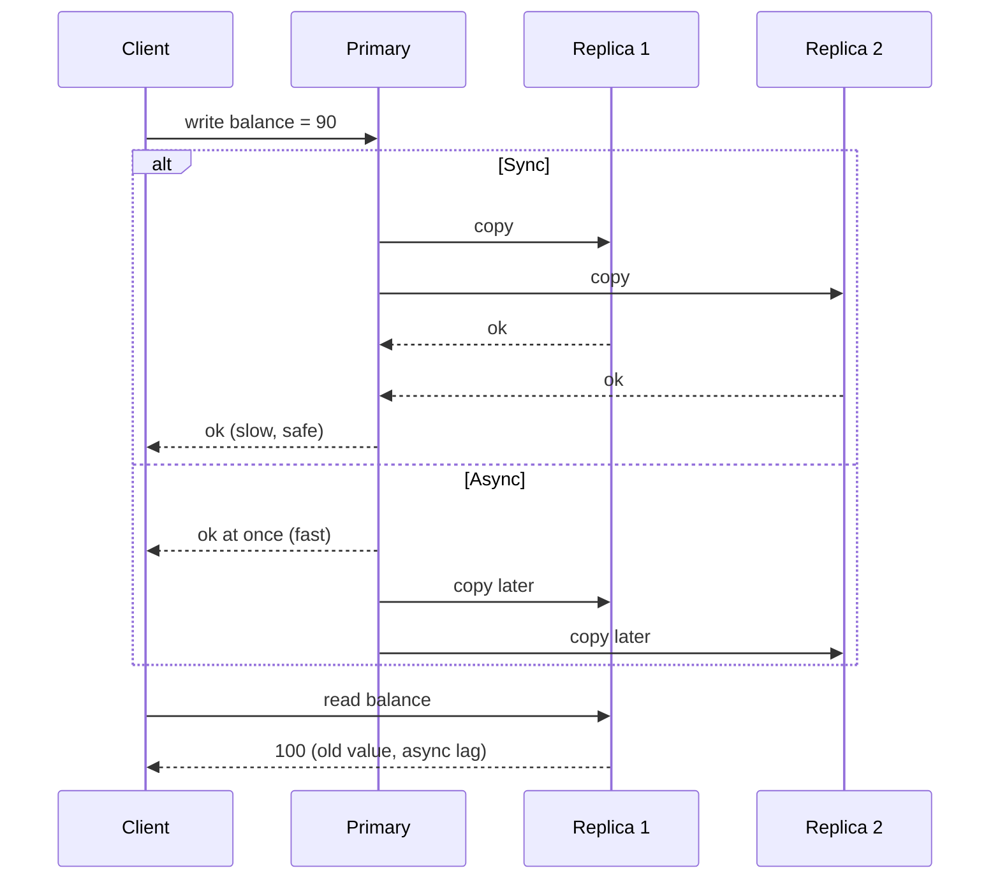

**The story.** A customer pays 10 and reloads the page. The write went to the primary. The read went to an async replica that has not caught up. The page still shows the old balance, and the customer pays again.

**How it works.**

1. Replication keeps copies of the same data on several nodes.
2. Sync: the write returns after every replica has it. Slow and safe.
3. Async: the write returns at once and replicas catch up. Fast, and the tail is lost on failover.
4. Semi-sync: at least one replica confirms. A middle point.
5. Quorum: with three copies, a write confirmed by two is safe from one failure.
6. Read replicas are async copies used only for reads. They take load off the primary.

### In code

```text
writeSync(balance):
  primary applies change at position + 1
  send it to every replica, wait for every ok
  answer after localDisk + the slowest replica
writeAsync(balance):
  primary applies change at position + 1
  add the change to the to-copy list
  answer after localDisk
catchUp(): every replica applies the to-copy list
read(sinceWrite, readYourWrite):
  if readYourWrite and sinceWrite < 5 s: read the primary
  else: read replica 1
failover():
  promote the replica with the highest position
  writes lost = primary.position - its position
```

```go
func (cl *Cluster) WriteSync(balance int) (waitMs int) {
	c := Change{cl.Primary.Pos + 1, balance}
	cl.Primary.Apply(c)
	for _, r := range cl.Replicas {
		r.Apply(c)
		waitMs = max(waitMs, r.Disk)
	}
	return localDisk + waitMs
}

func (cl *Cluster) WriteAsync(balance int) (waitMs int) {
	c := Change{cl.Primary.Pos + 1, balance}
	cl.Primary.Apply(c)
	cl.Pending = append(cl.Pending, c)
	return localDisk
}

func (cl *Cluster) CatchUp() {
	for _, c := range cl.Pending {
		for _, r := range cl.Replicas {
			r.Apply(c)
		}
	}
	cl.Pending = nil
}

func (cl *Cluster) Read(msSinceWrite int, readYourWrite bool) int {
	if readYourWrite && msSinceWrite < 5000 {
		return cl.Primary.Balance
	}
	return cl.Replicas[0].Balance
}

func (cl *Cluster) Failover() (*Node, int) {
	best := cl.Replicas[0]
	for _, r := range cl.Replicas[1:] {
		if r.Pos > best.Pos {
			best = r
		}
	}
	return best, cl.Primary.Pos - best.Pos
}
```

Run it: `handbook/code/12-replication/` with `go run .` prints the customer's wait and each copy's balance: 17 ms with sync, 2,005 ms with one slow disk (15 ms for a quorum), 5 ms with async, the stale 100 from replica 1, 90 from the primary with read-your-own-write, and 1 write lost at failover.

**What goes wrong.** Read-your-own-write. The customer above. The fix is to send a user's reads to the primary for a short time after their write, or to wait for the replica to reach the write's position. The second failure: failing over to an async replica loses the writes it never got.

**Where you use it.**

- A columnar warehouse with three replicas per tablet confirms a write by majority.
- Read replicas for dashboards, the primary for anything a user just changed.

> Sync replication trades write speed for no data loss, async trades the reverse, and with async I route a user's own reads to the primary right after they write.

▶ Watch it move: [Replication](visual/12-replication.html)

---

## Read replicas and replica lag: reads off the primary

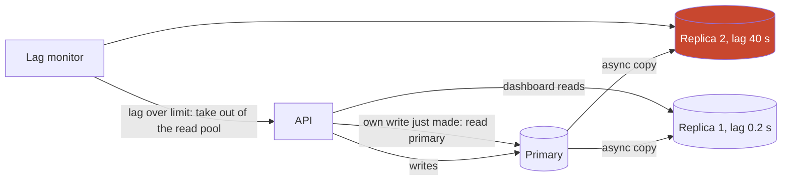

**The story.** An analytics API answers dashboards from the same database that takes writes. The dashboards are heavy, and writes slow down. The team adds two read replicas and sends dashboard reads to them. One night a big batch backfill makes replica 2 fall forty seconds behind, and a dashboard shows numbers that do not match the write the user just made.

**How it works.**

1. The primary takes every write and streams changes to the replicas.
2. Replicas apply the changes a little later. The gap is the replica lag, in seconds or in log position.
3. The application routes reads: heavy or tolerant reads to replicas, reads that must be fresh to the primary.
4. After a user writes, their reads go to the primary for a short time, or wait until the replica has reached the write's position.
5. A monitor watches each replica's lag. Over the limit, the replica leaves the read pool until it catches up.
6. Add replicas to scale reads. They do nothing for writes.

### In code

```text
lag(replica, written):
  0.2 s + (written - applied) rows / 1000 per second
tick(replica, written): applied = min(written, applied + rate)
route(sinceWrite):
  if the user wrote in the last 5 s: read the primary
  for each replica, round the list:
    if it is in the pool: read it
  pool is empty: read the primary
monitor(written):
  for each replica: inPool = lag(replica) <= 5 s
load(writes, dashboards, replicas):
  no replicas: primary = writes + dashboards
  else: primary = writes,
        each replica = writes + dashboards / replicas
```

```go
func (r *Replica) Lag(written int) float64 {
	return 0.2 + float64(written-r.Applied)/1000
}

func (r *Replica) Tick(written int) {
	r.Applied = min(written, r.Applied+r.Rate)
}

func (rt *Router) Route(sinceWrite float64) string {
	if sinceWrite < 5 {
		return "primary"
	}
	for range rt.Replicas {
		r := rt.Replicas[rt.next%len(rt.Replicas)]
		rt.next++
		if r.InPool {
			return r.Name
		}
	}
	return "primary"
}

func (rt *Router) Monitor(written int) {
	for _, r := range rt.Replicas {
		r.InPool = r.Lag(written) <= limit
	}
}

func Load(writes, dashboards, replicas int) (primary, each int) {
	if replicas == 0 {
		return writes + dashboards, 0
	}
	return writes, writes + dashboards/replicas
}
```

Run it: `handbook/code/12-read-replicas/` with `go run .` prints primary load falling from 90% to 30%, the read routing, replica 2 falling 40 s and 40,000 rows behind with no error, the monitor taking it out of the pool, and its return at t=207 s.

**What goes wrong.** Lag spikes are invisible without a monitor. A long query or a big write on the primary makes a replica minutes behind, and every read routed there returns old data with no error. Second: replicas scale reads only, so a write-heavy service gains nothing. The fixes: measure lag per replica and drop a lagging one from the pool, route read-your-own-write to the primary, and shard when the write load is the problem.

**Where you use it.**

- PostgreSQL or MySQL replicas behind a router such as PgBouncer or ProxySQL, with a lag limit.
- Reports and dashboards on replicas, the primary for anything a user just changed.
- A warehouse that serves reads from replicas of each tablet.

> Read replicas take read load off the primary, and because they lag, I monitor lag per replica, drop the slow ones from the pool, and send a user's own fresh reads to the primary.

▶ Watch it move: [Read replicas](visual/12-read-replicas.html)

---

## Semi-sync and quorum writes: wait for enough copies

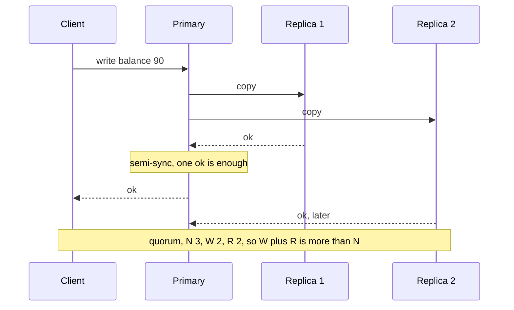

**The story.** A payment ledger cannot lose a write, and cannot wait for its slowest replica either. Full sync waits for every copy, so one slow disk stalls every payment. Full async answers at once, and a crash loses the tail. Semi-sync waits for one replica. A quorum system with three copies waits for two. Both survive one failure without waiting for the slowest copy.

**How it works.**

1. Semi-sync: the primary answers the client after at least one replica confirms it has the write.
2. If no replica confirms in time, MySQL semi-sync falls back to async. Watch for that.
3. Quorum: keep N copies. A write succeeds when W copies confirm. A read asks R copies and takes the newest.
4. With W plus R greater than N, every read set overlaps every write set, so a read sees the latest confirmed write.
5. A common choice is N 3, W 2, R 2: one copy can be down for writes and reads.
6. A majority write, W more than half of N, is what Raft and Paxos use to stay correct through a failure.

### In code

```text
semiWrite(balance):
  primary writes balance, sends copies
  fastest = the first confirmation time
  if fastest > timeout:     # 3,000 ms
    async = true            # no error, no sign
    answer ok, unconfirmed
  every replica gets the balance
  answer ok after fastest
promote():
  replica 1 becomes primary
  a write is lost if its balance differs
write(version, W, reach):
  for each copy in reach, if it is up:
    copy.version = version; acks += 1
  ok if acks >= W
read(ask):
  for each copy asked: newest = max(newest, its version)
  return newest
overlap(N, W, R):
  for every write set of W and read set of R:
    total += 1
    if the sets share a copy: shared += 1
```

```go
type Primary struct {
	Balance  int
	Async    bool // true after the silent fallback
	Replicas []*Replica
}

func (p *Primary) SemiWrite(balance int) (waitMs int, confirmed bool) {
	p.Balance = balance
	fastest := p.Replicas[0].AckMs
	for _, r := range p.Replicas {
		fastest = min(fastest, r.AckMs)
	}
	if fastest > timeoutMs {
		p.Async = true // no error, no sign to the client
		return timeoutMs, false
	}
	for _, r := range p.Replicas {
		r.Balance = balance // the slower one arrives moments later
	}
	return fastest, true
}

func (p *Primary) Promote() (int, bool) {
	return p.Replicas[0].Balance, p.Replicas[0].Balance != p.Balance
}

func Write(cs []*Copy, version, w int, reach ...int) bool {
	acks := 0
	for _, k := range reach {
		if cs[k].Up {
			cs[k].Version = version
			acks++
		}
	}
	return acks >= w
}

func Read(cs []*Copy, ask ...int) int {
	newest := 0
	for _, k := range ask {
		newest = max(newest, cs[k].Version)
	}
	return newest
}
```

Run it: `handbook/code/12-semi-sync-and-quorum/` with `go run .` prints the client told ok after 8 ms with nothing lost, then after the 3,000 ms timeout with no confirmation and 1 write lost at failover, then the quorum reads: v2 with W 2 and R 2 where 9 of 9 write and read sets share a copy, and v1 with W 1 and R 1 where only 3 of 9 do.

**What goes wrong.** Silent fallback. Semi-sync drops to async when replicas are slow, and nobody notices that writes are no longer protected until a failover loses them. In quorum systems, sloppy quorums and W 1 for speed break the overlap, and reads return old values. The fixes: alert on the fallback, keep W plus R above N for data that must be read fresh, and state which writes may be lost.

**Where you use it.**

- MySQL semi-sync replication for a primary with a failover replica.
- Cassandra and DynamoDB style stores, with consistency levels chosen per query.
- A warehouse with three replicas per tablet that confirms a write by majority.

> Semi-sync waits for one replica and a quorum waits for W of N copies, so with W plus R above N a read always overlaps the latest write without waiting for the slowest copy.

▶ Watch it move: [Semi-sync and quorum](visual/12-semi-sync-and-quorum.html)

---

## Latency percentiles and queueing: averages lie

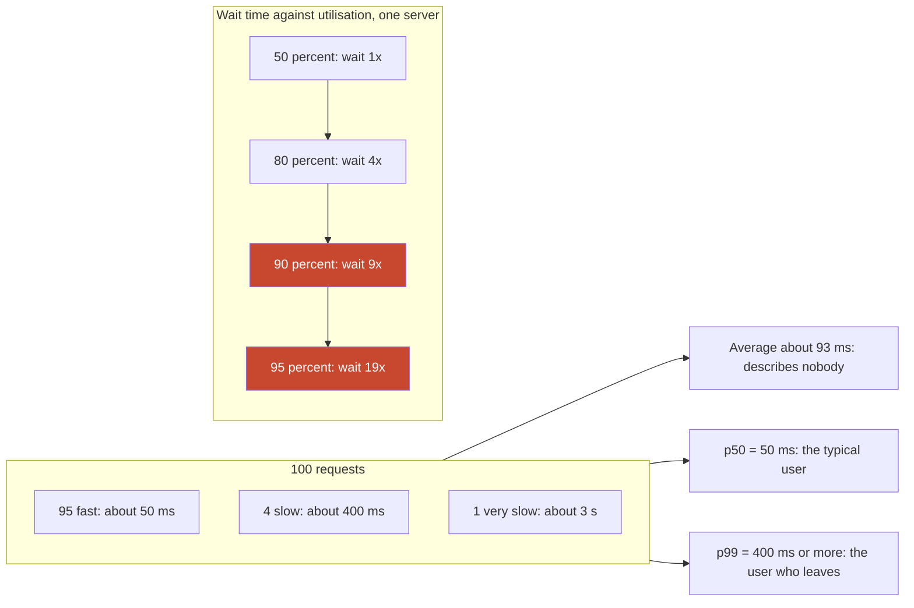

**The story.** A warehouse query has an average of 200 milliseconds. The dashboard is green. But one partition is cold and the p99 is 6 seconds. The agents that call it time out at 5 seconds. The users are angry, and the dashboard says all is well.

**How it works.**

1. Sort all request times. p50, the median, is the middle one: half are faster. p99 is the time that 99 out of 100 beat.
2. The average mixes a fast majority with a slow tail, and describes neither.
3. Fan-out makes the tail the normal case. A page that calls 100 backends, each slow 1 percent of the time, hits at least one slow backend in about 63 percent of page views.
4. Little's law: items in the system equal arrival rate times time in the system. With 100 requests per second each taking 0.2 seconds, 20 are in flight at once, so you need at least 20 slots.
5. Queueing: for random arrivals at one server, the wait grows like utilisation over one minus utilisation. At 50 percent it is one service time. At 80 percent, four. At 90 percent, nine. At 95 percent, nineteen.
6. The knee sits around 70 to 80 percent. Past it, a small spike makes a deep queue.

### In code

```text
average = sum(times) / 100           # pulled right by two slow ones
sorted = sort(times)
p50 = sorted[50th]                   # the typical user
p99 = sorted[99th]                   # the tail
allFast = 0.99 ^ backends            # fan-out: 0.99 ^ 100 = 37%
wait(u) = u / (1 - u)                # one server, in service times
for u in 50%, 70%, 80%, 90%, 95%:
  print wait(u)                      # 1, 2.3, 4, 9, 19
```

```go
func Percentile(t []int, p int) int {
	s := append([]int(nil), t...)
	sort.Ints(s)
	return s[len(s)*p/100-1]
}

func Wait(u float64) float64 { return u / (1 - u) }
```

Run it: `handbook/code/12-latency-percentiles-and-queueing/` with `go run .` It prints average 145 ms, p50 63 ms and p99 2,400 ms, the 2 requests past the 2 s timeout, 63 percent of pages hitting a slow backend with 100 backends, and the wait at 50 to 95 percent busy: 1.0, 2.3, 4.0, 9.0 and 19.0 service times.

**What goes wrong.** A dashboard that shows only the average, and a database run at 90 percent CPU "with 10 percent headroom". Its queue is already nine times deeper than at half load. The fixes: report p50, p95 and p99; keep steady load at 50 to 70 percent; and collect histograms and merge them, because a p99 of p99s is not a p99.

**Where you use it.**

- A graph sync pushed a database to 90 percent and the reads behind it went from about 100 milliseconds to seconds. Taking load off made latency fall several times over.
- Google's tail-at-scale idea: a hedged request sends the same read to a second replica after the p95 wait and takes the first answer.

> I read p99, not the average, because the tail is what users feel, and I keep utilisation below the knee, because past about 80 percent the queue explodes.

▶ Watch it move: [Latency percentiles and queueing](visual/12-latency-percentiles-and-queueing.html)

---

## Little's law: how many are in flight

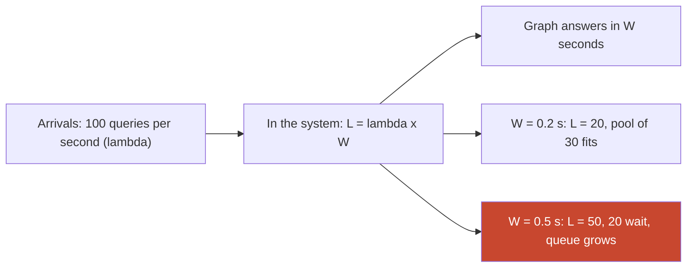

**The story.** An MCP (Model Context Protocol) proxy sends 100 agent queries a second to a graph database through a pool of 30 connections. Each query takes 0.2 seconds, so about 20 are in flight and the pool has room. Then a heavy sync slows the graph to 0.5 seconds per query. Agents keep sending 100 a second. Now 50 want a connection, 20 wait, and the waiting makes every query slower still.

**How it works.**

1. λ (lambda) is the arrival rate: queries per second.
2. W is the time one item spends inside the system, waits included.
3. L is how many items are inside at one moment.
4. Little's law: L = λ × W. 100 per second times 0.2 seconds is 20 in flight.
5. It works in any direction. The most a pool can serve is its size divided by W: 30 connections at 0.2 seconds serve at most 150 a second.
6. It holds for any stable system, whatever the arrival pattern, which makes it the first sizing tool.

### In code

```text
inFlight(lambda, W) = lambda * W        # Little's law: L = λ × W
maxRate(slots, W)  = slots / W          # the law turned round

proxy, each second:
  served = maxRate(pool, W)            # 30 / 0.2 s = 150, 30 / 0.5 s = 60
  waiting = waiting + arrivals - served
  if waiting < 0: waiting = 0
  if waiting > cap:                    # cap the queue
    refused = refused + waiting - cap  # fast error, not a place in line
    waiting = cap
```

```go
func InFlight(lambda, w float64) float64 { return lambda * w }

func MaxRate(slots int, w float64) float64 { return float64(slots) / w }

func (p *Proxy) Second(lambda int, w float64) {
	served := int(MaxRate(p.Pool, w))
	p.Waiting += lambda - served // arrivals beyond what the pool serves wait
	if p.Waiting < 0 {
		p.Waiting = 0
	}
	if p.Cap >= 0 && p.Waiting > p.Cap {
		p.Refused += p.Waiting - p.Cap // refuse fast with a clear error
		p.Waiting = p.Cap
	}
}
```

Run it: `handbook/code/12-littles-law/` with `go run .` It prints 20 in flight with 10 spare, 100 writers for 50 blocks a second, the pool's ceiling of 150 then 60 a second, a queue with no cap growing 60, 100, 140, and the capped queue holding at 10 while 40 a second are refused.

**What goes wrong.** W grows and λ does not. A slow dependency raises L until it passes the pool size. The extra items wait, the wait adds to W, and when arrivals beat what the pool can serve the queue grows without a ceiling. The fix is to bound both sides: a timeout caps W, a concurrency cap with a short queue caps L, and extra work is refused fast.

**Where you use it.**

- Sizing a database connection pool or a goroutine worker pool from the p99 time, not the average.
- A Go indexer that must write 50 blocks a second at 2 seconds per write needs about 100 writes in flight.
- Reading a dashboard: throughput flat and in-flight doubled means latency doubled.

> Little's law says items in flight equal arrival rate times time in the system, so when a dependency slows and arrivals do not, in-flight work grows until it hits a limit, and I size pools and timeouts from that.

▶ Watch it move: [Little's law](visual/12-littles-law.html)

---

## Capacity planning: buy before the peak

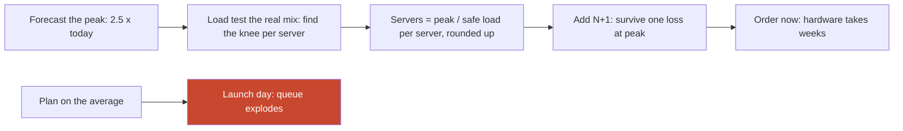

**The story.** A serving lane peaks at 120 query units a second on two servers. A token launch is coming that should bring two and a half times that: 300. A load test on the real query mix shows each server reaches its knee at 70 units, where p99 starts to climb. Five servers keep 300 below the knee, a sixth covers a failure, and the order goes in six weeks early because hardware takes weeks to arrive.

**How it works.**

1. Measure today's peak, not the daily average. Users feel the busiest minute.
2. Forecast the next peak with a written reason: the last launch, sign-ups, a campaign.
3. Load test one server with the real query mix. Raise the rate until p99 climbs steeply. That knee is the safe load, not the crash point.
4. Servers needed = forecast peak divided by safe load per server, rounded up.
5. Add N+1, so the peak still fits with one server lost. Critical systems use N+2.
6. Order with the lead time: buying, racking and testing a server takes weeks.

### In code

```text
peak = today's peak * growth           # 120 * 2.5 = 300, never the average
knee(test):                            # load test the real mix on one server
  for each step after the first:
    if crashed or p99 > 1.5 * previous p99: return previous rate
  return the last rate
servers(peak, knee):
  n = ceil(peak / knee)                # 300 / 70 -> 5
  while (n + spare - 1) * knee < peak: # N+1: fits with one lost?
    spare = spare + 1
orderBy = launchWeek - leadWeeks       # week 6 - 4 = week 2
```

```go
func Knee(test []Step) int {
	knee := test[0].Rate
	for i := 1; i < len(test); i++ {
		if test[i].Broken || test[i].P99*2 > test[i-1].P99*3 {
			return knee
		}
		knee = test[i].Rate
	}
	return knee
}

func Servers(peak, knee int) (n int, spare int) {
	n = (peak + knee - 1) / knee // round up
	for (n+spare-1)*knee < peak {
		spare++ // N+1: the peak must fit with one server down
	}
	return n, spare
}
```

Run it: `handbook/code/12-capacity-planning/` with `go run .` It prints the 300-unit forecast, the knee at 70 per server, 5 servers plus 1 spare (4 x 70 = 280 is short), the order-by week 2, and the average team's 160 units over and servers landing in week 10.

**What goes wrong.** Planning on the average, testing one query type with a warm cache, and calling the crash point "capacity". On launch day the real peak lands far past the real knee, the queue explodes, agents retry and add more load. Hardware ordered that day arrives after the launch. The fix is the list above: peak, real-mix test to the knee, headroom, a spare, and an early order.

**Where you use it.**

- Sizing StarRocks backends or graph replicas for a lane before a launch.
- A quarterly review of the growth trend against the lead time for new servers.
- Cloud autoscaling shortens lead time but has limits too: quotas, warm-up, and a database that does not autoscale.

> I plan capacity on the forecast peak, measure each server's safe load at the knee with a real-mix load test, keep the peak below it with one spare, and order early enough for the lead time.

▶ Watch it move: [Capacity planning](visual/12-capacity-planning.html)

---

## Histograms: merge the buckets, never average percentiles

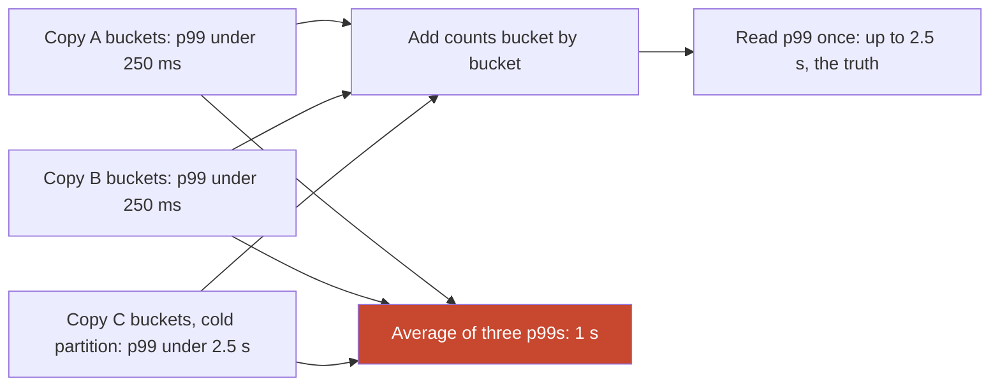

**The story.** Three copies of an MCP proxy each serve 1,000 queries. Copies A and B have a p99 under 250 milliseconds. Copy C sits in front of a cold partition and one query in ten takes over a second, so its p99 is 2.5 seconds. A dashboard averages the three p99s and shows 1 second. Merging the bucket counts shows the truth: up to 2.5 seconds, because one query in thirty took over a second.

**How it works.**

1. Choose bucket edges: under 50 ms, under 100, under 250, under 500, under 1 s, under 2.5 s.
2. Each finished request adds 1 to the first bucket its time fits. A copy keeps only a few counters.
3. To read p99, count from the fast end until the running total passes 99 percent of all requests. That bucket holds p99.
4. To combine copies or time windows, add the counts bucket by bucket. Counts add up, so the merge is exact.
5. Read the percentile once, from the merged counts.

### In code

```text
observe(ms):                         # on every finished query
  bucket = first edge with ms <= edge  # 50, 100, 250, 500, 1k, 2.5k
  counts[bucket] = counts[bucket] + 1
merge(histograms):
  for each bucket: add the counts     # counts add up, so this is exact
quantile(q, h):
  target = ceil(q * total)            # 0.99 * 3,000 = 2,970
  run = 0
  for each bucket from the fast end:
    run = run + count
    if run >= target: return its edge
p99 = quantile(0.99, merge(A, B, C))  # never average three p99s
```

```go
func Merge(hs ...Hist) Hist {
	m := make(Hist, len(Edges))
	for _, h := range hs {
		for i, c := range h {
			m[i] += c
		}
	}
	return m
}

func Quantile(q float64, h Hist) int {
	total := 0
	for _, c := range h {
		total += c
	}
	target := int(q*float64(total) + 0.999999) // round up: the 990th of 1,000
	run := 0
	for i, c := range h {
		run += c
		if run >= target {
			return Edges[i]
		}
	}
	return Edges[len(Edges)-1]
}
```

Run it: `handbook/code/12-histograms/` with `go run .` It prints each copy's p99 (250, 250 and 2,500 ms), the merged true p99 of 2,500 ms against an average of 1,000 ms, and the next day where the average still says 1,000 ms but the merged p99 is 250 ms.

**What goes wrong.** Averaging percentiles. Each copy's p99 forgets how much traffic it served. The average can hide a slow tail, as above. When copy C serves only 100 queries the next day, its p99 is still 2.5 seconds and the average still says 1 second, but the merged p99 is under 250 milliseconds. Same average, opposite truth. The fix: export histograms, sum them, then compute the quantile. And put a bucket edge at the number you alert on, because a percentile from buckets is exact only to the bucket width.

**Where you use it.**

- Prometheus: `histogram_quantile(0.99, sum by (le) (rate(..._bucket[5m])))`, never `avg()` over a p99 series.
- HDR histograms and t-digests in load-test tools and services that need finer buckets.
- A latency SLO of 300 ms needs a bucket edge at 300 ms.

> I record latency as histograms and add the buckets across copies before reading p99, because an average of percentiles throws away how much traffic each copy served.

▶ Watch it move: [Histograms](visual/12-histograms.html)

---

## Hedged requests: a second copy after the slow wait

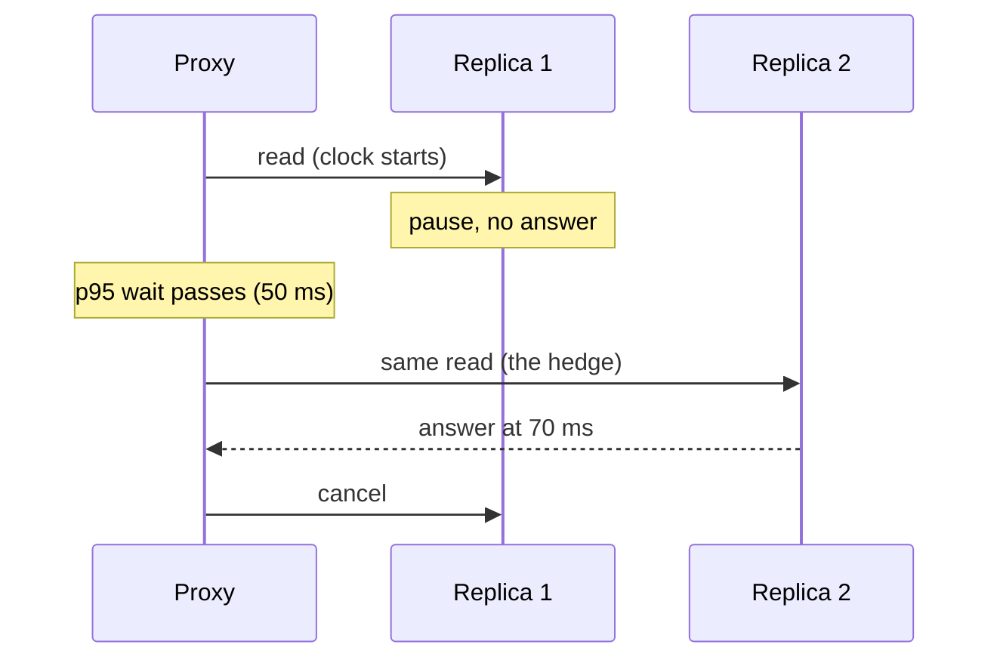

**The story.** An MCP proxy reads an address's links from one of two graph replicas. Most reads take about 20 milliseconds, and the p95 is 50. Now and then a replica pauses for garbage collection and a read takes seconds. The proxy waits 50 milliseconds, sends the same read to the other replica, takes whichever answer comes first, and cancels the other.

**How it works.**

1. Send the read to one replica and start a clock.
2. Wait about the p95 time: the time 95 of 100 reads beat.
3. If there is no answer yet, send the same read to a second replica. That is the hedge.
4. Return the first answer that arrives.
5. Cancel the losing request so it stops using work.
6. Only the slowest few percent get a hedge, so extra load stays near 5 percent while the tail falls toward the p95 time.

### In code

```text
read(req):
  send req to replica 1, start a clock
  if answered within 50 ms: return it        # the p95 wait
  if not idempotent(req): wait for replica 1 # never hedge a write
  if hedges >= 5% of reads + 1: wait          # the hedge budget
  hedges = hedges + 1
  send the same req to replica 2             # the hedge
  take the first answer                      # 50 + 20 = 70 ms
  cancel the loser
```

```go
func (p *Proxy) Read(first int, idempotent bool) (int, error) {
	p.Reads++
	if first <= hedgeAfter {
		return first, nil // answered before the p95 wait: no hedge
	}
	if !idempotent {
		return first, errors.New("not idempotent: never hedge, wait")
	}
	if float64(p.Hedges) >= p.Budget*float64(p.Reads)+1 { // +1 lets the first one through
		return first, errors.New("hedge budget spent: wait")
	}
	p.Hedges++                      // send the same read to replica 2
	second := hedgeAfter + replica2 // 50 + 20 = 70 ms
	if second < first {
		return second, nil // take the first answer, cancel replica 1
	}
	return first, nil // replica 1 won after all, cancel replica 2
}
```

Run it: `handbook/code/12-hedged-requests/` with `go run .` It prints p99 2,000 ms with no hedge, p99 70 ms with 5 hedges per 100 reads (5 percent extra load), 200 percent load when every read is hedged, and a label applied twice by a hedged write.

**What goes wrong.** Hedging everything at once. Every read runs twice, load doubles, replicas pass the knee, and the tail gets worse. When both replicas are slow for the same reason, such as a cold partition, the hedge only adds load. And a hedged write runs twice: a label added twice. The fix: hedge only idempotent reads, only after the p95 wait, under a budget that caps hedges at a few percent, and cancel the loser.

**Where you use it.**

- Google's tail-at-scale work: hedged reads in large fan-out back ends.
- Cassandra's speculative retry, which sends a second read after a percentile wait.
- A graph read fan-out where one slow shard makes the whole answer slow.

> A hedged request sends the same idempotent read to a second replica after the p95 wait and takes the first answer, cutting the tail for a few percent extra load, as long as I cap and cancel the hedges.

▶ Watch it move: [Hedged requests](visual/12-hedged-requests.html)

---

## Timeouts and retries: wait, back off, add jitter

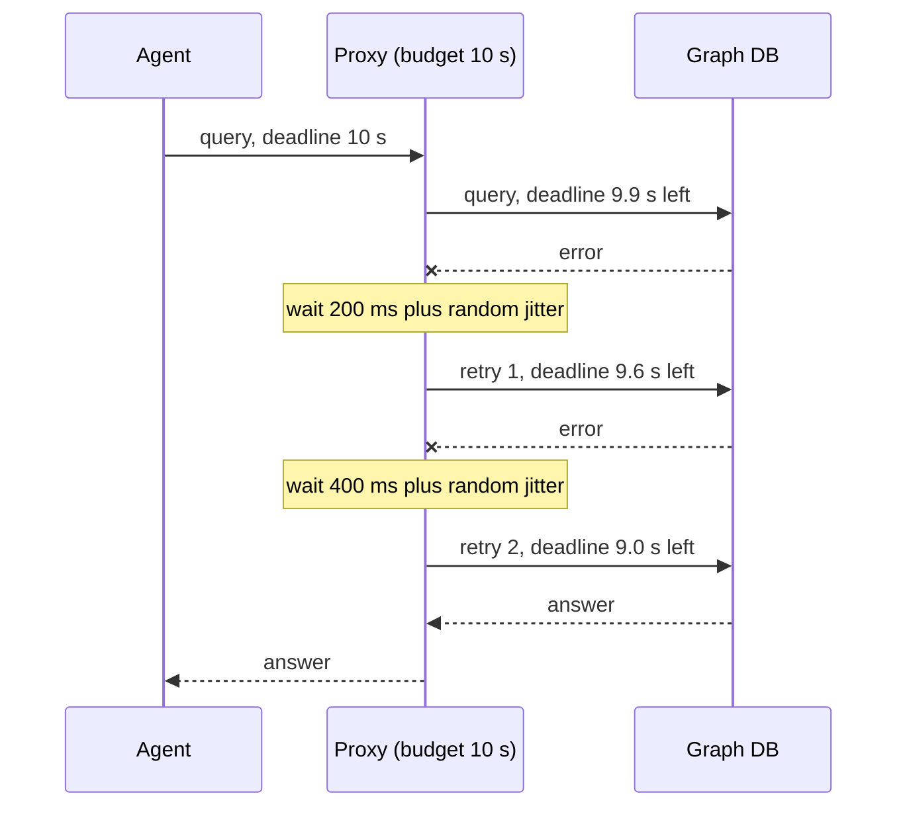

**The story.** An indexer calls a blockchain node. The node blips. Every worker times out after the same 2 seconds and retries at the same instant. The node, just recovering, gets a wall of calls and falls over again. Adding random jitter alone spreads the retries enough for the node to recover.

**How it works.**

1. Every call has a timeout. No call waits forever.
2. A deadline is a timeout that travels. The caller says "answer by 14:05:03.200", and each hop passes on what is left.
3. A failed call waits, then retries. The wait doubles each time: 200 ms, 400 ms, 800 ms. That is exponential backoff.
4. A random amount is added to each wait. That is jitter. It stops clients retrying in lockstep.
5. Retries stop at a cap (five tries) or when the deadline has no time left.
6. Only idempotent calls are retried: doing them twice has the same effect as once. A row keyed by transaction hash and log index can be inserted twice safely. A counter increment cannot.

### In code

```text
retry(req, deadline):
  for attempt = 0 .. maxTries-1:
    if now >= deadline: return "deadline spent, give up"
    ok = send(req, timeout 2 s)
    if ok: return the answer
    if not idempotent(req): return error   # never repeat a counter +1
    if this was the last try: stop
    wait = 200 ms * 2^attempt               # exponential backoff
    wait = wait + random(0, wait)           # jitter
    now = now + wait
  return "gave up after maxTries"
```

```go
func Backoff(attempt int, jitter time.Duration) time.Duration {
	wait := base << attempt // 200 ms, 400 ms, 800 ms
	return wait + jitter    // jitter is drawn from [0, wait)
}

func Retry(n *Node, deadline time.Duration, idempotent bool, jitter []time.Duration) (time.Duration, []time.Duration, error) {
	var now time.Duration
	var calls []time.Duration
	for attempt := 0; attempt < maxTries; attempt++ {
		if now >= deadline {
			return now, calls, errors.New("deadline spent: give up")
		}
		calls = append(calls, now)
		if err := n.Call(now); err == nil {
			return now, calls, nil
		}
		if !idempotent {
			return now, calls, errors.New("not idempotent: do not repeat")
		}
		if attempt == maxTries-1 {
			break
		}
		now += Backoff(attempt, jitter[attempt])
	}
	return now, calls, errors.New("gave up after max tries")
}
```

Run it: `handbook/code/12-timeouts-and-retries/` with `go run .` It prints the fixed-wait storm (all 5 calls at 0.00, 2.20 and 4.40 s, and 27 calls for one request through 3 layers), each worker's jittered calls (worker 2 answered at 2.10 s, worker 5 gives up at its 1.5 s deadline), and worker 4's counter at 2 instead of 1.

**What goes wrong.** The retry storm. Retries in every layer multiply: three layers with three tries each is 27 calls per user request. A downstream timeout longer than the upstream one means the callee keeps working after the caller gave up. The fixes: retry in one layer only, set a retry budget (for example at most 10 percent extra calls), make downstream timeouts shorter, and put a breaker on top.

**Where you use it.**

- A graph query with a 10-second budget: the proxy passes the remaining time to the database, so a slow query dies there instead of finishing an answer nobody will read.
- Payments: a client idempotency key turns a retried charge into one charge.

> Every call gets a timeout shorter than my own deadline, retries use exponential backoff with jitter in one layer only, and I retry only what is idempotent.

▶ Watch it move: [Timeouts and retries](visual/12-timeouts-and-retries.html)

---

## Idempotency keys: a retried charge is one charge

```mermaid
sequenceDiagram
  participant A as Agent
  participant API as Payment API
  participant K as Idempotency store
  participant L as Ledger
  A->>API: top up 10 USD, key K-7f3
  API->>K: insert K-7f3 (in progress)
  API->>L: charge 10 (same transaction)
  API->>K: K-7f3 done, receipt 881
  API--xA: receipt 881 (reply lost)
  A->>API: retry, same key K-7f3
  API->>K: K-7f3 found, done
  API-->>A: receipt 881 (no new charge)
```

**The story.** An agent tops up its subscription with 10 USD. The payment succeeds, but the reply is lost on the way back. The agent sees only a timeout and retries. Because the first call carried the key K-7f3, the API finds the key already done and returns the stored receipt. The ledger shows one charge.

**How it works.**

1. The client creates a random key for one logical action and sends it with the request.
2. The server inserts the key first, as "in progress", with a hash of the request body. The insert is unique.
3. The server does the effect, the charge, in the same transaction as the key.
4. It stores the response under the key and replies.
5. A retry with the same key finds "done" and gets the stored response. No second charge.
6. A retry that arrives while the first is still running finds "in progress" and is told to try again shortly.

### In code

```text
client: key = random()            # one key per action, reused on every retry
topUp(key, body):                  # all of it is one transaction
  e = store.insert(key)            # unique: finds the key if it is there
  if e exists:
    if e.bodyHash != hash(body): return 422 "key reused"
    if not e.done: return 409 "in progress"
    return e.receipt               # the stored answer, no new charge
  e = {in progress, hash(body)}
  ledger.charge(10 USD)
  e.done, e.receipt = true, receipt
  return receipt
```

```go
func (a *API) TopUp(key, body string) (int, string) {
	h := sha256.Sum256([]byte(body))
	if key != "" {
		if e, ok := a.Keys[key]; ok { // the unique insert finds the key
			switch {
			case e.BodyHash != h:
				return 0, "422: key reused for a different body"
			case !e.Done:
				return 0, "409: in progress, try again shortly"
			default:
				return e.Receipt, "stored receipt, no new charge"
			}
		}
		a.Keys[key] = &Entry{BodyHash: h} // in progress
	}
	a.Charges++ // write the charge to the ledger
	a.next++
	receipt := 880 + a.next
	if key != "" {
		a.Keys[key].Done, a.Keys[key].Receipt = true, receipt
	}
	return receipt, "charged"
}
```

Run it: `handbook/code/12-idempotency-keys/` with `go run .` It prints receipt 881 returned twice with one charge, the 409 for a retry in progress, 2 charges with no key and with the key saved after the charge, and the 422 for K-7f3 reused on a 50 USD body.

**What goes wrong.** No key: the retry charges twice. A key saved after the charge, in a separate step: a crash between the two leaves a charge with no key, and the retry charges again. A key reused for a different body: the old receipt comes back for a new action. The fix: key and effect in one transaction, a body hash checked on repeat, and keys kept longer than the longest retry window.

**Where you use it.**

- Payment APIs such as Stripe take an `Idempotency-Key` header and keep keys for about a day.
- A CLI top-up command that retries on timeout.
- An indexer insert keyed by transaction hash and log index is idempotent by its natural key, so it needs no extra key.

> The client sends one idempotency key per action and reuses it on retries, the server records the key with the effect in one transaction and returns the stored response for a repeat, so a retried charge is one charge.

▶ Watch it move: [Idempotency keys](visual/12-idempotency-keys.html)

---

## Circuit breaker: stop calling a sick service

```mermaid
stateDiagram-v2
  [*] --> Closed
  Closed --> Closed: success, or failures below threshold
  Closed --> Open: failures above threshold
  Open --> Open: calls fail fast, no network call
  Open --> HalfOpen: after a wait
  HalfOpen --> Closed: probe succeeds
  HalfOpen --> Open: probe fails
```

**The story.** A proxy calls a lane of the graph database. The lane starts returning errors. Without a breaker, every agent call waits for its full timeout, threads pile up, and the proxy itself stops answering. With a breaker, after five failures the proxy answers "lane unavailable" at once, and tries one probe call every 30 seconds.

**How it works.**

1. Closed: calls go through. The breaker counts failures in a rolling window.
2. Failures pass the threshold. The breaker trips to Open.
3. Open: calls fail at once, with no network call. The caller gets a fast error or a fallback.
4. After a wait, the breaker goes Half-open and lets one probe through.
5. The probe succeeds: back to Closed. The probe fails: back to Open, and the wait starts again.

### In code

```text
call(query, now):
  if state == open:
    if now - openedAt < 30 s: return fast error   # nothing reaches lane B
    state = half-open                             # let one probe through
  result = send(query, timeout 2 s)
  if ok: state = closed; failures = []; return answer
  if state == half-open:
    state = open; openedAt = now                  # probe failed: wait again
  failures.add(now); drop failures older than 10 s
  if count(failures) >= 5:
    state = open; openedAt = now                  # trip
```

```go
func (b *Breaker) Call(now time.Duration, laneOK bool) error {
	if b.State == Open {
		if now-b.openedAt < openFor {
			return ErrOpen // no call reaches lane B
		}
		b.State = HalfOpen // 30 s passed: let exactly one probe through
	}
	if laneOK {
		b.State, b.failures = Closed, nil // success closes and resets the count
		return nil
	}
	if b.State == HalfOpen {
		b.State, b.openedAt = Open, now // the probe failed: open again
		return errors.New("probe failed")
	}
	b.failures = append(b.failures, now)
	for len(b.failures) > 0 && now-b.failures[0] > window {
		b.failures = b.failures[1:] // drop failures older than the window
	}
	if len(b.failures) >= threshold {
		b.State, b.openedAt = Open, now // trip
	}
	return errors.New("timeout after 2 s")
}
```

Run it: `handbook/code/12-circuit-breaker/` with `go run .` It prints the timeline: failures 1 to 5 from 2 s to 10 s, the trip at 10 s, a fast error at 12 s, the failed probe at 40 s, a fast error at 50 s, the good probe at 71 s that closes the breaker, and the storm numbers (200 calls, 27 per request).

**What goes wrong.** No timeout under the breaker. Calls never fail, they just hang, so the breaker never trips. Second: one breaker for a whole service when only one endpoint is sick. Third: a threshold set once and never tuned, which is why Netflix retired Hystrix for adaptive concurrency limits. Without any breaker, clients keep hammering a dead service and the retry storm keeps it dead.

**Where you use it.**

- Netflix wrapped every remote call with a breaker and a fallback, such as popular titles when recommendations are down.
- A breaker per dependency and per endpoint in a Go service, under a timeout, above a bulkhead.

> A circuit breaker counts failures, fails fast while the dependency is sick, and sends one probe in half-open to find out when it is safe again, and it only works with a timeout under it.

▶ Watch it move: [Circuit breaker](visual/12-circuit-breaker.html)

---

## Adaptive concurrency limits: learn the limit from latency

```mermaid
stateDiagram-v2
  [*] --> Probe: start at a low limit
  Probe --> Probe: latency near baseline, add a little
  Probe --> Cut: latency over 2x baseline
  Cut --> Probe: limit halved, queue drains
  Probe --> Refuse: request above the limit
  Refuse --> Probe: refused at once, retry later
```

**The story.** An MCP proxy sends agent queries to a graph lane. On a quiet day the graph takes about 55 queries at once before it starts to queue. On a day with a heavy sync it takes about 25. A fixed limit of 100, chosen on a good day, lets 50 queries queue inside a busy graph, and everyone times out. An adaptive limit watches latency, grows while latency is flat, halves when it rises, and settles near the real capacity each day.

**How it works.**

1. Measure the latency of every request. Keep the recent best as the baseline: the time with no queueing.
2. Start with a low limit on queries in flight.
3. While latency stays near the baseline, raise the limit by a small step. That is additive increase.
4. When latency rises past a threshold, such as twice the baseline, cut the limit in half. That is multiplicative decrease. Together: AIMD.
5. Refuse requests above the limit at once, with "busy, retry later".
6. A gradient variant scales the limit by baseline latency divided by current latency, so it moves smoothly.

### In code

```text
limit = 20; baseline = 20 ms
every few seconds, with latency measured:
  baseline = min(baseline, latency)   # the time with no queueing
  if latency > 1.5 * baseline:        # the graph has started to queue
    limit = limit / 2                 # multiplicative decrease
  else:
    limit = limit + 5                 # additive increase
on each query:
  if inFlight >= limit: refuse "busy, retry later"
  else: send it to the graph
```

```go
func (l *Limiter) Tick(latency int) {
	if latency < l.Baseline {
		l.Baseline = latency
	}
	if latency*2 > l.Baseline*3 { // past 1.5 x baseline: the graph queues
		l.Limit /= 2 // multiplicative decrease
		return
	}
	l.Limit += 5 // additive increase
}

func (l *Limiter) Admit(inFlight int) bool { return inFlight < l.Limit }
```

Run it: `handbook/code/12-adaptive-concurrency/` with `go run .` It prints the sawtooth 20, 25 ... 55, 60 (35 ms), 30 against a capacity of 55, the refusal above the limit, the limit falling 55, 27, 32, 16 when a sync drops the capacity to 25, and the fixed limits: 170 ms at 100 on a busy day, 100 idle slots at 20 on a quiet one.

**What goes wrong.** A fixed limit is wrong on most days. Too high on a busy day: work queues inside the dependency, where the caller cannot see or cancel it, latency passes the timeout, and retries keep it overloaded. Too low on a quiet day: requests are refused while the dependency sits idle. The fix is to learn the limit from latency, with a floor and a ceiling.

**Where you use it.**

- Netflix's concurrency-limits library, which replaced Hystrix's fixed thresholds.
- Envoy's adaptive concurrency filter in front of a service.
- TCP (Transmission Control Protocol) congestion control is the original AIMD.

> An adaptive concurrency limit grows while latency stays at its baseline and cuts back when latency rises, so the caller finds the dependency's real capacity each day instead of trusting a number set once.

▶ Watch it move: [Adaptive concurrency limits](visual/12-adaptive-concurrency.html)

---

## Bulkhead and graceful degradation: keep the leak in one room

```mermaid
flowchart LR
  subgraph One["One shared pool"]
    RQ1["All requests"] --> POOL["20 connections"]
    POOL --> WH1[("Warehouse")]
    POOL --> GR1[("Graph, slow")]
  end
  subgraph Split["Bulkheads"]
    RQ2["Warehouse requests"] --> PW["10 connections"] --> WH2[("Warehouse")]
    RQ3["Graph requests"] --> PG["10 connections"] --> GR2[("Graph, slow")]
  end
  style POOL fill:#c8472f,color:#fff
  style PG fill:#d6a21a
```

**The story.** A service calls a warehouse and a graph through one pool of 20 connections. The graph slows down. Slow graph calls hold all 20 connections. Now warehouse calls, which are healthy, cannot get a connection either. A ship's hull has separate rooms for this reason: one leak floods one room.

**How it works.**

1. Give each dependency its own pool of threads or connections: the bulkhead.
2. A slow graph fills only its own 10 connections. Warehouse calls keep flowing.
3. When the graph pool is full or its breaker is open, return a degraded answer.
4. Graceful degradation keeps the core working with less: a transfer list without USD values when the price service is down.
5. The answer says what is missing, so the user knows.

### In code

```text
warehousePool = 10, graphPool = 10     # bulkheads, not one shared pool of 20
call(dep):
  p = the pool of dep
  if p is full: refuse at once "pool full"   # a shared pool would wait 5 s, then time out
  take a connection, run the call
answer(rows, graphErr):
  if graphErr is nil: return rows and graph links
  return rows + "Graph links missing: graph is slow"   # never a silent "no links found"
```

```go
func (p *Pool) TryAcquire() error {
	if p.Busy >= p.Size {
		return errors.New(p.Name + " pool full: refused fast")
	}
	p.Busy++
	return nil
}

func Answer(rows int, graphErr error, silent bool) string {
	if graphErr == nil {
		return fmt.Sprintf("%d rows and graph links", rows)
	}
	if silent {
		return fmt.Sprintf("%d rows, no graph links found", rows) // BUG: reads as a fact
	}
	return fmt.Sprintf("%d rows. Graph links missing: graph is slow", rows)
}
```

Run it: `handbook/code/12-bulkhead-and-degradation/` with `go run .` It prints the shared pool at 20 of 20 graph calls and the warehouse call timing out, then with bulkheads 10 graph calls refused fast while the warehouse runs at 5 of 10, the honest and the silent answers, and 15 calls waiting when a busy hour needs 25 from a pool of 10.

**What goes wrong.** Pools that are too small, so the bulkhead itself becomes the bottleneck. And degrading silently: the user sees a number with no price and trusts it.

**Where you use it.**

- Separate connection pools for the warehouse and the graph in one service.
- Cells and pods are bulkheads at system scale: Amazon cells, Shopify pods.

> A bulkhead gives each dependency its own pool so one slow dependency cannot drain the rest, and when it is down I return a smaller answer that says what is missing.

▶ Watch it move: [Bulkhead and graceful degradation](visual/12-bulkhead-and-degradation.html)

---

## Cell-based architecture: many small copies of the whole system

```mermaid
flowchart TB
  U["Customers"] --> RT["Cell router: customer id to cell"]
  RT --> C1["Cell 1: API, workers, database"]
  RT --> C2["Cell 2: API, workers, database"]
  RT --> C3["Cell 3: bad deploy"]
  C3 --> X["Only cell 3 customers affected"]
  style C3 fill:#c8472f,color:#fff
```

**The story.** A large SaaS (software as a service) platform runs one big shared stack. A bad deploy or one huge customer's query storm hurts every customer at once. The team splits the platform into cells. Each cell is a full, small copy of the stack with its own database and its own slice of customers. When a bad deploy reaches cell 3, only cell 3's customers notice.

**How it works.**

1. Build a cell: the whole stack, small. API, workers, queue and database, nothing shared with other cells.
2. A thin router maps each customer to a cell, by a directory lookup on the customer id.
3. Size cells so a cell has a fixed maximum size. Growth means more cells, not bigger ones.
4. Deploy to one cell first, watch it, then the next. A cell is a natural canary.
5. Move a customer between cells by copying its data and changing one row in the router.
6. Keep the router as simple as possible. It is the one thing all cells share.

### In code

```text
serve(customer):
  if router is down: fail every customer       # the one shared piece
  cell = route[customer]                       # one row per customer
  if cell uses shared auth and auth is down: fail
  run the request inside that cell only
deploy(release):
  for cell in 1, 2, 3:
    cell.release = release
    if errorRate(cell) > 1%:
      roll the cell back; stop the roll
place(newCustomer):
  cell = first cell with fewer than 3 customers
  if none: add a new cell of the same size
```

```go
func (p *Platform) Serve(customer string) error {
	if !p.RouterUp {
		return fmt.Errorf("router down: no route to any cell")
	}
	c := p.Cells[p.Route[customer]]
	if !c.OwnAuth && !p.SharedAuth {
		return fmt.Errorf("cell %d: shared auth refused the token", c.ID)
	}
	if c.Release == "v2-bug" {
		return fmt.Errorf("cell %d: workers crash", c.ID)
	}
	return nil
}

func (p *Platform) Deploy(release string, order []int) {
	for _, id := range order {
		old := p.Cells[id].Release
		p.Cells[id].Release = release
		if r := p.ErrorRate(id); r > 0.01 {
			p.Cells[id].Release = old
			fmt.Printf("cell %d: error rate %.0f%% > 1%%: stop the roll, roll back\n", id, r*100)
			return
		}
	}
}
```

Run it: `handbook/code/12-cells/` with `go run .` It prints Acme routed to cell 2, a bad deploy failing 3 of 9 customers, the roll stopped at cell 1 (100 percent errors), the new customer placed in cell 4, and 9 of 9 failing when the shared auth or the router is down.

**What goes wrong.** The router becomes the new single point of failure, or the cells quietly share something: one auth service, one global database, one config push. Then a fault in the shared piece hits every cell, and the blast radius is the whole system again. The fix is a tiny, cached, redundant router and an audit of every shared dependency.

**Where you use it.**

- Amazon builds many services as cells to cap the blast radius of any one failure.
- Shopify pods: each pod holds a set of shops with its own database.
- A noisy tenant gets its own cell, so it cannot hurt the others.

> Cells are many small, complete copies of the system, each serving a slice of customers, so a failure or a bad deploy hurts one cell instead of everyone.

▶ Watch it move: [Cell-based architecture](visual/12-cells.html)

---

## Rate limiting and load shedding: say no early

```mermaid
flowchart LR
  REQ["Agent requests"] --> TB{"Token bucket for this key: token left?"}
  TB -- "yes, take one" --> LOAD{"Whole system near its limit?"}
  TB -- "no" --> R429["429 Too Many Requests, Retry-After"]
  LOAD -- "no" --> SVC["Serve"]
  LOAD -- "yes, low priority" --> SHED["Shed: reject fast"]
  LOAD -- "yes, high priority" --> SVC
  REFILL["Tokens drip in at the allowed rate"] --> TB
```

**The story.** A free-tier agent gets stuck in a loop and sends a thousand queries a minute. A token bucket per API key lets its first burst of ten through, then refuses the flood with a 429. Later, a real traffic peak arrives from everyone. Now the system sheds low-priority background queries first so paying users keep their answers.

**How it works.**

1. Token bucket: tokens drip into a bucket at the allowed rate. Each request takes one. A full bucket allows a burst.
2. Leaky bucket: requests queue and drain at a fixed rate. Output is smooth, bursts wait.
3. Sliding window: count requests in the last N seconds. No edge burst, more memory.
4. Many servers share one counter, in Redis with an atomic script, or every server allows the full rate and the limit multiplies.
5. Throttling refuses one client over its share. Load shedding drops work when the whole system is near its limit, whoever sent it.
6. Shed the cheapest-to-lose work first, and reject fast so the client can back off.

### In code

```text
on request from key k at time now:
  b = redis.bucket(k)                       # one shared bucket per key, atomic script
  b.tokens = min(10, b.tokens + (now - b.last) * 1 per s)   # drip in
  b.last = now
  if b.tokens >= 1: b.tokens -= 1; serve
  else: reply 429, Retry-After = (1 - b.tokens) / 1 per s
when the whole system is hot:
  admitted = 0
  for each class, highest priority first:
    if admitted + class.demand <= 90%: admitted += class.demand
    else: reply 503 at once                 # shed the cheapest work
```

```go
// Allow takes one token if there is one. Otherwise it returns the Retry-After wait.
func (b *Bucket) Allow(now float64) (bool, float64) {
	b.Tokens = math.Min(b.Cap, b.Tokens+(now-b.Last)*b.Rate) // drip in since last call
	b.Last = now
	if b.Tokens >= 1 {
		b.Tokens--
		return true, 0
	}
	return false, (1 - b.Tokens) / b.Rate // seconds until the next whole token
}

// Shed admits classes from the highest priority down while the total stays at or under limit.
func Shed(classes []Class, limit float64) (admitted float64, shed []string) {
	for _, c := range classes { // classes are sorted by priority, highest first
		if admitted+c.Demand <= limit {
			admitted += c.Demand
		} else {
			shed = append(shed, c.Name) // refused fast: 503, come back later
		}
	}
	return
}
```

Run it: `handbook/code/12-rate-limiting-and-load-shedding/` with `go run .` It prints the burst of 10, the 429 with Retry-After 1 s, 69 served of 1,000 with one bucket against 207 with three, and the shedder admitting 80 percent by refusing background jobs.

**What goes wrong.** A fixed window lets a client double its rate at the window edge: full at 12:00:59, full again at 12:01:00. And a limiter in each copy separately multiplies the limit by the copy count. Decide too what happens when Redis is down: fail open keeps the product up and risks abuse, fail closed protects the backend.

**Where you use it.**

- An agent API with three caller classes, each with its own bucket size, enforced in the proxy.
- An edge rate limiter in front of the origin, before traffic costs anything.

> I give each key a token bucket in a shared store so bursts pass and floods get a 429, and when the whole system is hot I shed the lowest-priority work first.

▶ Watch it move: [Rate limiting and load shedding](visual/12-rate-limiting-and-load-shedding.html)

---

## Rate limit algorithms: four ways to count

```mermaid
flowchart TB
  IN["Same traffic: 5 just before 1 s, 5 just after, limit 5 per second"] --> TB["Token bucket: 5 pass, then one per drip"]
  IN --> LB["Leaky bucket: queued, sent out evenly"]
  IN --> FW["Fixed window: new counter at 1 s, all 10 pass"]
  IN --> SW["Sliding window: looks back 1 s, second 5 refused"]
  style FW fill:#c8472f,color:#fff
  style LB fill:#d6a21a
```

**The story.** One agent key is allowed 5 queries a second. The agent sends 5 queries just before 1 s and 5 more just after. A fixed-window limiter counts per clock second, so the second 5 land in a fresh window and all 10 pass: double the limit in half a second. A sliding window looks back one second from each query and refuses the second 5. A token bucket refuses most of them too. A leaky bucket queues them and sends them out evenly.

**How it works.**

1. Token bucket: tokens drip in at the allowed rate up to the bucket size. Each request takes one. A full bucket allows a burst. Two numbers per key.
2. Leaky bucket: requests join a fixed-size queue that drains at a fixed rate. Output is smooth. A full queue refuses.
3. Fixed window: one counter per key per clock window. Cheapest. Resets at the edge.
4. Sliding-window log: keep a timestamp per passed request and count those in the last N seconds. Exact, but memory grows with traffic.
5. Sliding-window counter: keep this window's and the last window's counts, and weight the last by how much it still overlaps. Nearly exact for two numbers.

### In code

```text
for each query at time t, limit 5 a second:
token bucket:   tokens = min(5, tokens + (t - last) * 5); last = t
                if tokens >= 1: tokens -= 1, pass       else refuse
leaky bucket:   if 5 sends still wait: refuse
                else send at max(t, last send + 0.2 s)  # smooth, but late
fixed window:   w = floor(t)
                if count[w] < 5: count[w] += 1, pass     else refuse
                # at t = 1.00 a fresh counter starts at 0: the edge
sliding window: n = passed times after t - 1 s
                if n < 5: store t, pass                  else refuse
two counters:   estimate = count[w-1] * (1 - (t - w)) + count[w]
                if estimate + 1 <= 5: count[w] += 1, pass else refuse
```

```go
// FixedWindow keeps one counter per clock second.
func FixedWindow(ts []float64) []bool {
	count := map[int]int{}
	out := make([]bool, len(ts))
	for i, t := range ts {
		w := int(math.Floor(t)) // window 0 is 0 to 1 s, window 1 is 1 to 2 s
		if count[w] < Limit {
			count[w]++
			out[i] = true
		}
	}
	return out
}

// SlidingCounter keeps two counters per key: this second and the last one.
func SlidingCounter(ts []float64) []bool {
	count := map[int]float64{}
	out := make([]bool, len(ts))
	for i, t := range ts {
		w := int(math.Floor(t))
		overlap := 1 - (t - float64(w)) // share of the last window still inside the look-back
		estimate := count[w-1]*overlap + count[w]
		if estimate+1 <= Limit {
			count[w]++
			out[i] = true
		}
	}
	return out
}
```

Run it: `handbook/code/12-rate-limit-algorithms/` with `go run .` It prints each limiter's pass and refuse pattern for both bursts: at the window edge the fixed window passes all 11, the sliding window 6, and the two-counter shortcut 7.

**What goes wrong.** The fixed-window edge: a client can send the full limit at the end of one window and again at the start of the next, double the rate. The fix is a token bucket or a sliding-window counter. The second trap is each server counting alone: the limit multiplies by the number of servers. Keep the counter in one shared store, such as Redis, updated by one atomic script.

**Where you use it.**

- Token buckets in API gateways and cloud API throttles, when short bursts are fine.
- A leaky bucket, such as NGINX `limit_req`, in front of a backend that needs a smooth rate.
- A sliding-window counter in Redis for per-key limits shared by every proxy copy.

> A token bucket allows a burst up to its size, a leaky bucket smooths output at a fixed rate, a fixed window is cheap but lets double the limit through at its edge, and a sliding window fixes the edge for a little more memory.

▶ Watch it move: [Rate limit algorithms](visual/12-rate-limit-algorithms.html)

---

## Backpressure: a full queue slows the producer

```mermaid
flowchart LR
  subgraph B["Bounded queue"]
    R1["Block reader: 10 per second"] --> Q1["Queue holds 4: full"]
    Q1 --> W1["Writer: 6 per second"]
    Q1 -. "send blocks: reader slows to 6" .-> R1
  end
  subgraph U["Unbounded queue"]
    R2["Block reader: 10 per second"] --> Q2["Queue: no limit, grows 4 per second"]
    Q2 --> W2["Writer: 6 per second"]
    Q2 --> OOM["Out of memory: all queued blocks lost"]
  end
  style OOM fill:#c8472f,color:#fff
```

**The story.** A Go indexer reads 10 blocks a second from a node, but its writer can put only 6 a second into StarRocks. With a buffered channel that holds 4, the channel fills in a second, the reader's send blocks, and the reader drops to 6 a second. Another indexer uses a queue with no limit. Its reader never waits, 4 blocks a second pile up in memory, and after an hour the process is killed for running out of memory, losing every queued block.

**How it works.**

1. Put a bounded queue between a fast stage and a slow stage.
2. When the queue is full, the producer's send waits.
3. The producer now runs at the consumer's pace. Memory stays flat.
4. The slowdown travels upstream: the waiting reader asks the node for less.
5. When the consumer speeds up, the queue drains and the producer runs at full speed again, with no tuning.
6. Choose what "full" means. Backpressure slows the producer. Throttling refuses one client over its share. Load shedding drops work.

### In code

```text
q = queue that holds 4                       # make(chan int, 4)
reader, 10 times a second:
  block = node.get(next)
  if len(q) < 4: q.put(block); next += 1
  else: wait until the writer frees a slot   # backpressure: the reader slows to 6
writer, 6 a second:
  if q not empty: store q.take() in StarRocks
no limit instead:
  queue.append(block)                        # never full, never waits
  grows 4 a second: 14,400 blocks after an hour, out of memory
```

```go
q := make(chan int, 4) // the bound: at most 4 blocks wait

// writer side
select {
case <-q: // the writer takes one block out and stores it
	written++
default: // queue empty: the writer idles
}

// reader side
select {
case q <- *next: // room in the queue: the send succeeds
	*next++
	read++
	pending = false
default: // queue full: the send would block, so the reader waits
	pending = true
	waits++
}
```

In a real indexer the reader writes a plain `q <- block`. The send blocks by itself while the channel is full. The program uses `select` with `default` only so it can count the waits in one goroutine and print the same numbers every run.

Run it: `handbook/code/12-backpressure/` with `go run .` It prints the queue full at 4 after one second, the reader held to 6 blocks a second, the reader back at 10 when the writer does 12, and the unbounded queue at 240, 2,400 and 14,400 blocks until it is killed at 7,200 MiB.

**What goes wrong.** An unbounded queue. It hides the slow stage until memory runs out. Before the crash, each item waits longer and longer, so the data falls behind (Little's law). After the crash, everything queued is lost and the restart repeats the cycle. The fix is a bound on every queue and a rule for when it is full.

**Where you use it.**

- A buffered Go channel between a block reader and a StarRocks writer.
- Reactive Streams, Akka Streams and Kafka consumers, which pass demand upstream or pull only what they can handle.
- TCP (Transmission Control Protocol) flow control: the receiver's window slows the sender.

> Backpressure bounds the queue so a slow consumer slows the producer instead of letting work pile up in memory, and I choose it over throttling or shedding when no item may be lost.

▶ Watch it move: [Backpressure](visual/12-backpressure.html)

---

## Queue-based load leveling: the queue takes the burst

```mermaid
flowchart LR
  AG["Agents: 40 per minute, 300 at market open"] --> Q[("Queue: holds the burst")]
  Q --> WK["Workers: steady 100 per minute"]
  WK --> GR["Graph: flat load"]
  Q --> LAG["Arrivals above 100 all day: queue never empties"]
  style LAG fill:#c8472f,color:#fff
```

**The story.** Agents send about 40 graph jobs a minute. At market open they send 300 a minute for three minutes. Workers run 100 a minute. The extra jobs wait in a queue, 600 at the peak, and the graph's load stays flat. When the burst ends, the queue drains by 60 a minute and is empty ten minutes later. Then a campaign raises arrivals to 120 a minute all day, and the queue grows by 20 every minute without end.

**How it works.**

1. Put a queue between the producers that accept work and the workers that do it.
2. The caller gets a job id at once and reads the result later.
3. Workers pull at their own pace. The backend sees a flat load whatever the input does.
4. A burst raises the queue depth, not the backend load.
5. The queue drains with the spare capacity: drain rate minus normal arrivals.
6. Watch consumer lag, the age of the oldest job, and scale workers on it.

### In code

```text
each minute:
  queue.put(arrivals)                  # agents get a job id at once
  workers take min(100, waiting), oldest first
  waiting = max(0, waiting + arrivals - 100)
  graph load = what the workers took   # never more than 100
lag = now - arrival time of the oldest waiting job
# BUG: arrivals 120 > drain 100 for good: waiting += 20 a minute
if lag > 10 minutes: answers go to nobody
if lag > 60 minutes: retention deletes jobs nobody ran
FIX: if lag > target: add workers until drain > arrivals   # 150
FIX: if waiting >= limit: refuse the put with an error
```

```go
func (q *Queue) Put(minute, jobs int) (refused int) {
	if q.Limit > 0 {
		if room := q.Limit - q.Depth(); jobs > room {
			refused = jobs - room
			jobs = room
		}
	}
	if jobs > 0 {
		q.batches = append(q.batches, batch{minute, jobs})
	}
	return refused
}

func (q *Queue) Take(n int) {
	for n > 0 && len(q.batches) > 0 {
		b := &q.batches[0]
		k := min(n, b.jobs)
		b.jobs -= k
		n -= k
		if b.jobs == 0 {
			q.batches = q.batches[1:]
		}
	}
}

func (q *Queue) Lag(now int) int {
	if len(q.batches) == 0 {
		return 0
	}
	return now - q.batches[0].minute
}

func (q *Queue) Minute(now, arrivals, drain int) {
	q.Put(now, arrivals)
	q.Take(drain)
}

func main() {
	run(14, 120, workers)
	for retention == 0 {
		if timeout == 0 && q.Lag(now) >= 10 {
		if q.Lag(now) >= 60 {
	}
	run(1, 120, 150)
}
```

Run it: `handbook/code/12-load-leveling/` with `go run .` It prints the burst queue at 200, 400 and 600, empty again 10 minutes later, then the lasting rise: 1,220 waiting and 10 minutes of lag at minute 63, an hour of lag at minute 363, and 150 workers draining the 280 in 10 minutes and the limit of 200 refusing 180 jobs.

**What goes wrong.** Arrivals that stay above the drain rate. A queue absorbs bursts, never a too-high average. It grows quietly, jobs go stale, callers give up, and retention starts deleting work nobody ran. No errors appear, only answers that never come. The fix: scale workers on lag, bound the queue so new jobs are refused when it is full, and alert on the age of the oldest job.

**Where you use it.**

- Kafka or a cloud queue between an API that accepts graph jobs and the workers that run them.
- A Go indexer's queue of fetched blocks between the node and the writer.
- Reports, syncs and enrichment: work that may finish minutes later. Not a page a user is waiting on.

> Queue-based load leveling puts a queue between bursty producers and steady workers so the backend runs at a flat rate, as long as average arrivals stay below the drain rate and I watch consumer lag.

▶ Watch it move: [Queue-based load leveling](visual/12-load-leveling.html)

---

## Releasing safely: canary, blue-green, health checks

```mermaid
flowchart LR
  subgraph BG["Blue-green"]
    LB1["Balancer"] -- "100 percent" --> BLUE["Blue: old version"]
    LB1 -. "flip" .-> GREEN["Green: new version"]
  end
  subgraph CN["Canary"]
    LB2["Balancer"] -- "99 percent" --> OLD["Old version"]
    LB2 -- "1 percent" --> NEW["New version, error rate watched"]
    NEW --> RAMP["10, 50, 100 percent, or roll back"]
  end
```

**The story.** A team has two identical serving lanes. Lane A is live. A release rolls to lane B, is proven there, and then a pointer flips traffic to B. Rollback is flipping it back. That is blue-green. Another team sends 1 percent of traffic to the new version first, watches the error rate, and widens. That is a canary.

**How it works.**

1. Build one immutable image, pinned by digest. What was tested is what runs. Never a mutable tag like `latest`.
2. Blue-green: run two full environments. Flip the balancer. Rollback is instant, at the cost of double capacity.
3. Canary: send a small share to the new version. Compare its error rate and latency to the old one. Ramp up, or roll back at the first bad signal.
4. Rolling update: replace copies a few at a time, with a max surge and max unavailable.
5. Readiness check: "can I take traffic now?" A copy joins the balancer only when its cache is warm and its schema version is present.
6. Liveness check: "is the process stuck?" If it fails, restart the process. Keep it minimal.
7. Feature flags separate deploy from release. The binary is everywhere, the risky path turns on for 1 percent.

### In code

```text
ramp = [1, 5, 10] servers of 10 on the new version
for each step n in ramp:
  move n servers to the new version (n x 10% of traffic)
  watch one window: 10 minutes, about 1,000 requests a minute a server
  canary = errors / requests on new servers
  old    = errors / requests on old servers, same window
  if canary errors >= 20 and canary > 2 x old:
    drain the canary, put it back on the old version, stop
  else: go on
done at 10 of 10
```

```go
// Rate is the error rate in percent.
func (w Window) Rate() float64 { return 100 * float64(w.Errors) / float64(w.Requests) }

// Verdict compares the canary with the old servers in the same window.
// It fails when the canary has at least minErrors errors and more than twice the old rate.
func Verdict(canary, baseline Window, minErrors int) (bool, string) {
	if canary.Errors >= minErrors && canary.Rate() > 2*baseline.Rate() {
		return false, fmt.Sprintf("roll back: canary %.1f%% vs old %.1f%%", canary.Rate(), baseline.Rate())
	}
	return true, fmt.Sprintf("go on: canary %.1f%% vs old %.1f%%", canary.Rate(), baseline.Rate())
}

// Flip moves all traffic to the other fleet in one step.
func (r *Router) Flip(to *Fleet) { r.Live = to }
```

Run it: `handbook/code/12-canary-and-rollback/` with `go run .` It prints the blue-green flip and flip back, blue failing after the column rename, the canary passing at 1 and 5 servers with 0.1 percent, and version 3 rolled back at 400 errors in 10,000 requests, 4.0 percent against 0.1.

**What goes wrong.** A liveness check that calls the database. A database blip fails every liveness check at once and restarts every copy together: an outage made by the health check. Second: a schema change that works with only one version breaks all of these strategies. Expand first, migrate, then contract.

**Where you use it.**

- Two lanes with a pointer that names the live one: blue-green with a rehearsed rollback.
- Kubernetes rolling updates with readiness gates.
- A bad deploy burns the error budget fastest, which is why canaries exist.

> I ship an immutable image to a canary first, watch its errors against the old version, and ramp or roll back, and I keep liveness checks minimal so a database blip cannot restart every copy.

▶ Watch it move: [Canary and rollback](visual/12-canary-and-rollback.html)

---

## Blue-green: two full copies, one pointer

```mermaid
flowchart LR
  U["Agents"] --> P{"Pointer: which lane is live?"}
  P -- "100 percent" --> A["Lane A (blue): version 3.37"]
  P -. "flip" .-> B["Lane B (green): version 3.38, proven"]
  A --> DB[("Shared database")]
  B --> DB
  style DB fill:#d6a21a
```

**The story.** A graph service runs on two identical lanes, A and B. Lane A serves every agent. Version 3.38 is rolled to lane B, which serves no one yet. The team proves it there with real queries. Then one pointer changes and every agent lands on lane B. When an error shows up an hour later, the pointer flips back to A in seconds.

**How it works.**

1. Keep two full environments of the same size: blue and green.
2. One of them is live. The pointer, a balancer rule or a DNS (Domain Name System) record, names it.
3. Deploy the new version to the idle side. Nobody's traffic is touched.
4. Test the idle side with smoke tests and real reads.
5. Flip the pointer. All traffic moves at once.
6. Keep the old side running. Rollback is flipping the pointer back.

### In code

```text
live = lane A                              # the pointer
idle = the lane live does not name
deploy 3.38 to idle                        # no agent is routed there
smoke test idle directly: ok under the full load?
live = idle                                # flip: one assignment
if errors on live > old rate: live = the other lane    # flip back in seconds
before every flip: diff the lanes, any difference is a defect
schema changes: expand and contract, never a rename both lanes share
```

```go
// Idle is the lane the pointer does not name.
func (e *Env) Idle() *Lane {
	if e.Live == e.A {
		return e.B
	}
	return e.A
}

// Flip points every new query at the other lane in one step.
func (e *Env) Flip() { e.Live = e.Idle() }

// Serve answers one query on lane l under real load needing needGB of memory.
func (e *Env) Serve(l *Lane, needGB int) string {
	switch {
	case !e.DB[l.Reads]:
		return l.Name + " " + l.Version + ": error, column " + l.Reads + " missing"
	case l.MemGB < needGB:
		return fmt.Sprintf("%s %s: out of memory, %d GB needed, %d GB given", l.Name, l.Version, needGB, l.MemGB)
	case l.Broken:
		return l.Name + " " + l.Version + ": error on one kind of query"
	}
	return l.Name + " " + l.Version + ": ok"
}
```

Run it: `handbook/code/12-blue-green/` with `go run .` It prints the deploy to lane B, the flip and flip back, lane A failing on the missing column `dest` before and after the flip, 64 GB paid for and 32 GB serving, and the drifted lane B running out of memory with 16 GB against 24 GB needed.

**What goes wrong.** Three things. The two sides share a database, so a schema change that only the new version understands breaks the old side, and rollback no longer works. Second, it costs double capacity. Third, the idle side drifts: a setting changed on one lane and not the other means the flip lands on a different system. The fixes: expand and contract the schema, accept the cost for systems where instant rollback matters, and treat any difference between the two sides as a defect.

**Where you use it.**

- Two serving lanes with a pointer that names the live one, kept identical by rule.
- AWS (Amazon Web Services) load balancer target groups or two Kubernetes deployments behind one service selector.
- Not for a database itself: data cannot be flipped, only replicated.

> Blue-green runs two full environments and flips one pointer, so rollback is instant, at the price of double capacity and a schema that both versions can read.

▶ Watch it move: [Blue-green](visual/12-blue-green.html)

---

## Rolling update: replace copies a few at a time

```mermaid
flowchart LR
  subgraph S1["Step 1"]
    A1["v1"] --- A2["v1"] --- A3["v1"] --- A4["v1"] --- N1["v2 (surge)"]
  end
  subgraph S2["Step 2"]
    B1["v2"] --- B2["v1"] --- B3["v1"] --- B4["v1"] --- N2["v2"]
  end
  subgraph S3["Done"]
    C1["v2"] --- C2["v2"] --- C3["v2"] --- C4["v2"]
  end
  S1 --> S2 --> S3
  style N1 fill:#d6a21a
```

**The story.** An MCP (Model Context Protocol) proxy runs as four copies in Kubernetes. A new version rolls out. Kubernetes starts one new copy, waits until it says it is ready, then stops one old copy. It repeats until all four are new. At no moment are fewer than four copies serving.

**How it works.**

1. Max surge: how many extra copies may run during the roll. Here one.
2. Max unavailable: how many copies may be missing. Here zero.
3. Start a new copy. Wait for its readiness check to pass.
4. Only then send it traffic and stop one old copy.
5. Repeat until every copy runs the new version.
6. If a new copy never becomes ready, the roll stops and the old copies keep serving.

### In code

```text
for each old copy k (4 copies, max surge 1, max unavailable 0):
  start one new copy                      # the fifth: surge
  wait for its readiness check
  if not ready in 10 minutes: mark the roll failed, old copies serve
  add it to the balancer
  stop old copy k                         # only now: ready never below 4
  errors = average error rate over ready copies
  gate: if new rate > 2 x old rate: put copy k back, stop the roll
done: every copy on the new version
```

```go
func Roll(copies []*Copy, r Release, gate func(newRate, oldRate float64) bool, waitMin int) []*Copy {
	old := 0.001
	for k := range copies {
		surge := &Copy{Version: r.Version, ErrRate: r.ErrRate} // max surge 1: a fifth copy starts
		if !r.StartsReady {
			fmt.Printf("  step %d: %s never ready after %d minutes: roll stalled, %d old copies serve\n", k+1, r.Version, waitMin, len(copies))
			return copies
		}
		surge.Ready = true // readiness passed: it joins the balancer
		copies[k] = surge  // only now does one old copy stop (max unavailable 0)
		fmt.Printf("  step %d: %d of %d on %s, errors %.1f%%\n", k+1, k+1, len(copies), r.Version, 100*ErrorRate(copies))
		if gate != nil && !gate(surge.ErrRate, old) {
			copies[k] = &Copy{Version: "v1", Ready: true, ErrRate: old}
			fmt.Printf("  gate: new copy %.1f%% vs old %.1f%%: undo, %d of %d on %s\n", 100*surge.ErrRate, 100*old, 0, len(copies), r.Version)
			return copies
		}
	}
	return copies
}
```

Run it: `handbook/code/12-rolling-update/` with `go run .` It prints the good roll at 0.1 percent errors, the roll that stalls when the new copy is never ready, the bad version climbing 2.6, 5.1, 7.5 and 10.0 percent, and the gate undoing it after copy 1.

**What goes wrong.** Two things. During the roll, old and new versions serve side by side, so both must read the same data and speak the same API (application programming interface). And a bad version that passes its readiness check rolls to every copy before anyone notices the errors. The fixes: expand and contract for schemas, and a canary pause or an error-rate gate between steps.

**Where you use it.**

- Kubernetes Deployments, with `maxSurge` and `maxUnavailable` in the rollout strategy.
- A worker pool that walks block ranges: roll one worker at a time, each finishes its range first.
- Not when two versions must never run together: use blue-green instead.

> A rolling update replaces copies a few at a time under max surge and max unavailable, so capacity never drops, but two versions serve at once and a bad one spreads unless a gate stops it.

▶ Watch it move: [Rolling update](visual/12-rolling-update.html)

---

## Liveness and readiness: restart me, or send me traffic

```mermaid
flowchart LR
  K["Kubernetes, every 10 s"] --> SP{"Startup: finished loading?"}
  SP -- "yes" --> L{"Liveness: is the process stuck?"}
  SP -- "yes" --> R{"Readiness: can I take traffic now?"}
  L -- "fails" --> RS["Restart the container"]
  R -- "fails" --> OUT["Remove from the balancer, keep running"]
  R -- "passes" --> IN["Add to the balancer"]
  style RS fill:#c8472f,color:#fff
```

**The story.** A graph sync service starts and loads a cache for a minute. During that minute it must get no queries. Later the database it reads has a 30-second blip. The team wants the service to stop taking traffic during the blip, not to be killed. Two different checks give two different answers.

**How it works.**

1. Startup probe: "have I finished starting?" Other checks wait until it passes, so slow starts are not killed.
2. Readiness probe: "can I serve traffic right now?" Failing it takes the copy out of the balancer. The process keeps running.
3. Liveness probe: "is the process stuck beyond repair?" Failing it restarts the container.
4. Readiness may check dependencies: warm cache, database reachable, schema present.
5. Liveness checks only the process itself: the event loop answers, no deadlock.

### In code

```text
every 10 s, for each copy:
  if still loading its cache: startup probe holds the checks back
  liveness: does the handler answer?      # the process, nothing else
  if liveness passes: fails = 0   else: fails += 1
  if fails >= 3: restart the copy, cache loads for 60 s
  readiness: handler answers, database up, cache loaded?
  if readiness passes: in the balancer
  else: out of the balancer               # no restart
```

```go
// Liveness is the question "is the process itself alive?"
func Liveness(c *Copy, w World) bool { return !c.Deadlock }

// LivenessWrong also calls the database: the mistake.
func LivenessWrong(c *Copy, w World) bool { return !c.Deadlock && w.DBUp }

// Readiness is the question "can you take traffic right now?"
func Readiness(c *Copy, w World) bool {
	return !c.Deadlock && w.DBUp && w.Now >= c.LoadedAt
}
```

Run it: `handbook/code/12-liveness-readiness/` with `go run .` It prints the 30 second database blip twice: 30 seconds with no copy ready and 0 restarts when liveness stays out of the database, 80 seconds and 3 restarts when it does. It also prints the deadlock that restarts only copy 2, and the 9 kills in 5 minutes of a slow start with no startup probe.

**What goes wrong.** A liveness check that calls the database. The database blips. Every copy fails liveness at the same moment. Kubernetes restarts every copy together, and they all reload their caches at once. A 30-second blip becomes a long outage made by the health check. The fix: liveness checks only the process, and dependency trouble goes to readiness.

**Where you use it.**

- Kubernetes `startupProbe`, `readinessProbe` and `livenessProbe` on every long-running pod.
- A load balancer health check is a readiness check: it decides who gets traffic.
- A graceful shutdown fails readiness first, so traffic drains before the process stops.

> Readiness decides whether a copy gets traffic and may check dependencies, liveness decides whether it is restarted and checks only the process, so a database blip never restarts every copy.

▶ Watch it move: [Liveness and readiness](visual/12-liveness-readiness.html)

---

## Feature flags: deploy is not release

```mermaid
flowchart LR
  D["Deploy: new code on every copy"] --> F{"Flag: new_walk_planner"}
  F -- "off for 99 percent" --> OLD["Old path"]
  F -- "on for 1 percent" --> NEW["New path, errors watched"]
  NEW --> W["Widen: 10, 50, 100 percent"]
  NEW -- "errors" --> K["Kill switch: flag off in seconds"]
  style K fill:#c8472f,color:#fff
```

**The story.** An agent proxy gets a new way to plan graph walks. The code ships to every copy on Tuesday, switched off. On Wednesday the team turns it on for 1 percent of agents. Errors rise. One click turns it off again. No deploy, no rollback, no waiting for a build.

**How it works.**

1. Wrap the new path in a flag check. Ship it switched off. That is the deploy.
2. Turn the flag on for a small share of users, or for named test users. That is the release.
3. Use a stable key, such as the user id, so the same user always sees the same path.
4. Watch the error rate of the flagged group against the rest.
5. Widen step by step. At the first bad signal, flip the kill switch.
6. When the flag is at 100 percent and stable, delete the flag and the old path.

### In code

```text
each request from agent with api_key:
  n = hash(flag name + api_key) % 100     # the same number every time
  if n < flag.percent: take the new path
  else: take the old path
deploy with percent = 0                   # code everywhere, on for nobody
widen: 10, then 50, then 100, only if new errors are no higher than old
kill: percent = 0                         # seconds, no build, no deploy
build check: if flag.expiry < today: fail the build, name the owner
after 100: delete the check and the old path
```

```go
// Enabled decides by a hash of the key, so one agent always gets the same answer.
func (f *Flag) Enabled(apiKey string) bool {
	h := fnv.New32a()
	h.Write([]byte(f.Name + ":" + apiKey))
	return h.Sum32()%100 < f.Percent
}

// Expired lists the flags past their date: the check that fails the build.
func Expired(flags []Flag, today string) []string {
	var out []string
	for _, f := range flags {
		if f.Expiry < today { // YYYY-MM-DD sorts as text
			out = append(out, f.Name+" (owner "+f.Owner+")")
		}
	}
	return out
}
```

Run it: `handbook/code/12-feature-flags/` with `go run .` It prints the ramp over 10,000 agents (982 at 10 percent, 4,997 at 50), the same answer 1,000 times for one agent, the kill switch back to 0, the 1,024 combinations of 10 flags, and the build check naming the two expired flags.

**What goes wrong.** Flags pile up. A codebase with hundreds of old flags has paths nobody has tested together: flag A on with flag B off may never have run. A stale kill switch may no longer work when it is needed. The fixes: give every flag an owner and an expiry date, delete it after full rollout, and keep only a few long-lived operational switches.

**Where you use it.**

- A percentage rollout of a new query planner, keyed by API key.
- A kill switch for an expensive feature, such as deep graph walks, during an incident.
- Services such as LaunchDarkly or Unleash, or a small config file read at run time.

> A feature flag separates deploy from release, so risky code ships switched off, turns on for a small share, and turns off in seconds, as long as old flags are deleted.

▶ Watch it move: [Feature flags](visual/12-feature-flags.html)

---

## Immutable infrastructure: replace, never patch

```mermaid
flowchart LR
  subgraph Mut["Mutable: patch in place"]
    S1["Server 1: patched by hand in May"]
    S2["Server 2: patched in June"]
    S3["Server 3: never patched"]
  end
  subgraph Imm["Immutable: replace"]
    B["Build image once"] --> DG["Pin by digest sha256:4f1c..."]
    DG --> C1["Copy 1"]
    DG --> C2["Copy 2"]
    DG --> C3["Copy 3"]
  end
  style S1 fill:#d6a21a
  style S2 fill:#d6a21a
```

**The story.** A team has three indexer servers. Over a year, engineers log in and fix things by hand: a library upgrade on one, a config tweak on another. One night server 2 fails and its replacement behaves differently, because nobody wrote down what was changed. A second team builds one container image per release, pins it by digest, and replaces copies instead of changing them.

**How it works.**

1. Build an image once per release, from code in version control.
2. Name it by its digest, the hash of its content. The same digest is always the same bytes.
3. Test that digest. Promote that same digest to staging and production.
4. To change anything, build a new image and replace the running copies.
5. Never log in to change a running server. Configuration comes from the deploy, not from a person.

### In code

```text
build once from a commit -> image
digest = sha256(image content)        # one byte changes it
registry.images[digest] = content     # never changes
registry.tags[tag] = digest           # any push can move it
production only runs a digest that passed staging
deploy: every copy pulls by digest and checks the hash
change: commit to git, build again -> a new digest, replace the copies
rollback: deploy the old digest again
```

```go
// Build makes one image from a commit. The digest is the hash of the content.
func Build(commit string, timeoutSec int) (digest, content string) {
	content = fmt.Sprintf("indexer 3.38, commit %s, timeout %d s", commit, timeoutSec)
	return Digest(content), content
}

// Push stores the content under its digest and moves the tag.
func (r *Registry) Push(tag, digest, content string) {
	r.Images[digest] = content
	r.Tags[tag] = digest
}

// Pull fetches by digest and checks that the content hashes to that digest.
func (r *Registry) Pull(digest string) (string, bool) {
	content, found := r.Images[digest]
	return content, found && Digest(content) == digest
}
```

Run it: `handbook/code/12-immutable-infrastructure/` with `go run .` It prints the digest three indexers share, the new digest after the timeout change, the old digest still meaning the same bytes, three server fingerprints drifting apart, and the tag `latest` naming different code on Monday and Tuesday.

**What goes wrong.** Configuration drift: servers that started the same slowly become different, and a replacement is a stranger. The second trap is a mutable tag such as `latest`. Two copies pull `latest` a day apart and run different code under the same name. The fixes: pin by digest, and rebuild rather than patch.

**Where you use it.**

- Lane values files that reference images by digest, never by tag.
- Kubernetes pods: a changed pod is a new pod.
- Terraform or golden machine images for virtual machines.

> Immutable infrastructure builds one image, pins it by digest and replaces running copies instead of patching them, so what was tested is exactly what runs.

▶ Watch it move: [Immutable infrastructure](visual/12-immutable-infrastructure.html)

---

## Expand and contract: change a schema without downtime

```mermaid
flowchart LR
  E["1. Expand: add column to_address"] --> DW["2. Dual write: old and new column"]
  DW --> BF["3. Backfill old rows"]
  BF --> SR["4. Switch reads to the new column"]
  SR --> SO["5. Stop writing the old column"]
  SO --> C["6. Contract: drop column dest"]
  X["Rename in one step"] --> BR["Old version reads dest: error"]
  style BR fill:#c8472f,color:#fff
```

**The story.** A transfers table in StarRocks has a column called `dest`. The team wants it called `to_address`. A rolling update means old and new indexer versions run side by side for ten minutes. If the column is renamed in one step, the old version writes to a column that no longer exists and fails. So the change is split into steps that each version can survive.

**How it works.**

1. Expand: add the new column. Old code ignores it.
2. Deploy code that writes both columns.
3. Backfill: copy the old values into the new column for every past row.
4. Deploy code that reads the new column.
5. Deploy code that stops writing the old column.
6. Contract: drop the old column once nothing reads it.

### In code

```text
rule at every step: each running version finds every column it names
1. expand: ALTER TABLE ADD to_address     # empty, old code ignores it
2. roll v2: write dest and to_address
3. backfill: for each range of 500 rows:
     if to_address is empty: to_address = dest    # safe to run twice
4. check count(to_address) = count(dest), then readers read to_address
5. roll v3: write only to_address
6. contract: DROP dest                    # nothing names it now
```

```go
// Write inserts one row into the named columns. It fails if a column is missing.
func (t *Table) Write(addr string, cols ...string) error {
	row := map[string]string{}
	for _, c := range cols {
		if !t.Columns[c] {
			return fmt.Errorf("insert failed: column %s does not exist", c)
		}
		row[c] = addr
	}
	t.Rows = append(t.Rows, row)
	return nil
}

// Backfill copies from into to on every row that has no value in to, a range at a time.
func (t *Table) Backfill(from, to string, rangeSize int) (copied, ranges int) {
	for start := 0; start < len(t.Rows); start += rangeSize {
		end := min(start+rangeSize, len(t.Rows))
		for _, r := range t.Rows[start:end] {
			if r[to] == "" {
				r[to] = r[from]
				copied++
			}
		}
		ranges++
	}
	return
}
```

Run it: `handbook/code/12-expand-contract/` with `go run .` It prints the row counts of both columns after each of the six releases, the backfill of 1,050 rows in 3 ranges, then the one-step rename: 650 failed inserts, every reader failing, and the rollback failing with `column dest does not exist`.

**What goes wrong.** A one-step rename or type change. During any rolling update, canary or blue-green flip, the old version meets the new schema and breaks, and rollback breaks too. The fix is expand and contract, with each step its own release. A second trap: never contracting, so dead columns pile up and confuse the next reader.

**Where you use it.**

- Any column rename or type change on a table that live services write.
- API fields: add the new field, move clients, then remove the old one.
- Graph properties: add the new form, migrate, remove the old form in a later step.

> Expand and contract adds the new shape first, moves writes and reads across in separate releases, and removes the old shape last, so every version in a roll can read the schema.

▶ Watch it move: [Expand and contract](visual/12-expand-contract.html)

---

## Graceful shutdown: drain, then exit

```mermaid
sequenceDiagram
  participant K as Kubernetes
  participant B as Balancer
  participant P as Old proxy pod
  K->>P: SIGTERM (30 s grace starts)
  P->>P: fail readiness, preStop sleep
  B->>P: a few last queries (still served)
  Note over B: drops the old pod
  P->>P: finish in-flight queries, deadline 20 s
  P->>P: flush, close connections
  P-->>K: exit 0 at 13 s
  Note over K: SIGKILL at 30 s never needed
```

**The story.** A rolling update replaces a pod of the MCP proxy. Kubernetes sends it SIGTERM with six agent queries in flight and a 30-second grace period. The pod marks itself not ready, keeps serving for a few seconds while the balancer catches up, finishes the six queries, closes its connections and exits at 13 seconds. A pod without a signal handler dies at once instead, and six agents get a 502.

**How it works.**

1. Kubernetes sends SIGTERM and starts the grace period, 30 seconds by default.
2. The process catches the signal and fails its readiness check.
3. It keeps serving for a few seconds, a preStop sleep, because the balancer's endpoint list updates late.
4. It stops accepting new work and finishes what is in flight, under a deadline shorter than the grace period.
5. It flushes logs and metrics, commits or rolls back its current batch, and closes connections.
6. It exits with code 0. If it is still running when the grace period ends, SIGKILL ends it, and SIGKILL cannot be caught.

### In code

```text
on SIGTERM:                   # the 30 s clock starts
  ready = false               # /ready answers 503
  sleep 5 s                   # the balancer takes about 3 s to notice
  stop accepting connections
  for each query in flight:
    if it needs more than 25 s: end it at 25 s with an error answer
    else: wait for it
  flush logs, close connections
  exit 0
```

```go
ctx, stop := signal.NotifyContext(context.Background(), syscall.SIGTERM)
defer stop()
<-ctx.Done()

ready.Store(false) // 1. fail readiness, keep serving

drain, cancel := context.WithTimeout(context.Background(), 5*time.Second)
defer cancel()
err = srv.Shutdown(drain) // 2. stop accepting, wait for in-flight work under a deadline
```

Run it: `handbook/code/12-graceful-shutdown/` with `go run .` It prints the timeline on a fixed clock: 6 finished and exit 0 at 13 s, 6 lost and 60 refused with no handler, SIGKILL at 30 s with no deadline, exit 0 at 26 s with a 25 s timeout. Then it runs a real HTTP server, sends itself a real SIGTERM, and shows the in-flight request still getting `200 answer`.

**What goes wrong.** Exiting on SIGTERM cuts every query in flight. Closing the port at once refuses queries the balancer is still sending. Draining with no deadline lets one slow walk run past the grace period, and SIGKILL kills it mid-answer, or kills an indexer halfway through a batch. The fix: fail readiness first, wait, drain with a deadline, and make writes idempotent for the day SIGKILL still comes.

**Where you use it.**

- Every Kubernetes rolling update, scale-down and node drain.
- A Go server: `signal.NotifyContext` for SIGTERM, then `http.Server.Shutdown` with a deadline.
- A Go indexer that commits its current batch and checkpoint before it exits, so the next pod resumes cleanly.

> On SIGTERM I fail readiness, wait for the balancer to stop sending, finish in-flight work under a deadline shorter than the grace period, then exit, so a deploy never cuts a request.

▶ Watch it move: [Graceful shutdown](visual/12-graceful-shutdown.html)

---

## SLO and the error budget: reliability as a number

```mermaid
flowchart LR
  SLI["SLI: share of requests under 300 ms with a good answer"] --> SLO["SLO: 99.9 percent over 30 days"]
  SLO --> BUD["Error budget: 0.1 percent, about 43 minutes"]
  BUD --> D{"Budget left?"}
  D -- "yes" --> SHIP["Release, take risks"]
  D -- "no" --> FIX["Stop releases, fix reliability"]
  SLO --> SLA["SLA: contract, looser than the SLO"]
```

**The story.** A blockchain data product promises fresh data. The user cares about one thing: how far behind the chain head the data is. So the team measures blocks behind head, sets a target, and treats the allowed misses as a budget. A bad release burns half the budget in a day, so releases pause until the cause is fixed.

**How it works.**

1. SLI (Service Level Indicator): a measurement from the user's view. Share of requests under 300 ms. Blocks behind head.
2. SLO (Service Level Objective): the target. 99.9 percent over 30 days.
3. Error budget: 100 percent minus the SLO. At 99.9 percent per 30 days, about 43 minutes.
4. Releases spend the budget. Budget left: ship. Budget gone: stop and fix.
5. SLA (Service Level Agreement): the contract with a customer, with penalties. It sits looser than the SLO, so the contract has margin.
6. The cost of nines: 99 percent is about 3.65 days down a year, 99.9 about 8.8 hours, 99.99 about 53 minutes, 99.999 about 5 minutes. Each nine costs roughly ten times more.

### In code

```text
good(minute): blocks behind < 100       # the SLI check
budget(slo): 43,200 minutes x (1 - slo)
countBad(lag per minute):
  for each minute: if not good: bad += 1
left = budget - all bad minutes so far
gate(left, budget):
  if left <= 0: releases stopped
  if left x 2 < budget: slow down
  else: ship
review(slo, sla, dependency):
  if slo >= 1: budget zero, every release a breach
  if sla >= slo: contract breaks before the alarm
  if slo > dependency: promise above the dependency
downPerYear(avail): 525,600 minutes x (1 - avail)
```

```go
func Good(blocksBehind int) bool {
	return blocksBehind < behindLimit
}

func Budget(slo float64) int {
	return int(minutesIn30Days * (1 - slo))
}

func CountBad(lagPerMinute []int) int {
	bad := 0
	for _, behind := range lagPerMinute {
		if !Good(behind) {
			bad++
		}
	}
	return bad
}

func Gate(left, budget int) string {
	if left <= 0 {
		return "releases stopped"
	}
	if left*2 < budget {
		return "slow down"
	}
	return "ship"
}

func Review(slo, sla, dependency float64) []string {
	var faults []string
	if slo >= 1 {
		faults = append(faults, "budget is zero: every release is a breach")
	}
	if sla >= slo {
		faults = append(faults, "the contract breaks before the alarm fires")
	}
	if slo > dependency {
		faults = append(faults, "promise above the dependency")
	}
	return faults
}

func DownPerYear(avail float64) float64 {
	return 365 * 24 * 60 * (1 - avail)
}
```

Run it: `handbook/code/12-slo-and-error-budget/` with `go run .` prints the budget of 43 minutes, each event with what is left and the gate (41, 36, 14 slow down, 0 releases stopped), the 216-minute contract, and the review faults of the second tab.

**What goes wrong.** An SLO of 100 percent: no releases ever. An SLA tighter than the SLO. An SLI measured inside the server instead of where the user is. And promising nines your dependencies cannot deliver: you are never more available than your least available hard dependency.

**Where you use it.**

- Freshness as a block count, not a time, because block time varies.
- A free analytics tier can live at 99.9. A payment rail cannot.

> An SLO is a target on a user-facing measurement, the error budget is what it allows to fail, and when the budget is spent we stop releasing and fix reliability.

▶ Watch it move: [SLO and the error budget](visual/12-slo-and-error-budget.html)

---

## The cost of nines: availability math

```mermaid
flowchart LR
  subgraph Ser["In series: all must work"]
    P["Proxy 99.9"] --> G["Graph 99.9"] --> W["Warehouse 99.9"]
  end
  Ser --> SR["Together about 99.7"]
  subgraph Par["In parallel: one must work"]
    N1["Node provider 1: 99"]
    N2["Node provider 2: 99"]
  end
  Par --> PR["Together 99.99"]
  style SR fill:#d6a21a
```

**The story.** A product manager asks for 99.99 percent. The request path goes proxy, then graph, then warehouse, each at 99.9 percent. Multiplied, the path is about 99.7 percent, worse than any single part. The team adds a second blockchain node provider in parallel instead, and learns what the fourth nine would cost.

**How it works.**

1. A nine is a 9 in the availability: 99.9 percent is three nines.
2. Downtime per year: 99 percent is about 3.65 days, 99.9 about 8.8 hours, 99.99 about 53 minutes, 99.999 about 5 minutes.
3. In series every part must work, so the availabilities multiply: 0.999 times 0.999 times 0.999 is about 0.997.
4. In parallel only one must work, so the failure chances multiply: two parts at 99 percent fail together 0.01 times 0.01, which gives 99.99 percent.
5. Parallel only helps if the failures are independent: different zones, providers, and power.
6. Each extra nine costs roughly ten times more: more copies, more regions, more people on call.

### In code

```text
series(parts):               # every part must be up
  a = 1; for p in parts: a = a x p
parallel(copies):            # one copy is enough
  down = 1; for c in copies: down = down x (1 - c)
  return 1 - down
correlated(a, share):        # share = failures both copies have together
  shared = (1 - a) x share
  alone = (1 - a) x (1 - share)
  return 1 - (shared + alone x alone)
downHoursPerYear(a): 8,760 x (1 - a)
costFactor(from, to): 10 ^ (to - from)
pick(target, path, pays):
  if target > path: a lie
  if target > pays: waste
  else: ok
```

```go
func Series(parts ...float64) float64 {
	a := 1.0
	for _, p := range parts {
		a *= p
	}
	return a
}

func Parallel(copies ...float64) float64 {
	down := 1.0
	for _, c := range copies {
		down *= 1 - c
	}
	return 1 - down
}

func Correlated(a, share float64) float64 {
	shared := (1 - a) * share
	alone := (1 - a) * (1 - share)
	return 1 - (shared + alone*alone)
}

func DownHoursPerYear(a float64) float64 {
	return 8760 * (1 - a)
}

func CostFactor(fromNines, toNines int) float64 {
	return math.Pow(10, float64(toNines-fromNines))
}

func Pick(target, path, pays float64) string {
	if target > path {
		return "a lie: the path cannot deliver it"
	}
	if target > pays {
		return "waste: users do not pay for it"
	}
	return "ok"
}
```

Run it: `handbook/code/12-cost-of-nines/` with `go run .` prints 99.80 and 99.70 percent in series, 99.99 percent in parallel, 99.00 when all failures are shared, the downtime per nine, and the pick verdicts.

**What goes wrong.** Promising more nines than your hard dependencies have. You are never more available than your least available dependency in series. The second trap: counting two copies as independent when they share a zone, a deploy, or a config, so they fail together. The fixes: add the nines where users pay for them, and put redundancy across real failure domains.

**Where you use it.**

- Two node providers for chain data, so one outage does not stop the indexer.
- A free analytics tier at three nines, a payment rail at four or more.
- Every new hard dependency in a request path lowers the ceiling: make it soft with a fallback where you can.

> Availabilities multiply in series and failure chances multiply in parallel, so a chain of 99.9 percent parts is worse than any of them, redundancy only helps across independent failures, and each nine costs about ten times more.

▶ Watch it move: [The cost of nines](visual/12-cost-of-nines.html)

---

## Observability and alerting: page on symptoms

```mermaid
flowchart TB
  subgraph Sig["Three signals"]
    MET["Metrics: numbers over time, cheap, for alerts"]
    LOG["Logs: events with detail, for the why"]
    TRC["Traces: one request across services, for the where"]
  end
  MET --> PAGE["Page: users see errors, latency over SLO, data stale"]
  MET --> DASH["Dashboard: CPU, disk, queue depth"]
  PAGE --> ONC["On-call opens the dashboard"]
  DASH --> ONC
  ONC --> PM["Blameless postmortem"]
```

**The story.** A data pipeline pages the on-call when "blocks behind head is above the threshold for 10 minutes". The page says what the user feels. Whether the node, the indexer or the warehouse caused it is for the dashboard the on-call opens next.

**How it works.**

1. Metrics are numbers over time. Cheap to keep, good for alerts. Prometheus is the usual store.
2. Logs are events with detail. Good for the why. Loki or Elasticsearch store them.
3. Traces follow one request across services. Good for the where. OpenTelemetry carries them.
4. Page on symptoms: error rate, latency against the SLO, freshness.
5. Put causes, such as CPU, disk and queue depth, on the dashboard for diagnosis.
6. Use burn-rate alerts: page when the error budget burns fast enough to be gone in hours, open a ticket when it burns slowly.
7. After the incident, write a blameless postmortem: timeline, root causes, actions, no blame on a person.

### In code

```text
symptom alert: limit 1,000 blocks, for 10 minutes
check(behind):                 # once a minute
  if behind <= limit: over = 0; no page
  over += 1
  page only when over == 10    # once, not every minute
tile = cause on the board: name, value, limit
diagnose(board):
  list every tile over its limit  # disk 98, queue 4,000
route(burn):
  hours left = 720 / burn
  if hours left < 24: page
  else: ticket
causePages(rules):             # the other team
  every rule over its limit is one page
worth(page):
  no action needed: delete the page
```

```go
type Symptom struct {
	Limit, ForMinutes, over int
}

func (a *Symptom) Check(behind int) bool {
	if behind <= a.Limit {
		a.over = 0
		return false
	}
	a.over++
	return a.over == a.ForMinutes // once, not every minute after
}

func Diagnose(board []Tile) []string {
	var red []string
	for _, t := range board {
		if t.Value > t.Limit {
			red = append(red, t.Name)
		}
	}
	return red
}

func Route(burn float64) string {
	hoursLeft := 30 * 24 / burn
	if hoursLeft < 24 {
		return "page"
	}
	return "ticket"
}

func CausePages(rules []Tile) int {
	pages := 0
	for _, r := range rules {
		if r.Value > r.Limit {
			pages++
		}
	}
	return pages
}

func Worth(neededAction bool) string {
	if !neededAction {
		return "delete it: it teaches people to ignore the pager"
	}
	return "keep"
}
```

Run it: `handbook/code/12-observability-and-alerting/` with `go run .` prints one page at minute 14 for 10 minutes over 1,000 blocks, the red tiles disk and queue, the slowest span, page at burn 1,000 and ticket at burn 1.5, then 20 pages from the rule-per-cause team.

**What goes wrong.** Two traps. A page per cause: one incident fires twenty pages, and the rest of the time alerts train people to ignore them. And high cardinality: a metric labelled by user id or address makes millions of series and the metrics store falls over. Keep labels few (a `lane` label has two values), and put high-cardinality detail in logs and traces.

**Where you use it.**

- Prometheus metrics with a `lane` label, Loki logs, OpenTelemetry traces.
- A postmortem that ends "the health check restarted every copy at once, fix: liveness no longer calls the database", not "engineer X made a mistake".

> I page on what the user feels, keep causes on the dashboard, alert on error-budget burn rate, and keep metric labels low-cardinality.

▶ Watch it move: [Observability and alerting](visual/12-observability-and-alerting.html)

---

## The three pillars: metrics, logs, traces

```mermaid
flowchart LR
  REQ["Agent query, trace id 7f3a"] --> PX["MCP proxy"]
  PX --> GR["Graph database"]
  PX --> MET["Metric: request_seconds histogram, label lane"]
  PX --> LOG["Log line: error, trace_id 7f3a"]
  PX --> TRC["Trace 7f3a: proxy span, graph span"]
  MET -- "exemplar points at trace 7f3a" --> TRC
  LOG -- "trace_id links" --> TRC
  style GR fill:#d6a21a
```

**The story.** An agent says a graph query was slow at 14:02. The on-call opens Grafana. The latency metric shows a p99 spike on lane B, and one dot on the chart is an exemplar: a sample request with its trace id. They click it and land on the trace. The trace shows 4 seconds inside the graph span. The log line with the same trace id says "query plan scanned all addresses".

**How it works.**

1. Metrics are numbers over time: a counter, a gauge, a histogram. Cheap, fixed size, good for alerts and charts. Prometheus stores them.
2. Logs are events with detail, one line per thing that happened. Good for the why. Loki stores them.
3. Traces follow one request across services. Each hop is a span with a start and an end. Good for the where. OpenTelemetry carries the trace id from hop to hop.
4. The trace id is the glue. The proxy writes it into every log line and every span of that request.
5. An exemplar attaches one trace id to a metric sample. A spike on the chart becomes one click to a real slow request.
6. Use each for its question: metrics say that something is wrong, traces say where, logs say why.

### In code

```text
recordMetric(seconds, id):
  find first bucket that holds seconds: 1, 2, 4, 8
  count += 1; if id: exemplar[bucket] = id
handle(id):                 # one request
  recordMetric(4.1, id)     # pillar 1
  spans[id] = [proxy 4.1, graph 4.0]   # pillar 2
  logs += (id, "plan scanned all addresses")   # pillar 3
follow(bucket):             # the on-call
  id = exemplar[bucket]; none: which request?
  open spans[id]            # where
  logs with that id         # why
keepHead(id): hash(id) mod 100 == 0  # blind to how it ends
keepTail(seconds, failed): seconds > 1 or failed
```

```go
func (s *Stores) RecordMetric(seconds float64, traceID string) {
	for _, upper := range []int{1, 2, 4, 8} {
		if seconds <= float64(upper) || upper == 8 {
			s.Buckets[upper]++
			if traceID != "" {
				s.Exemplars[upper] = traceID
			}
			return
		}
	}
}

func (s *Stores) Handle(traceID, minute string, keepTrace bool) {
	graph := Span{"graph", 4.0}
	proxy := Span{"proxy", 4.1}
	s.RecordMetric(proxy.Seconds, traceID)
	if keepTrace {
		s.Spans[traceID] = []Span{proxy, graph}
	}
	s.Logs = append(s.Logs, Log{traceID, minute, "plan scanned all addresses"})
}

func (s *Stores) Follow(bucket int) {
	id, ok := s.Exemplars[bucket]
	if !ok {
		fmt.Println("  chart: spike, but which request? no exemplar")
		return
	}
	fmt.Println("  1. chart spike, exemplar", id)
	for _, sp := range s.Spans[id] {
		fmt.Printf("  2. trace %s: %s %.1f s\n", id, sp.Name, sp.Seconds)
	}
	for _, l := range s.Logs {
		if l.TraceID == id {
			fmt.Println("  3. log:", l.Text)
		}
	}
}

func KeepHead(traceID string) bool {
	h := fnv.New32a()
	h.Write([]byte(traceID))
	return h.Sum32()%100 == 0
}

func KeepTail(seconds float64, failed bool) bool {
	return seconds > 1 || failed
}
```

Run it: `handbook/code/12-three-pillars/` with `go run .` prints the bucket up to 8 seconds with exemplar 7f3a, the three clicks from chart to trace to log, then the second tab: no exemplar, 3,000 log lines at 14:02, head sampling false, tail sampling true.

**What goes wrong.** Three separate tools that share nothing. The on-call sees a spike, then searches logs by time and guesses which line belongs to the slow request. The fix is one trace id everywhere: in the log line, in the span, and as an exemplar on the histogram. A second trap: tracing every request at full detail costs more than the service. Sample, and always keep the slow and failed ones.

**Where you use it.**

- An MCP proxy that puts the trace id in every log line and returns it to the agent, so a user report becomes a trace in one step.
- A Go indexer with a histogram per stage and spans around each warehouse insert.
- Grafana with Prometheus, Loki and Tempo linked by trace id.

> Metrics tell me that something is wrong, traces tell me where, logs tell me why, and one trace id in all three lets me jump between them.

▶ Watch it move: [The three pillars](visual/12-three-pillars.html)

---

## Distributed tracing: one request, four services, one picture

```mermaid
sequenceDiagram
  participant P as MCP proxy
  participant G as Graph API
  participant S as Price service
  participant R as StarRocks
  P->>G: traceparent: trace 7f3a, parent span A
  G->>S: trace 7f3a, parent span B
  S->>R: trace 7f3a, parent span C
  R-->>S: rows (span D, 740 ms)
  S-->>G: weighted prices
  G-->>P: answer
  Note over P,R: The collector joins spans A, B, C, D into one waterfall by trace id
  Note over S,R: Failure: S forgets the header, R starts trace 91c2, the trace breaks in two
```

**The story.** An agent says a price-weighted balance took a second. The request passed through the MCP (Model Context Protocol) proxy, the graph API, the price service and StarRocks. The proxy started trace 7f3a, and every hop passed it on. The waterfall shows one long bar: the StarRocks read of price rows took 740 of the 1,000 milliseconds.

**How it works.**

1. The first service starts a trace with a random trace id and opens a span: one piece of work with a start and an end.
2. Each outgoing call carries a header, the W3C `traceparent`, with the trace id and the caller's span id.
3. The next service opens its own span, with a new span id and the caller's span as its parent.
4. Each service sends finished spans to a collector, such as the OpenTelemetry collector.
5. The collector groups spans by trace id and joins them by parent id into a tree. Jaeger, Tempo or Grafana draws it as a waterfall.
6. Log lines carry the same trace id, so a slow span is one click from its logs.
7. Sampling keeps the cost down. Head sampling decides at the first service, for example keep 1 in 100. Tail sampling decides at the collector after the trace ends, and keeps every slow or failed one.

### In code

```text
inject(header, trace, span, flag):
  header traceparent = 00-trace-span-flag
extract(header):
  no header: not ok
  else: trace and parent from the header
open(header, id, name):        # every service
  ok: same trace, parent from the header
  not ok: new trace, no parent
collect(spans):                # the collector
  group by trace id
selfTime(span): its time minus its children's time
the waterfall: the span with the most self time is the slow one
keepTail(trace, failed):
  keep if any span > 500 ms or failed
```

```go
func Inject(h http.Header, trace, span, flag string) {
	h.Set("traceparent", "00-"+trace+"-"+span+"-"+flag)
}

func Extract(h http.Header) (trace, parent string, ok bool) {
	p := strings.Split(h.Get("traceparent"), "-")
	if len(p) != 4 {
		return "", "", false
	}
	return p[1], p[2], true
}

func Open(h http.Header, id, name, newTrace string, start, end int) Span {
	trace, parent, ok := Extract(h)
	if !ok {
		trace, parent = newTrace, ""
	}
	return Span{trace, id, parent, name, start, end}
}

func Collect(spans []Span) map[string][]Span {
	traces := map[string][]Span{}
	for _, s := range spans {
		traces[s.Trace] = append(traces[s.Trace], s)
	}
	return traces
}

func SelfTime(s Span, all []Span) int {
	self := s.End - s.Start
	for _, c := range all {
		if c.Parent == s.ID {
			self -= c.End - c.Start
		}
	}
	return self
}

func KeepTail(all []Span, failed bool) bool {
	for _, s := range all {
		if s.End-s.Start > 500 {
			return true
		}
	}
	return failed
}
```

Run it: `handbook/code/12-distributed-tracing/` with `go run .` uses a real http.Header and prints spans A to D in trace 7f3a with StarRocks at 740 ms of its own, then the broken run: trace 7f3a blames the price service at 800 ms and StarRocks sits alone in trace 91c2.

**What goes wrong.** One hop drops the header. A new HTTP client in the price service is not instrumented, so StarRocks sees a request with no parent and starts a new trace. The waterfall of 7f3a shows the price service span at 800 milliseconds with nothing inside it, and the slow read sits in an orphan trace nobody opens. The on-call blames the wrong service. The fix: instrument every client and server with the same library, and test that the header reaches the next hop. The second trap is head sampling at 1 in 100, which throws away 99 of every 100 slow requests. Use tail sampling when the rare slow request is the one you need.

**Where you use it.**

- OpenTelemetry in every service of an agent API, with the trace id in every log line.
- A Go indexer that passes `context.Context` into every StarRocks call, so a slow batch shows which insert was slow.
- Tail sampling at the collector that keeps every trace over the latency SLO.

> A trace id and a parent span id travel in a header through every hop, each service records a span, and the waterfall shows where the time went, so every client must pass the header on, or the trace breaks in two.

▶ Watch it move: [Distributed tracing](visual/12-distributed-tracing.html)

---

## Cardinality: every label value is a new series

```mermaid
flowchart LR
  subgraph Good["Bounded labels"]
    M1["request_seconds"] --> L1["lane: 2 values"]
    L1 --> E1["endpoint: 10 values"]
    E1 --> S1["2 x 10 = 20 series"]
  end
  subgraph Bad["Unbounded label"]
    M2["request_seconds"] --> L2["lane: 2 values"]
    L2 --> A2["address: millions of values"]
    A2 --> S2["millions of series: store runs out of memory"]
  end
  style S2 fill:#c8472f,color:#fff
```

**The story.** An engineer wants to see which address makes the graph slow. They add an `address` label to the request latency metric. Every new address the agents ask about creates a new time series. Within a day Prometheus holds millions of series, its memory fills, and it restarts in a loop. Now there are no metrics at all, including the ones the alerts need.

**How it works.**

1. A time series is one metric name plus one exact set of label values.
2. Cardinality is the number of distinct series. It is the product of the label value counts: 2 lanes times 10 endpoints times 5 status codes is 100 series.
3. Each series costs memory in the metrics store, and a histogram multiplies that by its bucket count.
4. Bounded labels have a small, known set of values: lane, endpoint, status class, region.
5. Unbounded labels grow with the data: user id, address, request id, full URL with parameters.
6. Put unbounded detail where it is cheap per event: in logs and traces, and link them with the trace id.

### In code

```text
label = name + how many values it can take
cardinality(labels):
  n = 1; for l in labels: n = n x values(l)
memory(series): 5 percent + series / 1,000,000
boot(series):                # on every start
  if memory(series) < 100 percent: healthy
  else: out of memory, restart, load the same series
  no metric stored: alerts have no data
observe(requests):           # traffic does not add series
  for each request: seen[label values] = true
  return count of seen
relabel(labels, drop):       # scrape rule
  keep every label except drop
admit(series, limit):        # cap per metric
  refuse the scrape when series > limit
```

```go
type Label struct {
	Name   string
	Values int
}

func Cardinality(labels []Label) int {
	n := 1
	for _, l := range labels {
		n *= l.Values
	}
	return n
}

func Memory(series int) float64 {
	return 0.05 + float64(series)/storeLimit
}

func Boot(series, restarts int) string {
	if Memory(series) < 1 {
		return "healthy"
	}
	for r := 0; r < restarts; r++ {
		fmt.Printf("  restart %d: load %d series, out of memory\n", r+1, series)
	}
	return "restart loop: alerts have no data"
}

func Observe(requests int, labelsOf func(int) string) int {
	seen := map[string]bool{}
	for r := 0; r < requests; r++ {
		seen[labelsOf(r)] = true
	}
	return len(seen)
}

func Relabel(labels []Label, drop string) []Label {
	var kept []Label
	for _, l := range labels {
		if l.Name != drop {
			kept = append(kept, l)
		}
	}
	return kept
}

func Admit(series, limit int) bool {
	return series <= limit
}
```

Run it: `handbook/code/12-cardinality/` with `go run .` prints 1, 2, 20, 100 and 1,000 series, 1,000 series from 1,000,000 requests, 500,000 and 30 million with the address label, the restart loop, and 100 after the scrape rule.

**What goes wrong.** One unbounded label takes down the whole metrics store, not just its own metric. The alerts go blind exactly when they are needed. The fix: review new labels like code, cap series per metric in the store, normalise paths (`/address/{id}`, not the address), and drop or relabel offending labels at scrape time.

**Where you use it.**

- A `lane` label with two values on every metric of the serving stack.
- Address and transaction hash in Loki log lines, not in Prometheus labels.
- A series-count panel per job on the dashboard, so growth shows before memory does.

> Cardinality is the product of label values, so I keep metric labels to small fixed sets and put user ids and addresses in logs and traces.

▶ Watch it move: [Cardinality](visual/12-cardinality.html)

---

## Burn-rate alerts: page when the budget will run out

```mermaid
flowchart LR
  ERR["Error rate now"] --> BR["Burn rate = error rate / allowed rate"]
  BR --> F{"Fast: burn above 14 over 1 hour and 5 minutes?"}
  BR --> S{"Slow: burn above 1 over 3 days and 6 hours?"}
  F -- "yes" --> PAGE["Page now: budget gone in about 2 days"]
  S -- "yes" --> TKT["Ticket: fix this week"]
  F -- "no" --> OK["Nothing"]
  S -- "no" --> OK
  style PAGE fill:#c8472f,color:#fff
  style TKT fill:#d6a21a
```

**The story.** The graph API has an SLO of 99.9 percent good requests over 30 days. The old alert paged whenever errors passed 1 percent for one minute. It woke the on-call for every short blip, and it stayed silent while a slow 0.3 percent leak quietly ate the whole budget. The team replaced it with burn-rate alerts: one fast pair that pages, one slow pair that opens a ticket.

**How it works.**

1. The allowed error rate is 100 percent minus the SLO: 0.1 percent for 99.9.
2. Burn rate is the error rate now divided by the allowed rate. Burn 1 spends the budget exactly over the 30 days. Burn 10 spends it in 3 days.
3. Fast alert: burn above about 14 over the last hour. At that pace about 2 percent of the month's budget goes per hour. Page.
4. A second, short window (5 minutes) must also be above the line. It makes the alert stop soon after the problem stops.
5. Slow alert: burn above 1 over several days, with a 6-hour short window. Open a ticket, no page.
6. Every alert is tied to the SLO, so a page always means users are losing something that matters.

### In code

```text
allowed = 100 - 99.9 = 0.1 percent
burn(errors, minute, window):
  average the last window minutes of errors
  return average / allowed
fixed(minute): errors[minute] > 1
fast(minute):            # page
  burn over 60 min > 14 and burn over 5 min > 14
slow(minute):            # ticket
  burn over 3 days > 1 and burn over 6 h > 1
budgetLeft(minute):
  spent = sum of errors so far, as a share
  return 1 - spent / 43.2 full-outage minutes
edges(alert):             # one page per start
  for each minute: if alert turned on: fire
  if alert turned off: resolve
```

```go
func Burn(errs []float64, m, window int) float64 {
	from := m - window + 1
	if from < 0 {
		from = 0
	}
	sum := 0.0
	for _, e := range errs[from : m+1] {
		sum += e
	}
	return sum / float64(m+1-from) / allowed
}

func Fixed(errs []float64, m int) bool {
	return errs[m] > 1
}

func Fast(errs []float64, m int) bool {
	return Burn(errs, m, 60) > 14 && Burn(errs, m, 5) > 14
}

func Slow(errs []float64, m int) bool {
	return Burn(errs, m, 3*1440) > 1 && Burn(errs, m, 360) > 1
}

func BudgetLeft(errs []float64, m int) float64 {
	spent := 0.0
	for _, e := range errs[:m+1] {
		spent += e / 100
	}
	return 1 - spent/(30*24*60*allowed/100)
}

func Edges(errs []float64, alert func([]float64, int) bool) [][2]int {
	var out [][2]int
	on := false
	for m := range errs {
		now := alert(errs, m)
		if now && !on {
			out = append(out, [2]int{m, -1})
		}
		if !now && on {
			out[len(out)-1][1] = m
		}
		on = now
	}
	return out
}
```

Run it: `handbook/code/12-burn-rate/` with `go run .` replays 72 hours minute by minute: two fixed pages and nothing for the leak, then no page for the blip, a page 41 minutes into the outage, resolved 1 minute after the rollback, and a ticket at hour 46.2.

**What goes wrong.** A static threshold. "Errors above 1 percent for a minute" pages on every blip that costs nothing, and misses a low leak that costs the month. People learn to ignore the pager. The fix is burn rate on two windows: the long window proves it matters, the short window proves it is still happening.

**Where you use it.**

- Freshness SLO for chain data: burn on "minutes over 100 blocks behind head".
- Prometheus recording rules for error ratios over 5 minutes, 1 hour, 6 hours and 3 days.
- The Google SRE (site reliability engineering) workbook's multi-window, multi-burn-rate recipe.

> I alert on how fast the error budget burns, with a long and a short window, so a fast burn pages, a slow burn opens a ticket, and a blip does neither.

▶ Watch it move: [Burn-rate alerts](visual/12-burn-rate.html)

---

## On-call and blameless postmortems: respond, then learn

```mermaid
sequenceDiagram
  participant A as Alert
  participant P as Primary on-call
  participant S as Secondary on-call
  participant IC as Incident commander
  participant PM as Postmortem
  A->>P: page: data stale
  Note over P: no ack in 5 minutes
  A->>S: escalate
  S->>IC: declare incident, take command
  IC->>IC: runbook, mitigate, status updates
  IC->>PM: timeline, causes, actions
  PM-->>A: new alert and fixes, no names blamed
```

**The story.** At 03:10 the freshness alert fires. The primary on-call is on a train and does not acknowledge. After five minutes the page escalates to the secondary. They open the runbook, declare an incident and take the incident commander role. They roll back the morning release and the data catches up. Two days later the team writes a postmortem. It finds three causes and four actions. It names no one.

**How it works.**

1. A rotation names who is paged first this week, and who is second. Hand-offs happen at a fixed time with notes.
2. Escalation: no acknowledgement within a few minutes goes to the next person automatically.
3. A runbook per alert says what the alert means and the first safe steps, such as roll back or fail over.
4. In a real incident one person is the incident commander. They decide and coordinate. Others fix. One person writes status updates.
5. Mitigate first, find the root cause later. Stopping the bleeding beats understanding it.
6. The blameless postmortem records the timeline, the contributing causes, what went well, and action items with owners and dates.
7. Blameless means the question is "why did the system let this happen?", not "who did it?".

### In code

```text
escalate(start, rotation):
  t = start
  for each person:
    if they ack within 5 minutes: they own it
    else: t += 5, page the next
declare(users affected):
  yes: incident, take command
  no: ticket
runbook(has one, released today):
  no runbook: search by hand, 260 minutes
  released today: roll back, 15 minutes
  else: read the next step
review(action):               # postmortem
  text says careful: refused, not an action
  no owner or no date: refused
  else: tracked
```

```go
func Escalate(start int, rotation []Person) (who string, at int) {
	t := start
	for _, p := range rotation {
		if p.AckIn >= 0 && p.AckIn <= ackTimeout {
			return p.Name, t + p.AckIn
		}
		t += ackTimeout
	}
	return "", t
}

func Declare(usersAffected bool) string {
	if usersAffected {
		return "incident: take command"
	}
	return "ticket"
}

func Runbook(hasRunbook, releasedToday bool) (string, int) {
	if !hasRunbook {
		return "no runbook: search by hand", 260
	}
	if releasedToday {
		return "roll back the release", 15
	}
	return "read the next runbook step", 30
}

func Review(a Action) string {
	if strings.Contains(a.Text, "careful") {
		return "refused: not an action"
	}
	if a.Owner == "" || a.Due == "" {
		return "refused: no owner or date"
	}
	return "tracked"
}

func Clock(m int) string {
	return fmt.Sprintf("%02d:%02d", m/60, m%60)
}
```

Run it: `handbook/code/12-on-call-postmortem/` with `go run .` prints the night by the clock: 03:10 page, 03:15 escalation, 03:18 acknowledged, 03:25 rollback, 03:40 closed after 30 minutes, the four tracked actions, then the refused "be more careful" and the 07:30 recovery with no runbook.

**What goes wrong.** Blame and heroes. If the postmortem names a person, people hide what they did and the real causes stay hidden. If one hero always fixes things at night, nothing gets written down and the next outage waits for them. The fix: blameless write-ups, runbooks, a rotation that spreads the load, and action items tracked like features.

**Where you use it.**

- Alerts routed by tier: pages for SLO burn, digests for the rest, so the rotation is survivable.
- A postmortem that ends "liveness no longer calls the database", not "an engineer pushed a bad change".
- PagerDuty or Opsgenie for the rotation and escalation, a shared document for the timeline.

> On-call is a rotation with escalation and runbooks, incidents have one commander who mitigates first, and every incident ends in a blameless postmortem with owned actions.

▶ Watch it move: [On-call and postmortems](visual/12-on-call-postmortem.html)

---

## Disaster recovery and chaos: practise losing a region

```mermaid
flowchart LR
  subgraph AA["Active-active"]
    A1["Region 1 serves"] <--> A2["Region 2 serves"]
  end
  subgraph AP["Active-passive"]
    P1["Region 1 serves"] --> P2["Region 2 waits, replicated"]
  end
  RPO["RPO: how much data may be lost"] --> BK["Backups, replication"]
  RTO["RTO: how long you may be down"] --> FO["Failover, second lane"]
  CH["Chaos test: drop the live region on purpose"] --> AA
  CH --> AP
```

**The story.** A team has a passive second region that has never served traffic. One night the main region fails. The failover is the first real test, and it fails too: DNS still points at the dead region, and the secrets live only there. A team that drops its live region on purpose every quarter finds those gaps in daylight.

**How it works.**

1. Ask the business for two numbers. RPO (Recovery Point Objective): how much data, in time, you may lose. RTO (Recovery Time Objective): how long you may be down.
2. Backups meet a loose RPO. A nightly backup gives an RPO of 24 hours. An async replica gives seconds.
3. Failover meets the RTO. Active-passive takes minutes and the passive copy may be stale. Active-active fails over in seconds, but writes must be reconciled and capacity costs double.
4. Restore backups on a timer and record how long it took.
5. Chaos engineering: inject the failure on purpose, with a hypothesis and an abort switch. Kill the primary database pod on staging and time the failover. Netflix runs Chaos Monkey and Chaos Kong.
6. Check the dependencies: DNS, identity and secrets must survive the region too.

### In code

```text
dep = name, ready alone?, minutes, minutes by hand
failover(deps, lag, drill):
  lost = replica lag at the moment of the failure
  for each dep in order:
    if ready: down += minutes; next
    if drill: stop here, the gap is this dep
    else: down += minutes by hand
hypothesis(result, rto, rpo):
  a gap: abort
  down > rto or lost > rpo: false
  else: holds
restoreDrill(backup):
  newest file corrupt: a hope, not a backup
  else: record the minutes
```

```go
type Dep struct {
	Name    string
	Ready   bool // it works without a person
	Minutes int  // time when ready
	ByHand  int  // time when a person must rebuild it
}

func Failover(deps []Dep, lagSec int, drill bool) Result {
	r := Result{LostSec: lagSec}
	for _, d := range deps {
		if d.Ready {
			r.Down += d.Minutes
			continue
		}
		if drill {
			r.Gap = d.Name
			return r
		}
		r.Down += d.ByHand
	}
	return r
}

func Hypothesis(r Result, rtoMin, rpoSec int) string {
	if r.Gap != "" {
		return "abort: gap in " + r.Gap
	}
	if r.Down > rtoMin || r.LostSec > rpoSec {
		return "false: over target"
	}
	return "holds"
}

func RestoreDrill(b Backup) string {
	if !b.NewestOK {
		return fmt.Sprintf("%d minutes, newest file corrupt: a hope, not a backup", b.RestoreMin)
	}
	return fmt.Sprintf("%d minutes, last file readable", b.RestoreMin)
}
```

Run it: `handbook/code/12-disaster-recovery-and-chaos/` with `go run .` prints the night (serving at 05:40, down 220 minutes, 240 seconds lost, a corrupt backup), then the drills: abort on the secrets gap at 11:04, next drill 4 minutes and 3 seconds, restore drill 40 minutes.

**What goes wrong.** A backup never restored is a hope, not a backup. A passive region never exercised rots. Chaos with no hypothesis and no abort switch is just an outage.

**Where you use it.**

- Two lanes kept identical by rule, so either can serve at any time. The parity rule is the disaster recovery plan.
- Netflix regional evacuation, rehearsed until it is a button.

> I get RPO and RTO from the business, pick backups and replication for the first and failover for the second, and test the failover on purpose, because an untested failover is a plan, not a capability.

▶ Watch it move: [Disaster recovery and chaos](visual/12-disaster-recovery-and-chaos.html)

---

## RPO and RTO: how much data, how much time

```mermaid
flowchart LR
  LB["Last good copy"] -- "RPO: data lost" --> X["Disaster at 02:00"]
  X -- "RTO: time down" --> UP["Service back"]
  subgraph Copy["What sets the RPO"]
    NB["Nightly backup: up to 24 hours"]
    AR["Async replica: seconds"]
    SR["Sync replica: zero"]
  end
  subgraph Back["What sets the RTO"]
    RS["Restore from backup: hours"]
    FO["Fail over to a replica: minutes"]
    AA["Already serving: seconds"]
  end
  style X fill:#c8472f,color:#fff
```

**The story.** The business asks for a recovery plan for the payments ledger. The team asks back two questions. How many minutes of payments may be lost? Zero. How long may the service be down? Fifteen minutes. A nightly backup fails both answers: it can lose a day and takes hours to restore. So the ledger gets a sync replica in a second zone and a rehearsed failover. The analytics warehouse gets a nightly backup, because a day of loss and a day of downtime are fine there.

**How it works.**

1. RPO (Recovery Point Objective) looks backwards from the disaster: how much data, in time, may be lost.
2. RTO (Recovery Time Objective) looks forwards: how long until the service is back.
3. The copying method sets the RPO. A nightly backup gives up to 24 hours. An async replica gives seconds. A sync replica gives zero.
4. The recovery method sets the RTO. Restoring a large backup takes hours. Promoting a replica takes minutes. A second region already serving takes seconds.
5. Each data set gets its own pair. Tighter numbers cost more: more copies, more capacity, more practice.
6. Measure, do not assume: restore a backup on a timer and time a failover, and write the numbers next to the targets.

### In code

```text
option = worst loss, downtime, does a bad write reach it?
judge(option, target):
  lost = worst loss > RPO
  late = downtime > RTO
  neither: fits; else name what fails
lostSinceBackup(disaster, last backup):
  disaster - last backup
cleanCopy(copies):
  first copy a bad write did not reach
restoreMinutes(size, speed): size / speed
pointInTime(damage, stop before):
  replay the write log up to damage - stop before
  lost = stop before
```

```go
type Option struct {
	Name      string
	WorstLost float64
	Downtime  float64
	CopiesBad bool // a bad write reaches this copy too
}

func Judge(o Option, t Target) string {
	lost := o.WorstLost > t.RPO
	late := o.Downtime > t.RTO
	switch {
	case lost && late:
		return "fails RPO and RTO"
	case lost:
		return "fails RPO"
	case late:
		return "fails RTO"
	}
	return "fits"
}

func LostSinceBackup(disaster, lastBackup float64) float64 {
	return disaster - lastBackup
}

func CleanCopy(options []Option) string {
	for _, o := range options {
		if !o.CopiesBad {
			return o.Name
		}
	}
	return "none"
}

func RestoreMinutes(sizeGB, gbPerMinute float64) float64 {
	return sizeGB / gbPerMinute
}

func PointInTime(damage, stopBefore float64) (restoreTo, lost float64) {
	return damage - stopBefore, stopBefore
}
```

Run it: `handbook/code/12-rpo-rto/` with `go run .` judges each option: the ledger keeps only the sync replica, analytics fits a nightly backup; then the corrupted replica, 54 minutes on paper against 540 measured, and the write log that fits at 1 minute lost.

**What goes wrong.** An RTO nobody measured. The backup exists, but nobody has restored it, and the first restore, started at 02:30, takes nine hours. Another: an async replica sold as zero loss. The fix: get both numbers from the business per data set, pick the copy and the recovery that meet them, and test both on a schedule.

**Where you use it.**

- A chain-data warehouse that can be re-indexed from the chain: loose RPO, because the chain is the backup.
- A payments ledger: sync replica, RPO zero, failover rehearsed.
- Kubernetes volume snapshots on a timer, with a restore drill recorded.

> RPO is how much data I may lose and sets how I copy, RTO is how long I may be down and sets how I recover, and I measure both instead of trusting them.

▶ Watch it move: [RPO and RTO](visual/12-rpo-rto.html)

---

## Active-active and active-passive: who serves when a region dies

```mermaid
flowchart LR
  subgraph AA["Active-active"]
    U1["Users"] --> R1["Region 1 serves"]
    U1 --> R2["Region 2 serves"]
    R1 <-- "replicate both ways" --> R2
  end
  subgraph AP["Active-passive"]
    U2["Users"] --> R3["Region 1 serves"]
    R3 -- "replicate one way" --> R4["Region 2 waits"]
  end
  subgraph Cheap["Cheaper standbys"]
    WS["Warm standby: small copy running"]
    PL["Pilot light: data only, servers off"]
  end
  R1 -. "both accept a write to the same row" .-> CF["Write conflict"]
  style CF fill:#c8472f,color:#fff
```

**The story.** A team runs two serving lanes. Only one is live at a time and a pointer names it. That is active-passive: failover is flipping the pointer, and the other lane must be kept identical. A second team runs a global chat service with users in both regions writing at once. That is active-active: each region serves its own users, and the hard part is two people editing the same thing in two regions.

**How it works.**

1. Active-active: every region serves traffic. A region failure just moves its users to the others, in seconds. Capacity must cover the loss of a region.
2. Writes in two regions can conflict. Either give each record one home region, or merge with rules such as last write wins or a CRDT (conflict-free replicated data type).
3. Active-passive: one region serves, one waits with replicated data. Failover takes minutes and the passive copy may be behind.
4. Warm standby: the passive side runs a small copy, scaled up on failover.
5. Pilot light: only the data is copied, servers start from images on failover. Cheapest, slowest.
6. Split brain: both sides believe they are primary and both accept writes. Prevent it with a single authority for "who is live", such as a quorum or a fenced pointer.

### In code

```text
write = value + clock time
capacityNeeded(load, regions):
  per region = load / (regions - 1)
  normal share = load / regions / per region
lastWriteWins(a, b):
  later clock wins, the other is gone with no error
home(row): even: region 1, odd: region 2
writeRow(from, home, row, value):
  from is not the home: forward, home writes
  from is the home: write
replicate to the other region after each write
```

```go
type Write struct {
	Value string
	At    int
}

func CapacityNeeded(totalLoad, regions int) (perRegion, normalShare int) {
	perRegion = totalLoad / (regions - 1)
	return perRegion, 100 * totalLoad / regions / perRegion
}

func LastWriteWins(a, b Write) Write {
	if b.At > a.At {
		return b
	}
	return a
}

func Home(row int) string {
	if row%2 == 0 {
		return "region 1"
	}
	return "region 2"
}

func WriteRow(from *Region, home *Region, row int, w Write) string {
	if Home(row) != from.Name {
		home.Row = w
		return from.Name + " forwards to " + home.Name
	}
	from.Row = w
	return from.Name + " writes"
}
```

Run it: `handbook/code/12-active-active-passive/` with `go run .` prints 100 percent sizing and 50 percent running, last write wins dropping the hot wallet name, the home-region forward, then the lease: refused at 30, won at 61, region 1 fenced.

**What goes wrong.** Split brain in active-passive, and conflicts in active-active. A network cut makes the passive side think the primary died, it promotes itself, and now two primaries take writes that disagree. The fix is fencing: only one side can hold the lease, and the old primary must stop writing before the new one starts. In active-active, design ownership of each record before the first write.

**Where you use it.**

- Two identical lanes with a pointer: active-passive with a rehearsed flip.
- DynamoDB global tables and Cassandra: active-active with last write wins.
- A pilot light for a back-office tool where an hour of downtime is acceptable.

> Active-active fails over in seconds but must resolve write conflicts, active-passive is simpler but slower and must fence against split brain, and the RTO and budget pick between them.

▶ Watch it move: [Active-active and active-passive](visual/12-active-active-passive.html)

---

## Chaos engineering: break it on purpose, with a hypothesis

```mermaid
stateDiagram-v2
  [*] --> SteadyState: measure normal (p99, error rate, freshness)
  SteadyState --> Hypothesis: "if one pod dies, p99 stays under 500 ms"
  Hypothesis --> Inject: small blast radius, staging first
  Inject --> Watch
  Watch --> Abort: steady state broken
  Watch --> Widen: hypothesis holds
  Abort --> Fix: gap found
  Fix --> Hypothesis
  Widen --> Inject: more pods, then production
```

**The story.** The team believes the graph sync survives a database pod restart. Nobody has seen it happen. On a Tuesday game day they write down the steady state and a hypothesis: if one pod dies, freshness stays under 100 blocks behind. They kill one pod on staging. Freshness climbs past the line, so they hit the abort switch and restart the pod. The gap: the sync does not reconnect. They fix it, run again, and it passes. Next month they try production.

**How it works.**

1. Define steady state as a user-facing number: p99, error rate, freshness.
2. Write a hypothesis: "when X fails, steady state holds".
3. Choose a small blast radius: one pod, one zone, staging before production, a small share of traffic.
4. Prepare an abort switch that undoes the fault in seconds, and agree the line that triggers it.
5. Inject the fault: kill a pod, add latency, drop a network path, fill a disk.
6. Watch the steady state. Broken means abort, record the gap and fix it. Holding means widen the blast radius next time.
7. Run it as a scheduled game day with everyone watching, then automate the ones that pass.

### In code

```text
experiment = hypothesis, abort line, switch, pods touched
blast(): pods touched / all pods
behind(minute):        # freshness after the kill
  sync stuck: 30 + 30 x minute
  sync reconnects: rises to 60, drains to 20
run(experiment, sync):
  for each minute: b = behind(minute); keep the peak
    if switch and b > abort line: abort, false
  no switch: nothing to judge by, an outage
  else: hypothesis holds
nextStep(verdict):
  did not hold: fix the gap, same fault again
  held: widen by one pod, then production
```

```go
type Experiment struct {
	Hypothesis string
	AbortAt    int
	HasAbort   bool
	Pods, Of   int
}

func (e Experiment) Blast() int {
	return 100 * e.Pods / e.Of
}

func (s Sync) Behind(m int) int {
	if !s.Reconnects {
		return 30 + 30*m // stuck: falls 30 further behind each minute
	}
	switch {
	case m <= 1:
		return 30 + 30*m // the pod is coming back
	case m == 2:
		return 40
	}
	return steady
}

func Run(e Experiment, s Sync, minutes int) (peak, at int, verdict string) {
	for m := 0; m < minutes; m++ {
		b := s.Behind(m)
		if b > peak {
			peak, at = b, m
		}
		if e.HasAbort && b > e.AbortAt {
			return peak, m, "hypothesis false: abort, record the gap"
		}
	}
	if !e.HasAbort {
		return peak, at, "no line to judge it by: an outage you caused"
	}
	return peak, at, "hypothesis holds"
}

func NextStep(verdict string, pods int) string {
	if verdict != "hypothesis holds" {
		return "fix the gap, run the same fault again"
	}
	return fmt.Sprintf("widen: %d pods, then production in working hours", pods+1)
}
```

Run it: `handbook/code/12-chaos-engineering/` with `go run .` prints the blast radius of 33 percent, the abort at 120 blocks at 11:04, the peak of 60 after the fix, the next step, then the reckless run at 150, 750 and 840 blocks.

**What goes wrong.** Chaos without a hypothesis or an abort switch is just an outage you caused. Nobody knows what "good" looked like, nobody can stop it, and users pay. The fix: steady state first, written hypothesis, smallest blast radius, abort ready, people watching.

**Where you use it.**

- Kill the primary database pod on staging and time the failover.
- Netflix Chaos Monkey kills instances in production during work hours.
- Fault injection with Chaos Mesh or Litmus on Kubernetes, or latency injection in a service mesh.

> Chaos engineering tests a written hypothesis about steady state by injecting a small, abortable fault, and widens only when the system holds.

▶ Watch it move: [Chaos engineering](visual/12-chaos-engineering.html)

---

## Small words

Every term below with a full section above is listed with that section in the last column. The plain line is a reminder, not the explanation.

| Term | In plain words | Belongs to |
|---|---|---|
| Vertical scaling | A bigger machine: more CPU, RAM or disk in one box. It needs no code change. Example: moving a graph database to a box with twice the RAM so its hot set fits. | Scale out |
| Horizontal scaling | More machines doing the same job. The service must be stateless first. Example: three proxy copies behind one balancer. | Scale out |
| Stateless | The copy keeps nothing between requests. Sessions and caches live in a shared store. Example: any proxy copy can answer agent 7, because its session is in Redis. | Scale out |
| L4 / L7 balancer | L4 (transport layer) spreads TCP connections by address and port. L7 (application layer) reads each HTTP request and can route by path or header. Example: an L7 balancer sends `/graph` to graph copies and `/sql` to warehouse copies. | Load balancing |
| Round robin, least connections, weighted | Three picking rules. Round robin takes turns. Least connections picks the copy with the fewest open calls. Weighted gives bigger boxes a bigger share. | Load balancing |
| Power of two choices | Pick two copies at random and send to the less busy one. Almost as good as checking every copy, far cheaper. | Load balancing |
| Service discovery | Finding the live copies of a service at call time, from a registry or behind one stable name. Example: the graph API calls `price.default.svc` and Kubernetes picks a ready pod. | Service discovery |
| Service registry | A small database of which copies run where, kept true by health checks. Consul and Eureka are registries. | Service discovery |
| Service mesh | A sidecar proxy next to every copy that does discovery, retries and encryption, so the code does not. Istio and Linkerd are meshes. | Service discovery |
| Sticky session | The balancer sends one client to the same copy every time, by cookie or IP address. It hides state instead of removing it. Example: a crash of that copy logs out everyone pinned to it. | Sticky sessions |
| Autoscaling, cool-down | Add or remove copies when a metric crosses a line. After each change, wait (the cool-down) before the next one. Example: add a proxy copy when queue depth stays above 20 for two minutes, then wait five minutes. | Autoscaling |
| Flapping | An autoscaler adds and removes copies over and over because the metric jumps around the line. A cool-down and a gap between the up and down lines stop it. | Autoscaling |
| CDN | Content Delivery Network: caches spread close to users that answer without asking the origin. Example: a website's images served from a city near the reader. | CDN and edge |
| Edge computing | Small programs that run at the CDN locations, close to the user. Example: checking an API key at the edge so bad requests never reach the origin. | CDN and edge |
| TTL, purge | TTL (time to live) is how long a cached copy may be served. A purge throws cached copies away early. Purging everything at once sends every request to the origin together. | CDN and edge |
| Anycast | Many servers announce the same IP address, and the network routes each user to the nearest. CDNs and DNS providers use it. | CDN and edge |
| Single point of failure | One part whose failure stops the whole system. Example: one load balancer in front of ten healthy copies. | Redundancy and N+1 |
| N+1, N+2 | Run one or two more copies than the peak needs, so one can fail or be upgraded. Example: four copies where three carry the peak. | Redundancy and N+1 |
| Failure domain | A set of things that fail together: a rack, a power feed, a zone. Spread copies across them. | Redundancy and N+1 |
| Shard key | The field that decides which shard holds a row. Pick the field most queries filter by, with an even spread. Example: user id for a profile store. | Sharding |
| Range, hash, directory, geo | Four ways to split data: key ranges, the hash of the key, a lookup table, or the user's region. Example: a warehouse partitioned by day is range sharding. | Sharding |
| Consistent hashing | Keys and nodes sit on a ring, and a key belongs to the next node clockwise. Adding a node moves only one arc of keys. | Consistent hashing |
| Virtual node | One real node placed on the ring many times, so the arcs stay even and a removed node's load spreads over many neighbours. | Consistent hashing |
| Hot spot | One key or shard with far more traffic than the rest. Adding nodes does not help, because the key still lands on one node. Example: an exchange hot wallet in a transfer graph. | Hot spots |
| Request coalescing | Many identical reads in flight are merged into one call, and the answer is shared. Discord fixed hot channels this way. | Hot spots |
| Resharding | Moving keys when the shard count changes. With modulo most keys move, with consistent hashing about one in N. | Sharding |
| Sync, async, semi-sync | How long a write waits: for every replica, for none, or for one. Sync is safe and slow, async fast and can lose the tail. | Replication |
| Quorum | A majority of copies that must agree. With N copies, W writers and R readers, W + R > N means every read sees the latest write. Example: three copies, write to two, read from two. | Semi-sync and quorum |
| Read replica | An async copy used only for reads, to take load off the primary. Example: dashboards read a replica, a user's own page reads the primary. | Read replicas |
| Replica lag | How far a replica is behind the primary, in seconds or log position. Watch it and stop routing reads to a replica that is too far behind. | Read replicas |
| Read-your-own-write | After a user writes, their own next read must see it. Route their reads to the primary for a short time. | Replication |
| p50, p95, p99 | The time that 50, 95 or 99 of 100 requests beat. p99 is what the unlucky user feels. Example: p50 of 50 ms and p99 of 2 s on the same endpoint. | Percentiles |
| Tail latency | The slow end of the distribution. With fan-out it becomes the normal case, because one slow backend makes the whole page slow. | Percentiles |
| Little's law | Items in flight equal arrival rate times time in the system. Example: 100 queries a second at 0.2 seconds each means 20 in flight. | Little's law |
| Utilisation | The share of time a server is busy. Past about 80 percent the queue grows steeply. | Percentiles |
| The knee | The utilisation where waiting starts to climb steeply, around 70 to 80 percent for one server with random arrivals. | Percentiles |
| Capacity planning | Forecast the peak, measure the limit with a load test, keep headroom below the knee, and order hardware before you need it. | Capacity planning |
| Load test | Send traffic at rising rates until latency or errors break the SLO. The rate where that happens is the real limit. | Capacity planning |
| Hedged request | Send a second copy of a read after the p95 wait, take the first answer, cancel the other. It cuts the tail for a few percent extra load. | Hedged requests |
| Histogram | Counts of requests per latency bucket. Histograms from many servers can be added together, percentiles cannot. | Histograms |
| Deadline | A timeout that travels with the request. Each hop passes on the time left. Example: the proxy has 9.6 seconds left, so the graph gets 9.6, not a fresh 10. | Retries |
| Exponential backoff | Each retry waits twice as long as the last: 200 ms, 400 ms, 800 ms. | Retries |
| Jitter | A random amount added to each wait, so clients do not retry in step. | Retries |
| Retry storm | Many clients retry at once and knock a recovering service down again. | Retries |
| Retry budget | A cap on retries as a share of first calls, for example 10 percent. Past it, failures are returned instead of retried. | Retries |
| Idempotent | Doing it twice has the same effect as once. Example: insert a row keyed by transaction hash and log index. A counter increment is not idempotent. | Retries |
| Idempotency key | A unique id the client sends with a request. The server stores the result under it, and a retry with the same key gets the stored result. Payment APIs use it. | Idempotency keys |
| Closed, open, half-open | The three breaker states: calls pass, calls fail fast, one probe tests recovery. | Circuit breaker |
| Fallback | The answer given when the call cannot be made: a cached value, a default, or a smaller answer that says what is missing. Example: a transfer list without USD values when the price service is down. | Circuit breaker |
| Adaptive concurrency limit | A limit on calls in flight that is learned from measured latency instead of set by hand. It grows slowly while latency is fine and halves when latency rises. | Adaptive concurrency |
| AIMD | Additive increase, multiplicative decrease: add one when things are fine, halve when they are not. TCP congestion control works this way. | Adaptive concurrency |
| Bulkhead | A separate pool of connections or threads per dependency or tenant, so one slow dependency cannot drain the rest. | Bulkhead |
| Graceful degradation | The core keeps working with less, and says what is missing. | Bulkhead |
| Cell | A full, small copy of the whole system serving a slice of customers. A bad cell hurts only its slice. Amazon cells and Shopify pods work this way. | Cells |
| Shuffle sharding | Each customer gets a random small set of cells or nodes, so two customers rarely share all of them, and one bad customer harms few others. AWS uses it for Route 53. | Cells |
| Blast radius | How much breaks when one part fails. Cells, bulkheads and canaries all shrink it. | Cells |
| Token bucket | Tokens drip in at the allowed rate and each request takes one. A full bucket allows a burst. | Rate limit algorithms |
| Leaky bucket | Requests queue and drain at a fixed rate. Output is smooth, bursts wait or overflow. | Rate limit algorithms |
| Fixed window | Count requests per clock minute. Cheap, but a client can double its rate at the window edge. | Rate limit algorithms |
| Sliding window | Count requests in the last N seconds, whatever the clock says. No edge burst, more memory. | Rate limit algorithms |
| 429 | The HTTP status "Too Many Requests", usually with a Retry-After header saying when to try again. | Rate limiting |
| Throttling | Slow down or refuse one client that is over its own share. Example: a free-tier key limited to one query a second. | Rate limiting |
| Load shedding | Drop work when the whole system is near its limit, whoever sent it, cheapest work first. | Rate limiting |
| Backpressure | A full consumer tells the producer to slow down instead of buffering without limit. Example: a bounded channel that blocks the Go reader when the writer falls behind. | Backpressure |
| Bounded queue | A queue with a maximum length. When full, it blocks, refuses or drops, so memory cannot run out. | Backpressure |
| Queue-based load leveling | A queue between a bursty producer and a steady worker, so the worker drains at its own pace. It only works if the average arrival rate stays below the drain rate. | Load leveling |
| Blue-green | Two full environments, one live. Flip a pointer to release, flip it back to roll back. | Blue-green |
| Canary | A small share of traffic goes to the new version first, and its error rate is compared to the old one before the share grows. | Releasing |
| Rolling update | Replace copies a few at a time, each joining traffic only when ready. | Rolling update |
| Max surge, max unavailable | How many extra copies a roll may add, and how many may be missing, at any moment. Example: surge 1, unavailable 0 never drops below full capacity. | Rolling update |
| Liveness / readiness | Liveness asks "am I stuck, restart me?". Readiness asks "can I take traffic now?". A startup probe holds both back during a slow start. | Liveness and readiness |
| Feature flag | A switch that turns a code path on without a deploy, for a share of users or as a kill switch. | Feature flags |
| Immutable infrastructure | Never change a running server. Build a new image, pinned by digest, and replace the server. | Immutable infrastructure |
| Configuration drift | Servers that should be the same slowly differ, because someone patched one by hand. Immutable images prevent it. | Immutable infrastructure |
| Expand and contract | Change a schema in steps: add the new form, write both, backfill, switch reads, then remove the old. Both versions work at every step. | Expand and contract |
| Graceful shutdown | On a stop signal, stop taking new work, finish what is in flight, then exit within the grace period. | Graceful shutdown |
| Connection draining | The balancer stops sending new requests to a copy but lets open ones finish. | Graceful shutdown |
| SLI, SLO, SLA | Service Level Indicator, Objective, Agreement: the measurement, the target, the contract. Example: blocks behind head, 99.9 percent of minutes under 100, a contract at 99.5. | SLO |
| Error budget | 100 percent minus the SLO. At 99.9 percent over 30 days, about 43 minutes that may fail. | SLO |
| Nines | 99.9 percent is "three nines". Each extra nine allows ten times less downtime and costs roughly ten times more. | The cost of nines |
| Serial and parallel availability | Hard dependencies in a row multiply their availability down: 99.9 times 99.9 is about 99.8. Redundant copies in parallel multiply their failure chance down. | The cost of nines |
| Metrics, logs, traces | The three pillars: numbers over time, events with detail, one request's path across services. | The three pillars |
| Trace id, span id | The trace id names one request across every service. The span id names one piece of work in one service, and the parent id says who called it. | Distributed tracing |
| traceparent | The W3C HTTP header that carries the trace id and parent span id to the next service. Drop it in one hop and the trace breaks in two. | Distributed tracing |
| Head and tail sampling | Head sampling keeps a share of traces, decided at the first service. Tail sampling decides at the collector after the trace ends and keeps every slow or failed one. | Distributed tracing |
| Exemplar | One trace id attached to a metric sample, so a spike on a chart is one click from a real slow request. | The three pillars |
| Cardinality | The number of distinct label values on a metric. Every combination is a new time series. Example: a `lane` label has 2 values, an address label has millions. | Cardinality |
| Burn rate | How fast the error budget is spent compared with an even pace. A burn rate of 1 uses the whole budget exactly at the end of the window. | Burn-rate alerts |
| On-call | The named person paged first for a service, on a rotation, with a runbook and someone to escalate to. | On-call and postmortems |
| Incident commander | The one person who coordinates an incident: decides, assigns, communicates. They do not debug. | On-call and postmortems |
| Blameless postmortem | A written record of an incident: timeline, root causes, actions. It names causes in the system, never a person to blame. | On-call and postmortems |
| RPO, RTO | Recovery Point Objective: how much data, in time, you may lose. Recovery Time Objective: how long you may be down. | RPO and RTO |
| Active-active, active-passive | All regions serve at once, or one serves while another waits. Seconds of failover against simpler writes. | Active-active and active-passive |
| Warm standby, pilot light | Two cheaper shapes of the passive side. Warm standby runs small and scales up. Pilot light keeps only the data copied and starts servers on failover. | Active-active and active-passive |
| Split brain | Both sides believe they are primary and both accept writes. Prevent it with one authority, such as a lease or a quorum. | Active-active and active-passive |
| Chaos engineering | Inject a failure on purpose, with a hypothesis and an abort switch, to prove the system survives it. | Chaos engineering |
| Game day | A scheduled chaos exercise with the team watching, run before the same failure is automated. | Chaos engineering |
| Static stability | The system keeps working when its control plane is down: running copies keep serving even if nothing new can be started. AWS designs zones this way. | Redundancy and N+1 |
| Head-of-line blocking | One slow item at the front of a queue or connection holds up everything behind it. Example: one slow HTTP/1.1 response blocks later requests on the same connection. | Load balancing |
| Connection pool | A fixed set of open connections reused by many requests. Its size is a concurrency limit, so size it with Little's law. | Little's law |

## Practise

1. **How would you scale a service from one server to many?** Draw the vertical and horizontal picture. Point at the shared store: state moves out first. Then copies behind the balancer, then read replicas, then shards. Each step has its metric: p99, replica lag, per-shard load. Keep vertical on the table.
2. **An L4 balancer and an L7 balancer: what is the difference, and how does it pick a copy?** Draw the load balancing picture. L4 sees connections, so one long HTTP/2 connection pins all its requests to one copy. L7 sees each request and can route by path. Then the picking rules: round robin, least connections, power of two choices. Point at sticky sessions as the rule that hides state instead of removing it.
3. **Copies of a service come and go with new addresses. How do callers find them?** Draw the service discovery picture. Client-side with a registry and health checks, or server-side behind one Kubernetes Service name. Point at the red stale entry: deregister on shutdown, check health often, keep client caches short.
4. **A launch will bring ten times the traffic. How do you prepare?** Draw the CDN picture first: static and cacheable answers never reach the origin. Then the autoscaling picture: scale on queue depth, with a cool-down and a warm minimum, because new copies take minutes to start. Then the N+1 picture: one spare per failure domain, spread across zones.
5. **How do you add a shard without moving everything?** Draw the ring. Modulo moves most keys when N changes. Consistent hashing moves one arc. Virtual nodes keep arcs even. Then the hot shard: adding nodes does not help, split or cache the key.
6. **One customer sends a hundred times more traffic than the rest. What happens?** Draw the hot spots picture. The hot key lands on one shard, and adding nodes does not move it. Split the key with a suffix, cache it, or coalesce identical reads. Then the cells picture: give big tenants their own cell, so a bad day for one customer stays in one slice.
7. **A user saves a change, reloads, and sees the old value. Why?** Draw the read replicas picture and point at replica lag. Route a user's own reads to the primary for a short time after a write. Then the quorum picture: with three copies, write to two and read from two, because W plus R greater than N means every read overlaps the newest write.
8. **Why do averages lie about latency?** Draw the 100 requests and the three lines. Point at the p99 user. Then the fan-out sum: 100 backends with a 1 percent tail means most page views hit a slow one. Merge histograms, never average percentiles.
9. **How big should a connection pool be, and how much hardware do you need next year?** Write Little's law beside its picture: in flight equals arrival rate times time. 100 a second at 0.2 seconds is 20 in flight, so size the pool from the p99 time, not the average. Then the capacity planning picture: forecast the peak, load test to find the real limit, keep headroom below the knee, order early.
10. **Your p99 is the average of ten servers' p99s. What is wrong, and how do you cut the tail?** Draw the histograms picture: add the buckets, then read the percentile, because an average of percentiles is no percentile at all. Then the hedged requests picture: a second copy after the p95 wait, the first answer wins, the other is cancelled. Hedge only reads, and only past the p95.
11. **Your database is at 85 percent CPU. Is that fine?** Point at the queue row of the percentiles picture. At 80 percent the wait is four service times, at 90 it is nine. A small spike at 85 makes a deep queue. Aim for 50 to 70 percent steady state.
12. **A retry storm took down a service. What happened?** Draw the retry sequence. Without jitter every client retries at once. Three layers of three retries is 27 calls. Fix: backoff with jitter, one retry layer, a retry budget, a deadline, a breaker on top.
13. **A client retries a payment after a timeout. How do you stop a double charge?** Draw the idempotency keys picture. The client sends one key per payment. The server stores the result under it, and a retry with the same key gets the stored result, not a second charge. Point at the timeout: it does not prove the first call failed.
14. **A dependency is slow. How do you stop it taking your service down?** Draw the bulkhead picture and the breaker state diagram. Timeout first, or the breaker never trips. Then the breaker with a half-open probe. Then the bulkhead so the slow one cannot drain the shared pool. Then a fallback that says what is missing. If a fixed limit needs hand tuning, draw the adaptive concurrency picture: the limit grows while latency is fine and halves when it rises.
15. **Design a rate limiter for an API with many servers.** Draw the token bucket flow. One bucket per key in a shared store with an atomic take. 429 with Retry-After. Decide fail open or closed. Shedding is a separate step for total load.
16. **A producer writes faster than the consumer can read. What do you do?** Draw the backpressure picture. A bounded queue tells the producer to slow down, where an unbounded one grows until memory runs out. Then the load leveling picture: a queue absorbs a burst, but only if the average arrival rate stays below the drain rate.
17. **How do you deploy without downtime?** Draw blue-green beside canary. Immutable image by digest. Canary with error rate compared, ramp or roll back. Readiness gates traffic, liveness stays minimal. Expand-then-contract for the schema. Blue-green flips a pointer for instant rollback at double cost. A rolling update needs no spare environment but mixes versions during the roll.
18. **During a rolling update some requests fail. Why?** Draw the liveness and readiness picture, then the graceful shutdown picture. A new copy takes traffic only when ready. An old copy fails its readiness check first, finishes its in-flight requests, then exits within the grace period. A liveness check that calls the database restarts every copy at once.
19. **How do you rename a column with zero downtime?** Draw the expand and contract picture. Add the new column, write both, backfill, switch reads, then remove the old one in a later release. A one-step rename breaks the old version during the roll and breaks rollback. Point at feature flags for switching the read path without a deploy.
20. **How do you set an SLO and what is an error budget?** Draw the SLI to SLO to budget chain and the "budget left?" diamond. Measure from the user's view. The budget is what you may fail. Gone means stop releasing.
21. **Your service needs three other services, each at 99.9 percent. What can you promise?** Draw the cost of nines picture. Hard dependencies in series multiply: about 99.7 percent at best. Two redundant copies in parallel multiply the failure chance instead. Promise what the chain allows, or add redundancy where the chain is weakest.
22. **A request is slow and it passes through five services. How do you find where?** Draw the three pillars picture, then the distributed tracing waterfall. The metric says something is slow, the trace shows which span, the log with the same trace id says why. Point at the dropped header: one uninstrumented client breaks the trace in two.
23. **Your metrics store ran out of memory overnight. What happened?** Draw the cardinality picture. Every label combination is a new series. A label holding an address or a user id makes millions of series. Keep metric labels bounded, and put high-cardinality detail in logs and traces.
24. **How should alerting and on-call work?** Draw the burn-rate picture: page when the budget will be gone in hours, open a ticket when it burns slowly, and never page on a single blip. Then the on-call picture: a rotation, a runbook, one incident commander, and a blameless postmortem that names causes in the system.
25. **How do you plan for a region failure?** Draw active-active beside active-passive. RPO and RTO from the business pick the shape. Then the chaos box: drop the live region on purpose, because an untested failover is a plan. Then the RPO and RTO time line: the copying method sets how much data you lose, the failover sets how long you are down. Active-active fails over in seconds but must resolve write conflicts. Active-passive must guard against split brain.

## Read next

- [11. Famous Architectures](11-famous-architectures.md) for who proved each pattern.
- [3. Distributed systems](03-distributed-systems.md) for consistency, quorums and idempotency in depth.
- [5. Caching](05-caching.md) and [4. Messaging patterns](04-messaging-patterns.md) for hot keys, queues and back-pressure.
