# 13. API Design

> An API (Application Programming Interface) is the contract between a service and its callers. A bad contract is the most expensive thing to change, so interviewers probe it hard.

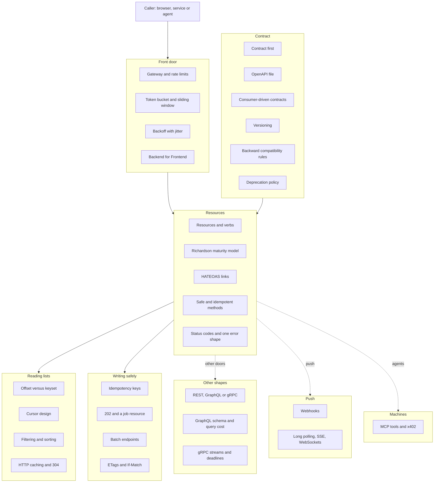

## The map in words

A caller reaches the API through a front door. The gateway checks who it is and how fast it may go, using a token bucket, and every client backs off with jitter when told to wait. Each kind of client may get its own thin backend. Behind the door sit resources: nouns with URLs, changed by verbs that are safe or idempotent, climbing the Richardson ladder and sometimes carrying links to the next action. Every answer carries a status code and one error shape. A contract file describes it all before the code exists, consumer tests guard it, and compatibility and deprecation rules decide how it grows. Lists come back in cursor pages with allowed filters and HTTP caching. Writes are safe to retry with idempotency keys, ETags, jobs and batches. GraphQL, gRPC, push channels and agent tools are other doors onto the same rules.

## Resources and verbs

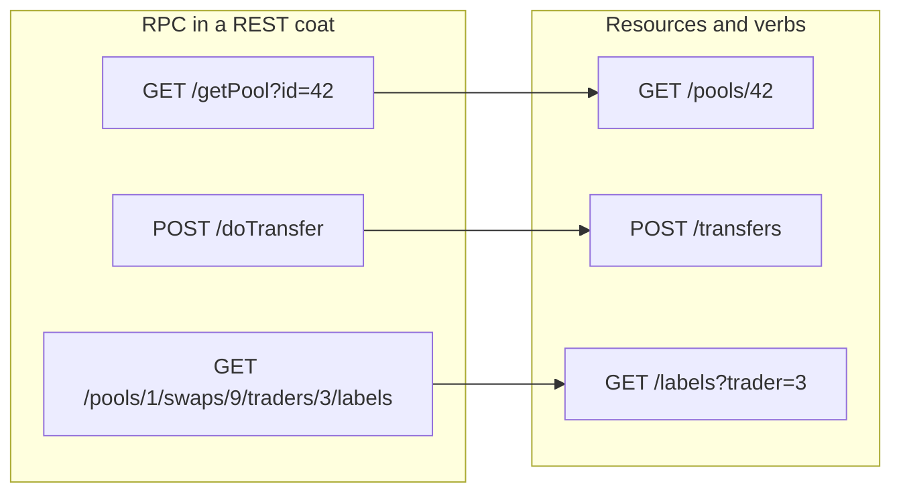

**Story.** An analyst wants the swaps of one exchange pool on the Robinhood chain. The API has a pool resource at `/pools/42`. Its swaps live one level below, at `/pools/42/swaps`. The analyst never learns a function name. They learn the nouns, and the HTTP method says what to do.

**How it works.**

1. Name the thing as a noun with a URL: `/pools/42` in the right box.
2. Pick the verb: `GET` reads, `POST` creates, `PUT` replaces, `PATCH` changes part, `DELETE` removes.
3. Nest one level when one thing belongs to another: a swap belongs to a pool.
4. Turn deep nesting into a flat URL with filters: `/labels?trader=3`.
5. The server keeps no session about the caller. Each request carries everything it needs.

### In code

**RPC in a REST coat.**

```text
route "/getPool?id=N"      -> answer the pool    # the path names a function
route "/doTransfer"        -> move money          # any method is accepted
route "/deleteLabel?id=N"  -> delete the label    # any method, even GET
route "/pools/1/swaps/9/traders/3/labels" -> labels  # deep nesting
pick the handler by path only, never by method
every client's retry rule: a GET is safe to send again
prefetcher: for each link on the page, send a GET
```

```go
// rpcAPI names functions in the path. Picked by path only.
func rpcAPI(db *DB) http.Handler {
	mux := http.NewServeMux()
	mux.HandleFunc("/getPool", func(w http.ResponseWriter, r *http.Request) {
		fmt.Fprint(w, "pool "+r.URL.Query().Get("id"))
	})
	mux.HandleFunc("/doTransfer", func(w http.ResponseWriter, r *http.Request) {
		fmt.Fprint(w, "moved") // a retry cannot tell if this is safe
	})
	mux.HandleFunc("/deleteLabel", func(w http.ResponseWriter, r *http.Request) {
		delete(db.labels, r.URL.Query().Get("id")) // a GET that writes
		fmt.Fprint(w, "deleted")
	})
	return mux
}

// prefetch follows every GET link on the page, as a browser prefetcher does.
func prefetch(base string, links []string) {
	for _, l := range links {
		fmt.Println("  prefetcher GET", l, "->", call(http.MethodGet, base+l))
	}
}
```

**Resources and verbs.**

```text
route GET    /pools/{id}        -> answer the pool     # GET only reads
route GET    /pools/{id}/swaps  -> swaps of that pool  # one level of nesting
route GET    /labels?trader=T   -> filter the labels   # flat URL plus a filter
route POST   /transfers         -> create, 201 + Location /transfers/77
route DELETE /labels/{id}       -> delete, 204
pick the handler by method AND path
a method with no route for the path: 405 Method Not Allowed
every request carries its token: no session on the server
rule: no GET handler ever writes
```

```go
// restAPI names things in the path and picks the handler by method AND path.
func restAPI(db *DB) http.Handler {
	mux := http.NewServeMux()
	mux.HandleFunc("GET /pools/{id}", func(w http.ResponseWriter, r *http.Request) {
		fmt.Fprint(w, "pool "+r.PathValue("id")) // GET only reads
	})
	mux.HandleFunc("GET /pools/{id}/swaps", func(w http.ResponseWriter, r *http.Request) {
		fmt.Fprint(w, "swaps of pool "+r.PathValue("id"))
	})
	mux.HandleFunc("GET /labels", func(w http.ResponseWriter, r *http.Request) {
		fmt.Fprint(w, "labels of trader "+r.URL.Query().Get("trader"))
	})
	mux.HandleFunc("POST /transfers", func(w http.ResponseWriter, r *http.Request) {
		w.Header().Set("Location", "/transfers/77")
		w.WriteHeader(http.StatusCreated)
	})
	mux.HandleFunc("DELETE /labels/{id}", func(w http.ResponseWriter, r *http.Request) {
		delete(db.labels, r.PathValue("id"))
		w.WriteHeader(http.StatusNoContent)
	})
	return mux // a method with no route gets 405 Method Not Allowed
}

	req.Header.Set("Authorization", "Bearer analyst") // no session: every request carries its token
```

Run it: `handbook/code/13-resources-and-verbs/` with `go run .`

**What goes wrong.** A path like `/doTransfer` is RPC (Remote Procedure Call) dressed as REST (Representational State Transfer). Caches, gateways and retry logic cannot reason about it. A `GET` that changes data is worse: a crawler or a prefetch fires it by accident. Fix: verbs in the method, nouns in the path, and `GET` never changes anything.

**Where you use it.**

- A public warehouse API: `GET /addresses/{addr}/transfers?day=2026-10-01`. Most production APIs stop at Richardson level 2: resources plus correct verbs and status codes.
- A payment flow where the next step depends on state: add links to the next actions (HATEOAS, Hypermedia As The Engine Of Application State), such as `topup` and `cancel`.
- Everywhere else, skip level 3. Few clients follow links. A good contract file serves them better.

> Nouns in the path, verbs in the method, and a `GET` never changes anything.

▶ Watch it move: [Resources and verbs](visual/13-resources-and-verbs.html)

## Richardson maturity model

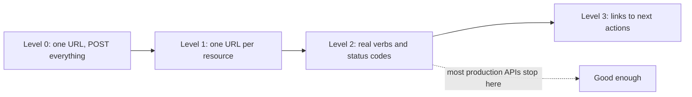

**Story.** A pool API starts life as one endpoint, `POST /api`, with an `action` field in the body. Every read is a `POST`, so no cache can help. The team climbs one level at a time. At level 2 a `GET /pools/42` is cached, and a missing pool is a clean `404`.

**How it works.**

1. Level 0: one URL, one verb. The body says what to do: `{"action": "getPool", "id": 42}`.
2. Level 1: each thing gets its own URL, `/pools/42`, but everything is still `POST`.
3. Level 2: the HTTP verb says what to do, and the status code says what happened.
4. Level 3: answers carry links to what the caller may do next (HATEOAS, the next section).
5. Stop at the level where the next one stops paying for itself.

### In code

```text
level 0: POST /api, read the action from the body
  missing pool: answer 200 with the error in the body
level 1: POST /pools/{id}: a URL per resource, still POST
level 2: GET /pools/{id}
  missing pool: answer 404
  found: answer 200 with Cache-Control max-age=60
level 3: add links: swaps and labels
  signed-in caller: also a watch link
retry code: method is GET: may retry
  anything else: must not guess
cache: URL saved: answer from the copy, no database read
stop at the lowest level that pays
```

```go
func level0(w http.ResponseWriter, r *http.Request) {
	var cmd struct{ Action, ID string }
	json.NewDecoder(r.Body).Decode(&cmd)
	p, ok := pool(cmd.ID)
	if !ok {
		json.NewEncoder(w).Encode(map[string]string{"error": "no such pool"})
		return // still 200: the error hides in the body
	}
	json.NewEncoder(w).Encode(p)
}

func level1(w http.ResponseWriter, r *http.Request) {
	p, _ := pool(r.PathValue("id"))
	json.NewEncoder(w).Encode(p)
}

func level2(w http.ResponseWriter, r *http.Request) {
	p, ok := pool(r.PathValue("id"))
	if !ok {
		http.Error(w, "no such pool", http.StatusNotFound)
		return
	}
	w.Header().Set("Cache-Control", "max-age=60")
	json.NewEncoder(w).Encode(p)
}

	links := map[string]string{"swaps": "/pools/42/swaps", "labels": "/pools/42/labels"}
	if r.Header.Get("Authorization") != "" {
		links["watch"] = "/watchlist/items" // only a signed-in caller may watch
	}
	p["_links"] = links

func mayRetry(method string) bool { return method == http.MethodGet }

	if body, ok := c.saved[url]; ok {
		return body, 200, true
```

Run it: `handbook/code/13-richardson-maturity-model/` with `go run .`

**What goes wrong.** Calling a level 0 API "REST" because it speaks JSON over HTTP. Caches, gateways and retry logic all treat every call as an unsafe `POST`. Nothing can be cached, and every timeout is a guess. Fix: reach level 2. It is cheap and it unlocks the whole HTTP toolbox.

**Where you use it.**

- A design review: name the level out loud. "This is level 1, reads are `POST`" is a precise finding.
- A JSON-RPC (Remote Procedure Call) API between two internal services is a fair choice. Call it RPC, not REST, and do not expect caches to help.
- A public data API: level 2. Level 3 only for flows whose next step depends on state.

> The Richardson model is a ladder: resources, then verbs and codes, then links, and most good APIs stop at level 2 on purpose.

▶ Watch it move: [Richardson maturity model](visual/13-richardson-maturity-model.html)


## HATEOAS: links to the next action

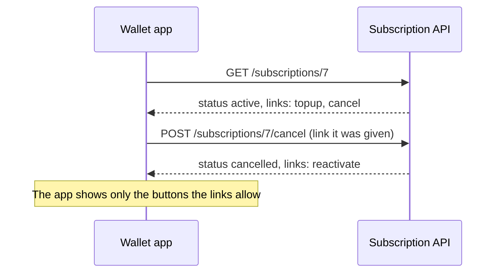

**Story.** A wallet app shows a subscription. The answer carries links: `topup` and `cancel`. The app draws one button per link. After a cancel, the answer carries only `reactivate`, so the cancel button disappears. The app never had to copy the server's rules about which state allows what.

**How it works.**

1. HATEOAS means Hypermedia As The Engine Of Application State.
2. Each answer carries the resource and a list of links: a name (`rel`), a URL and a method.
3. The server puts in only the links the current state allows.
4. The client follows a link by its name, not by building a URL.
5. When rules change on the server, the links change, and the client follows without a release.

### In code

**Rules copied into the app.**

```text
app: read GET /subscriptions/7
app: status is active: show Top up and Cancel   # its own copy of the rule
server: cancel requested:
  rule says cancel is not allowed now: answer 409
  else: cancel it
new rule on the server: unpaid invoice blocks cancel
app: changes only at its next release
```

```go
func hardcodedButtons(a answer) []string {
	if a.Status == "active" {
		return []string{"Top up", "Cancel"}
	}
	return nil
}

	mux.HandleFunc("POST /subscriptions/7/cancel", func(w http.ResponseWriter, r *http.Request) {
		if _, ok := a.links()["cancel"]; !ok {
			http.Error(w, "unpaid invoice", http.StatusConflict)
			return
		}
		a.sub.Status = "cancelled"
```

**Buttons from links.**

```text
server: build links from the state and the rule
  active: offer topup
  active and not (rule on and unpaid): offer cancel
  cancelled: offer reactivate
answer GET: status plus links
app: for each link name it knows, draw one button
app: unknown names: skip them
tap: follow the link it was given, by name
```

```go
func (a *API) links() map[string]Link {
	out := map[string]Link{}
	if a.sub.Status == "active" {
		out["topup"] = Link{"/subscriptions/7/topup", "POST"}
		if !(a.rule && a.sub.Unpaid) {
			out["cancel"] = Link{"/subscriptions/7/cancel", "POST"}
		}
	}
	if a.sub.Status == "cancelled" {
		out["reactivate"] = Link{"/subscriptions/7/reactivate", "POST"}
	}
	return out
}

	mux.HandleFunc("GET /subscriptions/7", func(w http.ResponseWriter, r *http.Request) {
		json.NewEncoder(w).Encode(map[string]any{"status": a.sub.Status, "_links": a.links()})
	})

func buttonsFromLinks(a answer) []string {
	known := map[string]string{"topup": "Top up", "cancel": "Cancel", "reactivate": "Reactivate"}
	var out []string
	for name := range a.Links {
		if label, ok := known[name]; ok {
			out = append(out, label)
		}
	}
	sort.Strings(out)
	return out
}

	after := read(http.Post(srv.URL+now.Links["cancel"].Href, "", nil))
```

Run it: `handbook/code/13-hateoas/` with `go run .`

**What goes wrong.** Clients ignore the links and hard-code URLs and rules anyway. Now the links are dead weight and the rules live in two places. Fix: use links only where the next step really depends on state, and make the client draw its actions from them.

**Where you use it.**

- Payment and subscription flows: `pay`, `refund`, `cancel` appear only when allowed.
- Paged lists: a `next` link is the simplest HATEOAS most APIs already have.
- Agent tools: a result that names the next useful tool call plays the same role for a model.

> HATEOAS puts the allowed next actions in the answer, so the client follows links instead of copying the server's state rules.

▶ Watch it move: [HATEOAS: links to the next action](visual/13-hateoas.html)


## Safe and idempotent methods, PUT versus PATCH

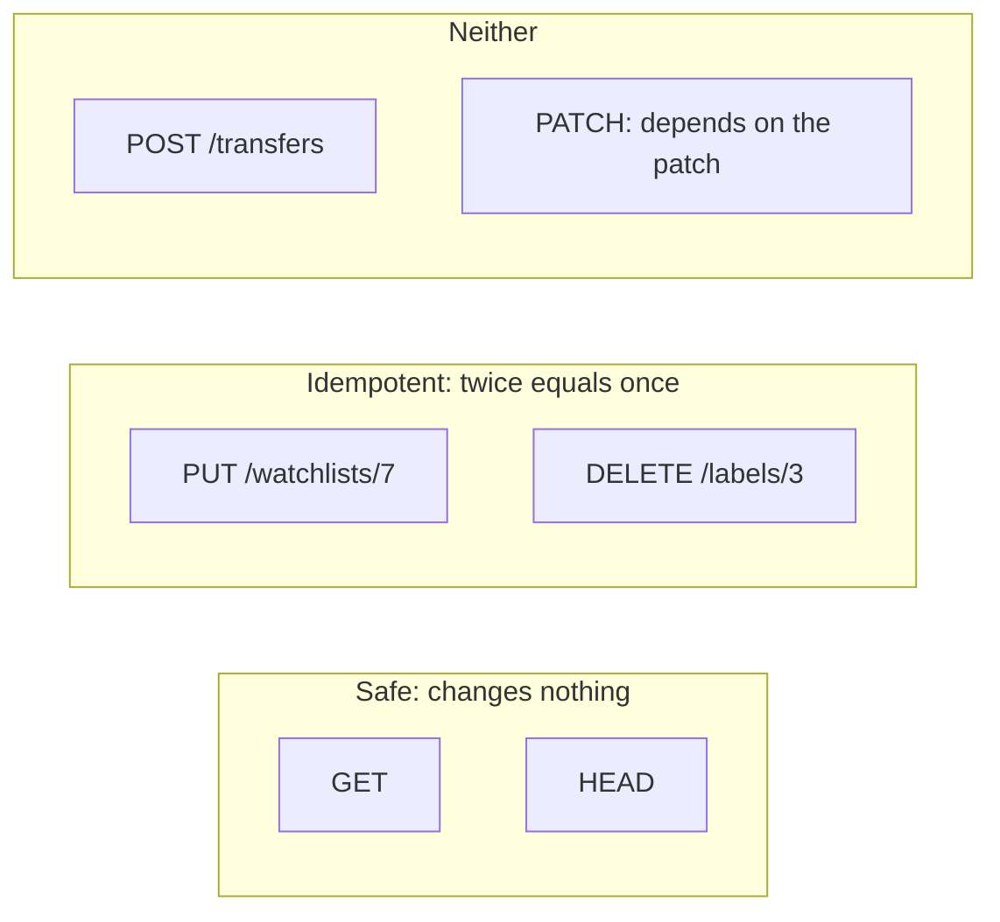

**Story.** An agent renames watch list 7 and the answer times out. It retries. With `PUT` and the full new list, the second call leaves the same result as the first. With `POST /watchlists/7/append`, the second call adds the address twice.

**How it works.**

1. Safe means the method changes nothing on the server: `GET`, `HEAD`, `OPTIONS`.
2. Idempotent means doing it twice leaves the same state as doing it once: `PUT`, `DELETE`, and every safe method.
3. `PUT` sends the whole new resource. Sending it again changes nothing more.
4. `PATCH` sends only a change. "Set name to X" is idempotent. "Add 5 to the balance" is not.
5. `POST` creates or acts, and is neither. It needs an idempotency key to be retried safely.

### In code

**Methods that are safe to repeat.**

```text
GET: read the list, change nothing       # safe
PUT: replace the whole list              # same state after 1 or 2 calls
PATCH with a value: set name             # same state after 1 or 2 calls
DELETE: found: remove it, answer 204
  not found: answer 404                  # the state is the same
a retry may send any of these twice
  check: state after one call == state after two
```

```go
	mux.HandleFunc("GET /watchlists/{id}", func(w http.ResponseWriter, r *http.Request) {
		json.NewEncoder(w).Encode(a.lists[r.PathValue("id")]) // reads, changes nothing
	})

	mux.HandleFunc("PUT /watchlists/{id}", func(w http.ResponseWriter, r *http.Request) {
		var l List
		json.NewDecoder(r.Body).Decode(&l)
		a.lists[r.PathValue("id")] = &l // replaces everything it holds
	})

	mux.HandleFunc("PATCH /watchlists/{id}", func(w http.ResponseWriter, r *http.Request) {
		var p struct {
			Name   *string `json:"name"`
			Append string  `json:"append"`
		}
		json.NewDecoder(r.Body).Decode(&p)
		l := a.lists[r.PathValue("id")]
		if p.Name != nil {
			l.Name = *p.Name // sets a value: repeating changes nothing
		}
		if p.Append != "" {
			l.Addresses = append(l.Addresses, p.Append) // relative: repeating adds again
		}
	})

	mux.HandleFunc("DELETE /labels/{id}", func(w http.ResponseWriter, r *http.Request) {
		if !a.labels[r.PathValue("id")] {
			w.WriteHeader(http.StatusNotFound) // nothing left to delete
			return
		}
		delete(a.labels, r.PathValue("id"))
		w.WriteHeader(http.StatusNoContent)
	})
```

**Methods that are not.**

```text
PATCH with append: add the address       # relative
  a retry adds it again
POST with no key: create a new list
  a retry creates a second list
PUT with only a name: replace everything
  the addresses are wiped
fix: PUT sends the whole object
fix: PATCH sets values, never appends
fix: POST carries an idempotency key
  key seen: answer the same list, create nothing
```

```go
	mux.HandleFunc("PATCH /watchlists/{id}", func(w http.ResponseWriter, r *http.Request) {
		var p struct {
			Name   *string `json:"name"`
			Append string  `json:"append"`
		}
		json.NewDecoder(r.Body).Decode(&p)
		l := a.lists[r.PathValue("id")]
		if p.Name != nil {
			l.Name = *p.Name // sets a value: repeating changes nothing
		}
		if p.Append != "" {
			l.Addresses = append(l.Addresses, p.Append) // relative: repeating adds again
		}
	})

	mux.HandleFunc("POST /watchlists", func(w http.ResponseWriter, r *http.Request) {
		key := r.Header.Get("Idempotency-Key")
		if id, ok := a.keys[key]; ok && key != "" {
			fmt.Fprint(w, id) // same key: same list, nothing new
			return
		}
		a.nextID++
		id := fmt.Sprint(a.nextID)
		a.lists[id] = &List{Name: "new"}
		a.keys[key] = id
		w.WriteHeader(http.StatusCreated)
		fmt.Fprint(w, id)
	})

	mux.HandleFunc("PUT /watchlists/{id}", func(w http.ResponseWriter, r *http.Request) {
		var l List
		json.NewDecoder(r.Body).Decode(&l)
		a.lists[r.PathValue("id")] = &l // replaces everything it holds
	})
```

Run it: `handbook/code/13-safe-idempotent-methods/` with `go run .`

**What goes wrong.** A `PATCH` with a relative change, such as "append this address", retried after a timeout. The address is added twice. A second trap: `PUT` with a partial body wipes every field the client left out. Fix: write patches as absolute values (JSON Merge Patch), and send whole objects with `PUT`.

**Where you use it.**

- Retry libraries and gateways retry safe and idempotent methods by themselves, and never a `POST`.
- A settings page: `PATCH` with only the changed fields, so two people editing different fields do not overwrite each other.
- Kubernetes: `kubectl apply` sends a patch, and the object's version stops stale writes.

> Safe changes nothing, idempotent can be repeated, PUT replaces the whole thing, and a PATCH is only safe to retry when it sets values instead of adding to them.

▶ Watch it move: [Safe and idempotent methods, PUT versus PATCH](visual/13-safe-idempotent-methods.html)


## Status codes and one error shape

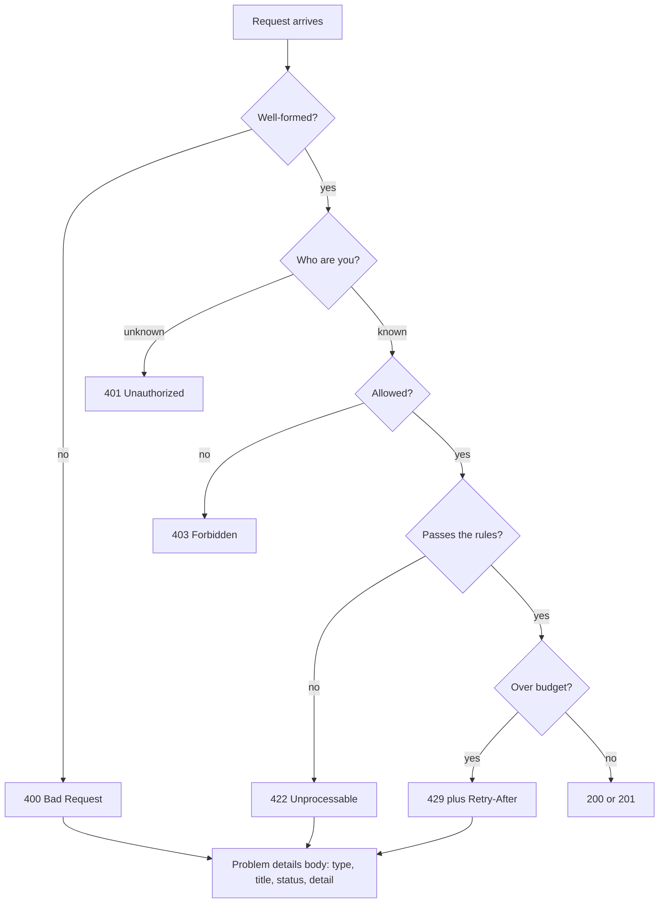

**Story.** An agent asks a graph API for the links of an address that has none yet. The API answers `404` with a body whose `type` is `anchor-missing`. The agent matches on that `type`. It asks the user for another address instead of retrying the same one forever.

**How it works.**

1. The server walks the questions in the picture, top to bottom.
2. The first "no" picks the status code. `4xx` means the caller must change something. `5xx` means retry later.
3. Every error carries the same body: RFC 7807 problem details.
4. `type` is a URL naming the error class. Machines match on it.
5. `title` and `detail` are for humans. Extra fields say how to fix it, such as the bad address.
6. Validation errors list every bad field at once, not only the first.

### In code

**200 with an error inside.**

```text
on GET /addresses/{addr}/links:
  answer 200 with {"error": "no link yet"}   # the error hides in the body
cache: store every 200 answer for 5 minutes
monitor: count answers by status code
  error rate = answers with code >= 400 / all answers
agent: if the body contains "no links yet": stop
agent: else treat it as a hiccup and retry the same address
```

```go
var msg = "no link yet" // the text changes in a later release

// badHandler answers 200 for everything and hides the error in the body.
func badHandler(w http.ResponseWriter, r *http.Request) {
	fmt.Fprintf(w, `{"error":%q}`, msg)
}

func (m *Monitor) errorRate() string {
	total, bad := 0, 0
	for c, n := range m.byCode {
		total += n
		if c >= 400 {
			bad += n
		}
	}
	return fmt.Sprintf("%d of %d errors", bad, total)
}

	fmt.Println("GET 0xab ->", code, body, "| cacheable:", code == 200, "| board:", mon.errorRate())
	matches := strings.Contains(body, "no link yet") // the agent matches on the old words
```

**Status code plus problem details.**

```text
on GET /addresses/{addr}/links:
  if addr is not hex: problem 400, type invalid-params, list every bad field
  if no token: problem 401                 # 403 if known but not allowed
  count the call; over 5 this minute: problem 429 with Retry-After: 20
  if the server fails: problem 500 with request id r-81, no stack trace
  if addr has no links: problem 404, type anchor-missing
  else: 200 with the links
problem(status, type, title, detail):
  Content-Type: application/problem+json
  write the status code, then the body {type, title, status, detail}
agent: the status class says what to do, the type says which error
```

```go
func problem(w http.ResponseWriter, p Problem) {
	w.Header().Set("Content-Type", "application/problem+json")
	if p.Status == http.StatusTooManyRequests {
		w.Header().Set("Retry-After", "20")
	}
	w.WriteHeader(p.Status)
	json.NewEncoder(w).Encode(p)
}

// links walks the ladder: the first "no" picks the status code.
func (a *API) linksHandler(w http.ResponseWriter, r *http.Request) {
	addr := r.PathValue("addr")
	if !hexAddr.MatchString(addr) { // well-formed?
		problem(w, Problem{Type: "/problems/invalid-params", Title: "Invalid request", Status: 400, InvalidParams: []string{"addr: not hex"}})
		return
	}
	tok := r.Header.Get("Authorization")
	if tok == "" { // who are you?
		problem(w, Problem{Type: "/problems/no-token", Title: "Unauthorized", Status: 401})
		return
	}
	if a.calls[tok]++; a.calls[tok] > 5 { // over budget?
		problem(w, Problem{Type: "/problems/rate-limit", Title: "Too many requests", Status: 429})
		return
	}
	if addr == "0xcd" { // a server bug: say so safely
		problem(w, Problem{Type: "/problems/internal", Title: "Internal error", Status: 500, RequestID: "r-81"})
		return
	}
	n, ok := a.links[addr]
	if !ok || n == 0 {
		problem(w, Problem{Type: "/problems/anchor-missing", Title: "No links yet", Status: 404, Detail: addr + " has no links yet"})
		return
	}
	fmt.Fprintf(w, `{"links":%d}`, n)
}

	fmt.Println("agent matches type == /problems/anchor-missing:", p.Type == "/problems/anchor-missing", "-> asks the user")
```

Run it: `handbook/code/13-status-codes-problem-details/` with `go run .`

**What goes wrong.** `200 OK` with `{"error": ...}` inside. Monitoring counts it as a success, caches store it, and retry logic never fires. The second classic is a free-text `message` only: clients match on the words and break when someone fixes a typo. Fix: the right status code, and a stable `type`.

**Where you use it.**

- A paid tool API: `402 Payment Required` with a price, the code x402 revived.
- A rate-limited free tier: `429` with `Retry-After`, so clients wait instead of hammering.
- Support: add a request id to every error body. Never leak a stack trace or a SQL string.

> The status code tells the machine what to do next, and the `type` field tells it which error it got.

▶ Watch it move: [Status codes and one error shape](visual/13-status-codes-problem-details.html)

## The contract comes first

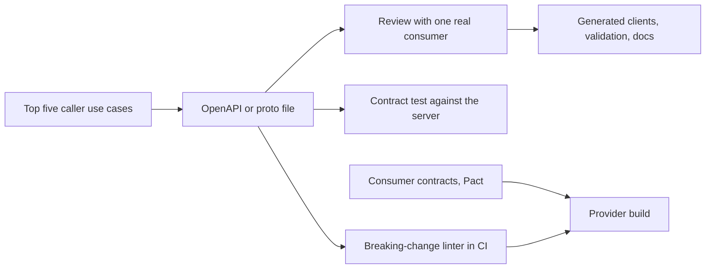

**Story.** A web dashboard reads `fee_bps` from the pool service as an integer. The dashboard team writes that down as a consumer contract. Months later a pool developer turns `fee_bps` into a string. The pool service build fails on the dashboard's contract before anything ships.

**How it works.**

1. List what callers need to do. Start from them, not from the tables.
2. Write the OpenAPI file (or a `.proto` file for gRPC) for those use cases.
3. Review it with one real consumer and one person who will be on call for it.
4. Generate client libraries, request validation and the docs page from the file.
5. Each consumer records only the fields it reads, as a Pact contract.
6. The provider's build runs every consumer contract and a breaking-change linter.

### In code

```text
contract file: fee_bps is an integer        # written first, reviewed by a consumer
serve GET /pools/42 from the code
consumer pact: the dashboard reads fee_bps as an integer, nothing else
on every provider build:
  for each field of the contract on main:
    removed or retyped in the new file: breaking change
  for each consumer pact:
    call the real provider, read the field
    missing or wrong type: fail, name the consumer and the field
    (greedy pact) any extra field: fail      # do not write pacts like this
  any failure: the build is red, nothing ships
dashboard: decode fee_bps into an int       # a string breaks it
```

```go
type Schema map[string]string
type Pact map[string]string

	mux.HandleFunc("GET /pools/42", func(w http.ResponseWriter, r *http.Request) {
		json.NewEncoder(w).Encode(body)

func lint(old, nw Schema) []string {
	var breaks []string
	for f, t := range old {
		if nt, ok := nw[f]; !ok {
			breaks = append(breaks, f+" removed")
		} else if nt != t {
			breaks = append(breaks, f+" changed "+t+" -> "+nt)
		}
	}
	return breaks
}

func verify(p Pact, provider http.Handler, exact bool) []string {
	srv := httptest.NewServer(provider)
	defer srv.Close()
	res, err := http.Get(srv.URL + "/pools/42")
	raw, _ := io.ReadAll(res.Body)
	var got map[string]any
	json.Unmarshal(raw, &got)
	var fails []string
	for f, t := range p {
		if v, ok := got[f]; !ok || jsonType(v) != t {
			fails = append(fails, "needs "+f+" as "+t)
		}
	}
	if exact && len(got) != len(p) { // a greedy pact: the whole body, nothing more
		fails = append(fails, "unexpected extra field")
	}
	return fails
}

	var pool struct {
		FeeBps int `json:"fee_bps"`
	}
	if err := json.NewDecoder(res.Body).Decode(&pool); err != nil {
		return "fee broken: " + err.Error()
	}
	return fmt.Sprintf("fee %d", pool.FeeBps)
```

Run it: `handbook/code/13-contract-first/` with `go run .`

**What goes wrong.** Generating the file from code after the fact. Then the code is the contract and the file lags behind it. The second failure is a consumer contract that copies a whole response: it breaks on every harmless new field. Fix: the file first, reviewed like code, and contracts that name only what is read.

**Where you use it.**

- A public REST API: OpenAPI file in the repository, diffed in every pull request.
- Service to service over gRPC: the `.proto` file is the contract and the code generator enforces it.
- An agent tool server: the tool descriptions and JSON schemas are the contract. Review them like code, because the model reads nothing else.

> I write the contract before the code, and every consumer's test runs in the provider's build.

▶ Watch it move: [The contract comes first](visual/13-contract-first.html)

## OpenAPI: the REST contract file

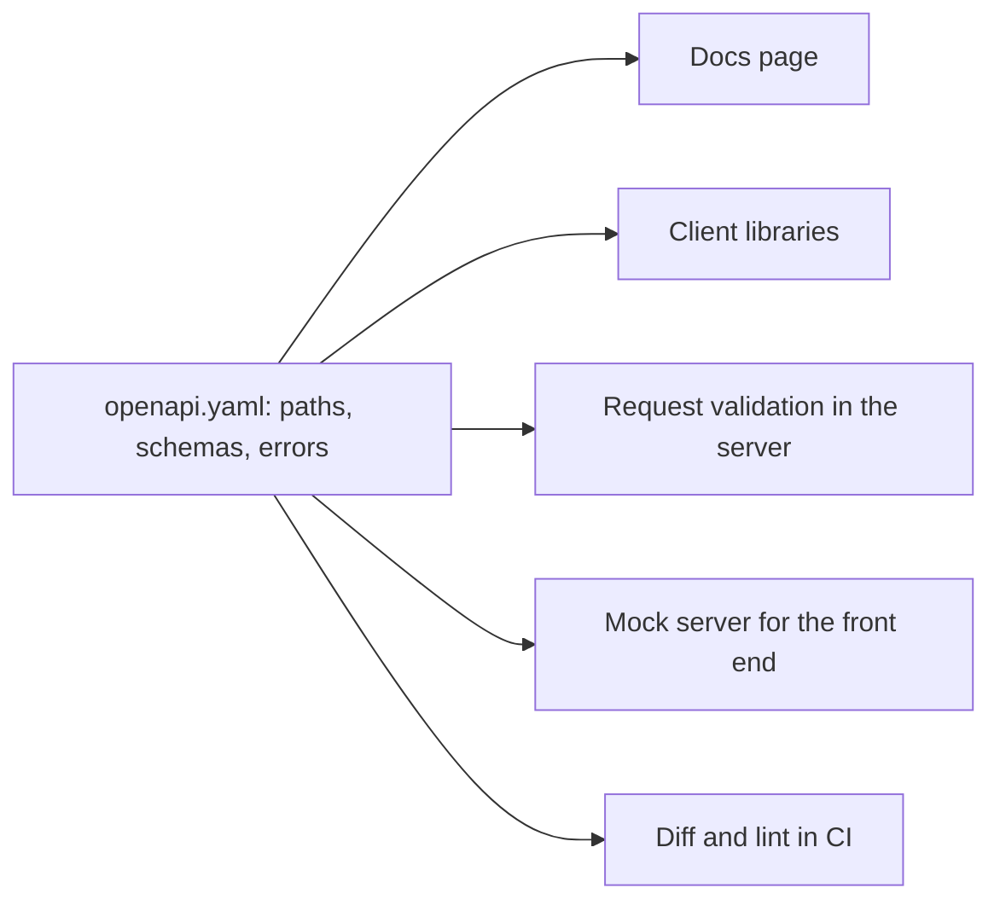

**Story.** A transfers API has one file, `openapi.yaml`. The front-end team starts work on a mock server built from the file, before the backend exists. When the backend ships, the same file validates every incoming request. A pull request that renames a field shows up as a red diff on that file.

**How it works.**

1. OpenAPI, formerly Swagger, is a YAML or JSON file describing a REST API.
2. `paths` list each URL and method. `components/schemas` describe the bodies with JSON Schema.
3. Each operation lists its responses, including the problem details error shape.
4. Tools read the file: a docs page, client libraries, a mock server, request validation.
5. A linter in CI (Continuous Integration) diffs the file against `main` and fails on a breaking change.

### In code

**One file, many tools.**

```text
file: path /transfers, parameter day, fields id and amount
mock: for each field in the file, answer an example of its type
client: generated from the file: getTransfers(day)
server: for each parameter in the file:
  value does not match its pattern: 400, name the field
  all match: run the handler
docs: render every field from the file
CI on a change: for each field of the file on main:
  missing in the new file: fail: field removed
```

```go
var openapi = Spec{
	Path:   "/transfers",
	Params: map[string]string{"day": `^\d{4}-\d{2}-\d{2}$`},
	Fields: map[string]string{"id": "string", "amount": "number"},
}

func mock(s Spec) http.Handler {
	return http.HandlerFunc(func(w http.ResponseWriter, r *http.Request) {
		row := map[string]any{}
		for f, t := range s.Fields {
			if t == "number" {
				row[f] = 12.5
			} else {
				row[f] = "example"
			}
		}
		json.NewEncoder(w).Encode([]map[string]any{row})
	})
}

func validate(s Spec, next http.Handler) http.Handler {
	return http.HandlerFunc(func(w http.ResponseWriter, r *http.Request) {
		for name, pattern := range s.Params {
			v := r.URL.Query().Get(name)
			if v != "" && !regexp.MustCompile(pattern).MatchString(v) {
				w.WriteHeader(http.StatusBadRequest)
				json.NewEncoder(w).Encode(map[string]string{"type": "invalid-params", "field": name})
				return
			}
		}
		next.ServeHTTP(w, r)
	})
}

func getTransfers(base, day string) ([]Transfer, int, error) {

func lint(main, changed Spec) []string {
	var fails []string
	for f := range main.Fields {
		if _, ok := changed.Fields[f]; !ok {
			fails = append(fails, "field removed: "+f)
		}
	}
	return fails
}
```

**The server drifts from the file.**

```text
server: hand-written, never loads the file
code change: amount becomes a string
file: not edited, so review sees no contract change
generated client: decode amount as a number: fails
fix: test each real answer against the file:
  for each field in the file:
    real type differs: fail the build, name the field
fix: keep amount a number, add amount_text
```

```go
func server(amount any) http.Handler {
	return http.HandlerFunc(func(w http.ResponseWriter, r *http.Request) {
		json.NewEncoder(w).Encode([]map[string]any{{"id": "t1", "amount": amount}})
	})
}

func conforms(s Spec, base string) []string {
	res, err := http.Get(base + s.Path)
	if err != nil {
		panic(err)
	}
	defer res.Body.Close()
	var rows []map[string]any
	json.NewDecoder(res.Body).Decode(&rows)
	var fails []string
	for f, want := range s.Fields {
		got := "string"
		if _, isNumber := rows[0][f].(float64); isNumber {
			got = "number"
		}
		if got != want {
			fails = append(fails, f+" is "+got+", the file says "+want)
		}
	}
	return fails
}
```

Run it: `handbook/code/13-openapi/` with `go run .`

**What goes wrong.** The file says one thing and the server does another. Generated clients then fail in ways the docs do not explain. Fix: validate real requests and responses against the file in tests, so drift fails the build.

**Where you use it.**

- A public API: the file in the repository, published as the docs page.
- A front end that starts before the backend: a mock server from the file.
- Generating a typed client in Go or TypeScript instead of writing one by hand.

> OpenAPI is the REST contract as a file, and docs, clients, mocks and validation all come from it, so it cannot drift from the server.

▶ Watch it move: [OpenAPI: the REST contract file](visual/13-openapi.html)


## Consumer-driven contracts

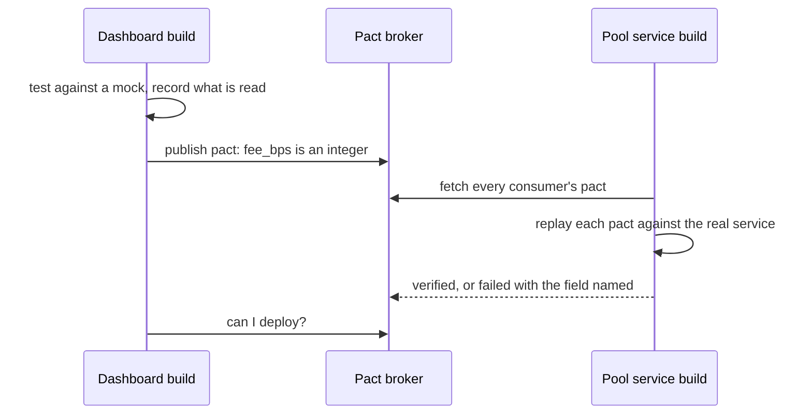

**Story.** Three teams read the pool service: a dashboard, an alerting job and an agent tool. Each writes down only the fields it reads, as a pact. The pool service build replays all three pacts against the real service. When a developer drops a field only the alerting job reads, the build names that consumer and that field.

**How it works.**

1. The consumer tests its own code against a mock of the provider.
2. The mock records each request and the fields of the answer the consumer used. That record is the pact.
3. The pact is published to a broker, tagged with the consumer's version.
4. The provider's build fetches every pact and replays it against the real service.
5. Before either side deploys, it asks the broker whether its version is compatible with what is live.

### In code

**Pacts that name what is read.**

```text
consumer test: record the request and only the fields it reads
publish that pact to the broker
provider build: fetch every pact from the broker
  for each pact: call the real provider
    for each field in the pact:
      missing or wrong type: fail, name the consumer and the field
before deploy: can I deploy?
  yes only if every live pact passes
```

```go
type Pact struct {
	Consumer string
	Fields   map[string]string // field -> type
	Exact    map[string]any
}

func replay(p Pact, provider http.Handler) []string {
	srv := httptest.NewServer(provider)
	defer srv.Close()
	res, err := http.Get(srv.URL)
	if err != nil {
		panic(err)
	}
	defer res.Body.Close()
	raw, _ := io.ReadAll(res.Body)
	var got map[string]any
	json.Unmarshal(raw, &got)
	var fails []string
	for f, want := range p.Fields {
		if v, ok := got[f]; !ok || typeOf(v) != want {
			fails = append(fails, p.Consumer+" needs "+f+" as "+want)
		}
	}
	if p.Exact != nil && !reflect.DeepEqual(p.Exact, got) {
		fails = append(fails, p.Consumer+" expected the exact old body")
	}
	sort.Strings(fails)
	return fails
}

func canIDeploy(broker []Pact, provider http.Handler) (bool, []string) {
	var fails []string
	for _, p := range broker {
		fails = append(fails, replay(p, provider)...)
	}
	return len(fails) == 0, fails
}

	dashboard := Pact{Consumer: "dashboard", Fields: map[string]string{"fee_bps": "number"}}
	alerts := Pact{Consumer: "alert job", Fields: map[string]string{"tvl_usd": "number"}}
	broker := []Pact{dashboard, alerts}
```

**A greedy pact.**

```text
greedy pact: copy the whole body, every value
provider adds fee_tier, which nobody reads
replay: body differs from the copy: fail
after false alarms: tests marked allowed to fail
the next real break ships
fix: list only the fields read
  match by type, not by exact value
```

```go
type Pact struct {
	Consumer string
	Fields   map[string]string // field -> type
	Exact    map[string]any
}

	var fails []string
	for f, want := range p.Fields {
		if v, ok := got[f]; !ok || typeOf(v) != want {
			fails = append(fails, p.Consumer+" needs "+f+" as "+want)
		}
	if p.Exact != nil && !reflect.DeepEqual(p.Exact, got) {
		fails = append(fails, p.Consumer+" expected the exact old body")
	}

	greedy := Pact{Consumer: "dashboard", Exact: v1}
	dashboard := Pact{Consumer: "dashboard", Fields: map[string]string{"fee_bps": "number"}}
```

Run it: `handbook/code/13-consumer-driven-contracts/` with `go run .`

**What goes wrong.** A pact that copies the whole response. Every harmless new field breaks it, and teams learn to ignore red builds. Fix: assert only the fields read, and match by type, not by exact value.

**Where you use it.**

- Microservices owned by different teams, where an end-to-end test environment is slow and flaky.
- A public API: you cannot collect pacts from strangers, so use the OpenAPI diff instead.
- An agent tool server: record the inputs and outputs real hosts use, and replay them in the build.

> Each consumer writes down what it reads, and the provider's build checks every one of them, so a break is caught before it ships and names who it hurts.

▶ Watch it move: [Consumer-driven contracts](visual/13-consumer-driven-contracts.html)


## Versioning and backward compatibility

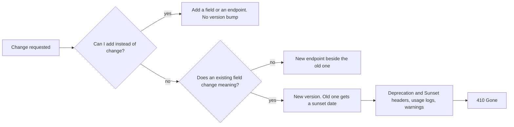

**Story.** A transfers response gains `usd_at_day`, the token value at that day's price. Old clients ignore the new field and keep working. Later the price source changes what the number means. That gets a new field name, not a quiet change to the old one.

**How it works.**

1. Ask the first question in the picture. Adding a field or an endpoint is free.
2. Never remove, rename, or change the type of a field. Never add a required input.
3. Clients ignore unknown fields and tolerate unknown enum values. Write that rule down.
4. Only a changed meaning earns a new version: in the URL (`/v2`), a header, or a date pinned per account like Stripe.
5. The old version gets `Deprecation` and `Sunset` headers and an end date.
6. Log which clients still call it. Talk to the top three. Then answer `410 Gone`.

### In code

**Quiet change of meaning.**

```text
serve GET /transfers, one row per transfer:
  usd = amount x day-close price
  (later) price source switched:
    usd = amount x minute price        # same name, new meaning
  send amount, token, usd_at_day = usd
client: decode only usd_at_day, ignore other fields
client: report = sum of usd_at_day
no check looks at meaning:
  status 200 and a number pass every test
finance: books = sum at the day price  # report must equal books
```

```go
	var out []map[string]any
	for _, t := range transfers {
		usd := t.Amount * t.Day
		if a.minuteSource {
			usd = t.Amount * t.Minute // same name, new meaning: the quiet change
		}
		row := map[string]any{"amount": t.Amount, "token": "WETH", "usd_at_day": usd}
		if a.addMinute {
			row["usd_at_minute"] = t.Amount * t.Minute // a new meaning gets a new name
		}
		out = append(out, row)
	}
	json.NewEncoder(w).Encode(out)

	var rows []struct {
		USD float64 `json:"usd_at_day"`
	}
	json.NewDecoder(res.Body).Decode(&rows)
	sum := 0.0
	for _, r := range rows {
		sum += r.USD
	}
	return sum, res
```

**Add, then version with a sunset.**

```text
written rule: clients ignore unknown fields
serve v1 row: amount, token, usd_at_day
new meaning: add usd_at_minute beside it, keep usd_at_day
an existing field must change type (amount to a decimal string):
  only then: serve it under /v2/transfers
v1, once a sunset date is set:
  record which client called
  now at or after sunset: 410 Gone, Link to v2
  else: add Deprecation and Sunset headers
one new version per real break, never per change
```

```go
	mux.HandleFunc("GET /transfers", a.v1)
	mux.HandleFunc("GET /v2/transfers", a.v2)

func (a *API) v1(w http.ResponseWriter, r *http.Request) {
	a.seen("v1", r.Header.Get("X-Client"))
	if !a.sunset.IsZero() {
		if !a.now().Before(a.sunset) {
			w.Header().Set("Link", `</v2/transfers>; rel="successor-version"`)
			http.Error(w, "v1 is gone, use /v2/transfers", http.StatusGone)
			return
		}
		w.Header().Set("Deprecation", "true")
		w.Header().Set("Sunset", a.sunset.Format(http.TimeFormat))
	}

		row := map[string]any{"amount": t.Amount, "token": "WETH", "usd_at_day": usd}
		if a.addMinute {
			row["usd_at_minute"] = t.Amount * t.Minute // a new meaning gets a new name
		}

func (a *API) v2(w http.ResponseWriter, r *http.Request) {
	a.seen("v2", r.Header.Get("X-Client"))
	var out []map[string]any
	for _, t := range transfers {
		out = append(out, map[string]any{"amount": fmt.Sprintf("%.18f", t.Amount), "usd_at_day": t.Amount * t.Day})
	}
	json.NewEncoder(w).Encode(out)

	var rows []struct {
		USD float64 `json:"usd_at_day"`
	}
```

Run it: `handbook/code/13-versioning/` with `go run .`

**What goes wrong.** Changing what a field means while keeping its name. Nothing fails loudly, and every client computes wrong numbers. The second is a `/v2` for a small change: every live version doubles tests, docs and support. Fix: additive change first, a new version only for a new meaning, and at most two live versions.

**Where you use it.**

- Internal APIs: no version at all, only additive changes.
- A public API with paying clients: date-pinned versions per account, the friendliest and the most work.
- An agent tool server: add a new tool, keep the old tool name as an alias with a deprecation note in its description, because hosts cache tool lists.

> I version by adding. A new version is only for a changed meaning, and it ships with a sunset date.

▶ Watch it move: [Versioning and backward compatibility](visual/13-versioning.html)

## Backward compatibility rules

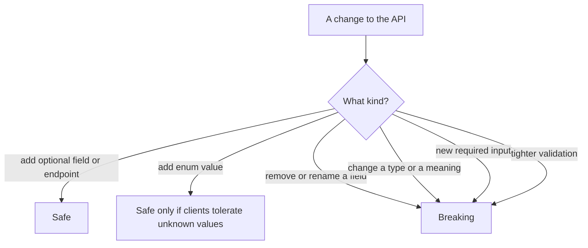

**Story.** A transfers API adds a new kind of transfer, `bridge`. One client has a `switch` over `kind` with no default branch. It crashes on the first bridge transfer. The API did nothing illegal by its own rules. The client never promised to tolerate unknown values, and nobody wrote that rule down.

**How it works.**

1. Adding an optional field or a new endpoint is safe.
2. Removing, renaming or retyping a field breaks clients.
3. A new required input breaks every old caller. Make it optional with a default.
4. Tighter validation breaks callers that used to pass. Looser validation is safe.
5. The client's half: ignore unknown fields and accept unknown enum values. This is the tolerant reader rule.
6. Write both halves into the API guide, and check the server half with a linter.

### In code

```text
strict client: parse into a fixed struct
  amount missing: fail
  switch kind: transfer, swap
  any other kind: fail                  # no default branch
tolerant client: parse into a fixed struct
  amount missing: fail
  any kind is fine: unknown shows as other
server: new required input missing: 400
server: tighter rule fails: 400
linter on every change: a field on main is gone: fail
server rule: add only; client rule: ignore what you do not know
```

```go
func strict(body []byte) error {
	var t struct {
		Amount *float64 `json:"amount"`
		Kind   string   `json:"kind"`
	}
	if err := json.Unmarshal(body, &t); err != nil {
		return err
	}
	if t.Amount == nil {
		return fmt.Errorf("amount is missing")
	}
	switch t.Kind {
	case "transfer", "swap":
		return nil
	}
	return fmt.Errorf("unknown kind %q", t.Kind) // no default branch: it crashes
}

func tolerant(body []byte) error {
	var t struct {
		Amount *float64 `json:"amount"`
		Kind   string   `json:"kind"`
	}
	if err := json.Unmarshal(body, &t); err != nil {
		return err
	}
	if t.Amount == nil {
		return fmt.Errorf("amount is missing")
	}
	return nil // any kind is fine: unknown shows as "other"
}

	return http.HandlerFunc(func(w http.ResponseWriter, r *http.Request) {
		if requireNetwork && r.URL.Query().Get("network") == "" {
			http.Error(w, "network is required", http.StatusBadRequest)
			return
		}
		if a := r.URL.Query().Get("address"); rejectUpper && !lower.MatchString(a) {
			http.Error(w, "address must be lower case", http.StatusBadRequest)
			return
		}
		fmt.Fprint(w, `{"amount":1,"kind":"transfer"}`)
	})

func lint(old, nw map[string]bool) []string {
	var fails []string
	for f := range old {
		if !nw[f] {
			fails = append(fails, "removed "+f)
```

Run it: `handbook/code/13-backward-compatibility-rules/` with `go run .`

**What goes wrong.** A change that is legal for the server and fatal for a strict client, such as a new enum value. Fix: publish the tolerant reader rule from day one, and give every enum an "unknown" branch in the generated clients.

**Where you use it.**

- Protobuf has the rules built in: never reuse a field number, and new fields are optional.
- A JSON API: the OpenAPI diff linter flags removed fields, new required fields and type changes.
- Agent tools: a new optional input is safe, but a renamed tool breaks every host that cached the list.

> Add freely, never remove, rename or retype, never require something new, and ask clients to ignore what they do not know.

▶ Watch it move: [Backward compatibility rules](visual/13-backward-compatibility-rules.html)


## Deprecation policy

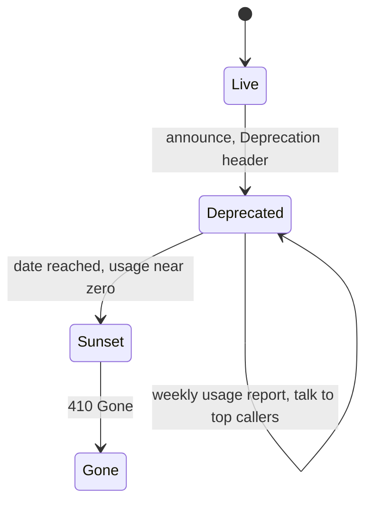

**Story.** An API team decides to retire `/v1/transfers`. They announce a date six months out and add `Deprecation` and `Sunset` headers to every v1 answer. Each week a report lists who still calls v1. Two weeks before the date, one big client is still on it. The team calls them, helps them move, and switches v1 off on the date with `410 Gone`.

**How it works.**

1. Write the policy once: how long a deprecated version lives, how it is announced, and who is told.
2. On deprecation, every answer carries `Deprecation: true` and `Sunset: <date>`, plus a link to the guide for moving.
3. Usage is logged per caller, so the team knows who is left.
4. The top callers are contacted directly. Headers alone move nobody.
5. Short planned brownouts before the date make the last callers notice.
6. On the date, the old version answers `410 Gone` with a link to the new one.

### In code

**A dated promise, kept.**

```text
policy: v1 ends on 1 March, six months out
on each v1 call: count it under the caller
now at or after the date: 410 Gone, Link to v2, stop
now inside the brownout hour: 503, Retry-After 3600, stop
else: add Deprecation, Sunset and a Link to the guide
  answer as usual
weekly report: calls per caller, biggest first
two weeks before: phone whoever is left on the report
```

```go
func (v *V1) ServeHTTP(w http.ResponseWriter, r *http.Request) {
	now := v.now()
	v.usage[r.Header.Get("X-Client")]++
	if !now.Before(v.sunset) {
		w.Header().Set("Link", `</v2/transfers>; rel="successor-version"`)
		http.Error(w, "v1 ended, use v2", http.StatusGone)
		return
	}
	if !now.Before(v.brownout[0]) && now.Before(v.brownout[1]) {
		w.Header().Set("Retry-After", "3600")
		http.Error(w, "planned v1 brownout", http.StatusServiceUnavailable)
		return
	}
	w.Header().Set("Deprecation", "true")
	w.Header().Set("Sunset", v.sunset.Format(http.TimeFormat))
	w.Header().Set("Link", `</docs/move-to-v2>; rel="deprecation"`)
	fmt.Fprint(w, `[{"amount":1}]`)
}

func (v *V1) report() []string {
	var names []string
	for n := range v.usage {
		names = append(names, n)
	}
	sort.Slice(names, func(i, j int) bool { return v.usage[names[i]] > v.usage[names[j]] })
	var out []string
	for _, n := range names {
		out = append(out, fmt.Sprintf("%s %d", n, v.usage[n]))
	}
	return out
}
```

**A date that slips.**

```text
policy: v1 ends on 1 March
no report, no calls: nobody knows who is left
a big client complains: move the date
every other caller hears it: stop planning
the date comes round, nobody moved: move it again
two versions stay live
every bug fix, test and doc page is done twice
```

```go
type Caller struct {
	Name    string
	MovesAt int
}

func planEnd(callers []*Caller, date, horizon int, gaps []int) []int {
	dates := []int{date}
	for month := 0; month < horizon && len(gaps) > 0; month++ {
		if month != date-1 || moved(callers, date) == len(callers) {
			continue
		}
		date += gaps[0] // not ready: the team moves the date
		gaps = gaps[1:]
		dates = append(dates, date)
		for _, c := range callers {
			c.MovesAt = never // nobody plans for a date that moves
		}
	}
	return dates
}

	callers := []*Caller{{"small client", 5}, {"big client", never}}
	dates := planEnd(callers, 6, 24, []int{3, 6, 6, 6})
	fmt.Println("month 24: callers moved:", moved(callers, 24), "| live versions 2, every bug fix done 2 times")
```

Run it: `handbook/code/13-deprecation-policy/` with `go run .`

**What goes wrong.** A sunset date that slips every time a client complains. Clients learn that dates mean nothing, and the old version lives forever. Fix: publish the policy, measure usage, help callers move, and keep the date.

**Where you use it.**

- Public APIs with paying clients: six to twelve months is a common window.
- Internal APIs: weeks, because you can find every caller in the logs.
- Agent tools: keep the old tool name as an alias with "deprecated, use X" in its description, then remove it.

> A deprecation is a dated promise: headers on every answer, usage per caller, a call to the last ones, and 410 Gone on the date.

▶ Watch it move: [Deprecation policy](visual/13-deprecation-policy.html)


## Pagination: offset versus keyset

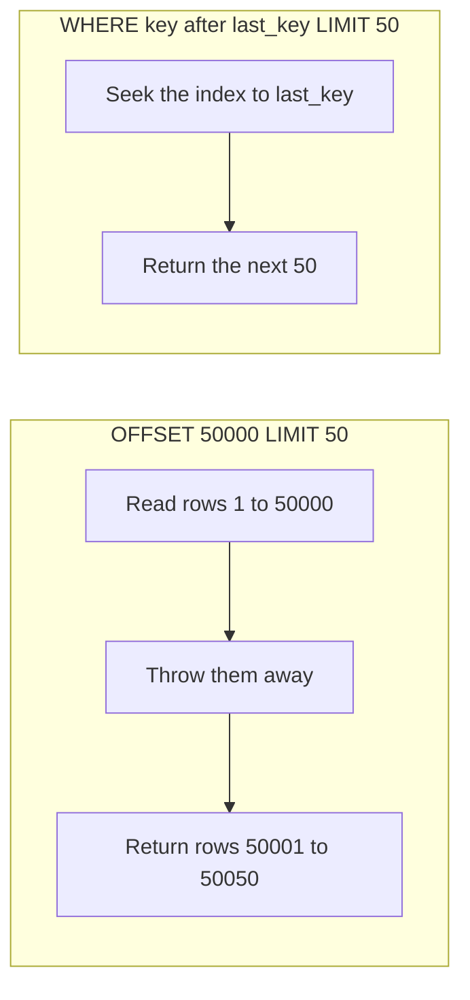

**Story.** A busy exchange pool has millions of swaps. A client pages through them 50 at a time. With `OFFSET`, page 1,000 makes the database read 50,000 rows and throw them away. With a cursor on `(block_height, log_index)`, page 1,000 costs the same as page 1.

**How it works.**

1. The first page is a plain sorted query with `LIMIT 50`.
2. The server takes the sort key of the last row, here `(block_height, log_index)`.
3. It encodes that key into an opaque `next_cursor` token.
4. The client sends `?after=<token>` for the next page.
5. The server decodes it and asks for rows after that key: a seek on the index, the right box.
6. When there are no more rows, `next_cursor` is null and the client stops.

### In code

**Offset paging.**

```text
GET /offset?offset=n
end = n + 4
read every row from the front up to end
count them as rows read
answer only the last four
next page: n + 4
a new row lands at the front: every position moves by one
OFFSET 12 now holds a row already seen
```

```go
func (a *API) byOffset(w http.ResponseWriter, r *http.Request) {
	offset, _ := strconv.Atoi(r.URL.Query().Get("offset"))
	end := min(offset+pageSize, len(a.blocks))
	a.rowsRead += end // every row up to the end of the page is read
	json.NewEncoder(w).Encode(map[string]any{"rows": a.blocks[min(offset, end):end]})
}

	a.blocks = append([]int{965}, a.blocks...) // a new swap lands at the front
	p := a.get(srv.URL, "/offset?offset=12")
	fmt.Println("block", p.Rows[0], "already seen on page 3:", contains(seen, p.Rows[0]))
```

**Keyset (cursor) paging.**

```text
GET /keyset, no cursor: start at the front
cursor given: decode the last block
  bad cursor: answer 400
seek the index to the first block below it
read only the next four
rows left: next_cursor = encode the last block
none left: next_cursor stays null
a new row at the front changes no key
the trap: block alone is not unique
the fix: compare block, then log
```

```go
func (a *API) byKeyset(w http.ResponseWriter, r *http.Request) {
	start := 0
	if c := r.URL.Query().Get("cursor"); c != "" {
		raw, err := base64.URLEncoding.DecodeString(c)
		last, err2 := strconv.Atoi(string(raw))
		if err != nil || err2 != nil {
			http.Error(w, "bad cursor", http.StatusBadRequest)
			return
		}
		start = sort.Search(len(a.blocks), func(i int) bool { return a.blocks[i] < last })
	}
	end := min(start+pageSize, len(a.blocks))
	page := a.blocks[start:end]
	a.rowsRead += len(page) // the index jumps: only the page is read
	var next *string
	if end < len(a.blocks) {
		c := base64.URLEncoding.EncodeToString([]byte(strconv.Itoa(page[len(page)-1])))
		next = &c
	}
	json.NewEncoder(w).Encode(map[string]any{"rows": page, "next_cursor": next})
}

func afterKey(rows []swap, last swap, n int) []swap {
	var out []swap
	for _, s := range rows {
		if (s.block < last.block || (s.block == last.block && s.log < last.log)) && len(out) < n {
			out = append(out, s)
		}
	}
	return out
}
```

Run it: `handbook/code/13-pagination-offset-vs-keyset/` with `go run .`

**What goes wrong.** A new swap lands while the client is between pages. With offset, every row shifts by one: the client sees one row twice, or skips one after a delete. Keyset has no shift, because it asks "after this key", not "after this many". Second failure: a raw key as the cursor. Clients start building their own and you can never change the key. Fix: encode it, sign it if the key is sensitive.

**Where you use it.**

- Data feeds and event lists: keyset, with a tie-breaker column so the sort key is unique.
- Small admin lists with "jump to page 7": offset is fine.
- Totals: a `COUNT` on a big table is expensive. Offer it as an opt-in field or an estimate.
- Sorting and filtering: allow-list the sortable fields. A sort on a column with no index lets one client slow the whole database.

> Offset re-reads everything before the page, keyset seeks straight to it, so every keyset page costs the same and never skips a row.

▶ Watch it move: [Offset versus keyset pagination](visual/13-pagination-offset-vs-keyset.html)

## Cursor design: opaque token and tie-breaker

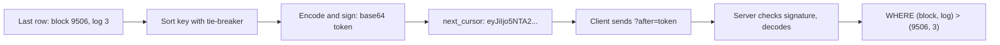

**Story.** Swaps are sorted by block. Block 9,506 holds seven swaps. A page ends in the middle of that block. If the cursor holds only the block number, the next page either repeats those swaps or skips them. Adding the log index as a tie-breaker makes every row's key unique, and the next page starts exactly after the last row.

**How it works.**

1. Sort by a key that is unique. Add a tie-breaker column, such as `log_index` or the primary key.
2. Take the key of the last row on the page.
3. Encode it, and the sort order and filters, into one token. Sign it if the content is sensitive.
4. Return it as `next_cursor`. The client treats it as opaque.
5. On the next call, decode it and seek: `WHERE (block_height, log_index) > (9506, 3)`.
6. Reject a cursor used with different filters, so a page never mixes two queries.

### In code

**Cursor on block only.**

```text
query: rows that match, up to the limit
page 1: the first four rows
cursor = block of the last row           # block=9506, plain text
page 2 with block > cursor:
  the rest of block 9506 is skipped
page 2 with block >= cursor:
  the start of block 9506 repeats
```

```go
func where(match func(Swap) bool, limit int) []Swap {
	var out []Swap
	for _, s := range swaps {
		if match(s) && len(out) < limit {
			out = append(out, s)
		}
	}
	return out
}

	p1 := where(func(s Swap) bool { return true }, 4)
	fmt.Println("page 1:", p1, "cursor: block=9506")
	fmt.Println("block > 9506:", where(func(s Swap) bool { return s.Block > 9506 }, 4), "(logs 3 to 6 are skipped)")
	fmt.Println("block >= 9506:", where(func(s Swap) bool { return s.Block >= 9506 }, 4), "(logs 0 to 2 repeat)")
```

**Opaque cursor with a tie-breaker.**

```text
sort by block, then log: together unique
cursor holds the last key, the sort version, the filters
sign it with a server secret, base64 encode it
request has a cursor:
  signature wrong: 400
  filter in the token differs from this request: 400
  sort version differs: 400, start again
  use the key inside
rows after the key: (block, log) > (key block, key log)
a full page of 4: next_cursor = a new token
fewer: next_cursor stays null, the client stops
```

```go
type token struct {
	Block, Log, Sort int
	Pool             string
}

func encode(t token) string {
	raw, _ := json.Marshal(t)
	mac := hmac.New(sha256.New, key)
	mac.Write(raw)
	return base64.URLEncoding.EncodeToString(append(mac.Sum(nil), raw...))
}

func list(version int) http.HandlerFunc {
	return func(w http.ResponseWriter, r *http.Request) {
		pool := r.URL.Query().Get("pool")
		after := token{Block: -1, Log: -1, Sort: version, Pool: pool}
		if c := r.URL.Query().Get("cursor"); c != "" {
			t, err := decode(c)
			switch {
			case err != nil:
				http.Error(w, err.Error(), http.StatusBadRequest)
				return
			case t.Pool != pool:
				http.Error(w, "cursor was made for other filters", http.StatusBadRequest)
				return
			case t.Sort != version:
				http.Error(w, "cursor is from an old sort: start again", http.StatusBadRequest)
				return
			}
			after = t
		}
		rows := where(func(s Swap) bool {
			return s.Block > after.Block || (s.Block == after.Block && s.Log > after.Log)
		}, 4)
		var next *string
		if len(rows) == 4 {
			last := rows[3]
			c := encode(token{last.Block, last.Log, version, pool})
			next = &c
		}
		json.NewEncoder(w).Encode(map[string]any{"rows": rows, "next_cursor": next})
	}
}
```

Run it: `handbook/code/13-cursor-design/` with `go run .`

**What goes wrong.** A sort key that is not unique. Rows with equal keys at a page edge are skipped or repeated, and nobody notices on small test data. The second failure is a readable cursor: clients start building their own, and the key can never change. Fix: a tie-breaker, and an opaque token.

**Where you use it.**

- Chain data: `(block_height, log_index)` is unique and matches the index.
- A table with timestamps: `(created_at, id)`, because two rows can share a timestamp.
- Stripe and Slack: `starting_after` and `next_cursor` are this pattern.

> A cursor is the last row's unique key, made opaque, so the next page seeks straight past it and never skips or repeats a row.

▶ Watch it move: [Cursor design: opaque token and tie-breaker](visual/13-cursor-design.html)


## Filtering and sorting

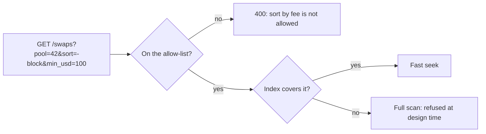

**Story.** An analyst asks for the swaps of pool 42, newest first, worth at least 100 USD. The API allows filters on `pool`, `day` and `min_usd`, and sorting by block. Another caller tries `sort=fee`. There is no index for that, so the API answers `400` and names the allowed sorts.

**How it works.**

1. Filters are query parameters: `?pool=42&day=2026-10-01`.
2. Sorting is one parameter: `sort=-block` means newest first.
3. Each allowed filter and sort is on an allow-list, and each one has an index behind it.
4. Unknown or slow fields get `400` with the list of allowed ones.
5. Filters and sort go into the cursor, so the next page uses the same query.

### In code

**Any field allowed.**

```text
pool given: read only that pool's index
no pool: read the whole table
for each row read: count it
  keep it if it passes the filters
sort=fee: sort everything kept        # no index on fee
else: sort by block
answer the first page
each next page: run all of it again
more callers: more whole-table reads at once
```

```go
func run(pool, minUSD int, sortBy string, limit, budget int) ([]Swap, error) {
	source := table
	if rows, ok := byPool[pool]; ok && pool >= 0 {
		source = rows
	}
	var hits []Swap
	for _, s := range source {
		rowsRead++
		if budget > 0 && rowsRead > budget {
			return nil, errTimeout
		}
		if s.USD >= minUSD && (pool < 0 || s.Pool == pool) {
			hits = append(hits, s)
		}
	}
	if sortBy == "fee" {
		sort.Slice(hits, func(i, j int) bool { return hits[i].Fee < hits[j].Fee })
	} else {
		sort.Slice(hits, func(i, j int) bool { return hits[i].Block > hits[j].Block })
	}
	return hits[:min(limit, len(hits))], nil
}

	total := 0
	for page := 1; page <= 3; page++ {
		get(anyField.URL, "sort=fee")
		total += rowsRead
		fmt.Println("sort=fee, page", page, "rows read", rowsRead)
	}
	fmt.Println("three pages:", total, "rows read for one caller")
```

**An allow-list with indexes.**

```text
allowed filters: pool, day, min_usd; allowed sort: block
each one has an index behind it
filter not on the list: 400, stop
sort not on the list: 400, name the allowed sorts, stop
start from the query, or from the cursor if one was sent
run it with a limit on rows read
over the limit: answer query-timeout, stop
answer the rows and a cursor holding the filters
```

```go
var allowedSorts = map[string]bool{"block": true, "-block": true}
var allowedFilters = map[string]bool{"pool": true, "day": true, "min_usd": true, "sort": true, "cursor": true}

func handler(allowList bool) http.HandlerFunc {
	return func(w http.ResponseWriter, r *http.Request) {
		q := r.URL.Query()
		if allowList {
			for f := range q {
				if !allowedFilters[f] {
					http.Error(w, "unknown filter "+f, http.StatusBadRequest)
					return
				}
			}
			if s := q.Get("sort"); s != "" && !allowedSorts[s] {
				http.Error(w, "allowed sorts: block, -block", http.StatusBadRequest)
				return
			}
		}
		st := state{Pool: atoi(q.Get("pool"), -1), MinUSD: atoi(q.Get("min_usd"), 0), Sort: strings.TrimPrefix(q.Get("sort"), "-")}
		if c := q.Get("cursor"); c != "" { // filters and sort ride in the cursor
			raw, _ := base64.URLEncoding.DecodeString(c)
			json.Unmarshal(raw, &st)
		}
		budget := 0
		if allowList {
			budget = scanBudget
		}
		rows, err := run(st.Pool, st.MinUSD, st.Sort, 100, budget)
		if errors.Is(err, errTimeout) {
			http.Error(w, "query-timeout: narrow the filters", http.StatusServiceUnavailable)
			return
		}
		raw, _ := json.Marshal(st)
		json.NewEncoder(w).Encode(map[string]any{"rows": len(rows), "next_cursor": base64.URLEncoding.EncodeToString(raw)})
	}
}
```

Run it: `handbook/code/13-filtering-and-sorting/` with `go run .`

**What goes wrong.** Allowing any field. One caller sorts a big table by an unindexed column, and the database scans every row for every page. The whole API slows for everyone. Fix: an allow-list backed by indexes, and a query timeout.

**Where you use it.**

- A warehouse API over StarRocks: filters that match the partition and sort key, such as day and address.
- An admin list: more freedom is fine, because the table is small.
- A search need that outgrows filters: move it to a search engine, not to more query parameters.

> Filters and sorts are an allow-list with an index behind each one, so no caller can make the database scan the whole table.

▶ Watch it move: [Filtering and sorting](visual/13-filtering-and-sorting.html)


## Idempotency keys

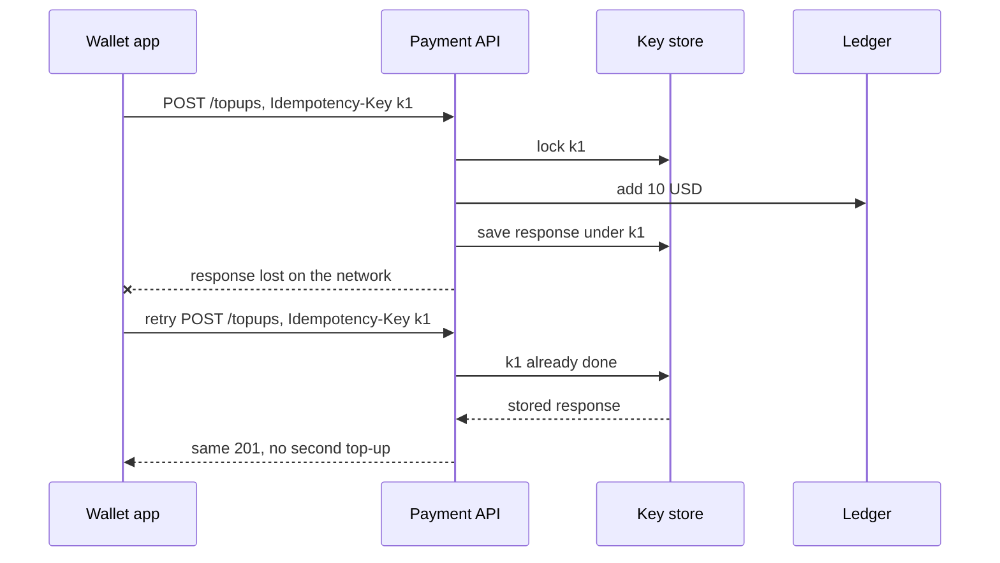

**Story.** A user tops up a wallet with 10 USD from a phone on a train. The server adds the money, but the response dies in a tunnel. The app retries. Without a key, the user pays twice. With the same `Idempotency-Key`, the server sees it already did this and sends the stored answer.

**How it works.**

1. The client makes a unique key per intended action, such as a UUID, and sends it as a header.
2. The server locks the key, so two copies arriving at once do not both run.
3. It does the write and saves the response under the key, in the same database transaction.
4. A retry with the same key finds the saved response and returns it. No second effect.
5. A key reused with a different body gets `422`.
6. Keys expire after about 24 hours, which covers every realistic retry.

### In code

**Without a key.**

```text
app: POST /topups with the amount
API: read the amount
API: add it to the ledger
API: build the 201 answer
the answer is lost in the tunnel
app: timeout: send POST /topups again
API: a fresh request, no way to know: add it again
```

```go
	raw, _ := io.ReadAll(r.Body)
	var req struct {
		USD int `json:"usd"`
	}
	json.Unmarshal(raw, &req)
	a.ledger += req.USD
	answer := fmt.Sprintf(`{"balance":%d}`, a.ledger)
	w.WriteHeader(http.StatusCreated)
	fmt.Fprint(w, answer)

	send(srv.URL, "", 10) // the answer is lost in the tunnel
	send(srv.URL, "", 10) // the app retries
	fmt.Println("user paid once, ledger holds", a.ledger, "USD")
```

**With an Idempotency-Key.**

```text
app: make one key for this tap
every retry of this tap sends the same key
API: lock the key                 # a second copy waits here
key already stored:
  body differs: answer 422, do nothing
  body same: send the stored answer, ledger untouched
new key: add to the ledger
save the answer under the key, in the same transaction
key in a cache instead: a crash after the money loses the key
```

```go
func (a *API) topup(w http.ResponseWriter, r *http.Request) {
	raw, _ := io.ReadAll(r.Body)
	var req struct {
		USD int `json:"usd"`
	}
	json.Unmarshal(raw, &req)
	a.mu.Lock() // lock the key: a second copy of this request waits here
	defer a.mu.Unlock()
	key := r.Header.Get("Idempotency-Key")
	if a.useKeys && key != "" {
		if s, ok := a.keys[key]; ok {
			if s.Body != string(raw) {
				http.Error(w, "this key was used for another request", http.StatusUnprocessableEntity)
				return
			}
			w.WriteHeader(s.Status) // the stored answer: the ledger is not touched
			fmt.Fprint(w, s.Answer)
			return
		}
	}
	a.ledger += req.USD
	answer := fmt.Sprintf(`{"balance":%d}`, a.ledger)
	if a.keyApart && a.crashOnce {
		a.crashOnce = false // money committed, the key never reached the cache
		panic(http.ErrAbortHandler)
	}
	if a.useKeys && key != "" {
		a.keys[key] = &Stored{string(raw), http.StatusCreated, answer} // same transaction
	}
	w.WriteHeader(http.StatusCreated)
	fmt.Fprint(w, answer)
}

	code, answer := send(srv.URL, "k1", 10)
	code, answer = send(srv.URL, "k1", 10)
```

Run it: `handbook/code/13-idempotency-key/` with `go run .`

**What goes wrong.** The key lives in a cache and the write lives in the database. The server crashes between the two. Now the money moved but the key was never saved, and the retry pays again. Fix: store the key in the same transaction as the write. Also scope keys to the caller, so two clients cannot collide.

**Where you use it.**

- Payments and top-ups: every `POST` that moves money takes a key.
- Webhook receivers: the event id is the key. A duplicate delivery is dropped.
- Agent tools: agents retry and loop, so a paid or writing tool needs a key even more than a human client does.

> The client names the action once, and the server remembers the answer, so a retry returns the same result instead of doing it twice.

▶ Watch it move: [Idempotency key](visual/13-idempotency-key.html)

## Long-running operations: 202 Accepted

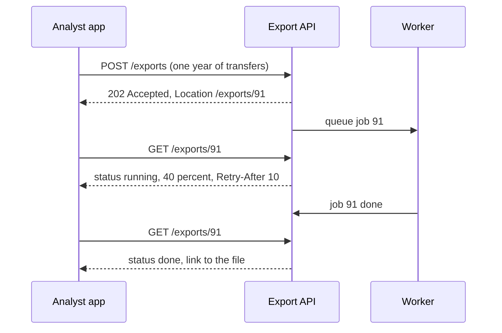

**Story.** An analyst asks for a year of transfers as a file. Building it takes many minutes. The API does not hold the request open. It answers `202 Accepted` with a link to a job. The app checks the job every few seconds, shows progress, and downloads the file when it is ready.

**How it works.**

1. The client sends the request, with an idempotency key.
2. The server stores a job and answers `202 Accepted` with `Location: /exports/91`.
3. A worker runs the job in the background.
4. The client polls the job resource. The answer carries the status and `Retry-After`.
5. When done, the job holds the result or a link to it. On failure, it holds a problem details error.
6. Optionally, the server also sends a webhook when the job ends.

### In code

**Request held open.**

```text
POST /exports: count a new export
  build the file inside the request   # takes much longer than the cut
  answer with the file
load balancer: idle too long: close the connection
app: timeout: send POST /exports again
  a third time, a new copy each time
```

```go
func (h *Held) ServeHTTP(w http.ResponseWriter, r *http.Request) {
	h.mu.Lock()
	h.started++
	h.mu.Unlock()
	time.Sleep(100 * time.Millisecond) // building the file, a heavy job
	fmt.Fprint(w, "file")
}

	lb := &http.Client{Timeout: 20 * time.Millisecond} // the load balancer's cut
	for try := 1; try <= 3; try++ {
		_, err := lb.Post(srv.URL, "", nil)
		fmt.Println("try", try, "cut:", err != nil)
	}
	time.Sleep(150 * time.Millisecond)
	h.mu.Lock()
	fmt.Println("copies of the same export started:", h.started)
```

**202 and a job resource.**

```text
POST /exports with an idempotency key
  key seen: use its job, create nothing
  new key: store job 91 as queued, put it on the queue
  answer 202 with Location /exports/91
worker: take the job, state = running, set progress
GET /exports/91:
  not done: answer the job plus Retry-After 10
  done: answer the job with the file link
worker at 100 percent: state = done, set the file
  a webhook is set: POST the job to it
```

```go
func (a *API) create(w http.ResponseWriter, r *http.Request) {
	key := r.Header.Get("Idempotency-Key")
	id, seen := a.keys[key]
	if !seen {
		id = 91 + len(a.jobs)
		a.jobs[id] = &Job{ID: id, State: "queued"}
		a.keys[key] = id
		a.queue = append(a.queue, id)
	}
	w.Header().Set("Location", "/exports/"+strconv.Itoa(id))
	w.WriteHeader(http.StatusAccepted)
}

func (a *API) poll(w http.ResponseWriter, r *http.Request) {
	id, _ := strconv.Atoi(r.PathValue("id"))
	job, ok := a.jobs[id]
	if !ok {
		http.Error(w, "no such job", http.StatusNotFound)
		return
	}
	if job.State != "done" {
		w.Header().Set("Retry-After", "10")
	}
	json.NewEncoder(w).Encode(job)
}

func (a *API) work(id, progress int) {
	job := a.jobs[id]
	job.State, job.Progress = "running", progress
	if progress == 100 {
		job.State, job.File = "done", "/files/export-"+strconv.Itoa(id)+".csv"
		if a.webhook != "" {
			body, _ := json.Marshal(job)
			res, err := http.Post(a.webhook, "application/json", strings.NewReader(string(body)))
			if err == nil {
				res.Body.Close()
			}
		}
	}
}
```

Run it: `handbook/code/13-long-running-operations/` with `go run .`

**What goes wrong.** Holding an HTTP request open for minutes. Proxies and load balancers cut it, the client retries, and the server starts a second copy of the job. Fix: `202` and a job resource, plus an idempotency key on the `POST`.

**Where you use it.**

- Exports, reports and re-indexing a range of blocks.
- Cloud APIs: creating a database or a cluster returns an operation to poll.
- Agent tools: return a job id at once, and give the model a tool to check it, so a call never hits the host's timeout.

> Work longer than a request returns 202 with a job resource, and the client polls it or gets a webhook, so no connection is held open.

▶ Watch it move: [Long-running operations: 202 Accepted](visual/13-long-running-operations.html)


## Batch and bulk endpoints

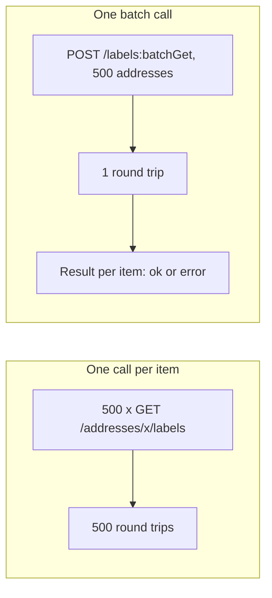

**Story.** An agent screens 500 addresses. One call per address means 500 round trips and 500 hits on the rate limit. A batch endpoint takes all 500 in one call. Three addresses are malformed. The answer lists 497 results and three errors, each next to its own address.

**How it works.**

1. A batch endpoint takes a list of items, up to a stated maximum.
2. The server processes them, in one query where it can.
3. The answer holds one result per item, in the same order, each with its own status.
4. A partial failure is normal: the call is `200`, and the errors are per item.
5. A batch write carries an idempotency key, so a retry does not apply it twice.

### In code

**One call per address.**

```text
for each address:
  budget of 5 this minute used up: wait for the next minute
  send one GET, the database runs one query
  address malformed: that call gets its own 400
total: 500 calls, 500 queries, 100 minutes
```

```go
const perMinute = 5

func valid(a string) bool { return len(a) == 42 && a[:2] == "0x" }

func oneByOne(as []string) (calls, bad, minutes int) {
	used := 0
	for _, a := range as {
		if used == perMinute {
			minutes++
			used = 0
		}
		used++
		calls++
		queries++
		if !valid(a) {
			bad++
		}
	}
	return calls, bad, minutes + 1
}
```

**One batch call.**

```text
POST /labels:batchGet with the addresses
more than 1,000: 413, stop
one query for all the valid addresses
for each input, in order:
  valid: a result with its labels
  invalid: a result with its own error
answer 200 with one result per input
the other API: any bad item: 400 for the whole call
batch write: key not seen: apply and remember the key
  key seen: apply nothing, answer the same
```

```go
const maxBatch = 1000

func batchGet(w http.ResponseWriter, r *http.Request) {
	var req struct{ Addresses []string }
	json.NewDecoder(r.Body).Decode(&req)
	if len(req.Addresses) > maxBatch {
		http.Error(w, fmt.Sprintf("at most %d per call", maxBatch), http.StatusRequestEntityTooLarge)
		return
	}
	queries++ // one query for all the valid addresses
	out := make([]Result, len(req.Addresses))
	for i, a := range req.Addresses {
		if valid(a) {
			out[i] = Result{Address: a, Labels: []string{"Exchange"}}
		} else {
			out[i] = Result{Address: a, Error: "invalid address"}
		}
	}
	json.NewEncoder(w).Encode(out)
}

func allOrNothing(w http.ResponseWriter, r *http.Request) {
	var req struct{ Addresses []string }
	json.NewDecoder(r.Body).Decode(&req)
	for _, a := range req.Addresses {
		if !valid(a) {
			http.Error(w, "invalid request", http.StatusBadRequest)
			return
		}
	}
	json.NewEncoder(w).Encode(req.Addresses)
}

func (b *Writes) ServeHTTP(w http.ResponseWriter, r *http.Request) {
	key := r.Header.Get("Idempotency-Key")
	var req struct{ Labels []string }
	json.NewDecoder(r.Body).Decode(&req)
	if !b.seen[key] {
		b.seen[key] = true
		b.applied += len(req.Labels)
	}
	json.NewEncoder(w).Encode(map[string]any{"atomic": true, "applied": b.applied})
}
```

Run it: `handbook/code/13-batch-endpoints/` with `go run .`

**What goes wrong.** All or nothing by accident. One bad item fails the whole batch with `400`, and the client cannot tell which one. Or no size limit, so one call times out. Fix: per-item results, a maximum batch size, and a clear rule on whether a batch write is atomic.

**Where you use it.**

- Screening or enrichment of many addresses at once.
- Graph tools: a batch query tool that runs several anchored queries in one call.
- Bulk imports: upload a file to a job resource instead of a giant request.

> A batch endpoint takes many items in one call and answers per item, with a size limit, so one bad item never hides the other results.

▶ Watch it move: [Batch and bulk endpoints](visual/13-batch-endpoints.html)


## ETags and safe concurrent updates

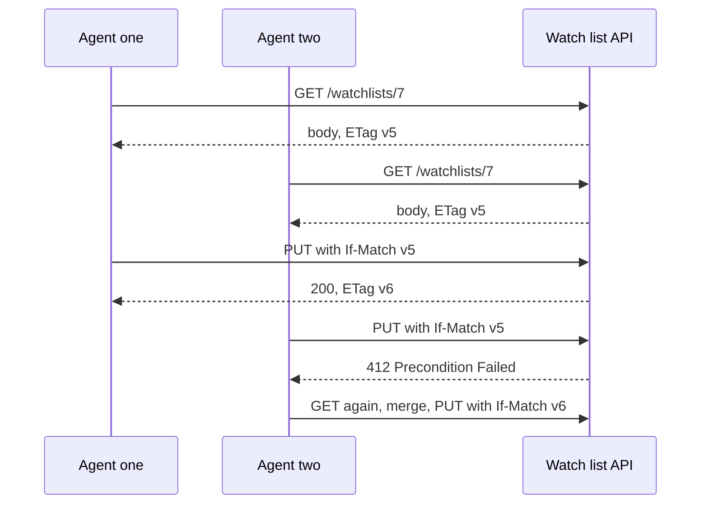

**Story.** Two agents edit the same watch list of addresses. Both read it at version 5. Agent one saves first. Agent two tries to save over it with a stale copy. The server refuses, so agent one's change is not lost.

**How it works.**

1. A read returns the resource and an ETag, a version stamp.
2. A write sends the stamp back in the `If-Match` header.
3. If the stamp still matches, the server writes and returns a new stamp.
4. If someone wrote in between, the server answers `412 Precondition Failed`.
5. The loser re-reads, merges, and tries again with the new stamp.

### In code

```text
on GET /watchlists/7:
  tag = "v" + version              # a counter, never a timestamp
  if request.If-None-Match == tag: answer 304, no body
  answer 200 with the list and ETag: tag
on PUT /watchlists/7 with a new list:
  if checkETag and request.If-Match != tag:
    answer 412 Precondition Failed   # a stale copy: write nothing
  list = new list                    # PUT replaces the whole list
  version = version + 1
  answer 200 with ETag: "v" + version
client, on 412:
  GET again, add its own change to the fresh list, PUT with the new ETag
```

```go
func (s *Store) etag() string {
	if s.useStamp { // the bug: a millisecond timestamp
		return `"t` + strconv.FormatInt(s.stampMs(), 10) + `"`
	}
	return `"v` + strconv.Itoa(s.version) + `"` // a counter
}

func (s *Store) ServeHTTP(w http.ResponseWriter, r *http.Request) {
	s.mu.Lock()
	defer s.mu.Unlock()
	switch r.Method {
	case http.MethodGet:
		tag := s.etag()
		if r.Header.Get("If-None-Match") == tag {
			w.WriteHeader(http.StatusNotModified) // your copy is still good
			return
		}
		w.Header().Set("ETag", tag)
		io.WriteString(w, s.addrs)
	case http.MethodPut:
		if s.checkETag && r.Header.Get("If-Match") != s.etag() {
			w.WriteHeader(http.StatusPreconditionFailed) // stale copy: refuse
			return
		}
		body, _ := io.ReadAll(r.Body)
		s.addrs = string(body)
		s.version++ // a counter never repeats
		w.Header().Set("ETag", s.etag())
		w.WriteHeader(http.StatusOK)
	}
}

// agent two, after a 412: read again, merge, retry with the new tag
_, two, tagTwo = get(u, nil)         // "A B C", "v6"
c, tagTwo = put(u, two+" D", tagTwo) // 200, "v7"
```

Run it: `handbook/code/13-etag-concurrent-updates/` with `go run .`

**What goes wrong.** A timestamp as the ETag. Two writes in the same millisecond get the same stamp, and one silently overwrites the other. Fix: a counter or a hash of the content.

**Where you use it.**

- Any shared document or configuration edited by more than one client.
- HTTP caches: `If-None-Match` with the ETag gives `304 Not Modified` and saves the body.
- Agent harnesses where several agents may touch one record.

> An ETag turns "last write wins" into "a stale write fails", so nobody's change is lost silently.

▶ Watch it move: [ETags and safe concurrent updates](visual/13-etag-concurrent-updates.html)

## Conditional requests and HTTP caching

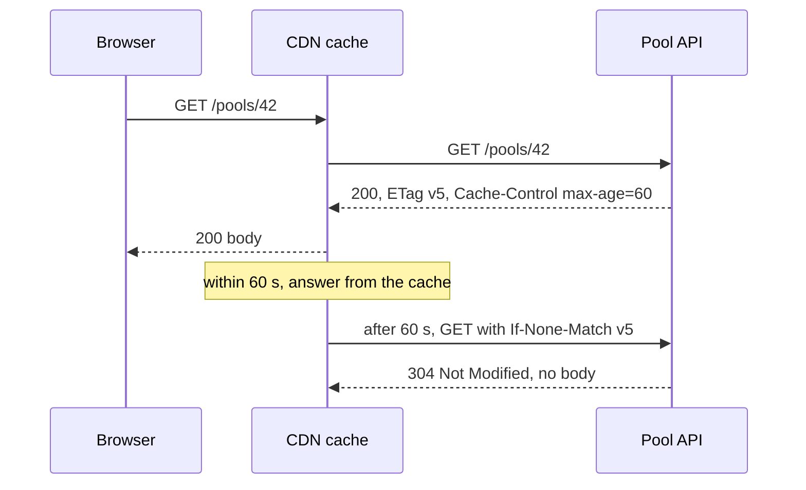

**Story.** Thousands of browsers show pool 42. The pool API answers once with `Cache-Control: max-age=60` and an ETag. For a minute the CDN (Content Delivery Network) answers every browser by itself. After that it asks the API "still v5?". The API answers `304 Not Modified` with no body, and the CDN keeps serving.

**How it works.**

1. `Cache-Control` says who may cache an answer and for how long: `public, max-age=60`, or `private`, or `no-store`.
2. Within `max-age`, a cache answers without asking the server.
3. After that, it revalidates with `If-None-Match: <etag>` or `If-Modified-Since: <date>`.
4. If nothing changed, the server answers `304 Not Modified` with no body.
5. If it changed, the server sends `200` with the new body and a new ETag.
6. `Vary` names the request headers that change the answer, such as `Authorization`.

### In code

**Cache-Control, ETag and 304.**

```text
CDN: look up the copy for this URL
copy younger than max-age: serve it, the API does no work
copy stale: ask the API with If-None-Match: its ETag
no copy: ask the API
API: set Cache-Control public, max-age=60, and the ETag
  If-None-Match equals the ETag: answer 304, no body
  else: answer 200 with the body
CDN on 304: keep the copy, restart its minute
CDN on 200: store the new copy with the new ETag
```

```go
func (c *CDN) ServeHTTP(w http.ResponseWriter, r *http.Request) {
	key := r.URL.Path
	if e, ok := c.copies[key]; ok && e.varyOn != "" {
		key += "|" + r.Header.Get(e.varyOn) // one copy per value of that header
	}
	e, ok := c.copies[key]
	if ok && now-e.storedAt < e.maxAge {
		c.hits++
		w.Header().Set("ETag", e.etag)
		fmt.Fprint(w, e.body) // fresh: the origin does no work
		return
	}
	if ok {
		r.Header.Set("If-None-Match", e.etag) // stale: ask if it changed
	}
	rec := httptest.NewRecorder()
	c.origin.ServeHTTP(rec, r)
	c.calls++
	res := rec.Result()
	if res.StatusCode == http.StatusNotModified {
		e.storedAt = now
		c.copies[key] = e
		fmt.Fprint(w, e.body)
		return

	mux.HandleFunc("GET /pools/42", func(w http.ResponseWriter, r *http.Request) {
		tag := `"v` + strconv.Itoa(a.version) + `"`
		w.Header().Set("Cache-Control", "public, max-age=60")
		w.Header().Set("ETag", tag)
		if r.Header.Get("If-None-Match") == tag {
			w.WriteHeader(http.StatusNotModified)
			return
		}
		a.bodiesSent++
		fmt.Fprintf(w, "pool 42 at %s", tag)
	})
```

**A personal answer cached as public.**

```text
API: mark the answer with its Cache-Control
CDN: public: store it under the URL
CDN: next caller of the URL gets that copy
fix: a personal answer says private
  CDN stores nothing and passes it through
fix: or Vary: Authorization
  CDN keeps one copy per token
block below the safe head: public, one year, immutable
block above it: no-store
```

```go
	if ok && now-e.storedAt < e.maxAge {
		c.hits++
		w.Header().Set("ETag", e.etag)
		fmt.Fprint(w, e.body) // fresh: the origin does no work
		return

	cc := res.Header.Get("Cache-Control")
	if strings.Contains(cc, "public") {
		vary := res.Header.Get("Vary")
		if vary != "" {
			c.copies[r.URL.Path] = entry{varyOn: vary, storedAt: -1 << 30}
			key = r.URL.Path + "|" + r.Header.Get(vary)
		}

	if e, ok := c.copies[key]; ok && e.varyOn != "" {
		key += "|" + r.Header.Get(e.varyOn) // one copy per value of that header
	}

	mux.HandleFunc("GET /me/watchlists", func(w http.ResponseWriter, r *http.Request) {
		w.Header().Set("Cache-Control", a.policy)
		if a.vary != "" {
			w.Header().Set("Vary", a.vary)
		}
		fmt.Fprintf(w, "watch list of %s", r.Header.Get("Authorization"))
	})

	mux.HandleFunc("GET /blocks/{n}", func(w http.ResponseWriter, r *http.Request) {
		n, _ := strconv.Atoi(r.PathValue("n"))
		if n <= safeHead {
			w.Header().Set("Cache-Control", "public, max-age=31536000, immutable")
		} else {
			w.Header().Set("Cache-Control", "no-store")
		}
		fmt.Fprint(w, "block ", n)
	})
```

Run it: `handbook/code/13-http-caching/` with `go run .`

**What goes wrong.** A personal answer cached as `public`. One user's data is served to the next user from the CDN. Fix: `private` or `no-store` for anything tied to a user, and `Vary` on the headers that matter.

**Where you use it.**

- Public reads: pool metadata, token lists, docs pages.
- A browser app: `304` keeps repeat loads cheap.
- Chain data below the safe head never changes, so it can be cached for a long time. The head itself cannot.

> Cache-Control says how long a copy is good, the ETag lets a cache ask "still the same?", and 304 answers yes without sending the body again.

▶ Watch it move: [Conditional requests and HTTP caching](visual/13-http-caching.html)


## The gateway and rate limits

```mermaid
flowchart LR
  C["Clients"] --> T["Gateway: TLS ends here"]
  T --> AU["Check token"]
  AU --> RL["Rate limit per caller"]
  RL -- over --> X["429 plus Retry-After"]
  RL -- ok --> RT{"Route by path"}
  RT -- "/mcp" --> P["Proxy pods"]
  RT -- "/api" --> W["Web pods"]
  RL --> M["Logs and metrics"]
```

**Story.** A free tier of a graph API lets each caller run a few queries per minute. An agent sees `RateLimit-Remaining: 3` and slows down. A badly written script ignores it and gets `429` with `Retry-After: 20`. It waits 20 seconds instead of retrying at once.

**How it works.**

1. Every request enters through one front door, the gateway.
2. It ends TLS (Transport Layer Security), so services behind it get plain, checked traffic.
3. It checks the token and counts calls per caller.
4. Each response carries `RateLimit-Limit`, `RateLimit-Remaining` and `RateLimit-Reset`.
5. Over the budget, it answers `429` with `Retry-After`.
6. Otherwise it routes by path and records logs and metrics.

### In code

**Limits with Retry-After.**

```text
every request enters the gateway       # TLS ends here
read the bearer token
  none: 401, stop
window = now / 60, key = caller + window
reset = seconds left in this window
used[key] >= 5:
  set Retry-After = reset
  count 429 for this caller, answer 429, stop   # pods never see it
used[key] += 1
set RateLimit-Limit 5, Remaining 5 - used, Reset
count 200 for this caller
forward to the proxy pods
client: Remaining low? space the next calls
client: on 429, wait Retry-After seconds
```

```go
func (g *Gateway) ServeHTTP(w http.ResponseWriter, r *http.Request) {
	caller, ok := strings.CutPrefix(r.Header.Get("Authorization"), "Bearer ")
	if !ok || caller == "" {
		g.count("anonymous", 401)
		http.Error(w, "no token", http.StatusUnauthorized)
		return
	}
	window := g.now / 60
	key := caller + "@" + strconv.Itoa(window)
	reset := (window+1)*60 - g.now
	if g.used[key] >= limit {
		if g.retryAfter {
			w.Header().Set("Retry-After", strconv.Itoa(reset))
		}
		g.count(caller, 429)
		http.Error(w, "too many requests", http.StatusTooManyRequests)
		return // the pods never see this call
	}
	g.used[key]++
	w.Header().Set("RateLimit-Limit", strconv.Itoa(limit))
	w.Header().Set("RateLimit-Remaining", strconv.Itoa(limit-g.used[key]))
	w.Header().Set("RateLimit-Reset", strconv.Itoa(reset))
	g.count(caller, 200)
	g.podCalls++
	g.next.ServeHTTP(w, r)
}

func (g *Gateway) count(caller string, code int) { g.codes[caller+" "+strconv.Itoa(code)]++ }
```

**429 with no Retry-After.**

```text
used[key] >= 5:
  (bug) no Retry-After header
  answer 429, stop
every client that got a bare 429:
  retries in the same second
  load on the gateway and pods grows
gateway config: free users must not see labels
  delete the field named labels
pods rename labels to label_names: nothing deletes it
fix: every 429 carries Retry-After
  each client waits that long, plus a random spread
fix: the labels rule lives in the service, with tests
```

```go
	if g.used[key] >= limit {
		if g.retryAfter {
			w.Header().Set("Retry-After", strconv.Itoa(reset))
		}
		g.count(caller, 429)
		http.Error(w, "too many requests", http.StatusTooManyRequests)
		return // the pods never see this call
	}

	for c := 0; c < 300; c++ {
		bare[0]++               // no hint: retry at once
		told[20+rng.Intn(20)]++ // Retry-After 20, plus a spread
	}

		json.NewEncoder(w).Encode(map[string]any{"address": "0xab", labelField: []string{"Exchange"}})

func freeFilter(body map[string]any) { delete(body, "labels") }
```

Run it: `handbook/code/13-gateway-rate-limits/` with `go run .`

**What goes wrong.** A `429` with no `Retry-After`. Every client retries at once and the overload gets worse. The second failure is business logic inside the gateway: it becomes a hidden service that nobody tests. Fix: always send `Retry-After`, and keep the gateway to cross-cutting work.

**Where you use it.**

- Traefik in front of a Kubernetes cluster: `/mcp` to the proxy pods, `/api` to the web pods, one certificate.
- A paid API: limits per tier, and metrics on `401`, `403` and `429` rates so abuse shows on a board.
- Chapter 15 covers ingress controllers in more depth.

> The gateway does the same checks for every service, and a `429` always says when to come back.

▶ Watch it move: [The gateway and rate limits](visual/13-gateway-rate-limits.html)

## Rate-limit algorithms: token bucket and sliding window

```mermaid
flowchart LR
  T["Refill: 1 token every 12 s"] --> B["Bucket: holds at most 5"]
  R["Request"] --> Q{"Token in the bucket?"}
  B --> Q
  Q -- yes --> P["Take one, pass"]
  Q -- no --> X["429, Retry-After until next token"]
```

**Story.** The free tier allows five queries per minute. An agent sends three queries at once, then nothing for a while. A token bucket lets the burst through, because it saved up tokens. A script that sends one query every second runs out after five and then gets one query per 12 seconds.

**How it works.**

1. Each caller has a bucket that holds up to five tokens.
2. Tokens drip in at a steady rate: five per minute is one every 12 seconds.
3. A request takes one token. With no token, it gets `429` and `Retry-After` until the next one.
4. A fixed window counts calls per calendar minute. A sliding window counts the last 60 seconds from now.
5. With many gateway copies, the counters live in one shared store, such as Redis, updated atomically.

### In code

**Token bucket.**

```text
each caller has a bucket: at most 5 tokens
one token drips in every 12 seconds
on a call: add what dripped in since the last call
never above 5 tokens
a whole token there: spend it, the call passes
no token: wait = seconds until the next one drips in
  answer 429 with Retry-After: wait
```

```go
type Bucket struct {
	capacity, refill int
	credit, last     int
}

func (b *Bucket) Take(now int) (bool, int) {
	b.credit = min(b.capacity*b.refill, b.credit+now-b.last)
	b.last = now
	if b.credit >= b.refill {
		b.credit -= b.refill
		return true, 0
	}
	return false, b.refill - b.credit
}

func (g *Gateway) ServeHTTP(w http.ResponseWriter, r *http.Request) {
	g.mu.Lock()
	defer g.mu.Unlock()
	caller := r.Header.Get("X-Caller")
	b, ok := g.buckets[caller]
	if !ok {
		b = &Bucket{capacity: 5, refill: 12, credit: 60, last: g.now}
		g.buckets[caller] = b
	}
	if ok, wait := b.Take(g.now); !ok {
		w.Header().Set("Retry-After", strconv.Itoa(wait))
		w.WriteHeader(http.StatusTooManyRequests)
	}
}
```

**Fixed window and per-copy counters.**

```text
fixed window: minute number = second / 60
  a new minute: the count goes back to 0
  count at the limit: refuse
  else: count + 1, pass
per-copy counter: each gateway copy has its own count
  a caller spread over 4 copies gets 5 per copy
sliding window: forget calls older than 60 seconds
  calls left at the limit: refuse
  else: remember this call, pass
every copy asks one shared store
```

```go
func (f *FixedWindow) Allow(second int) bool {
	if m := second / 60; m != f.window {
		f.window, f.count = m, 0
	}
	if f.count >= f.limit {
		return false
	}
	f.count++
	return true
}

func (s *Sliding) Allow(second int) bool {
	kept := s.calls[:0]
	for _, c := range s.calls {
		if second-c < 60 {
			kept = append(kept, c)
		}
	}
	s.calls = kept
	if len(s.calls) >= s.limit {
		return false
	}
	s.calls = append(s.calls, second)
	return true
}

	copies := make([]*FixedWindow, 4)
	for i := range copies {
		copies[i] = &FixedWindow{limit: 5, window: -1}
	}
		if copies[i%4].Allow(10) {
```

Run it: `handbook/code/13-rate-limit-algorithms/` with `go run .`

**What goes wrong.** A fixed window lets a caller send five calls at 12:00:59 and five more at 12:01:00: ten calls in two seconds. The second failure is a counter per gateway copy: with four copies, each caller gets four times the limit. Fix: a token bucket or a sliding window, and one shared counter.

**Where you use it.**

- A gateway in front of a public API: a token bucket per caller and per tier.
- Protecting a slow backend: a concurrency limit, how many requests at once, beside the rate limit.
- An outbound client calling someone else's API: the same bucket on your side, so you never hit their `429`.

> A token bucket refills at a steady rate and allows short bursts, and the counter is shared across gateway copies so the limit is real.

▶ Watch it move: [Rate-limit algorithms: token bucket and sliding window](visual/13-rate-limit-algorithms.html)


## Backoff with jitter

```mermaid
flowchart LR
  subgraph NoJitter["Backoff, no jitter"]
    A1["All clients retry at 1 s"] --> A2["All at 2 s"] --> A3["All at 4 s"]
  end
  subgraph Jitter["Backoff with full jitter"]
    B1["Retries spread over 0 to 1 s"] --> B2["Spread over 0 to 2 s"] --> B3["Spread over 0 to 4 s"]
  end
```

**Story.** The graph API restarts and is gone for ten seconds. A thousand agents all fail at the same moment. With plain exponential backoff, they all retry at 1 second, then all at 2, then all at 4: a wave each time. With jitter, each waits a random time inside the window. The retries arrive as a smooth trickle, and the API comes back up.

**How it works.**

1. After a failure, wait before retrying.
2. Double the wait after each failure: 1, 2, 4, 8 seconds, up to a cap.
3. Full jitter: wait a random time between zero and that number.
4. Stop after a set number of tries, and report the error.
5. If the server sent `Retry-After`, wait at least that long.
6. Retry only safe, idempotent or keyed requests, and only on errors that may pass: `429`, `503`, timeouts.

### In code

**Backoff, no jitter.**

```text
window = 1 second, doubled with each try, up to the cap
plain backoff: wait the whole window
every agent computes the same number
count the retries in each 100 ms slot
app, SDK and gateway each try 3 times
  calls = 3 x 3 x 3
```

```go
func window(try int) float64 {
	w := base
	for i := 0; i < try; i++ {
		w *= 2
	}
	return min(w, maxWait)
}

func plain(try int, _ *rand.Rand) float64 { return window(try) }

func arrivals(n int, wait func(int, *rand.Rand) float64) map[int]map[int]int {
	rng := rand.New(rand.NewSource(1))
	rounds := map[int]map[int]int{}
	for a := 0; a < n; a++ {
		at := 0.0
		for try := 0; try < 3; try++ {
			at += wait(try, rng)
			if rounds[try] == nil {
				rounds[try] = map[int]int{}
			}
			rounds[try][int(at*10)]++
		}
	}
	return rounds
}

	layers, each := 3, 3
	calls := 1
	for i := 0; i < layers; i++ {
		calls *= each
	}
	fmt.Println("app, SDK and gateway each try", each, "times: one user action, up to", calls, "calls")
```

**Backoff with full jitter.**

```text
window = 1 second, doubled with each try, up to the cap
for each try, up to 5:
  call the API
  success or a client error: stop
  full jitter: wait = random between 0 and the window
  server sent Retry-After: wait at least that long
after 5 tries: stop and report the error
```

```go
func window(try int) float64 {
	w := base
	for i := 0; i < try; i++ {
		w *= 2
	}
	return min(w, maxWait)
}

func jitter(try int, rng *rand.Rand) float64 { return rng.Float64() * window(try) }

func retry(url string, rng *rand.Rand) (tries int, waited float64, err error) {
	for try := 0; try < maxTries; try++ {
		tries++
		res, err := http.Get(url)
		if err != nil {
			return tries, waited, err
		}
		res.Body.Close()
		if res.StatusCode < 500 && res.StatusCode != http.StatusTooManyRequests {
			return tries, waited, nil
		}
		wait := jitter(try, rng)
		if s, e := strconv.Atoi(res.Header.Get("Retry-After")); e == nil {
			wait = max(wait, float64(s)) // at least what the server said
		}
		waited += wait
	}
	return tries, waited, errGaveUp
}
```

Run it: `handbook/code/13-backoff-with-jitter/` with `go run .`

**What goes wrong.** Backoff without jitter. Clients that failed together stay in lockstep and hit the server in waves, which is the thundering herd. The second failure is retries at every layer: the app, the SDK and the gateway each retry three times, which is 27 calls. Fix: jitter, a cap, and retries at one layer only.

**Where you use it.**

- Every client SDK: the AWS SDK uses exponential backoff with jitter by default.
- A Go indexer calling a chain node: retry a failed block fetch with jitter, then alert.
- Agent tool calls: the proxy retries with jitter, so the model does not loop on its own.

> Back off exponentially and add a random jitter, so clients that failed together do not all come back at the same moment.

▶ Watch it move: [Backoff with jitter](visual/13-backoff-with-jitter.html)


## Backend for Frontend (BFF)

```mermaid
flowchart LR
  WEB["Web app"] --> BW["Web BFF"]
  MOB["Phone app"] --> BM["Mobile BFF"]
  AG["Agent host"] --> BA["MCP proxy (agent BFF)"]
  BW --> S["Shared services: pools, labels, transfers"]
  BM --> S
  BA --> S
```

**Story.** The web dashboard needs a pool, its top traders and a chart. The phone app needs a small card. An agent needs bounded rows and clear error types. One general API cannot serve all three well. Each front end gets a thin backend of its own that calls the shared services and shapes the answer for its screen.

**How it works.**

1. Each kind of client gets its own backend, owned by the team that builds that client.
2. The BFF calls the shared services, often in parallel.
3. It shapes one answer for one screen: the fields that client shows, nothing more.
4. It handles the client's own concerns: session cookies for the web, small payloads for phones, bounded outputs for agents.
5. Business rules stay in the shared services, not in the BFFs.

### In code

**A thin BFF per client.**

```text
phone: GET /card/pools/42: one call
mobile BFF: list the three shared services
for each service, in parallel:
  fetch its answer, keep it
wait for all three
read only name and fee from the pool answer
read only the points from the chart answer
answer one small card: name, fee, sparkline
```

```go
func mobileBFF(pool, traders, chart string) http.HandlerFunc {
	return func(w http.ResponseWriter, r *http.Request) {
		urls := map[string]string{"pool": pool, "traders": traders, "chart": chart}
		raw := map[string][]byte{}
		var mu sync.Mutex
		var wg sync.WaitGroup
		for name, url := range urls {
			wg.Add(1)
			go func() {
				defer wg.Done()
				body := fetch(url)
				mu.Lock()
				raw[name] = body
				mu.Unlock()
			}()
		}
		wg.Wait()
		var p struct {
			Name string  `json:"name"`
			Fee  float64 `json:"fee_after_discount"`
		}
		var c struct {
			Points []int `json:"points"`
		}
		json.Unmarshal(raw["pool"], &p)
		json.Unmarshal(raw["chart"], &c)
		json.NewEncoder(w).Encode(map[string]any{"name": p.Name, "fee": p.Fee, "sparkline": c.Points})
	}
}
```

**Rules creep into the BFFs.**

```text
web BFF: TVL at least the threshold: fee minus 10 percent
mobile BFF: a copy of the rule
  but TVL more than the threshold
a pool exactly at the threshold: two fees
fix: the rule lives in the pool service, with tests
  the answer carries fee_after_discount
  both BFFs only read it
```

```go
func webFee(fee, tvl float64) float64 {
	if tvl >= threshold {
		return fee * 0.9
	}
	return fee
}

func mobileFee(fee, tvl float64) float64 {
	if tvl > threshold {
		return fee * 0.9
	}
	return fee
}

func discount(fee, tvl float64) float64 {
	if tvl >= threshold {
		return fee * 0.9
	}
	return fee
}

		"history": strings.Repeat("x", 4000), "fee_after_discount": discount(30, threshold)})
```

Run it: `handbook/code/13-backend-for-frontend/` with `go run .`

**What goes wrong.** Business logic creeps into the BFFs. The web and the phone app then compute the same price two different ways. Fix: a BFF only combines and shapes. Rules live in the services, and a rule found in two BFFs moves down.

**Where you use it.**

- A web app and a phone app with very different screens.
- A local MCP proxy is a BFF for agents: it shapes the API for a model.
- GraphQL is an alternative: one flexible endpoint instead of one BFF per client.

> A Backend for Frontend is a thin backend per kind of client that combines and shapes calls for one screen, while the business rules stay in the shared services.

▶ Watch it move: [Backend for Frontend (BFF)](visual/13-backend-for-frontend.html)


## REST, GraphQL or gRPC

```mermaid
flowchart TD
  Q{"Who calls?"} -- "browsers, public, caches matter" --> R["REST plus OpenAPI"]
  Q -- "many clients, many views of linked data" --> G["GraphQL plus DataLoader and cost limits"]
  Q -- "service to service, typed streams" --> P["gRPC plus proto"]
  Q -- "an AI agent" --> M["MCP tools over any of them"]
```

```mermaid
sequenceDiagram
  participant C as Dashboard
  participant G as GraphQL server
  participant L as DataLoader
  participant D as Database
  C->>G: 100 addresses with their labels
  G->>D: select 100 addresses
  loop each address resolver
    G->>L: labels for one address
  end
  L->>D: one select for all 100 keys
  D-->>L: all labels
  G-->>C: one response
```

**Story.** A dashboard needs an address, its labels and its last ten transfers. With REST that is three calls. With GraphQL it is one query naming exactly those fields. Behind the scenes, the labels resolver runs once per address, so 100 addresses would mean 100 database queries. DataLoader batches them into one.

**How it works.**

1. Pick by caller first, using the top picture.
2. REST: many URLs, HTTP caches work, every language understands it.
3. GraphQL: one endpoint, a typed schema, a resolver function per field. The client picks fields.
4. gRPC: binary protobuf (Protocol Buffers) messages over HTTP/2, with four call shapes: unary, server stream, client stream, two-way stream.
5. For GraphQL, batch per request with DataLoader, as in the second picture.

### In code

**REST: three calls.**

```text
GET /addresses/{a}: read the address row
GET /addresses/{a}/labels: read its labels
GET /addresses/{a}/transfers: read transfers, all 40 fields
cache in front of the API, key = the URL:
  answer saved for this URL: send it, the API does no work
  else: call the API, save the answer, send it
dashboard: call 1, call 2, call 3          # three round trips
dashboard shows 4 of the 40 fields
```

```go
	mux.HandleFunc("GET /addresses/{a}", func(w http.ResponseWriter, r *http.Request) {
		dbReads++
		fmt.Fprintf(w, `{"address":%q}`, r.PathValue("a"))
	})
	mux.HandleFunc("GET /addresses/{a}/labels", func(w http.ResponseWriter, r *http.Request) {
		dbReads++
		fmt.Fprint(w, `["Exchange"]`)
	})
	mux.HandleFunc("GET /addresses/{a}/transfers", func(w http.ResponseWriter, r *http.Request) {
		dbReads++
		row := map[string]int{}
		for f := 0; f < 40; f++ { // 40 fields per transfer, one size for all
			row[fmt.Sprintf("f%02d", f)] = f
		}
		json.NewEncoder(w).Encode([]map[string]int{row})

func cache(next http.Handler) http.Handler {
	saved := map[string]string{}
	return http.HandlerFunc(func(w http.ResponseWriter, r *http.Request) {
		if body, ok := saved[r.URL.String()]; ok {
			fmt.Fprint(w, body)
			return
		}
		rec := httptest.NewRecorder()
		next.ServeHTTP(rec, r)
		saved[r.URL.String()] = rec.Body.String()
		fmt.Fprint(w, rec.Body.String())
	})
}
```

**GraphQL: N+1 and DataLoader.**

```text
query: addresses(first 100) { labels }, only the shown fields
addresses resolver: one select for 100 addresses
without DataLoader:
  for each address: labels resolver selects its labels  # 100 more
with DataLoader:
  each labels resolver hands its key to the loader
  loader: one select for all keys
  each resolver gets its own labels
one response, exactly the fields asked for
before running: depth = deepest nesting of braces
  depth over 5: refuse, run nothing
```

```go
func selectLabels(keys []string) map[string][]string {
	sqlQueries++ // one query, however many keys
	out := map[string][]string{}
	for _, k := range keys {
		out[k] = []string{"Exchange"}
	}
	return out
}

func resolve(n int, loader bool) map[string][]string {
	addrs := selectAddresses(n)
	res := map[string][]string{}
	if !loader {
		for _, a := range addrs { // N+1: one query per address
			res[a] = selectLabels([]string{a})[a]
		}
		return res
	}
	var keys []string
	for _, a := range addrs { // each resolver only hands its key over
		keys = append(keys, a)
	}
	return selectLabels(keys) // the loader's one batch
}

func admit(query string, maxDepth int) error {
	depth, top := 0, 0
	for _, c := range query {
		if c == '{' {
			depth++
			top = max(top, depth)
		} else if c == '}' {
			depth--
		}
	}
	if top > maxDepth {
		return fmt.Errorf("refused: depth %d over %d", top, maxDepth)
	}
	return nil
}
```

**gRPC: a typed stream.**

```text
proto: message Block { height, hash }
  rpc StreamBlocks(from) returns (stream Block)
client: open one call, StreamBlocks from 100
server: content type must be application/grpc
  else refuse: raw gRPC only
for height from 100:
  send one typed Block, flush it now     # same call, many answers
client: read message after message on the same call
browser: cannot send raw gRPC
gRPC-Web proxy: turn the browser call into a gRPC call
```

```go
type Block struct {
	Height int    `json:"height"`
	Hash   string `json:"hash"`
}

func streamBlocks(w http.ResponseWriter, r *http.Request) {
	if r.Header.Get("Content-Type") != "application/grpc" {
		http.Error(w, "raw gRPC only: use a gRPC-Web proxy", http.StatusUnsupportedMediaType)
		return
	}
	enc, f := json.NewEncoder(w), w.(http.Flusher)
	for h := 100; h <= 102; h++ {
		enc.Encode(Block{h, fmt.Sprintf("0x%x", h*7919)})
		f.Flush() // each message leaves now, on the same call
	}
}

func grpcWebProxy(next http.HandlerFunc) http.HandlerFunc {
	return func(w http.ResponseWriter, r *http.Request) {
		if r.Header.Get("Content-Type") == "application/grpc-web" {
			r.Header.Set("Content-Type", "application/grpc")
		}
		next(w, r)
	}
}

	req, _ := http.NewRequest("POST", url, nil)
	req.Header.Set("Content-Type", ctype)
	res, err := http.DefaultClient.Do(req)
	if err != nil {
		panic(err)
	}
	defer res.Body.Close()
	sc := bufio.NewScanner(res.Body)
	for sc.Scan() {
		var b Block
		if json.Unmarshal(sc.Bytes(), &b) == nil {
			got = append(got, b)
		}
	}
	return res.StatusCode, got
```

Run it: `handbook/code/13-rest-graphql-grpc/` with `go run .`

**What goes wrong.** The N+1 query: one query for the list, then one per item. And a deep nested GraphQL query becomes a denial-of-service door. Fix: DataLoader, plus depth and cost limits and a timeout per query. For gRPC, the failure is reaching browsers: they need gRPC-Web and a proxy.

**Where you use it.**

- An indexer streaming decoded blocks to a sync service: gRPC server streaming, one connection, typed messages.
- The public face for browsers and agents: REST and MCP.
- A product with many front ends and a graph of data: GraphQL.

> REST for the public and browsers, GraphQL for many views of linked data, gRPC between services, and each one's main risk handled up front.

▶ Watch it move: [REST, GraphQL or gRPC](visual/13-rest-graphql-grpc.html)

## GraphQL schema and query cost

```mermaid
flowchart LR
  SDL["Schema in SDL: type Address, labels, transfers"] --> V["Validate the query against the schema"]
  V --> COST["Compute cost: depth x list sizes"]
  COST -- "over budget" --> X["Refuse before running"]
  COST -- "within budget" --> R["Run resolvers with DataLoader"]
  R --> T["Per-query timeout"]
```

**Story.** The schema says an address has labels and transfers, and a transfer has a sender, which is an address again. A caller writes a query ten levels deep: senders of transfers of senders. Each level multiplies the rows. The server computes the cost before running anything, sees millions of rows, and refuses it.

**How it works.**

1. The contract is a schema written in SDL (Schema Definition Language): types, fields, arguments.
2. Every query is checked against the schema before it runs.
3. Each list field has a size argument with a maximum, such as `transfers(first: 50)`.
4. The server computes a cost: the product of list sizes down each path, plus a depth limit.
5. Over budget means refused with an error that names the limit. Within budget runs with DataLoader and a timeout.
6. Public APIs often allow only persisted queries: known query ids, registered ahead of time.

### In code

**No cost limit.**

```text
schema: Address has transfers, Transfer has sender
query: transfers of senders of transfers, ten levels with the root
each list multiplies the rows under it by its size
every level adds its rows to the total
no check: run the resolvers
the database does all of it
a timeout stops it only after the work is done
```

```go
type Field struct {
	Name  string  `json:"name"`
	First int     `json:"first,omitempty"`
	Sub   []Field `json:"sub,omitempty"`
}

func nested(first int) Field {
	f := Field{Name: "transfers", First: first}
	for i := 0; i < 4; i++ {
		f = Field{Name: "transfers", First: first, Sub: []Field{{Name: "sender", Sub: []Field{f}}}}
	}
	return Field{Name: "address", Sub: []Field{f}}
}

func price(f Field, rows float64) (depth int, cost float64) {
	if f.First > 0 {
		rows *= float64(f.First)
	}
	depth, cost = 1, rows
	for _, s := range f.Sub {
		d, c := price(s, rows)
		depth = max(depth, d+1)
		cost += c
	}
	return depth, cost
}

	s.resolved += cost // the resolvers run: this is the database's work
```

**Priced before it runs.**

```text
limits: depth 5, list size 100, budget 10,000 rows
public client: id not registered: refuse
validate: field exists in the schema
  list size over 100: refuse
price: depth and cost, before any resolver runs
  depth over 5: refuse, name the limit
  cost over the budget: refuse, name the limit
within limits: run the resolvers
```

```go
	maxDepth = 5
	maxFirst = 100
	budget   = 10_000

func validate(f Field) error {
	if !schema[f.Name] {
		return fmt.Errorf("unknown field %s", f.Name)
	}
	if f.First > maxFirst {
		return fmt.Errorf("first: %d is over the maximum %d", f.First, maxFirst)
	return nil

func (s *Server) ServeHTTP(w http.ResponseWriter, r *http.Request) {
	var req struct {
		ID    string `json:"id"`
		Query *Field `json:"query"`
	}
	json.NewDecoder(r.Body).Decode(&req)
	if s.public {
		q, ok := s.known[req.ID]
		if !ok {
			http.Error(w, "unknown query: only registered ids", http.StatusBadRequest)
			return
		}
		req.Query = &q
	}
	if s.limits {
		if err := validate(*req.Query); err != nil {
			http.Error(w, err.Error(), http.StatusBadRequest)
			return
		}
		depth, cost := price(*req.Query, 1)
		if depth > maxDepth {
			http.Error(w, fmt.Sprintf("depth %d, maximum %d", depth, maxDepth), http.StatusBadRequest)
			return
		}
		if cost > budget {
			http.Error(w, fmt.Sprintf("cost %.0f, budget %d", cost, budget), http.StatusBadRequest)
			return
		}
	}
	_, cost := price(*req.Query, 1)
	s.resolved += cost // the resolvers run: this is the database's work
	fmt.Fprintf(w, "ran, rows %.0f", cost)
}
```

Run it: `handbook/code/13-graphql-query-cost/` with `go run .`

**What goes wrong.** An open schema with no cost limit. One nested query, by accident or on purpose, takes the database down. Fix: depth and cost limits, maximum list sizes, timeouts, and persisted queries for public clients.

**Where you use it.**

- GitHub's public GraphQL API: every query has a computed cost charged against a rate limit.
- An internal product with many screens: persisted queries from your own front ends only.
- Schema changes follow the same additive rules: add fields, deprecate with `@deprecated`, never remove in place.

> A GraphQL schema is the contract, and every query is priced before it runs, so one nested query cannot take the database down.

▶ Watch it move: [GraphQL schema and query cost](visual/13-graphql-query-cost.html)


## gRPC streams, HTTP/2 and deadlines

```mermaid
sequenceDiagram
  participant Y as Sync service
  participant I as Indexer
  participant N as Chain node
  Y->>I: StreamBlocks(from 100), deadline 30 s
  I->>N: fetch block 100, deadline passed along
  N-->>I: block 100
  I-->>Y: Block 100
  I-->>Y: Block 101
  Note over Y,I: one HTTP/2 connection carries many streams at once
  Y--xI: cancel
  I->>I: stop work for this stream
```

**Story.** A sync service streams blocks from an indexer. Each call carries a deadline. The indexer passes the remaining time on to its own call to the chain node. When the sync service cancels, the cancel reaches the indexer, which stops fetching blocks nobody will read.

**How it works.**

1. HTTP/2 carries many streams over one connection, so calls do not wait behind each other.
2. gRPC sends protobuf messages on those streams: unary, server stream, client stream or two-way.
3. Every call sets a deadline: an absolute time by which the answer must arrive.
4. A server passes the remaining deadline on to every call it makes.
5. A cancel or an expired deadline stops the work at every hop.
6. Errors come back as gRPC status codes, such as `DEADLINE_EXCEEDED` or `UNAVAILABLE`.

### In code

**No deadline.**

```text
sync: open a call per block range, no deadline
indexer: ctx = Background                 # no link to the caller
indexer: call the node with that ctx
node: answer after its delay
  or stop if the caller went away
each new range: another call, waiting
operator cancels the sync
  the indexer's ctx never hears it
  the node finishes the dead call
```

```go
func indexer(nodeURL string, passDown bool) http.HandlerFunc {
	return func(w http.ResponseWriter, r *http.Request) {
		ctx := context.Background() // no link to the caller: the cancel stops here
		if passDown {
			ctx = r.Context()
			if ms, err := strconv.Atoi(r.Header.Get("Grpc-Timeout")); err == nil {
				remaining := time.Duration(ms)*second - 2*second
				var cancel context.CancelFunc
				ctx, cancel = context.WithTimeout(ctx, remaining)
				defer cancel()
			}
		}
		req, _ := http.NewRequestWithContext(ctx, "GET", nodeURL, nil)
		res, err := http.DefaultClient.Do(req)
		if err != nil {
			http.Error(w, "DEADLINE_EXCEEDED", http.StatusGatewayTimeout)
			return
		}
		res.Body.Close()
	}
}

	select {
	case <-time.After(n.delay):
		n.finished.Add(1)
	case <-r.Context().Done():
		n.stopped.Add(1)
	}

	for i := 0; i < 8; i++ { // more ranges, each call waits
		wg.Add(1)
		go func() {
			defer wg.Done()
			streamBlocks(context.Background(), idx.URL, 0)
		}()
	ctx, cancel := context.WithCancel(context.Background())
	err := streamBlocks(ctx, idx.URL, 0)
```

**Deadlines passed down.**

```text
sync: ctx = WithTimeout(30 seconds)
sync: send the deadline with the call
indexer: ctx = the caller's ctx           # a cancel travels down
indexer: remaining = deadline - 2 seconds used
indexer: ctx = WithTimeout(remaining)
indexer: call the node with that ctx
deadline passes: node stops, answer DEADLINE_EXCEEDED
sync: retry with backoff, or a second node
operator cancels: ctx is cancelled at every hop
```

```go
func streamBlocks(ctx context.Context, url string, deadline time.Duration) error {
	if deadline > 0 {
		var cancel context.CancelFunc
		ctx, cancel = context.WithTimeout(ctx, deadline)
		defer cancel()
	}
	req, _ := http.NewRequestWithContext(ctx, "GET", url, nil)
	if deadline > 0 {
		req.Header.Set("Grpc-Timeout", strconv.Itoa(int(deadline/second)))
	}
	res, err := http.DefaultClient.Do(req)
	if err != nil {
		return err
	}
	defer res.Body.Close()
	if res.StatusCode == http.StatusGatewayTimeout {
		return errDeadline
	}
	return nil
}

func indexer(nodeURL string, passDown bool) http.HandlerFunc {
	return func(w http.ResponseWriter, r *http.Request) {
		ctx := context.Background() // no link to the caller: the cancel stops here
		if passDown {
			ctx = r.Context()
			if ms, err := strconv.Atoi(r.Header.Get("Grpc-Timeout")); err == nil {
				remaining := time.Duration(ms)*second - 2*second
				var cancel context.CancelFunc
				ctx, cancel = context.WithTimeout(ctx, remaining)
				defer cancel()
			}
		}
		req, _ := http.NewRequestWithContext(ctx, "GET", nodeURL, nil)
		res, err := http.DefaultClient.Do(req)
		if err != nil {
			http.Error(w, "DEADLINE_EXCEEDED", http.StatusGatewayTimeout)
			return
		}
		res.Body.Close()
	}
}

	select {
	case <-time.After(n.delay):
		n.finished.Add(1)
	case <-r.Context().Done():
		n.stopped.Add(1)
	}

	err = streamBlocks(context.Background(), idx3.URL, 30*second)
```

Run it: `handbook/code/13-grpc-deadlines/` with `go run .`

**What goes wrong.** No deadline. A slow chain node holds the indexer's call, which holds the sync service's call, and threads pile up until everything stalls. Fix: a deadline on every call, passed down, and work that stops on cancel.

**Where you use it.**

- An indexer streaming decoded blocks: server streaming with a deadline per batch.
- Service-to-service calls in Go: `context.WithTimeout` is the deadline, and gRPC carries it to the next service.
- Kubernetes gRPC probes and load balancers: HTTP/2 needs a load balancer that spreads requests, not whole connections.

> gRPC runs typed streams over HTTP/2, and every call carries a deadline that is passed down and cancels the work at every hop.

▶ Watch it move: [gRPC streams, HTTP/2 and deadlines](visual/13-grpc-deadlines.html)


## Pushing data: webhooks, SSE and WebSockets

```mermaid
sequenceDiagram
  participant P as Payment provider
  participant R as Subscription service
  participant D as Database
  P->>R: POST payment.settled, signature, event id e9, timestamp
  R->>R: check HMAC signature and timestamp
  R->>D: insert event id e9 if new
  R-->>P: 200 at once
  R->>R: unlock the subscription in the background
  P->>R: same event again after a timeout
  R->>D: e9 already seen
  R-->>P: 200, nothing done
```

**Story.** A customer's payment settles. The provider posts `payment.settled` to the subscription service. The service checks the signature, stores the event id and answers `200` before doing the slow work. When the provider sends the same event again, the stored id makes it a no-op.

**How it works.**

1. The client registers a URL. On an event the server sends a `POST` there.
2. The body is signed with a shared secret, an HMAC (Hash-based Message Authentication Code). A timestamp inside the signed data stops replays.
3. The receiver checks the signature, stores the event id, and answers `200` fast.
4. On anything but `2xx`, the sender retries with backoff, then gives up into a dead-letter list the client can replay.
5. For a browser instead of a server: SSE (Server-Sent Events) for one-way feeds, WebSockets for two-way, long polling as the last resort.

### In code

**Naive receiver.**

```text
provider: POST the event to the registered URL
provider: wait for the answer, up to its timeout
  no answer in time: mark failed, send again later
receiver: read the event                # no signature check
  (no id check: every delivery counts as new)
  slow work first: unlock, email, invoice
  settled: months + 1
  refunded: months - 1, never below 0   # order is not guaranteed
  answer 200
```

```go
func (n *Naive) ServeHTTP(w http.ResponseWriter, r *http.Request) {
	var e Event
	json.NewDecoder(r.Body).Decode(&e)
	time.Sleep(n.work) // unlock, email, invoice, all before the answer
	switch e.Type {
	case "payment.settled":
		n.months[e.Account]++
	case "payment.refunded":
		n.months[e.Account] = max(0, n.months[e.Account]-1)
	}
	w.WriteHeader(http.StatusOK)
}


func post(url string, e Event, ts int64, sig string, timeout time.Duration) (int, error) {
	body, _ := json.Marshal(e)
	req, _ := http.NewRequest("POST", url, bytes.NewReader(body))
	req.Header.Set("X-Timestamp", strconv.FormatInt(ts, 10))
	if sig == "sign" {
		sig = sign(strconv.FormatInt(ts, 10), body)
	}
	req.Header.Set("X-Signature", sig)
	res, err := (&http.Client{Timeout: timeout}).Do(req)
	if err != nil {
		return 0, err
	}
	res.Body.Close()
```

**Signed, deduplicated, fast.**

```text
provider: signature = HMAC of timestamp + body with the shared secret
receiver: read body, signature, timestamp
  timestamp older than 300 seconds: 401, stop
  recompute the HMAC, compare in constant time
  no match: 401, write nothing, stop
  event id already stored: 200, do nothing, stop
  store the id
  queue the unlock for the background
  answer 200 at once
provider: on failure wait 1, 5, 15, 30, 60 minutes between tries
  still failing: move to the dead-letter list, replay later
browser, one way: SSE, the server writes data lines and flushes
browser, two way: WebSocket, both sides send freely
```

```go
func sign(ts string, body []byte) string {
	mac := hmac.New(sha256.New, secret)
	mac.Write([]byte(ts + "." + string(body)))
	return hex.EncodeToString(mac.Sum(nil))
}

func (s *Safe) ServeHTTP(w http.ResponseWriter, r *http.Request) {
	body, _ := io.ReadAll(r.Body)
	ts := r.Header.Get("X-Timestamp")
	sent, err := strconv.ParseInt(ts, 10, 64)
	if err != nil || s.now()-sent > 300 { // older than five minutes: a replay
		http.Error(w, "stale", http.StatusUnauthorized)
		return
	}
	if !hmac.Equal([]byte(sign(ts, body)), []byte(r.Header.Get("X-Signature"))) {
		http.Error(w, "bad signature", http.StatusUnauthorized)
		return
	}
	var e Event
	json.Unmarshal(body, &e)
	if s.seen[e.ID] {
		w.WriteHeader(http.StatusOK) // already stored: do nothing
		return
	}
	s.seen[e.ID] = true
	s.queue <- e // the unlock runs in the background
	w.WriteHeader(http.StatusOK)
}

func deliver(try func() bool, gaps []int) (minutes int, delivered bool) {
	for _, gap := range gaps {
		if try() {
			return minutes, true
		}
		minutes += gap
	}
	return minutes, false
}

func sse(w http.ResponseWriter, r *http.Request) {
	w.Header().Set("Content-Type", "text/event-stream")
	f := w.(http.Flusher)
	for h := 9506; h <= 9508; h++ {
		fmt.Fprintf(w, "data: block %d\n\n", h)
		f.Flush()
	}

func socket(fromUser <-chan string, toUser chan<- string) {
	for cmd := range fromUser {
		toUser <- "agent ran: " + cmd
```

Run it: `handbook/code/13-webhooks-sse-websockets/` with `go run .`

**What goes wrong.** No signature, so anyone can post a fake `payment.settled`. No event id, so a retry unlocks twice. Slow work before the `200`, so the sender times out and sends a retry storm. Fix: sign, dedupe by event id, acknowledge first. Order is never guaranteed: carry a sequence number if it matters.

**Where you use it.**

- Events between companies: webhooks, plus a polling endpoint as the fallback every client understands.
- A live view of new blocks: SSE. It reconnects by itself and passes most proxies.
- A chat with an agent that also takes commands: WebSockets.

> A webhook is signed, retried and deduplicated by event id, and the receiver acknowledges before it does the work.

▶ Watch it move: [Pushing data: webhooks, SSE and WebSockets](visual/13-webhooks-sse-websockets.html)

## Long polling, SSE and WebSockets

```mermaid
sequenceDiagram
  participant B as Browser
  participant S as Block feed
  Note over B,S: Long polling
  B->>S: GET /blocks?after=100 (held open)
  S-->>B: block 101, request ends
  B->>S: GET /blocks?after=101 (held open again)
  Note over B,S: SSE
  B->>S: GET /blocks/stream, Accept text/event-stream
  S-->>B: id 102, data block 102
  S-->>B: id 103, data block 103
  Note over B,S: WebSocket
  B->>S: upgrade to WebSocket
  B->>S: subscribe pool 42
  S-->>B: swap in pool 42
```

**Story.** A browser page shows new blocks as they arrive. With long polling it asks "anything after block 100?" and the server holds the request until block 101 lands. With SSE (Server-Sent Events) one response stays open and the server writes each block as an event. When the page also sends commands, such as "subscribe to pool 42", a WebSocket carries both directions.

**How it works.**

1. Long polling: the server holds each request until there is news or a timeout, then the client asks again.
2. SSE: one long HTTP response of text events. Each event has an id.
3. After a drop, the browser reconnects by itself and sends `Last-Event-ID`, so the server resumes from there.
4. WebSocket: the connection is upgraded to a two-way channel for messages.
5. WebSockets need your own heartbeats, reconnect logic and resume points.

### In code

**Long polling.**

```text
page: GET /blocks?after=100
server: start a 30 second timer
loop: latest block newer than after:
  answer it, the request ends
wait for: a new block, or the timer, or the page leaving
  timer: answer empty, 204, the request ends
new block: wake everyone waiting
page: on any answer, ask again at once
it is plain HTTP, so a strict proxy lets it through
```

```go
func (f *Feed) add(n int) {
	f.mu.Lock()
	defer f.mu.Unlock()
	f.latest = n
	close(f.wake)
	f.wake = make(chan struct{})
}

func (f *Feed) longPoll(w http.ResponseWriter, r *http.Request) {
	after, _ := strconv.Atoi(r.URL.Query().Get("after"))
	timeout := time.After(30 * second)
	for {
		f.mu.Lock()
		latest, wake := f.latest, f.wake
		f.mu.Unlock()
		if latest > after {
			json.NewEncoder(w).Encode(map[string]int{"block": latest})
			return
		}
		select {
		case <-wake:
		case <-timeout:
			w.WriteHeader(http.StatusNoContent) // nothing new: ask again
			return
		case <-r.Context().Done():
			return
		}
	}
}

	mux.HandleFunc("GET /blocks", f.longPoll)
	code, block := poll(srv.URL + "/blocks?after=100")
	code, _ = poll(srv.URL + "/blocks?after=101")
```

**SSE.**

```text
page: GET /blocks/stream, Accept: text/event-stream
server: Last-Event-ID sent: start after it
for each block to send:
  write id: n, data: block n, flush
browser: remember the last id it read
the stream breaks: blocks keep landing
browser: reconnect by itself, send Last-Event-ID
feed with no ids: only what is new from now on
```

```go
func stream(upTo *int, ids bool) http.HandlerFunc {
	return func(w http.ResponseWriter, r *http.Request) {
		w.Header().Set("Content-Type", "text/event-stream")
		from := 102
		if last, err := strconv.Atoi(r.Header.Get("Last-Event-ID")); err == nil {
			from = last + 1
		} else if !ids {
			from = *upTo // a feed with no ids: only what is new from now on
		}
		for n := from; n <= *upTo; n++ {
			if ids {
				fmt.Fprintf(w, "id: %d\n", n)
			}
			fmt.Fprintf(w, "data: block %d\n\n", n)
			w.(http.Flusher).Flush()
		}
	}
}

func readEvents(url, lastID string) (blocks []string, last string) {
	req, _ := http.NewRequest("GET", url, nil)
	req.Header.Set("Accept", "text/event-stream")
	if lastID != "" {
		req.Header.Set("Last-Event-ID", lastID)
	}
	res, err := http.DefaultClient.Do(req)
	if err != nil {
		panic(err)
	}
	defer res.Body.Close()
	last = lastID
	sc := bufio.NewScanner(res.Body)
	for sc.Scan() {
		if id, ok := strings.CutPrefix(sc.Text(), "id: "); ok {
			last = id
		}
		if data, ok := strings.CutPrefix(sc.Text(), "data: "); ok {
			blocks = append(blocks, data)
		}
	}
	return blocks, last
}
```

**WebSocket.**

```text
upgrade: one connection, both sides send at any time
page: subscribe pool 42
server: push only swaps in that pool
proxy: quiet for 60 seconds: cut the connection
with a ping every 20 seconds:
  the proxy's idle clock restarts, the socket lives
page: on silence, reconnect and subscribe again
page sends its last sequence number
server: send every swap after it
```

```go
type Socket struct {
	pool     int
	lastSeen int
}

const proxyIdle, pingEvery = 60, 20

func survives(gap int, heartbeat bool) bool {
	if heartbeat {
		return pingEvery < proxyIdle // each ping resets the proxy's idle clock
	}
	return gap < proxyIdle
}

func replay(log []int, after int) []int {
	var out []int
	for _, seq := range log {
		if seq > after {
			out = append(out, seq)
		}
	}
	return out
}

	s := &Socket{pool: 42}
	s.lastSeen = 3
```

Run it: `handbook/code/13-long-polling-sse-websockets/` with `go run .`

**What goes wrong.** A WebSocket where SSE would do. The team now owns reconnects, heartbeats and resume logic, and some proxies cut idle WebSockets. The second failure: SSE with no event ids, so a reconnect loses every event sent during the drop. Fix: SSE with ids for one-way feeds, WebSockets only for real two-way traffic.

**Where you use it.**

- A live block or price feed in a browser: SSE.
- A chat with an agent that takes commands mid-stream: WebSockets.
- A network or proxy that blocks both: long polling still works everywhere.
- MCP over HTTP streams its replies as SSE.

> SSE is a one-way stream that resumes by event id, WebSockets are two-way and need their own reconnect logic, and long polling is the fallback that works everywhere.

▶ Watch it move: [Long polling, SSE and WebSockets](visual/13-long-polling-sse-websockets.html)


## APIs for machines: MCP tools and x402

```mermaid
sequenceDiagram
  participant H as Agent host
  participant P as Local MCP proxy
  participant A as Graph API
  H->>P: list tools
  P-->>H: names, descriptions, JSON schemas
  H->>P: call graph_query with an address
  P->>A: anchored query with a token
  A-->>P: 402, price and pay-to address
  P->>A: pay on chain, retry with payment proof
  A-->>P: rows
  P-->>H: bounded result
```

**Story.** An analyst asks Claude Desktop where money from one address went. The host lists the tools of a local MCP (Model Context Protocol) proxy and reads their descriptions. It calls the query tool. The graph API answers `402` with a price. The proxy pays with a stablecoin, retries with the proof, and returns a bounded result.

**How it works.**

1. The host discovers tools: a name, a description and a JSON schema each.
2. The model reads only the description and the schema. That text is the contract.
3. Every rule the host must follow goes into the description of the tool it governs.
4. Read-only tools are marked read-only. A tool that could do irreversible damage needs a human step.
5. A paid call returns `402 Payment Required` with the price. The client pays and retries with a proof header. No account, no key, no invoice: that is x402.
6. Outputs are bounded, because a huge answer burns the model's context.

### In code

**A clear tool, paid with x402.**

```text
tool = name, description, input schema  # the model reads only this
description: anchor on one address, read-only, capped at 100
host: call graph_query with the address
proxy: address does not match the schema: refuse, no network call
proxy: send the call
API: no payment proof:
  answer 402 with the price and the pay-to address
proxy on 402: pay once for this idempotency key, get a proof
proxy: send the same call with the proof and the same key
API: address has no links: answer anchor-missing
API: else return the rows
proxy: more rows than the cap: cut to 100, mark capped
```

```go
var clearTool = Tool{"graph_query",
	"Anchor on one full address. Read-only. Rows are capped at 100. Error anchor-missing: ask for another address.",
	"^0x[0-9a-f]{40}$"}

func graphAPI(w http.ResponseWriter, r *http.Request) {
	if r.Header.Get("X-Payment-Proof") == "" {
		w.Header().Set("X-Price", "0.01 USDC")
		w.Header().Set("X-Pay-To", payTo)
		w.WriteHeader(http.StatusPaymentRequired)
		return
	}
	address := r.URL.Query().Get("address")
	switch {
	case !strings.HasPrefix(address, "0x"):
		writeProblem(w, http.StatusBadRequest, "anchor-required")
	case strings.HasSuffix(address, "00"):
		writeProblem(w, http.StatusNotFound, "anchor-missing")
	default:
		json.NewEncoder(w).Encode(map[string]int{"rows": 50000})
	}
}

func (p *Wallet) pay(key string) string {
	if !p.spent[key] {
		p.spent[key] = true // the on-chain payment happens here
	}
	return "proof-" + key
}

func callTool(url string, t Tool, arg, key string, maxRows int, w *Wallet) (int, map[string]any) {
	if t.Pattern != "" && !regexp.MustCompile(t.Pattern).MatchString(arg) {
		return 400, map[string]any{"type": "schema: address must be 42 characters"}
	}
	res := do("")
	if res.StatusCode == http.StatusPaymentRequired {
		res.Body.Close()
		res = do(w.pay(key))
	}
	if rows, ok := out["rows"].(float64); ok && maxRows > 0 && int(rows) > maxRows {
		out["rows"], out["capped"] = maxRows, true
	}
	return res.StatusCode, out
}
```

**A vague tool and a looping agent.**

```text
description: query the graph       # no anchor, no cap, no error types
model: nothing says anchor, so send the name
API: refuse: not an address
agent: reword and try again
  each try uses a new idempotency key
  a new key: the wallet pays again
try 5 finally sends the address: every row comes back
  no cap: 50,000 rows fill the context
count: wallet paid 5 times for one question
fix: description with the anchor rule, the cap, the error types
eval: run real questions and check the first call is anchored
```

```go
var vague = Tool{"graph_query", "Query the graph.", ""}

func model(t Tool, name, address string) string {
	if strings.Contains(t.Description, "Anchor") {
		return address
	}
	return name
}

func (p *Wallet) pay(key string) string {
	if !p.spent[key] {
		p.spent[key] = true // the on-chain payment happens here
	}
	return "proof-" + key
}

	for try := 1; try <= 4; try++ {
		code, out = callTool(srv.URL, vague, arg, fmt.Sprintf("try-%d", try), 0, w)
		fmt.Println("try", try, code, out["type"])
	}
	code, out = callTool(srv.URL, vague, address, "try-5", 0, w)
	fmt.Println("try 5 with the address:", code, "rows", out["rows"], "no cap")
	fmt.Println("wallet paid", len(w.spent), "times for one question")
```

Run it: `handbook/code/13-mcp-tools-x402/` with `go run .`

**What goes wrong.** A vague description. The model guesses how to call the tool and guesses wrong, and nothing in the logs says why. The second failure: a paid call with no idempotency, so a looping agent pays many times. Fix: write descriptions like code, test them with an eval suite on a real model, and give paid calls a key.

**Where you use it.**

- A local tool proxy for agents: a thin door over a normal API, with typed inputs and clear error types such as `anchor-missing`.
- Machine-to-machine payments: x402 per call, with a clear price per unit and a receipt the client can check.
- Chapter 18 covers MCP itself. Chapter 14 covers the safety rings around agents.

> For an agent, the tool description is the whole documentation, so the rules live there, the outputs are bounded, and paid calls are safe to retry.

▶ Watch it move: [APIs for machines: MCP tools and x402](visual/13-mcp-tools-x402.html)

## Small words

Terms with a section of their own point to it. Every other term gets a few plain sentences and one example.

| Term | In plain words | Belongs to |
|---|---|---|
| Richardson maturity model | Four levels of REST: one URL, resources, verbs and codes, links. Full section above. | Richardson maturity model |
| HATEOAS | Hypermedia As The Engine Of Application State: answers carry links to the next allowed actions. Full section above. | HATEOAS |
| `PUT` versus `PATCH` | `PUT` replaces the whole thing, `PATCH` changes part of it. Full section above. | Safe and idempotent methods |
| Safe method | A method that changes nothing, such as `GET`. Full section above. | Safe and idempotent methods |
| Idempotent method | Doing it twice leaves the same state as doing it once, such as `PUT` and `DELETE`. Full section above. | Safe and idempotent methods |
| `401` versus `403` | `401 Unauthorized` means the server does not know who you are: send or refresh your token. `403 Forbidden` means it knows you, and the answer is still no. Retrying a `403` with the same token never helps. Example: an agent with an expired token gets `401`, and a free-tier agent calling a paid tool gets `403`. | Status codes |
| `400` versus `422` | `400 Bad Request` means the request itself is broken: bad JSON, a missing field, an address that is not hex. `422 Unprocessable Content` means it is well formed but breaks a rule. The caller fixes the format for a `400` and the content for a `422`. Example: `0xzz` is a `400`, a top-up of minus 5 USD is a `422`. | Status codes |
| RFC 7807 | The standard shape for an error body, called problem details, now updated as RFC 9457. It has `type`, `title`, `status`, `detail` and `instance`, plus any extra fields. Machines match on `type`, people read `title` and `detail`. Example: `{"type": ".../anchor-missing", "status": 404, "detail": "0xab has no links yet"}`. | Status codes |
| `202 Accepted` | The server took the request and will do the work later. Full section above. | Long-running operations |
| `304 Not Modified` | Your cached copy is still good, so no body is sent. Full section above. | Conditional requests and HTTP caching |
| `412 Precondition Failed` | Your `If-Match` stamp is stale: someone changed the resource since you read it. Re-read, merge and try again. It is how an ETag stops a lost update. Example: agent two saves watch list 7 with ETag v5 after agent one made it v6. | ETags |
| `410 Gone` | This URL or version was switched off on purpose and will not come back. It differs from `404`, which only says nothing is there now. Clients should stop calling and move. Example: `/v1/transfers` after its sunset date. | Deprecation policy |
| OpenAPI | A file describing a REST API, formerly Swagger. Full section above. | OpenAPI |
| SDL | Schema Definition Language, the GraphQL contract file. Full section above. | GraphQL schema and query cost |
| Pact | A tool for consumer-driven contract tests. Full section above. | Consumer-driven contracts |
| Tolerant reader | The client half of compatibility: ignore unknown fields and accept unknown enum values. Full section above. | Backward compatibility rules |
| Sunset header | A response header with the date an old version stops working. It goes with `Deprecation` on every answer of a retired version. Clients and gateways can read it and warn. Example: `Sunset: Sat, 01 Mar 2027 00:00:00 GMT`. | Deprecation policy |
| Cursor | An opaque token that marks where the next page starts. Full section above. | Cursor design |
| Tie-breaker column | An extra sort column that makes the sort key unique. Full section above. | Cursor design |
| Content negotiation | The client says which format it wants in the `Accept` header, and the server answers in that format or says `406 Not Acceptable`. One URL can serve JSON, CSV or an event stream. The server says what it sent in `Content-Type`. Example: `Accept: text/csv` on `/transfers` returns a CSV file. | Resources and verbs |
| DataLoader | Batches many small lookups in one request into one query. Full section in REST, GraphQL or gRPC. | REST, GraphQL or gRPC |
| HTTP/2 | One connection carrying many streams at once. Full section above. | gRPC streams, HTTP/2 and deadlines |
| gRPC-Web | A bridge that lets browsers call gRPC through a proxy such as Envoy. Browsers cannot speak raw gRPC, so the proxy translates. It supports unary and server streaming only. Example: a web page reading the indexer's block stream through Envoy. | REST, GraphQL or gRPC |
| Deadline | The absolute time by which a call must finish, passed to every call it makes. Full section above. | gRPC streams, HTTP/2 and deadlines |
| HMAC | Hash-based Message Authentication Code: a signature made with a shared secret. Sender and receiver both compute it over the body and a timestamp, and compare. Only someone with the secret can produce a match. Example: Stripe's `Stripe-Signature` header on every webhook. | Webhooks |
| Dead-letter list | Events that failed every retry, kept so they can be replayed later instead of lost. The sender moves an event there after its last backoff. A person or a tool replays them once the receiver is fixed. Example: a payment provider's "failed deliveries" page with a Resend button. | Webhooks |
| SSE | Server-Sent Events: one long response of text events, server to browser. Full section above. | Long polling, SSE and WebSockets |
| Long polling | The server holds a request open until there is news. Full section above. | Long polling, SSE and WebSockets |
| Token bucket | A rate limit that refills at a steady rate and allows short bursts. Full section above. | Rate-limit algorithms |
| Backoff with jitter | Wait longer after each failure, plus a random bit. Full section above. | Backoff with jitter |
| BFF | Backend for Frontend: a thin backend per kind of client. Full section above. | Backend for Frontend |
| x402 | Pay per call over HTTP. The server answers `402 Payment Required` with a price and a pay-to address. The client pays, usually in a stablecoin, and retries with a proof header. Example: a local MCP proxy paying a few cents per graph query with no account or invoice. | APIs for machines |
| MCP | Model Context Protocol: how an AI host finds and calls tools. The host lists tools, reads their names, descriptions and JSON schemas, and calls them. The description is the only documentation the model reads. Example: Claude Desktop calling `graph_query` on a local proxy. Chapter 18 covers it in full. | APIs for machines |

## Practise

1. **How do you design a new public API?** Draw the contract-first flow. Start from the top five caller use cases, write the OpenAPI file, review it with one real consumer, then build. Point at the linter box: from day one, changes are additive only. Decide the error shape, pagination and idempotency before version one.
2. **Is this API RESTful?** Draw the Richardson ladder. Name the level out loud: "every read is a `POST`, this is level 1." Say why level 2 matters: caches, safe retries and monitoring by status code start working. Level 3 links only where the next step depends on state.
3. **What is HATEOAS, and would you use it?** Draw the wallet sequence: the answer carries `topup` and `cancel`, and after a cancel only `reactivate`. The rule lives in one place, the server. Use it for payment and subscription flows and a `next` link on pages. Skip it for plain data reads.
4. **`PUT` or `PATCH`, and which methods may a client retry?** Draw the three boxes: safe, idempotent, neither. `PUT` replaces the whole thing, so a retry is harmless. A `PATCH` that adds is not idempotent and a `PUT` with a partial body wipes fields. A `POST` needs an idempotency key.
5. **What does a good error look like?** Walk the status code tree. Then the problem details body: a stable `type` to match on, a human `detail`, the fields to fix, and a request id. Never `200` with an error inside. Know `401` versus `403` and `400` versus `422`.
6. **How do you stop a provider breaking its consumers?** Draw the Pact sequence. Each consumer publishes the fields it reads. The provider's build replays every pact and names the consumer it would break. Point at the greedy-pact failure: match by type, only the fields read.
7. **How do you version an API?** Walk the versioning flowchart. Add instead of change. A new version only when a meaning changes, with a sunset date, usage logs and `410 Gone` at the end. Each live version costs tests and support, so at most two.
8. **Which changes are backward compatible?** Draw the change-kind tree. Adding an optional field or endpoint is safe. Removing, renaming, retyping, a new required input or tighter validation breaks. Then the client half: the tolerant reader ignores unknown fields and accepts unknown enum values.
9. **How do you retire an old version?** Draw the deprecation state diagram. `Deprecation` and `Sunset` headers on every answer, usage per caller each week, a call to the top callers, a short brownout, then `410 Gone` on the date. A date that slips teaches everyone to ignore the next one.
10. **How do you paginate a big list?** Draw the two boxes: offset reads and throws away, keyset seeks. Add the failure: a new row between pages makes offset show a row twice. Keyset needs a unique sort key, so add a tie-breaker, and keep the cursor opaque.
11. **What goes inside a cursor?** Draw the cursor flow: the last row's unique key, the sort and the filters, signed and encoded. Point at the block with seven swaps: without the tie-breaker the next page skips or repeats rows. Opaque means the server can change the key later.
12. **How do you let clients filter and sort safely?** Draw the allow-list flow. Every allowed filter and sort has an index behind it. Anything else gets `400` with the allowed list. One unindexed sort on a big table slows every caller, so add a query timeout too.
13. **How do you make a `POST` safe to retry?** Draw the idempotency sequence and point at the lost response. The key is stored in the same transaction as the write, locked against concurrent copies, scoped to the caller, and kept for about 24 hours.
14. **How do you design an endpoint for work that takes minutes?** Draw the export sequence. Answer `202 Accepted` with a job resource at once. The client polls with `Retry-After`, or gets a webhook. An idempotency key on the `POST` stops a second job when the client retries.
15. **A client needs data for 500 items. What do you offer?** Draw the batch versus one-call picture. One call with a stated maximum, one query behind it, and a result per item. One bad item never fails the batch, and a batch write carries a key.
16. **Two clients update the same record. What happens?** Draw the ETag sequence. The stale write gets `412`, re-reads, merges and retries. Use a counter or a hash, never a timestamp.
17. **How do you make reads cheap with HTTP caching?** Draw the CDN sequence. `Cache-Control: max-age` lets the cache answer alone, the ETag lets it ask "still the same?", and `304` answers without a body. Point at the failure: a personal answer marked `public` leaks to the next user, so use `private` and `Vary`.
18. **How do you rate-limit an API?** Draw the token bucket. It refills at a steady rate and allows short bursts. A fixed window lets ten calls through across its edge, and counters per gateway copy multiply the limit. Share one counter, and always send `Retry-After`.
19. **How should a client retry after a failure?** Draw the two backoff rows. Double the wait each time, add full jitter, honour `Retry-After`, cap the tries, and retry at one layer only. Without jitter, clients that failed together come back together and knock the server down again.
20. **Why would you build a Backend for Frontend?** Draw the BFF picture: one thin backend per kind of client, calling shared services. It combines and shapes calls for one screen. Point at the failure: business rules creeping into two BFFs give two prices. Rules move down into the shared services.
21. **REST, GraphQL or gRPC?** Draw the "who calls?" decision. Browsers and the public get REST, because caches and every language understand it. Many views of linked data get GraphQL, with DataLoader and cost limits. Services get gRPC streams. Name each one's main risk.
22. **How do you protect a GraphQL API?** Draw the cost flow. Check the query against the schema, cap every list, compute depth and cost, and refuse before running. Add a timeout and, for public clients, persisted queries.
23. **What happens when a downstream service is slow?** Draw the gRPC deadline sequence. Every call carries a deadline, passes the remaining time down, and stops work on cancel. Without deadlines, one slow chain node stalls the indexer and the sync service behind it.
24. **How do you design trustworthy webhooks?** Draw the webhook sequence. Sign with HMAC and a timestamp, dedupe by event id, acknowledge before the work, retry with backoff into a dead-letter list. No order promise without a sequence number.
25. **Long polling, SSE or WebSockets?** Draw the three exchanges. SSE for one-way feeds, with event ids so a reconnect resumes. WebSockets only for real two-way traffic, with your own heartbeats and resume. Long polling where proxies block both.
26. **How does an API for agents differ?** Draw the MCP sequence. The description is the whole documentation, so the rules live there. Bound the outputs, mark read-only tools, put a human step before irreversible actions, and make paid calls idempotent. Test with an eval suite.

## Read next

- [14. Security](14-security.md) for OAuth, keys and agent safety.
- [15. Cloud and Infrastructure](15-cloud-and-infrastructure.md) for gateways and ingress.
- [16. Data Engineering](16-data-engineering.md) for cursor paging over columnar stores and exactly-once.
- [18. Model Context Protocol](18-model-context-protocol.md) for tools, resources and hosts.
- [2. Architecture Styles](02-architecture-styles.md) for contracts between services.
