# 15. Cloud and Infrastructure

> Where the code runs and how it gets there. A senior engineer owns the
> system in production, not only the code.

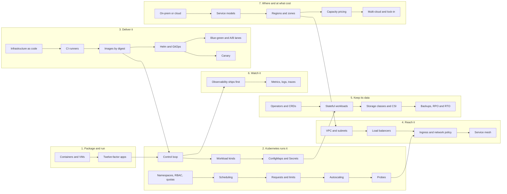

## The map in words

The map has seven groups. Read it left to right.

1. **Package and run.** Code ships as a container image, built so any copy
   can be thrown away (twelve-factor).
2. **Kubernetes runs it.** A control loop makes the cluster match declared
   objects. Workload kinds, config, namespaces, scheduling, requests,
   autoscaling and probes decide where each pod runs and when it is healthy.
3. **Deliver it.** Terraform builds the machines. A CI runner builds the
   image once and names it by its digest. Helm and GitOps roll it out. A
   pointer between two lanes, or a canary, makes the release safe.
4. **Reach it.** A private network (VPC), a load balancer, an ingress and a
   mesh carry traffic in, and network policy says who may talk.
5. **Keep its data.** StatefulSets, storage classes and operators hold the
   databases. Backups set how much data you lose (RPO) and how long you are
   down (RTO).
6. **Watch it.** Metrics, logs and traces exist before the first user.
7. **Where and at what cost.** On-prem or cloud, the service model, regions
   and zones, the pricing plan and the lock-in you accept.

---

## Containers and virtual machines

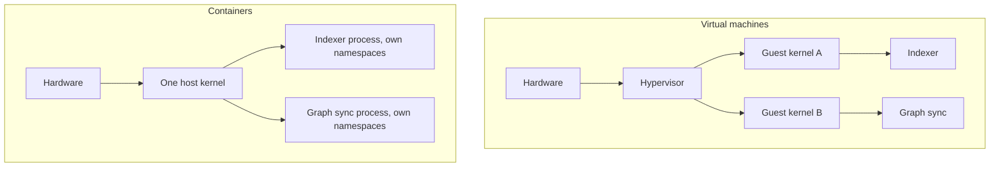

**Story.** A Go indexer and a graph sync run on one server. As virtual
machines (VMs), each boots its own kernel and takes minutes. As
containers, each is just a process with its own view of files, network and
process ids. They start in milliseconds and share the host kernel.

**How it works.**

1. A VM sits on a hypervisor and runs a full guest kernel (left box).
2. A container is a host process fenced by kernel namespaces (what it can
   see) and cgroups (how much CPU and memory it may use) (right box).
3. The container's files come from an **image**: a stack of read-only
   layers, one per Dockerfile step, cached by content hash.
4. A thin writable layer sits on top while the container runs. It is
   thrown away when the container stops.

### In code

A container is a fork plus two kernel settings: namespaces decide what the process can see, a cgroup decides how much it may use. Image layers are cached by a hash of the layer below, the step and its input files.

```text
# a virtual machine
hypervisor.create(vm, cpus=2, memory=4 GiB)
vm boots its own guest kernel            # minutes
guest kernel starts init, then the service
# a container
p = fork the service as a plain process  # host kernel is already up
give p new namespaces: hostname, pids, mounts   # what it can see
put p in cgroup indexer, memory.max = 256 MiB   # how much it may use
every container calls the same host kernel      # one bug reaches all
untrusted code: run it in a microVM instead     # its own kernel again
```

```go
func startVM(kernel, rootfs string) error {
	cfg := fmt.Sprintf(`{"machine-config": {"vcpu_count": 2, "mem_size_mib": 4096},
  "boot-source": {"kernel_image_path": %q, "boot_args": "init=/indexer"},
  "drives": [{"drive_id": "root", "path_on_host": %q,
    "is_root_device": true, "is_read_only": false}]}`, kernel, rootfs)
	if err := os.WriteFile("vm.json", []byte(cfg), 0o644); err != nil {
		return err
	}
	vm := exec.Command("firecracker", "--no-api", "--config-file", "vm.json")
	vm.Stdout, vm.Stderr = os.Stdout, os.Stderr
	return vm.Run() // a guest kernel boots, then init, then the service
}

func startContained(name string, memMax int64, cmd string, args ...string) error {
	cg := filepath.Join("/sys/fs/cgroup", name)
	if err := os.MkdirAll(cg, 0o755); err != nil {
		return err
	}
	if err := os.WriteFile(filepath.Join(cg, "memory.max"), []byte(fmt.Sprint(memMax)), 0o644); err != nil { // 268435456 = 256 MiB
		return err
	}
	c := exec.Command(cmd, args...)
	c.SysProcAttr = &syscall.SysProcAttr{
		Cloneflags: syscall.CLONE_NEWUTS | // own hostname
			syscall.CLONE_NEWPID | // own process ids
			syscall.CLONE_NEWNS, // own mounts
	}
	c.Stdout, c.Stderr = os.Stdout, os.Stderr
	if err := c.Start(); err != nil { // a fork, no kernel boots
		return err
	}
	pid := []byte(fmt.Sprint(c.Process.Pid))
	if err := os.WriteFile(filepath.Join(cg, "cgroup.procs"), pid, 0o644); err != nil {
		return err
	}
	return c.Wait() // every syscall goes to the one host kernel
}
```

```text
parent = nothing
for each Dockerfile step:
  key = hash(parent, step line, content of its input files)
  if key is in the cache: reuse that layer      # cache hit
  else: run the step, store its layer under key
  parent = key           # a change here changes every key above
stage 2: FROM a tiny base with no compiler
COPY --from=build the binary only
on start: add a writable layer on top
on stop: throw the writable layer away   # state belongs on a volume
```

```dockerfile
# stage 1: build
FROM golang:1.23 AS build
WORKDIR /src
# lock files first: cached until they change
COPY go.mod go.sum ./
RUN go mod download
# your code: changes on every commit
COPY . .
RUN go build -o /indexer .

# stage 2: ship, tiny base, no compiler
FROM gcr.io/distroless/static
COPY --from=build /indexer /indexer
USER nonroot
ENTRYPOINT ["/indexer"]
```

The run prints the VM plan and the container plan (`-vm` and `-run` really start them), then replays the layer cache. Lock files first: a code change reruns 2 of 5 steps. All code first: it reruns 4 of 5.

Run it: `handbook/code/15-containers-and-vms/` with `go run .`

**What goes wrong.** Treating a container as a wall against a hostile
tenant. All containers share one kernel, so a kernel bug crosses the wall.
Fix: use VMs or a sandboxed runtime (gVisor, Firecracker) for untrusted
code. A second trap: `COPY . .` before installing dependencies, so every
code change rebuilds the dependency layer. Copy the lock file, install,
then copy the code.

**Where you use it.**

- Every service on the platform runs as a container on Kubernetes.
- A Go service uses a two-stage build: compile in a fat image, copy one
  binary onto a tiny base. Tens of megabytes, fast rebuilds.
- A test sandbox runs a command line tool in a throwaway container with an
  empty home folder, so a test never writes into a real wallet.

▶ Watch it move: [Containers and virtual machines](visual/15-containers-and-vms.html)

> **Say it:** "A container is a process with a private view of one shared
> kernel. A VM is a whole machine with its own kernel."

---

## Twelve-factor apps: built to be thrown away

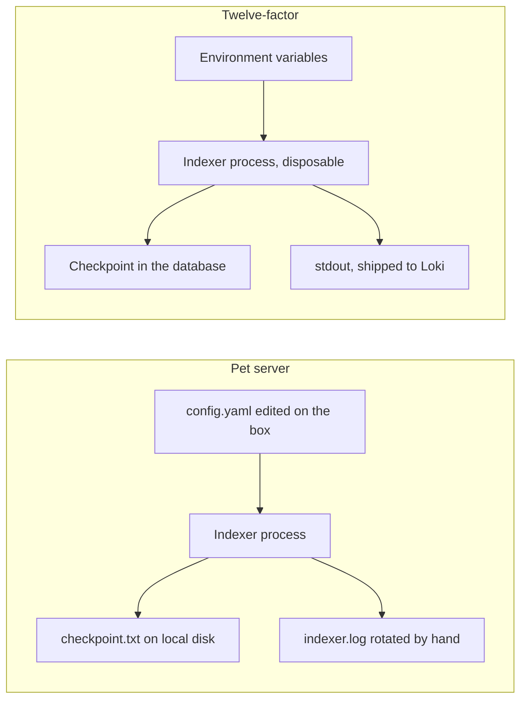

**Story.** An indexer once kept its checkpoint in a file on the server and its
settings in a file someone edited by hand. When the server died, the new copy
started from block 1 with the wrong node address. The twelve-factor version
reads its settings from the environment, keeps its checkpoint in the
database, and writes logs to stdout. Killing it costs nothing.

**How it works.**

1. One codebase, one image, many deploys (staging and production run the
   same image).
2. Config comes from the environment, never from the image.
3. Backing services (database, queue, node) are attached by an address in
   config, so they can be swapped.
4. Processes are stateless. State lives in a backing service.
5. Logs are a stream to stdout. The platform collects them.
6. Processes start fast and stop cleanly on a signal (SIGTERM), so they can
   be killed at any time.

### In code

A twelve-factor process reads its config from the environment, keeps its checkpoint in a backing service, writes logs to stdout, and stops cleanly on SIGTERM. So any copy can die and the next one resumes.

```text
node_url = env NODE_URL          # config from the environment
db = connect(env DB_URL)         # state in a backing service
log to stdout                    # the platform ships it to Loki
on SIGTERM: stop after the page in hand
next = db.next                   # resume, never restart
loop:
  if SIGTERM arrived: exit 0
  index blocks next .. next+199  # upserts, safe to repeat
  db.next = next + 200           # saved after every page
  print one log line
  next = next + 200
```

```go
func run(db *Store, maxPages, sigtermAfter, powerLoss int) {
	nodeURL := mustEnv("NODE_URL") // config from the environment
	log := slog.New(slog.NewTextHandler(os.Stdout, &slog.HandlerOptions{ReplaceAttr: noTime}))
	ctx, stop := signal.NotifyContext(context.Background(), syscall.SIGTERM)
	defer stop()
	next := db.Next() // resume, never restart
	log.Info("start", "node", nodeURL, "next", next)
	for p := 1; p <= maxPages; p++ {
		select {
		case <-ctx.Done(): // SIGTERM: the page in hand is already saved
			log.Info("SIGTERM, exiting", "next", next)
			return
		default:
		}
		last := next + pageSize - 1
		if p == powerLoss { // no SIGTERM, no warning, no save
			log.Info("power lost mid-page", "from", next, "saved next", db.Next())
			return
		}
		indexPage(nodeURL, next, last)
		db.SaveNext(last + 1) // after every page
		log.Info("page", "from", next, "to", last)
		next = last + 1
		if p == sigtermAfter { // a drain: the kubelet sends SIGTERM
			syscall.Kill(os.Getpid(), syscall.SIGTERM)
			time.Sleep(10 * time.Millisecond)
		}
	}
}

func mustEnv(k string) string {
	v := os.Getenv(k)
	if v == "" {
		fmt.Fprintln(os.Stderr, "missing", k) // fail fast, never a default
		os.Exit(1)
	}
	return v
}
```

The run shows the pet leaving checkpoint 9,506,400 on node 1's disk, then the new pod on node 2 starting at block 1 with the stale node-1.local config from the image. The twelve-factor indexer exits on SIGTERM with next = 9,506,400, loses power in the next page, and the new pod resumes at 9,506,400.

Run it: `handbook/code/15-twelve-factor/` with `go run .`

**What goes wrong.** State on local disk. The pod is rescheduled, the
writable layer is thrown away, and the indexer forgets where it was. Fix:
every piece of state goes to a backing service, and a test kills the
process mid-run to prove it resumes.

**Where you use it.**

- Every Kubernetes service: config from ConfigMaps and Secrets, logs to
  stdout, state in StarRocks or the graph.
- A graceful stop: on SIGTERM the indexer finishes the current page, saves
  its checkpoint and exits before the grace period ends.
- The rule set predates Kubernetes (Heroku, 2011), and Kubernetes assumes
  it.

▶ Watch it move: [Twelve-factor apps](visual/15-twelve-factor.html)

> **Say it:** "A twelve-factor service keeps no state of its own, takes its
> config from the environment and logs to stdout, so the platform can kill
> and replace it at any moment."

---

## Kubernetes is a control loop over declared objects

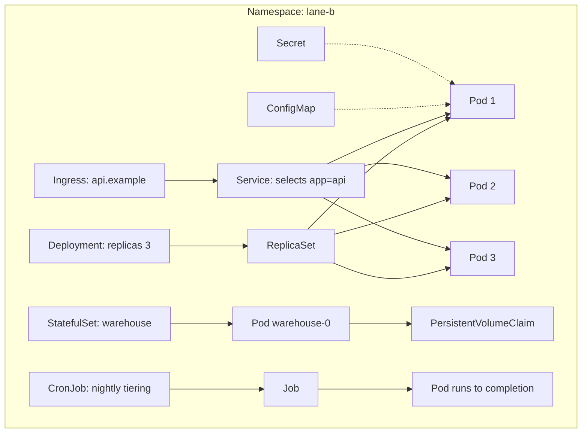

**Story.** An API runs as a Deployment that asks for three pods. At 03:00 a
node dies and takes pod 2 with it. Nobody is paged. The ReplicaSet sees two
pods where three are declared, and starts a new one on a healthy node. The
Service only sends traffic to pods whose readiness probe passes, so users
never reach the half-started one.

**How it works.**

1. You write what should be, never how: "three pods of this image".
2. The Deployment owns a ReplicaSet, and the ReplicaSet owns the pods.
3. A controller loops forever: read declared state, read actual state, fix
   the difference.
4. The Service picks pods by label (`app=api`) and gives them one stable
   name and address.
5. The Ingress routes a host name from outside to that Service.
6. ConfigMaps and Secrets are mounted into pods as files or environment
   variables.
7. A StatefulSet gives each pod a stable name and its own volume claim.
8. A Job runs a pod to completion. A CronJob makes a Job on a schedule.

### In code

Kubernetes is loops over declared objects. The ReplicaSet compares want with have and starts or deletes the difference. The Service sends traffic only to pods whose readiness probe passes. A rolling update starts a surge pod and stops an old one only after the new one is ready.

```text
forever, the ReplicaSet controller:
  want = spec.replicas                     # 3
  have = live pods with label app=api
  if have < want: start want - have new pods
  if have > want: delete have - want pods
forever, the endpoints controller:
  endpoints = live pods whose readiness probe passes
the kubelet, every second, for each pod:
  if liveness fails 3 times in a row: restart the container
  if readiness fails: mark the pod not ready     # it leaves the endpoints
the Service sends each request to one endpoint
```

```go
type Pod struct {
	Name  string
	Alive bool
	Ready bool // readiness probe passed
}

// reconcile is one pass of the ReplicaSet controller.
func reconcile(want int, pods []*Pod, newName func() string) []*Pod {
	var live []*Pod
	for _, p := range pods {
		if p.Alive {
			live = append(live, p)
		}
	}
	for len(live) < want { // too few: start more
		live = append(live, &Pod{Name: newName(), Alive: true})
	}
	for len(live) > want { // too many: delete the newest
		live = live[:len(live)-1]
	}
	return live
}

// endpoints is what the Service sends traffic to.
func endpoints(pods []*Pod) []string {
	var out []string
	for _, p := range pods {
		if p.Alive && p.Ready {
			out = append(out, p.Name)
		}
	}
	return out
}

// probe is the kubelet. Liveness restarts, readiness only removes.
func probe(p *Pod, livenessOK, readinessOK bool) {
	if !livenessOK {
		p.Ready = false // restarted: starts again, not ready
		return
	}
	p.Ready = readinessOK
}
```

```text
on a new image, the Deployment controller:
  create ReplicaSet v2 with 0 pods
  each pass, until v1 has 0 pods:
    if v2 < 3 and v1 + v2 < 3 + maxSurge (1): start one v2 pod
    else if v1 + ready v2 > 3 - maxUnavailable (0): stop one v1 pod
    else: wait                          # readiness is the gate
  keep ReplicaSet v1 with 0 pods        # the rollback
no readiness probe: a started pod counts as ready
```

```go
type RS struct{ Pods, Ready int }

// rollStep is one pass of the Deployment controller during a roll.
func rollStep(replicas, maxSurge, maxUnavailable int, old, nw *RS) string {
	if nw.Pods < replicas && old.Pods+nw.Pods < replicas+maxSurge {
		nw.Pods++ // start one surge pod
		return "start a v2 pod"
	}
	if old.Pods > 0 && old.Pods+nw.Ready > replicas-maxUnavailable {
		old.Pods-- // only after a new pod is ready
		return "stop a v1 pod"
	}
	return "wait for readiness"
}

func roll(healthy, hasProbe bool) {
	old, nw := &RS{Pods: 3, Ready: 3}, &RS{}
	for pass := 1; pass <= 8 && old.Pods > 0; pass++ {
		did := rollStep(3, 1, 0, old, nw)
		if !hasProbe || healthy { // no probe: started counts as ready
			nw.Ready = nw.Pods
		}
		fmt.Printf("    pass %d: %-18s v1 %d, v2 %d (ready %d)\n", pass, did, old.Pods, nw.Pods, nw.Ready)
	}
}
```

The run starts 3 pods, loses api-b, starts api-d, and empties the endpoints when liveness checks the database. The roll takes 6 passes. A broken v2 with a readiness probe stalls at pass 2 with v1 still serving. Without the probe it replaces all three.

Run it: `handbook/code/15-kubernetes-objects/` with `go run .`

**What goes wrong.** A database run as a Deployment. During a rolling
update two pods start, and both try to mount one volume, or neither can.
Fix: a StatefulSet, which replaces pod 0 only after the old pod 0 is gone.

**Where you use it.**

- The indexer is a Deployment with one pod and a checkpoint. If the node
  dies, the new pod resumes from the last block it saved.
- The StarRocks warehouse is a StatefulSet run by an operator. Each backend
  keeps its name and disk across restarts.
- A re-index from block 1 is a Job. A nightly partition move is a CronJob.
  A log shipper on every node is a DaemonSet.

▶ Watch it move: [Kubernetes objects](visual/15-kubernetes-objects.html)

> **Say it:** "Kubernetes is a loop that keeps the actual cluster equal to
> the objects I declared, and every object says what, never how."

---

## Workload kinds: DaemonSet, Job and CronJob

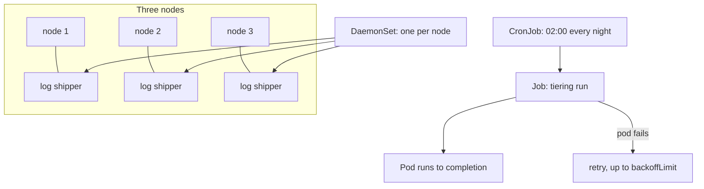

**Story.** Every node needs one log shipper, so logs from every pod reach
Loki. That is a DaemonSet: add a node and a shipper appears on it. Every
night at 02:00 a tiering run moves old partitions to slower disks. That is
a CronJob, which makes a Job, which runs one pod until it finishes.

**How it works.**

1. A Deployment keeps N pods running forever. A StatefulSet adds stable
   names and volumes.
2. A DaemonSet runs exactly one pod on every node (or every node that
   matches a selector).
3. A Job runs a pod until it exits with success. A failed pod is retried up
   to `backoffLimit` times.
4. A CronJob creates a Job on a schedule.
5. `concurrencyPolicy: Forbid` stops a new run while the old one is still
   going.

### In code

A DaemonSet's controller keeps one pod per node. A CronJob's controller creates a Job when the schedule is due, unless concurrencyPolicy Forbid sees one still active. A Job retries a failed pod up to backoffLimit.

```text
every minute, the CronJob controller:
  if the schedule 0 2 * * * is due:          # 02:00 every day
    if a Job of this CronJob is still active:
      if concurrencyPolicy is Forbid: skip this run
    create a Job
the Job controller: start one pod
  if the pod fails and retries < backoffLimit 3: start a new pod
  if the pod exits 0: the Job is complete
  if it runs past activeDeadlineSeconds: kill it, Job failed
```

```yaml
apiVersion: batch/v1
kind: CronJob
metadata:
  name: starrocks-tiering
spec:
  schedule: "0 2 * * *"           # 02:00 every day
  concurrencyPolicy: Forbid       # skip a run while one is active
  jobTemplate:
    spec:
      backoffLimit: 3             # up to 3 retries
      completions: 1              # one pod that exits 0 completes the Job
      activeDeadlineSeconds: 172800   # 48 h: a hung run fails
      template:
        spec:
          restartPolicy: Never
          containers:
          - name: tiering
            image: registry.local/tiering@sha256:4f2a
            args: ["--older-than", "30d"]
```

```text
every sync of the DaemonSet controller:
  for each node in the cluster:
    if the node has no shipper pod: create one on it
  for each shipper pod:
    if its node is gone: delete the pod
on a new shipper version:
  replace pods maxUnavailable at a time      # 1 = one node at a time
  wait for the new pod to be ready before the next node
each shipper: memory limit 200 MiB          # a leak kills the pod, not the node
```

```yaml
apiVersion: apps/v1
kind: DaemonSet             # one pod per node, no replicas field
metadata:
  name: log-shipper
spec:
  selector:
    matchLabels: {app: log-shipper}
  updateStrategy:
    type: RollingUpdate
    rollingUpdate:
      maxUnavailable: 1     # one node at a time
  template:
    metadata:
      labels: {app: log-shipper}
    spec:
      containers:
      - name: shipper
        image: registry.local/shipper@sha256:9c1e
        resources:
          requests: {memory: 100Mi}
          limits: {memory: 200Mi}   # a leak kills this pod only
        volumeMounts:
        - {name: logs, mountPath: /var/log/pods, readOnly: true}
      volumes:
      - name: logs
        hostPath: {path: /var/log/pods}
```

The run creates a shipper on each of 3 nodes, then rolls a leaking version: all at once it takes down 3 nodes, with maxUnavailable 1 and a 200 MiB limit it stops at node 1. The CronJob with Allow starts 2 jobs on the same partitions. With Forbid it skips Tuesday.

Run it: `handbook/code/15-workload-kinds/` with `go run .`

**What goes wrong.** A nightly CronJob that takes longer than a day. With
the default policy, a second run starts beside the first and both write
the same partitions. Fix: `concurrencyPolicy: Forbid`, a deadline, and a
job that is safe to run twice.

**Where you use it.**

- DaemonSets: log shippers, node metrics exporters, storage agents.
- Jobs: a re-index from block 1, a one-off schema migration.
- CronJobs: nightly partition tiering, a daily report, a backup.

▶ Watch it move: [Workload kinds](visual/15-workload-kinds.html)

> **Say it:** "A Deployment runs forever, a DaemonSet runs one per node, a
> Job runs to completion, and a CronJob makes Jobs on a clock."

---

## ConfigMaps and Secrets

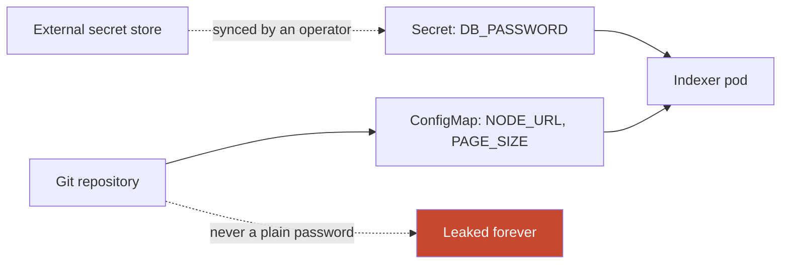

**Story.** The indexer needs the node address, a page size and the
database password. The address and page size go in a ConfigMap committed
to git. The password goes in a Secret that an operator syncs from an
external secret store. Nobody ever types the password into a values file.

**How it works.**

1. A ConfigMap holds plain settings as key and value pairs.
2. A Secret holds sensitive values. By default it is only base64 encoded,
   not encrypted.
3. Both reach the pod as environment variables or as files in a mounted
   folder.
4. Mounted files update in place when the object changes. Environment
   variables only change on a restart.
5. Real protection: encryption at rest in the cluster store, RBAC (role
   based access control) on who may read Secrets, and an external store
   such as Vault synced by an operator, or sealed secrets in git.

### In code

Settings reach the pod as environment variables, copied once at start. The password reaches it as a mounted file from a Secret that only one service account may read. A checksum of the ConfigMap in the pod template makes a config change roll the pods.

```text
ConfigMap indexer-config = NODE_URL, PAGE_SIZE   # from the values file in git
Secret indexer-db = synced from the secret store   # the value never touches git
pod start: env NODE_URL, PAGE_SIZE from the ConfigMap   # copied once
pod start: mount the Secret at /secrets           # a file, refreshed live
RBAC: only service account indexer may get indexer-db
pod template annotation: checksum = sha256(ConfigMap)
on a ConfigMap change: the checksum changes, so the pods roll
a value pushed to git stays in every clone forever
on a leak: rotate the value in the database and the store
```

```yaml
apiVersion: apps/v1
kind: Deployment
metadata: {name: indexer}
spec:
  template:
    metadata:
      annotations:
        # changes when the ConfigMap changes, so the pods roll
        checksum/config: {{ include "config.yaml" . | sha256sum }}
    spec:
      serviceAccountName: indexer
      containers:
      - name: indexer
        envFrom:
        - configMapRef: {name: indexer-config}  # NODE_URL, PAGE_SIZE
        volumeMounts:
        - {name: db, mountPath: /secrets, readOnly: true}
      volumes:
      - name: db
        secret: {secretName: indexer-db}  # synced from the store
---
apiVersion: rbac.authorization.k8s.io/v1
kind: Role
metadata: {name: read-indexer-db}
rules:
- apiGroups: [""]
  resources: [secrets]
  resourceNames: [indexer-db]   # this one Secret only
  verbs: [get]
---
apiVersion: external-secrets.io/v1beta1
kind: ExternalSecret
metadata: {name: indexer-db}
spec:
  refreshInterval: 1h               # a rotated value arrives within the hour
  secretStoreRef: {name: vault, kind: ClusterSecretStore}
  target: {name: indexer-db}        # the Secret the pod mounts
  data:
  - secretKey: password
    remoteRef: {key: lane-b/indexer-db, property: password}   # in the store, never in git
```

The run shows PAGE_SIZE staying 500 without the checksum and becoming 1,000 with it, the RBAC rule refusing the default account, and the leaked commit still in history until the password is rotated.

Run it: `handbook/code/15-configmaps-secrets/` with `go run .`

**What goes wrong.** A password committed to git in a values file. Git
history keeps it forever, even after a delete. Fix: rotate the password at
once, then move it to a Secret fed from a secret store. A second trap:
changing a ConfigMap and expecting a running pod to see a new environment
variable. It will not until it restarts.

**Where you use it.**

- Settings per lane in a ConfigMap rendered from the lane values file.
- Database and API credentials in Secrets, readable only by the service
  account that needs them.
- A checksum of the ConfigMap in the pod template, so a config change rolls
  the pods.

▶ Watch it move: [ConfigMaps and Secrets](visual/15-configmaps-secrets.html)

> **Say it:** "Settings go in a ConfigMap, credentials in a Secret fed from
> a real secret store, and a base64 Secret in git is a leaked password."

---

## Kubernetes namespaces, RBAC and quotas

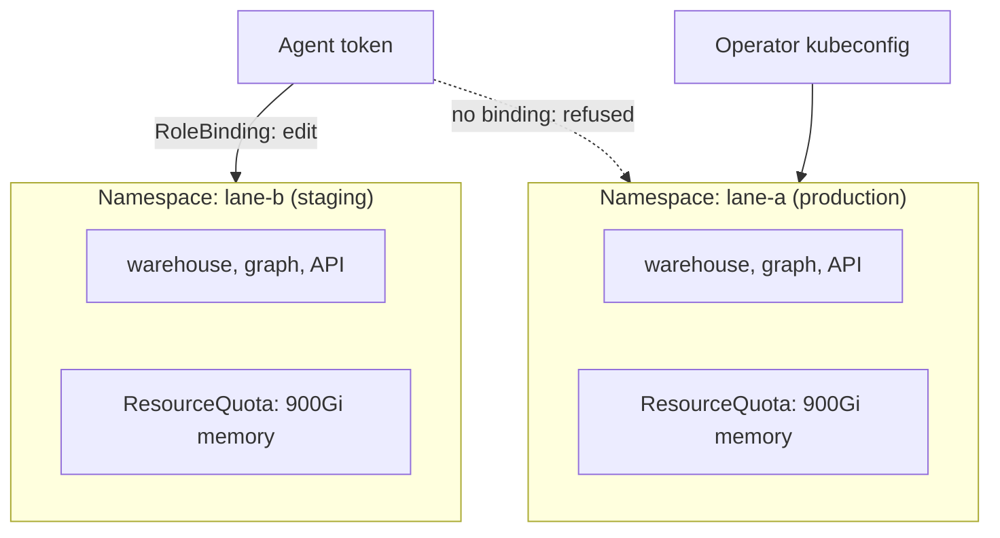

**Story.** Two lanes share one cluster. Each lives in its own namespace. An
automation agent holds a short-lived token with edit rights on the staging
namespace only. When it tries to scale a pod in production, the API server
refuses: no RoleBinding gives it that right.

**How it works.**

1. A namespace is a named partition of the cluster. Names only have to be
   unique inside it.
2. A Role lists verbs on resources ("get, list pods"). A ClusterRole does
   the same across the cluster.
3. A RoleBinding gives a Role to a user, group or service account, inside
   one namespace.
4. A ResourceQuota caps the total CPU, memory and objects in a namespace.
5. A LimitRange sets default requests and limits for pods that forget them.

### In code

Every write passes two checks. Authorize: a RoleBinding in this namespace must give the caller a role that allows this verb. Admit: a pod with no requests gets the LimitRange defaults, and a pod that would pass the ResourceQuota is refused.

```text
on each request (who, verb, resource, namespace):
  for each RoleBinding in that namespace naming who:
    if its Role allows verb on resource: allow
  no binding allows it: answer 403 Forbidden
on a pod create in a namespace:
  if the pod set no requests: fill them from the LimitRange   # 1Gi, limit 2Gi
  if used + requests > the ResourceQuota: refuse
  else: create it, used = used + requests
a ClusterRoleBinding to cluster-admin allows every verb, everywhere
```

```yaml
apiVersion: rbac.authorization.k8s.io/v1
kind: RoleBinding
metadata: {name: agent-edit, namespace: lane-b}
subjects:
- {kind: ServiceAccount, name: agent, namespace: lane-b}
roleRef: {kind: ClusterRole, name: edit, apiGroup: rbac.authorization.k8s.io}
---
apiVersion: v1
kind: ResourceQuota
metadata: {name: lane-b, namespace: lane-b}
spec:
  hard:
    requests.memory: 900Gi   # all lane-b pods together
    requests.cpu: "200"
---
apiVersion: v1
kind: LimitRange
metadata: {name: defaults, namespace: lane-b}
spec:
  limits:
  - type: Container
    defaultRequest: {memory: 1Gi}   # for a pod that set none
    default: {memory: 2Gi}          # its limit
```

The run allows the agent in lane-b and refuses it in lane-a, refuses 400Gi with 300Gi left, fills in 1Gi and 2Gi, and shows the lane-a delete allowed under shared cluster-admin and refused under least privilege.

Run it: `handbook/code/15-namespaces-rbac/` with `go run .`

**What goes wrong.** Everyone shares cluster-admin. One wrong `kubectl
delete` in the wrong namespace removes production. Fix: least privilege,
namespace-scoped roles, a read-only context for production, and writes to
production only through a reviewed pipeline.

**Where you use it.**

- One namespace per lane or per team, with a quota each.
- Service accounts per workload, so a compromised pod can read only its own
  Secrets.
- A namespace is not a security wall by itself. Pair it with network policy.

▶ Watch it move: [Namespaces, RBAC and quotas](visual/15-namespaces-rbac.html)

> **Say it:** "A namespace partitions names and quotas, RBAC decides who
> may do what inside it, and production writes go through review, not
> through a laptop."

---

## Scheduling: taints, tolerations and affinity

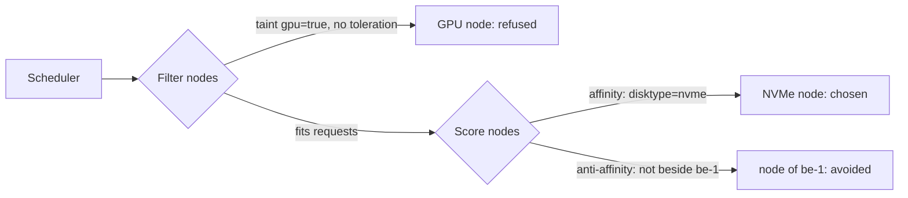

**Story.** One node has GPUs for model training. Ordinary pods must never
fill it. The node gets a taint, `gpu=true:NoSchedule`, and only the
training pod carries the matching toleration. The two warehouse backends
carry anti-affinity, so they never land on the same node and one node loss
cannot take both.

**How it works.**

1. The scheduler first filters: nodes without room for the requests, or
   with a taint the pod does not tolerate, are out.
2. Then it scores the rest and picks the best.
3. A taint on a node repels pods. A toleration on a pod lets it ignore that
   taint.
4. Node affinity attracts a pod to nodes with a label (`disktype=nvme`).
5. Pod anti-affinity keeps pods apart, for example one replica per node or
   per zone.

### In code

The scheduler filters, then scores. A node is dropped when its taint is not tolerated, when it lacks a label the pod's node affinity requires, or when it holds a pod the anti-affinity names. The rest are scored, and the best one gets the pod.

```text
for each pending pod:
  for each node:                                   # filter
    if the node has a taint the pod does not tolerate: drop it
    if the node lacks a label the pod's node affinity requires: drop it
    if a pod on the node matches the pod's anti-affinity: drop it
  no node left: the pod stays Pending
  score the rest: fewest pods wins, first in the list breaks a tie
  bind the pod to the best node
```

```go
func feasible(p *Pod, n *Node) (bool, string) {
	if n.Taint != "" && n.Taint != p.Tolerates {
		return false, "taint " + n.Taint + " not tolerated"
	}
	for k, v := range p.NodeAffinity {
		if n.Labels[k] != v {
			return false, "node affinity " + k + "=" + v + " not met"
		}
	}
	for _, q := range n.Pods {
		if p.AntiAffinity != "" && q.App == p.AntiAffinity {
			return false, "anti-affinity: " + q.Name + " is here"
		}
	}
	return true, ""
}

func schedule(p *Pod, nodes []*Node) {
	var best *Node
	for _, n := range nodes {
		if ok, why := feasible(p, n); !ok {
			fmt.Printf("    %-7s filtered: %s\n", n.Name, why)
			continue
		}
		if best == nil || len(n.Pods) < len(best.Pods) { // score: fewest pods
			best = n
		}
	}
	if best == nil {
		fmt.Printf("  %s: Pending, no node fits\n", p.Name)
		return
	}
	best.Pods = append(best.Pods, p)
	fmt.Printf("  %s -> %s\n", p.Name, best.Name)
}
```

```yaml
# the training pod: allowed in by the toleration, sent there by the affinity
tolerations:
- {key: gpu, operator: Equal, value: "true", effect: NoSchedule}
affinity:
  nodeAffinity:
    requiredDuringSchedulingIgnoredDuringExecution:
      nodeSelectorTerms:
      - matchExpressions:
        - {key: gpu, operator: In, values: ["true"]}
```

The run places the API pod on nvme-1, the toleration-only training pod on nvme-2, the fixed training pod on gpu-1, be-0 on nvme-2 and be-1 on nvme-1, and leaves be-2 Pending. When nvme-1 loses power, be-0 keeps serving.

Run it: `handbook/code/15-scheduling/` with `go run .`

**What goes wrong.** A toleration without affinity. The training pod may
run on the GPU node, but nothing makes it go there, so it lands on a CPU
node and crawls. Fix: a toleration to be allowed in, plus node affinity to
be sent there. A second trap: hard anti-affinity with more replicas than
nodes leaves pods Pending.

**Where you use it.**

- GPU and large-memory nodes: taint them, tolerate them only where needed.
- Replicas of a database: anti-affinity per node, or topology spread across
  zones.
- Local-disk pods: node affinity follows the volume.

▶ Watch it move: [Scheduling: taints and affinity](visual/15-scheduling.html)

> **Say it:** "Taints keep pods out, tolerations let chosen pods in,
> affinity pulls them to the right node, and anti-affinity keeps replicas
> apart."

---

## Requests and limits

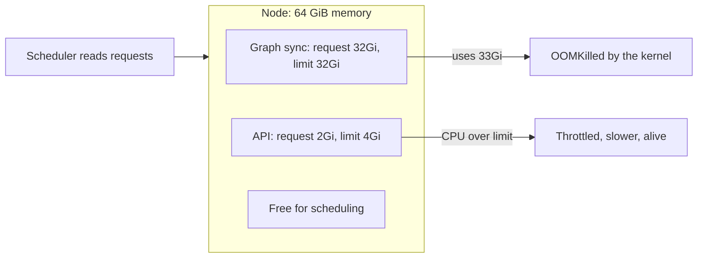

**Story.** A graph sync pod had a 16Gi memory limit. On the largest layer it
needed more, and the kernel killed it mid-page, again and again. The
metrics showed the real peak. The limit went to 32Gi on both lanes in one
change, with a comment saying why.

**How it works.**

1. A **request** is what the scheduler reserves. It decides which node the
   pod lands on.
2. A **limit** is the ceiling while running.
3. Over the CPU limit, the container is throttled: it slows down.
4. Over the memory limit, the container is killed (OOMKilled, out of
   memory).
5. Request equal to limit gives the Guaranteed quality-of-service class.
   Those pods are evicted last.

### In code

The scheduler adds requests and never reads limits. The kernel enforces limits: over the CPU limit a pod is paused until the next 100 ms period, over the memory limit it is killed. When the whole node runs out, the kernel kills the biggest user, inside its limit or not.

```text
schedule: place the pod where sum(requests) + its request <= node memory
  no node fits: the pod stays Pending           # limits are never read here
every CPU period of 100 ms:
  if the pod used its CPU limit (2 CPU = 200 ms): pause it until the next period
on every memory allocation:
  if pod memory > its limit: kill it, OOMKilled   # no slowing down
  the kubelet restarts it, with a growing back-off
if node memory in use > node memory:
  the kernel kills the pod using the most        # inside its limit or not
memory request = limit: the node can never overcommit this pod
```

```go
// fits is the scheduler: requests only, limits are ignored.
func fits(node []Pod, capGi float64, p Pod) bool {
	sum := p.ReqGi
	for _, q := range node {
		sum += q.ReqGi
	}
	return sum <= capGi
}

// cpuGranted is the CFS quota: over the limit, the pod waits.
func cpuGranted(want, limCPU float64) (got float64, throttled bool) {
	if want > limCPU {
		return limCPU, true
	}
	return want, false
}

// memCheck is the kernel: over the limit, the pod is killed.
func memCheck(useGi, limGi float64) string {
	if useGi > limGi {
		return "OOMKilled"
	}
	return "ok"
}

// nodeOOM picks a victim when the node itself runs out.
func nodeOOM(use map[string]float64, capGi float64) string {
	names := []string{}
	for n := range use {
		names = append(names, n)
	}
	sort.Strings(names)
	total, victim := 0.0, ""
	for _, n := range names {
		total += use[n]
		if victim == "" || use[n] > use[victim] {
			victim = n
		}
	}
	if total <= capGi {
		return ""
	}
	return victim // the biggest user, inside its limit or not
}

// in main, prints trimmed
gs := Pod{"graph sync", 16, 16, 2, 4}
gs.ReqGi, gs.LimGi = 32, 32 // the measured peak was 21Gi
five[i].ReqGi, five[i].LimGi = 14, 14 // measured peak
```

```yaml
# the graph sync: request = limit, so it is Guaranteed
resources:
  requests: {memory: 32Gi, cpu: "2"}
  limits:   {memory: 32Gi, cpu: "4"}   # measured peak 21Gi
```

The run places both pods, throttles the API at 2.0 of 2.6 CPU, kills the graph sync at 21Gi of 16Gi and passes at 32Gi. Five pods of 4Gi all fit, use 65Gi and lose pod 3. With request = limit 14Gi, 4 fit and pod 5 is Pending.

Run it: `handbook/code/15-requests-and-limits/` with `go run .`

**What goes wrong.** No requests at all, so the scheduler packs pods until
the node starves. Or a memory limit far above the request: the node
overcommits, fills up, and the kernel kills a random pod. Fix: size from
measured peaks, and for stateful pods set memory request equal to limit.

**Where you use it.**

- Stateful pods (warehouse, graph, sync): memory request equals limit.
- Latency-sensitive Go or Java services: many teams keep a CPU request and
  drop the CPU limit, because throttling hurts latency more than it helps.
- A Horizontal Pod Autoscaler (HPA) adds pods from a metric. Scale a query
  API on CPU. Never scale a single-writer indexer: it has one checkpoint.

▶ Watch it move: [Requests and limits](visual/15-requests-and-limits.html)

> **Say it:** "Requests decide where a pod is scheduled, limits decide when
> it is throttled or killed, and I size both from measured peaks."

---

## Autoscaling: HPA, VPA and the cluster autoscaler

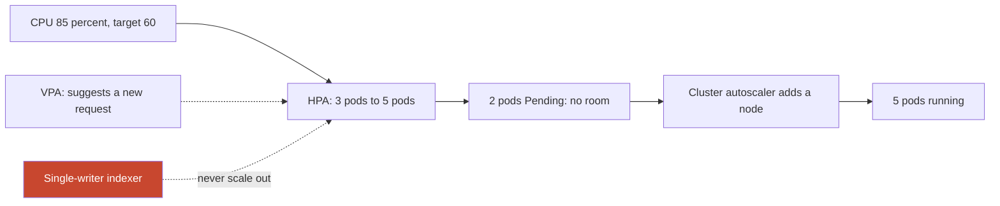

**Story.** A query API runs three pods at 60 percent CPU. A news story
doubles the traffic. The Horizontal Pod Autoscaler (HPA) sees 85 percent
and asks for five pods. Two have no room, so the cluster autoscaler adds a
node, and the new pods start there. When the traffic falls, both scale back
down.

**How it works.**

1. The HPA reads a metric (CPU, memory, or a custom one such as queue depth).
2. It computes pods wanted = pods now × current value ÷ target, within a
   minimum and a maximum.
3. A pod that does not fit stays Pending.
4. The cluster autoscaler sees Pending pods and adds a node, or removes an
   idle one.
5. The Vertical Pod Autoscaler (VPA) changes a pod's requests instead of
   its count, usually by recommending values.

### In code

The HPA computes desired = ceil(current * metric / target). A scale-down takes the highest answer of the last 5 minutes. A pod that fits no node stays Pending, and that is the signal for the cluster autoscaler to add a node.

```text
every 15 s, the HPA:
  metric = average CPU of the pods, as a percent of their request
  desired = ceil(current * metric / target)     # 3 * 85 / 60 = 4.25 -> 5
  if desired < current: take the highest desired of the last 5 minutes
  set the Deployment's replicas to desired
the scheduler: a pod that fits no node stays Pending
every 10 s, the cluster autoscaler:
  if a pod is Pending and a new node could hold it: add a node
  if a node has been idle for 10 minutes: remove it
an HPA clones the process: same image, same checkpoint
a writer scales by range: one Job per block range, its own checkpoint
a VPA changes the request, so the percent moves, so the HPA reacts
```

```go
const targetCPU = 60.0 // percent of the request

// desired is the HPA formula.
func desired(current int, metric float64) int {
	return int(math.Ceil(float64(current) * metric / targetCPU))
}

// stabilised is the scale-down rule: use the highest desired count
// seen in the last 5 minutes, so a short dip keeps its pods.
func stabilised(recent []int) int {
	top := 0
	for _, d := range recent {
		top = max(top, d)
	}
	return top
}

// place returns how many of the wanted pods stay Pending.
func (c *Cluster) place(pods int) (pending int) {
	if pods > c.Free {
		pending = pods - c.Free
	}
	c.Free -= pods - pending
	return pending
}

// the cluster autoscaler: a Pending pod makes it add a node.
func (c *Cluster) addNode() {
	c.Nodes++
	c.Free += c.SlotsPerNewNode
}

// removeNode: a node idle for 10 minutes is removed.
func (c *Cluster) removeNode() {
	c.Nodes--
	c.Free -= c.SlotsPerNewNode
}

// percent is the HPA metric: use as a share of the request. A VPA moves the request.
func percent(usedCores, requestCores float64) float64 { return 100 * usedCores / requestCores }

// clones is what an HPA does to a writer: every pod starts at the one checkpoint.
func clones(pods, checkpoint int) []int {
	starts := make([]int, pods)
	for i := range starts {
		starts[i] = checkpoint // same image, same checkpoint: the same blocks twice
	}
	return starts
}

// ranges is how a writer scales: one Job per block range, each its own checkpoint.
func ranges(from, to, jobs int) [][2]int {
	size := (to - from + 1) / jobs
	var out [][2]int
	for j := 0; j < jobs; j++ {
		out = append(out, [2]int{from + j*size, from + (j+1)*size - 1})
	}
	return out
}
```

The run gives 3 x 85 / 60 = 4.25, so 5 pods: 4 run at 64 percent, 1 is Pending, a node joins, and 5 run at 51 percent. When traffic falls it goes to 3 pods only after 5 minutes. It also prints both traps: 2 indexers on one checkpoint with the fix of one Job per block range, and an HPA and a VPA moving against each other.

Run it: `handbook/code/15-autoscaling/` with `go run .`

**What goes wrong.** Autoscaling a single-writer indexer. Two copies read
the same checkpoint and write the same blocks twice. Fix: scale only
stateless services. A writer with one checkpoint scales by splitting work
into ranges, never by adding copies. Second trap: HPA and VPA both acting on
CPU fight each other.

**Where you use it.**

- A query API on CPU, a queue worker on queue depth (KEDA does this from
  events).
- Spot worker pools with the cluster autoscaler.
- VPA in recommend mode to size requests from real use.

▶ Watch it move: [Autoscaling](visual/15-autoscaling.html)

> **Say it:** "The HPA changes the number of pods, the VPA changes their
> size, the cluster autoscaler changes the number of nodes, and I only
> scale out what is stateless."

---

## Probes: liveness, readiness, startup

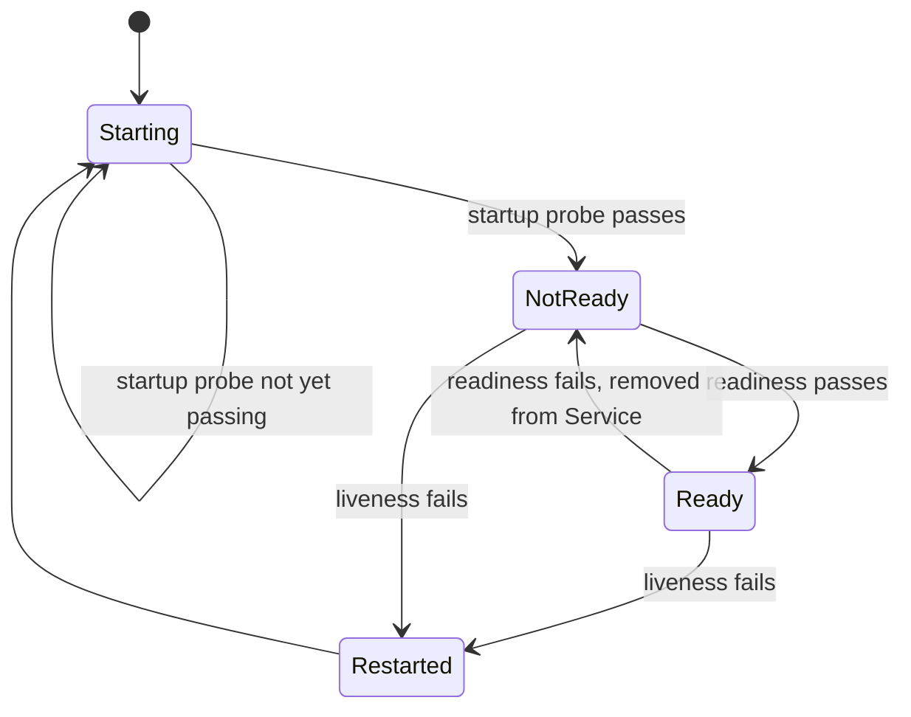

**Story.** A service checks at start that the database has at least
migration 42 applied. That check can take a minute. Without a startup
probe, the liveness probe fails during that minute and Kubernetes restarts
the pod forever. With a startup probe, liveness waits until start is done.

**How it works.**

1. The startup probe holds the other probes back until the process is up.
2. The readiness probe decides if the pod gets traffic. Failing removes it
   from the Service, but keeps it running.
3. The liveness probe decides if the pod is broken. Failing restarts it.

### In code

Three probes, three actions. A startup probe holds the other two back while a slow start runs. Three liveness failures in a row restart the container. A failed readiness probe only takes the pod out of the Service.

```text
the kubelet, for each pod:
  run only the startup probe, every 5 s, up to 30 times   # a 150 s budget
  if it never passes: restart the container
  after it passes, every second:
    liveness = GET /livez
    if liveness failed 3 times in a row: restart the container
    readiness = GET /readyz
    if readiness failed: remove the pod from the endpoints
    if readiness passed: add the pod to the endpoints
/livez: answer 200 if the process is not stuck    # no dependency
/readyz: answer 200 if the database answers
```

```go
func livez(w http.ResponseWriter, r *http.Request) {
	w.WriteHeader(http.StatusOK) // no dependency: only "is this process stuck?"
}

func readyz(db *DB) http.HandlerFunc {
	return func(w http.ResponseWriter, r *http.Request) {
		if err := db.Ping(); err != nil {
			http.Error(w, "database: "+err.Error(), http.StatusServiceUnavailable)
			return
		}
		w.WriteHeader(http.StatusOK)
	}
}

// tick is one second of the kubelet for one pod.
func (k *Kubelet) tick(p *Pod) {
	p.Age++
	if k.StartupProbe && !p.Started {
		if k.probe(p, "/livez") {
			p.Started = true
		} else if p.Age > startupBudget {
			p.restart()
		}
		return // liveness and readiness wait for the startup probe
	}
	if k.probe(p, k.LivenessPath) {
		p.Fails = 0
	} else if p.Fails++; p.Fails >= failureThreshold {
		p.restart()
		return
	}
	p.Ready = k.probe(p, "/readyz") // the Service reads this
}
```

```yaml
startupProbe:
  httpGet: {path: /livez, port: 8080}
  periodSeconds: 5
  failureThreshold: 30     # up to 150 s
livenessProbe:
  httpGet: {path: /livez, port: 8080}
  periodSeconds: 1
  failureThreshold: 3
readinessProbe:
  httpGet: {path: /readyz, port: 8080}
  periodSeconds: 1
```

The run shows ready at 61 s with a startup probe, and never ready with 100 restarts in 300 s without one. In a 5-second database pause, liveness on /livez gives 0 restarts and liveness on the database gives 1 restart.

Run it: `handbook/code/15-probes/` with `go run .`

**What goes wrong.** A liveness probe that checks the database. The
database hiccups for five seconds, every pod fails liveness at once, and
Kubernetes restarts the whole fleet while the database recovers. Fix:
liveness checks only the process itself. Readiness checks dependencies.

**Where you use it.**

- A service with a migration latch at start: startup probe.
- An API behind an ingress: readiness on "can I reach my database".
- A roll restart can expose a start-up check that has been broken for
  weeks. Run a restart on staging before trusting it.

▶ Watch it move: [Probes: liveness, readiness, startup](visual/15-probes.html)

> **Say it:** "Liveness asks if the process is broken, readiness asks if it
> can serve, and a dependency belongs only in readiness."

---

## Helm and GitOps: git is the source of truth

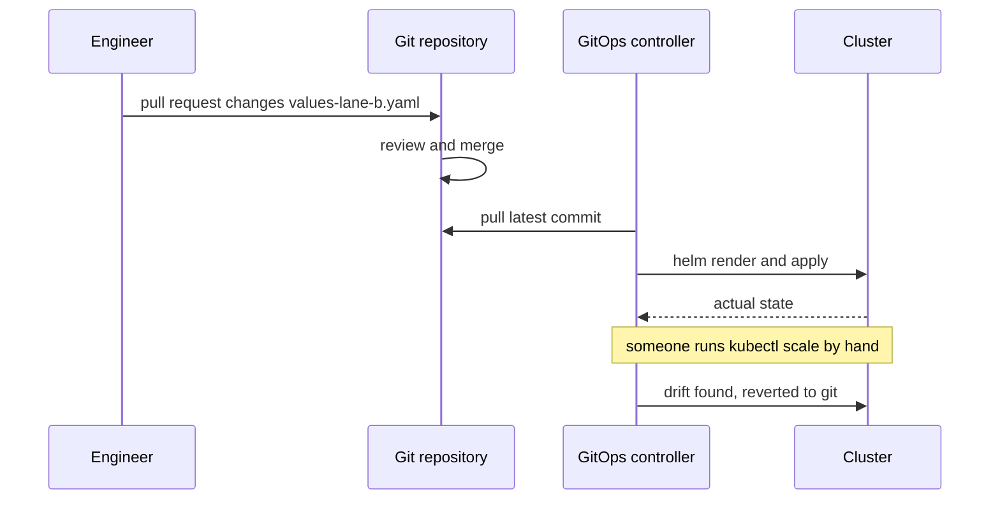

**Story.** An engineer wants two replicas instead of one. They do not run
`kubectl scale`. They open a pull request that changes one line in the
values file. After the merge, the controller in the cluster pulls git and
applies it. Git history now says who changed it, when, and why.

**How it works.**

1. A Helm **chart** is a set of manifest templates.
2. A values file per environment fills the templates. Lane A and lane B
   have one values file each.
3. The chart plus values is committed to git.
4. A GitOps controller (Argo CD or Flux) pulls the repository and applies
   the rendered manifests.
5. The controller compares the cluster with git and reverts any drift.
6. Rollback is a revert of the commit.

### In code

The controller renders the chart from the values in git, reads the live object, and applies the render when the two differ. So a merged commit rolls out, a hand change is reverted, and a revert is a rollback.

```text
every change, a revert too: a pull request to main, merged on review
every minute, the GitOps controller:
  head = pull the newest commit of main       # nobody pushes in
  desired = render the chart with its values  # replicas: 2
  actual = read the live objects from the cluster
  if desired != actual:
    apply desired                             # a hand change is reverted here
  record: in sync with head
```

```go
// render is what helm template does.
func render(v Values) string {
	var b bytes.Buffer
	template.Must(template.New("chart").Parse(chart)).Execute(&b, v)
	return b.String()
}

// reconcile is one pass of the controller: pull, render, compare, apply.
func reconcile(mainBranch []Commit, c *Cluster) {
	head := mainBranch[len(mainBranch)-1] // nobody pushes into the cluster
	desired := render(head.Values)
	if desired == c.rendered() {
		fmt.Printf("  in sync with %q: replicas %d\n", head.Msg, c.Replicas)
		return
	}
	before := c.Replicas
	c.Replicas, c.Digest = head.Values.Replicas, head.Values.Digest // apply
	fmt.Printf("  drift against %q: replicas %d -> %d\n", head.Msg, before, c.Replicas)
}

// in main, prints trimmed
main1 = append(main1, Commit{"replicas 2 (reviewed)", Values{2, "sha256:7ab3"}})
c.Replicas = 4 // kubectl scale on a busy night
main1 = append(main1, Commit{"revert: replicas 1", main1[0].Values})
```

```yaml
# templates/deployment.yaml
apiVersion: apps/v1
kind: Deployment
metadata: {name: api}
spec:
  replicas: {{ .Values.replicas }}
  template:
    spec:
      containers:
      - name: api
        image: "registry.local/api@{{ .Values.digest }}"
---
# values-lane-b.yaml: the only file a person edits
replicas: 1
digest: sha256:7ab3
```

The run goes from replicas 1 to 2 on a reviewed commit, reverts a hand scale from 4 back to 2, and rolls back to 1 on a revert. By hand, the next helm upgrade silently takes 4 back to 1.

Run it: `handbook/code/15-helm-gitops/` with `go run .`

**What goes wrong.** A hand-made change. Someone runs `kubectl scale` on a
busy night. The next `helm upgrade` resets replicas to the chart value and
the fix disappears. Fix: every change is a values-file change in a pull
request. The same applies to cloud resources: Terraform or Pulumi files,
planned in the pull request, with state in a locked remote backend.

**Where you use it.**

- A production switch is a pull request with the operator as a required
  reviewer. Nobody holds a production write credential on a laptop.
- A hotfix takes the same path. Speed comes from automation, not from a
  bypass.
- Argo CD gives a user interface and "app of apps". Flux is lighter and
  git-native. Both work.

▶ Watch it move: [Helm and GitOps](visual/15-helm-gitops.html)

> **Say it:** "The cluster pulls its state from git, so every change is a
> reviewed commit and drift is reverted on its own."

---

## Infrastructure as code: Terraform and Pulumi

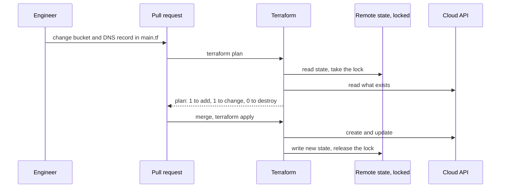

**Story.** The website needs a storage bucket and a DNS record. Nobody clicks
in a cloud console. An engineer adds both to a Terraform file and opens a
pull request. The pipeline posts the plan: one to add, one to change, zero
to destroy. A reviewer reads the plan, merges, and the pipeline applies it.

**How it works.**

1. Resources are declared in files: HCL for Terraform, a normal language
   such as TypeScript or Go for Pulumi.
2. A state file records which real resource each declaration owns.
3. `plan` compares files, state and the real cloud, and prints the diff.
4. `apply` makes the cloud match the files and updates the state.
5. State lives in a remote backend with a lock, so two applies never run
   at once.

### In code

A plan is a compare between the files and the state. Not in the state means add. Different means change. In the state and not in the files means destroy. The lock keeps two runs from writing the state together.

```text
plan:
  take the lock on the remote state          # a second run stops and waits
  state = what this project owns
  real = read each owned resource from the cloud
  rename by the moved blocks first           # main is now main_db
  for each resource in the files:
    not in state: add. In state but different: change.
  for each resource in state and not in the files: destroy
  if a destroy hits prevent_destroy: fail the plan
  post the plan on the pull request          # 1 to add, 1 to change, 0 to destroy
apply, after the merge:
  make the changes, write the new state, release the lock
```

```hcl
terraform {
  backend "s3" {
    bucket         = "site-tf-state"
    key            = "website.tfstate"
    dynamodb_table = "tf-lock"    # the lock
  }
}

resource "aws_s3_bucket" "assets" {    # new: 1 to add
  bucket = "site-assets"
}

resource "aws_route53_record" "www" {  # changed: 1 to change
  name    = "www"
  type    = "CNAME"
  records = ["new-host.example.com"]
}

moved {                                # no destroy, no add
  from = aws_db_instance.main
  to   = aws_db_instance.main_db
}

resource "aws_db_instance" "main_db" {
  instance_class = "db.r6g.large"
  lifecycle {
    prevent_destroy = true             # a destroy plan fails
  }
}
```

The run prints 1 to add, 1 to change, 0 to destroy for the change. The rename gives 1 to add, 1 to destroy. A moved block gives 0. prevent_destroy fails the plan. A second apply stops at the lock.

Run it: `handbook/code/15-infrastructure-as-code/` with `go run .`

**What goes wrong.** A plan that says "destroy" nobody reads, for example
after a rename that Terraform sees as delete plus create. The database is
dropped and recreated empty. Fix: read every destroy line, use `moved`
blocks for renames, and set `prevent_destroy` on stateful resources. A
second trap: state on a laptop, lost or edited by two people at once.

**Where you use it.**

- Cloud resources: networks, buckets, DNS, managed databases, IAM roles.
- Kubernetes objects stay in Helm and GitOps. Terraform builds the cluster,
  GitOps fills it.
- Drift: a scheduled plan that should print "no changes" catches hand edits.

▶ Watch it move: [Infrastructure as code](visual/15-infrastructure-as-code.html)

> **Say it:** "Infrastructure is declared in files, planned in a pull
> request and applied from a locked remote state, and I read every destroy
> line before I merge."

---

## CI runners: hosted or self-hosted

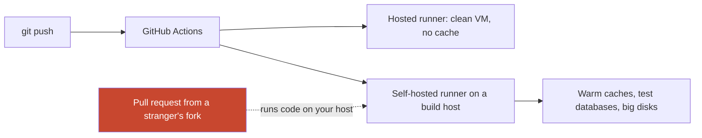

**Story.** Integration tests need a throwaway StarRocks and a sealed
recording of chain data. On a hosted runner each run downloads gigabytes
and starts cold. The team moves the test workflow to four runners on its
own build host. Caches stay warm and test databases start in seconds. The
host is now theirs to secure.

**How it works.**

1. A push starts a workflow. Each job needs a runner, a machine that
   executes its steps.
2. A hosted runner is a fresh VM from the CI provider, thrown away after
   the job.
3. A self-hosted runner is your machine, registered with the provider. It
   keeps caches and local services between jobs.
4. Branch protection requires the workflow's check to pass before a merge.
5. Ephemeral self-hosted runners (one job, then wiped) mix both: your
   hardware, a clean start.

### In code

A hosted runner starts empty each time. A self-hosted runner keeps its caches, and so it also keeps whatever the last job left behind. So a self-hosted runner never runs code from a stranger.

```text
on a push to a pull request:
  for each job: find an idle runner with the job's labels
  hosted runner: a fresh machine, every cache empty, thrown away after
  self-hosted runner: your machine, caches kept between jobs
  run the steps, report the check to the pull request
branch protection: merge only if the required check is green
a fork's pull request runs a stranger's code on that runner
the rule: self-hosted runners serve private repositories only
ephemeral: wipe the runner after each job, no secret stays on it
```

```yaml
name: tests
on:
  pull_request:
  push: {branches: [main]}
concurrency:
  group: tests-${{ github.ref }}
  cancel-in-progress: true
jobs:
  t2:
    runs-on: [self-hosted, build-host]   # the four runners
    # never run a fork's code on your own machine
    if: github.event.pull_request.head.repo.full_name == github.repository
    steps:
    - uses: actions/checkout@v4
    - run: bash ci/t2.sh                 # the image is already on disk
```

The run prints 9 downloads for 3 jobs on hosted runners, 3 on self-hosted, and 0 on ephemeral runners with caches baked into their disk. It refuses a public repository's pull request on the build host.

Run it: `handbook/code/15-ci-runners/` with `go run .`

**What goes wrong.** A self-hosted runner on a public repository. Anyone
can open a pull request from a fork, and the workflow runs their code on
your host, next to your secrets. Fix: self-hosted runners only for private
repositories or trusted branches, no long-lived secrets on the host, and
ephemeral runners where possible.

**Where you use it.**

- Private repositories with heavy integration tests: self-hosted, cached.
- Public repositories and untrusted contributors: hosted runners.
- Image builds on demand only, so the runner fleet runs tests, not noise.

▶ Watch it move: [CI runners](visual/15-ci-runners.html)

> **Say it:** "Hosted runners are clean and safe, self-hosted runners are
> fast and cached, and a self-hosted runner must never run a stranger's
> code."

---

## Immutable images by digest

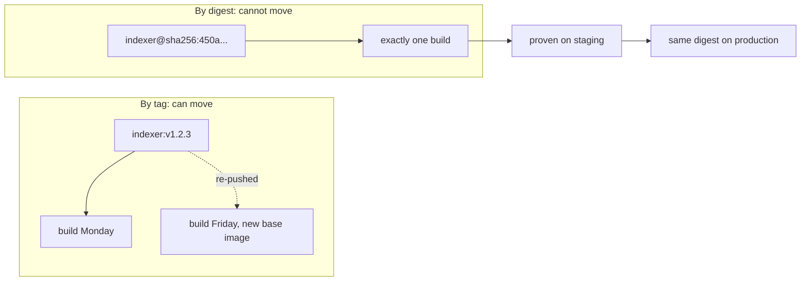

**Story.** A team builds `v1.2.3`, tests it on staging, then rebuilds it
for production. The base image moved in between. Production now runs
code nobody tested. With a digest, production names the exact bytes that
staging proved.

**How it works.**

1. Build the image once, from a commit.
2. The registry gives it a `sha256` digest, a hash of its content.
3. The staging values file names that digest.
4. Promotion copies the same digest into the production values file.
5. A tag is only a label for people. The values file never uses one.

### In code

A digest is the hash of the bytes, so one name can never hold other bytes. A tag is a pointer the next push can move. So production pins the digest staging proved.

```text
build(commit, base): digest = sha256(all the bytes)   # other base, other digest
push: the registry stores the bytes under the digest
tag v1.2.3 -> digest                  # a pointer, and it can be moved
deploy by tag: each pod start asks what v1.2.3 points at now
a restart asks again, and may get other bytes
deploy by digest: each pod start asks for exactly that hash, and checks it
promote: copy the digest to the production values file, in a reviewed pull request
a build argument is written into the layer history    # the token ships with the image
a mounted build secret never enters a layer
```

```go
type Registry struct {
	blobs map[string][]byte // digest -> bytes
	tags  map[string]string // tag -> digest, can move
}

func digestOf(img []byte) string { return fmt.Sprintf("sha256:%x", sha256.Sum256(img)) }

func build(commit, base string) []byte { return []byte(base + "\n" + commit) }

func (r *Registry) push(img []byte, tag string) string {
	d := digestOf(img)
	r.blobs[d] = img
	r.tags[tag] = d // moves the tag if it already existed
	return d
}

// pullTag asks what the tag points at right now.
func (r *Registry) pullTag(tag string) string { return r.tags[tag] }

// pullDigest asks for exact bytes, and checks them.
func (r *Registry) pullDigest(d string) ([]byte, error) {
	img := r.blobs[d]
	if digestOf(img) != d {
		return nil, fmt.Errorf("digest mismatch for %s", d)
	}
	return img, nil
}

// promote copies the proven digest into production's values file.
func promote(staging, prod map[string]string) {
	prod["image"] = staging["image"] // a copy of a proven name, never a new build
}

// history is what any puller can read from the image's layers.
func history(buildArgs map[string]string, mountedSecrets []string) []string {
	var h []string
	for k, v := range buildArgs {
		h = append(h, "ARG "+k+"="+v) // the token ships with the image
	}
	for range mountedSecrets {
		h = append(h, "RUN --mount=type=secret (value not stored)")
	}
	return h
}
```

```yaml
# values-lane-a.yaml: copied from lane B in a reviewed pull request
image: registry.local/indexer@sha256:450a
```

The run builds commit a1b2c3 twice. Monday gives sha256:450a, Friday gives sha256:126d, and the tag v1.2.3 moves between them. Production by tag pulls bytes staging never tested. By digest both get 450a, and tampered bytes fail the check.

Run it: `handbook/code/15-image-digest/` with `go run .`

**What goes wrong.** Rebuilding for production, or a mutable tag like
`latest` in a values file. Either way the running bytes are not the tested
bytes. Fix: build once, promote by digest. Never pass a secret as a build
argument either: it lives in a layer forever.

**Where you use it.**

- Every lane values file names images by digest.
- Image builds run on demand only, never on every push, so the registry
  holds releases, not noise.
- A supply-chain check (chapter 14) signs the digest and verifies it at
  deploy.

▶ Watch it move: [Immutable images by digest](visual/15-image-digest.html)

> **Say it:** "A tag can move and a digest cannot, so I build once and
> promote the digest that staging proved."

---

## Ingress, network policy and the service mesh

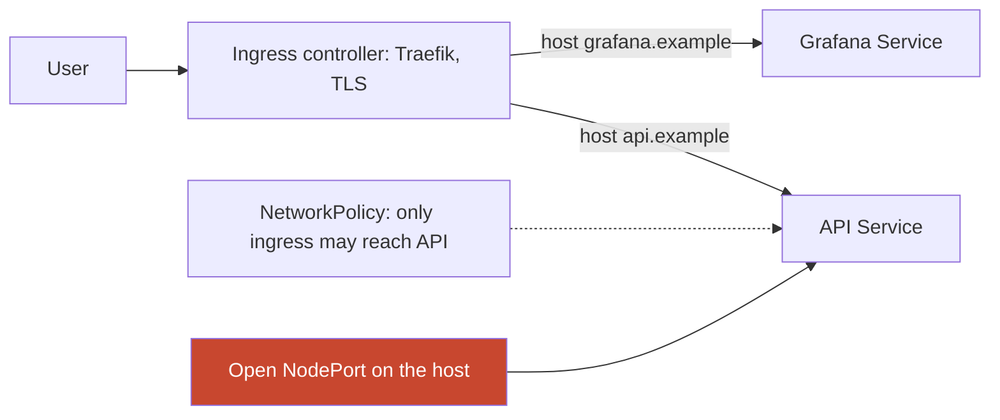

**Story.** Traefik receives `api.example`, ends the TLS (Transport Layer
Security) connection with a certificate from cert-manager, and forwards to
the API Service. A NetworkPolicy says only the ingress may talk to the API
pods. After a cluster reboot, policy enforcement turned on and refused the
monitoring scraper too, because nobody had listed it.

**How it works.**

1. An **Ingress** object declares host and path rules.
2. An ingress controller (Traefik, nginx) is the pod that implements them.
3. A NetworkPolicy lists who may connect to which pods.
4. A service mesh (Istio, Linkerd) puts a proxy beside each pod. It adds
   mutual TLS (mTLS), retries, timeouts and traffic splits with no code
   change.

### In code

The ingress decides where a request goes, by host. A NetworkPolicy decides who may connect to a pod, by source and port. A NodePort walks around both.

```text
on a request at the ingress controller (Traefik):
  end TLS with the certificate for the host   # from cert-manager
  find the rule for the host                  # api.example -> API Service
  no rule: answer 404
  forward to the Service, which picks a ready pod
on a connection to a pod that a NetworkPolicy selects:
  if the source and the port match a rule: allow
  else: drop                                  # only if enforcement is on
a NodePort opens the port on every host: traffic skips lines 1 to 5
calls per request = app tries * mesh tries    # 3 * 3 = 9
```

```yaml
apiVersion: networking.k8s.io/v1
kind: Ingress
metadata: {name: api}
spec:
  tls:
  - {hosts: [api.example], secretName: api-tls}   # cert-manager renews it
  rules:
  - host: api.example
    http:
      paths:
      - path: /
        pathType: Prefix
        backend: {service: {name: api, port: {number: 80}}}
---
apiVersion: networking.k8s.io/v1
kind: NetworkPolicy
metadata: {name: api-allow}
spec:
  podSelector: {matchLabels: {app: api}}
  policyTypes: [Ingress]
  ingress:
  - from:                 # the ingress controller
    - namespaceSelector: {matchLabels: {name: traefik}}
    ports: [{port: 8080}]
  - from:                 # Prometheus, the second rule
    - namespaceSelector: {matchLabels: {name: monitoring}}
    ports: [{port: 9090}]
---
apiVersion: v1
kind: Service
metadata: {name: api}
spec:
  type: ClusterIP         # not NodePort: no door on the host
  selector: {app: api}
  ports: [{port: 80, targetPort: 8080}]
---
# retries live in one place: the mesh
apiVersion: networking.istio.io/v1
kind: VirtualService
metadata: {name: database}
spec:
  hosts: [database]
  http:
  - route: [{destination: {host: database}}]
    timeout: 2s
    retries: {attempts: 2, perTryTimeout: 500ms}   # 2 retries: 3 calls at most
```

The run routes api.example to the API and an unknown host to 404. With enforcement on, it drops the Prometheus scrape until a second rule names it. It also prints 3 x 3 = 9 database calls, and 3 with retries in the mesh only.

Run it: `handbook/code/15-ingress-network-policy/` with `go run .`

**What goes wrong.** A NodePort left open on the internet beside the
ingress. The ingress rules do not protect it (red box). Fix: audit the
host's listening ports, and close NodePorts that are not needed. A second
trap: retries in both the mesh and the application, so one request is
tried nine times. Decide once where retries live.

**Where you use it.**

- Traefik `IngressRoute` objects for each public host.
- A NetworkPolicy per service, with the scraper and the ingress listed.
- A mesh traffic split to send 10 percent to a new version.

▶ Watch it move: [Ingress, network policy and the mesh](visual/15-ingress-network-policy.html)

> **Say it:** "The ingress routes and ends TLS, network policy decides who
> may connect, and anything that bypasses the ingress is unprotected."

---

## Load balancers: layer 4 and layer 7

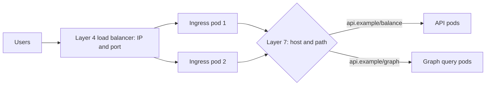

**Story.** Traffic for `api.example` first hits a layer 4 load balancer. It
sees only an IP address and a port, and spreads connections over two
ingress pods. Each ingress pod is a layer 7 proxy: it reads the HTTP
request, sees the path `/graph`, and sends it to the graph query pods
instead of the balance API.

**How it works.**

1. Layer 4 (transport) balances TCP or UDP connections by address and port.
   It is fast and does not read the request.
2. Layer 7 (application) ends the connection, reads HTTP, and routes by
   host, path or header. It can end TLS, retry and rate limit.
3. Health checks remove a dead backend from the pool.
4. Algorithms: round robin, least connections, or a hash for stickiness.
5. In Kubernetes, a `Service` of type LoadBalancer is layer 4. An Ingress
   controller is layer 7.

### In code

Layer 4 picks a backend once, per connection, and never reads the request. Layer 7 reads the path and picks a healthy pod per request. A gRPC client keeps one connection, so at layer 4 every request lands on one pod.

```text
layer 4, on each new connection:
  backend = next in round robin              # sees only address and port
  every packet of this connection goes to that backend
layer 7, on each request:
  end TLS, read the method and the path
  pool = the pool for that path              # /balance -> API, /graph -> graph
  skip pods that fail their health check
  pod = next in the pool                     # per request, not per connection
a gRPC client keeps one connection, so layer 4 pins it to one pod
client side: look up all pod addresses, spread each request yourself
```

```go
// RoundRobin hands out the next backend.
type RoundRobin struct {
	Pool []string
	next int
}

func (r *RoundRobin) Pick() string {
	b := r.Pool[r.next%len(r.Pool)]
	r.next++
	return b
}

// L4 picks a backend once, when the connection opens.
func L4(r *RoundRobin) func() string {
	backend := r.Pick()
	return func() string { return backend } // every request on this connection
}

// L7 reads the path, then picks a healthy pod per request.
func (l *L7) Route(path string) string {
	pool := l.Pools[path]
	for range pool.Pool {
		if p := pool.Pick(); l.Healthy[p] {
			return p
		}
	}
	return "503"
}
```

The run routes /balance and /graph to their pools and skips graph-2 once it fails. On one gRPC connection at layer 4, api-1 gets 3,000 of 3,000, and still all of them after the autoscaler adds 2 pods. Per request, each of 5 pods gets 600.

Run it: `handbook/code/15-load-balancers/` with `go run .`

**What goes wrong.** Long-lived connections behind layer 4. A gRPC client
opens one connection and keeps it for hours, so every request goes to the
same pod while the others idle. Fix: a layer 7 balancer that spreads
requests, not connections, or client-side balancing.

**Where you use it.**

- Cloud load balancer or MetalLB on bare metal for layer 4 into the cluster.
- Traefik or nginx for layer 7 routing by host and path.
- Sticky sessions only when unavoidable. Keep state out of the server.

▶ Watch it move: [Load balancers: layer 4 and layer 7](visual/15-load-balancers.html)

> **Say it:** "Layer 4 balances connections by address and port, layer 7
> reads the request and routes by host and path, and long connections need
> layer 7 to spread the load."

---

## Private networks: VPC, subnets and bastion

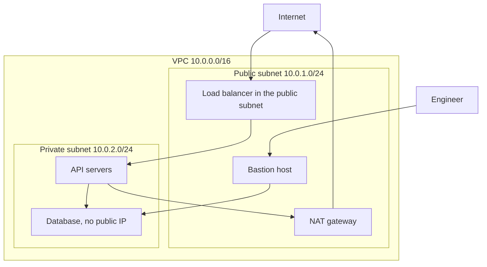

**Story.** The API and its database live in a cloud VPC (Virtual Private
Cloud), a private network only the team owns. The database has no public
address. Users reach the API through a load balancer in the public subnet.
An engineer who must query the database jumps through one hardened bastion
host, and every session is logged.

**How it works.**

1. A VPC is a private address range, such as 10.0.0.0/16.
2. Subnets split it. A public subnet has a route to the internet. A private
   subnet does not.
3. Load balancers and the bastion sit in the public subnet. Servers and
   databases sit in the private one.
4. A NAT gateway lets private servers call out, for updates, without being
   reachable from outside.
5. Security groups (firewalls per machine) allow only named ports from
   named sources.

### In code

A connection from outside needs a route, so a machine with no public address cannot be reached at all. Every connection then meets the security group, which checks the source and the port.

```text
VPC 10.0.0.0/16, split into:
  public subnet 10.0.1.0/24: route 0.0.0.0/0 -> internet gateway
  private subnet 10.0.2.0/24: route 0.0.0.0/0 -> NAT gateway
on a connection in from outside:
  if the target has no public address: no route, it never arrives
on a connection to a machine, its security group:
  if the source and the port match a rule: allow, else drop
on a call out from the private subnet:
  NAT rewrites the source: replies return, nothing can start a connection in
alert on any rule that opens a port to 0.0.0.0/0, except the load balancer
```

```hcl
resource "aws_vpc" "main" {
  cidr_block = "10.0.0.0/16"
}

resource "aws_subnet" "public" {
  vpc_id     = aws_vpc.main.id
  cidr_block = "10.0.1.0/24"
}

resource "aws_subnet" "private" {
  vpc_id     = aws_vpc.main.id
  cidr_block = "10.0.2.0/24"
}

resource "aws_route_table" "private" {
  vpc_id = aws_vpc.main.id
  route {
    cidr_block     = "0.0.0.0/0"
    nat_gateway_id = aws_nat_gateway.out.id   # out only
  }
}

resource "aws_security_group_rule" "db_from_api" {
  type                     = "ingress"
  from_port                = 5432
  to_port                  = 5432
  protocol                 = "tcp"
  security_group_id        = aws_security_group.db.id
  source_security_group_id = aws_security_group.api.id   # not 0.0.0.0/0
}
```

The run allows the user to the load balancer, the load balancer to the API and the API to the database. It refuses the scanner twice over. After the one-time public address, the scanner gets through and the alert names database port 5432.

Run it: `handbook/code/15-vpc-subnets/` with `go run .`

**What goes wrong.** A database with a public IP "just for a quick check".
Scanners find it within hours and try passwords. Fix: databases only in
private subnets, access through a bastion or a VPN, and an alert on any
security rule that opens a port to 0.0.0.0/0.

**Where you use it.**

- Every cloud deployment: public subnet for the edge, private for the rest.
- Subnets in several availability zones, so one zone loss keeps the network.
- On bare metal the same idea: a private network for the cluster, one
  guarded entry point.

▶ Watch it move: [VPC, subnets and bastion](visual/15-vpc-subnets.html)

> **Say it:** "Only the edge lives in a public subnet, everything with data
> lives in a private one, and people reach it through one guarded door."

---

## Service mesh and sidecars

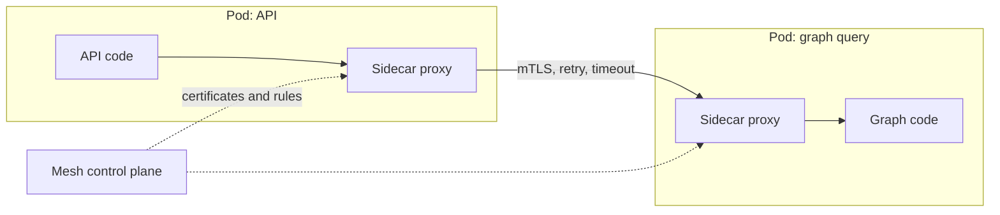

**Story.** The API calls the graph query service. The team wants every call
encrypted, both sides proven, a timeout, and a way to send 10 percent of
traffic to a new version. Instead of adding this to every service's code,
a service mesh puts a small proxy, a sidecar, beside each pod. The code
calls plain HTTP. The proxies do the rest.

**How it works.**

1. A sidecar is a helper container in the same pod. In a mesh it is a proxy
   (Envoy for Istio, linkerd2-proxy for Linkerd).
2. All traffic in and out of the pod passes through it.
3. The control plane gives each proxy a certificate and the routing rules.
4. Proxies talk mutual TLS (mTLS): both sides prove who they are.
5. Rules add retries, timeouts, circuit breaking and traffic splits with no
   code change. Every call becomes a metric and a trace span.

### In code

The sidecar owns the call: it picks the version, proves identity with mutual TLS, retries with a growing wait, and measures. A retry budget caps the extra load. Retries in the app as well multiply: 3 times 3 is 9.

```text
before: each service hand-writes its own TLS, timeouts and retries
the API code: call localhost, the sidecar takes over
the sidecar, on each outgoing call:
  v = pick v1 for 90 percent, v2 for 10 percent
  open mutual TLS: each side proves its service identity
  for try in 1 .. 3:
    if this is a retry and the budget is spent: stop    # 20 percent extra
    send with a 2 s timeout
    success: stop
    wait a backoff: 100 ms, doubled each try, with jitter
  record rate, errors, duration and a trace span
calls per request = app tries * sidecar tries     # 3 * 3 = 9
```

```go
// Budget allows retries up to 20 percent of the calls.
type Budget struct{ Calls, Retries int }

func (b *Budget) allow() bool { return float64(b.Retries) < 0.2*float64(b.Calls) }

// pick is the traffic split: 90 percent to v1, 10 percent to v2.
func (s *Sidecar) pick() string {
	if s.Rand.Intn(100) < 90 {
		return "v1"
	}
	return "v2"
}

// tlsConfig is mutual TLS: show this service's certificate, demand the peer's.
func (s *Sidecar) tlsConfig() *tls.Config {
	return &tls.Config{
		Certificates: []tls.Certificate{s.Cert}, // its service identity
		ClientCAs:    s.MeshCA,
		ClientAuth:   tls.RequireAndVerifyClientCert,
	}
}

// Call tries up to MaxTries, waiting 100 ms, then doubling, with jitter.
func (s *Sidecar) Call(send func() error) error {
	backoff := 100 * time.Millisecond
	var err error
	for try := 1; try <= s.MaxTries; try++ {
		if try > 1 {
			if s.Budget != nil && !s.Budget.allow() {
				return err // the budget is spent: fail fast
			}
			if s.Budget != nil {
				s.Budget.Retries++
			}
			jitter := time.Duration(s.Rand.Int63n(int64(backoff / 2)))
			s.Waited += backoff + jitter // a real sidecar sleeps here
			backoff *= 2
		}
		s.Sent++
		if s.Budget != nil && try == 1 {
			s.Budget.Calls++
		}
		if err = send(); err == nil {
			return nil
		}
	}
	return err
}

// appCall is the old retry loop in the API code: 3 tries of 3 tries.
func appCall(tries int, s *Sidecar, send func() error) error {
	var err error
	for i := 0; i < tries; i++ {
		if err = s.Call(send); err == nil {
			return nil
		}
	}
	return err
}
```

The run splits 10,000 calls about 90 to 10. On a dead service, 1 request makes 3 calls from the mesh alone and 9 with the app loop too. 1,000 requests make 3,000 calls with no budget and 1,200 with a 20 percent budget.

Run it: `handbook/code/15-service-mesh/` with `go run .`

**What goes wrong.** Retries in the mesh and in the code. Three retries
times three retries is nine calls to a struggling service. Fix: retries in
one place, with a retry budget. Second cost: a proxy per pod adds memory
and a little latency to every call. A small system may not need a mesh.

**Where you use it.**

- Many services owned by many teams, with a rule that all traffic is
  encrypted.
- Canary releases by weight, done in the mesh.
- A handful of services: plain TLS and a library is often enough.

▶ Watch it move: [Service mesh and sidecars](visual/15-service-mesh.html)

> **Say it:** "A service mesh puts a proxy beside every pod, so encryption,
> retries, timeouts and traffic splits are configured once instead of coded
> in every service."

---

## Stateful workloads: StatefulSet, volumes, storage classes

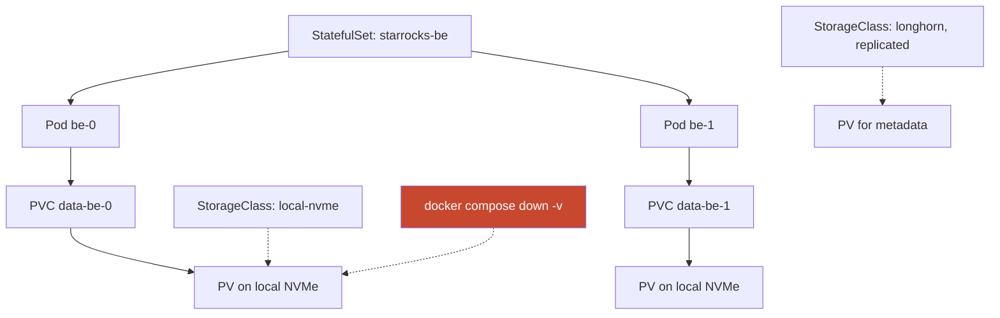

**Story.** The warehouse backends run as a StatefulSet. Pod `be-0` always
gets volume `data-be-0`, even after a restart on another day. Hot
partitions live on local NVMe (fast flash disks). Metadata lives on
Longhorn, which copies each block volume to several nodes.

**How it works.**

1. The pod asks for storage through a PersistentVolumeClaim (PVC): a size
   and a class.
2. A StorageClass names a kind of storage: fast local, replicated, cloud
   disk.
3. A CSI (Container Storage Interface) driver creates the volume.
4. The StatefulSet ties claim and pod by name, so `be-0` keeps its data.
5. An operator, a controller for one product, runs upgrades one pod at a
   time with a readiness check between.

### In code

A StatefulSet starts pods in order and gives each a stable name and its own claim, so a restart finds its data. A local volume ties the pod to one node. A replicated one lets it start wherever a copy lives.

```text
for ordinal 0, 1, ...:                     # pods in order
  wait until pod ordinal - 1 is ready
  claim = data-be-<ordinal>; if missing, create it from the template
  start pod be-<ordinal> and bind that claim
a pod that dies comes back with the same name and the same claim
upgrade: one pod at a time, highest ordinal first, wait until ready
deleting a claim or a volume removes the data, and nothing asks twice
drain: evict only if the PodDisruptionBudget stays met  # 1 of 2 stays up
local volume: the pod must run on that node, else Pending
replicated volume: the pod may start on any node with a copy
```

```yaml
apiVersion: apps/v1
kind: StatefulSet
metadata: {name: be}
spec:
  replicas: 2
  serviceName: be                 # stable names: be-0, be-1
  podManagementPolicy: OrderedReady   # pod 1 waits for pod 0
  updateStrategy:
    type: RollingUpdate           # highest ordinal first
  persistentVolumeClaimRetentionPolicy:   # deleting or scaling the set keeps the claims
    whenDeleted: Retain
    whenScaled: Retain
  template:
    spec:
      containers:
      - name: be
        volumeMounts: [{name: data, mountPath: /data}]
  volumeClaimTemplates:           # one claim per pod: data-be-0, data-be-1
  - metadata: {name: data}
    spec:
      accessModes: [ReadWriteOnce]
      storageClassName: local-nvme   # one node: fast, tied to it
      resources: {requests: {storage: 2Ti}}
---
apiVersion: policy/v1
kind: PodDisruptionBudget
metadata: {name: be}
spec:
  minAvailable: 1                 # a drain keeps 1 of 2 up
  selector: {matchLabels: {app: be}}
---
apiVersion: storage.k8s.io/v1
kind: StorageClass
metadata: {name: longhorn-3}
provisioner: driver.longhorn.io
reclaimPolicy: Retain                 # a deleted claim keeps its volume
parameters: {numberOfReplicas: "3"}   # a copy on 3 nodes: the pod may move
```

The run starts be-0 then be-1 with their claims, brings be-0 back with the same name and claim, allows a drain with 2 ready and refuses it with 1. When node-1 dies, be-0 is Pending and fe-0 starts on node-2.

Run it: `handbook/code/15-stateful-workloads/` with `go run .`

**What goes wrong.** Deleting a volume you did not create: a PVC, a
`docker volume rm`, or `docker compose down -v`. History is gone (red
arrow). Fix: a protected-volume list that every runbook names, and the
rule that unknown volumes are protected until proven otherwise.

**Where you use it.**

- Local disks: fastest, but tie the pod to one node.
- Replicated CSI like Longhorn: survives a node loss, at a write-latency
  cost.
- A PodDisruptionBudget: the minimum pods that must stay up while nodes
  are drained.

▶ Watch it move: [Stateful workloads](visual/15-stateful-workloads.html)

> **Say it:** "State lives in a StatefulSet with one claim per pod, on a
> storage class that matches the workload, and volumes are protected by
> default."

---

## Storage classes, CSI and reclaim policy

```mermaid
stateDiagram-v2
  [*] --> Pending: PVC created
  Pending --> Bound: pod scheduled, CSI driver creates the volume
  Bound --> Released: PVC deleted
  Released --> Deleted: reclaimPolicy Delete
  Released --> Retained: reclaimPolicy Retain
  Retained --> Bound: admin re-binds it
```

**Story.** A graph database claims 4 TiB of the `local-nvme` class. The class
says "wait for the first consumer", so the volume is made only after the
scheduler picks a node, on that node's disk. Months later someone deletes
the claim by mistake. Because the class says `Retain`, the volume and its
data stay, and an admin binds them back.

**How it works.**

1. A StorageClass names a CSI (Container Storage Interface) driver and its
   settings: disk type, replicas, file system.
2. A PersistentVolumeClaim (PVC) asks for a size and a class.
3. With `volumeBindingMode: WaitForFirstConsumer`, the volume is made after
   the pod is placed, so it lands where the pod runs.
4. The driver creates a PersistentVolume (PV) and binds it to the claim.
5. When the claim is deleted, `reclaimPolicy` decides: `Delete` removes the
   volume, `Retain` keeps it.

### In code

WaitForFirstConsumer holds the volume back until the scheduler has placed the pod. The CSI driver then creates it on that node. The class's reclaim policy decides what a deleted claim means: Retain keeps the data, Delete removes it.

```text
on a claim of a WaitForFirstConsumer class: do nothing, Pending
when a pod uses the claim, the scheduler:
  for each node: room for the pod, and 4 TiB free on its disk?
  bind the pod to the first node that fits
the CSI driver: create the volume on that node
make a PersistentVolume and bind it to the claim    # the pod starts
on a claim delete, read the class's reclaimPolicy:
  Retain: keep the volume, status Released          # an admin can bind it again
  Delete: the CSI driver deletes the volume and its data
```

```yaml
apiVersion: storage.k8s.io/v1
kind: StorageClass
metadata: {name: local-nvme}
provisioner: local.csi.example     # the CSI driver
volumeBindingMode: WaitForFirstConsumer   # the pod is placed first
reclaimPolicy: Retain              # the default is Delete
---
apiVersion: v1
kind: PersistentVolumeClaim
metadata: {name: graph-data}
spec:
  accessModes: [ReadWriteOnce]
  storageClassName: local-nvme
  resources: {requests: {storage: 4Ti}}
```

The run skips node-1 with 1 TiB free and places the pod on node-2. With Retain the deleted claim leaves a Released volume that an admin binds again. With Delete the data is gone.

Run it: `handbook/code/15-storage-classes-csi/` with `go run .`

**What goes wrong.** The default class has `reclaimPolicy: Delete`. A
cleanup removes a PVC, and the CSI driver deletes the disk with all its
data. Fix: `Retain` for every class that holds data you cannot rebuild,
and volume snapshots before risky work.

**Where you use it.**

- Local NVMe class with WaitForFirstConsumer for warehouse and graph data.
- A replicated class (Longhorn, Ceph) for small data that must survive a
  node loss.
- Cloud disk classes (EBS, persistent disk) tied to one availability zone.

▶ Watch it move: [Storage classes and reclaim policy](visual/15-storage-classes-csi.html)

> **Say it:** "A claim asks, a storage class decides how, the CSI driver
> builds the volume, and reclaim policy Retain is what keeps the data
> when the claim is deleted."

---

## Operators and custom resources (CRDs)

```mermaid
flowchart LR
  CRD["CRD: kind StarRocksCluster"] --> CR["Object: backends 3, version 3.3"]
  CR --> OPR["Operator: a controller for one product"]
  OPR --> SS["StatefulSets, Services, ConfigMaps"]
  OPR -- "upgrade: one pod, wait ready, next" --> SS
  SS -- "status" --> CR
```

**Story.** Running a warehouse by hand means many runbook steps: start the
frontend first, add backends one at a time, upgrade one node and check it
before the next. The StarRocks operator turns those steps into code. The
team writes one object, "a cluster with three backends at version 3.3",
and the operator does the rest.

**How it works.**

1. A Custom Resource Definition (CRD) adds a new object type to the cluster
   API, such as `StarRocksCluster`.
2. You create objects of that type, in git, like any other manifest.
3. The operator is a controller that watches those objects.
4. It creates the low-level objects (StatefulSets, Services) and runs the
   product's own procedure: ordered start, careful upgrades, backups.
5. It writes progress back into the object's status.

### In code

An operator is a control loop that knows one product. It compares the object with the pods, takes one safe step per pass, and writes the result into the status.

```text
watch objects of kind StarRocksCluster, on each change:
  if the frontend is missing: create it, wait until ready
  for i in 0 .. spec.backends - 1:
    if be-i is missing: create it, wait until it joins
  for i from highest to 0:
    if be-i runs another version: upgrade it, wait until caught up
  if the frontend runs another version: upgrade it, last
  write status: ready, version
everything created carries an owner reference to the object
deleting the CRD deletes every object of that kind, and all they own
```

```go
// Cluster is the custom resource: what you want, and what is true.
type Cluster struct {
	Name   string
	Spec   Spec
	Status Status
}

type Spec struct {
	Backends int
	Version  string
}

// Reconcile takes one safe step and returns true when nothing is left.
func Reconcile(c *Cluster, pods Pods) (string, bool) {
	if _, ok := pods["fe-0"]; !ok {
		pods["fe-0"] = c.Spec.Version
		return "create fe-0, wait until ready", false
	}
	for i := 0; i < c.Spec.Backends; i++ { // create in order, one at a time
		name := fmt.Sprintf("be-%d", i)
		if _, ok := pods[name]; !ok {
			pods[name] = c.Spec.Version
			return "create " + name + ", wait until it joins", false
		}
	}
	for i := c.Spec.Backends - 1; i >= 0; i-- { // upgrade highest first
		name := fmt.Sprintf("be-%d", i)
		if pods[name] != c.Spec.Version {
			pods[name] = c.Spec.Version
			return "upgrade " + name + ", wait until caught up", false
		}
	}
	if pods["fe-0"] != c.Spec.Version { // the frontend goes last
		pods["fe-0"] = c.Spec.Version
		return "upgrade fe-0", false
	}
	c.Status = Status{true, c.Spec.Version}
	return "status: ready, version " + c.Spec.Version, true
}

// deleteCRD is the cascade: every object of the kind goes, then all they own.
func deleteCRD(objects map[string]*Cluster, pods Pods) int {
	for name := range objects {
		delete(objects, name)
	}
	n := len(pods)
	for p := range pods {
		delete(pods, p) // each pod has an owner reference to its object
	}
	return n
}
```

```yaml
apiVersion: starrocks.example/v1
kind: StarRocksCluster
metadata: {name: prod}
spec:
  backends: 3
  version: "3.3"     # one line changes, the operator does the rest
```

The run creates fe-0, then be-0, be-1 and be-2 in order. Version 3.3 upgrades be-2, be-1, be-0, then fe-0. Deleting the CRD removes the object and all 4 pods it owned.

Run it: `handbook/code/15-operators-crds/` with `go run .`

**What goes wrong.** Deleting a CRD. Kubernetes deletes every object of
that type with it, and the operator then deletes what they owned. A whole
database can vanish from one cleanup command. Fix: never delete a CRD of
a running product, and keep operators and CRDs under the same review as
data.

**Where you use it.**

- Databases: StarRocks, Postgres (CloudNativePG), Kafka (Strimzi).
- cert-manager is an operator: a `Certificate` object becomes a renewed TLS
  key.
- Write your own only when the product has real procedures. A plain
  Deployment does not need one.

▶ Watch it move: [Operators and CRDs](visual/15-operators-crds.html)

> **Say it:** "A CRD adds a new kind of object, and an operator is the
> controller that turns that object into a running product, with the
> product's own runbook written as code."

---

## Backups and disaster recovery: RPO and RTO

```mermaid
flowchart LR
  subgraph Time["Timeline of a disaster"]
    BK["Last backup 01:00"] --> LOSS["Disk lost 05:00"] --> UP["Service back 07:00"]
  end
  BK -. "RPO: 4 hours of data lost" .-> LOSS
  LOSS -. "RTO: 2 hours down" .-> UP
  BK --> OFF["Copy in another site"]
  OFF --> TEST["Restore tested every month"]
```

**Story.** A warehouse disk set fails at 05:00. The last backup ran at
01:00, so four hours of writes are lost: that is the recovery point. The
restore and catch-up take until 07:00, two hours of downtime: that is the
recovery time. Because the indexer can re-read the chain, the lost four
hours are rebuilt from the source.

**How it works.**

1. The RPO (Recovery Point Objective) is how much data you may lose,
   measured in time.
2. The RTO (Recovery Time Objective) is how long you may be down.
3. Backups follow 3-2-1: three copies, two kinds of media, one off-site.
4. Snapshots are fast but often live on the same storage. A backup must
   leave the site.
5. Only a restore proves a backup. Run one on a schedule and time it.

### In code

RPO is the failure time minus the newest good copy. RTO is the time back online minus the failure time. Only a restore tells you whether a copy is good.

```text
every night at 01:00: copy the data off-site        # the 3-2-1 rule
every month: restore the latest copy into scratch, check row counts, record the time
on a failure at time F:
  last = the newest copy that is good
  RPO = F - last.time                  # the data you lose
  restore last onto new disks
  re-read the lost hours from the chain     # this data can be re-derived
  RTO = back online - F                # the time customers feel
a copy nobody has restored might not be good
```

```go
// lastGood is what you learn at restore time.
func lastGood(copies []Copy) Copy {
	for i := len(copies) - 1; i >= 0; i-- {
		if copies[i].Good {
			return copies[i]
		}
	}
	return Copy{}
}

// drill restores each unverified copy into a scratch environment.
func drill(copies []Copy) int {
	bad := 0
	for i := range copies {
		copies[i].Verified = true
		if !copies[i].Good {
			bad++
		}
	}
	return bad
}

// in main: one bad night
good := []Copy{{At: at(9, 1), Good: true}, {At: at(10, 1), Good: true}} // 01:00, every night
failure := at(10, 5) // 05:00: the disks fail
c := lastGood(good)
fmt.Printf("RPO = %v of data lost\n", failure.Sub(c.At))
fmt.Printf("restore the %s copy\n", c.At.Format("Jan 2 15:04"))
fmt.Printf("re-read the chain from %s to %s\n", c.At.Format("15:04"), failure.Format("15:04"))
back := at(10, 7) // 07:00: back online
fmt.Printf("RTO = %v of downtime\n", back.Sub(failure))
```

The run prints RPO 4h and RTO 2h for the good night. With a copy nobody restored, the newest good one is a week old: RPO 172h. A drill finds the 7 bad copies first.

Run it: `handbook/code/15-backup-dr/` with `go run .`

**What goes wrong.** Backups nobody ever restored. On the day of the
disaster the files are corrupt, or the restore takes three days. Fix: a
scheduled restore test into a scratch environment, with its time written
down as the real RTO.

**Where you use it.**

- Data that can be re-derived (an index of a public chain) can accept a
  long RPO: the source is the backup.
- Data that exists nowhere else (customer accounts, payments) needs a short
  RPO: replication plus point-in-time recovery.
- Two lanes are a form of disaster recovery: the idle lane can serve.

▶ Watch it move: [Backups, RPO and RTO](visual/15-backup-dr.html)

> **Say it:** "RPO is how much data I may lose and RTO is how long I may be
> down, and only a tested restore proves either number."

---

## Blue-green and A/B lanes with a pointer

```mermaid
flowchart LR
  subgraph Before["Before the switch"]
    P1{"Pointer: A"} --> A1["Lane A: warehouse, graph, API (serving)"]
    B1["Lane B: new digest, rebuilt, checked (staging)"]
  end
  subgraph After["After the merged pull request"]
    P2{"Pointer: B"} --> B2["Lane B: serving"]
    A2["Lane A: staging, holds the rollback"]
  end
  Before -- "PR moves the pointer" --> After
```

**Story.** A decoder bug means the swap table must be rebuilt from block 1.
Lane B rebuilds while lane A keeps serving customers. When lane B passes a
30-minute health gate and its golden checks, a pull request moves the
pointer to B. No customer ever sees a half-built table. Lane A becomes the
staging lane and holds the rollback.

**How it works.**

1. Two full lanes exist. Each has its own warehouse, graph and services.
2. A pointer in git names the serving lane.
3. The new release rolls onto the lane that is not pointed at.
4. The lane is proven: health gate, golden checks, history judged.
5. A pull request flips the pointer. The merge is the approval.
6. Rollback is a revert of that pull request.

### In code

The pointer moves only when the idle lane passes the gate: at the head, 30 minutes healthy, every golden check green. A diff of the two values files catches any setting that differs, so a fix on one lane cannot stay there.

```text
pointer = the serving lane, both lanes run one digest   # one value in git
build once: the release is one digest, @cd34
write @cd34 to the idle lane's values file      # lane B
roll the idle lane, re-index from block 1 if a decoder changed
gate: is the idle lane within 100 blocks of the chain head?
gate: 30 minutes healthy, and every golden check passes?
either gate fails: fix it, back to line 2       # no customer saw it
pull request: pointer = idle lane, the operator reviews and merges
the controller applies it: traffic moves
rollback: revert that pull request              # the old lane still runs
a fix on one lane goes to the other in the same session
check: diff the two values files
anything but names, namespaces, hosts and secrets differs: fail
```

```go
const (
	gateMinutes = 30  // healthy on live behaviour, no longer
	maxLag      = 100 // blocks behind the chain head
)

// gate decides if the idle lane may serve.
func gate(l Lane) error {
	switch {
	case l.HeadLag > maxLag:
		return fmt.Errorf("lane %s is %d blocks behind the head", l.Name, l.HeadLag)
	case l.HealthyMin < gateMinutes:
		return fmt.Errorf("lane %s healthy for %d of %d minutes", l.Name, l.HealthyMin, gateMinutes)
	case l.GoldenPassed < l.GoldenTotal:
		return fmt.Errorf("lane %s passed %d of %d golden checks", l.Name, l.GoldenPassed, l.GoldenTotal)
	}
	return nil
}

// flip is the pull request that moves the pointer.
func flip(pointer *string, idle Lane) error {
	if err := gate(idle); err != nil {
		return err
	}
	*pointer = idle.Name
	return nil
}

// drift returns every setting that differs, other than the allowed ones.
func drift(a, b map[string]string) []string {
	allowed := map[string]bool{"namespace": true, "host": true}
	var out []string
	for k := range a {
		if a[k] != b[k] && !allowed[k] {
			out = append(out, fmt.Sprintf("%s: A %s, B %s", k, a[k], b[k]))
		}
	}
	return out
}

// in main, prints trimmed
pointer := "A"
b := Lane{Name: "B", Digest: "@cd34", HeadLag: 400000, GoldenTotal: 37}
b.HeadLag, b.HealthyMin = 0, 12
b.HealthyMin, b.GoldenPassed = 30, 37
pointer = "A" // git revert of the pointer commit
la := map[string]string{"namespace": "lane-a", "host": "a.example", "image": "@cd34", "graphSyncMemory": "16Gi"}
lb := map[string]string{"namespace": "lane-b", "host": "b.example", "image": "@cd34", "graphSyncMemory": "16Gi"}
lb["graphSyncMemory"] = "32Gi" // fixed on lane B only
la["graphSyncMemory"] = "32Gi" // the same session
```

The run refuses the flip while lane B is 400,000 blocks behind, again at 12 of 30 minutes, and moves the pointer once it is proven. A revert moves it back. The drift check reports graphSyncMemory: A 16Gi, B 32Gi until both lanes match.

Run it: `handbook/code/15-ab-lanes-and-switch/` with `go run .`

**What goes wrong.** Drift. A memory limit fixed on lane B is never copied
to lane A. Weeks later production switches to A and the old bug returns.
Fix: both lanes carry the same settings. Only names, namespaces, hosts and
secrets may differ. A setting proven on one lane goes to the other in the
same session, and any other difference is a defect.

**Where you use it.**

- A whole data platform, where a rebuild takes hours and must not be seen.
- A plain web service: blue-green by switching the Service selector.
- A canary: one instance first, then 10, 50, 100 percent while the error
  rate is watched. Cheaper than two full lanes, but needs good metrics.

▶ Watch it move: [A/B lanes and the switch](visual/15-ab-lanes-and-switch.html)

> **Say it:** "I never edit production in place: I make the idle lane
> production-ready, then flip a pointer in a reviewed pull request."

---

## Canary and progressive delivery

```mermaid
flowchart LR
  V1["v1: 100 percent"] --> C1["v2: 1 pod, 5 percent"]
  C1 --> CHK{"Error rate and latency vs v1"}
  CHK -- "as good" --> C2["v2: 25, then 50, then 100 percent"]
  CHK -- "worse" --> RB["Roll back to v1, few users touched"]
```

**Story.** A new version of the query API goes out to one pod that gets 5
percent of the traffic. For ten minutes its error rate and latency are
compared with the old version. They match, so the weight rises to 25, 50
and 100 percent. If the errors had doubled, only 5 percent of users would
have seen them, and the rollout would have stopped on its own.

**How it works.**

1. Deploy the new version beside the old one, with a small share of
   traffic.
2. Compare its metrics with the old version's, over the same time.
3. If it is as good, raise the share in steps.
4. If it is worse, send all traffic back to the old version.
5. Tools such as Argo Rollouts or Flagger automate the steps and the
   checks.

### In code

The rule is one comparison per step: v2 fails when its error rate is above
1.5 times v1's over the same ten minutes. A step with fewer than 1,000 v2
requests is not judged.

```text
steps = [5, 25, 50, 100]              # percent of traffic for v2
for weight in steps:
  send weight percent to v2, the rest to v1
  wait 10 minutes
  base = error rate of v1, last 10 min   # label version="v1"
  can  = error rate of v2, last 10 min   # label version="v2"
  if v2 served fewer than 1000 requests:
    pause                                # too little traffic to judge
  if can > base * 1.5:
    send 0 percent to v2                 # roll back
    stop: aborted
remove v1 pods, keep the v1 version for rollback
stop: promoted
```

```go
const (
	maxRatio    = 1.5  // v2 fails above 1.5 times v1's error rate
	minRequests = 1000 // fewer v2 requests cannot be judged
)

var steps = []int{5, 25, 50, 100}

func Rollout(m Metrics, setWeight func(int)) string {
	for _, weight := range steps {
		setWeight(weight)
		sleep(10 * time.Minute) // let both versions serve for ten minutes
		base := m("v1", weight) // query with version="v1"
		can := m("v2", weight)  // query with version="v2"
		if can.Requests < minRequests {
			return "paused: not enough v2 traffic to judge"
		}
		if can.Rate() > base.Rate()*maxRatio {
			setWeight(0) // roll back: all traffic to v1
			return fmt.Sprintf("aborted at %d%%", weight)
		}
	}
	return "promoted: v1 pods removed, v1 version kept for rollback"
}
```

The run prints three rollouts. A good v2 is promoted. A bad v2 at 1.0
percent is stopped at 5 percent. The same bad v2 with one overall error
rate is stopped only at 100 percent, after every user saw it.

Run it: `handbook/code/15-canary/` with `go run .`

**What goes wrong.** A canary with no good metrics. Five percent of
traffic is too little to see a rise in errors, or the dashboard has no
per-version split, so the bad version reaches everyone. Fix: per-version error
and latency metrics and enough traffic in each step. A second trap: a
schema change that the old version cannot read. Canary works only when
both versions can run side by side.

**Where you use it.**

- Stateless APIs with steady traffic: canary by weight.
- A data platform that rebuilds tables for hours: two full lanes and a
  pointer instead.
- Feature flags: ship the code dark, then turn it on for a few users.

▶ Watch it move: [Canary releases](visual/15-canary.html)

> **Say it:** "A canary gives the new version a small slice of real
> traffic, compares it with the old one, and only widens the slice when
> the numbers stay as good."

---

## Observability ships first

```mermaid
flowchart LR
  APP["Indexer, graph sync, API"] -- "metrics door" --> PR["Prometheus scrapes"]
  APP -- "stdout logs" --> LK["Loki"]
  APP -- "OpenTelemetry traces" --> TR["Trace store"]
  PR --> GF["Grafana board, one per service"]
  LK --> GF
  PR --> AL["Alert rules"] --> T1["Page: wake someone"]
  AL --> T2["Digest: read in the morning"]
  AL --> T3["Board only"]
```

**Story.** An indexer re-indexes from block 1. Its board shows blocks
behind head, rows per second and errors. That board is how the team
watches the catch-up. If the board waited "until the lane is caught up",
nobody could watch the catch-up it was built for.

**How it works.**

1. Each service exposes a metrics endpoint. Prometheus scrapes it.
2. Logs go to stdout. Loki stores them with labels.
3. OpenTelemetry (OTel) is the standard for metrics, logs and traces in
   code.
4. Grafana draws one board per service and evaluates alerts.
5. Alerts come in tiers: page, digest, board only. Each alert names an
   owner and a runbook.

### In code

Ship the metrics door, the scrape, the board and the alert with the service. An alert asks about the fault itself: a rule on blocks behind fires all through a re-index, while a rule on no new block fires only on a real stall. A silence always has an end time.

```text
the indexer: counter blocks_written_total, gauge blocks_behind_head
every 15 s, Prometheus: GET /metrics, store the numbers
logs go to stdout, an agent ships them to Loki
every 15 s, evaluate each rule:
  old rule: blocks_behind_head > 1000 for 10 minutes   # fires during a re-index
  new rule: no new block written for 15 minutes        # fires on a real stall
  if a rule fires and a silence matches: send nothing
  a silence with no end time matches forever
route by tier, page: wake someone now
  digest: the morning mail, read today
  board only: send nothing
```

```go
// metrics is the handler Prometheus scrapes.
func (ix *Indexer) metrics(w http.ResponseWriter, r *http.Request) {
	fmt.Fprintf(w, "# TYPE blocks_written_total counter\nblocks_written_total %.0f\n", ix.BlocksWritten)
	fmt.Fprintf(w, "# TYPE blocks_behind_head gauge\nblocks_behind_head %.0f\n", ix.BlocksBehind)
}

// logPage writes one line to stdout. An agent ships stdout to Loki.
func logPage(from, to int) { fmt.Printf("level=info msg=page_written from=%d to=%d\n", from, to) }

// behindFor is the old rule: behind by more than 1000 for 10 minutes.
func behindFor(h []Sample) bool {
	last := h[len(h)-1]
	for _, s := range h {
		if s.Min >= last.Min-10 && s.Behind <= 1000 {
			return false
		}
	}
	return last.Min >= 10
}

// stalled is the new rule: no new block written for 15 minutes.
func stalled(h []Sample) bool {
	last := h[len(h)-1]
	for _, s := range h {
		if s.Min >= last.Min-15 && s.Written < last.Written {
			return false
		}
	}
	return last.Min >= 15
}

func notify(firing bool, now float64, s *Silence) string {
	switch {
	case !firing:
		return "quiet"
	case s != nil && (s.End == 0 || now < s.End):
		return "firing, silenced: nobody is told"
	}
	return "PAGE"
}

// route sends a firing alert by its tier.
func route(tier string) string {
	switch tier {
	case "page":
		return "PAGE: wake the on-call engineer"
	case "digest":
		return "add to the morning digest"
	}
	return "board only: send nothing"
}
```

```yaml
groups:
- name: indexer
  rules:
  - alert: IndexerStopped
    expr: increase(blocks_written_total[15m]) == 0
    labels: {tier: page}
    annotations: {runbook: docs/runbooks/indexer-stopped.md}
```

The run prints the /metrics text. In a healthy re-index, the old rule pages and the new rule is quiet. In a real stall, the old rule under an endless silence tells nobody, and the new rule pages.

Run it: `handbook/code/15-observability-first/` with `go run .`

**What goes wrong.** An alert that fires only because of a known catch-up.
The team silences it forever and misses the real outage later. Fix: change
the rule (its condition or its `for` duration), or add a silence with an
end time.

**Where you use it.**

- A Pareto board: the few panels that explain most incidents.
- Health read from Prometheus and Loki, never from a person watching logs.
- Push metrics only for short Jobs, through a push gateway.

▶ Watch it move: [Observability ships first](visual/15-observability-first.html)

> **Say it:** "The board ships with the service, not after it is stable,
> because the board is how you make it stable."

---

## Metrics, logs and traces: Prometheus, Loki, OpenTelemetry

```mermaid
flowchart LR
  APP["Graph sync"] -- "/metrics, pulled every 15 s" --> PR["Prometheus: numbers over time"]
  APP -- "stdout" --> AG["Log agent"] --> LK["Loki: lines, indexed by labels only"]
  APP -- "OpenTelemetry spans" --> TS["Trace store: one request across services"]
  PR --> GF["Grafana"]
  LK --> GF
  TS --> GF
  BAD["label address=0x..."]:::bad -. "millions of series" .-> PR
  classDef bad fill:#c8472f,color:#fff
```

**Story.** A user says one graph query took 30 seconds. The metrics board
shows the latency rose at 14:00 for every query. The trace of one slow
request shows 29 of the 30 seconds inside the database call. The logs from
that minute show the database restarting its page cache. Three signals, one
answer.

**How it works.**

1. Metrics are numbers over time with labels, such as
   `query_seconds{service="graph"}`. Prometheus pulls them from each
   service's `/metrics` endpoint.
2. Logs are lines of text. Loki stores them cheaply and indexes only the
   labels (service, lane), not the words.
3. Traces follow one request across services. Each step is a span with a
   start and an end.
4. OpenTelemetry (OTel) is the standard library and protocol that emits all
   three from the code.
5. Grafana draws them side by side and links a spike to its traces and
   logs.

### In code

A metric says when, a trace says where, a log says why. Prometheus keeps one series per distinct label combination, so an id as a label grows its memory with every new id.

```text
metric: query_seconds{service, status}    # one series per label combination
series = the number of distinct label combinations
every 15 s, Prometheus scrapes /metrics
trace: each service records a span: name, start, end, parent
slow hop = the span whose own time, without its children, is largest
logs: filter by labels, then search the text
an address as a label: one new series per address     # memory grows with it
ids go in a log line or a span attribute, never a label
OpenTelemetry emits all three, where they go is configuration
```

```go
// Span is one hop of a trace, in seconds.
type Span struct {
	Name     string
	Seconds  float64
	Children []*Span
	Attrs    map[string]string // ids go here: an address, a transaction hash
}

// slowHop finds the span whose own time, without its children, is largest.
func slowHop(s *Span) (name string, own float64) {
	own = s.Seconds
	name = s.Name
	best := 0.0
	bestName := ""
	for _, c := range s.Children {
		own -= c.Seconds
		if n, o := slowHop(c); o > best {
			bestName, best = n, o
		}
	}
	if best > own {
		return bestName, best
	}
	return name, own
}

// Series counts one time series per distinct label combination.
type Series map[string]bool

func (s Series) Observe(labels ...string) { s[strings.Join(labels, ",")] = true }

// grep is the log query: filter by a label, then search the text.
func grep(logs []string, label, text string) []string {
	var out []string
	for _, l := range logs {
		if strings.Contains(l, label) && strings.Contains(l, text) {
			out = append(out, l)
		}
	}
	return out
}

// exporters is configuration: where each signal goes. The code never changes.
var exporters = map[string]string{"metrics": "prometheus", "traces": "tempo", "logs": "loki"}

// in main, prints trimmed
small.Observe("graph", status) // labels: small fixed sets
big.Observe("graph", "ok", fmt.Sprintf("0x%040x", i)) // an address as a label
api.Attrs = map[string]string{"address": wallet} // the id on the span, not a label
```

The run shows p95 jumping at 14:00, finds the database call as the slow hop with 29 s of its own, prints the cold-read log lines, and counts 3 series against 2,000,000 once an address becomes a label. The address stays findable as a span attribute.

Run it: `handbook/code/15-metrics-logs-traces/` with `go run .`

**What goes wrong.** High cardinality: a metric label holding a wallet
address or a user id. Each value makes a new time series, millions appear,
and Prometheus runs out of memory. Fix: labels only for small fixed sets
(service, lane, status). Put ids in logs and traces.

**Where you use it.**

- Metrics for alerts and boards: rates, errors, durations, how far behind.
- Logs for what exactly happened, searched by labels then text.
- Traces when a request crosses services and you need where the time went.

▶ Watch it move: [Metrics, logs and traces](visual/15-metrics-logs-traces.html)

> **Say it:** "Metrics tell me something is wrong, traces tell me where,
> and logs tell me why, and metric labels must stay small."

---

## On-prem or cloud, and cost

```mermaid
flowchart TB
  Q{"What does the load look like?"}
  Q -- "spiky, small team, many managed services" --> CL["Cloud: elastic, pay per use"]
  Q -- "steady, tens of terabytes, GPU hours" --> BM["Rented bare metal"]
  CL --> C1["Reserved for the floor, spot for bursts"]
  BM --> B1["Kubernetes and open formats keep the exit open"]
  CL --> EG["Watch egress and cross-zone traffic"]
  BM --> PPL["Count the people: disks, patches, capacity"]
```

**Story.** A blockchain analytics platform keeps a warehouse and a graph of
tens of terabytes always on. Each server holds a terabyte of RAM. Model
training runs on GPUs for hours. Rented bare metal costs a fraction of the
cloud quote. Kubernetes and open data formats (Parquet, Iceberg) mean the
team can still move to cloud later.

**How it works.**

1. Measure the load: steady or spiky, data size, GPU hours.
2. Steady and heavy: bare metal or reserved capacity.
3. Spiky: cloud, with spot capacity for stateless workers.
4. Data gravity: big data is costly to move and to read across a network.
   Put the compute where the data is.
5. Keep the exits open: portable manifests, open formats, no managed-only
   service on the critical path.

### In code

Price each load both ways and take the lower. Cloud pays per busy hour plus egress. Metal pays a fixed price plus the people who run it. So the busy hours decide. Prices in the program are made-up examples.

```text
for each load, measure: hours busy per month, data read out per month
cloud cost = price per hour * busy hours + egress per TB * TB out
metal cost = fixed monthly price + share of the people who run it
choose the lower                          # a spreadsheet, not a belief
a load that reads data sits where its data sits   # data gravity
on metal, someone must own disks, kernels and the Saturday failure
keep the exit open: Kubernetes, open file formats, no cloud-only service on the critical path
on a spot node, for each chunk of work:
  do the chunk
  save a checkpoint
on a reclaim: start again from the last checkpoint   # with none: from zero
no spot capacity: run on a small reserved fallback pool
```

```go
type Load struct {
	Name        string
	BusyHours   float64 // per month
	CloudPerH   float64 // cloud price per busy hour
	EgressTB    float64 // data read out of the cloud, per month
	MetalFixed  float64 // metal price per month, busy or idle
	PeopleShare float64 // the share of the people who run the metal
}

func cloudCost(l Load) float64 { return l.BusyHours*l.CloudPerH + l.EgressTB*egressPerTB }

func metalCost(l Load) float64 { return l.MetalFixed + l.PeopleShare }

// place picks the lower cost.
func place(l Load) string {
	c, m := cloudCost(l), metalCost(l)
	where := "cloud"
	if m < c {
		where = "metal"
	}
	return where
}

// exit keeps the choice open: what must stay portable.
var exit = []string{"Kubernetes manifests", "Parquet and Iceberg files", "no cloud-only service on the critical path"}

// spotHours adds up what a job pays for when spot nodes are taken back.
func spotHours(jobHours float64, reclaimAt []float64, checkpoint bool) float64 {
	done, paid := 0.0, 0.0
	for _, at := range reclaimAt {
		paid += at*jobHours - done
		if checkpoint {
			done = at * jobHours
		}
		if !checkpoint {
			done = 0
		}
	}
	return paid + jobHours - done
}

// pool picks where a task runs: spot while there is capacity, else the reserved fallback.
func pool(spotFree int) string {
	if spotFree == 0 {
		return "reserved fallback"
	}
	return "spot"
}
```

The run puts the warehouse and the GPU training on metal and the website in the cloud, adds 2,700 a month for egress, and shows a 10-hour spot job costing 6.3 with no checkpoint, 6.0 on a reserved node, and 3.0 with checkpoints.

Run it: `handbook/code/15-onprem-or-cloud/` with `go run .`

**What goes wrong.** Spot capacity for a long job with no checkpoint. Each
eviction restarts it from zero. Fix: checkpoints, short tasks, a
disruption budget, and a fallback pool. On the other side: bare metal
without the people to replace disks and patch kernels.

**Where you use it.**

- Stateless workers on spot nodes, databases on reserved or bare metal.
- Regions and availability zones (AZs): replicas in three zones survive one
  data-centre loss. All replicas in one zone is not high availability.
- A CDN (Content Delivery Network) for the website and docs, the API
  central near the warehouse.

▶ Watch it move: [On-prem or cloud, and cost](visual/15-onprem-or-cloud.html)

> **Say it:** "On-prem or cloud is a spreadsheet, not a belief: steady heavy
> data goes to metal, spiky load goes to cloud, and open formats keep the
> exit open."

---

## Service models: IaaS, PaaS, SaaS and FaaS

```mermaid
flowchart TB
  subgraph Stack["Who runs which layer"]
    APPL["Your code"] --- RT["Runtime and scaling"] --- OS["Operating system"] --- HW["Servers, disks, network"]
  end
  IAAS["IaaS: you run code, runtime, OS"] -.-> OS
  PAAS["PaaS: you give code only"] -.-> RT
  FAAS["FaaS: you give one function"] -.-> APPL
  SAAS["SaaS: you only use the product"] -.-> APPL
```

**Story.** A team needs four things. A virtual machine for a custom node
client: IaaS. A place to push a small web app without managing servers:
PaaS. A function that resizes an image each time one is uploaded: FaaS.
Email for the company: SaaS. Each step up hands one more layer to the
provider and takes away one more knob.

**How it works.**

1. IaaS (Infrastructure as a Service): you rent VMs, disks and networks.
   You patch the operating system.
2. PaaS (Platform as a Service): you give code, the platform builds, runs
   and scales it. Managed Kubernetes sits between IaaS and PaaS.
3. FaaS (Functions as a Service, serverless): you give one function per
   event. It is billed per call and scales to zero.
4. SaaS (Software as a Service): a finished product you configure and use.
5. Higher up means less work and less control.

### In code

Each step from IaaS to SaaS hands one more layer to the provider. Pick the highest step your job fits. A function has a time limit and no memory, so a job longer than the limit never finishes there.

```text
layers = code, runtime, operating system, servers
you run on-prem: all four
you run on IaaS: code, runtime, operating system
you run on PaaS: code
you run on FaaS: one function             # billed per call, scales to zero
you run on SaaS: nothing, only its settings
a function: a time limit, a cold start after idle, no memory between calls
fit check: a job longer than the limit, or one that keeps state, is not a function
managed Kubernetes: the provider runs the control plane, you run nodes and workloads
```

```go
var layers = []string{"code", "runtime", "operating system", "servers"}

// provider runs the layers from this index down.
var models = []struct {
	Name         string
	ProviderFrom int
}{
	{"on-prem", 4},
	{"IaaS", 3},
	{"managed Kubernetes", 2},
	{"PaaS", 1},
	{"FaaS", 1},
	{"SaaS", 0},
}

// runAsFunction replays a block range under a time limit. A function
// remembers nothing, so each call starts the range again.
func runAsFunction(rangeMinutes, limitMinutes, calls int, checkpointOutside bool) (done int) {
	for c := 1; c <= calls; c++ {
		progress := min(limitMinutes, rangeMinutes-done)
		if checkpointOutside {
			done += progress
		} else if progress < rangeMinutes {
			continue // timed out: all progress lost
		} else {
			done = rangeMinutes
		}
		if done >= rangeMinutes {
			return done
		}
	}
	return done
}
```

The run prints the layers you run in each model. A 40-minute block range under a 15-minute limit finishes 0 of 40 minutes after 100 calls. With a checkpoint in a database, 3 calls finish it.

Run it: `handbook/code/15-service-models/` with `go run .`

**What goes wrong.** FaaS for long or stateful work. Functions have a time
limit, start cold after idle time, and keep no memory between calls. An
indexer as a function times out mid-range and restarts from scratch. Fix:
functions for short, stateless events. Long-running workers go in
containers.

**Where you use it.**

- IaaS or bare metal for the warehouse and the graph, where control and cost
  matter.
- FaaS for glue: a webhook, a nightly cleanup, an upload trigger.
- SaaS for everything that is not the product: email, CI, error tracking.

▶ Watch it move: [Service models](visual/15-service-models.html)

> **Say it:** "Each step from IaaS to PaaS to FaaS to SaaS hands one more
> layer to the provider, and I give away only the layers that are not
> my product."

---

## Regions and availability zones

```mermaid
flowchart TB
  subgraph R["Region eu-central"]
    subgraph Z1["Zone a"]
      P1["Database primary"]
    end
    subgraph Z2["Zone b"]
      P2["Replica"]
    end
    subgraph Z3["Zone c"]
      P3["Replica"]
    end
  end
  P1 -- "synchronous, under 2 ms" --> P2
  P1 --> P3
  R2["Region us-east: async copy for disaster recovery"]
  P1 -. "asynchronous, 90 ms" .-> R2
```

**Story.** A database runs in one cloud region with three availability
zones (AZs). Each zone is a separate data centre with its own power and
cooling, a few kilometres apart. The primary is in zone a, replicas in b
and c. When zone a loses power, a replica in zone b takes over in seconds.
A copy in another region guards against losing the whole region.

**How it works.**

1. A region is a geographic area, such as Frankfurt.
2. An availability zone is one or more data centres inside it, built to
   fail on its own.
3. Zones in a region are close, so synchronous replication between them is
   cheap (single-digit milliseconds).
4. Regions are far apart, so replication between them is asynchronous and
   may lose the last seconds.
5. Traffic between zones and regions is often billed.

### In code

A write is confirmed only after the replicas in the other zones have it, so a zone loss loses nothing. The far region is copied without waiting, so a region loss loses what had not crossed. A spread rule keeps replicas out of one zone.

```text
on a write at the primary:
  copy it to the replicas in the other zones
  wait for them, only then confirm to the client   # a few ms, zones are close
  copy it to the far region, without waiting        # it lags a little
on a zone loss: promote a replica        # has every confirmed write, nothing lost
on a region loss: promote the far copy   # loses writes that had not crossed
```

```go
// Write confirms only after the replicas in the other zones have it.
// The far region is copied without waiting.
func (d *DB) Write(farKeepsUp bool) {
	d.ReplicaB++ // a few milliseconds: the zones are close
	d.ReplicaC++
	d.Primary++ // confirmed to the client here
	if farKeepsUp {
		d.FarRegion++
	}
}

// in main
fmt.Printf("zone a lost: promote zone b, writes lost %d\n", d.Primary-d.ReplicaB)
fmt.Printf("region lost: promote the far copy, writes lost %d\n", d.Primary-d.FarRegion)
```

```yaml
spec:
  topologySpreadConstraints:
  - maxSkew: 1                      # zones may differ by 1 replica
    topologyKey: topology.kubernetes.io/zone
    whenUnsatisfiable: DoNotSchedule   # Pending, never two in one zone
    labelSelector: {matchLabels: {app: db}}
---
kind: StorageClass
volumeBindingMode: WaitForFirstConsumer   # the disk follows the pod's zone
```

The run confirms 1,000 writes. Zone a lost: 0 lost. Region lost: 3 lost. With no spread rule, zone a lost leaves 0 of 3 replicas. With it, 2 of 3.

Run it: `handbook/code/15-regions-zones/` with `go run .`

**What goes wrong.** Three replicas, all in one zone. It looks highly
available on the diagram. One zone outage takes all three. Fix: spread
replicas across zones with topology spread rules, and test a zone failure.

**Where you use it.**

- Kubernetes nodes in three zones, with pod topology spread.
- Zonal disks: a volume lives in one zone, so its pod must too.
- A second region only when the business needs to survive a region loss.
  It doubles cost and adds lag.

▶ Watch it move: [Regions and availability zones](visual/15-regions-zones.html)

> **Say it:** "Zones protect against one data centre failing and regions
> against a whole area failing, and replicas only help if they are spread
> across them."

---

## Capacity pricing: on-demand, reserved and spot

```mermaid
flowchart TB
  subgraph Load["CPU need over one day"]
    FLOOR["Floor: always needed"]
    DAY["Daytime bump"]
    BURST["Batch burst at night"]
  end
  FLOOR --> RES["Reserved or savings plan: cheapest per hour, committed"]
  DAY --> OD["On-demand: full price, no commitment"]
  BURST --> SPOT["Spot: deep discount, can be taken back"]
```

**Story.** A platform's CPU use has a floor it always needs, a bump during
the day, and a burst of batch work at night. The floor runs on reserved
capacity, committed for a year at a big discount. The daytime bump runs on
on-demand machines. The night batch runs on spot machines, which are cheap
because the provider can take them back at short notice.

**How it works.**

1. On-demand: pay per hour or second, start and stop at will, full price.
2. Reserved or savings plans: commit to one or three years for a large
   discount. You pay even when idle.
3. Spot or preemptible: spare capacity at a deep discount. It can be taken
   back with a warning of seconds to minutes.
4. Match each to the shape of the load: floor, bump, burst.
5. Measure first. A commitment sized from a guess is money spent on idle
   machines.

### In code

Fit a price to each part of the load. Reserved takes the floor, on-demand takes the bump, spot takes work that can stop. A reservation above the floor is paid for and idle. Prices in the program are made-up examples.

```text
floor = the CPU always in use          # 10 cores, 24 hours
bump = working hours only              # 6 cores, 10 hours
batch = can stop and resume            # 20 cores, 6 hours
reserved = the floor: cheapest per hour, paid even when idle
on-demand = the bump: full price, only while it runs
spot = the batch: deep discount, can be taken back
cost = core hours * price, plus reserved cores left idle * price
```

```go
const (
	onDemand = 1.00 // price per core hour
	reserved = 0.60 // paid every hour, busy or idle
	spot     = 0.30
)

// allOnDemand is the bill with no choices made, per day.
func allOnDemand(s Shape) float64 {
	return (s.FloorCores*24 + s.BumpCores*s.BumpHours + s.BatchCores*s.BatchHours) * onDemand
}

// mix fits a price to each part, per day. A reservation above the
// floor is paid for and sits idle.
func mix(s Shape, reservedCores float64) float64 {
	return reservedCores*24*reserved + s.BumpCores*s.BumpHours*onDemand + s.BatchCores*s.BatchHours*spot
}
```

```text
for chunk from the last checkpoint to 10:
  if a reclaim notice arrived: save the checkpoint, stop
  do the chunk
  save a checkpoint
when a node is gone: run the task elsewhere, from its checkpoint
no spot capacity: use the on-demand fallback pool
with no checkpoint: start again from chunk 1
```

```go
// Task is one batch task, ten chunks long.
type Task struct{ Chunk, Saved int }

// run works chunk by chunk and saves a checkpoint after each one.
func (t *Task) run() {
	for t.Chunk = t.Saved + 1; t.Chunk <= 10; t.Chunk++ {
		select {
		case <-notice: // the warning: stop cleanly, the checkpoint is saved
			return
		default:
		}
		doChunk(t.Chunk)
		t.Saved = t.Chunk // the checkpoint
	}
}

// resume restarts the task on another node.
func resume(t *Task, spotFree, checkpoint bool) {
	pool := "spot"
	if !spotFree {
		pool = "the on-demand fallback pool" // no spot capacity left
	}
	if !checkpoint {
		t.Saved = 0 // no checkpoint: chunk 1 again
	}
	fmt.Printf("resume on %s at chunk %d of 10\n", pool, t.Saved+1)
}
```

The run prints 420 a day all on-demand, 240 for the fitted mix, and 326 with 6 idle reserved cores. A task reclaimed after chunk 3 resumes on the fallback pool at chunk 4 with a checkpoint, and at chunk 1 without one.

Run it: `handbook/code/15-capacity-pricing/` with `go run .`

**What goes wrong.** A long job on spot with no checkpoint. Each time the
machine is taken back, the job restarts from zero and may never finish.
Fix: short tasks, checkpoints, and a fallback pool of on-demand or
reserved machines. The opposite trap: reserving for a peak that never
comes.

**Where you use it.**

- Databases and always-on services: reserved, or rented bare metal.
- Stateless workers and CI runners: spot with checkpoints.
- A monthly cost review per service, with egress as its own line.

▶ Watch it move: [On-demand, reserved and spot](visual/15-capacity-pricing.html)

> **Say it:** "Reserved covers the floor, on-demand covers the bump, spot
> covers interruptible bursts, and spot work must checkpoint."

---

## Multi-cloud and lock-in

```mermaid
flowchart LR
  subgraph Locked["Locked in"]
    L1["Code"] --> L2["Provider-only queue"] --> L3["Provider-only database"]
  end
  subgraph Portable["Exit kept open"]
    P1["Code"] --> P2["Kafka on Kubernetes"] --> P3["Parquet and Iceberg files"]
  end
  Locked -- "moving means a rewrite" --> X["Months of work"]:::bad
  Portable -- "moving means a redeploy" --> Y["Weeks of work"]
  classDef bad fill:#c8472f,color:#fff
```

**Story.** A team built everything on one provider's own queue and database.
When prices rose, moving meant rewriting every service. A second team used
Kubernetes, Kafka and open file formats. They could move a workload by
redeploying it. Neither team ran on two clouds at once: they simply kept
the door to leave open.

**How it works.**

1. Lock-in is the cost of leaving: code, data formats, skills and contracts
   tied to one provider.
2. Data gravity makes it worse: terabytes are slow and costly to move out.
3. Portable layers lower it: Kubernetes manifests, open data formats
   (Parquet, Iceberg), standard protocols.
4. Multi-cloud means running on more than one provider at once. It is not
   the same as being portable.
5. Choose consciously: a managed service saves work now and costs exit
   later.

### In code

Lock-in is the cost of leaving. Keep it small with a port: the service calls one interface and only one adapter knows the cloud. Running on two clouds at once costs far more than keeping that door open. Prices and counts in the program are made-up examples.

```text
define a port: Queue, with Publish           # your code calls only this
adapter A = cloud A's queue                  # the only code that knows cloud A
adapter B = Kafka                            # runs on any Kubernetes
the service takes a Queue, never a cloud client
move to cloud B: swap one adapter, apply the same manifests, copy the files
with no port: every call site is rewritten and retested
an exit plan: written down and costed
two clouds at once: every cross-cloud query pays egress
cost = GB per day * 30 * price per GB
the fix: one provider, a portable critical path
```

```go
// Queue is the port. The service knows only this.
type Queue interface {
	Publish(topic, msg string) error
	Name() string
}

// CloudAQueue is the adapter for cloud A's own queue.
type CloudAQueue struct{}

func (CloudAQueue) Publish(topic, msg string) error { return nil } // cloud A's client here
func (CloudAQueue) Name() string                    { return "cloud A queue" }

// KafkaQueue is the adapter for Kafka, on any Kubernetes.
type KafkaQueue struct{}

func (KafkaQueue) Publish(topic, msg string) error { return nil } // a Kafka client here
func (KafkaQueue) Name() string                    { return "Kafka" }

// Indexer takes a Queue, never a cloud client.
type Indexer struct{ Out Queue }

// moveCost counts the files a move touches.
func moveCost(callSites int, hasPort bool) int {
	if hasPort {
		return 1 // one adapter
	}
	return callSites // each one is rewritten and retested
}

// crossCloud is the monthly bill for querying data on the other cloud.
func crossCloud(gbPerDay float64) float64 { return gbPerDay * 30 * egressPerGB }
```

The run flushes a block through both adapters with the same code. A move touches 240 files with no port, 1 with one. Two clouds at once, 2,000 GB a day across, costs 5,400 a month in egress.

Run it: `handbook/code/15-multi-cloud-lock-in/` with `go run .`

**What goes wrong.** Multi-cloud from day one "to avoid lock-in". Every
feature must work on the lowest common denominator, the team learns two
platforms, and data moves between clouds on every query, paying egress
both ways. Fix: one provider, portable choices on the critical path, and
an exit plan written down.

**Where you use it.**

- Managed services for things that are not the product (email, CI).
- Open formats and Kubernetes for the data and the core services.
- Multi-cloud only for a hard reason: a customer contract, a regulator, or
  a service only one cloud offers.

▶ Watch it move: [Multi-cloud and lock-in](visual/15-multi-cloud-lock-in.html)

> **Say it:** "I avoid lock-in by keeping the critical path portable, not
> by running on two clouds, because multi-cloud doubles the work and the
> egress."

---

## Small words

| Term | Plain words, with an example | Concept |
|---|---|---|
| IaaS | Infrastructure as a Service. You rent virtual machines, disks and networks, and you patch the operating system yourself. Example: a VM that runs a custom chain node client. | Service models |
| PaaS | Platform as a Service. You hand over code and the platform builds, runs and scales it. Example: pushing a small web app with no server to manage. | Service models |
| SaaS | Software as a Service. A finished product you configure and use, with nothing to run. Example: company email or an error tracker. | Service models |
| FaaS | Functions as a Service, also called serverless. One function runs per event and is billed per call. Example: a function that resizes each uploaded image. Bad for long or stateful work. | Service models |
| Region, AZ | A region is a geographic area. An availability zone (AZ) is one or more separate data centres inside it, built to fail alone. Example: replicas in three zones survive one zone losing power. | Regions and availability zones |
| VPC | Virtual Private Cloud: your own private network inside a cloud, split into subnets. Public subnets reach the internet, private ones do not. Example: the database lives in a private subnet with no public address. | Private networks |
| Subnet | A slice of a network's address range, such as 10.0.2.0/24. Routes and firewall rules are set per subnet. Example: load balancers in the public subnet, servers in the private one. | Private networks |
| Bastion | One hardened host that people jump through to reach private machines. Every session is logged. Example: an engineer reaches the database through the bastion, never through a public database address. | Private networks |
| NAT gateway | Network Address Translation: lets private machines call out to the internet without being reachable from it. Example: a private server downloads security updates through it. | Private networks |
| Security group | A firewall attached to each machine. It allows named ports from named sources and drops the rest. Example: the database accepts port 5432 only from the API servers. | Private networks |
| Namespace (kernel) | What a process can see: files, network, process ids. Two containers on one host each see only their own. Example: the indexer cannot see the graph sync's files. | Containers |
| cgroup | Control group: how much CPU and memory a process may use. Kubernetes limits become cgroup settings. Example: a 32Gi memory limit is a cgroup cap the kernel enforces. | Containers |
| Image layer | One read-only filesystem step from a Dockerfile, cached by content hash. Unchanged steps are reused on the next build. Example: the dependency download layer is reused when only the code changes. | Containers |
| Container registry | A server that stores images by name, tag and digest. Clusters pull images from it. Example: GitHub Container Registry holds every release of the indexer. | Images by digest |
| Pod | One or more containers that share a network address and a lifecycle. Kubernetes schedules pods, not containers. Example: an API container plus its mesh proxy sidecar form one pod. | Kubernetes |
| ReplicaSet | Keeps N identical pods running. A Deployment owns it and makes a new one per version. Example: the old version's empty ReplicaSet is what a rollback returns to. | Kubernetes |
| StatefulSet | Pods with stable names (be-0, be-1) and one volume claim each, started and upgraded in order. Example: warehouse backends. | Stateful workloads |
| DaemonSet | One pod on every node, added when a node joins. Example: a log shipper on each node. | Workload kinds |
| Job, CronJob | A Job runs a pod until it succeeds. A CronJob makes a Job on a schedule. Example: a re-index from block 1, a nightly tiering run. | Workload kinds |
| ConfigMap, Secret | Settings and credentials mounted into pods as files or environment variables. A Secret is only base64 unless encryption at rest is on. Example: the node address in a ConfigMap, the database password in a Secret. | ConfigMaps and Secrets |
| Namespace (Kubernetes) | A named partition of a cluster, for names, rights and quotas. Example: lane-a and lane-b are two namespaces in one cluster. | Namespaces and RBAC |
| RBAC | Role Based Access Control: roles list allowed verbs on resources, bindings give roles to users or service accounts. Example: an agent token may edit lane-b and nothing else. | Namespaces and RBAC |
| ResourceQuota | A cap on the total CPU, memory and objects in one namespace. Example: staging cannot take memory production needs. | Namespaces and RBAC |
| Service account | An identity for a pod, used to call the Kubernetes API or cloud APIs. Give each workload its own. Example: only the indexer's account may read the indexer's Secret. | Namespaces and RBAC |
| Taint, toleration | A taint on a node repels pods. A toleration on a pod lets it in. Example: a GPU node tainted so only training pods run there. | Scheduling |
| Affinity | Rules that pull a pod to nodes with a label, or keep pods apart. Example: anti-affinity puts the two warehouse backends on different nodes. | Scheduling |
| CRD | Custom Resource Definition: a new object type in the cluster API. Example: StarRocksCluster. | Operators and CRDs |
| Operator | A controller that runs the Kubernetes loop for one product, with its runbook as code. Example: the StarRocks operator upgrades one backend at a time. | Operators and CRDs |
| maxSurge, maxUnavailable | How many extra pods may start, and how many may be missing, during a rolling update. Example: surge 1, unavailable 0 keeps full capacity while it rolls. | Kubernetes |
| QoS class | Quality of Service: Guaranteed, Burstable or BestEffort, decided by requests and limits. It sets the eviction order when a node runs short. Example: a pod with memory request equal to limit is Guaranteed and evicted last. | Requests and limits |
| OOMKilled | Out Of Memory killed: the kernel ended the process for going over its memory limit. Kubernetes then restarts it. Example: a graph sync killed on its largest page, again and again. | Requests and limits |
| HPA, VPA | Horizontal Pod Autoscaler adds pods from a metric. Vertical Pod Autoscaler changes a pod's requests. Example: a query API from 3 to 5 pods on CPU. | Autoscaling |
| Cluster autoscaler | Adds a node when pods are Pending for lack of room, removes idle ones. Example: a spot worker pool that grows at night. | Autoscaling |
| Chart | Helm's package of manifest templates, filled by a values file per environment. Example: one chart, values-lane-a.yaml and values-lane-b.yaml. | Helm and GitOps |
| Drift | The cluster or cloud no longer matches git. GitOps reverts it, a scheduled Terraform plan reports it. Example: a hand-run kubectl scale. | Helm and GitOps |
| Terraform, Pulumi | Infrastructure as code: cloud resources declared in files, with a state file that maps them to real resources. Example: a bucket and a DNS record added in a pull request. | Infrastructure as code |
| Self-hosted runner | A CI machine you own: fast and cached, yours to secure. Example: four runners on a build host for integration tests. | CI runners |
| Digest | A sha256 hash that names exactly one image build. It cannot be moved like a tag. Example: indexer@sha256:450a in a values file. | Images by digest |
| Layer 4, layer 7 | Layer 4 balances connections by address and port. Layer 7 reads HTTP and routes by host and path. Example: a cloud load balancer in front of Traefik. | Load balancers |
| mTLS | Mutual TLS: both sides of a connection prove who they are with certificates. Example: the mesh gives every pod a certificate. | Service mesh |
| Sidecar | A helper container in the same pod, sharing its network. Example: a mesh proxy or a log shipper beside the app. | Service mesh |
| CSI | Container Storage Interface: the plugin standard that lets a storage system create volumes for Kubernetes. Example: the Longhorn driver. | Storage classes |
| PVC, PV | A PersistentVolumeClaim asks for storage. A PersistentVolume is the real volume that satisfies it. Example: data-be-0 bound to a local NVMe volume. | Storage classes |
| Reclaim policy | What happens to a volume when its claim is deleted: Delete removes it, Retain keeps it. Example: Retain saved a graph volume after a mistaken delete. | Storage classes |
| PodDisruptionBudget | The minimum pods that must stay up while nodes are drained for planned work. Example: at least 1 of 2 warehouse backends. It does not protect against a node that simply dies. | Stateful workloads |
| RPO, RTO | Recovery Point Objective: how much data you may lose. Recovery Time Objective: how long you may be down. Example: last backup at 01:00, loss at 05:00, back at 07:00. | Backups and disaster recovery |
| Canary | A new version on a small slice of traffic first, widened only while its numbers hold. Example: 5, 25, 50, 100 percent. | Canary |
| Feature flag | A switch in config that turns code on for some users without a deploy. Example: ship a new query planner dark, turn it on for staff first. | Canary |
| Cardinality | The number of distinct label values on a metric. Each one is a separate time series. Example: a wallet address as a label makes millions. | Metrics, logs and traces |
| OpenTelemetry | The standard library and protocol for emitting metrics, logs and traces from code. Example: one span per database call in the graph sync. | Metrics, logs and traces |
| Twelve-factor | Rules for cloud services: config in the environment, logs as streams, stateless disposable processes. Example: an indexer that keeps its checkpoint in the database. | Twelve-factor apps |
| SIGTERM, grace period | The signal Kubernetes sends before it stops a pod, and the seconds it waits before killing it. Example: the indexer saves its checkpoint on SIGTERM. | Twelve-factor apps |
| Spot, reserved | Cheap capacity that can vanish, and discounted capacity you commit to. On-demand is full price, no commitment. Example: reserved for databases, spot for batch. | Capacity pricing |
| Egress | Data leaving a cloud network. It is often the surprise on the bill. Example: training on metal that reads a cloud warehouse pays for every byte. | Cost |
| Data gravity | Big data is expensive to move, so compute moves to it. Example: the query API runs beside the warehouse, not across a network. | Cost |
| CDN | Content Delivery Network: copies of pages and files served from machines near the user. Example: the website and docs, while the API stays central. | Cost |
| Lock-in | The cost of leaving a provider: code, data formats, skills and contracts tied to it. Example: a provider-only queue means a rewrite to move. | Multi-cloud and lock-in |
| Managed Kubernetes | EKS, GKE or AKS: the provider runs the control plane, you run the nodes and workloads. It sits between IaaS and PaaS. Example: a small team that does not want to patch etcd. | Service models |

## Practise

Each answer starts from a picture above. Draw it first, then talk.

### Package and run

1. **Container or virtual machine?** Draw the containers picture: one
   kernel under many containers, one kernel per VM. A container starts in
   about a second and shares the host kernel. A VM costs more but isolates a
   kernel bug or an untrusted tenant. Pick VMs for that isolation.
2. **What makes a service twelve-factor?** Point at the twelve-factor
   picture where a pod is killed and a new one takes the traffic. Config
   comes from the environment, logs go to stdout, state lives in a backing
   service. So any copy can die and nothing is lost.

### Kubernetes runs it

3. **Explain Kubernetes to someone who knows Docker.** Draw the objects
   picture and point at the ReplicaSet. Docker runs one container on one
   machine. Kubernetes keeps many at the declared count, gives them names,
   storage and config, and replaces them when they die.
4. **What does "desired state" mean?** Draw the control loop: observe,
   compare, act, repeat. You write the wanted count. A controller sees three
   pods where you asked for four and creates one. Nobody runs a command.
5. **Deployment, DaemonSet, Job or CronJob?** Point at the workload kinds
   picture. A web API is a Deployment. A log shipper on every node is a
   DaemonSet. A migration is a Job. A nightly report is a CronJob with
   `concurrencyPolicy: Forbid`.
6. **Where do passwords go?** Draw the ConfigMaps and Secrets picture.
   Settings go in a ConfigMap. Credentials go in a Secret fed from a vault,
   never from git in plain text. A Secret is only base64, so RBAC and
   encryption at rest protect it.
7. **How do two teams share a cluster safely?** Point at the namespaces
   picture. One namespace per team, a ResourceQuota on each, and RBAC roles
   that reach only their own namespace. Network policy closes the traffic
   path too.
8. **How do you keep GPU nodes for GPU work?** Draw the scheduling picture.
   Taint the GPU nodes. Only pods with a matching toleration land there.
   Node affinity then pulls the GPU pods towards them.
9. **How do you set requests and limits?** Point at the node picture.
   Requests schedule, limits throttle or kill. Size from measured peaks.
   Memory request equals limit for stateful pods, so the node never
   overcommits them.
10. **Traffic doubles at 18:00. What scales?** Walk the autoscaling
    picture. The HPA (Horizontal Pod Autoscaler) adds pods from CPU or a
    queue metric. A Pending pod makes the cluster autoscaler add a node.
    Scale on the metric that moves first, not on memory.
11. **Why does a liveness probe never check the database?** Walk the probe
    state diagram. If liveness checks the database, a short database hiccup
    restarts the whole fleet. Dependencies go in readiness, which only
    removes the pod from traffic.

### Deliver it

12. **How do you change infrastructure safely?** Draw the infrastructure
    as code picture. Edit the file, read `terraform plan` in the pull
    request, apply after review. State lives in a locked remote backend,
    so two people never apply at once.
13. **Hosted or self-hosted CI runners?** Point at the runners picture.
    Hosted runners are clean each run. Self-hosted runners are faster and
    reach private networks. Never run a public fork's code on them.
14. **Why pin by digest?** Draw the tag box with its moving arrow. A tag
    can be re-pushed onto a new build. A digest names one build, so the
    bytes in production are the bytes staging proved.
15. **GitOps or pipeline-driven deploys?** Draw the GitOps sequence and
    point at the drift revert. A push pipeline needs cluster credentials in
    CI and never sees drift. GitOps pulls, reverts drift, and git history
    is the audit log.
16. **How do you deploy a change to production safely?** Draw the lanes
    picture. Build one image, pin its digest, roll it to the idle lane,
    prove it with a 30-minute health gate and golden checks. Then a
    reviewed pull request moves the pointer. Rollback is a revert.
17. **How do you keep two environments identical?** Point at the lanes
    picture. One chart, one values file per lane, and only names,
    namespaces, hosts and secrets may differ.
18. **When is a canary better than blue-green?** Draw the canary picture
    with its 5 percent slice. A canary tests on real traffic with a small blast
    radius. It compares the canary's error rate with the stable version's,
    not the overall rate, and rolls back on its own.

### Reach it

19. **Layer 4 or layer 7 load balancer?** Point at the load balancer
    picture. Layer 4 moves connections by address and port and never reads
    the request. Layer 7 reads the path and headers, so it can route
    `/api` and end TLS (Transport Layer Security).
20. **Design a private network for a database.** Draw the VPC (Virtual
    Private Cloud) picture. Load balancer in a public subnet. App and
    database in private subnets. A security group lets only the app reach
    port 5432. Admins come in through a bastion or a VPN.
21. **When do you need a service mesh?** Walk the mesh picture. With many
    services, a sidecar beside each pod gives mutual TLS, retries and
    traces with no code change. With five services, it is cost without
    benefit.

### Keep its data

22. **How do you run a database on Kubernetes?** Draw the StatefulSet
    picture. One claim per pod, a storage class that fits, an operator,
    memory request equal to limit, one pod upgraded at a time.
23. **Someone deletes a claim. Is the data gone?** Point at the storage
    class picture. With reclaim policy `Delete`, yes. With `Retain`, the
    volume stays and can be bound again. Databases use `Retain`.
24. **What is an operator?** Draw the operator picture. A CRD (Custom
    Resource Definition) adds a kind like `StarRocksCluster`. The operator
    is a control loop that knows the database: it adds a replica, runs a
    failover, takes a backup.
25. **What are RPO and RTO?** Walk the backup timeline. RPO (Recovery
    Point Objective) is the gap since the last good copy. RTO (Recovery
    Time Objective) is the time to restore. A backup never restored in a
    drill is not a backup.

### Watch it

26. **When do you build the dashboard?** Point at the observability
    picture. Before the first user, in the same change as the service. A
    catch-up or a launch is exactly when you need to watch.
27. **Metrics, logs or traces?** Walk the three-signal picture. A metric
    alert says errors rose. The trace shows which hop is slow. The log line
    of that hop says why.

### Where and at what cost

28. **When would you choose bare metal over cloud?** Walk the decision
    picture. Steady heavy data and GPU hours go to metal. Spiky load goes
    to cloud. Count the people cost, and keep the exit open with open
    formats.
29. **IaaS, PaaS, FaaS or SaaS?** Point at the service model ladder. Each
    step up hands one more layer to the provider. Pick the highest step
    that still lets you control what matters to you.
30. **How do you survive a data centre fire?** Draw the regions and zones
    picture. Spread replicas over three zones in one region for a zone
    loss. Copy backups to a second region for a region loss.
31. **How do you cut a cloud bill?** Walk the capacity pricing picture.
    Reserved or committed use covers the steady floor. On-demand covers
    the bump. Spot runs work that can be stopped, like CI and batch.
32. **Is multi-cloud worth it?** Point at the lock-in picture. Usually no.
    Keep the critical path portable: open formats, Kubernetes, Terraform.
    Use one cloud well and keep a written exit plan.

## Read next

- [14. Security](14-security.md) for network policy, RBAC and supply-chain
  checks on digests.
- [16. Data Engineering](16-data-engineering.md) for storage tiers and
  re-indexing a lane from block 1.
- [12. Scalability and Reliability](12-scalability-and-reliability.md) for
  canary releases and metrics.
- [13. API Design](13-api-design.md) for the gateway in front of the
  ingress.
