# 16. Data Engineering

> Moving facts from where they happen to where they are asked about, at
> volume, without lying. Every analytics product is a pipeline first.

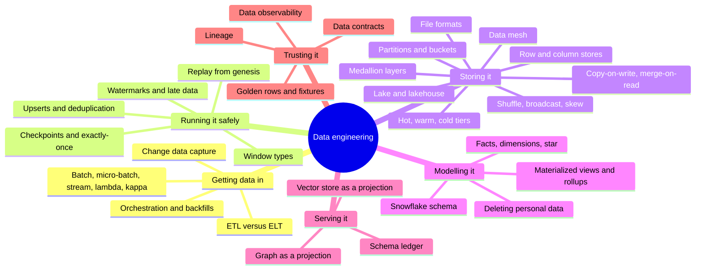

## The map in words

A source that can be replayed, like a blockchain, feeds an indexer. The
indexer decodes each block and writes typed facts with keys, so a rerun
overwrites instead of duplicating. The facts land in a **columnar**
warehouse, split by day and spread by address. A graph sync reads those
facts and projects a graph. The warehouse is the truth. When history is
wrong, the fix is a replay from the start, never a patched row.

---

## Row stores and columnar stores

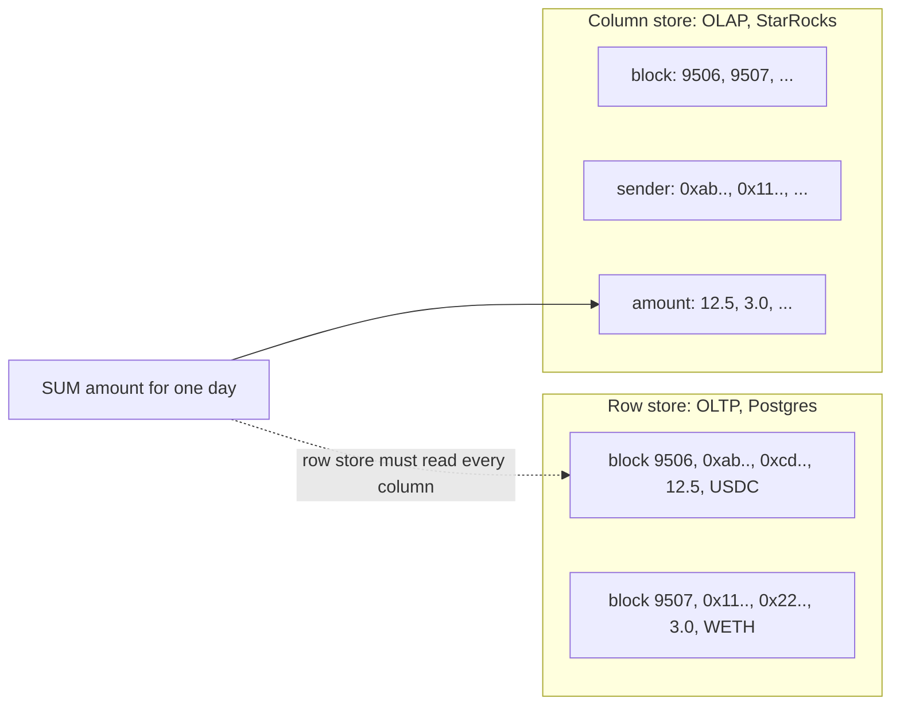

**Story.** An analyst asks for the total amount moved on 24 September. The
transfers table has twenty columns and a billion rows. A row store reads
every column of every row on that day. A column store reads only the
`amount` column and the day filter, compressed. It reads a small slice of
the bytes.

**How it works.**

1. OLTP (Online Transaction Processing) keeps each row together. It is
   fast for "read or write this one order by key".
2. OLAP (Online Analytical Processing) keeps each column together. It is
   fast for "sum this over millions of rows".
3. Columns of one type compress well, and each block keeps min and max
   statistics.
4. The engine skips blocks whose min and max cannot match the filter.
5. **Scan bytes** are the real cost: bytes read times nodes.

### In code

```text
query SUM(amount) WHERE day = D, column store:
  for each block b of the day column:
    if D < b.min or D > b.max: skip b    # pruned, zero bytes read
    for each value d in b.days:          # read the day column
      if d == D:
        sum += b.amounts[k]              # read the amount column only
  return sum                             # other columns never opened
```

```go
func (s ColumnStore) SumByDay(day string) (sum float64, cellsRead int, skipped int) {
	for _, b := range s.blocks {
		if day < b.MinDay || day > b.MaxDay { // min and max cannot match
			skipped++
			continue // pruned: not one byte read
		}
		for k, d := range b.Days { // read the day column
			cellsRead++
			if d == day {
				cellsRead++ // read the amount column
				sum += b.Amounts[k]
			}
		}
	}
	return sum, cellsRead, skipped
}
```

Run it: `handbook/code/16-row-vs-column-store/` with `go run .` It prints
20 of 40 cells for the row store and 8 of 40 for the column store.

**What goes wrong.** A query with no time filter goes behind an API. It
reads every partition: terabytes instead of megabytes. On BigQuery that is
the bill. On a self-hosted engine it is memory and latency. Fix: read the
scan bytes in `EXPLAIN` before shipping a query. A row count does not tell
you the cost.

**Where you use it.**

- A payment ledger is OLTP. Every token transfer on a chain is OLAP.
- Reports never run on the OLTP database. They lock and slow the writes.
- StarRocks and ClickHouse are self-hosted. Snowflake bills compute time,
  BigQuery bills bytes scanned.

▶ Watch it move: [Row store versus column store](visual/16-row-vs-column-store.html)

> **Say it:** "Row stores serve one record by key, column stores serve sums
> over millions, and the cost of a column query is the bytes it scans."

---

## Partitioning and bucketing

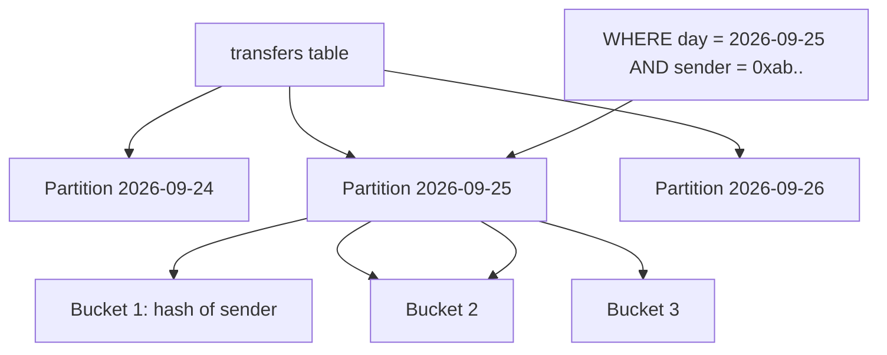

**Story.** Transfers are partitioned by day and bucketed by sender address.
A question about one address on one day opens one partition and one bucket.
Everything else is never touched. That skip is called **pruning**.

**How it works.**

1. Partition by time: each day is its own range of storage.
2. A time filter prunes to a few partitions.
3. Inside a partition, bucket by key: a hash of the address picks one of N
   buckets.
4. Rows with the same key sit together, and buckets spread evenly across
   nodes.
5. A join on the bucket key can run without moving data between nodes.

### In code

```text
plan(query):
  for each partition p (one per day):
    if query.day set and p.day != query.day: skip p    # pruning
    for b in 1..4:
      if query.sender set and b != hash(sender) mod 4 + 1: skip b
      open piece (p, b)                 # only these are read
```

```go
func bucketOf(sender string) int {
	h := fnv.New32a()
	h.Write([]byte(sender))
	return int(h.Sum32()%buckets) + 1 // the same key, the same bucket
}

func Plan(q Query) (pieces [][2]int) {
	for p, d := range days {
		if q.Day != "" && d != q.Day {
			continue // the day filter prunes this partition
		}
		for b := 1; b <= buckets; b++ {
			if q.Sender != "" && b != bucketOf(q.Sender) {
				continue // the hash says the sender is not here
			}
			pieces = append(pieces, [2]int{p, b})
		}
	}
	return pieces
}
```

```sql
-- the same layout in StarRocks
PARTITION BY date_trunc('day', block_time)
DISTRIBUTED BY HASH(sender) BUCKETS 4
```

Run it: `handbook/code/16-partition-and-bucket/` with `go run .` It prints
1 of 12 pieces for one address on one day, and 12 of 12 for the anti-join.

**What goes wrong.** Partitioning by a high-cardinality key, like address.
Millions of tiny partitions overload the metadata service. Fix: partition
by time, bucket by key. A second trap: an anti-join against a big table
across the whole range. It can run the backend out of memory. Scope it to
the partitions in question.

**Where you use it.**

- Fact tables in a warehouse: day partitions, address buckets.
- Old partitions move to cheaper storage by day.
- A reset of a lane can drop whole partitions instead of deleting rows.

▶ Watch it move: [Partitioning and bucketing](visual/16-partition-and-bucket.html)

> **Say it:** "Partition by time so a filter prunes, bucket by key so rows
> spread evenly and join locally."

---

## Hot, warm and cold tiers

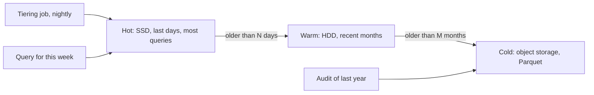

**Story.** Most questions ask about the last few days of transfers. Those
day partitions sit on SSD (Solid State Drive) in StarRocks. A nightly
tiering job moves older partitions to cheaper hard disks. Old years move to
object storage as Parquet, still readable through an external catalog.

**How it works.**

1. Data is partitioned by day, so age is a property of a partition.
2. **Hot** tier: fast disks for the recent days that most queries read.
3. **Warm** tier: cheaper disks for months that are read sometimes.
4. **Cold** tier: object storage for history that is rarely read.
5. A scheduled job moves whole partitions by age. Rows are never moved one
   by one.

### In code

```text
every new day partition is written to SSD (the hot tier)
nightly: for each partition p of a table with a rule:
  age = today - p.day
  if 7 <= age < 180 and p is hot: ALTER ... storage_medium = HDD
  if age >= 180: export p to Parquet on S3, DROP PARTITION p
a table with no rule is skipped, so its days stay on SSD
```

```go
// TierFor decides a partition's tier from its age in days.
func TierFor(day, today time.Time, r Rule) string {
	age := int(today.Sub(day).Hours() / 24)
	switch {
	case age < r.HotDays:
		return "hot"
	case age < r.WarmDays:
		return "warm"
	default:
		return "cold"
	}
}

// RunTiering moves every partition whose tier changed, for tables with a rule.
func RunTiering(table string, parts []Partition, rules map[string]Rule, today time.Time) (moved int) {
	r, ok := rules[table]
	if !ok {
		return 0 // no rule: the job skips this table
	}
	for k, p := range parts {
		want := TierFor(p.Day, today, r)
		if want == p.Tier {
			continue
		}
		switch want {
		case "warm":
			fmt.Printf("  ALTER TABLE %s MODIFY PARTITION %s SET (\"storage_medium\" = \"HDD\");\n", table, p.Name)
		case "cold":
			fmt.Printf("  INSERT INTO FILES(\"path\" = \"s3://cold/%s/%s/\", \"format\" = \"parquet\") SELECT * FROM %s PARTITION (%s);\n", table, p.Name, table, p.Name)
			fmt.Printf("  ALTER TABLE %s DROP PARTITION %s; -- now read through the external catalog\n", table, p.Name)
		}
		parts[k].Tier = want
		moved++
	}
	return moved
}
```

Run it: `handbook/code/16-hot-warm-cold-tiers/` with `go run .` It prints
the SQL for each move, then hot 4, warm 2, cold 2. This week reads 4 hot
partitions, the 2024 audit reads 1 cold, and no day filter reads all 8.
swaps_v2 with no rule fills the SSD to 10 of 10; with the rule it keeps 4.

**What goes wrong.** A new table is created with no tier rule. All of its
history stays on SSD, and the fast disks fill up. Fix: every new table
gets a tier rule at creation, and the tiering job is watched. A second
trap: a query with no time filter pulls cold data back through the slow
path.

**Where you use it.**

- StarRocks storage medium per partition, set by a tiering job.
- S3 storage classes: standard, infrequent access, archive.
- Kafka tiered storage: recent segments on broker disks, old ones in
  object storage.

▶ Watch it move: [Hot, warm and cold tiers](visual/16-hot-warm-cold-tiers.html)

> **Say it:** "Partition by time so age is a partition property, then move
> whole partitions from fast to cheap storage as they cool."

---

## Shuffle, broadcast join and data skew

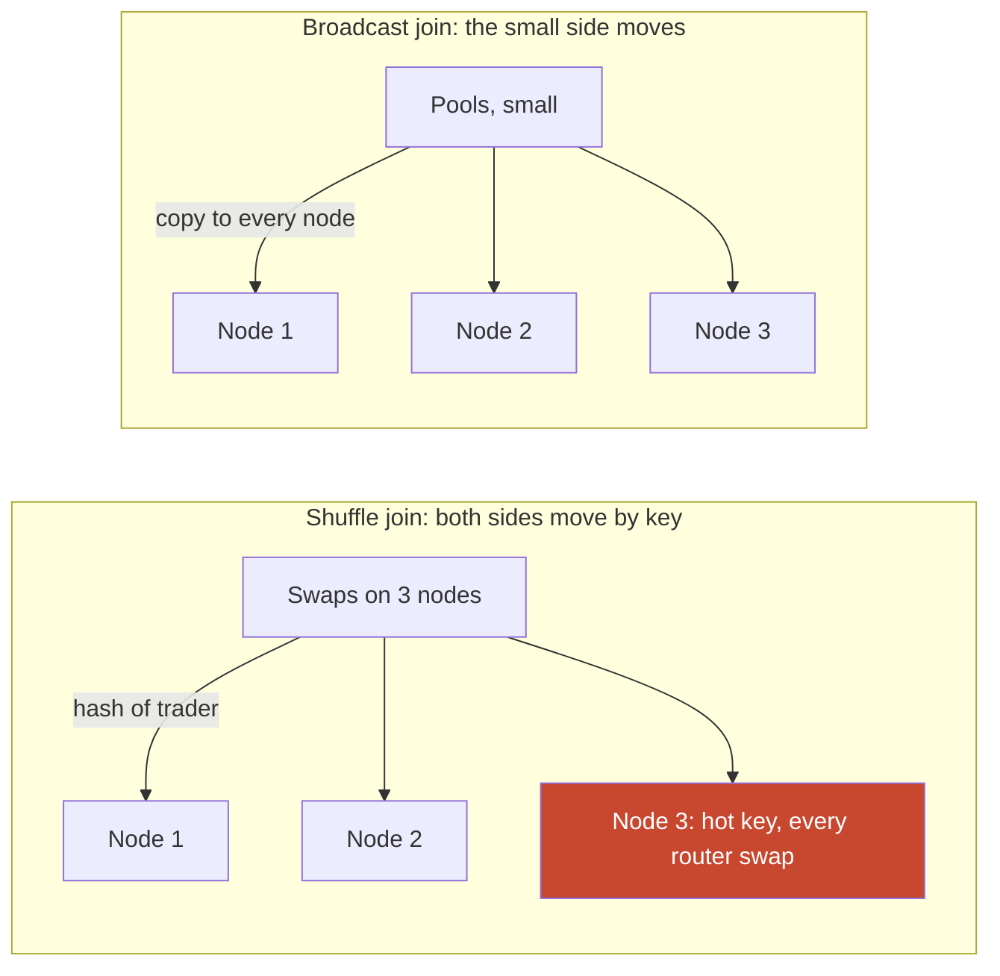

**Story.** A Spark job joins a month of swaps with the pool table. The pool
table is small, so a copy goes to every node and the swaps never move.
Then a second join groups swaps by trader. One router address makes most
of the swaps. Its key lands on one node, which runs for hours while the
others sit idle.

**How it works.**

1. A distributed join needs matching keys on the same node.
2. **Shuffle join**: both tables are sent across the network by a hash of
   the key. Works for two big tables.
3. **Broadcast join**: the small table is copied to every node. The big
   table stays where it is.
4. A bucketed join needs no movement when both sides are bucketed on the
   join key.
5. **Skew**: one key holds far more rows than the rest. Its node becomes
   the slowest part of the whole job.

### In code

```text
broadcast join: copy the small pools table to every node
  each node: for each local swap s: look up pools[s.pool_id]
group by trader: node = hash(trader) % 3
  hot key? key = trader + "#" + (k % 3 + 1)   # salt splits it over 3 nodes
  each node counts its piece
  final step: hot count = #1 + #2 + #3
```

```go
// BroadcastJoin copies the small pool table to every node and joins locally.
func BroadcastJoin(parts [][]Swap, pools map[int]string) (moved, joined int) {
	moved = len(pools) * (nodes - 1) // node 1 already holds the pools
	for _, part := range parts {
		for _, s := range part {
			if _, ok := pools[s.Pool]; ok {
				joined++ // local lookup, no swap moves
			}
		}
	}
	return moved, joined
}

// GroupByTrader shuffles rows by trader and returns the rows each node holds.
// A salt splits one hot key into several keys before the hash.
func GroupByTrader(all []Swap, hot string, salt int) (load [nodes]int, partial map[string]int) {
	partial = map[string]int{}
	for k, s := range all {
		key := s.Trader
		if salt > 0 && key == hot {
			key = fmt.Sprintf("%s#%d", key, k%salt+1) // 0x7a06#1, #2 and #3 land on three nodes
		}
		load[owner(key)]++
		partial[key]++
	}
	return load, partial
}

// Combine adds the salted pieces back into one count per trader.
func Combine(partial map[string]int, hot string, salt int) int {
	n := partial[hot]
	for k := 1; k <= salt; k++ {
		n += partial[fmt.Sprintf("%s#%d", hot, k)]
	}
	return n
}
```

Run it: `handbook/code/16-shuffle-broadcast-skew/` with `go run .` It
prints 600 swaps on 3 nodes. The shuffle join moves 404 rows, the broadcast
join 8. Grouping by trader puts 520 rows on node 3 (router 0x7a06 has 480)
past a 300-row limit. Salting by 3 gives 200 rows per node and the same
router count of 480.

**What goes wrong.** A hot key. One task takes most of the time, or runs
out of memory, and the job fails at 99 percent. Fix: split the hot key
with a salt (a random suffix), join each piece, then combine. Or handle
the few hot keys in a separate path. Adaptive query engines can split
skewed partitions on their own.

**Where you use it.**

- Facts joined to a small dimension: broadcast.
- Two big fact tables: shuffle, or co-located buckets on the same key.
- Group by address on a chain: expect router and exchange addresses to be
  hot keys.

▶ Watch it move: [Shuffle, broadcast and skew](visual/16-shuffle-broadcast-skew.html)

> **Say it:** "Broadcast the small side, shuffle when both are big, and
> watch for a hot key that turns one node into the whole job."

---

## Files, tables and the lakehouse

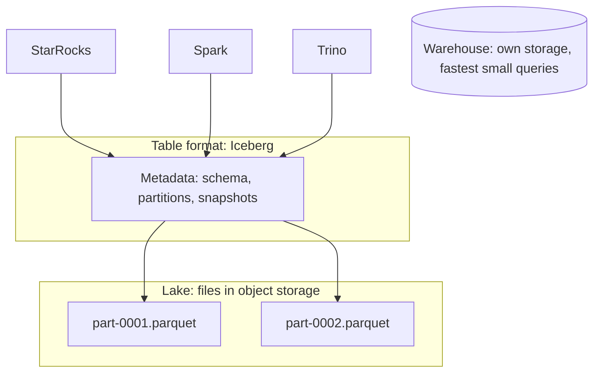

**Story.** Raw block captures and old partitions are Parquet files in object
storage. An Iceberg table sits on top. StarRocks, Spark and Trino all read
the same table. A failed write leaves no half-visible data. A query can
read the table as it was yesterday.

**How it works.**

1. A **warehouse** stores tables in its own format. Fast and governed.
2. A **lake** stores files in object storage. Cheap, any shape.
3. Parquet and ORC are columnar file formats with statistics per block.
   Avro is a row format with a schema, good for streams. JSON is text with
   no schema.
4. A table format (Iceberg, Delta, Hudi) adds schema, snapshots and atomic
   commits over the files.
5. A **lakehouse** is a lake with a table format, read by several engines.

### In code

```text
write(files): put files in storage        # no reader sees them
commit(id, files):
  snapshots.append(id -> files)
  current = id                            # one atomic pointer swap
scan(): return snapshots[current].files   # what every engine reads
asOf(id): return snapshots[id].files      # time travel
expire(): keep only the current snapshot
  delete every file no kept snapshot lists   # old files and orphans
```

```go
// Commit adds a snapshot and moves the pointer in one step: atomic.
func (t *Table) Commit(id string, files []string) {
	t.snapshots = append(t.snapshots, Snapshot{id, files})
	t.current = len(t.snapshots) - 1
}

func (t *Table) Scan() []string { return t.snapshots[t.current].Files }

func (t *Table) Expire() (deleted int) {
	t.snapshots = t.snapshots[t.current:]
	t.current = 0
	keep := map[string]bool{}
	for _, f := range t.Scan() {
		keep[f] = true
	}
	for f := range t.storage {
		if !keep[f] {
			delete(t.storage, f)
			deleted++
		}
	}
	return deleted
}
```

Run it: `handbook/code/16-lakehouse-table-format/` with `go run .` It prints
6 files in storage for a table of 1 until snapshots expire, then 5 deleted.

**What goes wrong.** A lake with no catalog and no table format becomes a
swamp: nobody knows what is in it or if it is complete. A second trap:
thousands of tiny Parquet files. Fix: a catalog, an owner per table, and
compaction to files of a hundred megabytes or more. Expire old snapshots,
or storage grows forever.

**Where you use it.**

- Typed facts that people query every day: the warehouse.
- Raw captures and archives: the lake.
- Several engines on the same history: Iceberg over Parquet. Open formats
  mean no engine owns the data.

▶ Watch it move: [Files, tables and the lakehouse](visual/16-lakehouse-table-format.html)

> **Say it:** "A warehouse for daily questions, a lake for cheap raw files,
> and a table format on the lake when several engines must share it."

---

## File formats: Parquet, ORC, Avro and JSON

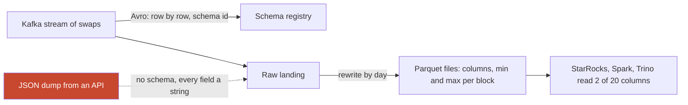

**Story.** Swap events leave the Go indexer as Avro messages on Kafka. Each
message carries a schema id, so a reader knows the exact fields. A nightly
Spark job rewrites a day of swaps as Parquet files in object storage. An
analyst sums one column over a month and reads only that column. A partner
API sends JSON, and every amount arrives as text.

**How it works.**

1. **Avro** stores rows one after another, with a schema. Good for
   streams, where each message is one whole record.
2. **Parquet** and **ORC** (Optimized Row Columnar) store columns
   together, in row groups, with min and max per block. Good for analysis.
3. JSON is text with no schema. Easy to write, slow and loose to read.
4. **Schema-on-read**: the files hold raw data, and the schema is applied
   when a query reads them. Schema-on-write checks it on the way in.
5. Schema evolution: add a field with a default, and old and new readers
   both still work. A schema registry refuses a change that breaks them.

### In code

```text
reader: for each file f:
  if f has no field "amount": read null, no error
  else: sum += f.amount
registry.register(v2):
  for each field in v1: if it is missing in v2: refuse
v2 adds fee with default 0                    # keeps every old field
```

```go
// SumField applies the schema on read: a missing field reads as null (0).
func SumField(files []DayFile, name string) (sum float64, nulls int) {
	for _, f := range files {
		v, ok := f.Fields[name]
		if !ok {
			nulls++ // no such field in this file: null, no error
			continue
		}
		sum += v
	}
	return sum, nulls
}

// Compatible is the registry check: a new version may add fields with a
// default, but must keep every old field.
func Compatible(old, next []string) bool {
	have := map[string]bool{}
	for _, f := range next {
		have[f] = true
	}
	for _, f := range old {
		if !have[f] {
			return false // removed or renamed: old readers would break
		}
	}
	return true
}
```

Run it: `handbook/code/16-file-formats/` with `go run .` It prints 20 cells
for Avro and 5 for Parquet, then 30 instead of 50 after the rename, and the
registry refusing the rename but accepting the added field.

**What goes wrong.** A field is renamed in place. Old files have the old
name, new files the new one, and a query silently reads nulls for half the
history. Fix: only add fields with defaults, never rename or change a type,
and let the registry check compatibility before the producer ships.

**Where you use it.**

- Kafka topics between services: Avro or Protobuf with a schema registry.
- Lake files for analysis: Parquet, sorted by the common filter column.
- JSON only at the edge, converted to a typed format on landing.

▶ Watch it move: [File formats](visual/16-file-formats.html)

> **Say it:** "Avro for rows in motion, Parquet for columns at rest, and a
> schema change only adds fields with defaults."

---

## Copy-on-write versus merge-on-read

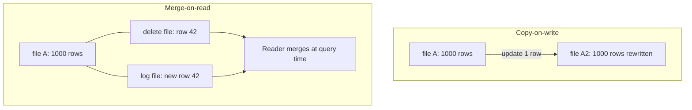

**Story.** A wrong label must be fixed on one swap row in an Iceberg table.
The row sits in a Parquet file of many rows. Parquet files cannot be
changed in place. The table either rewrites the whole file now, or writes a
small delete file and lets every reader skip the old row until compaction.

**How it works.**

1. Files in a lake are immutable. An update is always a new file.
2. **Copy-on-write**: rewrite every file that holds a changed row. Writes
   are slow, reads are plain.
3. **Merge-on-read**: write a small delete or change file beside the data.
   Writes are fast, and readers merge them.
4. A new snapshot commits either way, atomically.
5. Compaction later folds the delete files into clean data files.

### In code

```text
update(row id, label), copy-on-write:
  f = the data file holding id
  for each row x in f: copy x into a new file, fixing id
  commit a snapshot that lists the new file instead of f
update(row id, label), merge-on-read:
  write a delete file "row id is gone" and a change file with the fixed row
read(): skip rows a delete file names, add the corrected rows
compact(): fold the deltas into clean files, clear the deltas
```

```go
// UpdateMOR leaves the data file alone and writes two tiny files.
func (t *Table) UpdateMOR(id int, label string) (rowsWritten int) {
	t.Deletes[id] = true                      // delete file: "row id is gone"
	t.Changes[id] = Row{ID: id, Label: label} // change file: the fixed row
	t.Deltas += 2
	t.Snapshot++
	return 2
}

// Read returns the current rows. Merge-on-read skips deleted ids and adds
// the corrected rows: every read pays for the merge.
func (t *Table) Read() (rows []Row, filesOpened int) {
	for _, f := range t.Data {
		filesOpened++
		for _, r := range f.Rows {
			if t.Deletes[r.ID] {
				continue // named by a delete file
			}
			rows = append(rows, r)
		}
	}
	filesOpened += t.Deltas
	for id := 0; id < 16; id++ { // add each corrected row once
		if r, ok := t.Changes[id]; ok {
			rows = append(rows, r)
		}
	}
	return rows, filesOpened
}
```

Run it: `handbook/code/16-copy-on-write-merge-on-read/` with `go run .` It
prints 8 rows written per copy-on-write fix, 2 per merge-on-read fix, 98
files per read after 96 small files, and 2 again after compaction.

**What goes wrong.** Merge-on-read with no compaction. Every update adds a
small file, and after weeks each query merges thousands of them. Reads get
slower every day. Fix: schedule compaction. A second trap: copy-on-write on
a table updated every minute rewrites the same big files all day.

**Where you use it.**

- Daily batch facts, rarely corrected: copy-on-write.
- A table fed by change data capture with constant updates: merge-on-read.
- Delta, Hudi and Iceberg support both. Choose per table by how often it
  changes and how often it is read.

▶ Watch it move: [Copy-on-write versus merge-on-read](visual/16-copy-on-write-merge-on-read.html)

> **Say it:** "Copy-on-write pays at write time by rewriting files,
> merge-on-read pays at read time by merging deltas, and compaction settles
> the bill."

---

## Medallion layers: bronze, silver, gold

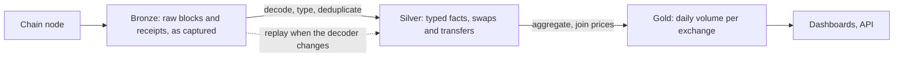

**Story.** Raw blocks and receipts land untouched in a bronze layer. The
indexer decodes them into typed swap and transfer facts: the silver layer.
A daily job sums volume per exchange into a small gold table that the
website reads. When the decoder changes, silver is rebuilt from bronze. No
node is asked again.

**How it works.**

1. **Bronze**: raw input, as it arrived. Never edited.
2. **Silver**: cleaned, typed and deduplicated facts. One row per event.
3. **Gold**: business tables built for one question: totals, rankings.
4. Each layer is built only from the layer before it.
5. A bug in silver is fixed by rebuilding silver from bronze, then gold.

### In code

```text
capture(block): append its raw logs to bronze, untouched
buildSilver():
  for each raw log r in bronze: f = decode(r)
    if seen[f.block, f.log]: skip               # captured twice
    append f to silver
buildGold():
  for each fact f in silver with f.ok: gold[f.exchange] += f.amount
decoder fix: buildSilver() again from bronze, then buildGold()
```

```go
// BuildSilver decodes bronze and removes duplicates by block and log index.
func (p *Pipeline) BuildSilver(version int) {
	p.silver = nil
	seen := map[[2]int]bool{}
	for _, r := range p.bronze {
		f := decode(r, version)
		if seen[[2]int{f.Block, f.Log}] {
			continue // the same event captured twice
		}
		seen[[2]int{f.Block, f.Log}] = true
		p.silver = append(p.silver, f)
	}
}

// BuildGold applies the business rule once: volume of successful swaps.
func (p *Pipeline) BuildGold() {
	p.gold = map[string]float64{}
	for _, f := range p.silver {
		if f.OK {
			p.gold[f.Exchange] += f.Amount
		}
	}
}
```

Run it: `handbook/code/16-medallion-layers/` with `go run .` It prints 6 raw
logs becoming 5 facts, gold B going from 120 to 12 with 0 extra node calls,
boards on silver at 50 and 42, and 5 node calls when bronze is gone.

**What goes wrong.** Dashboards read silver or bronze directly. Each one
writes its own sums, and two boards show two totals for the same day. Fix:
readers use gold. A second trap: no bronze kept. Then a decoder fix means
fetching the whole history from the source again.

**Where you use it.**

- A chain pipeline: captures, decoded facts, daily aggregates.
- Any lakehouse on Databricks or Iceberg: the same three names.
- A replayable source like a chain can make bronze small. A source that
  forgets needs bronze kept forever.

▶ Watch it move: [Medallion layers](visual/16-medallion-layers.html)

> **Say it:** "Bronze keeps the raw input, silver holds clean facts, gold
> answers one business question, and each is rebuilt from the one before."

---

## Data mesh

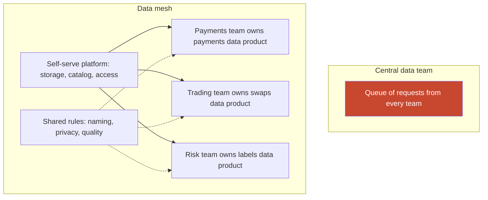

**Story.** A company has one central data team. Payments, trading and risk
all ask it for new tables. The queue grows and the central team does not
understand each domain. With a data mesh, the trading team publishes its
own swaps table as a product, with an owner, a contract and quality checks.
The platform team gives everyone the same storage and catalog.

**How it works.**

1. **Domain ownership**: the team that makes the data publishes it.
2. **Data as a product**: each dataset has an owner, documentation, a
   contract and a quality promise.
3. **Self-serve platform**: one shared set of tools, so each team does not
   build its own warehouse.
4. **Federated governance**: a few shared rules for naming, privacy and
   access, enforced by the platform.

### In code

```text
platform: storage, catalog and access control for every team
domain team publishes product p:
  p.owner = the team that makes the data
  p.contract = schema, meaning, freshness
  p.checks = quality checks that run on every load
platform rules for every product: naming, privacy fields, checks
catalog lists p only if owner, contract and passing checks exist
consumer: find p in the catalog, read it, ask p.owner
```

Pseudo code only: a data mesh is a way to organise teams and ownership, not
an algorithm, so there is no program to run.

**What goes wrong.** A small company adopts a mesh. Five engineers now run
five data products with five sets of tools, and nobody owns the joins
between them. Fix: a mesh fits large companies with many domain teams. A
small team keeps one warehouse and one owner.

**Where you use it.**

- A large bank or retailer with dozens of teams: a mesh.
- A startup or one product team: a central warehouse.
- The parts worth taking at any size: named owners and data contracts.

▶ Watch it move: [Data mesh](visual/16-data-mesh.html)

> **Say it:** "A data mesh moves ownership to the teams that make the data,
> on one shared platform, and it pays off only when there are many teams."

---

## Facts, dimensions and the star schema

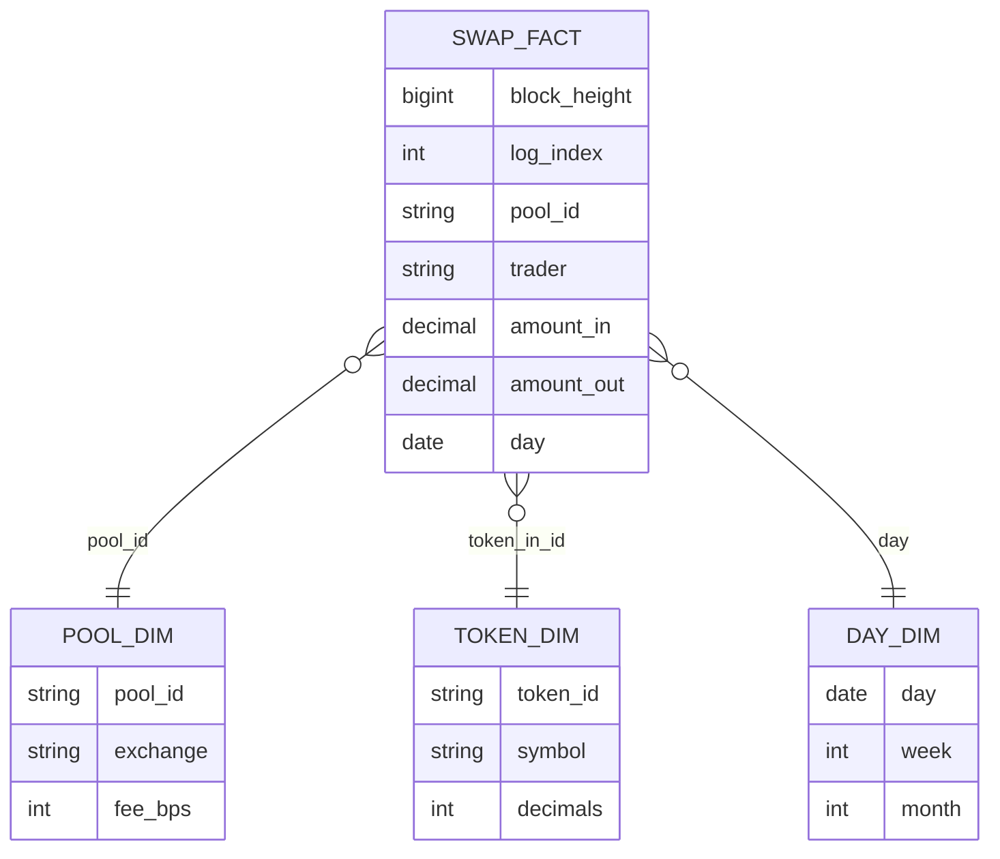

**Story.** Every swap on an exchange is a row in the swap fact table: who,
which pool, how much, which day. The pool, the token and the day are
described once each, in small dimension tables. A label on an address
changes from "unknown" to "exchange" on 3 October. A query about August
must still see "unknown".

**How it works.**

1. A **fact** is an event with numbers. Many rows, append only.
2. A **dimension** describes who, what and where. Few rows.
3. The star: one fact table in the middle, one dimension per axis.
4. A snowflake splits dimensions into sub-tables. In a column store that
   rarely pays.
5. A slowly changing dimension type 1 overwrites the old value.
6. Type 2 adds a new row with valid-from and valid-to dates, so history
   stays true.

### In code

```text
on a label change, type 2:
  close the current row: valid_to = day - 1, is_current = false
  insert a new row: valid_from = day, is_current = true
report about the past:
  join on f.day between valid_from and valid_to
report as known today:
  join on is_current
```

```sql
-- type 2: close the old row, add a new one
UPDATE dim_address_label
SET    valid_to = '2026-10-02', is_current = false
WHERE  address = '0x9f..' AND is_current;
INSERT INTO dim_address_label VALUES
  ('0x9f..', 'exchange', '2026-10-03', '9999-12-31', true);

-- the past reads the past
SELECT f.day, f.amount_in, d.label
FROM   fact_swaps f
JOIN   dim_address_label d
  ON   d.address = f.trader
 AND   f.day BETWEEN d.valid_from AND d.valid_to   -- the label of that day
WHERE  f.day BETWEEN '2026-08-01' AND '2026-08-31';
```

Run it: `handbook/code/16-star-schema-type2/` with `go run .` It prints
the August report as unknown with type 2, and exchange with type 1.

**What goes wrong.** A changing attribute, like a price or a label, copied
into the fact row. When the attribute changes, history changes with it, or
it is wrong forever. Fix: join the dimension at read time, and version it
(type 2) when the past matters. Give type 2 rows a current flag.

**Where you use it.**

- Swap and transfer facts with pool and token dimensions.
- Prices in their own table by day, joined at read time. The indexer never
  derives a price.
- Address labels as a type 2 dimension.

▶ Watch it move: [Facts, dimensions and the star schema](visual/16-star-schema-type2.html)

> **Say it:** "Facts are events with numbers, dimensions describe them, and
> anything that changes over time is joined at read time, not copied in."

---

## Snowflake schema versus star

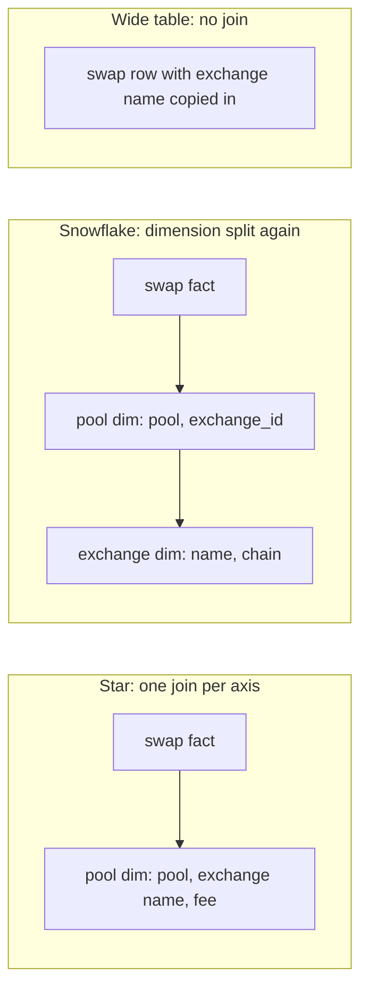

**Story.** The pool dimension holds each pool and the exchange it belongs
to. In a snowflake, the exchange moves into its own table, so the pool
dimension keeps only an exchange id. A report of swap volume per exchange
now joins three tables instead of two. A third team skips the joins and
copies the exchange name into every swap row: a wide table.

**How it works.**

1. A star has one fact table and one flat dimension per axis.
2. A snowflake normalises a dimension: repeated attributes move to a
   sub-table with a key.
3. Normalising saves space in the dimension and gives one place to edit.
4. Each extra level adds a join at query time.
5. A wide, denormalised table copies dimension values into every fact row.
   No joins, fastest scans, but every change rewrites history.

### In code

```text
star:      join swap_fact to pool_dim on pool_id            # join 1
snowflake: join swap_fact to pool on pool_id                # join 1
           join pool to exchange on exchange_id             # join 2
rename:    star updates every pool row of the exchange,
           snowflake updates one exchange row
wide:      exchange name copied into each swap at write time,
           so a rename splits history until the table is rebuilt
```

```sql
-- star: one join per axis
SELECT p.exchange_name,
       sum(f.amount) AS volume
FROM   swap_fact f
JOIN   pool_dim p ON p.pool_id = f.pool_id      -- join 1
WHERE  f.day >= current_date - INTERVAL 30 DAY
GROUP  BY p.exchange_name;

-- snowflake: one more join for the split dimension
SELECT e.name,
       sum(f.amount) AS volume
FROM   swap_fact f
JOIN   pool_dim p     ON p.pool_id = f.pool_id          -- join 1
JOIN   exchange_dim e ON e.exchange_id = p.exchange_id  -- join 2
WHERE  f.day >= current_date - INTERVAL 30 DAY
GROUP  BY e.name;
```

Run it: `handbook/code/16-snowflake-schema/` with `go run .` It prints the
same answer with 1 join and 2 joins, then the wide table split into Aero
and Velodrome after the rename.

**What goes wrong.** Snowflaking every dimension in a column store.
Dimensions are already small, so the space saved is tiny, and every
report pays for extra joins. The opposite trap: a wide table where a value
can change, such as a label. Fix: a star by default, snowflake only a
large dimension with a big repeated group, and a wide table only for
values fixed at the event.

**Where you use it.**

- A chain warehouse: a star with pool, token and day dimensions.
- An old OLTP (Online Transaction Processing) model copied into the
  warehouse often arrives snowflaked. Flatten it into a star.
- A wide table for a dashboard that needs one fast scan, built from the
  star and rebuilt when dimensions change.

▶ Watch it move: [Snowflake schema versus star](visual/16-snowflake-schema.html)

> **Say it:** "A star is the default, a snowflake trades joins for less
> repetition, and a wide table trades history for speed."

---

## Materialized views and incremental rollups

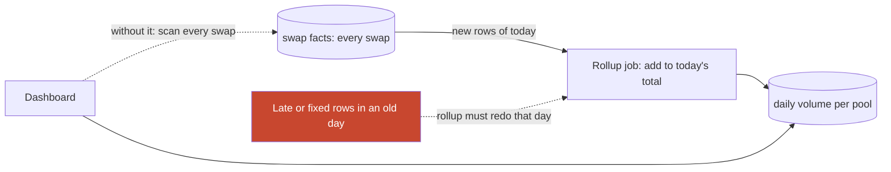

**Story.** A dashboard shows swap volume per pool per day. Summing a
billion swap rows on every page load is slow and expensive. A
materialized view stores the daily totals. Each run adds only the new
swaps of today to today's total. When yesterday's swaps are re-indexed,
yesterday's total must be computed again.

**How it works.**

1. A view is a saved query. It runs every time it is read.
2. A materialized view stores the result as a table.
3. An incremental refresh adds only the new rows since the last run.
4. A full refresh recomputes from scratch.
5. A rollup is a materialized view at a coarser grain: per day, per pool.
6. Readers see data as fresh as the last refresh: staleness is the price.

### In code

```text
facts:     each day partition has a version, +1 on every rewrite
refresh:   for each day: version same as last refresh -> keep total
                         version changed -> recompute that day
cursor:    add only rows above the highest block height seen
trap:      2 Oct is rewritten with old block heights,
           the cursor skips them and keeps the old total
```

```go
func (r *PartitionRollup) Refresh(f *Facts) (recomputed []string) {
	for day, v := range f.version {
		if r.seenVer[day] == v {
			continue // facts unchanged: keep the stored total
		}
		r.total[day] = sumOf(f.rows[day]) // recompute the whole day
		r.seenVer[day] = v
		recomputed = append(recomputed, day)
	}
	sort.Strings(recomputed)
	return recomputed
}
```

Run it: `handbook/code/16-materialized-views-rollups/` with `go run .` The
10:00 refresh recomputes only 5 Oct (2300). The next one recomputes 2 Oct and
5 Oct (8650 and 3100). The cursor rollup still says 2 Oct = 8400.

**What goes wrong.** Old rows change, but the incremental rollup only
looks at new rows. A re-index of yesterday leaves yesterday's total
wrong forever. Fix: refresh by partition, and recompute every day whose
facts changed. A second trap: a view stacked on a view, so logic piles up
and nobody can trace a number.

**Where you use it.**

- StarRocks asynchronous materialized views, refreshed by partition.
- Daily volume and active-address counts for dashboards.
- After a lane reset, rollups are dropped and rebuilt with the facts.

▶ Watch it move: [Materialized views and rollups](visual/16-materialized-views-rollups.html)

> **Say it:** "A materialized view trades freshness for speed, and an
> incremental rollup must recompute any period whose facts changed."

---

## Deleting personal data from append-only stores

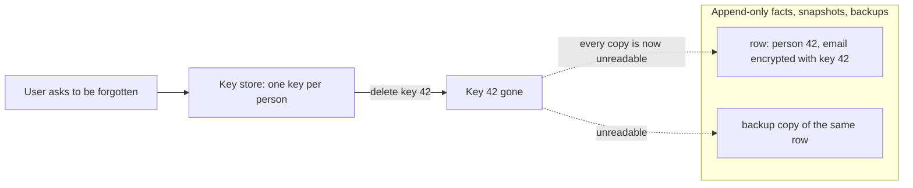

**Story.** A customer of a wallet app asks to be forgotten under GDPR
(General Data Protection Regulation). Their email and name sit in
append-only event tables, old Iceberg snapshots and last month's backups.
Rewriting every copy is slow and easy to miss. The app encrypted each
person's fields with that person's own key. Deleting the key makes every
copy unreadable at once.

**How it works.**

1. Keep personal data apart from facts: facts carry a person id, not the
   email.
2. Encrypt each personal field with a key that belongs to one person.
3. Keep the keys in a small key store, outside the data and its backups.
4. On an erasure request, delete that person's key. This is
   crypto-shredding.
5. Rows, snapshots and backups still exist but can never be decrypted.
6. Where you can delete rows, do it too, then expire old snapshots so the
   files go.

### In code

```text
write:   key = key store[person 42], made once
         every copy holds AES-GCM(key, email), never the email
read:    no key for person 42  -> "key deleted: unreadable"
erase:   DELETE key 42 in the key store                 # one delete
result:  events, snapshot, backup, lake copy: all noise
trap:    restore a backup that held the key store -> all readable again
```

```go
// Decrypt opens a field. With the key gone, every copy is noise.
func (k *KeyStore) Decrypt(person int, sealed []byte) (string, error) {
	key, ok := k.keys[person]
	if !ok {
		return "", errors.New("key deleted: unreadable")
	}
	block, _ := aes.NewCipher(key)
	gcm, _ := cipher.NewGCM(block)
	n := gcm.NonceSize()
	plain, err := gcm.Open(nil, sealed[:n], sealed[n:], nil)
	return string(plain), err
}

// Shred erases a person everywhere: one delete in the key store.
func (k *KeyStore) Shred(person int) { delete(k.keys, person) }
```

Run it: `handbook/code/16-gdpr-crypto-shredding/` with `go run .` It prints
all 4 copies readable, then all 4 unreadable after `DELETE key 42`, then all
4 readable again after a key-store restore. Plain rows with a DELETE on the
live table leave 3 of 4 copies readable.

**What goes wrong.** A delete run only on the live table. Old snapshots,
time travel, backups and the copy in the analytics lake still hold the
email. Fix: crypto-shredding for every copy, plus snapshot expiry. A
second trap: the key store backed up next to the data, which brings the
key back. Back up the keys separately and honour deletes there.

**Where you use it.**

- User profiles and emails in an event-sourced service: crypto-shred.
- Public chain data has no personal names, but labels such as a person's
  name on an address are personal data. Keep them in a separate table.
- Iceberg or Delta tables: delete rows, then expire snapshots.

▶ Watch it move: [Deleting personal data](visual/16-gdpr-crypto-shredding.html)

> **Say it:** "In append-only data I encrypt personal fields with a key per
> person and delete the key, so every copy, backup and snapshot goes dark
> at once."

---

## Batch, stream, lambda and kappa

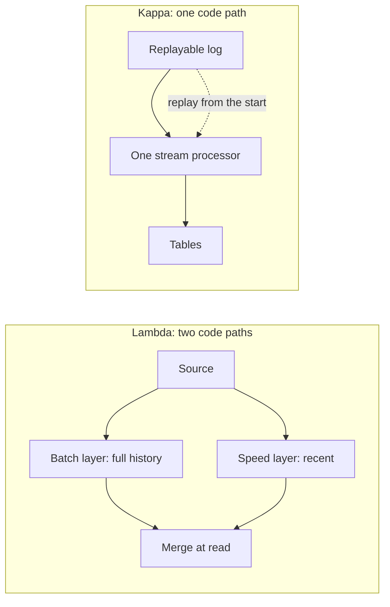

**Story.** A user asks about a transfer they made a minute ago. The chain
follower is a stream, so the answer is there. The nightly tiering job and
the daily quality report are batch, because nobody needs them before
morning. History is rebuilt by replaying the chain from block 1 through
the same code: that is kappa.

**How it works.**

1. **Batch** processes a bounded set on a schedule.
2. **Streaming** processes events as they arrive, with state and time.
3. Micro-batch is a tight loop over small bounded ranges: simple reruns,
   near-live results. A chain indexer is exactly that.
4. Lambda runs a batch layer and a speed layer and merges them at read.
5. Kappa runs one stream, and history is a replay of the log.

### In code: lambda versus kappa

```text
source = a replayable log: the chain
indexer, from block p:
  for each block b from p on: table[b] = compute(b, rule)   # upsert
query(x): return table[x]                # live and history, one table
nightly jobs read the table, never recompute the facts
rule change: start indexer v2 at block 1 into new tables
when v2 reaches the head: switch readers to the new tables
# a replay needs input: an API that keeps 30 days cannot replay a year
fix: keep raw captures of every response, and replay those
```

```go
// Kappa: one processor over a replayable log, writing one table.
type Kappa struct {
	rule  FeeRule
	table map[int]float64
}

func (k *Kappa) Run(bs []Block, from int) {
	for _, b := range bs {
		if b.Height >= from {
			k.table[b.Height] = k.rule() // upsert by block height
		}
	}
}

// the rule changes: fix the one program, replay from block 1
k := &Kappa{rule: v2, table: map[int]float64{}}
k.Run(bs, 1)

// a source that forgets: an API that keeps 30 days
const keepDays, wantDays = 30, 365
missing := wantDays - keepDays // 335 days with no input to replay
```

Run it: `handbook/code/16-lambda-vs-kappa/` with `go run .` Lambda answers
0.25 for yesterday and 0.30 for today after the rule change. Kappa answers
0.25 and 0.25. An API that keeps 30 days leaves 335 of 365 days with no input
to replay.

### In code: batch, micro-batch and stream

```text
batch, every night at 02:00:
  rows = read all of yesterday            # a bounded set
  write report(rows)
micro-batch, in a loop every 3 seconds:
  range = next blocks after the checkpoint
  write facts(range); checkpoint = range end
stream, on each event e:
  state = update(state, e); emit(e)       # one event at a time
  save position and state together
choose: how stale may the answer be? hours: batch, seconds: the others
history: run the micro-batch loop again from block 1
```

```go
const (
	transferAt  = 14*3600 + 5*60 // 14:05:00
	askAt       = 14*3600 + 6*60 // 14:06:00
	batchRunAt  = 26 * 3600      // 02:00 the next day
	microPeriod = 3              // a new range every 3 s
)

// visibleBatch: a bounded set on a schedule. The next run after the event.
func visibleBatch(event int) int { return batchRunAt }

// visibleMicro: the range holding the event closes at the next loop tick.
func visibleMicro(event int) int { return (event/microPeriod + 1) * microPeriod }

// visibleStream: each event is handled as it arrives.
func visibleStream(event int) int { return event }

// in time for the question if visible at or before 14:06
ok := visibleMicro(transferAt) <= askAt // 14:05:03: true

// history: the same loop again from block 1
```

```text
stream daily report, on each event e:
  dayState[e.day] += 1                    # held open all day
  when the day is complete: emit(dayState[day])
on restart at 15:00: resume from the saved position
# missing: state saved together with the position
fix: nightly batch: report(day) = count rows of day, rerun by date
```

```go
func streamReport(stateMatchesCheckpoint bool) int {
	count := 0
	checkpoint := 0
	for m := 0; m < 24*60; m++ {
		if m%10 == 0 {
			checkpoint = m // position saved every 10 minutes
		}
		count++ // dayState[day] += 1, held open all day
		if m == 15*60-1 { // the job restarts at 15:00
			if stateMatchesCheckpoint {
				continue // state and position were saved together
			}
			// state holds 14:50 to 14:59, the replay adds them again
			count += m - checkpoint + 1
		}
	}
	return count // 1450, not 1440
}

// batchReport is report(day) = count of the day's rows, rerun by date.
func batchReport(day []int) int { return len(day) }
```

Run it: `handbook/code/16-batch-microbatch-stream/` with `go run .` A transfer
at 14:05:00 is asked about at 14:06:00. Batch shows it at 02:00 (too late),
micro-batch at 14:05:03 and stream at 14:05:00 (both in time). A stream
report restarted with a mismatched checkpoint counts 1,450; the true count
and the batch rerun count 1,440.

**What goes wrong.** Lambda's two code bases drift apart. The batch layer
and the speed layer give different numbers and nobody knows which is
right. Fix: kappa when the source can be replayed. Second trap: streaming
because it sounds modern. If an hour of delay is fine, batch is simpler.

**Where you use it.**

- Chain follow: stream or micro-batch, with a checkpoint per block.
- Partition moves and quality reports: batch.
- A source that cannot be replayed (a third-party API that forgets): keep
  raw captures, or accept lambda.

▶ Watch it move: [Batch, micro-batch and stream](visual/16-batch-microbatch-stream.html)
▶ Watch it move: [Lambda versus kappa](visual/16-lambda-vs-kappa.html)

> **Say it:** "Ask how stale the answer may be: hours means batch, seconds
> means a stream, and a replayable source lets one code path do both."

---

## ETL versus ELT

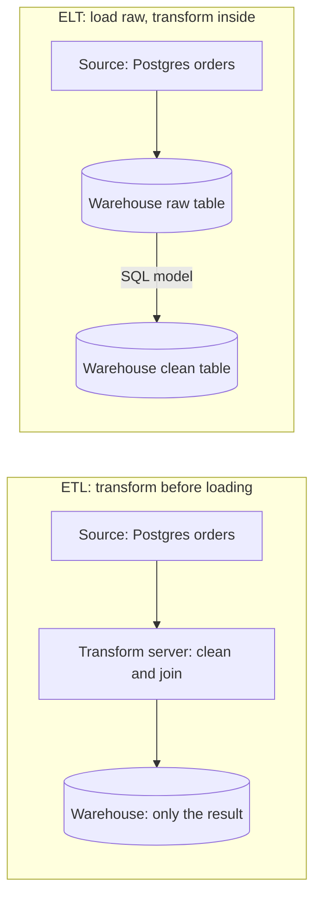

**Story.** A shop copies its Postgres orders into a warehouse every night.
The old way, ETL (Extract, Transform, Load), cleans and joins the rows on a
separate server and loads only the result. The new way, ELT (Extract, Load,
Transform), loads the raw rows first. SQL models inside StarRocks then
build the clean tables. When a rule changes, the raw rows are still there
to rebuild from.

**How it works.**

1. Extract: read rows from the source.
2. ETL transforms on a separate server, then loads only the result.
3. ELT loads the raw rows into the warehouse unchanged.
4. In ELT, SQL models (dbt is the common tool) turn raw tables into clean
   ones inside the warehouse.
5. A changed rule means rerunning the SQL model over the raw table.

### In code

```text
every night:
  rows = extract(postgres, month)
  load(warehouse.raw_orders, rows)      # unchanged, kept
model revenue_by_day, SQL in git:
  for each raw row: usd = amount * rate(currency)
  skip test orders, sum usd by day
run model: rebuild revenue_by_day from raw_orders
fix: model v2 uses rate 1.10, run it again
grant raw_orders to the pipeline only    # names and emails stay hidden
clean models drop or mask email and name
```

```sql
-- load: copy the raw rows in, unchanged
INSERT INTO raw_orders SELECT * FROM postgres_orders_month;

-- model revenue_by_day, v2, kept in git and run in the warehouse
INSERT OVERWRITE revenue_by_day
SELECT day,
       sum(CASE currency WHEN 'EUR' THEN amount * 1.10
                         ELSE amount END) AS revenue
FROM   raw_orders
WHERE  NOT is_test
GROUP  BY day;

-- raw tables hold personal data: only the pipeline may read them
REVOKE SELECT ON raw_orders FROM ROLE analyst;
GRANT  SELECT ON raw_orders TO ROLE pipeline;
```

Run it: `handbook/code/16-etl-vs-elt/` with `go run .` It extracts 10,000
orders. ETL loads 196,000.00 USD with the euro rate bug and keeps 0 raw rows.
ELT model v1 gives 196,000.00, and model v2 reruns over the same raw rows to
200,800.00. The trap: 10,000 emails sit in `raw_orders`.

**What goes wrong.** ETL throws away the raw input. A bug in the
transform is found a month later, and there is nothing to rebuild from.
The source has moved on. Fix: keep the raw data, load first, transform
with code that can be rerun. Second trap in ELT: raw tables full of
personal data that everyone can read. Restrict raw tables to the pipeline.

**Where you use it.**

- A cheap warehouse with strong SQL: ELT with dbt models.
- Personal data that must be masked before it lands: ETL for that column.
- A chain indexer is ELT in spirit: raw blocks are kept, decoded facts can
  be rebuilt from them.

▶ Watch it move: [ETL versus ELT](visual/16-etl-vs-elt.html)

> **Say it:** "ETL transforms before loading and loses the raw input, ELT
> loads raw first and transforms in the warehouse, so a rule change is just
> a rerun."

---

## Change data capture

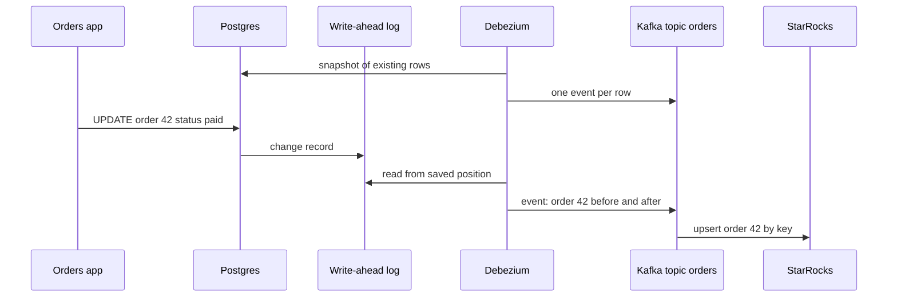

**Story.** The orders app writes to Postgres. The warehouse needs every
change within seconds, without nightly full copies. Debezium reads the
Postgres write-ahead log, the file where the database records every
change before it applies it. Each insert, update and delete becomes an
event on a Kafka topic. StarRocks applies the events by key.

**How it works.**

1. CDC (Change Data Capture) starts with a snapshot of existing rows.
2. It then reads the database change log from a saved position.
3. Each change becomes an event with the key, the old row and the new row.
4. Events go to a log such as Kafka, ordered per key.
5. The consumer upserts by key and deletes on a delete event.
6. The saved log position is the checkpoint. A restart replays from it.

### In code

```text
snapshot: for each existing row r: publish(insert r)
on each write in Postgres:
  append the change to the write-ahead log   # before it is applied
reader loop:
  changes = log records after savedPosition
  for each change c: publish(key c.id, before, after)
  savedPosition = position of the last c     # the checkpoint
consumer, for each event e:
  if e is a delete: remove row e.key
  else: upsert row e.key = e.after            # twice gives one row
# a stalled reader: Postgres keeps every record after savedPosition
alert when the log held for the reader grows (replication slot lag)
```

```go
// the change is logged before it is applied, every time
p.wal = append(p.wal, Change{LSN: len(p.wal) + 1, Op: op, Before: before, After: after})

// Debezium reads the log from its saved position and publishes events.
func (d *Debezium) Poll(p *Postgres) []Change {
	var out []Change
	for _, c := range p.wal {
		if c.LSN > d.saved { // only records after the saved position
			out = append(out, c)
		}
	}
	if len(out) > 0 {
		d.saved = out[len(out)-1].LSN // save the new position: the checkpoint
	}
	return out
}

// Apply upserts by key, and removes the row on a delete event.
func Apply(wh map[int]Row, events []Change) {
	for _, e := range events {
		switch e.Op {
		case "delete":
			delete(wh, e.Before.ID)
		default:
			wh[e.After.ID] = *e.After // same key twice gives one row
		}
	}
}

// Postgres keeps every record the reader has not read yet
held := len(pg.wal) - d.saved // alert on this: the replication slot lag
```

Run it: `handbook/code/16-change-data-capture/` with `go run .` The reader
starts at position 0, reads 1 event and saves position 1. The same upsert
applied twice still gives one row. The delete removes order 43 at position 2.
A stalled reader at position 2 makes Postgres hold 4 records. Polling leaves
2 of 3 warehouse rows wrong.

**What goes wrong.** Polling instead: `SELECT * WHERE updated_at > last`.
It misses deletes and misses rows whose `updated_at` was not set. Fix: read
the change log. Second trap: the CDC reader stops, and Postgres keeps the
log for it. The disk fills and the database stops. Fix: alert on the
replication slot lag.

**Where you use it.**

- Copying an app database into a warehouse without full reloads.
- Updating a search index or cache from the database of record.
- The outbox pattern: CDC reads the outbox table and publishes events.

▶ Watch it move: [Change data capture](visual/16-change-data-capture.html)

> **Say it:** "CDC reads the database's own change log, so it sees every
> insert, update and delete in order, and the consumer upserts by key."

---

## Orchestration and backfills

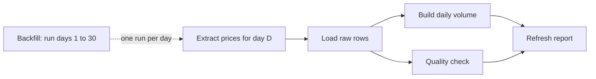

**Story.** Every night a job loads price data, builds daily swap volume,
checks quality and refreshes a report. These steps form a DAG (Directed
Acyclic Graph): each step waits for the steps before it. The orchestrator,
Airflow or Dagster, runs it per day. A new metric needs the last 30 days,
so the orchestrator runs the same DAG once for each past day: a backfill.

**How it works.**

1. Steps are tasks. Arrows are dependencies. No cycles.
2. Each run is for one logical date, not for "now".
3. A failed task retries with a delay. Later tasks wait.
4. Every task is idempotent: it overwrites its own day's partition.
5. A backfill is the same DAG run for past dates.
6. Temporal is different: a durable workflow in code, for long business
   flows, rather than a schedule of data steps.

### In code

```text
dag nightly(logical date D):
  extract(D) then load(D)
  load(D) then build(D) and quality(D)   # both need only load
  build(D) and quality(D) then refresh(D)
run task t:
  for attempt = 1 to 3:
    if t(D) succeeds: return
    wait, then retry
build(D): replace partition D with D's rows   # overwrite, never append
backfill: for D = 1 Sep to 9 Sep: run nightly(D)
# Temporal: one durable workflow in code, for long business flows
```

```go
// nightly is the DAG: extract -> load -> (build, quality) -> refresh.
// Every task gets the logical date D, never the clock.
func nightly(w *Warehouse, d int) {
	src := d // extract(D)
	runTask("build", func(attempt int) error {
		w.buildReplace(d, src)
		return nil
	})
}

// runTask retries a task up to 3 times, as the orchestrator does.
func runTask(name string, try func(attempt int) error) {
	for attempt := 1; attempt <= 3; attempt++ {
		if err := try(attempt); err == nil {
			return
		}
		fmt.Printf("  %s failed, retry %d of 3\n", name, attempt)
	}
}

// buildReplace is INSERT OVERWRITE ... PARTITION (day = D)
func (w *Warehouse) buildReplace(day int, src int) {
	rows := make([]int, rowsPerDay)
	for i := range rows {
		rows[i] = src
	}
	w.days[day] = rows // overwrite, never append
}

for d := 1; d <= 9; d++ { // backfill: the same DAG, older logical dates
	nightly(good, d)
}
// Temporal is a different tool: a durable workflow, not a date schedule
```

Run it: `handbook/code/16-orchestration-backfills/` with `go run .` With
idempotent tasks every day holds 24 rows, also after the retry and the
backfill. With appending tasks day 10 holds 48 rows after one retry, every
backfilled day holds 48, and day 3 holds 10 Sep data because its extract read
the clock.

**What goes wrong.** A task that appends rows. A retry or a backfill
writes the day twice and the totals double. Fix: each task replaces its
own partition for its own date. Second trap: tasks that read "today"
from the clock. A backfill for 3 September then computes today's data.
Fix: pass the logical date in.

**Where you use it.**

- Nightly reports and partition moves: Airflow or Dagster.
- Long business flows with waits and compensations: Temporal.
- A chain indexer needs none for the follow: it is its own loop with a
  checkpoint. Orchestration fits the batch jobs around it.

▶ Watch it move: [Orchestration and backfills](visual/16-orchestration-backfills.html)

> **Say it:** "An orchestrator runs a DAG of idempotent tasks per logical
> date, so a retry or a backfill just overwrites the same partition."

---

## Checkpoints and exactly-once

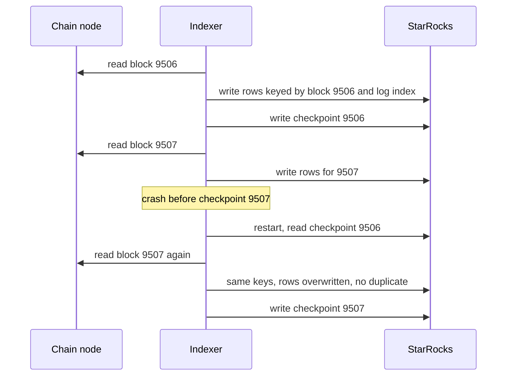

**Story.** The indexer writes block 9507's rows, then crashes before it
saves its checkpoint. On restart it reads checkpoint 9506 and does block
9507 again. The rows have the same keys, so they overwrite. Nothing is lost
and nothing is doubled.

**How it works.**

1. A checkpoint records how far processing got: a height and a hash.
2. Write the data first, then the checkpoint.
3. Key every row by the event: block height plus log index.
4. A replay rewrites the same keys. Delivery is at-least-once, the effect
   is exactly-once.
5. True exactly-once needs output and offset in one transaction. Inside one
   database or Kafka transactions, that exists. Across systems it does
   not, so idempotency is the practical answer.

### In code

```text
on start: next = checkpoint + 1
for each block b from next:
  for each event e in b:
    upsert row keyed by (b.height, e.logIndex)   # a replay overwrites
    if e is large and not alertSent[e.id]:      # dedup the side effect
      sendAlert(e); alertSent[e.id] = true
  checkpoint = b                                # only after the data
```

```go
func (s *Store) IndexBlock(b int, crash, dedup bool) error {
	for _, k := range eventsOf(b) {
		s.rows[k] = "transfer" // upsert by key
		if k.Log == 1 {
			if dedup && s.sentAlerts[k] {
				continue // already sent for this event id
			}
			s.sentAlerts[k] = true
			s.alerts = append(s.alerts, fmt.Sprintf("alert %d log %d", k.Block, k.Log))
		}
	}
	if crash {
		return errCrash
	}
	s.checkpoint = b // only after the rows are stored
	return nil
}
```

Run it: `handbook/code/16-checkpoint-exactly-once/` with `go run .` It
prints 4 rows after the replay with data first, a missing block 9507 with
checkpoint first, and 6 rows when rows have no key.

**What goes wrong.** The checkpoint written before the data. A crash in
between skips a block forever and nobody notices. Fix: data first. A
second trap: a side effect that is not idempotent, like a notification. It
needs its own deduplication by event id.

**Where you use it.**

- An indexer's checkpoint row per block range.
- A graph sync's high-water mark per layer.
- A Kafka consumer committing offsets after its write.

▶ Watch it move: [Checkpoints and exactly-once](visual/16-checkpoint-exactly-once.html)

> **Say it:** "Exactly-once in practice is at-least-once delivery plus
> idempotent writes, with the checkpoint written after the data."

---

## Upserts and deduplication

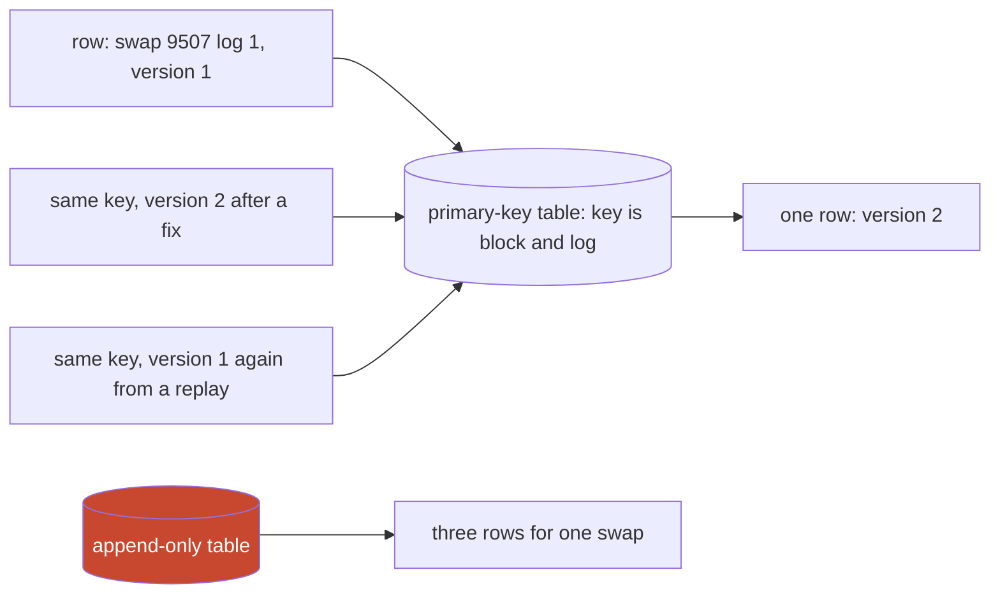

**Story.** The Go indexer writes swap 9507 log 1. A decoder fix writes it
again as version 2. Then a replay after a crash sends version 1 a third
time. In a primary-key table keyed by block and log, the newest version
wins and one row remains. In a plain append-only table, the same swap
now appears three times.

**How it works.**

1. An upsert means update if the key exists, insert if not.
2. A primary-key table in StarRocks, or `MERGE` in SQL, does it.
3. The key is the event identity: block height plus log index.
4. A version column decides which write wins when two arrive.
5. Without a version, the last write wins, even if it is older data.
6. Where you cannot upsert, deduplicate at read: keep one row per key.

### In code

```text
key:      (block_height, log_index), version = decoder version
upsert:   key absent              -> insert
          new version < old       -> ignore the write
          otherwise               -> update
no version: the last write wins, even an old replay
append:   keep every row, dedup when reading
```

```sql
-- dedup at read: one row per key, the highest version
SELECT * FROM (
  SELECT *, ROW_NUMBER() OVER (PARTITION BY block_height, log_index
                               ORDER BY version DESC) AS rn
  FROM swaps_append) t
WHERE rn = 1;
```

Run it: `handbook/code/16-upserts-dedup/` with `go run .` With a version,
the old replay is `ignored: version 1 < 2` and the row stays 12.5. Last write
wins gives 125. Append only gives 3 rows summing 262.5. Dedup at read gives 12.5.

**What goes wrong.** Last-write-wins with no version. A delayed replay of
old data overwrites the corrected row. Fix: compare a version or a source
timestamp, and keep the higher one. A second trap: a key that is not the
event, such as an auto-increment id, so every replay is a new row.

**Where you use it.**

- Swap and transfer facts: primary-key tables keyed by block and log.
- Change data capture from Postgres: upsert by primary key, using the log
  position as the version.
- Kafka consumers: deduplicate by event id before a side effect.

▶ Watch it move: [Upserts and deduplication](visual/16-upserts-dedup.html)

> **Say it:** "Key every row by the event and upsert with a version, so a
> replay or a fix leaves exactly one correct row."

---

## Watermarks, windows and late data

```mermaid
flowchart LR
  E1["swap at 12:00:10, arrives 12:00:11"] --> W1["Window 12:00 to 12:01"]
  E2["swap at 12:00:50, arrives 12:00:52"] --> W1
  WM["Watermark passes 12:01: window 12:00 emits"] --> W1
  E3["swap at 12:00:40, arrives 12:01:30"]:::late --> SIDE["Late: drop, side output, or correction"]
  classDef late fill:#c8472f,color:#fff
```

**Story.** Swap volume is counted per minute. A swap made at 12:00:40
reaches the processor at 12:01:30, after the 12:00 window was already
emitted. The processor needs a rule: drop it, send it to a side output, or
emit a correction. A blockchain has a simpler rule: blocks deeper than a
safety depth behind the head are final, so the indexer reads up to head
minus N and never sees late data.

**How it works.**

1. Each event has an **event time** (when it happened) and an arrival time.
2. A window groups by event time. Tumbling: fixed and non-overlapping.
   Sliding: fixed length, moving start. Session: closed by a quiet gap.
3. The watermark is the belief "no event older than T will arrive now".
4. When the watermark passes the window end, the window emits.
5. An event that arrives after that is late, and the late-data rule
   decides.

### In code

```text
on each swap s, arriving at time now:
  if s.eventTime > now + 5s: quarantine(s); return   # a bad clock
  maxSeen = max(maxSeen, s.eventTime)
  watermark = maxSeen - 10s               # wait 10 s for stragglers
  w = window of s.eventTime               # 12:00:40 -> window 12:00
  if watermark >= w.end + 60s:            # the grace is over, state is gone
    sideOutput("late_swaps", s); return   # the nightly batch fixes it
  state[w].count += 1                     # open, or fired and still kept
  if state[w].fired:
    board.upsert(w, state[w].count)       # same key: 3 becomes 4
```

```go
func (c *Counter) OnSwap(eventTime, arrival time.Time) {
	if eventTime.After(arrival.Add(maxClockSkew)) {
		c.quarantine = append(c.quarantine, eventTime)
		return
	}
	if eventTime.After(c.maxSeen) {
		c.maxSeen = eventTime
	}
	watermark := c.maxSeen.Add(-outOfOrder)
	start := eventTime.Truncate(time.Minute)
	end := start.Add(time.Minute)

	if !watermark.Before(end.Add(allowedLateness)) {
		c.late = append(c.late, eventTime) // its state is gone
		return
	}
	// count it, overwrite the board if the window already fired,
	// fire windows the watermark passed, free those past the grace
}
```

Run it: `handbook/code/16-watermarks/` with `go run .`

**What goes wrong.** A watermark set to the newest event time. One event
from the future closes windows too early and most events become late.
Fix: let the watermark trail the newest time by an allowed lateness. A
second trap: a sliding window with a small step over a long length, which
multiplies state and output.

**Where you use it.**

- Daily swap volume: a tumbling window.
- A rolling one-hour price: a sliding window.
- A trader's burst of activity: a session window.
- A chain indexer: head minus a safety depth is its watermark.

▶ Watch it move: [Batch versus stream, and watermarks](visual/16-batch-vs-stream-watermarks.html)

> **Say it:** "Windows group by event time, the watermark decides when a
> window is complete, and late data needs a rule written down in advance."

---

## Window types: tumbling, sliding and session

```mermaid
flowchart TB
  subgraph Tumbling["Tumbling: fixed, no overlap"]
    T1["12:00 to 12:05"] --> T2["12:05 to 12:10"] --> T3["12:10 to 12:15"]
  end
  subgraph Sliding["Sliding: 10 minutes long, moves every 5"]
    S1["12:00 to 12:10"] --> S2["12:05 to 12:15"]
  end
  subgraph Session["Session: closed by a quiet gap"]
    G1["trader 0xab.. active 12:01 to 12:07"] -- "gap over 3 minutes" --> G2["new session 12:12"]
  end
```

**Story.** A dashboard shows swap volume. Volume per 5 minutes uses
tumbling windows: each swap falls in exactly one. A rolling 10-minute
volume, updated every 5 minutes, uses sliding windows: one swap counts in
two windows. A trader's burst of activity uses a session window: it stays
open while swaps keep coming and closes after a quiet gap.

**How it works.**

1. Every window groups events by event time.
2. Tumbling: a fixed length, back to back. One event, one window.
3. Sliding: a fixed length that starts every step. One event lands in
   length divided by step windows.
4. Session: per key. A new event within the gap extends the window. A
   quiet gap closes it.
5. The watermark decides when each window is complete and emits.

### In code

```text
for each swap s, window size 5 minutes:
  start = floor(s.minute / 5) * 5        # 12:06 -> 12:05
  count[start] += 1                      # one swap, one window
sum of all counts = number of swaps     # 3 + 2 + 2 = 7
```

```go
var swaps = []float64{1, 2.5, 4, 6, 7, 12, 13.5} // minutes after 12:00

// Tumbling: each swap lands in exactly one fixed window.
func Tumbling(times []float64, size float64) map[float64]int {
	count := map[float64]int{}
	for _, t := range times {
		start := math.Floor(t/size) * size // 6 -> 5: window 12:05
		count[start]++
	}
	return count
}

show("tumbling 5 min", Tumbling(swaps, 5)) // 12:00=3 12:05=2 12:10=2, sum 7
```

```text
for each swap s of one trader, in time order:
  if no open session: open one at s
  else if s.minute - session.last > 3:   # a quiet gap
    emit(session); open a new one at s
  else: session.last = s.minute          # extends the end
  session.count += 1
# missing: a cap on the session length
fix: if s.minute - session.start > 60: emit and open a new one
```

```go
func Sessions(times []float64, gap, maxLen float64) (closed []Session, open *Session) {
	for _, t := range times {
		switch {
		case open == nil:
			open = &Session{Start: t, Last: t}
		case t-open.Last > gap: // quiet gap: close and start a new one
			closed = append(closed, *open)
			open = &Session{Start: t, Last: t}
		case maxLen > 0 && t-open.Start > maxLen: // the cap
			closed = append(closed, *open)
			open = &Session{Start: t, Last: t}
		default:
			open.Last = t // extends the end
		}
		open.Count++
	}
	return closed, open
}

closed, open = Sessions(bot, 3, 0) // no cap: the bot's session never closes
closed, _ = Sessions(day, 3, 60)  // cap 60 minutes: sessions close and emit
```

Run it: `handbook/code/16-window-types/` with `go run .` Tumbling 5-minute
windows count 3, 2 and 2 (sum 7). Sliding 10 by 5 counts 5 and 4, two windows
per swap; a 1-minute step gives 10 per swap and 1,440 windows a day. Session 1
runs 12:01 to 12:07 with 5 swaps and closes at 12:10; session 2 opens at
12:12. A bot with no cap never closes; a 60-minute cap closes 2 sessions in
3 hours.

**What goes wrong.** A sliding window with a long length and a tiny step:
a 24-hour window moving every minute. Each event sits in 1,440 windows.
State and output explode. Fix: a tumbling window of one minute, then sum
the last 1,440 minutes at read time. Second trap: a session window with
no maximum length. A bot that never pauses keeps one window open forever.
Fix: cap the session length.

**Where you use it.**

- Volume per day or per minute: tumbling.
- Rolling averages and alerts over the last hour: sliding.
- User or trader activity bursts: session.

▶ Watch it move: [Window types](visual/16-window-types.html)

> **Say it:** "Tumbling windows split time with no overlap, sliding windows
> overlap so one event counts several times, and session windows close
> after a quiet gap per key."

---

## Fix history by replaying from genesis

```mermaid
flowchart TB
  subgraph Patch["Patch rows in place"]
    UP["UPDATE 3,000 bad rows"] --> WT["Warehouse fixed"]
    SY["Graph sync already read the bad rows"]:::bad --> GG["Graph still wrong"]
    SUM["Summary table already summed them"]:::bad
  end
  subgraph Replay["Reset and re-index"]
    ST["Stop every writer and reader"] --> DR["Drop the tables"]
    DR --> RW["Re-walk from block 1 with fixed code"]
    RW --> RS["Re-sync the graph"]
  end
  classDef bad fill:#c8472f,color:#fff
```

**Story.** A decoder bug is found on day 40 of 100. Someone updates the bad
rows in place while the graph sync keeps running. The sync already passed
those blocks and never comes back. A summary table already added them up.
One table is right and three are wrong. A partial fix like this once cost
both lanes a graph rebuild.

**How it works.**

1. Fix the code first.
2. Stop every writer and every reader of the lane: indexer, sync,
   summaries, migration pods.
3. Drop the affected tables.
4. Re-walk from block 1 with the fixed code on the idle lane.
5. Re-sync the graph from the rebuilt facts.
6. Prove it with golden rows, then flip the pointer.
7. A fix during a reset is a new reset: start again from step 2.

### In code

```text
fix decoder; test it on a sealed fixture of days 20..40; build image v2
stop indexer, graph sync, summary job, migrate pod   # all of them
if any writer or reader still runs: refuse
drop swap facts, graph layers, summary, and their marks
indexer: walk from block 1 with decoder v2      # keyed writes overwrite
graph sync and summary: follow from mark 0
golden rows and counts match the chain: move the pointer
a second fix during the reset: back to line 2   # a new reset
```

```go
func (l *Lane) Reset(decoder int) error {
	for _, name := range []string{"indexer", "graph sync", "summary", "migrate"} {
		l.Running[name] = false // stop every writer and every reader
	}
	for name, on := range l.Running {
		if on {
			return fmt.Errorf("%s still running: a reset is all or nothing", name)
		}
	}
	l.Facts, l.Graph, l.Summary = [days + 1]string{}, [days + 1]string{}, [days + 1]string{}
	l.GraphMark, l.SumMark = 0, 0 // drop whole tables and marks
	l.Decoder = decoder           // image v2, tested on a sealed fixture
	l.Walk(1, days)               // re-walk from block 1
	l.Follow(&l.Graph, &l.GraphMark, days)
	l.Follow(&l.Summary, &l.SumMark, days)
	return nil
}
```

Run it: `handbook/code/16-reindex-from-genesis/` with `go run .` The patch
leaves 22 wrong graph days and 26 wrong summary days. The reset leaves none.

**What goes wrong.** A partial fix: one table or one pod fixed while the
others keep going. The writer that passed never comes back, the reader that
read bad rows never rewinds. Fix: all or nothing. Make the replay cheap
instead: two lanes, a replayable source, keyed writes, and a fast indexer.

**Where you use it.**

- A decoder change: re-index the swap tables from block 1 on lane B while
  lane A serves.
- A range-only rebuild is safe only for absolute facts in that range, and
  only if nothing downstream sums across ranges.
- If a replay takes days, speed up the indexer. The next bug needs that
  speed too.

▶ Watch it move: [Re-index from genesis](visual/16-reindex-from-genesis.html)

> **Say it:** "A bug in history is fixed by replaying from the start with
> the fixed code, because every reader downstream has already consumed the
> bad rows."

---

## The graph is a projection of the warehouse

```mermaid
flowchart LR
  C["Chain node"] -- "blocks" --> X["Indexer"]
  X -- "facts by day" --> W[("StarRocks: the truth")]
  W -- "pages by block range" --> Y["Graph sync"]
  Y -- "nodes and FLOWS_TO links" --> G[("DozerDB: a projection")]
  W --> Q1["SQL: one pair, one day"]
  G --> Q2["Graph: who is linked to whom"]
  H["Hand edit in the graph"]:::bad -. "lost at the next rebuild" .-> G
  classDef bad fill:#c8472f,color:#fff
```

**Story.** A sync reads transfer facts from StarRocks in pages by block
range. It merges them into DozerDB as `FLOWS_TO` links between address
nodes. "Who did this address send money to, three hops out?" is a graph
search. "What did this pair do on this day?" is a SQL lookup. When the
facts are re-indexed, the graph is rebuilt from them.

**How it works.**

1. Data flows one way: warehouse to graph.
2. Only the sync writes to the graph.
3. Pages are sized by rows, not by blocks, so a busy range does not blow
   up one transaction.
4. Each graph layer keeps its own high-water mark.
5. A shape change takes the smallest correct step: a new layer, a
   migration computed from the graph, or a full rebuild when node identity
   changes.

### In code

```text
sync step:
  page = SELECT rows WHERE block > mark ORDER BY block LIMIT pageRows
  for each row r in page:
    MERGE node(r.sender), node(r.receiver)
    MERGE link FLOWS_TO(r.sender -> r.receiver), set amount
  if page not empty: mark = last block of page   # only after the merge
rebuild after the facts change:
  empty the layer; mark = 99
  repeat sync step until a page is empty
```

```go
const mergeCypher = `UNWIND $rows AS r
MERGE (a:Address {id: r.sender})
MERGE (b:Address {id: r.receiver})
MERGE (a)-[f:FLOWS_TO {block: r.block}]->(b) SET f.amount = r.amount`

func (s *Sync) Step(facts []Transfer, g *Graph) int {
	page := readPage(facts, s.mark, s.pageRows) // block > mark, by rows
	for _, t := range page {
		g.links[t.Sender+">"+t.Recvr] = t.Amount // MERGE: idempotent
	}
	if len(page) > 0 {
		s.mark = page[len(page)-1].Block // only after the merge
	}
	return len(page)
}
```

Run it: `handbook/code/16-graph-is-a-projection/` with `go run .` It prints
the mark moving 99, 101, 103, and the hand-made E to D link gone after a
rebuild.

**What goes wrong.** Treating the graph as a second source of truth. A fix
made only in the graph disappears at the next rebuild. A fact written to
the graph without a SQL row has no provenance. Fix: every fact has a SQL
row first, and the graph can always be rebuilt from SQL.

**Where you use it.**

- Fund tracing: graph search outward from one address.
- Model-derived labels (scam, victim): a separate layer with its own
  rebuild, never mixed into the chain-fact layers.
- A vector store beside the warehouse is the same idea: an index rebuilt
  from facts, never the record.

▶ Watch it move: [The graph is a projection](visual/16-graph-is-a-projection.html)

> **Say it:** "SQL facts are the truth and the graph is a projection, so
> the graph can always be rebuilt and nothing writes to it but the sync."

---

## Vector stores as a projection

```mermaid
flowchart LR
  W[("StarRocks: the facts")] --> E["Embedding job, model v1"]
  E --> V[("Vector store: one vector per address")]
  Q["Agent asks: addresses that behave like this one"] --> V
  M["Model v2 released"]:::bad -. "v1 and v2 vectors cannot be compared" .-> V
  M --> R["Rebuild every vector from the facts"]
  classDef bad fill:#c8472f,color:#fff
```

**Story.** An agent asks for addresses that behave like a known scam
address. An embedding job turns each address's activity into a vector, a
list of numbers, and stores it in a vector store. The store finds the
nearest vectors. When the embedding model changes to v2, old and new
vectors live in different spaces. The whole store is rebuilt from the
facts.

**How it works.**

1. An embedding model turns text or activity into a vector.
2. Similar things get vectors that are close together.
3. A vector store indexes them for nearest-neighbour search.
4. The vectors are derived from facts, like the graph.
5. Each vector records the model version that made it.
6. A new model, or fixed facts, means a full rebuild, never a mix.

### In code

```text
build:   embed every address with one model, one index per model
search:  sort by distance to the query, take the nearest k
trap:    v2 vectors added to the v1 index: no error,
         results mix two models that do not share a space
guard:   Add refuses a vector whose model is not the index model
switch:  build the v2 index beside v1, then point serving at it
```

```go
func (ix *Index) Add(v Vector) error {
	if ix.guard && v.Model != ix.Model {
		return fmt.Errorf("refused %s: model %s in a %s index", v.Addr, v.Model, ix.Model)
	}
	ix.Vecs = append(ix.Vecs, v)
	return nil
}
```

Run it: `handbook/code/16-vector-store-projection/` with `go run .` The v1
index returns a2 and a0. The mixed index returns 4 where 2 are v2, with no
error. The guard refuses n1. Serving switches to the v2 index of 7 vectors.

**What goes wrong.** Mixing vectors from two model versions in one
index. Distances between them mean nothing, and searches return
nonsense quietly. Fix: write the model version on every vector, build
the new index beside the old, and switch readers when it is complete. A
second trap: treating the vector store as the record. It holds no facts.

**Where you use it.**

- Retrieval for a large language model (RAG, Retrieval-Augmented
  Generation): chunks of documents, rebuilt when the documents change.
- Address similarity for fraud work, rebuilt from transfer facts.
- pgvector in Postgres for small sets. A dedicated store for large ones.

▶ Watch it move: [Vector stores as a projection](visual/16-vector-store-projection.html)

> **Say it:** "A vector store is a projection of the facts, stamped with
> its model version, and a new model means a rebuild beside the old index."

---

## Schema changes through a ledger

```mermaid
sequenceDiagram
  participant R as Migration runner
  participant L as Ledger table
  participant D as Databases ethereum, base, robinhood
  participant S as Service
  R->>L: read applied ids and checksums
  R->>D: apply 043 to all three
  R->>L: record 043 with checksum
  S->>L: is the minimum id 042 applied?
  L-->>S: yes, start
  Note over R,L: an edited 041 has a new checksum
  R->>L: checksum mismatch, refuse to run
```

**Story.** One migration runner targets three databases of the same family,
so their schemas stay identical. Migration 043 adds a column to all three
and is recorded with a checksum. A service checks at start that at least
042 is applied. Someone edits 041 after it ran. The checksum no longer
matches and the runner refuses.

**How it works.**

1. Schema changes are numbered files, applied in order.
2. A ledger table records each applied id and its checksum.
3. An applied migration is immutable. A fix is a new migration.
4. Change in steps: expand (add the new shape), roll the code, contract
   (drop the old).
5. Services gate on a **minimum** migration id, never an exact one.
6. What a change retires, that change drops, in a tail migration.

### In code

```text
run(files):
  for each file f:                        # check first
    if ledger has f.id and ledger[f.id] != sha(f.text):
      refuse: checksum mismatch, apply nothing
  for each file f:                        # then apply
    if ledger has f.id: skip               # never run twice
    for db in ethereum, base, robinhood:
      apply f.text to db
    ledger[f.id] = sha(f.text)             # after all three
service start:
  ready if applied id >= needed id         # a minimum, never ==
```

```go
// Run checks every applied file first, then applies the new ones in order.
func (r *Runner) Run(files []Migration) error {
	sort.Slice(files, func(i, j int) bool { return files[i].ID < files[j].ID })
	for _, m := range files {
		if sum, done := r.ledger[m.ID]; done && sum != checksum(m.SQL) {
			return fmt.Errorf("checksum mismatch on %s: ledger %s, file %s: refuse", m.ID, sum, checksum(m.SQL))
		}
	}
	for _, m := range files {
		if _, done := r.ledger[m.ID]; done {
			continue // applied before: never run again
		}
		for _, db := range r.order { // one runner, the whole family
			r.dbs[db] = m.ID // stands in for executing m.SQL on db
		}
		r.ledger[m.ID] = checksum(m.SQL) // record after it ran everywhere
	}
	return nil
}

// ReadyMinimum is the readiness latch: at least this id applied.
func ReadyMinimum(applied, min string) bool { return applied >= min }

// ReadyExact is the trap: exactly this id.
func ReadyExact(applied, want string) bool { return applied == want }
```

Run it: `handbook/code/16-migration-ledger/` with `go run .` It prints
043 applied to all three databases, the minimum gate starting and the exact
gate refusing on 043, the refusal after 041 is edited (ledger 9481, file
7012), and 044 and 045 applied.

**What goes wrong.** A service that gates on an exact migration id. Every
new migration then breaks every running deploy. Fix: a minimum. Second
trap: a view built on another view. Logic stacks up in the security layer.
Fix: views read base tables only.

**Where you use it.**

- One runner per database family, so the family stays identical.
- Migrations tested against a throwaway engine, from empty and from the
  previous version.
- A hot table you cannot lock: create the new shape beside it, backfill,
  switch readers, drop the old.

▶ Watch it move: [Schema changes through a ledger](visual/16-migration-ledger.html)

> **Say it:** "Migrations are numbered, recorded with a checksum and never
> edited once applied, and a service waits for a minimum version, not an
> exact one."

---

## Data quality: golden rows and sealed fixtures

```mermaid
flowchart LR
  REC["Record a block range from a real node"] --> FIX["Sealed fixture bundle, hashed"]
  FIX --> RUN["Run the real indexer"]
  ENG["Throwaway StarRocks by digest"] --> RUN
  RUN --> OUT["Rows produced"]
  GOLD["Golden rows, frozen"] --> CMP{"Equal?"}
  OUT --> CMP
  CMP -- "yes" --> PASS["Merge"]
  CMP -- "no" --> FAIL["Fail the check"]
```

**Story.** A bug is found on a staging lane in blocks 9,500 to 9,600. Before
the fix merges, that range is recorded as a sealed fixture. The test runs
the real indexer binary against a throwaway StarRocks and compares the
output to frozen golden rows. A green lane alone is not proof. The fixture
is.

**How it works.**

1. Record the input: real responses from a node for one block range.
2. Seal it with a hash so it cannot change silently.
3. Freeze the known-correct output: the golden rows.
4. Run the real binary against a real, throwaway engine.
5. Compare. Any difference fails the build.
6. In production, add freshness and reconciliation alerts: row counts
   against the chain, sums that must match.

### In code

```text
record: for block in 9500..9600: save node responses and decimals()
seal: hash = sha256(bundle)
load: if sha256(bundle) != hash: refuse
golden = 4 rows, frozen, changed only by a reviewed edit
decode each log:
  d = decimals(token)
  if no answer: d = 5                 # the old bug
  amount = raw / 10^d
check: for each row: if row != golden row: fail
```

```go
// Load refuses a bundle whose hash does not match its seal.
func Load(f Fixture, want string) (Fixture, error) {
	if got := seal(f); got != want {
		return Fixture{}, fmt.Errorf("fixture hash %s, sealed %s: refuse", got, want)
	}
	return f, nil
}

// A decimals source: the old code, the fix, a mock, or the real engine.
type DecimalsFn func(token string) (int, bool)

func Decode(f Fixture, decimals DecimalsFn) []Row {
	var rows []Row
	for _, l := range f.Logs {
		d, ok := decimals(l.Token)
		if !ok {
			d = 5 // the bug: an unknown token falls back to a guess
		}
		raw, _ := new(big.Rat).SetString(l.RawValue)
		amt := raw.Quo(raw, new(big.Rat).SetInt(new(big.Int).Exp(big.NewInt(10), big.NewInt(int64(d)), nil)))
		rows = append(rows, Row{l.Block, l.Index, amt.FloatString(1), symbols[l.Token]})
	}
	return rows
}

// Compare is the check: every row equal to its golden row, or fail.
func Compare(got, golden []Row) error {
	for i := range golden {
		if got[i] != golden[i] {
			return fmt.Errorf("not equal at %d log %d: got %s %s, golden %s %s",
				golden[i].Block, golden[i].Index, got[i].Amount, got[i].Symbol, golden[i].Amount, golden[i].Symbol)
		}
	}
	return nil
}
```

Run it: `handbook/code/16-golden-rows-fixtures/` with `go run .` It prints
the seal 4c14, the old decoder failing on 9547 (125.0 against 12.5), the fix
equal, a changed bundle refused (7db3 against 4c14), and the mock passing
where the real tokens table fails.

**What goes wrong.** A mock of the warehouse. The test passes because it
checks your guess of the engine, not the engine's dialect and limits. Fix:
a real engine by digest in the integration tier. Second trap: quality
checks that only run in production, after customers saw the bad rows.

**Where you use it.**

- Unit tests for pure decoding with no I/O.
- Integration tests with fixtures for anything that touches a database or
  a node.
- A data contract: a producer's schema and guarantees, fixed for its
  consumers. Lineage tells you which boards break when a column changes.

▶ Watch it move: [Golden rows and sealed fixtures](visual/16-golden-rows-fixtures.html)

> **Say it:** "I prove a pipeline with recorded real input, a real engine
> and frozen golden rows, and every bug found live becomes a fixture first."

---

## Data contracts

```mermaid
flowchart LR
  P["Indexer team (producer)"] --> PR["Pull request"]
  PR --> CHK{"Output matches contract v1?"}
  CT["Contract: columns, types, units, key, freshness"] --> CHK
  CHK -- "yes" --> T[("Swap table")]
  CHK -- "no" --> RED["Check fails before merge"]:::bad
  T --> C1["Graph sync"]
  T --> C2["Daily volume report"]
  T --> C3["Pricing join"]
  classDef bad fill:#c8472f,color:#fff
```

**Story.** The indexer team owns the swap table. The graph sync, the daily
volume report and the pricing join all read it. The indexer team wants
`amount_in` in raw on-chain units, with the same column name. The contract
says `amount_in` is in token units. The producer's test fails, so the
change never reaches a reader.

**How it works.**

1. The producer writes the contract: columns, types, units, key, and a
   freshness promise.
2. The producer's tests check every change against it.
3. Additive changes are safe: a new column, a new optional field.
4. A breaking change adds the new shape beside the old one and marks the
   old one deprecated, with a date.
5. Readers move. Lineage shows who still reads the old column.
6. The old column is dropped in a new major version of the contract.

### In code

```text
for each column in the contract:
    missing in the new output     -> breaking: removed
    type differs                  -> breaking: type
    unit differs                  -> breaking: unit
new column                        -> additive, allowed (v1.1)
drop a deprecated column only when no team still reads it (v2)
```

```go
func (c Contract) Check(out []Column) []string {
	have := map[string]Column{}
	for _, o := range out {
		have[o.Name] = o
	}
	var errs []string
	for _, col := range c.Columns {
		o, ok := have[col.Name]
		switch {
		case !ok:
			errs = append(errs, col.Name+": removed")
		case o.Type != col.Type:
			errs = append(errs, col.Name+": type "+col.Type+" -> "+o.Type)
		case o.Unit != col.Unit:
			errs = append(errs, col.Name+": unit "+col.Unit+" -> "+o.Unit)
		}
	}
	return errs
}
```

Run it: `handbook/code/16-data-contracts/` with `go run .` The pull request
check fails on `amount_in: unit token units -> raw units`. The v1.1 change
gives 0 errors. Graph sync and the daily volume report still read
`amount_in`; at 0 readers it is dropped in v2. With no contract, 12.5 tokens
show as 12500000000000000000.

**What goes wrong.** No contract, so the producer changes a unit and keeps
the type. Every query still runs. A swap of 12.5 tokens shows as a
number with eighteen more digits, and a customer finds it first. Fix: a
written contract, checked on the producer's side, and breaking changes as
new versions.

**Where you use it.**

- A warehouse table read by other teams: the owner publishes its contract.
- A Kafka topic with a schema registry: incompatible Avro schemas are
  refused at write time.
- An API (Application Programming Interface) is the same idea for
  requests. A data contract is the API of a table.

▶ Watch it move: [Data contracts](visual/16-data-contracts.html)

> **Say it:** "A data contract is the producer's written promise of schema,
> meaning and freshness, checked in the producer's tests, so a breaking
> change fails before a consumer sees it."

---

## Data lineage

```mermaid
flowchart LR
  N["Chain node"] --> I["Indexer decoder"]:::bad
  I --> S[("Swap facts")]:::bad
  S -- "amount_in" --> V["Swaps view"] --> API["Public API"]
  S -- "trader only" --> G["Graph layer"]:::ok
  S -- "amount_in" --> R["Daily volume rollup"]
  R --> B["Grafana board"]
  R --> C["Customer report"]
  classDef bad fill:#c8472f,color:#fff
  classDef ok fill:#2f9e68,color:#fff
```

**Story.** The decoder wrote `amount_in` wrong for days 20 to 40, and the
swap facts are re-indexed. Which outputs are now stale? Lineage walks
downstream along the edges that carry `amount_in`. It finds the swaps
view, the public API, the daily volume rollup, the Grafana board and the
customer report. The graph layer reads only the trader column, so it is
safe.

**How it works.**

1. Every job and query run records its inputs and outputs.
2. Column-level lineage also records which columns flow where.
3. Downstream answers: what does this change or bug affect?
4. Upstream answers: where did this number on the board come from?
5. The orchestrator and the query engine emit the events, often in the
   OpenLineage format, into a catalog.

### In code

```text
downstream(table, column):
    first hop: follow only edges that carry the broken column
    later hops: follow every edge, the output is derived from it
upstream(output): walk back edge by edge to the source
no lineage: fix the outputs someone remembers, miss the rest
```

```go
// Downstream walks from a table along edges that carry the broken column.
func Downstream(start, col string) []string {
	seen := map[string]bool{}
	var walk func(node string, first bool)
	walk = func(node string, first bool) {
		for _, e := range edges {
			if e.From != node || seen[e.To] {
				continue
			}
			if first && !carries(e, col) {
				continue // column level: this reader never sees the column
			}
			seen[e.To] = true
			walk(e.To, false)
		}
	}
	walk(start, true)
	return keys(seen) // 5 outputs for amount_in
}
```

Run it: `handbook/code/16-data-lineage/` with `go run .` The `amount_in` bug
needs 5 outputs rebuilt and does not touch the graph layer. Upstream of the
Grafana board runs back to the chain node. With no lineage, 2 are fixed and
3 are missed.

**What goes wrong.** No lineage. The team rebuilds the view everyone
remembers and forgets the rollup. The board and the report stay wrong,
and everyone believes the fix is done. Fix: record lineage from every real
run and walk it before closing a fix. A map drawn by hand goes stale in
weeks.

**Where you use it.**

- Before a lane reset: list every reader of the tables being dropped.
- Before a contract change: list every reader of the column.
- dbt builds lineage from its models. Airflow and Spark send OpenLineage
  events to Marquez or DataHub.

▶ Watch it move: [Data lineage](visual/16-data-lineage.html)

> **Say it:** "Lineage is the map of what reads what, built from real runs,
> so a bug or a schema change starts with a query for every affected output
> instead of a guess."

---

## Data observability

```mermaid
flowchart LR
  T[("Swap facts")] --> F["Freshness: newest block time against the chain head"]
  T --> V["Volume: rows per hour against past days"]
  T --> S["Schema: a column added, dropped or retyped"]
  T --> D["Distribution: share of empty or odd values"]
  T --> R["Reconciliation: counts against the chain"]
  F --> A["Alert to the table owner"]
  V --> A
  S --> A
  D --> A
  R --> A
  J["Job status: success"]:::trap -. "says nothing about the rows" .-> T
  classDef trap fill:#c8472f,color:#fff
```

**Story.** The indexer job finishes with success every hour. One hour it
skipped a new exchange's swaps without an error. The job board stays
green. The volume monitor sees an hour with half the usual rows and
alerts the table owner. Without it, a customer would have found it.

**How it works.**

1. **Freshness**: how far the newest row is behind the source.
2. **Volume**: rows per hour compared with the same hour on past days.
3. **Schema**: any added, dropped or retyped column is recorded and
   announced.
4. **Distribution**: the share of nulls, zeros or odd values in a column.
5. **Reconciliation**: counts and sums compared with the source, daily.
6. Each alert names the table and goes to its owner. Lineage names the
   readers.

### In code

```text
freshness:     hours since the newest hour with rows   > 1     -> alert
volume:        rows this hour / median hour            < 60 %  -> alert
schema:        any column type differs from last seen          -> alert
distribution:  share of rows with empty amount_usd     > 20 %  -> alert
reconcile:     rows per block range == the chain's own count
job only:      exit 0 is green, even when it wrote 1 row
```

```go
// Volume: each hour against the median of the usual day.
func Volume(rows []int) (hour int, ratio float64, alert bool) {
	m := median(normal)
	for h, r := range rows {
		if r > 0 && float64(r)/m < volumeFloor {
			return h + 1, float64(r) / m, true
		}
	}
	return 0, 1, false
}

// Distribution: share of rows in an hour with no USD value.
func Distribution(empty, total int) (share float64, alert bool) {
	share = float64(empty) / float64(total)
	return share, share > nullShareLimit
}
```

Run it: `handbook/code/16-data-observability/` with `go run .` Freshness is
2 hours behind, volume is 50 % in hour 11, `amount_in` changed from
`decimal(38,9)` to `double`, 64 % of hour 11 is empty: 4 alerts, and
reconciliation matches. Watching only the job gives exit 0 and 0 alerts.

**What goes wrong.** Only the job status is watched. A job that exits
cleanly while writing nothing looks healthy. Fix: monitor the data itself.
Second trap: thresholds so tight they fire every night, so people mute
them. Compare with history, not a fixed number.

**Where you use it.**

- A chain warehouse: newest block time against the head, rows per block
  range against the chain.
- dbt tests and Great Expectations inside the pipeline. Monte Carlo or
  Soda from outside.
- Prometheus and Grafana, with one query per monitor.

▶ Watch it move: [Data observability](visual/16-data-observability.html)

> **Say it:** "I watch the data, not the job: freshness, volume, schema and
> distribution on every important table, plus a reconciliation against the
> source."

---

## Small words

| Term | Plain lines with an example | Concept |
|---|---|---|
| ETL | Extract, Transform, Load. Data is cleaned and shaped before it reaches the warehouse. A nightly job reads orders, converts currencies in Python, then loads the result. | ETL versus ELT |
| ELT | Extract, Load, Transform. Raw data lands first and is shaped later with SQL inside the warehouse. Raw swap logs land in StarRocks, and a SQL model builds the daily table from them. | ETL versus ELT |
| CDC | Change Data Capture. A reader follows a database's own change log and turns every insert, update and delete into an event. Debezium reads the Postgres write-ahead log into Kafka. | Change data capture |
| Micro-batch | A loop that processes small bounded ranges one after another. Each range is easy to rerun, and results are near live. A chain indexer that takes 100 blocks at a time is a micro-batch. | Batch, stream, lambda and kappa |
| Lambda architecture | A batch layer for full history plus a speed layer for recent data, merged at read time. Two code paths that must agree. They drift, and two numbers appear for one question. | Batch, stream, lambda and kappa |
| Kappa architecture | One stream processor for everything. History is a replay of the log through the same code. A chain re-indexed from block 1 by the live indexer is kappa. | Batch, stream, lambda and kappa |
| Orchestration | Running dependent steps in order, on a schedule, with retries. The steps form a DAG (Directed Acyclic Graph): arrows, no loops. Airflow, Dagster and Temporal are common tools. | Orchestration and backfills |
| Backfill | Running a pipeline for past dates it never covered or covered wrongly. Each run must overwrite its own day, or the backfill doubles rows. Rebuilding March after a fix is a backfill of 31 daily runs. | Orchestration and backfills |
| Pruning | Skipping partitions or blocks that a filter cannot match. The engine reads only what could hold the answer. A query for 25 September never opens 24 September. | Partitioning and bucketing |
| Cardinality | How many distinct values a column has. Day has few, address has millions. High-cardinality columns make good bucket keys and bad partition keys. | Partitioning and bucketing |
| Hot, warm, cold tiers | Recent data on fast disks, older data on cheaper disks, oldest in object storage. Data moves by partition age. Today's swaps on SSD, last year's in S3. | Hot, warm and cold tiers |
| Shuffle | Moving rows between nodes so equal keys meet on one node. It is the most expensive step of a distributed join. A join of two big tables on trader shuffles both. | Shuffle, broadcast join and data skew |
| Broadcast join | Copying a small table to every node, so the big table never moves. Good when one side fits in memory. The pool dimension is broadcast to every node holding swaps. | Shuffle, broadcast join and data skew |
| Data skew, salting | Skew is one key holding far more rows than others, so one node does most of the work. Salting splits that key into several sub-keys. A busy exchange router is a classic hot key. | Shuffle, broadcast join and data skew |
| Parquet, ORC | Columnar file formats. Each column is stored apart, with min and max statistics per block. Spark and StarRocks read only the columns a query names. | File formats |
| Avro | A row file format that carries its schema. Good for streams, where a whole record is written at once. Kafka topics often hold Avro records. | File formats |
| Schema-on-read | The schema is applied when data is read, not when it is written. Raw JSON lands as it is, and each query decides how to read it. Flexible, but bad data is found late. | File formats |
| Schema evolution | Changing a schema without breaking old data or old readers. Adding an optional field is safe. Renaming or retyping a field is not. | File formats |
| Schema registry | A service that stores each topic's schema versions and refuses incompatible ones. A producer cannot publish an Avro schema that would break consumers. It is a data contract enforced at write time. | Data contracts |
| Iceberg, Delta, Hudi | Table formats over Parquet files. They add snapshots, atomic commits and time travel. Spark, Trino and StarRocks can all read one Iceberg table. | Files, tables and the lakehouse |
| Copy-on-write, merge-on-read | Two ways to update files that cannot be edited. Copy-on-write rewrites the file at write time. Merge-on-read writes a small delete or update file and merges it at read time. | Copy-on-write versus merge-on-read |
| Time travel | Reading a table as of an older snapshot. It works only while that snapshot is kept. "What did the table say yesterday at noon?" | Files, tables and the lakehouse |
| Compaction | Merging many small files into fewer large ones. Fewer files means fewer opens and faster reads. A stream writing every few seconds needs it daily. | Files, tables and the lakehouse |
| Medallion layers | Bronze holds raw data, silver holds cleaned data, gold holds tables ready for people. Each layer is rebuilt from the one below. Raw block captures, decoded swaps, daily volume. | Medallion layers |
| Data mesh | Each domain team owns its data as a product, on a shared self-serve platform. Rules are agreed centrally, run locally. It fits large companies with many teams, not a small one. | Data mesh |
| Star schema | One fact table in the middle, one dimension table per axis around it. Simple joins, fast in a column store. Swaps in the middle, pool, token and day around them. | Facts, dimensions and the star schema |
| Snowflake schema | A star whose dimensions are split into sub-tables. It saves a little space and costs extra joins. Pool split into pool and exchange tables. | Snowflake schema versus star |
| SCD type 1, type 2 | SCD means Slowly Changing Dimension. Type 1 overwrites the old value. Type 2 adds a new row with valid-from and valid-to dates, so history stays true. | Facts, dimensions and the star schema |
| Materialized view | A query result stored as a table and kept up to date. Readers get answers without recomputing. Daily swap volume per pool, refreshed as new swaps land. | Materialized views and incremental rollups |
| Crypto-shredding | Each person's fields are encrypted with their own key. Deleting the key makes every copy unreadable, in backups too. It is how append-only data meets the right to erasure. | Deleting personal data from append-only stores |
| GDPR erasure | GDPR is the General Data Protection Regulation of the European Union. A person can ask to have their data deleted. Append-only tables and backups make that hard, so it is designed in. | Deleting personal data from append-only stores |
| Offset | A consumer's position in a log, like a page number. It is saved after the work is done. A Kafka consumer restarts from its last committed offset. | Checkpoints and exactly-once |
| At-least-once | Every event is delivered, and some twice. Retries cause the repeats. Writes must therefore be idempotent. | Checkpoints and exactly-once |
| Exactly-once | Each event has its effect one time. In practice it is at-least-once delivery plus idempotent writes. True exactly-once needs output and offset in one transaction. | Checkpoints and exactly-once |
| Idempotent | Running it twice gives the same result as running it once. Writing a row keyed by block and log index is idempotent. Sending an email is not. | Checkpoints and exactly-once |
| Upsert | Insert a row, or update it if the key exists. It makes a replay safe. StarRocks primary-key tables and SQL `MERGE` both do it. | Upserts and deduplication |
| Deduplication | Removing repeats of the same event. Keep one row per event id, or the newest by version. A retried webhook is stored once. | Upserts and deduplication |
| Event time | When something happened, not when it arrived. Windows group by event time. A swap at 12:00:40 belongs to the 12:00 minute even if it arrives at 12:01:30. | Watermarks, windows and late data |
| Tumbling, sliding, session | Tumbling windows are fixed and never overlap. Sliding windows have a fixed length and a moving start. Session windows close after a quiet gap. | Window types |
| Safety depth | The number of blocks behind the chain head treated as final. The indexer reads only up to head minus that number. Recent blocks can still be replaced, older ones are not. | Watermarks, windows and late data |
| Genesis | Block 1, the start of the chain. "Re-index from genesis" means rebuild from the very first block. It is the cleanest way to fix history. | Fix history by replaying from genesis |
| Lane reset | Stop every writer and reader of a lane, drop its tables, re-walk from block 1 and re-sync. All of it, never one table alone. A fix during a reset is a new reset. | Fix history by replaying from genesis |
| High-water mark | The furthest point a layer has processed. The graph sync keeps one per layer. On restart it continues from there. | The graph is a projection of the warehouse |
| Vector store | An index of embeddings, number lists that place similar texts close together. It answers "find things like this". It is a projection, rebuilt from the facts when the model changes. | Vector stores as a projection |
| Expand and contract | Add the new shape, move every reader, then drop the old shape. No step breaks a running reader. A new column, a code roll, then a tail migration that drops the old column. | Schema changes through a ledger |
| Readiness latch | A service waits at start until a minimum schema version is applied. It is a minimum, never an exact version. It stops a new service from reading an old schema. | Schema changes through a ledger |
| Golden rows | Known-correct output frozen beside its fixture. A test compares new output with them. Any difference fails the build. | Data quality: golden rows and sealed fixtures |
| Data contract | A producer's written promise: columns, types, units, key, freshness. The producer's tests check it. A breaking change becomes a new version. | Data contracts |
| Lineage | The map of where a column came from and what reads it. It is built from real job runs. After a bug, it lists every output to rebuild. | Data lineage |
| Data catalog | A searchable list of tables with owners, descriptions and lineage. People find data there instead of asking around. DataHub and Unity Catalog are examples. | Data lineage |
| Data observability | Monitoring the data itself: freshness, volume, schema and distribution. A job status says the code ran. Observability says the rows are right. | Data observability |
| Reconciliation | Comparing counts or sums with the source. Rows per block range against the chain's own transaction counts. It catches errors that never changed and so never alerted. | Data observability |
| Backpressure | A slow consumer tells the producer to slow down instead of being flooded. Without it, queues and memory grow until something falls over. A stream processor pauses reading Kafka while a sink is slow. | Batch, stream, lambda and kappa |
| Stream-table join | Each event in a stream is enriched from a table kept in the processor's state. A swap event gets its pool name from the pool table. The table must be current, or old names appear. | Change data capture |

## Practise

1. **Design a pipeline that turns blocks into queryable facts.** Draw the
   top map from left to right. An indexer follows the chain, writes keyed
   facts by day partition, and checkpoints after the data. A graph sync
   projects the facts. A bug is fixed by a replay from block 1.
2. **Batch or streaming?** Draw the three rows of the batch, micro-batch
   and stream picture and point at the 14:06 question. Ask how stale the
   answer may be. Hours means batch, seconds means a stream or micro-batch.
3. **Lambda or kappa?** Draw the two subgraphs side by side. Lambda's two
   code paths drift. With a replayable source, one stream serves live
   data and history.
4. **ETL or ELT?** Draw the transform box before the warehouse, then
   inside it. Today's warehouses are cheap enough to load raw data first
   and transform with SQL, so a bug is fixed by rerunning SQL, not
   re-extracting.
5. **How do you copy a database into a warehouse without full reloads?**
   Draw the CDC sequence. Snapshot, then read the change log from a saved
   position, then upsert by key. Point at the delete that polling misses.
6. **How do you run and backfill daily jobs?** Draw the DAG with one run
   per day. Each task overwrites its own day, so a retry or a backfill of
   March never doubles rows.
7. **How do you make a stream exactly-once?** Walk the checkpoint sequence
   to the crash. At-least-once delivery plus writes keyed by the event.
   Data first, checkpoint second, so a replay overwrites.
8. **Upsert or append?** Draw the replay arriving twice. A primary-key
   table or a `MERGE` keeps one row per key. Deduplicate side effects by
   event id.
9. **What is a watermark, and which window would you use?** Point at the
   late red event, then at the three window shapes. Tumbling for daily
   volume, sliding for a rolling hour, session for a burst of activity.
10. **Why not fix a wrong row with an UPDATE?** Draw the patch-versus-replay
    picture and point at the red boxes. Readers already took the bad rows
    and never rewind. Only a replay fixes every output.
11. **How do you control query cost in a columnar engine?** Draw the row
    store and column store grids, then the partition and bucket tree.
    Filter on the partition key, read few columns, check scan bytes in
    `EXPLAIN`.
12. **A join of two big tables is slow on one node. Why?** Draw the shuffle
    with one hot key. Broadcast the small side, or salt the hot key.
13. **How do you keep storage costs down as history grows?** Draw the hot,
    warm and cold tiers. Move whole partitions by age, and expire old
    snapshots.
14. **Warehouse, lake or lakehouse?** Draw the three engines over one
    Iceberg table. Warehouse for daily questions, lake for raw files, a
    table format when several engines share history.
15. **Parquet or Avro? Copy-on-write or merge-on-read?** Draw the column
    file beside the row file. Parquet for analysis, Avro for streams.
    Copy-on-write for read-heavy tables, merge-on-read for frequent updates.
16. **How would you organise a lake for many teams?** Draw bronze, silver
    and gold, then the domain boxes of a data mesh. Layers keep raw data
    replayable. A mesh fits only when many teams own their own data.
17. **Star or snowflake? How do you keep history true?** Draw the star,
    then the type 2 label rows. Join changing attributes at read time.
    Version them when the past matters.
18. **How do you delete a person's data from append-only tables and
    backups?** Draw the per-person keys. Delete the key, and every copy
    becomes unreadable.
19. **How do you keep the graph and a vector store consistent with the
    warehouse?** Point at the one-way arrow. Only the sync writes the
    projection, and it can always be rebuilt from SQL.
20. **How do you manage schema changes across many databases?** Walk the
    ledger sequence to the checksum refusal. Numbered, recorded, immutable.
    Services wait for a minimum id.
21. **How do you prove a pipeline is correct, and keep it correct?** Draw
    the fixture loop, then the monitors beside the hourly bars. Real
    input, a real engine, frozen golden rows. Then freshness, volume,
    schema and distribution checks in production.
22. **Another team broke your table. How do you stop it happening again?**
    Draw the contract check failing before merge, then the lineage graph.
    The contract stops the break. Lineage lists every reader to fix.

## Read next

- [15. Cloud and Infrastructure](15-cloud-and-infrastructure.md) for lanes,
  storage classes and the pointer switch.
- [14. Security](14-security.md) for personal data and deletes.
- [13. API Design](13-api-design.md) for cursor paging over partitioned
  tables.
- [8. SQL Optimisation](08-sql-optimisation.md) for scan bytes and plans.
