# 17. Data Structures and Algorithms

> How to count the work a program does, and pick the shape of data that keeps that count small. A senior engineer spots the slow shape before it reaches production.

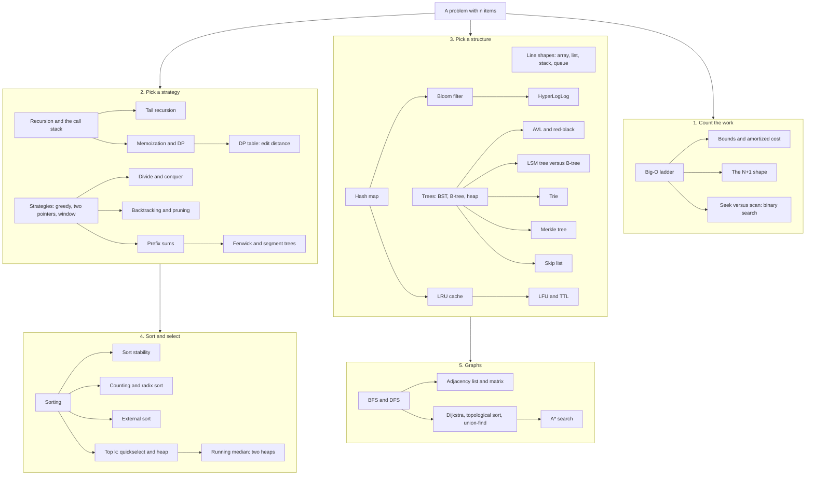

## The map in words

Every question here starts with one number: n, the size of the input. Big-O tells you how the work grows as n grows. That one count decides everything else.

Then you pick a structure. Each structure makes one operation cheap: a hash map makes lookup by key cheap, a tree makes ordered access cheap, a queue makes "next in line" cheap. Pick the one whose cheap operation is your hot one.

Then you pick a strategy. Recursion breaks a problem down. Memoization stops it doing the same piece twice. Sorting and searching are the strategies you meet every day, inside every database.

## Big-O and the complexity ladder

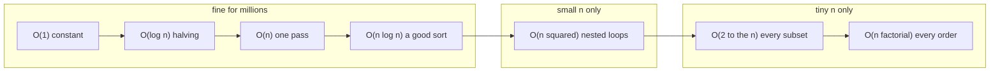

**Story.** An indexer team must check 1.59 million pool addresses for duplicates. The first version compares every pool with every other pool. That is n², about 2.5 × 10¹² steps, and it never finishes. The second version sorts the list, then walks it once comparing neighbours. That is n log n. It finishes in seconds.

**How it works.**

1. Name n: rows, blocks, addresses, characters.
2. Count how many times the innermost line runs as n grows.
3. Drop constants: 2n and 200n are both O(n). Doubling n doubles the work either way.
4. Drop lower terms: n² + n is O(n²). At scale the biggest term is all that matters.
5. Place the result on the ladder. The left four rungs survive millions. The right three do not.

The ladder, with what n is still fine for about one second of work (a modern machine does roughly 10⁸ to 10⁹ simple steps per second):

| Class | Name | n still fine | Typical shape |
|---|---|---|---|
| O(1) | constant | any | hash map lookup, array index |
| O(log n) | logarithmic | any | binary search, B-tree seek |
| O(n) | linear | about 10⁸ | one pass, a table scan |
| O(n log n) | linearithmic | about 10⁷ | merge sort, quicksort |
| O(n²) | quadratic | about 10⁴ | nested loops, bubble sort |
| O(2ⁿ) | exponential | about 25 | naive Fibonacci, every subset |
| O(n!) | factorial | about 11 | every permutation, brute-force travelling salesman |

Two cousins of Big-O. **Amortized** cost spreads one rare expensive step over many cheap ones: a dynamic array doubles when full, the copy is O(n), but it happens once per n appends, so append is O(1) amortized. **Best, average and worst case** are different inputs to the same code: quicksort is O(n log n) on average and O(n²) on already sorted input with a first-element pivot.

### In code

```text
lookup(table, key):                  # O(1)
  return table[key]                  # one hash, one slot
binary_search(sorted items, key):    # O(log n)
  while lo <= hi: look at mid, drop the half that cannot hold key
has_dup_set(addrs):                  # O(n)
  for a in addrs: if a in seen: True, else add a to seen
has_dup_sorted(addrs):               # O(n log n): the fix
  s = sorted(addrs)
  for i from 1 to n - 1:
    if s[i] == s[i - 1]: return True # duplicates sit side by side
has_dup_pairs(addrs):                # O(n²): the bug
  for i from 0 to n - 1:
    for j from i + 1 to n - 1:       # n(n - 1) / 2 compares
      if addrs[i] == addrs[j]: return True
every_subset(addrs):                 # O(2ⁿ)
  for mask from 0 to 2ⁿ - 1: check that subset
```

```python
def has_dup_pairs(addrs):            # O(n^2): every pair. The bug.
    for i in range(len(addrs)):
        for j in range(i + 1, len(addrs)):
            if addrs[i] == addrs[j]:
                return True
    return False


def has_dup_sorted(addrs):           # O(n log n): sort, then neighbours
    s = sorted(addrs)
    for i in range(1, len(s)):
        if s[i] == s[i - 1]:
            return True
    return False


def has_dup_set(addrs):              # O(n): one look per item
    seen = set()
    for a in addrs:
        if a in seen:
            return True
        seen.add(a)
    return False
```

Run it: `handbook/code/17-big-o-ladder/` with `python3 main.py`. It counts the real steps of every rung at n = 10, 100 and 1,000 (499,500 pair compares against 999 neighbour checks at 1,000), then prints the ladder the lesson draws and the 3.5 hours the pair loop needs at 1.59 million pools.

**What goes wrong.** Small test data hides the shape. O(n log n) and O(n²) look the same at 100 rows. They part ways at a few thousand. Production has millions. The fix is to ask "what is n in production, and can it grow?" before you merge.

**Where you use it.**

- Indexer design review: compare the Big-O of two designs first, then measure the constants. A 10x constant on O(n) is still a day versus two hours at 21 million blocks.
- A start-up check over a 30-entry registry: a nested loop of 900 checks is fine and readable. n is bounded by design.
- Code review: a loop inside a loop over user data is a question to ask, every time.

> Big-O is how the work grows when the input grows. Know your n, place it on the ladder, and stay on the left four rungs.

▶ Watch it move: [The Big-O ladder](visual/17-big-o-ladder.html)

## Bounds and amortized cost

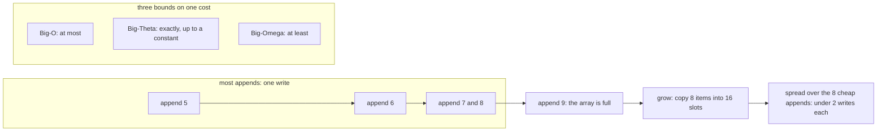

**Story.** A Go indexer appends 21 million transfer rows to a slice it did not pre-size. Most appends write one slot. Now and then the slice is full, and it copies everything into a block twice as big. A profiler shows a few very slow appends. Yet the total copy work over all appends stays under 2n, so each append is O(1) **amortized**.

**How it works.**

1. **Big-O** is an upper bound: the work is at most a constant times f(n) for large n.
2. **Big-Omega** (Ω) is a lower bound: at least a constant times f(n). Any sort that compares items is Ω(n log n).
3. **Big-Theta** (Θ) is both at once. Merge sort is Θ(n log n). In interviews, "Big-O" usually means this tight bound.
4. **Worst, average and best case** are different inputs to the same code. Quicksort is Θ(n log n) on average and Θ(n²) at worst.
5. **Amortized** is about one long run of operations: total cost divided by the count. Doubling copies 1 + 2 + 4 + ... + n, under 2n items over n appends (the "spread over" box). So append is O(1) amortized.

### In code

```text
append(item):
  if n == room:                         # full: no slot for the new item
    bigger = new array of grow(room)
    for k from 0 to n - 1:              # copy every old item across
      bigger[k] = slots[k]
    slots = bigger
  slots[n] = item                       # the one write every append does
  n = n + 1
  writes += copied + 1                  # this append's bar
grow by doubling(room): room * 2       # copies get rarer as they grow
grow by a fixed step(room): room + 2   # a copy every 2 appends
amortized = writes / n                 # total work / number of appends
```

```python
def append(self, item):
    copied = 0
    if self.n == len(self.slots):          # full: no room for the new item
        bigger = [None] * self.grow(len(self.slots))
        for k in range(self.n):            # copy every old item across
            bigger[k] = self.slots[k]
            copied += 1
        self.slots = bigger
    self.slots[self.n] = item              # write the new item
    self.n += 1
    self.writes += copied + 1
    return copied + 1


def double(room):
    return room * 2


def fixed_step(room):
    return room + 2
```

Run it: `handbook/code/17-amortized-cost/` with `python3 main.py`. It prints the bar of every append: 31 writes for 16 appends with doubling, 72 with a fixed step of 2, and 17 writes for append 17 alone.

**What goes wrong.** Amortized does not mean every call is fast. One append can copy millions of items and stall a loop that must answer in milliseconds. Pre-size with `make([]T, 0, n)` when you know n. The second trap: growing by a fixed step, say 1,000 slots, instead of a factor. Then the copies add up to O(n²).

Do not mix amortized with average. Amortized holds for any sequence of calls. Average only holds when the input is typical.

**Where you use it.**

- Go slices, Python lists and Java `ArrayList` grow by a factor, so append is O(1) amortized.
- A hash map resize is the same trick. Redis spreads its rehash over many later calls, so no single call pays the whole copy.
- A service with a latency target: amortized is fine for throughput, but pre-size or use incremental growth to protect the slowest requests.

> Big-O is an upper bound, Omega a lower bound, Theta both. Amortized means total cost over any long run divided by the count, so a doubling array appends in O(1) amortized even though one append copies everything.

▶ Watch it move: [Bounds and amortized cost](visual/17-amortized-cost.html)

## The N+1 shape

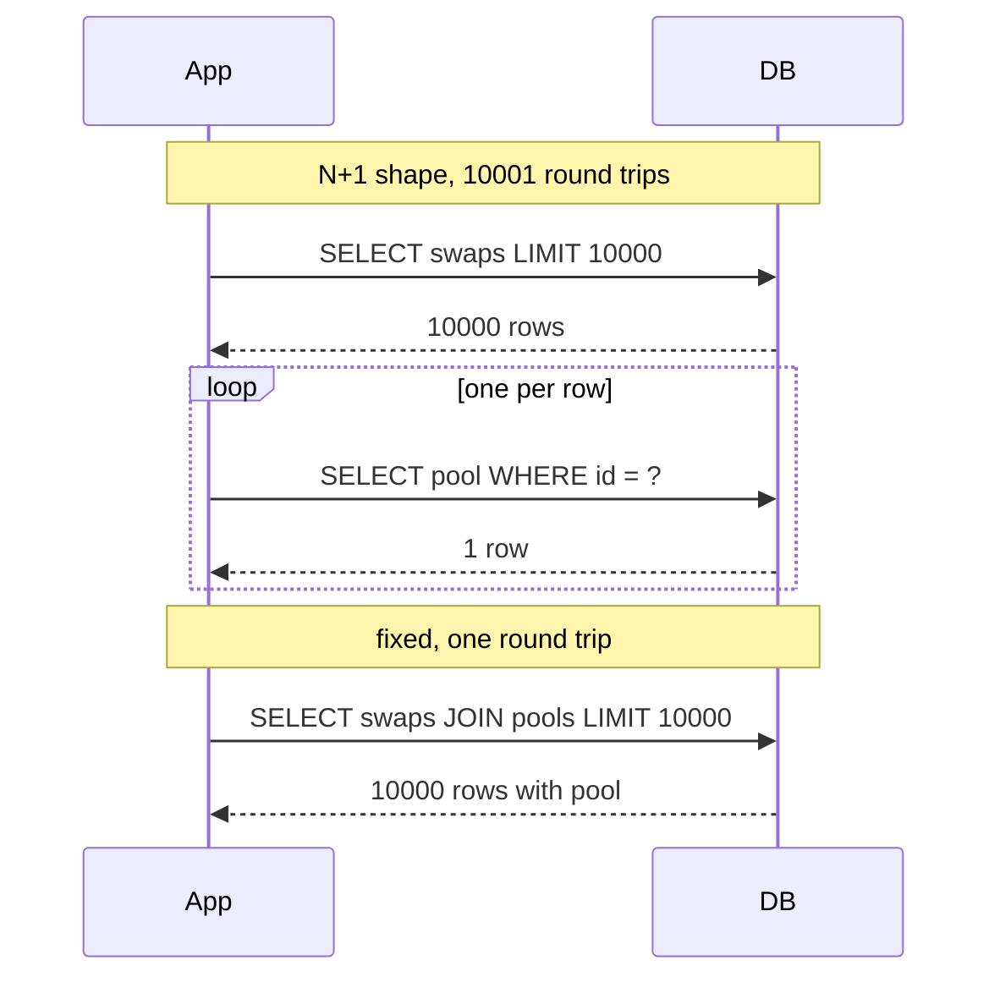

**Story.** A report page loads 10,000 swaps. For each swap an object-relational mapper (ORM) quietly loads its pool. The page takes about ten seconds. One join brings it under one second. The row count is the same. The round trips go from 10,001 to 1.

**How it works.**

1. The first query fetches n parent rows (top of the picture).
2. The loop runs one small query per row (the `loop` box).
3. Each query pays a network hop, a parse and a plan. At one millisecond each, 10,000 of them is ten seconds.
4. The fix sends one join, or one `WHERE id IN (...)` batch (bottom of the picture).

### In code

```text
report_lazy():
  swaps = query("SELECT swaps LIMIT 10000")    # the 1
  for each (swap_id, pool_id) in swaps:         # the N: 10,000 passes
    # the template reads swap.pool.name, so the ORM runs:
    row = query("SELECT name FROM pools WHERE id = ?", pool_id)
  # trips = 1 + 10,000
report_batched(page = 1000):
  swaps = query("SELECT swaps LIMIT 10000")
  ids = the distinct pool ids of swaps
  for each page of 1,000 ids:                   # 10 pages
    rows = query("SELECT pools WHERE id IN (page)")
  # trips = 1 + 10
```

```python
def report_lazy(db):
    swaps = db.query("SELECT id, pool_id FROM swaps ORDER BY id LIMIT 10000")  # the 1
    names = []
    for swap_id, pool_id in swaps:  # the N: one query per row
        row = db.query("SELECT name FROM pools WHERE id = ?", (pool_id,))
        names.append(row[0][0])
    return names


def report_batched(db, page=1000):
    swaps = db.query("SELECT id, pool_id FROM swaps ORDER BY id LIMIT 10000")
    ids = sorted({pool_id for _, pool_id in swaps})
    names = {}
    for k in range(0, len(ids), page):  # pages of 1,000 keys
        chunk = ids[k:k + page]
        marks = ",".join("?" * len(chunk))
        for pool_id, name in db.query(f"SELECT id, name FROM pools WHERE id IN ({marks})", chunk):
            names[pool_id] = name
    return [names[pool_id] for _, pool_id in swaps]
```

Run it: `handbook/code/17-n-plus-one/` with `python3 main.py`. It runs against a real SQLite database in memory and prints 10,001 round trips for the lazy loop, 1 for the join, 11 for the batches, 2 for the dataloader, and the "too many SQL variables" refusal for one IN with a million keys.

**What goes wrong.** The ORM hides it. Lazy loading looks like reading a field. After the fix, the second trap is an `IN` list of a million keys, which passes the query size limit. Batch in pages of about a thousand keys.

**Where you use it.**

- An ORM report: switch on eager loading or write the join.
- Two services that cannot join: collect keys and send one `IN` query per page.
- GraphQL servers: a dataloader collects the keys asked for in one tick and sends one batch.

> N+1 is O(n) round trips where one would do. Spot it by counting queries per request, fix it with a join or a batch.

▶ Watch it move: [The N+1 shape](visual/17-n-plus-one.html)

## Seek versus scan: binary search

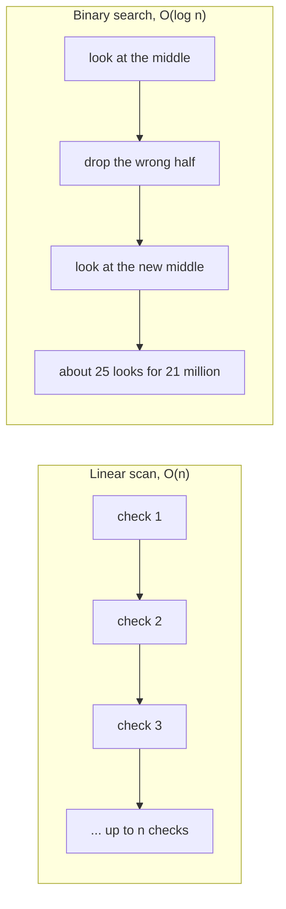

**Story.** An indexer must find block height 9,506,211 among 21 million sorted heights. A scan checks one height at a time: up to 21 million checks. Binary search looks at the middle, sees the target is bigger, and throws the left half away. After about 25 looks it lands on the block.

```python
def find(heights, target):
    low, high = 0, len(heights) - 1
    while low <= high:
        mid = (low + high) // 2
        if heights[mid] == target:
            return mid
        if heights[mid] < target:
            low = mid + 1
        else:
            high = mid - 1
    return -1
```

**How it works, line by line.**

1. `low` and `high` mark the part of the list that may still hold the target. At the start it is everything.
2. `while low <= high` runs as long as that part is not empty.
3. `mid` is the middle of the part (the "look at the middle" box).
4. If the middle is the target, return its position.
5. If the middle is too small, the target sits to the right: move `low` past `mid`. The left half is dropped.
6. Otherwise move `high` before `mid`. The right half is dropped.
7. If the part becomes empty, the target is not there: return `-1`.

Each pass halves the part. Halving 21 million to one takes about 25 passes. That is log₂ n.

### In code

```text
binary_search(items, target):          # items must be sorted
  low = 0, high = len(items) - 1         # low..high may hold target
  while low <= high:                     # empty range: not there
    mid = (low + high) // 2              # middle slot, rounded down
    if items[mid] == target:
      return mid  # found
    if items[mid] < target:
      low = mid + 1                      # drop mid and everything left
    else:
      high = mid - 1                     # drop mid and everything right
  return -1                              # not found, and no error
linear_search(items, target):          # no order needed
  for k, value in items:                 # check each slot in turn
    if value == target: return k
  return -1
```

```text
linear_search(items, target):          # no order needed
  for k, value in items:                 # check each slot in turn
    if value == target:
      return k                           # found
  return -1                              # looked at every slot
binary_search(items, target):          # the rival, for sorted items
  while low <= high:
    mid = (low + high) // 2
    drop the half that cannot hold target
  return -1
# no index: the database runs linear_search over every row, a table scan
# an index keeps keys sorted, so the engine can halve: a seek
```

```python
def binary_search(items, target, log=None):
    low, high = 0, len(items) - 1      # everything in low..high may hold target
    compares = 0
    while low <= high:                 # an empty range means: not there
        mid = (low + high) // 2        # the middle slot, rounded down
        compares += 1
        if log is not None:
            log.append((low, high, mid, items[mid]))
        if items[mid] == target:
            return mid, compares       # found
        if items[mid] < target:
            low = mid + 1              # target is bigger: drop mid and the left
        else:
            high = mid - 1             # target is smaller: drop mid and the right
    return -1, compares                # no error, just "not found"


def linear_search(items, target):
    compares = 0
    for k, value in enumerate(items):  # check each slot in turn
        compares += 1
        if value == target:
            return k, compares
    return -1, compares
```

Run it: `handbook/code/17-binary-search/` with `python3 main.py`. It prints the four probes for 63 (mid 7, 11, 13, 12), the 13 compares of the scan, 25 compares over 21 million heights and 30 over a billion, and the wrong "not found" on unsorted data.

**What goes wrong.** Binary search needs sorted data. Sorting just to search once costs O(n log n), more than one scan. Binary search pays off when you search many times, or when the data is already kept sorted, as an index is.

**Where you use it.**

- A database index seek is binary search on a tree. A table scan is the linear scan. Same rule: seek when you need a few rows of many.
- Finding the first block after a timestamp in a sorted checkpoint list.
- `git bisect` finds the bad commit by halving the history.

> Binary search halves a sorted range each step, so a million items take about twenty looks. It is the index seek, and a scan is its slow twin.

▶ Watch it move: [Binary search](visual/17-binary-search.html)

## Recursion and the call stack

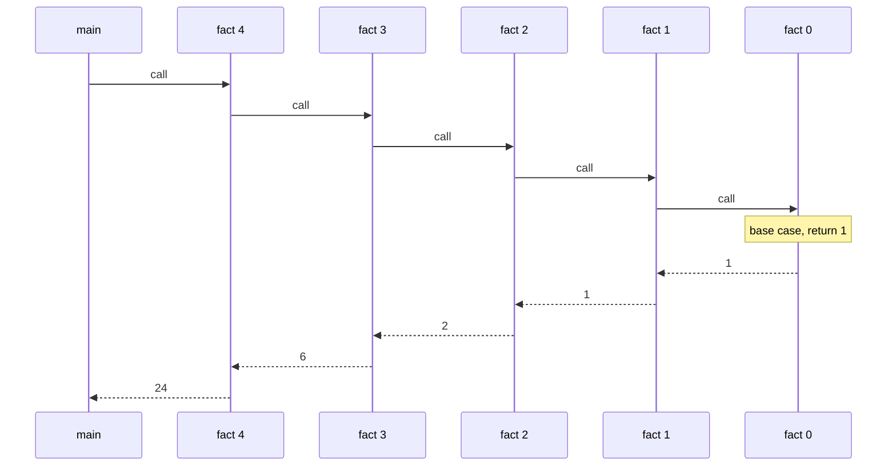

**Story.** You ask for `fact(4)`. It cannot answer yet, so it asks `fact(3)` and waits. That one asks `fact(2)`, and so on, down to `fact(0)`, which knows the answer is 1. Then the answers flow back up, each frame multiplying as it returns.

```python
def fact(n):
    if n == 0:          # base case
        return 1
    return n * fact(n - 1)   # recursive case

def visit(node):        # tree traversal, depth first
    if node is None:
        return
    visit(node.left)
    print(node.value)   # in order
    visit(node.right)
```

**How it works, line by line.**

1. `if n == 0: return 1` is the base case. It is the bottom box in the picture, where the calls stop.
2. `return n * fact(n - 1)` is the recursive case. It calls a smaller problem and waits. Each waiting call is one frame on the call stack (each arrow going right).
3. When `fact(0)` returns 1, the frames pop one by one (the arrows going left). Each multiplies its `n` into the answer: 1, 1, 2, 6, 24.
4. `visit` uses the same shape on a tree. `if node is None: return` is its base case: an empty branch.
5. `visit(node.left)` goes down the left side first. `print` runs when the left side is done. `visit(node.right)` finishes the right side. That order prints a search tree in sorted order.

Depth n means n frames, so `fact` uses O(n) stack space even though it allocates nothing.

### In code

```text
fact(n):
  push a frame that holds this call's n   # every call does this
  if n == 0:                              # the base case
    return 1                              # the floor: no more calls
  answer = fact(n - 1)                    # this frame pauses here
  return n * answer                       # pop: the frame is gone
fact_loop(n):                             # the fix for deep input
  result = 1
  while n > 0: result = result * n, then n = n - 1
  return result                           # one frame, whatever n is
```

```python
def fact(n):
    if n == 0:                   # the base case: the floor
        return 1
    return n * fact(n - 1)       # this frame waits here for the answer


def fact_no_base(n):
    # base case forgotten: nothing says when to stop
    return n * fact_no_base(n - 1)


def fact_loop(n):
    result = 1
    while n > 0:
        result *= n
        n -= 1
    return result
```

Run it: `handbook/code/17-recursion-call-stack/` with `python3 main.py`. It prints every push and pop of fact(4) = 24 (5 frames at the deepest), then the RecursionError after 998 frames without a base case, the same error for a correct fact(100000), and fact_loop(100000) finishing in one frame.

**What goes wrong.** A missing base case, or one the input never reaches, keeps pushing frames until the stack overflows. Python stops near 1,000 frames by default. **Tail recursion**, where the call is the very last action, lets some compilers reuse the frame. Python, Java and Go do not do this. The fix for a deep input is a loop with an explicit stack.

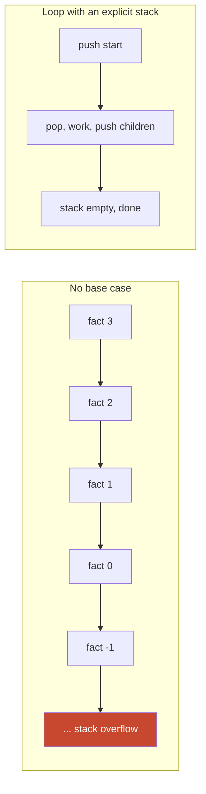

**Where you use it.**

- Walking a tree of agent skills and their sub-skills: ten lines of recursion, depth of a few levels.
- Walking a transfer chain hop by hop: a loop with an explicit queue, because a chain can be a hundred thousand hops long.
- Parsers and tree traversals in compilers: recursion is the natural fit, depth is bounded by nesting.

> Recursion needs a base case and must shrink the problem every call. Each call is a frame on the stack, so deep inputs need a loop instead.

▶ Watch it move: [Recursion and the call stack](visual/17-recursion-call-stack.html)

## Tail recursion

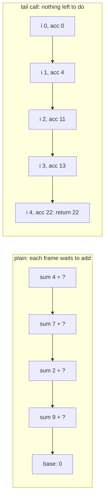

**Story.** A function sums the amounts of 100,000 transfers recursively. The plain version returns `xs[i] + sum(xs, i + 1)`. Every call must wait for the next one, so 100,000 frames pile up and Python stops with "maximum recursion depth exceeded". The tail version carries the running total along: `return sum(xs, i + 1, acc + xs[i])`. The caller has nothing left to do, so a compiler can reuse its frame.

**How it works.**

1. A call is a **tail call** when it is the very last action of the function. Its result is returned unchanged.
2. Plain recursion does work after the call returns: the `4 + ?` in each top box. So every frame must stay on the stack.
3. Tail recursion moves that work into an argument, the accumulator `acc` (the bottom row).
4. With nothing left to do, the compiler replaces the current frame instead of pushing a new one. This is tail call optimisation.
5. The result is a loop in disguise: `i` and `acc` are the loop variables. Stack use is O(1) instead of O(n).

### In code

```text
sum_plain(xs, i):
  if i == len(xs):
    return 0             # base case: past the end
  rest = sum_plain(xs, i + 1)           # this frame waits here
  return xs[i] + rest                   # the + runs after the call
sum_tail(xs, i, acc):
  if i == len(xs):
    return acc           # the answer is ready
  return sum_tail(xs, i + 1, acc + xs[i])   # last action: a tail call
sum_loop(xs):                           # what the compiler makes of it
  i = 0, acc = 0                        # the first call's arguments
  loop:
    if i == len(xs):
      return acc         # the same base case
    i, acc = i + 1, acc + xs[i]         # a jump, no new frame
```

```python
def depth():
    return len(inspect.stack())  # frames on the stack right now


def sum_plain(xs, i=0):
    if i == len(xs):                     # base case: past the end
        return 0
    return xs[i] + sum_plain(xs, i + 1)  # the + waits for the inner call


def sum_tail(xs, i=0, acc=0):
    if i == len(xs):                     # base case: the answer is ready
        return acc
    return sum_tail(xs, i + 1, acc + xs[i])  # the call is the last action


def sum_loop(xs):
    i, acc = 0, 0                        # the first call's arguments
    while True:
        if i == len(xs):                 # the same base case
            return acc
        i, acc = i + 1, acc + xs[i]      # a jump with new arguments, no push
```

Run it: `handbook/code/17-tail-recursion/` with `python3 main.py`. It prints 22 three ways, the unwinding of the plain version from depth 5, then RecursionError for both recursive forms on 100,000 items, because Python never reuses the frame, while sum_loop returns 100,000.

**What goes wrong.** Assuming your language does it. Scheme guarantees it. Scala does it when you mark `@tailrec`, and Kotlin with `tailrec`. C and C++ compilers often do it with optimisation on, but do not promise it. Python, Java and Go never do. In those, a tail-recursive function still overflows the stack on deep input. The fix is to write the loop yourself, or keep an explicit stack.

**Where you use it.**

- Functional code in Scala, Kotlin, Elixir or Scheme: write deep recursion in tail form, and let the compiler check it.
- Go, Python and Java: turn deep recursion into a loop before it meets production depth, such as a chain of 100,000 blocks.
- Interviews: name the accumulator, then say whether the language keeps the promise.

> A tail call is the last thing a function does, so its frame can be reused and recursion runs in constant stack. Python, Java and Go do not do this, so there I write the loop.

▶ Watch it move: [Tail recursion](visual/17-tail-recursion.html)

## Memoization and dynamic programming

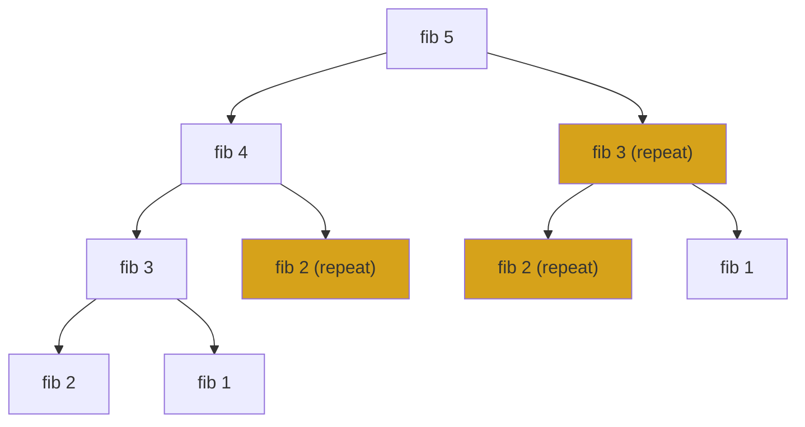

**Story.** Naive Fibonacci asks for `fib(3)` twice and `fib(2)` three times, just for `fib(5)`. The yellow boxes are repeated work. At `fib(40)` the same code makes hundreds of millions of calls. Add one dictionary that remembers answers, and every repeat becomes a lookup.

```python
# 1. naive recursion, O(2^n) time, O(n) stack
def fib_naive(n):
    if n < 2:
        return n
    return fib_naive(n - 1) + fib_naive(n - 2)

# 2. memoized, O(n) time, O(n) space
from functools import lru_cache

@lru_cache(maxsize=None)
def fib_memo(n):
    if n < 2:
        return n
    return fib_memo(n - 1) + fib_memo(n - 2)

# 3. iterative, O(n) time, O(1) space
def fib_iter(n):
    a, b = 0, 1
    for _ in range(n):
        a, b = b, a + b
    return a
```

**How it works, line by line.**

1. `fib_naive`: `if n < 2: return n` is the base case. The last line makes two calls. Each call makes two more. That doubling is the whole tree in the picture, O(2ⁿ).
2. `fib_memo`: the body is the same. `@lru_cache(maxsize=None)` wraps it with a dictionary from `n` to answer. The second time `fib_memo(3)` is asked, the yellow box is a lookup, not a subtree. Each `n` is computed once: O(n) time, O(n) memory.
3. `fib_iter`: `a, b = 0, 1` holds the last two answers. Each loop turn slides them forward: the new `b` is `a + b`. No tree, no stack, no dictionary: O(n) time, O(1) memory.

Memoization is top-down: recurse, and cache. **Dynamic programming** (DP) is the general idea: when sub-problems overlap and the best answer is built from best sub-answers, fill a table of sub-results. The iterative version is DP bottom-up.

### In code

```text
fib_naive(n):
  if n < 2:
    return n                     # base cases: fib(0) = 0, fib(1) = 1
  return fib_naive(n - 1) + fib_naive(n - 2)   # two calls, every time
fib_memo(n):
  if n in cache:
    return cache[n]         # asked before: a lookup
  if n < 2: answer = n
  else: answer = fib_memo(n - 1) + fib_memo(n - 2)
  cache[n] = answer                      # store it before returning
  return answer                          # the cache never forgets a key
fib_iter(n):
  a, b = 0, 1                            # fib(0) and fib(1)
  repeat n times:
    a, b = b, a + b                      # slide the window one step up
  return a
```

```python
def fib_naive(n):
    global calls
    calls += 1
    if n < 2:                                  # base cases: fib(0) = 0, fib(1) = 1
        return n
    return fib_naive(n - 1) + fib_naive(n - 2)  # two calls, every time


cache = {}
hits = 0


def fib_memo(n):
    global calls, hits
    calls += 1
    if n in cache:                             # asked before: a lookup, no subtree
        hits += 1
        return cache[n]
    if n < 2:
        answer = n
    else:
        answer = fib_memo(n - 1) + fib_memo(n - 2)
    cache[n] = answer                          # store it before returning
    return answer                              # the cache never forgets a key


def fib_iter(n):
    a, b = 0, 1                                # fib(0) and fib(1)
    for turn in range(n):                      # n turns, no calls
        a, b = b, a + b                        # slide the two-answer window up
    return a
```

Run it: `handbook/code/17-fibonacci-three-ways/` with `python3 main.py`. It counts 25 calls for naive fib(6) and 331,160,281 for fib(40), 11 calls (7 computed, 4 from the cache) for memoized fib(6) and 79 for fib(40), and the six loop turns that end at a = 8.

**What goes wrong.** A cache on a function with side effects, or with arguments that cannot be hashed. In a long-running service, a cache with no size limit grows until memory runs out. Give it a limit.

**Where you use it.**

- Shortest paths, edit distance (how many changes turn one word into another), knapsack, longest common subsequence: all DP tables.
- A price lookup by token and day in a backfill: the same pair repeats thousands of times, so a bounded cache in front of it.
- `functools.lru_cache` in Python, a map in Go.

> Memoize when the same sub-problem repeats. One dictionary turns naive Fibonacci from O(2ⁿ) into O(n).

▶ Watch it move: [Fibonacci three ways](visual/17-fibonacci-three-ways.html)

## Dynamic programming table: edit distance

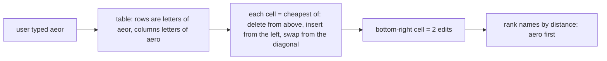

**Story.** A user types "aeor" into the Chain Insights exchange search. No name matches. The search ranks names by **edit distance**: the fewest single-letter inserts, deletes and substitutions that turn one word into the other. "aeor" to "aero" costs 2. A table of small answers builds the big one, each cell filled once.

**How it works.**

1. Make a table with one row per letter of the typed word and one column per letter of the name, plus a row and column for the empty string.
2. The first row and column count up 0, 1, 2, 3, 4: turning an empty string into k letters takes k inserts.
3. Each other cell takes the cheapest of three: the cell above plus 1 (delete), the cell to the left plus 1 (insert), or the diagonal cell plus 0 when the letters match, plus 1 when they differ (substitute).
4. Fill row by row. Every cell needs only cells already filled. That is **optimal substructure** with **overlapping sub-problems**, the two signs that call for dynamic programming (DP).
5. The bottom-right cell is the answer. Walking back through the choices gives the edits themselves.

### In code

```text
edit_table(a, b):
  D = table of (len(a) + 1) rows and (len(b) + 1) columns
  D[i][0] = i for every row              # i deletes reach the empty string
  D[0][j] = j for every column           # j inserts from the empty string
  for i from 1 to len(a):                # row by row
    for j from 1 to len(b):              # left to right
      same = a[i - 1] == b[j - 1]
      D[i][j] = min(above + 1,           # delete
                    left + 1,            # insert
                    diagonal + (0 if same else 1))   # match or substitute
  return D                               # the corner is the answer
walk_back(D):                            # from the corner to 0, 0
  if D[i][j] == diagonal + (0 if same else 1): keep or substitute, go diagonal
  else if D[i][j] == above + 1: delete, go up
  else: insert, go left
plain(i, j):                             # the failure: no table
  return min(plain(i - 1, j) + 1, plain(i, j - 1) + 1, plain(i - 1, j - 1) + cost)
```

```python
def edit_table(a, b):
    D = [[0] * (len(b) + 1) for _ in range(len(a) + 1)]
    for i in range(len(a) + 1):
        D[i][0] = i                       # i deletes reach the empty string
    for j in range(len(b) + 1):
        D[0][j] = j                       # j inserts from the empty string
    for i in range(1, len(a) + 1):        # row by row
        for j in range(1, len(b) + 1):    # left to right
            same = a[i - 1] == b[j - 1]
            D[i][j] = min(D[i - 1][j] + 1,                  # above + 1: delete
                          D[i][j - 1] + 1,                  # left + 1: insert
                          D[i - 1][j - 1] + (0 if same else 1))  # diagonal: match or substitute
    return D


def walk_back(D, a, b):
    i, j, edits = len(a), len(b), []
    while i > 0 or j > 0:
        same = i > 0 and j > 0 and a[i - 1] == b[j - 1]
        if i > 0 and j > 0 and D[i][j] == D[i - 1][j - 1] + (0 if same else 1):
            edits.append(f"keep {a[i - 1]}" if same else f"substitute {a[i - 1]} -> {b[j - 1]}")
            i, j = i - 1, j - 1
        elif i > 0 and D[i][j] == D[i - 1][j] + 1:
            edits.append(f"delete {a[i - 1]}")
            i -= 1
        else:
            edits.append(f"insert {b[j - 1]}")
            j -= 1
    return edits[::-1]


calls = 0


def plain(a, b, i, j):
    global calls
    calls += 1
    if i == 0 or j == 0:
        return i + j
    same = a[i - 1] == b[j - 1]
    return min(plain(a, b, i - 1, j) + 1, plain(a, b, i, j - 1) + 1,
               plain(a, b, i - 1, j - 1) + (0 if same else 1))
```

Run it: `handbook/code/17-edit-distance/` with `python3 main.py`. It prints the table with the corner 2, the walk back (keep a, keep e, two substitutions), and the calls of plain recursion: 481 on these words, about 3.9 × 10¹⁴ on two 20-letter names, against 441 table cells.

**What goes wrong.** Writing it as plain recursion. Each call asks three smaller ones, and the same pairs come up again and again: exponential time. The table makes it O(m × n). The second trap is memory: a table for two 10,000-letter strings has 100 million cells. Each row needs only the row above, so keep two rows: O(n) memory.

Plain edit distance counts a swap of two neighbours, "or" to "ro", as 2. If typos are mostly swaps, use the Damerau variant, which counts it as 1.

**Where you use it.**

- Fuzzy name search and spell checkers: rank candidates by edit distance.
- `diff` and Git compare files with the same table idea, over lines instead of letters.
- DNA alignment, and the 0/1 knapsack problem: the same shape of table, a different rule per cell.

> Dynamic programming fills a table of small answers so each one is computed once. For edit distance each cell is the cheapest of delete, insert or substitute from three neighbours, and the corner is the answer: O(m × n) time, two rows of memory.

▶ Watch it move: [Edit distance: a dynamic programming table](visual/17-edit-distance.html)

## Strategies: divide, greedy, backtrack, two pointers, window

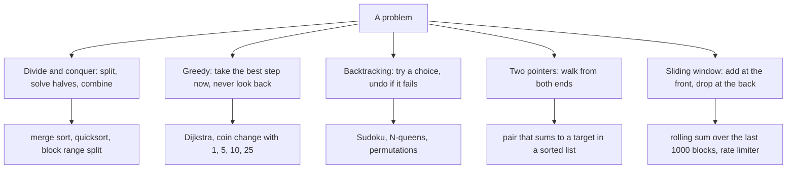

**Story.** A rate limiter must count requests in the last minute. Recounting the whole minute for every request is O(n × window). A sliding window adds the new request at the front and drops requests older than a minute at the back. One pass, one running count.

**How it works.**

1. **Divide and conquer** splits the input, solves each part, combines. With two halves and a linear combine, the cost is O(n log n).
2. **Greedy** takes the locally best choice each step. It is fast. It is only correct when a local best leads to the global best.
3. **Backtracking** builds a solution one choice at a time and undoes the last choice when it cannot work. Pruning is what keeps it from being brute force.
4. **Two pointers** walk one array from both ends or at two speeds. Sum too small, move the left one up. Too big, move the right one down. O(n), O(1) memory.
5. **Sliding window** keeps a running state over a moving range. Add the new item, remove the old one, never recompute.

### In code

```text
allow(now):                               # one request arrives
  while oldest time <= now - window:      # fell out of the back
    drop the oldest time
  if count inside >= limit:               # one compare, no scan
    return False                          # refused, and not recorded
  add now at the front                    # one add
  return True
recount(all times, now):                  # the brute force it replaces
  count every t with now - window < t <= now   # reads every timestamp
```

```text
two_sum_sorted(a, target):                # a must be sorted
  left = 0, right = len(a) - 1
  while left < right:                     # pointers met: no pair
    total = a[left] + a[right]
    if total == target: return left, right
    if total > target:
      right = right - 1                   # a[right] is too big for anyone left
    else:
      left = left + 1                     # a[left] is too small for anyone left
  return none
two_sum_seen(a, target):                  # the fix for unsorted data
  for x in a:
    if target - x in seen: return target - x, x
    add x to seen
```

```text
greedy_coins(coins, amount):
  while amount > 0:
    coin = biggest coin with coin <= amount    # the local best
    took.append(coin)                     # commit, never go back
    amount = amount - coin
  return took
best_coins(coins, amount):                # dynamic programming
  best[0] = no coins
  for a from 1 to amount:
    best[a] = the shortest of best[a - c] + [c], for each coin c <= a
  return best[amount]                     # the truth greedy is measured against
```

```python
from collections import deque


class SlidingWindowLimiter:
    def __init__(self, limit, window):
        self.limit, self.window = limit, window
        self.times = deque()                 # request times still inside the window

    def allow(self, now):
        while self.times and self.times[0] <= now - self.window:
            self.times.popleft()             # drop at the back: fell out of the window
        if len(self.times) >= self.limit:    # one compare: count against limit
            return False                     # refused, and not recorded
        self.times.append(now)               # add at the front
        return True


def recount(all_times, now, window):
    return sum(1 for t in all_times if now - window < t <= now)
```

```python
def two_sum_sorted(a, target, log=None):
    left, right = 0, len(a) - 1
    while left < right:
        total = a[left] + a[right]
        if log is not None:
            log.append((a[left], a[right], total))
        if total == target:
            return left, right               # found
        if total > target:
            right -= 1                       # too big: a[right] is too big for anyone left
        else:
            left += 1                        # too small: a[left] is too small for anyone left
    return None                              # pointers met: no pair


def two_sum_seen(a, target):
    seen = set()
    for x in a:
        if target - x in seen:
            return target - x, x
        seen.add(x)
```

```python
def greedy_coins(coins, amount):
    took = []
    while amount > 0:
        coin = max(c for c in coins if c <= amount)  # biggest coin that still fits
        took.append(coin)                    # commit, never go back
        amount -= coin
    return took


def best_coins(coins, amount):
    best = [[]] + [None] * amount
    for a in range(1, amount + 1):
        options = [best[a - c] + [c] for c in coins if c <= a and best[a - c] is not None]
        best[a] = min(options, key=len)
    return best[amount]


def coin_story(coins, amount):
    g, b = greedy_coins(coins, amount), best_coins(coins, amount)
    verdict = "greedy is best" if len(g) == len(b) else "greedy lost"
    print(f"coins {coins} for {amount}: greedy {g}, best {b}: {verdict}")
```

Run it: `handbook/code/17-strategies/` with `python3 main.py`. It prints each request of the limiter (55 refused, 65 and 75 allowed), the five sums that end at 6 + 15 = 21, the seven sums that miss it on unsorted data, and greedy against best on both coin sets.

**What goes wrong.** Greedy without proof. Coins 1, 3, 4 and a target of 6: greedy takes 4 + 1 + 1, three coins. The best is 3 + 3, two coins. Test greedy with a counter-example, or use DP. Two pointers on unsorted data also fail: sort first, or use a hash set.

**Where you use it.**

- A Go EVM indexer splits a 21 million block range into pieces for parallel workers: divide and conquer without the combine.
- Rolling transfer sums and rate limiters: sliding window.
- Dijkstra is greedy, and it is safe because edge weights are never negative.

> Divide splits, greedy commits, backtracking undoes, two pointers squeeze, and a window slides. Each turns brute force into one or a few passes.

▶ Watch it move: [Strategies: window, two pointers, greedy](visual/17-strategies.html)

## Divide and conquer

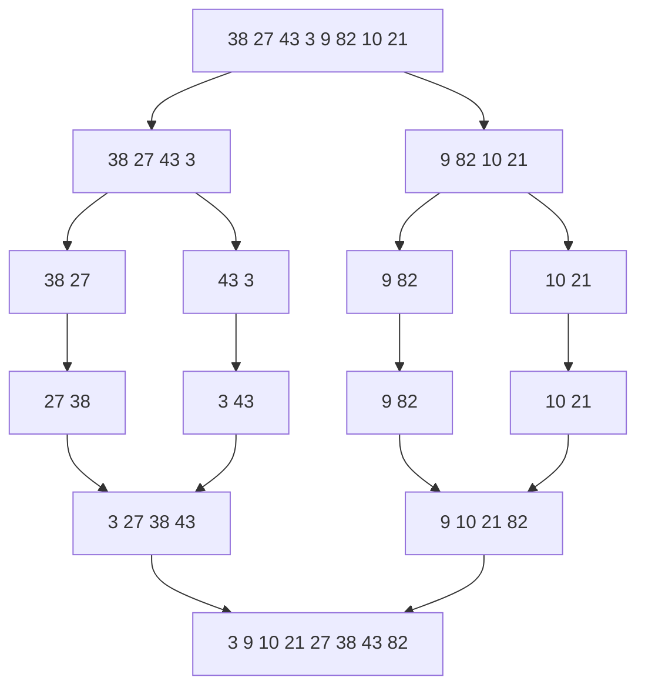

**Story.** A day of transfers must be sorted by amount. Merge sort does not attack the whole list. It splits it in half, sorts each half the same way, and merges the two sorted halves. Each split is easy, each merge is one pass, and there are only log₂ n levels. The same split, without the merge, lets an indexer hand a 21 million block range to eight workers.

**How it works.**

1. **Divide:** split the problem into parts of about equal size (the top half of the picture).
2. **Conquer:** solve each part the same way, until a part is trivial. One number is already sorted.
3. **Combine:** join the part answers. For merge sort, merge two sorted lists by repeatedly taking the smaller head (the bottom half).
4. Count the cost by level. Each level does O(n) merge work, and halving gives log₂ n levels. Total O(n log n).
5. Parts that do not depend on each other can run in parallel.

### In code

```text
merge_sort(items):
  if len(items) <= 1:
    return items       # base case: already sorted
  mid = len(items) // 2                  # divide: pick the middle
  left = merge_sort(items[:mid])
  right = merge_sort(items[mid:])
  return merge(left, right)              # conquer
merge(left, right):
  i = 0, j = 0, out = []
  while both sides have items:
    if left[i] <= right[j]: take left[i], i = i + 1   # the smaller head
    else: take right[j], j = j + 1
  append what is left of either side     # already sorted
  return out
peel_sort(items):                        # the failure: an uneven split
  rest = peel_sort(items[1:])
  return merge(items[:1], rest)
```

```python
def merge(left, right):
    global work
    out, i, j = [], 0, 0
    while i < len(left) and j < len(right):
        if left[i] <= right[j]:             # compare the two heads
            out.append(left[i])             # <= keeps equal items in order: stable
            i += 1
        else:
            out.append(right[j])
            j += 1
    out += left[i:] + right[j:]             # one side is empty, the other is sorted
    work += len(out)                        # one write per item at this merge
    return out


def merge_sort(items, depth=0, log=None):
    if len(items) <= 1:                     # base case: one item is already sorted
        return items
    mid = len(items) // 2                   # divide: pick the middle
    left = merge_sort(items[:mid], depth + 1, log)
    right = merge_sort(items[mid:], depth + 1, log)
    out = merge(left, right)                # conquer: combine two sorted halves
    if log is not None:
        log.setdefault(depth, []).append((left, right, out))
    return out


def peel_sort(items, depth=0):
    if len(items) <= 1:
        return items, depth
    rest, deepest = peel_sort(items[1:], depth + 1)  # an uneven split
    return merge(items[:1], rest), deepest
```

Run it: `handbook/code/17-divide-and-conquer/` with `python3 main.py`. It prints every merge level by level, 24 item writes for even splits against 35 for peeling one number at a time, and the gap at a million items.

**What goes wrong.** Uneven splits. If each split peels off one item, there are n levels instead of log n, and the cost becomes O(n²). That is quicksort with a bad pivot. A costly combine ruins it too: a combine of O(n²) makes the whole O(n²) whatever the split. Merge sort also needs O(n) extra memory for the merge.

**Where you use it.**

- Merge sort, quicksort, binary search, and the fast Fourier transform.
- A Go EVM indexer splits a block range into pieces for parallel workers: divide and conquer without the combine.
- MapReduce and Spark: split the data, compute per piece, then combine in a reduce step.

> Divide and conquer splits a problem into equal parts, solves each the same way, and combines the answers. With halves and a linear combine, as in merge sort, the cost is O(n log n).

▶ Watch it move: [Divide and conquer: merge sort](visual/17-divide-and-conquer.html)

## Backtracking and pruning

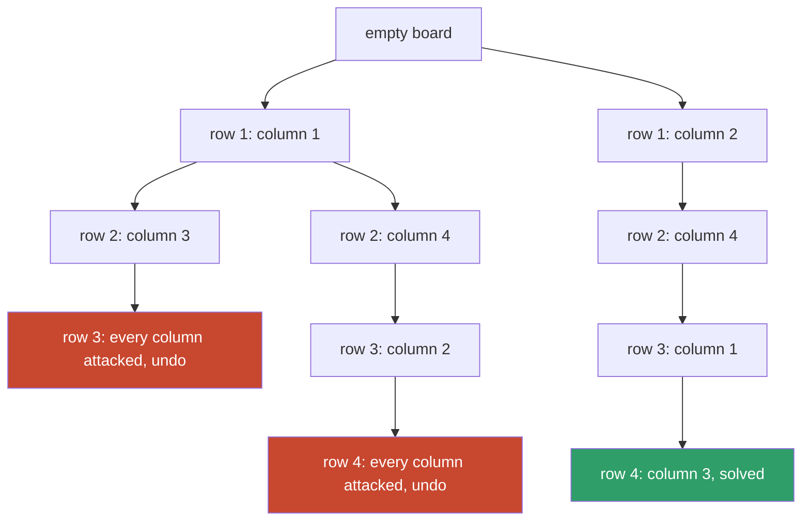

**Story.** Place four queens on a 4 × 4 board so that no two attack each other. Brute force tries every full board: 4⁴ = 256 of them, each checked at the end. Backtracking places one queen per row and checks at once. When a row has no safe column, it undoes the last queen and tries the next column. Whole branches are never built.

**How it works.**

1. **Choose:** put a queen in the next row, at the first safe column.
2. **Check:** a partial board that already breaks a rule is dropped at once. This is **pruning**.
3. **Go deeper:** move to the next row.
4. **Dead end:** no safe column in this row (the red boxes). Undo the last queen and try its next column. If none is left, undo one more row.
5. **Done** when every row holds a queen (the green box). For four queens: columns 2, 4, 1, 3.

### In code

```text
safe(queens, col):                       # queen in the next row, at col
  for each queen (r, c) above:
    if c == col or |c - col| == row - r: return False   # column or diagonal
  return True
solve(queens):
  if len(queens) == N:
    return True       # every row has a queen
  for col from 0 to N - 1:               # left to right
    if not safe(queens, col): continue   # the pruning
    queens.append(col)                   # choose
    if solve(queens):
      return True        # explore
    queens.pop()                         # undo exactly what was done
  return False                           # out of choices: climb back
brute_force():                           # the failure: no pruning
  for each of the N^N full boards: check only at the end
```

```python
def safe(queens, col):
    row = len(queens)
    for r, c in enumerate(queens):
        if c == col or abs(c - col) == row - r:  # same column, or same diagonal
            return False
    return True


def solve(queens, log):
    global tried, dead_ends
    if len(queens) == N:                # every row has a queen: done
        return True
    placed_any = False
    for col in range(N):                # try columns from left to right
        tried += 1
        if not safe(queens, col):       # the pruning: check at once
            continue                    # no board below this square is ever built
        placed_any = True
        queens.append(col)              # choose
        log.append(f"place row {len(queens)} column {col + 1}  -> {[c + 1 for c in queens]}")
        if solve(queens, log):          # explore
            return True
        queens.pop()                    # undo exactly what was done
        log.append(f"undo  row {len(queens) + 1} column {col + 1}  -> {[c + 1 for c in queens]}")
    if not placed_any:
        dead_ends += 1
        log.append(f"dead end: no safe column in row {len(queens) + 1}")
    return False                        # this row ran out of choices: climb back


def brute_force():
    boards = 0
    for board in product(range(N), repeat=N):
        boards += 1
        if all(safe(list(board[:r]), board[r]) for r in range(N)):
            return list(board), boards
    return None, boards
```

Run it: `handbook/code/17-backtracking/` with `python3 main.py`. It prints every place, undo and dead end, the solution in columns 2, 4, 1, 3 after 26 squares tried, and the 115 full boards brute force needs out of 256.

**What goes wrong.** No pruning: checking only full boards is brute force, exponential. And forgotten undo: the code changes a shared board and does not restore it, so later branches see ghosts. Undo exactly what you did, in reverse order.

The famous production failure is a backtracking regular expression. A pattern like `(a+)+$` on a long string of `a`s followed by one `b` tries an exponential number of splits. That is ReDoS (regular expression denial of service). Fix it with a non-backtracking engine such as Go's RE2, or a pattern with no nested repeats.

**Where you use it.**

- Sudoku, N-queens, permutations and constraint solvers.
- A scheduler fitting jobs into slots with rules: try, check, undo.
- A fund-tracing walk with a hop limit: drop a path as soon as it passes the limit or revisits an address.

> Backtracking builds a solution one choice at a time and undoes the last choice at a dead end. Pruning, cutting a branch as soon as it breaks a rule, is what makes it faster than brute force.

▶ Watch it move: [Backtracking and pruning](visual/17-backtracking.html)

## Prefix sums

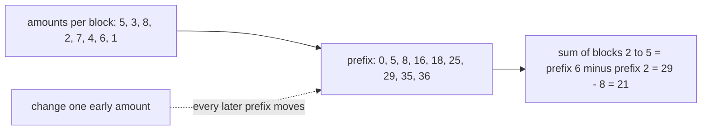

**Story.** A dashboard asks "how much moved between block 1,000 and block 1,250?" many times a minute, for many ranges. Adding up each range again costs O(range) per question. Instead, build running totals once. Then any range sum is one subtraction.

**How it works.**

1. Build `prefix[0] = 0` and `prefix[i + 1] = prefix[i] + a[i]`. One pass, O(n) (the second box).
2. The sum of items `l` to `r` is `prefix[r + 1] - prefix[l]`. Two lookups, O(1) (the third box).
3. The same trick counts things: a prefix of 1s and 0s counts matches in any range.
4. In two dimensions it is a summed-area table: any rectangle sum from four lookups.
5. The reverse is a difference array: add a value to a whole range in O(1), then rebuild the totals once.

### In code

```text
build(a):
  prefix = array of len(a) + 1 zeros      # prefix[0] = 0
  for i from 0 to len(a) - 1:
    prefix[i + 1] = prefix[i] + a[i]      # total before, plus one amount
  return prefix
range_sum(prefix, l, r):                  # blocks l to r, both included
  return prefix[r + 1] - prefix[l]        # two lookups, one subtraction
update(a, prefix, i, v):                  # a late correction
  delta = v - a[i]
  a[i] = v
  for j from i + 1 to len(a):
    prefix[j] += delta                    # every later total moves
```

```python
def build(a):
    prefix = [0] * (len(a) + 1)  # one more slot than there are blocks
    for i in range(len(a)):
        prefix[i + 1] = prefix[i] + a[i]  # the total before, plus one amount
    return prefix


def range_sum(prefix, l, r):
    # prefix[r + 1] holds blocks 0..r, prefix[l] holds blocks 0..l-1.
    return prefix[r + 1] - prefix[l]


def update(a, prefix, i, v):
    delta = v - a[i]
    a[i] = v
    for j in range(i + 1, len(prefix)):
        prefix[j] += delta  # this is the O(n) cost of one update
```

Run it: `handbook/code/17-prefix-sums/` with `python3 main.py`. It prints the totals 0, 5, 8, 16, 18, 25, 29, 35, 36, the answers 21 and 19, and the seven totals one correction rewrites.

**What goes wrong.** The data changes. One update near the start moves every prefix after it: O(n) per update (the dashed arrow). When updates are frequent, use a Fenwick tree (binary indexed tree): O(log n) for both update and range sum. Two smaller traps: the prefix array has n + 1 entries, so off-by-one bugs are common. And totals of large token amounts overflow a 64-bit integer, so sum in a wider type.

**Where you use it.**

- SQL `SUM(amount) OVER (ORDER BY block)` is a running total. A balance at a block is the prefix sum of the transfers in and out.
- A rate dashboard over fixed history: precompute the totals once, answer every range in O(1).
- Image processing and heat maps: summed-area tables for box blurs and region totals.

> Precompute running totals once in O(n), then any range sum is one subtraction. When the data changes often, switch to a Fenwick tree.

▶ Watch it move: [Prefix sums](visual/17-prefix-sums.html)

## Fenwick tree and segment tree: range sums with updates

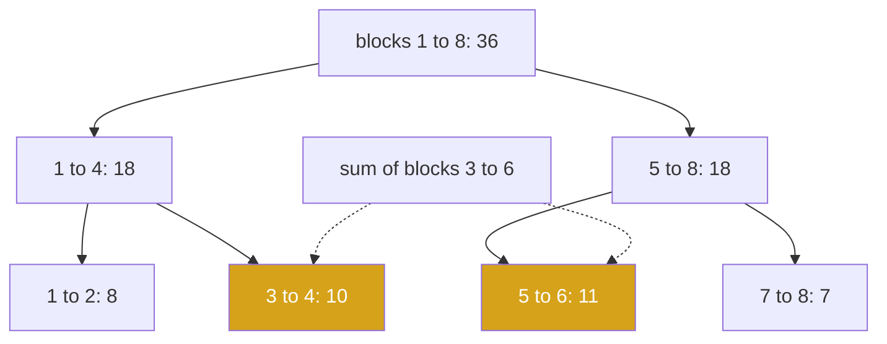

**Story.** The block-volume dashboard from Prefix sums gets late corrections all day. With prefix sums, one correction near the start rewrites every total after it: O(n). A segment tree keeps sums of halves, quarters and eighths. A range sum adds a few stored blocks, here 10 + 11 = 21 for blocks 3 to 6. A correction changes one leaf and the sums on its path to the root. Both cost O(log n).

**How it works.**

1. A **segment tree** is a binary tree over the array. Each node holds the sum of its range. Leaves are single blocks.
2. **Query:** cover the asked range with the fewest whole nodes (the yellow boxes), and add them. At most about 2 log₂ n nodes.
3. **Update:** change the leaf, then fix each sum on the way up to the root: log₂ n nodes.
4. A **Fenwick tree** (binary indexed tree) does the same for sums in one plain array of n numbers. Slot i holds the sum of the last lowbit(i) items, where lowbit is the lowest set bit of i. A prefix sum hops down by stripping that bit. An update hops up by adding it.
5. A segment tree can hold any combinable value: sum, min, max. A Fenwick tree needs a value that can be subtracted, so range min is out.

### In code

```text
add(i, delta):                            # blocks count from 1
  while i <= n:
    t[i] = t[i] + delta
    i = i + lowbit(i)                     # the next slot that covers block i
prefix(i):                                # sum of blocks 1 to i
  total = 0
  while i > 0:
    total = total + t[i]
    i = i - lowbit(i)                     # strip the lowest set bit
  return total
range_sum(lo, hi):
  return prefix(hi) - prefix(lo - 1)      # only works if you can subtract
lowbit(i) = i & -i                        # 6 = 110 in binary, lowbit 2
```

```text
build(values, combine):
  leaves sit at n to 2n - 1
  for i from n - 1 down to 1:
    t[i] = combine(t[2i], t[2i + 1])      # a parent from its two children
update(pos, value):
  i = pos - 1 + n, t[i] = value           # change the leaf
  while i > 1:                            # the path up to the root
    i = i // 2
    t[i] = combine(t[2i], t[2i + 1])
query(lo, hi):
  l = lo - 1 + n, r = hi + n
  while l < r:                            # climb from both edges
    if l is a right child: take t[l], l = l + 1
    if r is a right child: r = r - 1, take t[r]
    l = l // 2, r = r // 2
  return the combined result
```

```python
class Fenwick:
    def __init__(self, values):
        self.t = [0] * (len(values) + 1)     # slot 0 is unused, blocks count from 1
        for i, v in enumerate(values, start=1):
            self.add(i, v)

    def add(self, i, delta):
        touched = []
        while i < len(self.t):
            self.t[i] += delta
            touched.append(i)
            i += i & -i                      # add the lowest set bit: the next cover
        return touched

    def prefix(self, i):
        total, read = 0, []
        while i > 0:
            total += self.t[i]
            read.append(i)
            i -= i & -i                      # strip the lowest set bit
        return total, read

    def range_sum(self, lo, hi):             # blocks lo to hi, both included
        return self.prefix(hi)[0] - self.prefix(lo - 1)[0]
```

```python
class SegmentTree:
    def __init__(self, values, combine):
        self.n, self.combine = len(values), combine
        self.t = [0] * (2 * self.n)          # leaves sit at n..2n-1
        self.t[self.n:] = values
        for i in range(self.n - 1, 0, -1):   # each parent combines its two children
            self.t[i] = combine(self.t[2 * i], self.t[2 * i + 1])
        self.writes = 0

    def update(self, pos, value):            # pos counts from 1
        i = pos - 1 + self.n
        self.t[i] = value
        self.writes += 1
        while i > 1:                         # fix each node on the path to the root
            i //= 2
            self.t[i] = self.combine(self.t[2 * i], self.t[2 * i + 1])
            self.writes += 1

    def query(self, lo, hi):                 # blocks lo to hi, both included
        l, r, result = lo - 1 + self.n, hi + self.n, None
        while l < r:                         # climb, taking whole nodes at the edges
            if l % 2 == 1:
                result = self.t[l] if result is None else self.combine(result, self.t[l])
                l += 1
            if r % 2 == 1:
                r -= 1
                result = self.t[r] if result is None else self.combine(result, self.t[r])
            l //= 2
            r //= 2
        return result
```

Run it: `handbook/code/17-fenwick-segment-tree/` with `python3 main.py`. It prints the Fenwick slots 5, 8, 8, 18, 7, 11, 6, 36, the prefix walk 11 + 18 = 29, the range answer 21, the three slots a correction changes, the four segment tree nodes on the update path, and the 32 node writes of a range add one leaf at a time.

**What goes wrong.** Off-by-one: a Fenwick tree counts from 1, not 0, and slot 0 is never used. Range min with a Fenwick tree does not work, because a min cannot be subtracted: use a segment tree. Adding a value to a whole range, one leaf at a time, is O(n log n). Use lazy propagation: park the pending add on the covering nodes and push it down only when a query needs it.

**Where you use it.**

- Live range sums and counts with constant corrections: volumes per block range, order book depth per price band.
- Rank queries: "how many wallets have a volume below mine?" is a Fenwick tree over volume buckets.
- Range min or max with updates, such as the lowest price in a window that keeps changing: a segment tree.

> A segment tree stores sums of halves and quarters, so a range sum and a point update both cost O(log n). A Fenwick tree does the same for sums in one array, and a segment tree also handles min and max.

▶ Watch it move: [Fenwick tree and segment tree](visual/17-fenwick-segment-tree.html)

## Line shapes: array, linked list, stack, queue

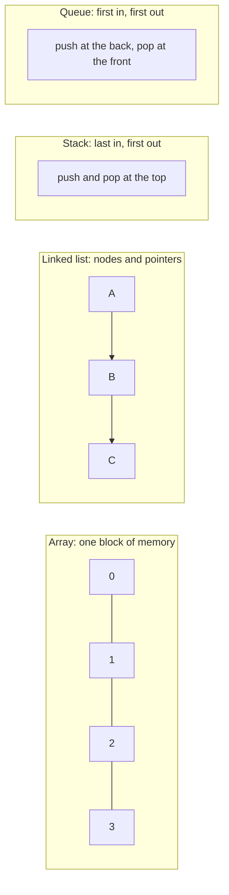

**Story.** A Go indexer keeps a slice of block hashes. Appending block 9,507 is cheap. Then it finds a missed block that belongs at position zero. Inserting it shifts every hash one slot to the right: O(n). A linked list would splice it in at O(1), but finding the tenth node in a list takes ten pointer hops.

**How it works.**

1. An **array** is one block of memory. Index access is O(1): jump straight to slot k.
2. A **dynamic array** (Python list, Go slice, Java ArrayList) grows by allocating a block twice as big and copying. Append is O(1) amortized. Insert in the middle is O(n).
3. A **linked list** is nodes with a pointer to the next one. A doubly linked list also points back. Insert or delete at a known node is O(1). Finding the k-th node is O(n).
4. A **stack** is last in, first out (LIFO). The call stack is one. Depth-first search uses one.
5. A **queue** is first in, first out (FIFO). Breadth-first search uses one. A **deque** (double-ended queue) does both ends in O(1).

### In code

```text
read(k): return slots[k]                  # start + k x size: one jump
append(x):
  if n == cap:                            # full
    new block of 2 x cap, copy n items    # rare, doubles the room
  slots[n] = x, n = n + 1
insert_front(x):
  for k from n down to 1:
    slots[k] = slots[k - 1]               # every item shifts right
  slots[0] = x
list insert at head(x):
  head = Node(x, next = head)             # one pointer change
list_read(head, k):
  cur = head
  repeat k times: cur = cur.next          # one hop per node, no jump
```

```text
pop_front on an array:
  x = slots[0]
  for k from 1 to n - 1:
    slots[k - 1] = slots[k]               # every other item shifts left
  n = n - 1, return x
ring pop():
  x = slots[front]
  front = (front + 1) % cap               # move the index, not the data
  count = count - 1, return x
ring push(x):
  if count == cap: return False           # full: the producer must wait
  back = (front + count) % cap            # next free slot, wraps to 0
  slots[back] = x, count = count + 1
```

```python
class Array:
    def __init__(self, cap):
        self.slots, self.n, self.moves = [None] * cap, 0, 0

    def read(self, k):
        return self.slots[k]                 # start + k x size: one jump

    def append(self, x):
        if self.n == len(self.slots):        # full: new block, twice as big
            bigger = [None] * (2 * len(self.slots))
            bigger[:self.n] = self.slots
            self.moves += self.n             # every item copied across
            self.slots = bigger
        self.slots[self.n] = x
        self.n += 1

    def insert_front(self, x):
        self.append(None)                    # make sure there is room
        for k in range(self.n - 1, 0, -1):   # every item shifts one slot right
            self.slots[k] = self.slots[k - 1]
            self.moves += 1
        self.slots[0] = x

    def pop_front(self):
        x = self.slots[0]
        for k in range(1, self.n):           # every other item shifts one slot left
            self.slots[k - 1] = self.slots[k]
            self.moves += 1
        self.n -= 1
        self.slots[self.n] = None
        return x


class Node:
    def __init__(self, value, next_node=None):
        self.value, self.next = value, next_node


def list_read(head, k):
    cur, hops = head, 1
    for _ in range(k):                       # one hop per node: no jump possible
        cur = cur.next
        hops += 1
    return cur.value, hops
```

```python
    def pop_front(self):
        x = self.slots[0]
        for k in range(1, self.n):           # every other item shifts one slot left
            self.slots[k - 1] = self.slots[k]
            self.moves += 1
        self.n -= 1
        self.slots[self.n] = None
        return x


class Node:
    def __init__(self, value, next_node=None):
        self.value, self.next = value, next_node


def list_read(head, k):
    cur, hops = head, 1
    for _ in range(k):                       # one hop per node: no jump possible
        cur = cur.next
        hops += 1
    return cur.value, hops


class RingBuffer:
    def __init__(self, cap):
        self.slots, self.front, self.count = [None] * cap, 0, 0

    def push(self, x):
        if self.count == len(self.slots):    # full: the producer must wait
            return False
        back = (self.front + self.count) % len(self.slots)  # next free slot, wraps
        self.slots[back] = x
        self.count += 1
        return True

    def pop(self):
        x = self.slots[self.front]
        self.slots[self.front] = None
        self.front = (self.front + 1) % len(self.slots)     # move the index, not the data
        self.count -= 1
        return x
```

Run it: `handbook/code/17-line-shapes/` with `python3 main.py`. It prints one jump for slot 4, 8 hashes copied into 16 slots, 9 moves for an insert at the front, 5 nodes walked to read node 5, the 5 and 4 moves of array pops, 0 moves for a ring pop, and the refused push when the ring is full.

**What goes wrong.** Popping from the front of a dynamic array to make a queue. Every pop shifts every element: O(n) per pop. Use a ring buffer or a deque. And a linked list for iteration: its nodes scatter through memory, so the processor cache misses on every hop. An array wins for almost everything except a splice at a known node.

**Where you use it.**

- Pre-size a slice when you know n, so it never grows one step at a time.
- The recency order inside an LRU cache: a doubly linked list, so a node can be unlinked in O(1).
- A work queue between an indexer's fetch and decode stages: a channel, which is a bounded queue.

> An array is fast to index and slow to insert into. A linked list is the opposite. A stack is last in first out, a queue is first in first out.

▶ Watch it move: [Line shapes](visual/17-line-shapes.html)

## Hash map

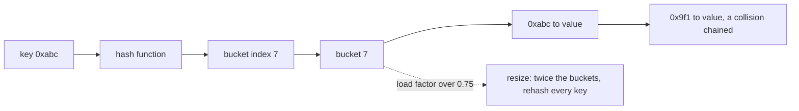

**Story.** A graph sync must turn millions of addresses into node ids. It keeps a Go `map[string]int`. For address `0xabc`, the map hashes the key to bucket 7 and finds the id in one step. A second address, `0x9f1`, happens to hash to bucket 7 too. That is a collision. It is chained behind the first.

**How it works.**

1. Hash the key to a number (the "hash function" box).
2. Take that number modulo the bucket count to get an index (bucket 7).
3. Look in that bucket. Usually there is one entry: O(1).
4. Two keys in one bucket is a collision. **Chaining** keeps a short list per bucket. **Open addressing** probes the next free slot.
5. The **load factor** is entries divided by buckets. Past a limit, often 0.75, the map doubles its buckets and rehashes every key: O(n) once, O(1) amortized (the dashed arrow).

A **set** is a hash map with keys only: membership test in O(1).

### In code

```text
bucket_of(key):
  return hash(key) % len(buckets)         # one hash, one division
put(key, value):
  chain = buckets[bucket_of(key)]         # one array jump
  if key is on the chain:
    overwrite its value, return
  add [key, value] to the chain           # two keys in a bucket: a collision
  count = count + 1
  if count / len(buckets) > 0.75:         # the load factor check
    resize(2 * len(buckets))
resize(new_size):
  for each entry on every old chain:      # touches every key: O(n), once
    put it in new_buckets[hash(key) % new_size]
get(key):
  for each entry on the chain of bucket_of(key):
    if entry.key == key: return entry.value
  return none
```

```python
class ChainedMap:
    def __init__(self, size=8, hash_fn=lambda key: key):
        self.buckets = [[] for _ in range(size)]
        self.hash_fn = hash_fn               # the key's number; here the key itself
        self.count = 0

    def bucket_of(self, key):
        return self.hash_fn(key) % len(self.buckets)  # one hash, one division

    def put(self, key, value):
        chain = self.buckets[self.bucket_of(key)]     # one array jump
        for entry in chain:
            if entry[0] == key:              # the same key again: overwrite
                entry[1] = value
                return
        chain.append([key, value])           # a new key goes on the chain
        self.count += 1
        if self.count / len(self.buckets) > 0.75:     # load factor past the limit
            self.resize(2 * len(self.buckets))

    def resize(self, new_size):
        old = self.buckets
        self.buckets = [[] for _ in range(new_size)]
        for chain in old:                    # touch every key: O(n), once
            for key, value in chain:
                self.buckets[self.bucket_of(key)].append([key, value])  # rehash

    def get(self, key):
        steps = 0
        for k, value in self.buckets[self.bucket_of(key)]:
            steps += 1                       # one compare per entry on the chain
            if k == key:
                return value, steps
        return None, steps
```

Run it: `handbook/code/17-hash-map-internals/` with `python3 main.py`. It prints every insert with its bucket and load factor, 2 compares for 0x19 on a chain, the resize to 16 at 7 / 8, 1 compare after it, and 7 compares when a weak hash sends every key to bucket 0.

**What goes wrong.** A bad hash function, or an attacker who sends keys that all collide, fills one bucket. Lookup becomes a list scan: O(n). A key that changes after insert hashes to a different bucket and is lost. Iteration order is not sorted. The resize is a latency spike.

**Where you use it.**

- Address to node id in a graph sync: millions of exact lookups.
- A database hash join: build a hash map on the small side, probe it with every row of the big side, O(n + m).
- The visited set in a fund-tracing walk, and dedup of transaction hashes in a batch.

> A hash map turns a key into a bucket number, so lookup is O(1) on average. Collisions and resizes are its cost, and O(n) is its worst case.

▶ Watch it move: [Hash map internals](visual/17-hash-map-internals.html)

## Bloom filter

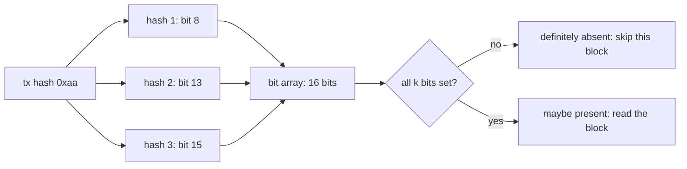

**Story.** A warehouse table holds a year of transfers in thousands of data blocks. A query asks for one transaction hash. Opening every block is a full scan. So each block keeps a Bloom filter of the hashes inside it. Almost every block answers "definitely absent", and the query opens only the one or two that answer "maybe".

**How it works.**

1. Start with m bits, all 0.
2. **Add** a key: run k hash functions on it and set those k bits (the three hash boxes).
3. **Check** a key: run the same k hashes. If any bit is 0, the key was never added: definitely absent.
4. If all k bits are 1, the key is maybe present. Other keys may have set those bits. That is a **false positive**.
5. Size it: about 10 bits per item and 7 hash functions give roughly a 1% false positive rate.

### In code

```text
positions(key):                           # k hash functions
  return [hash(i, key) % m for i from 0 to k - 1]
add(key):
  for p in positions(key):
    bits[p] = 1                           # a bit already 1 stays 1
check(key):
  for p in positions(key):
    if bits[p] == 0:                      # one 0 bit is proof
      return definitely absent
  return maybe present                    # all set: maybe other keys' bits
false_positive_rate(m, k, n):             # size it before you fill it
  return (1 - e^(-k n / m))^k
```

```python
class BloomFilter:
    def __init__(self, m, k):
        self.m, self.k = m, k
        self.bits = [0] * m                  # the filter stores no keys, only bits

    def positions(self, key):
        return [int(hashlib.sha256(f"{i}:{key}".encode()).hexdigest(), 16) % self.m
                for i in range(self.k)]

    def add(self, key):
        for p in self.positions(key):
            self.bits[p] = 1                 # a bit already 1 stays 1

    def check(self, key):
        for p in self.positions(key):
            if self.bits[p] == 0:            # one 0 bit is proof
                return "definitely absent"
        return "maybe present"               # all set: could be other keys' bits

    def ones(self):
        return [p for p, b in enumerate(self.bits) if b]


def false_positive_rate(m, k, n):
    return (1 - math.exp(-k * n / m)) ** k
```

Run it: `handbook/code/17-bloom-filter/` with `python3 main.py`. It uses sha256, so every run gives the same bits: 0xaa sets 8, 13, 15, 0x02 sets 3, 9, 15, 0x03 is definitely absent because bit 10 is 0, and 0xc8 is a false positive. With ten more keys, 15 of 16 bits are set and 212 of 254 other keys say maybe.

**What goes wrong.** Treating "maybe" as "yes". Always confirm in the real data. You also cannot delete: clearing a bit may remove other keys too. A counting Bloom filter keeps small counters instead of bits. And overfilling: past the planned item count, the false positive rate climbs toward 100%. Rebuild it bigger.

**Where you use it.**

- RocksDB, Cassandra and other LSM stores keep one per data file, so a read skips files that cannot hold the key.
- Every Ethereum block header carries a 2,048-bit logs Bloom, so a log search skips blocks with no matching event.
- A crawler or a dedup step: "have I seen this URL or hash before?" with a fixed, small memory.

> A Bloom filter is a bit array set by k hashes. It never wrongly says "absent", sometimes wrongly says "maybe", and so lets you skip most places a key is not.

▶ Watch it move: [Bloom filter](visual/17-bloom-filter.html)

## HyperLogLog: counting distinct with a few kilobytes

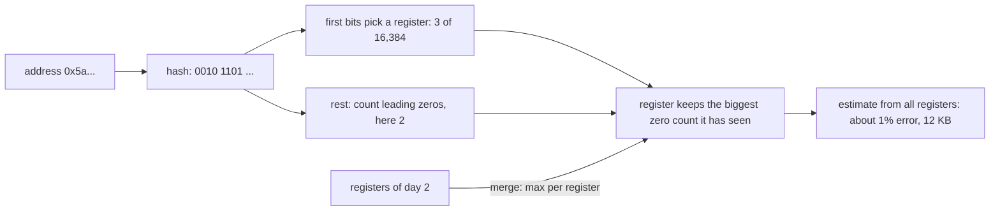

**Story.** A dashboard shows how many distinct wallets traded each day, out of billions of transfers. An exact set of 100 million addresses at 20 bytes each is about 2 GB per day. HyperLogLog (HLL) gives the count within about 1% using 12 KB. It never stores an address. It stores, per register, the longest run of leading zeros it has seen in the address hashes.

**How it works.**

1. Hash each address to a long random-looking bit string. The same address always gives the same bits.
2. A hash that starts with k zeros is rare: about one in 2ᵏ. Seeing one suggests you have seen about 2ᵏ distinct values.
3. One such guess is noisy, so the first bits of the hash pick one of many registers, 16,384 in Redis. Each register keeps the biggest zero count it has seen.
4. The estimate combines all registers with a harmonic mean and a correction factor. More registers means less error: Redis gets about 0.81% from 12 KB.
5. Two HLLs merge by taking the maximum of each register. That gives the distinct count of the union, such as a whole week from seven days.

### In code

```text
hash_bits(key, bits):
  return the first bits of sha256(key)    # same key, same bits
leading_zeros(bits):
  return how many 0s come before the first 1
one_counter(keys):
  longest = 0
  for key in keys:
    zeros = leading_zeros(hash_bits(key, 8))
    longest = max(longest, zeros)         # keep only the biggest
    estimate = 2^longest                  # k zeros: about one hash in 2^k
```

```text
add(key):
  bits = hash_bits(key, hash_size)
  index = the first p bits as a number    # picks a register
  rank = leading zeros in the rest + 1
  reg[index] = max(reg[index], rank)      # keep only the biggest
estimate():
  harmonic = sum of 2^-r over all registers   # damps one lucky register
  raw = alpha * m * m / harmonic
  if raw is small and some registers are empty:
    return m * ln(m / empty)              # few keys: count the empty ones
  return raw
merge(other):
  for each i: reg[i] = max(reg[i], other.reg[i])   # no key is re-read
```

```python
import hashlib
import math


def hash_bits(key, bits):
    digest = int.from_bytes(hashlib.sha256(key.encode()).digest(), "big")
    return format(digest >> (256 - bits), f"0{bits}b")


def leading_zeros(bits):
    return len(bits) - len(bits.lstrip("0"))


def one_counter(keys):
    longest, rows = 0, []
    for key in keys:
        bits = hash_bits(key, 8)
        zeros = leading_zeros(bits)
        longest = max(longest, zeros)        # keep only the biggest
        rows.append((key, bits, zeros, longest, 2 ** longest))
    return rows
```

```python
class HyperLogLog:
    def __init__(self, p, hash_size):
        self.p, self.hash_size = p, hash_size
        self.m = 2 ** p                      # number of registers
        self.reg = [0] * self.m

    def add(self, key):
        bits = hash_bits(key, self.hash_size)
        index = int(bits[:self.p], 2)        # the first p bits pick a register
        rank = leading_zeros(bits[self.p:]) + 1   # zeros in the rest, plus 1
        self.reg[index] = max(self.reg[index], rank)   # keep only the biggest
        return index, rank

    def estimate(self):
        alpha = 0.7213 / (1 + 1.079 / self.m)
        harmonic = sum(2.0 ** -r for r in self.reg)    # damps one lucky register
        raw = alpha * self.m * self.m / harmonic
        empty = self.reg.count(0)
        if raw <= 2.5 * self.m and empty:    # few keys: count the empty registers
            return self.m * math.log(self.m / empty)
        return raw

    def merge(self, other):
        for i, r in enumerate(other.reg):    # max of each pair: no key is re-read
            self.reg[i] = max(self.reg[i], r)
```

Run it: `handbook/code/17-hyperloglog/` with `python3 main.py`. It uses sha256, so each run gives the same result: a longest run of 3 then a lucky 6 on one counter, registers 2, 0, 0, 4, 0, 2, 5, 0, and with 16,384 registers an error of 0.59% on 200,000 wallets and 0.37% after a merge, in 12 KB.

**What goes wrong.** Asking it who. An HLL cannot list members, test membership or delete one. Use a Bloom filter for "is it there?" and an exact set when you need the names. Intersections are poor: "wallets active on both days" by subtraction adds the errors of both counts. And tiny counts need a different formula, which libraries switch to on their own.

**Where you use it.**

- Redis `PFADD` and `PFCOUNT`: distinct visitors or wallets per day in 12 KB per key.
- `approx_count_distinct` in StarRocks, Presto and BigQuery: far faster and lighter than `COUNT(DISTINCT ...)` on billions of rows.
- Rolling up distinct counts: store one HLL per day, merge any range of days at query time.

> HyperLogLog counts distinct values by keeping, per register, the longest run of leading zeros in their hashes. About 12 KB gives about 1% error, registers merge by maximum, and it can never tell you who.

▶ Watch it move: [HyperLogLog](visual/17-hyperloglog.html)

## Trees: search trees, B-trees and heaps

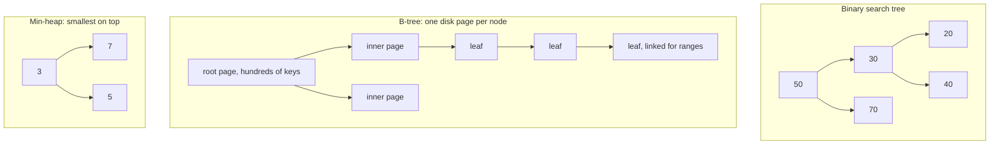

**Story.** A table has a primary key on `block_height`, a billion rows. A binary tree over a billion keys is 30 levels deep: 30 disk reads to find one block. A B-tree node is one disk page with hundreds of keys, so the tree is only four levels deep: four page reads. Then a 1,000-block range walks the linked leaves.

**How it works.**

1. A **binary search tree** (BST) keeps smaller keys left and larger keys right. Search walks one path: O(height).
2. A **balanced** tree keeps the height at log n. AVL trees balance strictly, red-black trees loosely with fewer rotations. Java `TreeMap` and C++ `std::map` are red-black.
3. A **B-tree** widens each node to one disk page, 100 to 500 keys. Height is log base fan-out of n, so under four for a billion keys. A B+ tree keeps values only in the leaves and links the leaves for range scans.
4. A **heap** is a tree stored in an array where each parent is smaller than its children (min-heap). Peek the top in O(1). Insert and pop in O(log n). It is the usual way to build a **priority queue**.

### In code

```text
bst_insert(node, key):
  if node is empty: return a new node     # an empty spot: the key lands here
  if key < node.key: node.left = bst_insert(node.left, key)     # smaller: left
  else: node.right = bst_insert(node.right, key)                # bigger: right
  return node
bst_search(root, key):
  node = root
  while node is not empty:                # one path from the top
    if key == node.key:
      return found
    if key < node.key: node = node.left   # the right side is never read
    else: node = node.right               # the left side is never read
  return not found
```

```text
search(key):
  page = root, reads = 1                  # reading the root: one page read
  while page is not a leaf:
    binary search the page's first keys   # in memory, cheap
    page = the child that covers key
    reads = reads + 1                     # one level down: one more page
  return key in page, reads
range_scan(key, count):
  while fewer than count rows found:
    read the next linked leaf             # never climbs back up
insert into a leaf page:
  put the key in the page it belongs to
  if the page is over capacity:
    at the right edge: leave it full, start a new page
    anywhere else: split it in two half-full pages
```

```text
peek: return a[0]                         # the smallest is always in slot 0
heap_push(a, x):
  append x, i = last slot                 # always start at the end
  while i > 0:
    parent = (i - 1) // 2
    if a[i] >= a[parent]: stop            # the heap rule holds
    swap a[i] and a[parent], i = parent   # sift up one level
heap_pop(a):
  top = a[0], move the last item to slot 0
  while i has a child:                    # sift down
    small = the smaller child (2i + 1 or 2i + 2)
    if a[i] <= a[small]: stop
    swap a[i] and a[small], i = small
  return top
find(x): read slot by slot               # the heap only knows its top
```

```python
class BSTNode:
    def __init__(self, key):
        self.key, self.left, self.right = key, None, None


def bst_insert(root, key):
    if root is None:
        return BSTNode(key)                  # an empty spot: the key lands here
    if key < root.key:                       # smaller keys go left
        root.left = bst_insert(root.left, key)
    else:                                    # bigger keys go right
        root.right = bst_insert(root.right, key)
    return root


def bst_search(root, key):
    compares, node = [], root
    while node is not None:                  # one path from the top
        compares.append(node.key)
        if key == node.key:
            return True, compares            # found
        node = node.left if key < node.key else node.right  # drop the other side
    return False, compares


def height(node):
    return 0 if node is None else 1 + max(height(node.left), height(node.right))
```

```python
class BPlusTree:

    def __init__(self, n_keys, fanout):
        # A leaf is a range of keys, so 10 million keys need almost no memory.
        self.leaves = [range(s, min(s + fanout, n_keys)) for s in range(0, n_keys, fanout)]
        level = [(leaf[0], leaf) for leaf in self.leaves]
        self.height = 1
        while len(level) > 1:                # stack levels until one root is left
            pages = [level[k:k + fanout] for k in range(0, len(level), fanout)]
            level = [(page[0][0], page) for page in pages]
            self.height += 1
        self.root = level[0][1]

    def search(self, key):
        page, reads = self.root, 1           # reading the root is one page read
        while not isinstance(page, range):
            firsts = [first for first, _ in page]    # binary search inside the page
            page = page[bisect.bisect_right(firsts, key) - 1][1]
            reads += 1                       # going down one level: one more page
        return key in page, reads

    def range_scan(self, key, count):
        at = next(i for i, leaf in enumerate(self.leaves) if key in leaf) if count else 0
        got, reads = 0, 0
        while got < count:                   # walk the linked leaves, left to right
            leaf = self.leaves[at + reads]
            got += sum(1 for k in leaf if k >= key)
            reads += 1
        return reads


def page_splits(keys, capacity):
    firsts, pages, splits = [keys[0]], [[]], 0
    for key in keys:
        i = max(bisect.bisect_right(firsts, key) - 1, 0)
        bisect.insort(pages[i], key)
        if len(pages[i]) > capacity:
            at_right_edge = i == len(pages) - 1 and key == pages[i][-1]
            cut = capacity if at_right_edge else len(pages[i]) // 2  # right edge: leave it full
            pages[i], new = pages[i][:cut], pages[i][cut:]
            pages.insert(i + 1, new)
            firsts.insert(i + 1, new[0])
            splits += 1
    return splits, len(keys) / (len(pages) * capacity)
```

```python
def heap_push(a, x):
    a.append(x)                              # always start at the end
    i, swaps = len(a) - 1, []
    while i > 0:
        parent = (i - 1) // 2
        if a[i] >= a[parent]:                # the heap rule holds: stop
            break
        a[i], a[parent] = a[parent], a[i]    # sift up one level
        swaps.append(list(a))
        i = parent
    return swaps


def heap_pop(a):
    top, last = a[0], a.pop()                # the last item fills the hole
    if a:
        a[0] = last
        i = 0
        while True:                          # sift down
            kids = [c for c in (2 * i + 1, 2 * i + 2) if c < len(a)]
            if not kids:
                break
            small = min(kids, key=lambda c: a[c])    # the smaller child
            if a[i] <= a[small]:             # the heap rule holds: stop
                break
            a[i], a[small] = a[small], a[i]
            i = small
    return top
```

Run it: `handbook/code/17-trees/` with `python3 main.py`. It finds 40 after compares 50, 30, 40, finds 5 at the end of a chain of height 5, reads 4 pages to find block 9,507,123 among 10 million keys, walks 6 leaves for the next 1,000 blocks, counts 999 page splits for rising keys against 1,439 for random ones, and prints each heap swap.

**What goes wrong.** Insert 1, 2, 3, ..., n into a plain BST and it becomes a linked list: every operation O(n). Balance it. For a heap, the trap is searching inside it: only the top is known, the rest is not sorted.

**Where you use it.**

- Every relational index is a B+ tree: one structure for the point lookup and the range scan. Random keys like UUIDs split pages everywhere, monotonic keys append cheaply.
- Top k of a billion rows: a min-heap of size k, one pass, O(n log k). `ORDER BY amount DESC LIMIT 10` is the same heap inside the engine.
- A scheduler picking the next job, and Dijkstra's frontier: a heap.

> Pick a tree when you need order: ranges, min, max, next. A B-tree is a tree with wide nodes so a billion keys take four disk reads.

▶ Watch it move: [Trees, B-trees and heaps](visual/17-trees.html)

## Balanced trees: AVL and red-black

```mermaid
flowchart LR
  subgraph before["insert 10, 20, 30: a chain"]
    A10["10, too heavy on the right"] --> A20["20"] --> A30["30"]
  end
  subgraph after["one left rotation"]
    B20["20"] --> B10["10"]
    B20 --> B30["30"]
  end
  before -->|"rotate left at 10"| after
  style A10 fill:#c8472f,color:#fff
  style B20 fill:#2f9e68,color:#fff
```

**Story.** A price index keeps token prices ordered by block height in a binary search tree. Heights arrive in order: 10, 20, 30. A plain tree turns into a chain, and every lookup walks the whole chain. A balanced tree notices the chain after the third insert and turns it with one **rotation**: 20 becomes the root, with 10 and 30 below. The height stays about log₂ n.

**How it works.**

1. An **AVL tree** stores each node's balance: left height minus right height. It must stay −1, 0 or 1.
2. After an insert, walk back up. A node at −2 or +2 is out of balance (the red box).
3. A **rotation** fixes it locally. A left rotation lifts the right child into the parent's place, and the old parent becomes its left child. Order is kept, height drops by one.
4. A **red-black tree** colours nodes instead. The root is black. A red node has no red child. Every path from a node down to its empty leaves passes the same number of black nodes.
5. Those rules keep the longest path at most twice the shortest, so the height is at most about 2 log₂ n. Fixes are recolourings plus at most two rotations per insert.

### In code

```text
avl_insert(n, key):
  if n is empty: return a new node
  insert into the left or the right subtree, as in a plain tree
  fix_height(n)                           # on the way back up, recheck each node
  b = height(n.left) - height(n.right)    # the rule: -1, 0 or 1
  if b < -1:                              # right side too deep
    if n.right leans left:
      rotate_right(n.right)
    return rotate_left(n)
  if b > 1:                               # left side too deep: the mirror
    if n.left leans right: rotate_left(n.left)
    return rotate_right(n)
  return n
rotate_left(x):
  y = x.right                             # y is lifted into x's place
  x.right = y.left, y.left = x            # x becomes y's left child
  fix_height(x), fix_height(y), return y
```

```text
insert(key):
  plain search tree insert, new node is red   # never changes a black count
  fix(node)
fix(n):
  while n's parent is red:                # red under red breaks the rule
    p = parent, g = grandparent, uncle = g's other child
    if uncle is red:                      # recolour only
      p and uncle turn black, g turns red, n = g
    else:                                 # empty counts as black: rotate
      if n is an inner child:
        rotate at p first
      rotate at g
      p turns black, g turns red
  root turns black                        # the root is always black
```

```python
def balance(n):
    return h(n.left) - h(n.right)            # the rule: -1, 0 or 1


def fix_height(n):
    n.h = 1 + max(h(n.left), h(n.right))


def rotate_left(x):
    y = x.right                              # y is lifted into x's place
    x.right, y.left = y.left, x              # x becomes y's left child
    fix_height(x)
    fix_height(y)
    return y


def rotate_right(x):
    y = x.left
    x.left, y.right = y.right, x
    fix_height(x)
    fix_height(y)
    return y


def avl_insert(n, key, log):
    if n is None:
        return AVL(key)
    if key < n.key:
        n.left = avl_insert(n.left, key, log)
    else:
        n.right = avl_insert(n.right, key, log)
    fix_height(n)                            # on the way back up: recheck each node
    b = balance(n)
    if b < -1:                               # right side too deep
        log.append(f"balance of {n.key} is {b}: rotate left at {n.key}")
        if balance(n.right) > 0:             # inner grandchild: two rotations
            n.right = rotate_right(n.right)
        return rotate_left(n)
    if b > 1:                                # left side too deep: the mirror
        log.append(f"balance of {n.key} is {b}: rotate right at {n.key}")
        if balance(n.left) < 0:
            n.left = rotate_left(n.left)
        return rotate_right(n)
    return n
```

```python
class RedBlackTree:
    def __init__(self):
        self.root, self.log = None, []

    def rotate(self, x, d):                  # d = L lifts x's right child
        y = x.kid[1 - d]
        x.kid[1 - d] = y.kid[d]
        if y.kid[d]:
            y.kid[d].parent = x
        y.parent = x.parent
        if x.parent is None:
            self.root = y
        else:
            x.parent.kid[x.parent.kid.index(x)] = y
        y.kid[d], x.parent = x, y

    def insert(self, key):
        parent, n = None, self.root
        while n:                             # a plain search tree insert first
            parent, n = n, n.kid[R if key > n.key else L]
        node = RB(key, parent)
        if parent is None:
            self.root = node
        else:
            parent.kid[R if key > parent.key else L] = node
        self.fix(node)

    def fix(self, n):
        while n.parent and n.parent.color == RED:    # red under red breaks the rule
            p, g = n.parent, n.parent.parent
            d = g.kid.index(p)
            uncle = g.kid[1 - d]
            if uncle and uncle.color == RED:         # red uncle: recolour only
                p.color = uncle.color = BLACK
                g.color = RED
                self.log.append(f"{n.key}: red uncle {uncle.key}, recolour")
                n = g
            else:                                    # empty or black uncle: rotate
                if p.kid.index(n) != d:              # inner child: straighten first
                    self.rotate(p, d)
                    n, p = p, n
                self.rotate(g, 1 - d)
                p.color, g.color = BLACK, RED
                self.log.append(f"{n.key}: no red uncle, rotate at {g.key}, recolour")
        self.root.color = BLACK                      # the root is always black
```

Run it: `handbook/code/17-balanced-trees/` with `python3 main.py`. It prints each insert of 10 to 50 with its rotation or recolouring and the final shape: height 3 for five sorted keys, and height 17 for 100,000.

**What goes wrong.** No balancing at all: sorted input makes a chain and every operation O(n). Between the two balanced kinds, the trade is strictness. AVL is stricter, so lookups are a little faster, but inserts rotate more often. Red-black is looser, so inserts and deletes do less work. Choose red-black for write-heavy maps.

**Where you use it.**

- Java `TreeMap`, C++ `std::map` and the Linux process scheduler use red-black trees.
- AVL trees suit read-heavy in-memory indexes, where lookups dominate.
- On disk, neither: a B-tree, because a disk page holds hundreds of keys, not one.

> A balanced tree rotates after inserts so the height stays log n. AVL keeps it strict for faster reads. Red-black keeps it loose with colour rules, for cheaper writes, which is why Java TreeMap and C++ std::map use it.

▶ Watch it move: [Balanced trees: AVL and red-black](visual/17-balanced-trees.html)

## LSM tree versus B-tree

```mermaid
flowchart LR
  W["write key, value"] --> WAL["write-ahead log on disk, append only"]
  W --> MEM["memtable: sorted, in memory"]
  MEM -->|"full: flush"| S1["sorted file 1"]
  MEM -->|"full: flush"| S2["sorted file 2"]
  S1 --> C["compaction: merge, drop old versions"]
  S2 --> C
  C --> L1["one bigger sorted file"]
  RD["read key"] --> MEM
  RD -.->|"then newest file first, Bloom filter skips"| S2
```

**Story.** An indexer writes tens of thousands of transfer rows a second. A B-tree updates pages in place, so each insert is a random page write. An LSM tree (log-structured merge tree) appends instead. It writes to a log and to an in-memory table. When that fills, it flushes one sorted file to disk. Background compaction merges the files later. Every disk write is sequential.

**How it works.**

1. **Write:** append to the write-ahead log (WAL) for crash safety, and insert into the memtable, a sorted structure in memory.
2. **Flush:** a full memtable is written as one immutable sorted file (often called an SSTable, sorted string table).
3. **Read:** check the memtable, then the files from newest to oldest. A Bloom filter per file skips most of them (the dashed arrow).
4. **Compaction:** merge files into bigger ones, keep only the newest version of each key, and drop deleted keys.
5. **The rival, a B-tree,** keeps one copy of each key in pages and updates in place. A read is one tree walk, but each write may touch a random page.

### In code

```text
put(key, value):
  if memtable is full:
    return stalled                          # no room, and the flush was refused
  log.append(key, value)                    # first: this survives a crash
  memtable[key] = value                     # then the sorted table in memory
  if memtable is full and files < limit:
    files.add(sorted memtable)              # flush: one sequential write
    empty the memtable and the log
get(key):
  if key in memtable: return its value
  for file in files, newest first:
    if file's Bloom filter says absent: skip it
    if key is in file: return its value
  return not found
compact():
  merged = empty
  for file in files, oldest first: merged.update(file)   # newer values win
  files = [sorted merged]                   # the old versions are gone
```

```python
class LSM:
    def __init__(self, limit=4, stall_at=7):
        self.limit, self.stall_at = limit, stall_at
        self.wal, self.mem, self.files = [], {}, []  # files: newest last

    def put(self, key, value):
        if len(self.mem) == self.limit:          # no room, and the flush was refused
            return "stalled"
        self.wal.append((key, value))            # append first: survives a crash
        self.mem[key] = value                    # then the sorted table in memory
        if len(self.mem) == self.limit and len(self.files) < self.stall_at:
            self.files.append(SSTable(self.mem)) # full: one big sequential write
            self.mem, self.wal = {}, []          # the log's job is done
        return "ok"

    def get(self, key):
        checked = []
        if key in self.mem:                      # newest data first
            return self.mem[key], ["memtable"]
        for n in range(len(self.files) - 1, -1, -1):  # newest file first
            f = self.files[n]
            if not all(b in f.filter for b in bloom_bits(key)):
                checked.append(f"file {n + 1} filter says absent")
                continue                         # no disk read for this file
            checked.append(f"file {n + 1} read")
            value = f.get(key)
            if value is not None:
                return value, checked
        return None, checked

    def compact(self):
        merged = {}
        for f in self.files:                     # oldest first, so newer values win
            merged.update(f.items)
        self.files = [SSTable(merged)]           # the old k5 is dropped here
```

Run it: `handbook/code/17-lsm-tree/` with `python3 main.py`. It prints the flushes, the read of k7 that skips file 2, the compaction and the stall at write 33.

**What goes wrong.** Three costs. Read amplification: a read may check several files. Write amplification: compaction rewrites the same data many times. Compaction falling behind: files pile up, reads slow down, and RocksDB stalls writes until it catches up.

Deletes are a trap too. A delete writes a marker, a **tombstone**, that only disappears at compaction. A queue table with constant deletes on Cassandra fills with tombstones and reads crawl.

**Where you use it.**

- LSM: RocksDB, LevelDB, Cassandra, ScyllaDB, and the storage under many time-series stores. Pick it for write-heavy loads.
- B-tree: Postgres and MySQL InnoDB. Pick it for read-heavy loads with point updates.
- A columnar warehouse such as StarRocks also writes new data as versions and compacts them in the background, the same idea.

> A B-tree updates in place and reads in one walk. An LSM tree turns writes into sequential appends and pays later, in compaction and in reads that check several files.

▶ Watch it move: [LSM tree versus B-tree](visual/17-lsm-tree.html)

## Trie

```mermaid
flowchart TB
  R["root"] --> A["a"]
  R --> U["u"]
  A --> AE["e"] --> AER["r"] --> AERO["o, end: aero"]
  A --> AA["a"] --> AAV["v"] --> AAVE["e, end: aave"]
  U --> UN["n"] --> UNI["i, end: uni"]
  U --> UP["p, end: up"]
```

**Story.** The Chain Insights proxy offers name search for exchanges. A user types "a" and wants "aave" and "aero". A trie stores names one letter per edge. Every name with the same prefix sits under the same node. Walk the prefix, then list everything below it.

**How it works.**

1. The root is the empty string. Each edge adds one character (each arrow).
2. **Insert:** walk the key letter by letter, create missing nodes, and mark the last one as an end.
3. **Lookup** costs the key length L, not the number of keys. "up" takes two steps whether the trie holds 4 names or 4 million.
4. **Prefix search:** walk the prefix, then collect every end below that node.
5. A **radix** (or Patricia) trie merges chains of single children into one edge, "ero" instead of "e", "r", "o", to save memory.

### In code

```text
insert(word):
  node = root
  for letter in word:
    if node has no child for letter: create it
    node = that child
  mark node as the end of a name
lookup(word):
  node = root
  for letter in word:
    if node has no child for letter: return not found
    node = that child
  return is node marked as an end?
prefix_search(prefix):
  walk down to the prefix, as lookup does
  for every node below it: if marked, collect the name
  return the names
child_slots(): letter nodes × 26             # the room a plain trie keeps
radix_nodes(): merge chains of single children into one edge
```

```python
def insert(root, word):
    node = root
    for ch in word:                          # one step per letter
        if ch not in node.kids:              # no child for this letter: create it
            node.kids[ch] = Node()
        node = node.kids[ch]                 # reuse or walk down
    node.end = True                          # mark the end of the name


def lookup(root, word):
    node, steps = root, 0
    for ch in word:
        if ch not in node.kids:              # the path stops: not in the trie
            return False, steps
        node = node.kids[ch]
        steps += 1
    return node.end, steps                   # found only if an end is marked here


def prefix_search(root, prefix):
    node = root
    for ch in prefix:                        # walk to the prefix
        if ch not in node.kids:
            return []
        node = node.kids[ch]
    out, stack = [], [(node, prefix)]
    while stack:                             # then every end in the subtree below
        cur, word = stack.pop()
        if cur.end:
            out.append(word)
        for ch, kid in cur.kids.items():
            stack.append((kid, word + ch))
    return sorted(out)


def count_nodes(node):
    return 1 + sum(count_nodes(k) for k in node.kids.values())


def child_slots(root):
    return (count_nodes(root) - 1) * 26      # every letter node keeps room for 26 children


def radix_nodes(node, is_root=True):
    total = 1 if is_root else 0
    for kid in node.kids.values():
        while len(kid.kids) == 1 and not kid.end:  # a chain: merge it into this edge
            kid = next(iter(kid.kids.values()))
        total += 1 + radix_nodes(kid, False)
    return total
```

Run it: `handbook/code/17-trie/` with `python3 main.py`. It prints new nodes per name, the lookups, the prefix search, 286 slots and 7 radix nodes.

**What goes wrong.** Memory. A plain trie has one node per character, and each node may hold an array of 26 or 256 child pointers. For a million keys that can dwarf a hash map. Use a radix trie, or a sorted array where a prefix is a range found by binary search. For Unicode names, keep children in a small map, not a fixed array.

**Where you use it.**

- Autocomplete and fuzzy name search.
- Network routers find the longest matching prefix of an IP address with a radix trie.
- Ethereum keeps every account's state in a Merkle Patricia trie keyed by address. Go HTTP routers such as httprouter match paths with a radix tree.

> A trie stores keys one character per edge, so lookup costs the key length and every key with the same prefix sits under one node. That is autocomplete and longest-prefix match.

▶ Watch it move: [Trie](visual/17-trie.html)

## Merkle tree

```mermaid
flowchart BT
  T1["tx1"] --> H1["H1"]
  T2["tx2"] --> H2["H2"]
  T3["tx3"] --> H3["H3"]
  T4["tx4"] --> H4["H4"]
  H1 --> H12["H12 = hash of H1 and H2"]
  H2 --> H12
  H3 --> H34["H34 = hash of H3 and H4"]
  H4 --> H34
  H12 --> ROOT["root, stored in the block header"]
  H34 --> ROOT
  style H4 fill:#d6a21a,color:#fff
  style H12 fill:#d6a21a,color:#fff
```

**Story.** A light client wants proof that transaction tx3 is in block 9,506, without downloading the whole block. The block header holds one hash, the Merkle root. A full node sends tx3 plus two sibling hashes, H4 and H12 (the yellow boxes). The client hashes its way up and compares the result with the root.

**How it works.**

1. Hash each transaction: H1 to H4.
2. Hash each pair together: H12 from H1 and H2, H34 from H3 and H4.
3. Repeat up the levels until one hash is left: the root.
4. **Proof:** for one leaf, send the sibling hash at each level. That is log₂ n hashes, 20 for a million transactions.
5. **Verify:** rebuild the path from the leaf up and compare with the root. Change any byte of any leaf, and the root changes.

### In code

```text
build(txs):
  level = [hash(tx) for each tx]            # the leaves
  while level has more than one hash:
    if the count is odd: repeat the last hash
    level = [hash(left + right) for each pair]
    keep this level
make_proof(levels, index):
  for each level below the root:
    sibling = index with its last bit flipped  # the other half of the pair
    add the sibling's hash and its side
    index = index // 2                      # up to the parent
verify(tx, proof, root):
  current = hash(tx)                        # the client hashes it itself
  for sibling, side in proof:
    current = hash(the pair, in side order)
  return current == root
```

```python
def h(data):
    return hashlib.sha256(data).digest()


def build_levels(txs):
    level = [h(tx) for tx in txs]            # the leaves: H1, H2, H3, H4
    levels = [level]
    while len(level) > 1:
        if len(level) % 2:                   # an odd count: repeat the last hash
            level = level + [level[-1]]
        level = [h(level[i] + level[i + 1]) for i in range(0, len(level), 2)]
        levels.append(level)                 # each level halves the hashes
    return levels


def make_proof(levels, index):
    proof = []
    for level in levels[:-1]:                # one sibling per level
        sibling = index ^ 1                  # the other half of this pair
        if sibling == len(level):
            sibling = index
        proof.append((level[sibling], "left" if sibling < index else "right"))
        index //= 2                          # move up to the parent
    return proof


def verify(tx, proof, root):
    current = h(tx)                          # the client hashes tx itself
    for sibling, side in proof:              # then climbs with the sent hashes
        pair = sibling + current if side == "left" else current + sibling
        current = h(pair)
    return current == root, current          # compare with the header's root
```

Run it: `handbook/code/17-merkle-tree/` with `python3 main.py`. It prints every hash, the proof for tx3, the check that passes and the one that fails.

**What goes wrong.** An odd number of leaves. Bitcoin copies the last one to make a pair, and that allowed two different transaction lists with the same root (CVE-2012-2459). Another trap: a node hash passed off as a leaf. The fix is to prefix leaves and inner nodes differently before hashing, as Certificate Transparency does.

**Where you use it.**

- Bitcoin and Ethereum block headers, and light clients that check one transaction.
- Git: every commit names a tree of hashes, so one hash fixes the whole history.
- Cassandra and DynamoDB-style repair: two replicas compare Merkle trees of their key ranges and copy only the ranges whose hashes differ.

> A Merkle tree hashes pairs up to one root. Any change moves the root, and a proof that one item is inside costs only log n sibling hashes.

▶ Watch it move: [Merkle tree](visual/17-merkle-tree.html)

## Skip list

```mermaid
flowchart LR
  subgraph L2["level 2: express"]
    H2["head"] --> A2["21"] --> B2["45"]
  end
  subgraph L1["level 1"]
    H1["head"] --> C1["9"] --> D1["21"] --> E1["38"] --> F1["45"]
  end
  subgraph L0["level 0: every node, in order"]
    H0["head"] --> N3["3"] --> N9["9"] --> N14["14"] --> N21["21"] --> N30["30"] --> N38["38"] --> N45["45"] --> N52["52"]
  end
```

**Story.** Redis keeps a leaderboard of wallets by volume in a sorted set. It needs inserts in order, lookups, and range reads such as "ranks 1 to 10", all in O(log n). A skip list does this with simple code. It is a sorted linked list with express lanes on top. Each node joins the lane above with probability one half.

**How it works.**

1. Level 0 links every node in order (the bottom row).
2. Each higher level links about half the nodes of the level below.
3. **Search** for 38: start at the top-left. Move right while the next node is smaller than the target. Otherwise drop one level. Head, 21, then 45 is too big, so drop. Next on level 1 is 38: found.
4. **Insert:** search for the spot, link the node on level 0, then flip a coin to promote it, level by level.
5. Search, insert and delete are O(log n) expected. A range read finds its start, then walks level 0.

### In code

```text
search(key):
  node = head
  for level from the top down to 0:
    while next on this level is smaller than key:
      node = next                           # move right
    if next is key:
      return found
    # next is too big or missing: drop a level
  return not found
insert(key):
  level = flip coins: heads goes up, tails stops
  for each level from the top down:
    walk right while next is smaller than key
    remember the last smaller node
  for each level from 0 up to the coin's level:
    new.next = remembered.next
    remembered.next = new                   # only nearby pointers change
```

```python
class Node:
    def __init__(self, key, level):
        self.key = key
        self.next = [None] * (level + 1)     # one forward pointer per level


def coin_level(rng, top):
    level = 0
    while level < top and rng.random() < 0.5:  # heads: join the level above
        level += 1
    return level                             # tails: stop here


class SkipList:
    def __init__(self, top=2):
        self.top = top
        self.head = Node(None, top)          # the head is on every level

    def search(self, key, start=None):
        node, moves, drops = self.head, [], 0
        start = self.top if start is None else start
        for level in range(start, -1, -1):   # start high, drop one level at a time
            while node.next[level] and node.next[level].key < key:
                node = node.next[level]      # the next node is smaller: move right
                moves.append(node.key)
            nxt = node.next[level]
            if nxt and nxt.key == key:       # the next node is the target
                moves.append(key)
                return True, moves, drops
            drops += 1                       # too big or missing: drop a level
        return False, moves, drops

    def insert(self, key, level):
        update, node = [self.head] * (self.top + 1), self.head
        for lv in range(self.top, -1, -1):   # the last smaller node on each level
            while node.next[lv] and node.next[lv].key < key:
                node = node.next[lv]
            update[lv] = node
        new = Node(key, level)
        for lv in range(level + 1):          # only nearby pointers change
            new.next[lv] = update[lv].next[lv]
            update[lv].next[lv] = new
```

Run it: `handbook/code/17-skip-list/` with `python3 main.py`. It prints the search for 38 with and without upper levels, the insert of 33 and a run over 100,000 keys.

**What goes wrong.** It is random. With bad luck, or a predictable random seed an attacker can game, the levels come out flat and search becomes O(n). With a good random source this is vanishingly rare. It also costs about two pointers per node on average.

**Where you use it.**

- Redis sorted sets (ZSET): a skip list for order plus a hash map for lookup by member.
- The memtable of LevelDB and RocksDB is a skip list, so the LSM write path above inserts into one.
- Java `ConcurrentSkipListMap`: an ordered map that many threads can update without one big lock.

> A skip list is a sorted linked list with random express lanes, so a search drops down the levels in O(log n) expected. Redis sorted sets and the RocksDB memtable use one.

▶ Watch it move: [Skip list](visual/17-skip-list.html)

## LRU cache

```mermaid
flowchart LR
  subgraph map["hash map: key to node"]
    K1["key A"] --> N1
    K2["key B"] --> N2
    K3["key C"] --> N3
  end
  subgraph list["doubly linked list, most recent first"]
    N1["A"] <--> N2["B"] <--> N3["C"]
  end
  GET["get B"] -. "move B to front, O(1)" .-> N2
  PUT["put D when full"] -. "evict tail C, O(1)" .-> N3
```

**Story.** An indexer decodes logs with contract ABIs (Application Binary Interfaces, the description of a contract's functions and events). It keeps the last 1,000 decoded ABIs in memory, keyed by contract address. Hot contracts stay at the head of the list. A new contract arrives when the cache is full, and the coldest one falls off the tail.

**How it works.**

1. **get**: look up the key in the hash map. It points straight at the list node: O(1).
2. Unlink the node and put it at the head. The doubly linked list has a back pointer, so the unlink needs no scan: O(1).
3. **put**: add a new node at the head and a map entry pointing at it.
4. If the cache is over capacity, take the tail node, unlink it, and delete its key from the map: O(1).
5. Every operation is O(1) because the map finds and the list orders.

### In code

```text
get(key):
  node = map.get(key)                       # one step, however big the cache
  if node is missing:
    return miss
  unlink(node)
  link_at_head(node)                        # now the most recent
  return node.value
put(key, value):
  if cache is full:
    victim = tail.prev                      # the least recently used
    unlink(victim)
    delete map[victim.key]                  # list and map both forget it
  node = new node
  link_at_head(node)
  map[key] = node
evict_by_scan(): check every entry's time    # the shortcut that fails
```

```python
class LRU:
    def __init__(self, capacity):
        self.capacity, self.map = capacity, {}
        self.head, self.tail = Node(), Node()    # two markers, never evicted
        self.head.next, self.tail.prev = self.tail, self.head

    def _unlink(self, node):
        node.prev.next, node.next.prev = node.next, node.prev  # no scan: both neighbours are known

    def _link_at_head(self, node):
        node.prev, node.next = self.head, self.head.next
        self.head.next.prev = node
        self.head.next = node

    def get(self, key):
        node = self.map.get(key)                 # one step, however big the cache
        if node is None:
            return None                          # a miss
        self._unlink(node)
        self._link_at_head(node)                 # this key is now the most recent
        return node.value

    def put(self, key, value):
        if len(self.map) == self.capacity:
            victim = self.tail.prev              # the tail is the least recently used
            self._unlink(victim)
            del self.map[victim.key]             # list and map must both forget it
        node = Node(key, value)
        self._link_at_head(node)
        self.map[key] = node

    def order(self):
        out, node = [], self.head.next
        while node is not self.tail:
            out.append(node.key)
            node = node.next
        return out


def evict_by_scan(last_used):
    victim, checks = None, 0
    for key, used in last_used.items():          # every entry, on every eviction
        checks += 1
        if victim is None or used < last_used[victim]:
            victim = key
    return victim, checks
```

Run it: `handbook/code/17-lru-cache-build/` with `python3 main.py`. It prints the list after each of the lesson's steps, then the scan counts: 3 and 1,000,000.

**What goes wrong.** A map plus a timestamp per entry, with a scan for the oldest on evict: O(n) per eviction. Invisible at a thousand entries, a stall at a million. Or a list alone: O(n) to find a key. You need both.

**Where you use it.**

- Python `functools.lru_cache`, and `OrderedDict`, which is this exact pair under the hood. Java `LinkedHashMap` with access order on.
- A decoded-ABI cache in an indexer, and an operating system page cache.
- Under many threads: a lock, or split the cache into shards each with its own lock.

> An LRU cache is a hash map for finding and a doubly linked list for order. Get moves a node to the front, put evicts from the back, and both are O(1).

▶ Watch it move: [Build an LRU cache](visual/17-lru-cache-build.html)

## LFU and TTL: other eviction rules

```mermaid
flowchart TB
  subgraph before["cache of 3, hot items A and B"]
    A["A, used 2 times"]
    B["B, used 2 times"]
    C["C, used 1 time"]
  end
  S["one-off scan: X, Y, Z"] --> LRU["LRU: evicts by age, A and B are flushed out"]
  S --> LFU["LFU: evicts the lowest count, A and B stay"]
  T["TTL: every entry expires after a set time"] --> J["many keys set at once expire at once: add jitter"]
  style LRU fill:#c8472f,color:#fff
  style LFU fill:#2f9e68,color:#fff
```

**Story.** The decoded-ABI cache from the LRU section holds the hot contracts. Then a batch job reads 5,000 one-off contracts, each once. LRU (least recently used) keeps whatever was used last, so the one-off scan flushes every hot ABI. LFU (least frequently used) counts uses and evicts the lowest count, so the hot contracts survive. TTL (time to live) is a different rule: an entry expires after a set time, whether it is hot or not.

**How it works.**

1. **LRU** evicts the entry used longest ago.
2. **LFU** keeps a use count per key and evicts the lowest. It stays O(1) with buckets per count: a map from count to a list of keys.
3. LFU breaks ties by recency: among the lowest counts, evict the oldest.
4. **TTL** stores an expiry time with each entry. A read past it is a miss. Expired entries are dropped on read, and a background sweep clears the rest.
5. Real caches combine them: LRU or LFU to bound the size, TTL to bound staleness.

### In code

```text
get(key):
  if key not in items:
    return miss
  move key to the recent end
  return hit
put(key):
  if items is full:
    evicted = the front key                 # the least recently used
    remove evicted
  add key at the recent end
run(requests):
  for key in requests:
    if get(key) is a miss: put(key)
```

```text
get(key):
  if key not in counts:
    return miss
  counts[key] += 1                          # how often, not how lately
  return hit
put(key):
  if counts is full:
    evicted = key with the lowest count     # a tie goes to the oldest
    remove evicted
  counts[key] = 1
decay():
  halve every count                         # the fix: old counts fade
```

```text
get(key, now):
  entry = items.get(key)
  if entry is missing:
    return miss
  if now >= entry.expires:
    delete entry
    return miss
  return entry.value                        # served as is, until it expires
put(key, value, now):
  expires = now + ttl + random(-jitter, jitter)
  if cache is full:
    drop the least recent   # size is still LRU's job
  items[key] = (value, expires)
expiry_peak(jitter):
  put 1,000 keys at the same moment
  return the most keys expiring in one second
```

```python
class LRUCache:
    def __init__(self, capacity=3):
        self.capacity, self.items = capacity, OrderedDict()

    def get(self, key):
        if key not in self.items:
            return "miss"
        self.items.move_to_end(key)              # now the most recent
        return "hit"

    def put(self, key):
        evicted = None
        if len(self.items) == self.capacity:
            evicted = next(iter(self.items))     # the front is the least recent
            del self.items[evicted]
        self.items[key] = True                   # added at the recent end
        return evicted


def run(cache, requests):
    log = []
    for key in requests:
        answer = cache.get(key)
        evicted = cache.put(key) if answer == "miss" else None
        log.append((key, answer, evicted))
    return log
```

```python
class LFUCache:
    def __init__(self, capacity=3):
        self.capacity, self.counts = capacity, {}

    def get(self, key):
        if key not in self.counts:
            return "miss"
        self.counts[key] += 1                    # how often, not how lately
        return "hit"

    def put(self, key):
        evicted = None
        if len(self.counts) == self.capacity:
            # min takes the first smallest, and a dict keeps insertion order: a tie goes to the oldest
            evicted = min(self.counts, key=self.counts.get)
            del self.counts[evicted]
        self.counts[key] = 1
        return evicted

    def decay(self):
        for key in self.counts:                  # the fix: old counts fade
            self.counts[key] //= 2
```

```python
class TTLCache:
    def __init__(self, ttl=60, jitter=0, capacity=3, rng=None):
        self.ttl, self.jitter, self.capacity = ttl, jitter, capacity
        self.items, self.rng = OrderedDict(), rng or random.Random(1)

    def get(self, key, now):
        entry = self.items.get(key)
        if entry is None:
            return "miss"
        if now >= entry[1]:                      # past its expiry
            del self.items[key]
            return "miss"
        self.items.move_to_end(key)
        return entry[0]                          # served as is, even if the real price moved

    def put(self, key, value, now):
        expires = now + self.ttl + self.rng.randint(-self.jitter, self.jitter)
        if key not in self.items and len(self.items) == self.capacity:
            self.items.popitem(last=False)       # size is still LRU's job
        self.items[key] = (value, expires)
        return expires


def expiry_peak(jitter, keys=1000):
    cache = TTLCache(jitter=jitter, capacity=keys)
    seconds = Counter(cache.put(f"key {i}", 1, 0) for i in range(1, keys + 1))
    return max(seconds.values()), min(seconds), max(seconds), cache  # the worst second, first, last
```

Run it: `handbook/code/17-lfu-ttl/` with `python3 main.py`. It prints each rule on the same requests, the decay, the expiry times and the worst second: 1,000 against 92.

**What goes wrong.** LFU never forgets. A contract that was hot last week keeps a count of a million and squats in the cache. The fix is to decay the counts over time, as Redis LFU and W-TinyLFU do. LRU loses to scans, as in the story.

TTL has its own failure. A thousand keys set in the same second expire in the same second. Every request then misses and hits the database at once: a stampede. Add random jitter to each TTL.

**Where you use it.**

- Redis `maxmemory-policy`: `allkeys-lru` or `allkeys-lfu`, plus a TTL per key.
- Caffeine, the Java cache, uses W-TinyLFU: a small LRU window in front of a frequency filter, so it resists scans and still adapts.
- A token price cached for 60 seconds: TTL, because the value goes stale, not because memory is short.

> LRU evicts the oldest use, LFU the fewest uses, and TTL the expired. LRU loses to a one-off scan, LFU forgets too slowly unless counts decay, and TTL needs jitter.

▶ Watch it move: [LFU and TTL](visual/17-lfu-ttl.html)

## Sorting

```mermaid
flowchart TB
  IN["unsorted array"] --> Q{"what do you know?"}
  Q -->|"tiny or nearly sorted"| INS["insertion sort, O(n) on nearly sorted"]
  Q -->|"need stable order"| MER["merge sort or Timsort, O(n log n), extra memory"]
  Q -->|"in memory, fastest"| QS["quicksort or introsort, O(n log n) average"]
  Q -->|"small integer keys"| CNT["counting or radix, O(n + k), no compares"]
  Q -->|"bigger than memory"| EXT["external sort: sorted runs, then k-way merge"]
```

**Story.** A day of transfers must be sorted by block, then by address, and each address's transfers must stay in block order. That needs a **stable** sort: equal keys keep their input order. Python's Timsort is stable, so it just works. Go's `sort.Slice` is not stable, so the code calls `sort.SliceStable`.

**How it works.**

1. **Bubble, insertion, selection** are O(n²) with O(1) memory. Insertion is the useful one: O(n) on nearly sorted input, and fast for tiny arrays.
2. **Merge sort** splits in half, sorts each half, merges. O(n log n) always, O(n) extra memory, stable.
3. **Quicksort** picks a pivot and partitions smaller and larger around it. O(n log n) on average, in place, cache friendly, not stable. Worst case O(n²) when the pivot is always the extreme.
4. **Heap sort** builds a heap and pops. O(n log n) always, in place, not stable, poor cache behaviour.
5. **Counting and radix** sort do not compare. For integers in a known range k they cost O(n + k).
6. Libraries blend them. Python and Java objects use Timsort, a merge sort that finds runs already sorted. C++ `std::sort` and .NET use introsort: quicksort that falls back to heap sort when it recurses too deep. Go uses pattern-defeating quicksort since 1.19.

### In code

```text
bubble(a):
  repeat passes until a pass swaps nothing:
    for each pair of neighbours:
      if left > right: swap them
insertion(a):
  for each item from the second on:
    while its left neighbour is bigger:
      swap it one place left
merge(a):
  if one item: return
  merge(left half), merge(right half)
  for each slot in the range:
    copy the smaller head, the left on a tie
    move that side on
quick(a):
  if one item or none: return
  pivot = last item
  for each other item: if item < pivot, move it to the left part
  put the pivot right after the left part
  quick(left part), quick(right part)
```

```python
def bubble(a, t):
    for p in range(len(a) - 1):
        swapped = False
        for j in range(len(a) - 1 - p):
            if t.compare(a[j] > a[j + 1]):       # neighbours in the wrong order
                t.swap(a, j, j + 1)
                swapped = True
        if not swapped:                          # a clean pass: stop early
            return


def insertion(a, t):
    for i in range(1, len(a)):
        j = i
        while j > 0 and t.compare(a[j - 1] > a[j]):  # walk it left until it fits
            t.swap(a, j - 1, j)
            j -= 1


def merge(a, lo, hi, t):
    if hi <= lo:
        return
    mid = (lo + hi) // 2
    merge(a, lo, mid, t)
    merge(a, mid + 1, hi, t)
    left, right, i, j = a[lo:mid + 1], a[mid + 1:hi + 1], 0, 0
    for k in range(lo, hi + 1):                  # every item is copied back: one move each
        if j == len(right) or (i < len(left) and t.compare(left[i] <= right[j])):
            t.place(a, k, left[i])
            i += 1
        else:
            t.place(a, k, right[j])
            j += 1


def quick(a, lo, hi, t):
    if lo >= hi:
        return
    pivot, i = a[hi], lo                         # always the last item: the trap
    for j in range(lo, hi):
        if t.compare(a[j] < pivot):
            if i != j:
                t.swap(a, i, j)
            i += 1
    if i != hi:
        t.swap(a, i, hi)
    quick(a, lo, i - 1, t)
    quick(a, i + 1, hi, t)
```

Run it: `handbook/code/17-sorting-race/` with `python3 main.py`. It prints compares, moves and totals per sort for the shuffled list and the sorted list, the same totals as the lesson.

**What goes wrong.** Quicksort on sorted input with a first-element pivot is O(n²). Random or median-of-three pivots make that rare. Introsort removes it. And assuming quicksort is stable: it is not. Add the original index as a tie-breaker if you must.

**Where you use it.**

- A database `ORDER BY` that spills to disk is an **external sort**: sort memory-sized runs, write them, merge with a heap. Sorting 500 GB on a 64 GB box works the same way.
- A warehouse sorts by a day partition key: a small integer range, so counting-style buckets.
- Your own code: never write a sort. Know the trade-offs to answer the question, then call the library.

> Merge sort is stable with a guaranteed O(n log n). Quicksort is faster in place but unstable with an O(n²) worst case. Libraries blend them, so I call the library.

▶ Watch it move: [Sorting race](visual/17-sorting-race.html)

## Sort stability

```mermaid
flowchart LR
  IN["B 101, A 102, B 103, A 104, C 105, A 106"] --> S["stable sort by address"]
  IN --> U["unstable sort by address"]
  S --> SO["A 102, A 104, A 106, B 101, B 103, C 105: blocks still in order"]
  U --> UO["A 106, A 104, A 102, B 101, B 103, C 105: blocks scrambled"]
  style SO fill:#2f9e68,color:#fff
  style UO fill:#c8472f,color:#fff
```

**Story.** A day of transfers arrives in block order. A report groups them by address, and each address's transfers must stay in block order. A **stable** sort by address does exactly that: rows with the same address keep the order they came in. An unstable sort may put block 106 before block 102 for the same address, and the report shows a balance going backwards.

**How it works.**

1. A sort is stable when items with equal keys come out in their input order.
2. Merge sort, insertion sort and Timsort are stable. Quicksort, heap sort and selection sort are not, because they swap items far apart.
3. Stability lets you sort by several keys in passes. Sort by block, then stable sort by address, and you get address first and block second.
4. Radix sort depends on it: each digit pass must be stable, or the earlier passes are undone.
5. When you only have an unstable sort, add a tie-breaker: sort by (address, block), or by (address, original index).

### In code

```text
merge_sort(rows, key):
  if one row or none: return rows
  left = merge_sort(first half)
  right = merge_sort(second half)
  while both sides have rows:
    if key(left[i]) <= key(right[j]):       # a tie takes the left row
      take left[i]
    else:
      take right[j]
  return out + what is left of either side
passes(rows):
  rows = merge_sort(rows, block)
  rows = merge_sort(rows, address)          # keeps the block order among ties
```

```text
quicksort(rows, lo, hi, key):
  if lo >= hi:
    return
  pivot = key(rows[hi])                     # the last row
  i = lo
  for j from lo to hi - 1:
    if key(rows[j]) < pivot:
      swap rows[i], rows[j]
      i += 1
  swap rows[i], rows[hi]                    # a long swap can jump over a tie
  quicksort(left of i)
  quicksort(right of i)
the fix: key = (address, block)             # no two rows are equal now
```

```python
def merge_sort(rows, key):
    if len(rows) <= 1:
        return rows
    mid = len(rows) // 2
    left = merge_sort(rows[:mid], key)
    right = merge_sort(rows[mid:], key)
    i = j = 0
    out = []
    while i < len(left) and j < len(right):
        if key(left[i]) <= key(right[j]):        # a tie takes the left row: that is stability
            out.append(left[i])
            i += 1
        else:
            out.append(right[j])
            j += 1
    return out + left[i:] + right[j:]            # whichever side still has rows


def address(row):
    return row[0]


def block(row):
    return row[1]


def two_passes(rows):
    rows = merge_sort(rows, block)
    return merge_sort(rows, address)             # keeps the block order among ties
```

```python
def quicksort(rows, lo, hi, key, trace=None):
    if lo >= hi:
        return
    pivot = key(rows[hi])                        # the last row is the pivot
    i = lo
    for j in range(lo, hi):
        if key(rows[j]) < pivot:
            rows[i], rows[j] = rows[j], rows[i]
            i += 1
    rows[i], rows[hi] = rows[hi], rows[i]        # a long swap: it can jump over a tie
    if trace is not None:
        trace.append(list(rows))
    quicksort(rows, lo, i - 1, key, trace)
    quicksort(rows, i + 1, hi, key, trace)


def address_then_block(row):
    return (row[0], row[1])                      # the tie-breaker: no two rows are equal now


def quicksort_copy(rows, key):
    rows = list(rows)                            # leave the input alone
    quicksort(rows, 0, len(rows) - 1, key)
    return rows
```

Run it: `handbook/code/17-sort-stability/` with `python3 main.py`. It prints the merge sort result, the two passes, the first partition, the scrambled ties and the tie-breaker result.

**What goes wrong.** Assuming stability. Go's `sort.Slice` is not stable, `sort.SliceStable` is. C++ `std::sort` is not, `std::stable_sort` is. Python's `sorted` and Java's object sort are stable. Java's sort of primitive numbers is a quicksort, but equal numbers cannot be told apart, so it does not matter there. The bug only shows on data with ties, which small tests rarely have.

**Where you use it.**

- Reports grouped by one column and ordered by another.
- A table header click in a web app: sorting by a second column should keep the first column's order among ties.
- SQL: `ORDER BY address` alone promises no order among ties. Write `ORDER BY address, block`.

> A stable sort keeps equal keys in their input order, so sorting in passes works and ties never scramble. Merge sort and Timsort are stable, quicksort is not, and when in doubt I add a tie-breaker key.

▶ Watch it move: [Sort stability](visual/17-sort-stability.html)

## Counting sort and radix sort

```mermaid
flowchart LR
  subgraph counting["counting sort: day numbers 0 to 4"]
    V["3 1 4 1 0 3 2 1"] --> CT["count per value: 1 3 1 2 1"]
    CT --> PS["start slot per value: 0 1 4 5 7"]
    PS --> OUT["0 1 1 1 2 3 3 4"]
  end
  subgraph radix["radix sort: one stable pass per digit"]
    R0["170 45 75 90 802 24 2 66"] -->|"ones"| R1["170 90 802 2 24 45 75 66"]
    R1 -->|"tens"| R2["802 2 24 45 66 170 75 90"]
    R2 -->|"hundreds"| R3["2 24 45 66 75 90 170 802"]
  end
```

**Story.** A warehouse loads a day of transfers and must sort them by day partition, a number from 0 to 364. A comparison sort needs O(n log n). But the keys are small integers. **Counting sort** counts how many rows have each day, works out where each day's block starts, and drops every row straight into place. No two rows are ever compared. The cost is O(n + k), where k is the number of possible keys.

**How it works.**

1. **Count:** one pass, add 1 to `count[key]` for each row.
2. **Positions:** a prefix sum over the counts gives the first slot for each key (the third box).
3. **Place:** walk the input in order and put each row at its key's next free slot. Walking in order makes it stable.
4. **Radix sort** handles bigger keys one digit at a time, lowest digit first, with a stable counting sort per digit (the lower picture). d digits cost O(d × (n + base)).
5. Why it beats n log n: the O(n log n) floor holds only for sorts that compare. These sorts read the key's value directly.

### In code

```text
counting_sort(days, k):
  count = k zeros                           # memory grows with k, the key range
  for day in days:
    count[day] += 1
  start = k zeros
  for d from 1 to k - 1:
    start[d] = start[d - 1] + count[d - 1]  # a running total
  out = empty, one slot per row
  for day in days:                          # input order keeps ties in order
    out[start[day]] = day
    start[day] += 1
  return out
```

```text
radix_sort(numbers, digits):
  for d from 0 to digits - 1:               # lowest digit first
    numbers = stable_pass(numbers, d)
  return numbers
stable_pass(numbers, d):
  buckets = ten empty lists
  for number in numbers:
    digit = (number // 10^d) % 10
    buckets[digit].append(number)           # in order: a tie stays behind
  return the buckets joined in order
unstable_pass(numbers, d):
  the same, but buckets[digit].insert(0, number)  # the bug
```

```python
def counting_sort(days, k):
    count = [0] * k
    for day in days:                             # one pass: tally each key
        count[day] += 1
    start = [0] * k
    for d in range(1, k):                        # a running total: each key's first slot
        start[d] = start[d - 1] + count[d - 1]
    out = [None] * len(days)
    for day in days:                             # input order, so ties keep their order
        out[start[day]] = day
        start[day] += 1                          # the next row of this key goes one slot on
    return out, count


def first_slots(count):
    start, total = [], 0
    for c in count:
        start.append(total)
        total += c
    return start
```

```python
def digit_of(number, d):
    return number // 10 ** d % 10


def stable_pass(numbers, d):
    buckets = [[] for _ in range(10)]            # ten buckets, one per digit
    for number in numbers:
        buckets[digit_of(number, d)].append(number)   # appended in order: stable
    return [number for bucket in buckets for number in bucket]


def unstable_pass(numbers, d):
    buckets = [[] for _ in range(10)]
    for number in numbers:
        buckets[digit_of(number, d)].insert(0, number)   # the bug: a tie goes in front
    return [number for bucket in buckets for number in bucket]


def radix_sort(numbers, digits):
    for d in range(digits):                      # lowest digit first
        numbers = stable_pass(numbers, d)
        print(f"  pass {d + 1}:", numbers)
    return numbers
```

Run it: `handbook/code/17-counting-radix-sort/` with `python3 main.py`. It prints the counts, the first slots, each radix pass and the unstable pass that loses the order.

**What goes wrong.** A big key range. Counting sort over 64-bit numbers would need 2⁶⁴ counters: impossible. Radix sort then needs many passes, and each pass moves all the data. Both need integer-like keys: floats and strings need care. And every radix pass must be stable, or the order from the earlier digits is lost.

**Where you use it.**

- Bucketing rows by a small partition key, such as a day number or a shard id.
- Sorting millions of fixed-width integers or IP addresses: radix sort, often faster than quicksort in practice.
- Suffix arrays and GPU sorting libraries use radix sort.

> Counting and radix sort never compare items. They read the key's value, so they run in O(n + k) and beat the n log n floor, but only for small integer-like keys, and each radix pass must be stable.

▶ Watch it move: [Counting sort and radix sort](visual/17-counting-radix-sort.html)

## External sort: data bigger than memory

```mermaid
flowchart LR
  F["500 GB file on disk"] --> R1["read 64 GB, sort in memory"]
  R1 --> W1["write sorted run 1"]
  F --> R2["next 64 GB, sort"] --> W2["run 2"]
  F --> R3["... until the file ends"] --> W3["run 8"]
  W1 --> H["k-way merge: min-heap holds the head of each run"]
  W2 --> H
  W3 --> H
  H --> O["one sorted 500 GB file"]
```

**Story.** A year of transfers, 500 GB, must be sorted by address on a machine with 64 GB of memory. It does not fit, so no in-memory sort will do. An **external sort** sorts the file in memory-sized pieces, writes each sorted piece back as a run, and then merges all the runs in one streaming pass. Every byte is read and written about twice, always sequentially.

**How it works.**

1. **Run phase:** read as much as fits in memory, sort it, write it out as a sorted run. Repeat until the file ends: 8 runs here.
2. **Merge phase:** open every run and read its first item into a min-heap (the heap box).
3. Pop the smallest item to the output. Read the next item from the run it came from into the heap.
4. Read each run through a large buffer, so the disk sees long sequential reads, not one seek per item.
5. When there are too many runs to buffer at once, merge them in groups, then merge the groups: one more pass.

### In code

```text
make_runs(numbers, memory):
  for each chunk that fits in memory:
    read the chunk
    sort it
    write it to its own file: one run
merge_runs(runs):
  heap = first number of each run
  while heap is not empty:
    value, run = pop the smallest
    write value to the output
    if that run has another number:
      push it on the heap
passes_needed(runs, fan_in):
  while runs > 1:
    runs = ceil(runs / fan_in)              # each pass reads the whole file
  return the number of passes
```

```python
def make_runs(numbers, memory, folder):
    paths = []
    for start in range(0, len(numbers), memory):
        chunk = numbers[start:start + memory]    # all that fits in memory
        chunk.sort()                             # any fast in-memory sort
        path = os.path.join(folder, f"run{len(paths) + 1}.txt")
        with open(path, "w") as f:
            f.write("\n".join(map(str, chunk)) + "\n")
        paths.append(path)
    return paths


def merge_runs(paths):
    files = [open(p) for p in paths]
    heap = []
    for run, f in enumerate(files):              # one head per run, not the whole file
        heapq.heappush(heap, (int(f.readline()), run))
    output, trace = [], []
    while heap:
        trace.append(sorted(v for v, _ in heap))
        value, run = heapq.heappop(heap)         # the smallest number left anywhere
        output.append(value)
        line = files[run].readline()             # refill from the run it came from
        if line:
            heapq.heappush(heap, (int(line), run))
    for f in files:
        f.close()
    return output, trace


def passes_needed(runs, fan_in):
    passes = 0
    while runs > 1:
        runs = math.ceil(runs / fan_in)          # each pass reads the whole file once
        passes += 1
    return passes
```

Run it: `handbook/code/17-external-sort/` with `python3 main.py`. It writes real run files in a temporary folder, prints them, the heap before the first pops, the sorted output and the merge passes.

**What goes wrong.** Too many runs for the memory. With 1,000 runs and room for only 100 buffers, a second merge pass reads and writes the whole file again. Make the runs bigger, for example with replacement selection, which produces runs about twice the memory size. Tiny read buffers are the other trap: the merge turns into random seeks and crawls.

**Where you use it.**

- A database `ORDER BY`, `GROUP BY` or sort-merge join that spills to disk is an external sort.
- Spark and Hadoop shuffles: each task sorts and spills runs, then merges them.
- The Unix `sort` command sorts files bigger than memory this way, with temporary files.

> An external sort sorts memory-sized runs, writes them, then merges all runs in one pass with a min-heap of their heads. It reads and writes the data about twice, always sequentially.

▶ Watch it move: [External sort](visual/17-external-sort.html)

## Top k: quickselect and the heap

```mermaid
flowchart TB
  IN["5 million transfers, want the 10 biggest"] --> Q{"stream or in memory?"}
  Q -->|"stream, or k small"| HP["min-heap of size k: O(n log k), one pass"]
  Q -->|"in memory, want the k-th value"| QS["quickselect: partition, keep one side, O(n) average"]
  Q -->|"sort everything"| SO["full sort: O(n log n), sorts rows nobody sees"]
  style SO fill:#c8472f,color:#fff
```

**Story.** A dashboard shows the 10 biggest transfers of the day out of 5 million rows. Sorting all 5 million is O(n log n) work on 4,999,990 rows nobody looks at. A min-heap of size 10 does it in one pass. Quickselect finds the k-th biggest value in O(n) on average, without a full sort.

**How it works.**

1. **Heap way:** keep a min-heap of the k biggest seen so far. Its top is the smallest of them.
2. Each new value bigger than the top replaces it and sifts down: O(log k). Smaller values are skipped. Total O(n log k).
3. **Quickselect:** pick a pivot and partition, bigger values left and smaller right, as quicksort does.
4. If the pivot lands at position k, it is the answer. Otherwise recurse into the one side that holds position k, and ignore the other.
5. The work shrinks by about half each round: n + n/2 + n/4 + ... is about 2n, so O(n) on average.

### In code

```text
partition(a, lo, hi, p):
  park the pivot at the end
  for each other value in the range:
    if value > pivot: move it to the left part
  put the pivot right after the left part
  return the pivot's position
quickselect(a, k):
  while lo < hi:
    p = partition(a, lo, hi, a chosen pivot)
    if p == k: stop                         # the pivot is the answer
    if k < p:
      hi = p - 1                    # drop the right side for good
    else: lo = p + 1                        # drop the left side for good
  return a[k]
```

```text
top_k(stream, k):
  heap = empty min-heap
  for value in stream:
    if heap holds fewer than k:
      push value
    else if value > heap top:               # the top is the bar to beat
      replace the top with value
    otherwise skip it, with one compare
  return the heap, biggest first
top_k_max_heap(stream, k):                  # the trap
  heap = every value, stored
  pop k times
```

```python
def partition(a, lo, hi, p, tally):
    a[p], a[hi] = a[hi], a[p]                    # park the pivot at the end
    pivot, i = a[hi], lo
    for j in range(lo, hi):
        tally[0] += 1
        if a[j] > pivot:                         # bigger goes left: biggest first
            a[i], a[j] = a[j], a[i]
            i += 1
    a[i], a[hi] = a[hi], a[i]                    # the pivot lands in its final place
    return i


def quickselect(a, k, choose, trace=None):
    lo, hi, tally, rounds = 0, len(a) - 1, [0], 0
    while lo < hi:
        rounds += 1
        p = partition(a, lo, hi, choose(lo, hi), tally)
        if trace is not None:
            trace.append((a[p], p, list(a)))
        if p == k:
            break
        if k < p:                                # the answer is left: drop the right for good
            hi = p - 1
        else:                                    # the answer is right: drop the left for good
            lo = p + 1
    return a[k], rounds, tally[0]
```

```python
import heapq
import random


def top_k(stream, k, trace=None):
    heap = []
    for value in stream:
        if len(heap) < k:                        # not full: everything goes in
            heapq.heappush(heap, value)
        elif value > heap[0]:                    # beats the bar: replace the smallest
            heapq.heapreplace(heap, value)
        if trace is not None:                    # otherwise skipped, with one compare
            trace.append((value, sorted(heap)))
    return sorted(heap, reverse=True)


def top_k_max_heap(stream, k):
    heap = [-value for value in stream]          # stores all n values
    heapq.heapify(heap)
    return [-heapq.heappop(heap) for _ in range(k)], len(heap) + k
```

Run it: `handbook/code/17-quickselect/` with `python3 main.py`. It prints each pivot and position, the 3rd biggest, the sorted-input cost and the heap after each value.

**What goes wrong.** Quickselect has the quicksort worst case. On sorted input with the first item as pivot, each round removes one item: O(n²). Use a random pivot, or median of medians for a guaranteed O(n). It also reorders the array in place. For a stream that does not fit in memory, only the heap works.

**Where you use it.**

- `ORDER BY amount DESC LIMIT 10`: the database keeps a top-N heap instead of sorting the whole table.
- C++ `std::nth_element` and NumPy `partition` are quickselect.
- Percentiles: the 99th percentile latency of a window is a quickselect, or a heap when it streams.

> For top k I keep a min-heap of size k: O(n log k), one pass, works on a stream. To find the k-th value in memory, quickselect partitions and recurses into one side, O(n) on average.

▶ Watch it move: [Top k: quickselect and the heap](visual/17-quickselect.html)

## Running median with two heaps

```mermaid
flowchart LR
  IN["stream: 5, 15, 1, 3, 8, 7"] --> D{"new value at most the top of the low half?"}
  D -->|"yes"| LO["low half: max-heap, top = biggest small value"]
  D -->|"no"| HI["high half: min-heap, top = smallest big value"]
  LO <-->|"rebalance: sizes differ by at most 1"| HI
  LO --> M["median = top of low, or the mean of both tops"]
  HI --> M
```

**Story.** A gas price monitor must show the median fee of everything seen so far, updated with every new transaction. Sorting all values each time costs O(n log n) per update. Two heaps keep the answer ready. A max-heap holds the smaller half, a min-heap holds the bigger half, and the median sits at their tops.

**How it works.**

1. A new value no bigger than the low half's top goes into the low heap. Otherwise it goes into the high heap.
2. **Rebalance:** if one heap now has two more items than the other, move its top across. The low heap may hold one extra.
3. Odd count: the median is the low heap's top. Even count: it is the mean of the two tops.
4. Each insert is O(log n) and reading the median is O(1).
5. For the stream 5, 15, 1, 3, 8, 7 the medians are 5, 10, 5, 4, 5, 6.

### In code

```text
add(x):
  if low is empty or x <= low top:
    push x on low
  else:
    push x on high
  if size(low) > size(high) + 1:
    move the low top to high
  else if size(high) > size(low):
    move the high top to low
median():
  if size(low) == size(high):
    return (low top + high top) / 2
  return low top
add_broken(x): push as above, with no size check
```

```python
class RunningMedian:
    def __init__(self):
        self.low, self.high = [], []             # low: max-heap by negation, high: min-heap

    def _push(self, x):
        if not self.low or x <= -self.low[0]:    # rule one: no bigger than the low top
            heapq.heappush(self.low, -x)
        else:
            heapq.heappush(self.high, x)

    def add(self, x):
        self._push(x)
        if len(self.low) > len(self.high) + 1:   # rule two: low may hold one more
            heapq.heappush(self.high, -heapq.heappop(self.low))
        elif len(self.high) > len(self.low):     # but never fewer
            heapq.heappush(self.low, -heapq.heappop(self.high))

    def add_broken(self, x):
        self._push(x)                            # the bug: no size check

    def median(self):
        if len(self.low) == len(self.high):      # even count: the mean of the two tops
            return (-self.low[0] + self.high[0]) / 2
        return -self.low[0]                      # odd count: the low top
```

Run it: `handbook/code/17-running-median/` with `python3 main.py`. It prints both heaps and the median after each fee next to the true median, then the broken run.

**What goes wrong.** Forgetting to rebalance. Values keep landing in one heap, and its top is no longer the middle value: the median is wrong, with no error. Check the size rule after every insert. Over a sliding window, old values must also leave. Heaps cannot delete from the middle cheaply, so mark values as removed and drop them when they reach a top, or use an ordered tree.

**Where you use it.**

- A live median of fees, latencies or trade sizes on a dashboard.
- Percentile monitors: the same idea, with the split placed at 95% or 99% instead of 50%.
- Interviews: "find the median from a data stream" is this design.

> Keep the smaller half in a max-heap and the bigger half in a min-heap, rebalance so their sizes differ by at most one, and the median is always at the tops: O(log n) per value, O(1) to read.

▶ Watch it move: [Running median with two heaps](visual/17-running-median.html)

## Graphs: BFS and DFS

```mermaid
flowchart LR
  V["victim"] --> M1["mule A"]
  V --> M2["mule B"]
  M1 --> M3["mule C"]
  M2 --> EX["exchange"]
  M3 --> EX
  M3 --> M4["mule D"]
  style V fill:#c8472f,color:#fff
  style EX fill:#2b6cb0,color:#fff
```

**Story.** A victim address sent money to two mules. One mule paid an exchange directly. The other paid a third mule, which also paid the exchange. An investigator asks: how many hops from the victim to the exchange? Breadth-first search (BFS) answers two, by going level by level. Depth-first search (DFS) dives down the first chain it finds and may answer three.

**How it works.**

1. A graph is stored as an **adjacency list**: for each address, the list of addresses it paid. O(V + E) memory, V nodes and E edges. A **matrix** of V × V would be 10¹² cells for a million addresses.
2. **BFS** puts the victim in a queue. It pops the front, adds every unvisited neighbour to the back, repeats. Hop one is fully explored before hop two starts. The first time it reaches the exchange is the shortest hop path.
3. **DFS** uses a stack, or recursion. It follows one path to its end, then backs up and tries the next.
4. Both keep a **visited set**, so a cycle does not loop forever. Both cost O(V + E) over what they visit.

### In code

```text
bfs(start, goal):
  queue = [start]
  parent = {start: none}                    # also the visited set
  while queue is not empty:
    node = take from the front              # first in, first out
    if node == goal:
      return the path by parent links
    for next in edges[node], at most cap:
      if next not in parent:
        parent[next] = node
        add next to the back
```

```text
dfs(start, goal):
  stack = [start]
  parent = {start: none}
  while stack is not empty:
    node = take from the top                # last in, first out
    if node == goal:
      return the path by parent links
    for next in edges[node], last first:
      if next not in parent:
        parent[next] = node
        push next
dfs_recursive(node, goal):                  # one call frame per hop
  return dfs_recursive(next, goal)
```

```python
def path_from(parent, node):
    path = []
    while node is not None:                      # follow the parent links back
        path.append(node)
        node = parent[node]
    return path[::-1]


def bfs(edges, start, goal, cap=None):
    queue = deque([start])
    parent = {start: None}                       # this is also the visited set
    while queue:
        node = queue.popleft()                   # first in, first out: nearest first
        if node == goal:
            return path_from(parent, node), len(queue)
        for nxt in edges[node][:cap]:            # cap: at most this many links per node
            if nxt not in parent:                # found already: never queue it twice
                parent[nxt] = node
                queue.append(nxt)
    return None, 0
```

```python
def path_from(parent, node):
    path = []
    while node is not None:                      # follow the parent links back
        path.append(node)
        node = parent[node]
    return path[::-1]


def bfs(edges, start, goal, cap=None):
    queue = deque([start])
    parent = {start: None}                       # this is also the visited set
    while queue:
        node = queue.popleft()                   # first in, first out: nearest first
        if node == goal:
            return path_from(parent, node), len(queue)
        for nxt in edges[node][:cap]:            # cap: at most this many links per node
            if nxt not in parent:                # found already: never queue it twice
                parent[nxt] = node
                queue.append(nxt)
    return None, 0


def dfs(edges, start, goal):
    stack = [start]
    parent = {start: None}
    while stack:
        node = stack.pop()                       # last in, first out: newest first
        if node == goal:
            return path_from(parent, node)
        for nxt in reversed(edges[node]):        # so the first edge ends on top
            if nxt not in parent:
                parent[nxt] = node
                stack.append(nxt)
    return None


def dfs_recursive(edges, node, goal, depth=1):
    if node == goal:
        return depth
    return dfs_recursive(edges, edges[node][0], goal, depth + 1)  # one call frame per hop
```

Run it: `handbook/code/17-bfs-vs-dfs/` with `python3 main.py`. It prints both paths, the queue peak with and without a cap, and the 100,000-hop chain: fine with a stack, RecursionError with recursion.

**What goes wrong.** Fan-out. One exchange hot wallet at hop two can link to millions of addresses, and BFS tries to queue them all. A spray cap stops it: an address that paid more than a set number of recipients is expanded only through its biggest outgoing edges. For DFS, recursion on a deep chain overflows the stack: use an explicit stack.

**Where you use it.**

- Fund tracing from a victim in a graph database: a variable-length pattern with a hop bound and a per-node limit, which the engine runs as a bounded BFS.
- Cycle detection and connected components: DFS.
- A "follow the most money" walk: a max-heap on edge value instead of a plain queue.

> BFS goes level by level with a queue and finds the fewest hops. DFS dives with a stack. For tracing funds I use a bounded BFS with a visited set and a fan-out cap.

▶ Watch it move: [BFS versus DFS](visual/17-bfs-vs-dfs.html)

## Graph shapes in memory: adjacency list and matrix

```mermaid
flowchart LR
  subgraph g["the graph"]
    W["wallet W"] --> A["A"]
    W --> B["B"]
    A --> C["C"]
    B --> X["exchange X"]
    C --> X
  end
  subgraph lst["adjacency list: O(V + E) memory"]
    LW["W: A, B"]
    LA["A: C"]
    LB["B: X"]
    LC["C: X"]
  end
  subgraph mat["adjacency matrix: O(V squared) memory"]
    MW["row W: 0 1 1 0 0"]
    MA["row A: 0 0 0 1 0"]
  end
```

**Story.** A fund-tracing walk needs every address that wallet W sent money to. The transfer graph has tens of millions of addresses, and each touches only a few dozen others. A matrix would need a cell for every pair, about 10¹⁵ cells, almost all empty. An adjacency list keeps, per address, only its real neighbours.

**How it works.**

1. **Adjacency matrix:** a V × V grid. Cell (a, b) is 1 if a links to b. Edge check O(1). Listing neighbours reads a whole row: O(V). Memory O(V²).
2. **Adjacency list:** per node, the list of its neighbours. Listing neighbours is O(degree). Edge check scans the list: O(degree). Memory O(V + E).
3. **Edge list:** just the pairs (from, to). Good for bulk loading and sorting, poor for walking.
4. Real graphs are sparse: E is far below V². So lists win. A matrix wins only for small, dense graphs.
5. Graph databases store the list with each node, so a walk follows pointers instead of an index (index-free adjacency).

### In code

```text
build_list(nodes, edges):
  adj = one empty row per address
  for sender, receiver in edges:
    adj[sender].append(receiver)
neighbours(node): return adj[node]          # reads = the row's size
has_edge(a, b):
  for receiver in adj[a]:                   # scan one row only
    if receiver == b: return true
  return false
memory(): rows + entries                    # V + E
expand(node, cap):
  if node is a known exchange:
    return nothing, marked as an exchange
  return at most cap neighbours
```

```text
build_matrix(nodes, edges):
  grid = V by V zeros                       # even with no transfers
  for sender, receiver in edges:
    grid[sender][receiver] = 1
has_edge(a, b):
  return grid[a][b] == 1                    # one read
neighbours(node):
  for each column in the row:               # the whole row, every time
    if the cell holds 1: collect it
  return what was collected
memory(addresses): addresses × addresses    # V squared
```

```python
def build_list(nodes, edges):
    adj = {node: [] for node in nodes}           # one row per address
    for sender, receiver in edges:
        adj[sender].append(receiver)             # one entry per transfer
    return adj


def list_neighbours(adj, node):
    return adj[node], len(adj[node])             # reads = the size of this row


def list_has_edge(adj, a, b):
    reads = 0
    for receiver in adj[a]:                      # scan one row only
        reads += 1
        if receiver == b:
            return True, reads
    return False, reads


def list_memory(adj):
    return len(adj) + sum(len(row) for row in adj.values())   # V + E


def expand(adj, node, cap, exchanges):
    if node in exchanges:                        # a known hub: stop here and say so
        return [], "exchange, not expanded"
    return adj[node][:cap], "expanded"           # never more than cap links
```

```python
def build_matrix(nodes, edges):
    index = {node: i for i, node in enumerate(nodes)}
    grid = [[0] * len(nodes) for _ in nodes]     # V by V cells, even with no transfers
    for sender, receiver in edges:
        grid[index[sender]][index[receiver]] = 1
    return grid, index


def matrix_has_edge(grid, index, a, b):
    return grid[index[a]][index[b]] == 1         # one read, however big the graph


def matrix_neighbours(grid, index, nodes, node):
    found, reads = [], 0
    for column, receiver in enumerate(nodes):    # the whole row, every time
        reads += 1
        if grid[index[node]][column] == 1:
            found.append(receiver)
    return found, reads


def matrix_memory(addresses):
    return addresses * addresses                 # V squared cells
```

Run it: `handbook/code/17-adjacency-list/` with `python3 main.py`. It prints the rows, the grid, the reads per question, the memory counts and 312.5 terabytes.

**What goes wrong.** A **supernode**. An exchange hot wallet links to millions of addresses. A walk that expands it reads a list of millions and the search explodes. Cap how many links a walk follows out of one node, or stop at known hubs. The other failure is a matrix for a sparse graph: it runs out of memory before it stores anything useful.

**Where you use it.**

- DozerDB and Neo4j keep each node's relationships with the node, so a hop costs O(degree).
- A StarRocks table of (from, to) rows is an edge list. An index or a sort on `from` turns it into an adjacency list.
- A matrix for small dense problems: all-pairs shortest paths (Floyd-Warshall) on a few hundred nodes, or pixels in an image.

> A matrix answers "is there an edge?" in O(1) but costs V squared memory. A list costs V plus E and walks neighbours fast. Real graphs are sparse, so lists win.

▶ Watch it move: [Adjacency list and matrix](visual/17-adjacency-list.html)

## Shortest paths, order and groups

```mermaid
flowchart TB
  subgraph dij["Dijkstra: cheapest path"]
    D1["min-heap of frontier"] --> D2["pop the closest"] --> D3["relax its edges"] --> D1
  end
  subgraph topo["Topological sort: order a DAG"]
    T1["prices migration"] --> T2["EVM migration"] --> T3["graph sync layer"]
  end
  subgraph uf["Union-find: which group"]
    U1["find x gives the root"] --> U2["union a b joins two roots"]
  end
```

**Story.** Database migrations must run in order: the pricing migration first, because the EVM migration depends on it, and the graph sync layer after the tables it reads. That is a **directed acyclic graph** (DAG). A topological sort turns it into one safe order. If someone adds a dependency back the other way, there is a cycle and no order exists.

**How it works.**

1. **Dijkstra** keeps a min-heap of frontier nodes by distance. Pop the closest, update its neighbours if the path through it is cheaper, repeat. O((V + E) log V). It is greedy, and safe because weights are never negative.
2. **A\*** is Dijkstra plus an estimate of the distance left, so it searches toward the goal.
3. **Topological sort** repeatedly removes a node with no incoming edges (Kahn's algorithm), or uses DFS finish order. O(V + E).
4. **Union-find** (disjoint set) tracks groups. `find(x)` returns the group's root. `union(a, b)` joins two groups. With path compression and union by rank, both are near O(1).

### In code

```text
topo_order(nodes, arrows):
  count = how many arrows point at each node
  ready = nodes with count 0
  while ready is not empty:
    node = take from the front              # safe to run now
    add node to the order
    for next after node:                    # remove its arrows
      count[next] -= 1
      if count[next] == 0:
        add next to ready
  if some nodes are left:                   # they never reached 0
    report a cycle
```

```text
dijkstra(edges, source, goal):
  dist = {source: 0}, heap = [(0, source)]
  while heap is not empty:
    d, node = pop the smallest              # the closest frontier node
    if node is done: skip it                # an old entry
    mark node done                          # final
    if node == goal: stop
    for next, cost in edges[node]:
      if next is done: skip it
      new = d + cost
      if new < dist[next]:                  # relax
        dist[next] = new, parent[next] = node
        push (new, next)
```

```text
find(x):
  root = x
  while parent[root] != root:
    root = parent[root]                     # walk up
  while x != root:                          # path compression
    point x at root, move up
  return root
union(a, b):
  ra, rb = find(a), find(b)
  if ra == rb: return                       # one group already
  if rank[ra] < rank[rb]:
    swap them         # shorter under taller
  parent[rb] = ra                           # one pointer: root to root
  if ranks were equal: rank[ra] += 1
union_naive(a, b):                          # no rank, no compression
  parent[root of a] = root of b
walk(x): follow parents to the root
```

```python
import heapq
from collections import deque


def topo_order(nodes, edges):
    count = {node: 0 for node in nodes}          # how many each node still waits for
    after = {node: [] for node in nodes}
    for first, then in edges:
        after[first].append(then)
        count[then] += 1
    ready = deque(node for node in nodes if count[node] == 0)
    order = []
    while ready:
        node = ready.popleft()                   # safe to run now
        order.append(node)
        for nxt in after[node]:                  # remove its arrows
            count[nxt] -= 1
            if count[nxt] == 0:
                ready.append(nxt)
    left = [node for node in nodes if node not in order]
    if left:                                     # some never reached 0: a cycle
        return order, left
    return order, []
```

```python
def dijkstra(edges, source, goal, trace=None):
    dist, parent, done = {source: 0}, {source: None}, set()
    heap = [(0, source)]
    while heap:
        d, node = heapq.heappop(heap)            # the closest frontier node
        if node in done:                         # an old entry: a cheaper one came first
            continue
        done.add(node)                           # final: assumes no negative cost
        if node == goal:
            break
        for nxt, cost in edges.get(node, []):
            if nxt in done:                      # already final: it will not be revisited
                continue
            new = d + cost
            if nxt not in dist or new < dist[nxt]:   # relax: is this route cheaper?
                dist[nxt], parent[nxt] = new, node
                heapq.heappush(heap, (new, nxt))
        if trace is not None:
            trace.append((node, dict(dist), sorted(heap)))
    return dist, parent
```

```python
class UnionFind:
    def __init__(self, n):
        self.parent, self.rank = list(range(n)), [0] * n

    def find(self, x):
        root = x
        while self.parent[root] != root:         # walk up to the root
            root = self.parent[root]
        while x != root:                         # path compression: point each at the root
            self.parent[x], x = root, self.parent[x]
        return root

    def union(self, a, b):
        ra, rb = self.find(a), self.find(b)
        if ra == rb:                             # one group already
            return
        if self.rank[ra] < self.rank[rb]:        # hang the shorter tree under the taller
            ra, rb = rb, ra
        self.parent[rb] = ra                     # one pointer changes: root to root
        if self.rank[ra] == self.rank[rb]:
            self.rank[ra] += 1

    def union_naive(self, a, b):
        self.parent[self.walk(a)[-1]] = self.walk(b)[-1]   # no rank, no compression

    def walk(self, x):
        path = [x]
        while self.parent[path[-1]] != path[-1]:
            path.append(self.parent[path[-1]])
        return path
```

Run it: `handbook/code/17-paths-order-groups/` with `python3 main.py`. It prints the order, the cycle, each Dijkstra pop with its heap, the negative-cost error and each union-find state.

**What goes wrong.** Dijkstra with a negative edge gives wrong answers: use Bellman-Ford. A topological sort on a graph with a cycle has no answer: detect the cycle and report it. Union-find without path compression degrades to O(n) finds on a long chain.

**Where you use it.**

- Ordering migrations, build targets and sync layers: topological sort.
- Connected components of a transfer graph, and clustering wallets that share a funding source: union-find.
- Route planning and network routing: Dijkstra and A\*.

> Dijkstra finds the cheapest path with a heap, topological sort orders a DAG, and union-find answers "same group?" in near constant time.

▶ Watch it move: [Shortest paths, order and groups](visual/17-paths-order-groups.html)

## A* search

```mermaid
flowchart LR
  S["start"] --> F["frontier ordered by f = g + h"]
  F --> G1["g: steps taken so far, exact"]
  F --> H1["h: estimate of steps left, never too high"]
  F --> P["pop the lowest f, expand its neighbours"]
  P --> F
  P --> GOAL["goal popped: path is shortest"]
  H1 -.->|"h too high"| BAD["fast, but the path may not be shortest"]
  style BAD fill:#c8472f,color:#fff
```

**Story.** A delivery robot must cross a warehouse floor with a wall in the middle. Dijkstra spreads out evenly in every direction, so it searches the whole floor behind the robot too. A* adds a guess of the distance left, the straight-line or grid distance to the goal, and expands the cells that look closest to the goal first. It finds the same shortest path and searches a fraction of the floor.

**How it works.**

1. Each cell gets **g**, the exact cost from the start, and **h**, an estimate of the cost left to the goal.
2. The frontier is a min-heap ordered by **f = g + h**.
3. Pop the cell with the lowest f, update its neighbours' g, and push them. As in Dijkstra.
4. On a grid with four moves, the Manhattan distance, rows apart plus columns apart, never overestimates. Such an h is called **admissible**.
5. With an admissible h, the first time the goal is popped, its path is the shortest. With h = 0, A* is exactly Dijkstra.

### In code

```text
search(floor, weight):
  h(cell) = columns apart + rows apart      # weight 0 turns the guess off
  dist = {start: 0}
  frontier = heap with (weight × h(start), 0, start)
  while frontier is not empty:
    f, g, cell = pop the lowest f           # f = g + weight × h
    if cell is done: skip it
    mark cell done, count it
    if cell == goal: stop
    for each neighbour of cell:
      if wall or off the floor: skip it
      if g + 1 < dist[neighbour]:
        dist[neighbour] = g + 1
        push (g + 1 + weight × h(neighbour), g + 1, neighbour)
  walk the parents back from the goal
```

```python
def find(floor, mark):
    return next((x, y) for y, row in enumerate(floor) for x, c in enumerate(row) if c == mark)


def search(floor, weight):
    start, goal = find(floor, "S"), find(floor, "G")

    def h(x, y):                                 # the guess: columns apart plus rows apart
        return abs(x - goal[0]) + abs(y - goal[1])

    dist, parent, done, order = {start: 0}, {}, set(), []
    frontier = [(weight * h(*start), 0, start[1], start[0])]
    while frontier:
        f, g, y, x = heapq.heappop(frontier)     # the lowest f = g + weight * h
        if (x, y) in done:                       # an old entry: skip it
            continue
        done.add((x, y))
        order.append((x, y))                     # one more cell expanded
        if (x, y) == goal:
            break
        for dx, dy in ((1, 0), (0, 1), (-1, 0), (0, -1)):
            nx, ny = x + dx, y + dy
            if not (0 <= ny < len(floor) and 0 <= nx < len(floor[0])) or floor[ny][nx] == "#":
                continue
            if (nx, ny) not in dist or g + 1 < dist[(nx, ny)]:
                dist[(nx, ny)], parent[(nx, ny)] = g + 1, (x, y)
                heapq.heappush(frontier, (g + 1 + weight * h(nx, ny), g + 1, ny, nx))
    steps, at = 0, goal
    while at in parent:                          # walk the parents back
        at, steps = parent[at], steps + 1
    return len(order), steps, order
```

Run it: `handbook/code/17-a-star/` with `python3 main.py`. It prints cells expanded and path length: 77 and 46 cells for 15 steps, then 75 cells for 17 steps against 30 cells for 19.

**What goes wrong.** An h that overestimates. The search rushes toward the goal, passes the real shortest path by, and returns a longer one. It is faster and wrong. Sometimes that trade is chosen on purpose, as weighted A* in games. A second trap is a weak h, such as 0 everywhere: correct, but no faster than Dijkstra.

**Where you use it.**

- Route planning in maps and games, and robot path planning.
- Puzzle solvers, where h counts misplaced tiles.
- A fund-tracing search with a known target address can rank its frontier by an estimate of hops left. Keep the estimate low, or the trace may miss the shortest link.

> A* is Dijkstra with a guess of the distance left. Order the frontier by g plus h. If h never overestimates, the first path to the goal is the shortest, and far fewer nodes are expanded.

▶ Watch it move: [A* search](visual/17-a-star.html)

## Small words

Terms with their own section above are not repeated here: bounds and amortized cost, tail recursion, edit distance and the DP table, divide and conquer, prefix sums, Fenwick and segment trees, backtracking and pruning, Bloom filter, HyperLogLog, AVL and red-black trees, LSM tree, trie, Merkle tree, skip list, LFU and TTL, sort stability, counting and radix sort, external sort, quickselect, running median, adjacency list, A* search.

| Term | In plain words, with an example | Belongs to |
|---|---|---|
| Space complexity | The extra memory a program needs as n grows, beyond the input itself. The call stack counts. Recursive `fact(n)` allocates nothing, yet uses O(n) space for its n waiting frames. | Big-O and the ladder |
| Dataloader | A helper that collects every key asked for during one tick and sends one batch query. A GraphQL server resolving 500 swaps asks for 500 pools one by one. The dataloader turns that into one `IN` query. | The N+1 shape |
| Index seek | Walking a tree index straight to the rows you need. It is binary search with wide pages. Finding block 9,507,123 in a billion rows takes about four page reads. | Seek versus scan |
| Table scan | Reading every row of a table. It is the right choice when you need most rows, such as a sum over a whole day. It is the wrong one when you need one row of 21 million. | Seek versus scan |
| Base case | The input where recursion stops and answers directly. Without it, calls never end. In `fact`, `n == 0` returns 1. In a tree walk, an empty branch returns at once. | Recursion |
| Stack frame | The memory one waiting call holds: its arguments and local variables. Each nested call pushes one frame. Python refuses a new one near 1,000 deep, which is the "maximum recursion depth" error. | Recursion |
| Optimal substructure | The best answer to a problem is built from the best answers to smaller parts. The cheapest route from A to C through B is the cheapest A to B plus the cheapest B to C. Dynamic programming needs this. | Memoization and DP |
| Overlapping sub-problems | The same smaller problem is asked many times. Naive `fib(30)` computes `fib(2)` hundreds of thousands of times. A cache of answers turns that into one computation each. | Memoization and DP |
| Ring buffer | A fixed-size array used as a queue, where the front and back indexes wrap around to the start. No item ever moves. A Go channel with a buffer works this way. | Line shapes |
| Deque | A double-ended queue: push and pop at both ends in O(1). Python's `collections.deque` is one. A sliding-window maximum keeps its candidates in a deque. | Line shapes |
| Collision | Two different keys land in the same hash map bucket. It is normal, not an error. The map keeps both, chained or in the next free slot, and lookup gets a little slower. | Hash map |
| Load factor | Entries divided by buckets. When it passes a limit, often 0.75, the map doubles its buckets and rehashes. A map of 1,000 buckets resizes at about 750 entries. | Hash map |
| Open addressing | On a collision, the map probes the next slot in the same array instead of keeping a list. It is cache friendly. Deletes leave a marker so later probes do not stop early. Python's dict works this way. | Hash map |
| Fan-out | How many children each tree node has. High fan-out makes a short tree. A B-tree page with 500 keys reaches a billion rows in four levels, where a binary tree needs thirty. | Trees |
| Priority queue | A queue that always hands out the smallest (or most urgent) item next. It is usually built on a heap. A job scheduler and Dijkstra's frontier are priority queues. | Trees |
| Run | A stretch of an array that is already sorted. Timsort finds runs and merges them, so nearly sorted data sorts in close to O(n). Log files appended in time order are one long run. | Sorting |
| Frontier | The nodes a search has found but not yet explored. BFS keeps it in a queue, DFS in a stack, Dijkstra in a heap. In a fund trace, the frontier is the next addresses to expand. | Graphs |
| Spray cap | A limit on how many links a walk follows out of one node. It stops a trace from exploding at a supernode such as an exchange hot wallet. The walk records that it stopped there instead. | Graphs |
| DAG | Directed acyclic graph: arrows, and no way to walk back to where you started. Migration order, build targets and Git history are DAGs. A topological sort orders one. | Shortest paths, order |
| Inverse Ackermann α(n) | A function that grows so slowly it stays below 5 for any input that fits in the universe. It is the cost per call of union-find with path compression and union by rank. In practice, treat it as constant. | Shortest paths, order |

## Practise

**1. What does Big-O mean, and why do we drop constants?**
Draw the ladder. Big-O is the growth of work as n grows, not the run time. 2n and 200n both double when n doubles, so they sit on one rung. Constants still matter at a fixed n: insertion sort beats merge sort under about 32 items, which is why Timsort uses it for short runs.

**2. When is O(n²) fine?**
Point at the "small n only" box. When n is small and bounded by design, not by today's data. Ten thousand squared is a hundred million steps, about a tenth of a second. A 30-entry registry checked pairwise is 900 checks and fine. The same loop over 1.59 million pools never ends.

**3. How do you find the top k of a billion rows?**
Draw the min-heap. Keep a heap of size k, push each row, pop the smallest when it grows past k: O(n log k), O(k) memory. In a warehouse, `ORDER BY ... LIMIT k` is that heap next to the data. Never `SELECT *` a billion rows into the application. If k is close to n, just sort.

**4. Hash map or tree?**
Put the hash map picture beside the tree picture. Hash map when the only question is "value for this key": O(1) average, O(n) worst, a resize spike. Tree when you need a range, min, max or the next key: O(log n), no spike. On disk the tree wins as a B-tree.

**5. Explain recursion, and when you avoid it.**
Draw the `fact(4)` frames pushing and popping. Base case, recursive case, one frame per call. Avoid it when depth is unbounded: a transfer chain can be a hundred thousand hops. Then use a loop with an explicit stack, because Python, Java and Go do not reuse tail-call frames.

**6. What is N+1 and how do you fix it?**
Draw the sequence with the loop box. One query for parents, one per parent for children. The cost is round trips, not rows. Fix with a join, or with `IN` batches of about a thousand keys, or a dataloader.

**7. Why do databases use B-trees?**
Draw the binary tree and the B-tree side by side. A disk read is the cost. Wide pages make a billion keys four levels, not thirty. The keys stay sorted, so ranges walk the leaves. A hash index cannot do `BETWEEN` or `ORDER BY`.

**8. Design an LRU cache with O(1) operations.**
Draw the map pointing into the list. The map finds the node, the doubly linked list keeps recency. Get unlinks and moves to the head. Put adds at the head and evicts the tail, deleting its map key. The back pointer is what makes the unlink O(1).

**9. Merge sort or quicksort?**
Walk the sorting decision picture. Merge: stable, always O(n log n), extra memory. Quick: in place and fast, unstable, O(n²) worst. Libraries blend them: Timsort in Python, introsort in C++, pattern-defeating quicksort in Go. For 500 GB on a 64 GB box, external merge sort.

**10. BFS or DFS to trace funds from a victim?**
Draw the victim, the mules and the exchange. BFS, because it gives the fewest hops and stops cleanly at a hop limit. Keep a visited set for cycles and a spray cap so one exchange hot wallet does not fan out to millions.

**11. What is the difference between Big-O, Big-Theta and amortized?**
Point at the bar chart of appends. Big-O is an upper bound, Omega a lower bound, Theta both. Amortized is the total over a long run divided by the count: a doubling slice copies under 2n items over n appends, so each append is O(1) amortized, even though one append copies everything. Pre-size the slice when one slow call hurts.

**12. Why is binary search O(log n), and what does it need?**
Draw the sorted row with low, mid and high. Each look halves the range, so a million items take about twenty looks. It needs sorted data. On unsorted data it gives a wrong answer, not an error. In a database the index keeps the keys sorted, so a seek is binary search on wide pages.

**13. How do you spot a dynamic programming problem, and how do you fill the table?**
Draw the edit distance table. Two signs: the best answer is built from best sub-answers, and the same sub-problems repeat. Fill row by row from the empty row and column. Each cell is the cheapest of delete from above, insert from the left, or substitute from the diagonal. Keep two rows when you only need the number.

**14. When is greedy correct, and when is it wrong?**
Draw the coins 1, 3 and 4 making 6. Greedy takes 4 + 1 + 1, three coins, but 3 + 3 is two. Greedy is right only when a local best leads to the global best, as with coins 1, 5, 10, 25, or Dijkstra with no negative weights. Look for a counter-example before trusting it.

**15. Explain the sliding window and two pointers.**
Draw the rate limiter's time line, then the sorted list with left and right arrows. A window adds at the front and drops at the back, so each request costs O(1) work. Two pointers squeeze a sorted list from both ends: too small, move left up, too big, move right down. On unsorted data the pointers silently miss the answer.

**16. What is divide and conquer, and what makes it fast?**
Draw merge sort's split levels and merge levels. Split into equal parts, solve each, combine. Halves give log₂ n levels and a linear merge gives O(n) per level: O(n log n). Uneven splits give n levels and O(n²), which is quicksort with a bad pivot.

**17. How does backtracking beat brute force?**
Draw the four-queens board with a dead row. Place one choice at a time, check at once, and undo at a dead end. Pruning drops whole branches that brute force would build in full. The production version of the failure is a backtracking regular expression: ReDoS.

**18. Range sums over data that keeps changing?**
Draw the prefix row, then the segment tree. Prefix sums answer any range in O(1), but one early correction rewrites every later total. A Fenwick tree or segment tree does both query and update in O(log n). Use a segment tree for min or max.

**19. Why not pop the front of an array as a queue?**
Draw the shifting arrows under the slots. Every pop moves every item: O(n). A ring buffer moves the front index instead, O(1), and a bounded one makes a fast producer wait. A Go channel is exactly that.

**20. How would you count distinct wallets per day, or skip blocks that cannot hold a hash?**
Draw the Bloom filter's bits, then the HyperLogLog registers. A Bloom filter answers "maybe present" or "definitely absent" in about 10 bits per item. HyperLogLog counts distinct values within about 1% in 12 KB. Neither can list who.

**21. AVL or red-black tree?**
Draw the 10, 20, 30 chain and the rotation. Both rotate to keep the height near log n. AVL is stricter, so reads are a little faster and inserts rotate more. Red-black is looser, at most two rotations per insert, which is why Java TreeMap and C++ std::map use it.

**22. B-tree or LSM tree for a write-heavy indexer?**
Draw the memtable, the flushed files and compaction. An LSM tree turns writes into sequential appends and pays later in compaction and in reads that check several files. A B-tree updates in place and reads in one walk. Write-heavy goes LSM, read-heavy goes B-tree.

**23. When would you use a trie, a Merkle tree or a skip list?**
Draw one each. A trie for prefix search and autocomplete: lookup costs the key length. A Merkle tree to prove one item is in a set with log n hashes, as a light client does. A skip list for an ordered set with simple code, as Redis sorted sets do.

**24. LRU, LFU or TTL?**
Draw the three slots facing the scan X, Y, Z. LRU loses its hot set to a one-off scan. LFU keeps it, but never forgets old favourites unless counts decay. TTL bounds staleness, and needs jitter so a thousand keys do not expire in the same second.

**25. Why does stability matter, and how do counting and radix sort beat n log n?**
Draw the transfer rows sorted by address with blocks in order. A stable sort keeps ties in input order, so sorting in passes works. Counting and radix sort never compare items: they read the key's value, so they run in O(n + k), for small integer-like keys only, and each radix pass must be stable.

**26. Sort 500 GB with 64 GB of memory.**
Draw the runs and the heap of run heads. Sort memory-sized runs and write them, then merge all runs in one pass with a min-heap. Every byte is read and written about twice, sequentially. Too many runs for the buffers costs an extra pass.

**27. Find the median of a stream.**
Draw the two heaps with the median between them. The low half in a max-heap, the high half in a min-heap, sizes within one. The median is a top or the mean of both tops: O(log n) per value, O(1) to read. Forget the rebalance and the median is wrong with no error.

**28. Adjacency list or matrix for a transfer graph?**
Draw the five-address graph beside both. Real graphs are sparse, so the list wins: O(V + E) memory and neighbours in O(degree). A matrix needs V² cells, 2.5 × 10¹⁵ for 50 million addresses. Watch for supernodes such as exchange hot wallets: cap how many links a walk follows.

**29. Order database migrations, find the cheapest route, group wallets.**
Draw the migration graph, the weighted route, and the union-find forest. Topological sort orders a DAG and reports a cycle. Dijkstra finds the cheapest path with a min-heap, and breaks on a negative edge. Union-find answers "same group?" in near constant time with path compression.

**30. How does A* beat Dijkstra, and when is it wrong?**
Draw the grid with the wall. A* orders the frontier by cost so far plus a guess of the cost left. A guess that never overestimates keeps the path shortest and searches far fewer cells: 46 against 77 on that floor. A guess that is too high is faster and can return a longer path.

**31. Tail recursion: does it save you?**
Draw the stack of waiting frames, then the one reused frame. A tail call is the last action, so a compiler can reuse the frame and recursion runs in constant stack. Scheme and Scala do that. Python, Java and Go do not, so deep input there needs a loop.

## Read next

- [8. SQL Optimisation](08-sql-optimisation.md) for B-trees, Bloom filters and seek versus scan inside a database.
- [5. Caching](05-caching.md) for eviction policies beyond LRU.
- The graph chapter for BFS, Dijkstra and fund tracing in a graph database.
- [3. Distributed Systems](03-distributed-systems.md#consistent-hashing) for consistent hashing: spreading keys over servers so adding one moves only a small share.
